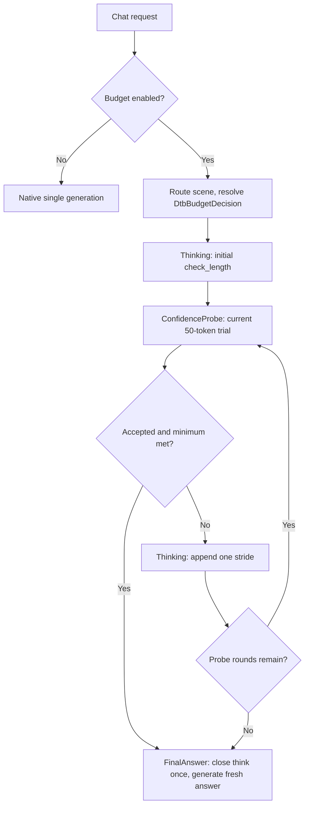

# CoTController 性能分析与优化设计

## 1. 目的与分析边界

本文分析 DEER 与 Think Budget 服务内控制器的端到端时延成本，目标是在质量约束下尽量降低“预算估算 + 置信度校验 + 多阶段调度”的额外耗时。

数据基线更新到 2026-07-27 的 v0.23.0 汇总、[`run_00`](../log/perf/run_00/RESULT.md)、
[`run_01`](../log/perf/run_01/RESULT.md) 和
[`run_02`](../log/perf/run_02/RESULT.md) 请求级 phase 数据；上游源码基线为
本地只读 checkout：vLLM `v0.23.0`（`0fc695f`）与 vLLM-Ascend
`v0.23.0rc1`（`f4a08bd`）。当前环境没有目标模型和推理设备，因此结论分为
“实测”“源码确定”“假设”。服务器端验证步骤见第 9 节。

## 2. 结论摘要

1. **run_02 首次在平均和 P95 上同时优于三次 Vanilla 均值。** Vanilla
   平均为 `65.3235 s/请求`，run_02 为 `44.7622 s`，改善 `31.48%`；
   P95 从 `79.5103 s` 降到 `67.7917 s`，改善 `14.74%`。相对唯一保存明细
   的 Vanilla，14/16 个 paired 请求更快。
2. **收益来自更早接受，不是已知代码语义改动。** run_02 相比 run_01 少
   `36` 次 engine call，iterative wall 少 `305.42 s`，解释两轮 E2E 改善的
   约 `82.2%`。但两次测试参数与 cold-cache 口径不完整一致，且两 commit
   之间没有改变 average score 或接受状态机，必须先重复 run_02。
3. **可见思考仍是最大成本中心。** run_02 initial + iterative thinking
   wall 为 `492.89 s / 68.82% E2E`；阈值、首段和 stride 是主要算法优化变量。
4. **短 probe 仍有净收益。** 1650 个 hidden token 使可见思考相对全部走满
   3072 token 少 24064 token，净少 22414 个模型生成 token；不能直接取消。
5. **阈值存在可测空间，但必须绑定质量。** run_02 静态回放显示
   `prob_th=0.89` 可让 5 个请求更早接受，少走约 `95.24 s` 已观测 phase wall；
   较早 final 的真实时延、内容和语义质量尚未测量。
6. **工程优化上界较小。** prefill 占 E2E `10.28%`，排除首次 initial
   prefill 后的绝对上界为 `7.97%`；queue、decision、controller CPU 和客户端
   gap 均非主项。
7. **质量只完成结构检查。** `_SUMMARY.csv` 已修复“非空错误字符串计真”的
   聚合问题，run_00 正确显示为 `12.5%`；run_02 为 16/16 `Judge=True` 且
   final 全部自然 stop，但 `Judge` 只评价 final JSON 结构，语义正确率与非劣
   界仍未采集。

## 3. 成本模型

### 3.1 正确的端到端账本

对同一个样本，定义：

$$
T_{vanilla} \\
= T_{\text{http}} + T_{\text{queue}} + T_{\text{prefill(prompt)}} + T_{\text{decode(visible_baseline)}}
$$

$$
T_{controller} \\
= T_{\text{decision_cpu}} + Σ T_{\text{think_phase}} + Σ T_{\text{confidence_probe}} + T_{\text{final_answer}} + T_{\text{controller_cpu}}
$$

$$
净收益
= T_{vanilla} - T_{controller} \\
= \text{visible_tokens_saved} × TPOT - \text{controller_overhead}
$$

其中：

$$
T_{\text{confidence_probe}}
= {\text{queue}}
+ {\text{prefill(reasoning_prefix + probe_suffix)}}
+ {\text{decode(hidden_probe_tokens, with logprobs)}}
+ {\text{confidence_cpu}}
$$

`hidden_probe_tokens` 不应与对外可见的 thinking/final token 混在一起。对每次 probe 还应计算边际收益：

$$
{\text{probe_expected_gain}}
= P(本轮可停止)
× E(若停止可省的后续思考 token)
× TPOT
- {\text{probe_cost}}
$$

只有 `probe_expected_gain > 0` 才值得做本轮校验。

### 3.2 当前汇总的盈亏平衡

最新同日汇总来自 [`docs/log/test_results/_SUMMARY.csv`](../log/test_results/_SUMMARY.csv)：

| 指标 | Vanilla 新基线（3 次均值） | run_01 | run_02 | run_02 相对 Vanilla |
|---|---:|---:|---:|---:|
| 样本数 | 16 | 16 | 16 | — |
| 平均时延 | 65.3235 s | 67.9792 s | **44.7622 s** | **-20.5613 s / -31.48%** |
| 时延 Q1 | 56.2285 s | 54.9850 s | **32.5439 s** | **-42.12%** |
| 时延中位数 | 66.0511 s | 66.7248 s | **39.7866 s** | **-39.76%** |
| 时延 P95 | 79.5103 s | 94.4605 s | **67.7917 s** | **-14.74%** |
| 平均可见 token | 4526.21 | 2579.25 | **2015.06** | **-55.48%** |
| 总可见 token/次 | 72419.33 | 41268 | **32241** | **-55.48%** |
| final JSON 结构正确率 | 100%（1 次明细） | 100% | 100% | 0 |

**聚合实测：** 三次 Vanilla 的平均时延范围为
`63.1573–67.2567 s/请求`。run_02 不仅优于三次均值，也低于其中最快一次；
但 Vanilla 轮次与 run_02 没有完全一致的 sampling/cache manifest，因此它是
强相关证据，不是严格代码因果。

**配对实测：** 当前保存的一次 Vanilla 明细
`vanilla_..._09-27-57.csv` 与 run_02 在规范化 CRLF/LF 后，16 个 QA_ID 的
问题和参考答案逐条一致；run_02 有 14/16 更快，paired delta 平均
`-20.7944 s`、中位数 `-22.4341 s`。两个退化请求均在第 4 轮才接受。

**数据质量实测：** `_SUMMARY.csv` 已改为只把字面量 `True` 计作结构通过；
run_00 从错误的 `1.0` 修正为 `0.125`。另两次无明细 Vanilla 的 `1.0`
仍只能作为汇总值，无法从逐请求文件复核。

**证据边界：** 另外两次 Vanilla 仅有汇总，所有 Vanilla 轮次都没有 phase
数据。sampling params、seed、warmup 和 cache 初态也未采集，不能把差值视为
严格代码因果。

### 3.3 run_00 请求级归因

[`run_00/RESULT.md`](../log/perf/run_00/RESULT.md) 保存完整分析。关键账本如下：

| Phase | 调用数 | wall | 客户端 E2E 占比 | decode | 生成 token |
|---|---:|---:|---:|---:|---:|
| initial_think | 16 | 164.44 s | 5.55% | 128.17 s | 6066 |
| iterative_think | 63 | 211.35 s | 7.13% | 150.26 s | 6212 |
| confidence_probe | 63 | **1922.17 s** | **64.85%** | **1864.57 s** | **74871** |
| final_answer | 16 | 664.05 s | 22.40% | 649.99 s | 27188 |

**实测：** phase wall 合计 2962.16 秒，客户端 E2E 合计 2964.20 秒，只差 2.04 秒。总模型生成量 114337 token，其中隐藏 probe 占 65.48%；同日 vanilla 可见生成量为 70096，因此 run_00 虽减少可见输出，真实生成量仍多 44241 token。

**采集边界：** before/after Prometheus 快照的进程启动时间不同，不能直接相减；after 的 158 call、591201 prompt、181248 cache hit、114337 generated 与 phase JSONL 完全一致，只作为绝对计数交叉校验。质量分和服务器源码 SHA 未采集。

### 3.4 run_01 请求级归因

[`run_01/RESULT.md`](../log/perf/run_01/RESULT.md) 保存完整计算和实验方案。
关键账本如下：

| Phase | 调用数 | wall | 客户端 E2E 占比 | prefill | decode | 生成 token |
|---|---:|---:|---:|---:|---:|---:|
| initial_think | 16 | 355.32 s | 32.67% | 17.50 s | 332.25 s | 16384 |
| iterative_think | 37 | 476.93 s | **43.85%** | 27.50 s | 446.26 s | 18439 |
| confidence_probe | 49 | 107.38 s | 9.87% | 44.25 s | 58.11 s | 2401 |
| final_answer | 16 | 145.97 s | 13.42% | 12.14 s | 132.63 s | 6450 |

**实测：** phase 解释客户端 E2E 的 99.8177%；同进程 metrics 的 call、
prompt 和 generated counter delta 与 phase 完全一致。run_01 相比 run_00
少生成 70663 个 engine token，但 visible thinking 增加 22545，成本中心已
由 hidden probe 转到固定思考预算。

**实测：** 12/16 个请求在 1–4 轮 probe 内接受，4 个走满；50-token probe
成本为 2401 hidden token，却相对“所有请求都走满 3072 thinking token”
少生成 14329 visible token，当前不应直接取消。

### 3.5 run_02 请求级归因

[`run_02/RESULT.md`](../log/perf/run_02/RESULT.md) 保存完整账本、配对结果和
离线回放：

| Phase | 调用数 | wall | 客户端 E2E 占比 | prefill | decode | 生成 token |
|---|---:|---:|---:|---:|---:|---:|
| initial_think | 16 | 321.39 s | 44.87% | 16.50 s | 300.43 s | 16384 |
| iterative_think | 17 | 171.51 s | 23.95% | 12.52 s | 156.82 s | 8704 |
| confidence_probe | 33 | 79.98 s | 11.17% | 32.91 s | 43.74 s | 1650 |
| final_answer | 16 | 141.23 s | 19.72% | 11.67 s | 127.85 s | 7153 |

**实测：** phase 解释客户端 E2E 的 `99.7198%`；同进程 Prometheus 的
82 次 engine call、370399 prompt token、33891 generated token 和 150528
cached token 与 phase 精确一致。run_02 相比 run_01 的 iterative 调用从
37 降到 17，iterative wall 降 `64.04%`，是两轮差异的主因。

**实测：** 16 个请求接受轮次分布为 `8/2/3/3`；33 个 probe 全部使用
`average_fallback`。启用 Value-Min 的反事实 raw score 后，16 个实际接受
probe 中只有 2 个仍能达到 `0.90`，在获得语义收益证据前不应启用。

**源码确定：** 16/16 effective decision branch 都是 fixed，预算字段来源与
请求 override 一致；但 task classifier 扫描完整 prompt，固定说明中的
“classify actions” 会让全部请求被标记为 classification。fixed branch 下不
影响本轮预算；动态预算实验前必须先只分类真实任务区段并增加黄金测试。

## 4. 当前执行路径与成本放大器

### 4.1 DEER 调用次数

[`deer/state.py`](../../deer/state.py) 中初始思考、每轮增量思考、每轮 trial answer 和最终答案都会单独调用 `engine_client.generate()`。若有 `k` 次置信度校验且思考没有自然闭合：

```text
generate_calls = 1 initial + k rethink + k probe + 1 final = 2k + 2
hidden_probe_tokens <= k × trial_answer_length
```

[`deer_confidence.txt`](../log/deer_confidence.txt) 记录了 4 次校验后置信度达到阈值（0.8710、0.7653、0.8738、0.9696）。对应典型路径是 10 次 `generate()`，其中 4 个 trial answer 对客户端不可见。前三次校验在事后看都没有产生早停收益。

Python 的 `_calculate_average_max_prob_from_logprobs()` 只遍历最多几十个 token。它存在 `torch.tensor()` 逐 token 分配等微优化空间，但与额外模型 decode 相比不是主矛盾。

### 4.2 Think Budget 的隐藏成本边界

裁决后实现不再使用任务预算中的 legacy `check_answer_len`。所有
confidence probe 由 `DtbAlgorithmPolicy` 固定为最多 50 token，并通过
`hidden_probe_tokens` 单独记账。任务预算只决定 `BudgetVector` 的首段、
最小思考、轮数和 stride。

当前实现边界：

- `hard_think_token_limit` 只约束可见思考；隐藏 probe 仍需按
  `probe_round × 实际 trial token` 单列，不能并入外部 completion usage。
- `max_internal_calls` 默认 20，并在可选 think/probe 前为 final 保留调用
  槽位；它与 50-token policy 共同限制隐藏调用，但不等于总 token 预算。
- v0.23.0 serving 补丁在入口检查 `BUDGET_ENABLED`；关闭时应走原生单次
  生成，仍需服务器验证 stream/non-stream bypass。
- safety 默认关闭；触发时只提前进入新鲜 FinalAnswer，不做时间放大或候选
  fallback。
- `min_think_budget` 仍在 probe 决策时门控；若模型没有提前输出
  `</think>`，首段小于 minimum 时可能先产生一次不能按分数接受的 probe。
  该额外成本要用服务器 phase 账本量化。
- DELTA/FINAL_ONLY/CUMULATIVE trial 已按明确 output kind 聚合完整文本、
  token ids 和 logprob 位置；不存在 candidate/answer-list 复用路径。

因此“思考硬预算”和“真实总模型工作量”仍是两个口径，但所有隐藏工作现在
都有固定单次上限和独立 phase 账本。

### 4.3 重复 prefill：存在，但不应夸大

新 phase 使用新 `request_id`，所以它确实是一个新的 scheduler 请求，并产生新的排队、输出处理和 phase 边界。另一方面，vLLM v0.20.2 scheduler 会对新请求调用 `kv_cache_manager.get_computed_blocks(request)`；开启 prefix caching 时，完整的共同 prefix block 可被复用。

[`docs/log/API_simulations/mtp_off.txt`](../log/API_simulations/mtp_off.txt) 中已有一次更直接的打点：

| 项目 | 数值 |
|---|---:|
| E2E | 202495.11 ms |
| 10 个 thinking segment 的 prefill | 4308.10 ms / 2.13% |
| 9 个 confidence branch 的 prefill | 3484.74 ms / 1.72% |
| 已打点 prefill 合计 | 7792.84 ms / 3.85% |

这份样本没有分解最终答案 prefill，也没有给出各分支生成 token，不能据此断言所有场景都只有 3.85%；但它足以否定“只优化 KV 就能解决 202 秒 E2E”的判断。

## 5. 优化优先级

### 当前 DTB 工程项（2026-09-07）：累计复制与诊断按需计算

**源码确定：** `generation_states.py::consume_output()` 的 DELTA 收集已改为独占 token
列表追加和文本片段末尾合并，消除每个 delta 重建历史 token 列表的累计复制。streaming
token-stop 不再维护无消费者的 raw 全文/token 历史；legacy non-streaming DELTA 仍保留
raw 前缀，并只在边界对齐时合并文本。CUMULATIVE/FINAL_ONLY 继续使用最后快照，已透传
delta 与引擎输入快照不共享可变累计列表。trial 文本也改为片段合并。

`assess_trial_confidence()` 保持默认完整诊断接口，生产状态机仅在 phase recorder 存在时
请求完整诊断。无 phase 且 Value-Min 关闭时跳过 Value 过滤/排序；无 phase 时不计算
perplexity，未计算字段使用 `None`。Value-Min 或 phase 所需的 Value 过滤只执行一次，
保留原排序和求和顺序。平均置信度的缺失值分母、Value-Min fallback、fail-open、minimum
门控、阈值比较、50-token probe、final cue、预算/调用数和 policy version 均未修改；
phase 的原有反事实 `value_min_raw` 和 pair count 继续保留。

**本地实测：** 新增 54 项等价性/所有权测试，全量 **319 tests / 1966 subtests 通过**；
`compileall` 与改动文件 `git diff --check` 通过。首次全量运行的 3 个 parser 子进程因
Windows stdin 句柄无效未启动；为测试进程绑定有效 NUL stdin 后原断言与完整套件通过，
没有修改或跳过这些测试。

本地 Windows/Python 3.14 CPU 微基准对照 `84eac7e` 的真实 `consume_output()` 与当前
实现：每个 DELTA 为 `text="x", token_ids=[42]`，末个 delta 为 length terminal，使用
无模型 context、关闭 phase；计时包括收集与入队，不包括 fixture 构造和出队核对。五次
配对运行取中位数，逐条 text/IDs/finish/stop 与累计结果均完全一致：

| 单 child DELTA 数 | 优化前 | 优化后 |
|---:|---:|---:|
| 1,000 | 9.33 ms | 5.97 ms |
| 4,000 | 49.06 ms | 24.88 ms |
| 16,000 | 378.04 ms | 126.69 ms |

这是收集器 CPU 诊断，不是目标服务器 E2E。deferred 自然短路径不经过该 thinking
收集器，较短 stride 下收益更小；本次没有修改 observer、队列、scene 路由或采样参数。

### 当前 Agent 前置项（2026-09-04）：取消完整输入 decode

在最低介入值机制实施前，先独立完成
[DTB 输入去 decode 与 Token ID 权威续写](../design/dtb_token_authoritative_prompt.md)。
详细输入、状态机和兼容性契约放在该设计文档，本文保留性能判断与后续实测记录。

**源码确定**：serving 已提供规范化 conversation 和可选 `prompt_components.text`；
重构前 controller 在选取最新 user 分类文本之前仍完整 decode 输入，context 还持续维护可变全文镜像。
本地实现已复用已有文本做一次轻量选取，缺文本时显式标记 `missing`，不再 decode 兜底；续写及
子请求只以 Token ID 为准，已有全文仅保留不可变快照用于诊断和外部可选响应字段。

这项重构可移除重复输入 decode 和长字符串拼接，不能消除 eager 模式的 stop+fresh-final、
重复 prefill 或模型输出 detokenize。新增 token 快照复制的成本也须计入；净收益尚未实测。
旧版 `decision.total` 不包含入口完整 decode，新版保持只计 resolver；新增
`DTB_REQUEST_SUMMARY.modules.controller.entry_to_first_submit` 单独测入口到首次提交 wall。
这是包含决策、context/token 快照和异步等待的重叠区间，不能当纯 CPU，也不能与 phase wall
相加。先固定 eager 做协议/质量/性能配对，再实施最低介入值；本地通过不代表服务器收益。

以下 P0—P3 保留原 run_02 场景级分析的历史优先级；不能据此把 Agent 长输入短思考下的输入
处理成本判断为已测可忽略，也不能将历史场景收益外推为 Agent task wall 改善。

### P0：重复 run_02，并建立语义质量门

run_02 与已保存明细的新 Vanilla 均为 16/16 `Judge=True`，但尚未证明诊断
规划语义非劣，也没有足够重复排除生成轨迹波动。先完全复用 run_02 payload、
到达顺序、并发 4 和 cold cache 再重复至少 2 次；每轮保存客户端明细、
metrics、phase 与 manifest。固定 seed（若后端支持）并预先声明语义质量非劣
界。`_SUMMARY.csv` 的字面量 True 聚合已修复。

### P1：先校准置信度阈值

保持 `check=1024 / stride=512 / rounds=4 / probe=50`，做单变量
`0.90 → 0.89 → 0.88 → 0.875`；`0.85` 只作为探索下界。run_02 轨迹静态回放：

| prob_th | 改变请求 | 静态少走 phase wall | 少生成 visible think | 少生成后续 probe |
|---:|---:|---:|---:|---:|
| 0.89 | 5 | 95.24 s | 4096 | 400 |
| 0.88 | 5 | 120.09 s | 5120 | 500 |
| 0.875 | 5 | 132.43 s | 5632 | 550 |
| 0.85 | 7 | 182.25 s | 7680 | 750 |

这些不是已测收益；阈值改变 final prompt 和答案，必须按相同 QA_ID 做质量/E2E
配对。

### P1：再缩减可见思考预算

分别测试 `check_length=512`、`think_stride=256`、`num_thinking=3`，不要一开始
做全因子。run_02 只有 3 个请求到达 round 4；若轮数改为 3，已观测路径最多
少走 3 次 round-4 probe，wall 合计 `5.95 s / 0.83% E2E`，优先级低。首段
和 stride 减半的静态 decode 上界约为 `150.2 s` 和 `78.4 s`，但更可能改变
质量与接受轮次，且两个上界不能相加。

`fixed_num_thinking=4` 全失败时的最大思考量实际是
`1024 + 4×512 = 3072`；`fixed_budget_tokens=10000` 不绑定，只是硬上限。
切换 task/difficulty/history 动态预算前，必须先修复完整 prompt 引起的
classification 误判，不能直接移除 fixed overrides 做性能对照。

### P2：保持语义的 APC / resumable

run_02 prefill 合计 `73.61 s / 10.28% E2E`；排除首次 initial prefill 后，
所有后续 prefill 的绝对上界为 `57.11 s / 7.97%`。phase cached token 与
Prometheus 本轮精确一致，旧 run_01 的 1536-token 口径缺口不再阻塞分析。

做并发 1/4 对照后，只有增长前缀仍有稳定缺口时，才在 DEER 验证“主思考链
resumable、probe 独立分支”的方案；不能改变 token 序列、采样状态、取消语义
或原生 priority/LoRA/trace/DP 上下文。

### P3：暂缓普通 Python 与调度微优化

queue、decision、phase residual 加客户端 gap 的量级不足以解释当前时延。
除非 CPU profiler 给出新证据，不优先改 JSON 序列化、对象复制、置信度
arithmetic、producer queue 或 `max_num_seqs`。50-token probe 已产生净 token
收益，也不应作为当前第一缩减变量。

## 6. 重构后的控制器接口

### 6.1 核心数据结构

当前生产入口是 `dtb.request_controller.DtbRequestController`。核心值对象为：

- `DtbAlgorithmConfig`：一次请求的状态机配置；
- `ThinkingBudget`：check/min/round/stride 四维生成限制；
- `DtbBudgetDecision`：scene、分支、预算、置信度、来源和 hard limit；
- `DtbRequestContext`：原生 vLLM 调用上下文、请求输入和可选观测器；
- `DtbRequestState`：状态机进度以及 thinking/probe/final/call 的唯一模型工作账本。

`model.py`、`plan.py`、`planner.py`、`executor.py` 这类容易和 vLLM 或通用调度概念冲突的
弱命名不进入生产结构。telemetry 不维护第二个 `BudgetLedger`。

### 6.2 内部接口

职责边界固定为：

```text
integration/vllm  原生 request/response/parser 契约
request_controller 请求编排、配置装配和生命周期
budgeting          scene、difficulty、history 的预算解析
reasoning          三状态生成、parser boundary、唯一工作账本
history            scene 历史存储与预算策略
observability      可选 phase/stream audit，不参与算法裁决
```

所有 child `generate()` 由 `DtbRequestContext.engine_request_kwargs()` 透传 priority、LoRA、
trace headers、DP rank 和 reasoning/parser 上下文。phase metrics 只在 recorder 非空时读取
`RequestOutput.metrics`；关闭态不构造 phase record，也不执行计时和 metrics 反射。

### 6.3 目标流程



## 7. 一致性与风险检查

- **流式/非流式**：内部 phase 使用 DELTA 或 FINAL_ONLY 时，token、text、logprobs 的聚合语义必须一致；不能只保存最后一个 delta。
- **取消**：客户端断开要中止当前 child request，并保证 parent 不再提交后续 phase。
- **错误**：orchestrator 不能只记日志后返回一个看似成功的空 200；错误应转换为 OpenAI error response。
- **预算**：所有 thinking、hidden probe、final token 和 child 调用都进入 `DtbRequestState`；任何路径都不能绕过上限。
- **质量**：减少 probe 或调整预算必须同时报告任务正确率/完整性，不能只比较时延。
- **公平性**：同一 parent 的 priority、DP rank、LoRA、采样参数和 tracing 上下文保持一致。
- **指标**：Prometheus 低基数标签只用 `phase`/`variant`，不要把 request_id 放进 metric label；request_id 只进入 JSONL/trace。

## 8. Agent 可读的性能产物

每次服务器实验建立：

```text
docs/log/perf/<run_id>/
├── manifest.json
├── extraction_manifest.json
├── request_index.csv
├── test_results/
│   ├── _SUMMARY.csv
│   └── <具体结果文件>.csv
├── extracted/
│   └── <具体结果文件名去扩展名>/
│       ├── requests.jsonl
│       ├── controller_phases.jsonl
│       └── phase_summary.csv
├── metrics.before.prom
├── metrics.after.prom
├── server.log
├── torch_profile/ or ascend_profile/
└── RESULT.md
```

`server.log` 固定在 run 根目录。`_SUMMARY.csv` 与结果 CSV 可以在根目录，也可以在
`test_results/` 等子目录；提取时递归搜索整个 run，但每个文件名必须唯一。顺序执行
多个数据集且中间复用同一服务做 Judge 时，目录边界不依赖两轮之间的等待时长。

`manifest.json` 至少记录：TB commit、该 commit 中
`patches/vllm/v0.23.0/dtb_serving.patch` 与 `qwen3_coder_parser.patch` 的 hash、
vLLM/vLLM-Ascend/torch/torch-npu/CANN 版本、模型与 tokenizer revision、
完整启动命令、设备、TP/DP、`max_num_seqs`、prefix cache、MTP 参数、
DTB policy/YAML hash、observability mode、experiment role、数据集 hash、并发和随机种子。
三个仓库的 dirty 状态不作为当前实验身份字段。

从 [`manifest.template.json`](../log/perf/manifest.template.json) 复制到
`docs/log/perf/<run_id>/manifest.json` 后填写。模板保留当前优化阶段固定的
vLLM、vLLM-Ascend、CANN、运行时、硬件、模型路径和服务启动基线；每轮仍须
确认 TB commit、控制参数、采样参数和 metrics 进程连续性。任何固定环境变化
必须写入 `baseline_overrides`。

`controller_phases.jsonl` 每行一个 phase，重构后格式为：

```json
{"schema":3,"parent_request_id":"chatcmpl-x","child_request_id":"chatcmpl-x_confidence_probe_2","variant":"dtb","policy_version":"dtb-algorithm-v4","phase":"confidence_probe","round":2,"wall_ms":912.4,"queue_ms":3.1,"prefill_ms":381.5,"decode_ms":524.0,"controller_cpu_ms":3.8,"prompt_tokens":3584,"cached_prompt_tokens":3456,"generated_tokens":50,"visible":false,"confidence":0.7653,"accepted":false,"confidence_method":"average_fallback","average_confidence":0.7653,"value_min_raw":null,"pair_count":50,"value_pair_count":38,"accept_reason":"below_threshold","stop_reason":"length"}
```

生产写端只在 `OBSERVABILITY.mode: "phase"` 时通过后台有界队列写单行 JSON；请求协程
不执行 JSON 序列化或同步 flush。不要记录完整 prompt、答案或逐 token 事件。

## 9. 服务器 profiling runbook

### 9.1 第一级：正式关闭态 run 与独立 phase 账本 run

1. 从 [`manifest.template.json`](../log/perf/manifest.template.json) 复制本轮
   manifest，填写 TB commit、请求 overrides、工作负载与结果路径。固定的
   vLLM/vLLM-Ascend/CANN/torch/torch-npu、硬件、模型路径和启动脚本已经由
   模板及其 hash 归档；只有 `baseline_overrides` 非空时才重新采集对应环境
   证据。vLLM 侵入式修改以该 TB commit 中的版本化 patch 为准，不采集三个
   仓库的 dirty。

正式性能/质量 run 使用 `OBSERVABILITY.mode: "off"`，manifest 记录
`experiment_role=official_performance`；该 run 只采客户端 E2E/质量和服务 Prometheus，
不会产生 DTB phase。最小流程：

```bash
curl -s http://127.0.0.1:41016/metrics \
  > docs/log/perf/<run_id>/metrics.before.prom
# 发送端到端请求；不要执行 phase 提取
curl -s http://127.0.0.1:41016/metrics \
  > docs/log/perf/<run_id>/metrics.after.prom
```

需要裁决分支、hidden probe 和模型工作量时，使用相同 commit、数据、采样、并发、到达
节奏和 cache 状态，另启 `OBSERVABILITY.mode: "phase"` 服务并记录
`experiment_role=phase_audit`。完成 workload 后执行：

```bash
python tools/extract_dtb_phase_metrics.py docs/log/perf/<phase_run_id>/
```

phase run 的 telemetry 开销必须单列，不能用它的 E2E 替代关闭态正式性能结果。

固定基线发生变化时，才刷新模板引用的公共证据：

```bash
cat /usr/local/Ascend/ascend-toolkit/latest/aarch64-linux/ascend_toolkit_install.info \
  > docs/log/perf/cann.txt
python -m vllm.collect_env > docs/log/perf/<baseline_run>/collect_env.txt
python -m pip show vllm vllm-ascend torch torch-npu \
  > docs/log/perf/<baseline_run>/packages.txt
npu-smi info > docs/log/perf/<baseline_run>/npu_smi.txt
curl -s http://127.0.0.1:41016/version \
  > docs/log/perf/<baseline_run>/version.json
```

模型不是固定 revision checkout 时，至少记录 `readlink -f` 后的真实路径及 `config.json`、tokenizer 配置文件 hash。测试后先核对两份 metrics 的 `process_start_time_seconds`；不同则 counter delta 整体无效，不能选择性使用其中某些差值。

2. `phase` 模式对每个 phase 异步输出一条 `DTB_PHASE` schema 3。优先从最终
   `RequestOutput` 读取：

- `num_cached_tokens`；
- `metrics.queued_ts / scheduled_ts / first_token_ts / last_token_ts`；
- `len(output.token_ids)`、stop/finish reason。

这些字段可按 child request 分解 engine 侧 queue、首次调度至首 token、decode 的墙钟区间，而不是从 10 秒全局日志猜测。这里的“首次调度至首 token”不是纯 NPU kernel 时间；若要继续拆算子、图编译或同步开销，使用下一节 profiler。若 vLLM 关闭 stats 或字段缺失，JSON 写 `null`，不能伪装为 0 ms。

请求完成后从服务日志提取标准产物：

```bash
python tools/extract_dtb_phase_metrics.py docs/log/perf/<run_id>/
```

提取器固定读取 `<run_id>/server.log`，递归查找唯一 `_SUMMARY.csv`，再在同一 run
内解析 summary 引用的全部具体结果 CSV；明细必须包含 `request_id`。提取器用这些 ID 与
phase 事件的 `parent_request_id` 精确等值关联，并为每个具体结果文件生成独立的
`extracted/<result_stem>/controller_phases.jsonl`、`requests.jsonl` 和
`phase_summary.csv`。未出现在结果 CSV 中的旧请求和 Judge phase 只计入
`extraction_manifest.json.excluded_phase_records`，不进入任何被测目录。

`request_index.csv` 是逐客户端结果行的关联审计；首末匹配日志行用于确认顺序和发现
交错请求，不参与归属裁决，也不等于客户端 HTTP 测试的精确起止时间。原生路径未打印
该 request ID 时首末行允许为空；Vanilla 没有内部 phase 时允许生成空 phase 文件。
`requests.jsonl.accounted_phase_wall_ms` 是顺序 phase 的计量和，不等于客户端 HTTP
E2E，最终 E2E 仍读取原始结果 CSV。Judge 可以在每个数据集后复用同一服务运行，但
必须在下一数据集开始前完成；Judge 自身耗时不得写入被测客户端的 `耗时(s)` 字段。
服务器文件可能不会完整上传到 GitHub，因此应在服务器上先执行提取；至少回传
`extraction_manifest.json`、`request_index.csv`、每个结果的 `requests.jsonl` 与
`phase_summary.csv`，完整 `controller_phases.jsonl` 仍可按体积选择是否上传。

3. 请求结束后保存同一端口的 `/metrics`：

```bash
curl -s http://127.0.0.1:41016/metrics > metrics.after.prom
```

随后先比较前后快照的 `process_start_time_seconds`，再计算 counter delta。重点
指标：

```text
vllm:e2e_request_latency_seconds
vllm:request_queue_time_seconds
vllm:request_prefill_time_seconds
vllm:request_decode_time_seconds
vllm:request_prompt_tokens
vllm:request_generation_tokens
vllm:request_prefill_kv_computed_tokens
vllm:prefix_cache_queries / vllm:prefix_cache_hits
vllm:num_requests_running / vllm:num_requests_waiting
SpecDecoding accepted/drafted/acceptance metrics
```

Prometheus histogram是聚合值；请求级归因以 phase JSONL 为主，前后快照用于交叉校验总量。

### 9.2 第二级：Ascend 服务流程与算子 profile

日志出现 `acl_graph.py`，优先按 vLLM-Ascend 的 Service Profiling Guide 使用 Ascend PyTorch Profiler：

```bash
vllm serve <model> \
  <原启动参数> \
  --profiler-config '{"profiler":"torch","torch_profiler_dir":"./ascend_profile","torch_profiler_with_stack":false}'

curl -X POST http://127.0.0.1:8000/start_profile
# 只发送预热后的 1–3 个目标请求
curl -X POST http://127.0.0.1:8000/stop_profile
```

采集后执行：

```python
from torch_npu.profiler.profiler import analyse
analyse("./ascend_profile/<generated>_ascend_pt/")
```

回传给 Agent 时优先给这些已分析文件，而不是只给巨大 trace：

- `step_trace_time.csv`
- `operator_details.csv`
- `op_statistic.csv`
- `kernel_details.csv`
- `api_statistic.csv`
- `trace_view.json`（需要时间线时）

要看 Python/service 状态机而非算子时，使用 MS Service Profiler，将
`BudgetController.handle_request`、三个 state handle、
`AsyncLLM.add_request`、scheduler add/schedule、model runner execute 标为
symbol，导出 Chrome Trace + CSV。

Profiler 只对少量请求开启，且不与正式延迟数字混用；profile 本身会改变时延。

### 9.3 第三级：API Server CPU sampling

当 phase JSONL 显示 `controller_cpu_ms` 明显时，对 APIServer PID 做采样：

```bash
py-spy record --pid <APISERVER_PID> --format speedscope \
  --output apiserver.speedscope.json --duration 60
```

重点检查 tokenizer decode/encode、`deepcopy`、logprob 对象构造、history 统计、JSON/logging 和 asyncio queue。若 CPU 占比低，就停止做 Python 微优化。

## 10. 验收标准

主指标：

```text
paired_net_gain_ms = vanilla_e2e_ms - controller_e2e_ms
```

同时满足：

- 平均和 P95 `paired_net_gain_ms > 0`；
- 任务质量达到预先定义的非劣界；
- `hidden_probe_tokens`、`probe_rounds`、`generate_calls` 有硬上限且日志可审计；
- 总模型生成量必须包含 hidden probe；按三次 Vanilla 均值，run_02 净少约
  `2408.0 token/请求`，平均 E2E 改善 `20.5613 s/请求`，时延指标已达到
  单轮候选标准，但仍缺语义非劣和重复验证；
- 流式取消、非流式聚合、异常、超时和 DP/priority 透传测试通过；

## 11. 本轮实现与下一轮实验

### 11.1 当前实现与历史证据边界

2026-08-20 起，生产实现位于 `dtb/`：`DtbRequestController` 只做请求编排，
`DtbBudgetResolver` 输出 `DtbBudgetDecision`，`DtbStateMachine` 驱动 Thinking /
ConfidenceProbe / FinalAnswer，`DtbRequestState` 是模型工作量的唯一账本。配置只在启动时
校验加载；history 默认关闭；difficulty 保留但默认关闭，等待独立检视。

observability 默认为 `off`。关闭态不构造 recorder/writer，不调用计时、metrics 反射、
序列化、队列或 flush；`phase` 才写 `DTB_PHASE` schema 3 和
`DTB_REQUEST_SUMMARY`；`stream_audit` 只对 allowlisted request ID 写
`DTB_STREAM_AUDIT`，且不创建 phase recorder。启用模式会在请求协程中构造相应 record，
但写出只做 `put_nowait`；后台线程负责 JSON 和输出。队列丢事件会用标准错误日志限频告警，
phase audit 必须以零 dropped 验收。

版本化 `dtb_serving.patch` 保持 v0.23.0 route、DP 亲和性、priority、LoRA、trace headers、
prompt/reasoning parser context 与原生流/非流式 parser 契约；Qwen3-Coder parser 修复是同
目录内独立 patch，不复制进 DTB Python 包。

run_02 的 `TB_PHASE`、`TimingCollector` 和 `BudgetPlan` 是**重构前历史证据**，原始产物
保持不变并由新提取器兼容读取。它在目标 NPU 上验证了当时版本的字段来源、confidence
method/raw、pair count 与 `accept_reason`，不能直接证明重构后关闭态性能无影响。重构后的
接口、默认关闭路径和异常行为目前属于**源码确定/本地无模型测试**；真实性能必须按本章
off/phase 分离 runbook 重新测量。

### 11.2 run_02 已确认的结论

- **实测：** run_02 相比三次 Vanilla 均值，平均/P95 时延改善
  `31.48% / 14.74%`；相比保存的 Vanilla 明细，14/16 个 paired QA_ID
  更快。
- **实测：** run_02 相比 run_01 总 E2E 降 `34.15%`；iterative wall
  单项减少 `305.42 s`，约解释总改善的 `82.2%`。
- **实测：** thinking wall 占 E2E `68.82%`，probe wall 占 `11.17%`；
  threshold、initial check 和 stride 是优先变量。
- **实测：** 50-token probe 以 1650 hidden token 换回 24064 visible
  thinking token，净少 22414 个模型生成 token。
- **实测：** prefill 总上界为 `10.28%`，排除首次 initial 后为 `7.97%`；
  phase 与同进程 Prometheus 的 call、prompt、generated、cached token 全部
  精确一致。
- **实测：** run_02 为 16/16 `Judge=True` 且 final 全部自然 stop；仅证明
  JSON 结构正确，语义质量未评分。`_SUMMARY.csv` 的旧聚合缺陷已修复。
- **源码确定/证据边界：** run_01 到 run_02 的 TB 运行时代码没有改变
  average score 或接受状态机；34.15% 改善不能归因于 telemetry commit。
  random seed、精确到达节奏仍缺失，另两次 Vanilla 没有逐请求明细。

### 11.3 下一轮服务器测试

先使用完全相同的 run_02 payload、到达顺序、并发 4 和 cold cache 重复至少
2 次，确认当前候选可复现。之后使用相同 16 个 QA_ID、随机交错顺序运行每个
变体至少 3 次。第一批只做阈值单变量：

```text
T0 = prob_th 0.90
T1 = prob_th 0.89
T2 = prob_th 0.88
T3 = prob_th 0.875
T4 = prob_th 0.85（探索）
```

第二批以 T0 为控制，分别测试：

```text
B1 = check_length 512
B2 = think_stride 256
B3 = num_thinking 3
```

每个变体报告 paired E2E 平均/P50/P95、accept round、visible/hidden/final
token、phase wall/queue/prefill/decode、JSON 结构分和语义质量分。单变量通过
非劣界后再组合，不允许先组合阈值和预算导致无法归因。

另做三个工程/算法诊断：

1. 为每次 Vanilla 保存同口径客户端明细、请求参数、metrics 与 cache 初态；
2. 使用最新用户消息进行 scene 匹配，以 score+margin 拒识门替代双分类裁决；
   当前已从既有 16 个产品问题抽样建立黄金测试，收到 13 场景数据后补齐正负例；
3. 并发 1/4 对照 APC，再决定是否研究 resumable main chain。

### 11.4 继续固定 50-token probe

`trial_answer_length=50` 继续作为当前 `DtbAlgorithmPolicy` 不变量。run_02
的 33/33 probe 均以 length 结束，不能直接复用为平均约 447-token 的 final。
若未来重新做 probe 长度消融，必须建立新 policy version，并与
threshold/budget 实验分开。

## 12. 外部版本依据

- [vLLM v0.23.0 `AsyncLLM.generate()`](https://github.com/vllm-project/vllm/blob/v0.23.0/vllm/v1/engine/async_llm.py)
- [vLLM v0.23.0 chat completion serving](https://github.com/vllm-project/vllm/blob/v0.23.0/vllm/entrypoints/openai/chat_completion/serving.py)
- [vLLM v0.23.0 `RequestOutput`：metrics 与 `num_cached_tokens`](https://github.com/vllm-project/vllm/blob/v0.23.0/vllm/outputs.py)
- [vLLM v0.23.0 `RequestStateStats`：请求级时间戳字段](https://github.com/vllm-project/vllm/blob/v0.23.0/vllm/v1/metrics/stats.py)
- [vLLM v0.23.0 SamplingParams](https://github.com/vllm-project/vllm/blob/v0.23.0/vllm/sampling_params.py)
- [vLLM-Ascend Service Profiling Guide](https://docs.vllm.ai/projects/ascend/en/main/developer_guide/performance_and_debug/service_profiling_guide.html)

## 13. 变更记录

| 日期 | 变更 | 原因 |
|---|---|---|
| 2026-09-07 | 优化 DTB DELTA 累计复制及置信度无用计算；新增 54 项等价性测试，全量 319 tests / 1966 subtests 通过，细节见第 5 节 | 保持算法与 parser-facing 输出语义，保留 phase 诊断；仅有本地收集器 CPU 微基准，尚无服务器 E2E 收益结论 |
| 2026-09-07 | 更新 Agent 方案的短思考/长尾背景与介入阈值语义；短路径转发简化待最低介入值验收后再实验，parser 优化不列为当前重点；代理关闭 chunk 日志时跳过无效线程池提交，详见 `proxy/AGENTS.md` | 用户收敛优先级至校验成本与压缩收益的权衡；代理仅作小优化，本次无新增服务器时延结论 |
| 2026-09-04 | 完成 [输入去 decode 前置重构](../design/dtb_token_authoritative_prompt.md#61-本地实施结果2026-09-04)：一次提取 serving 文本、不可变初始快照、Token ID 续写及提交快照、外部 `return_prompt_text` 元数据适配；全量 229 tests / 1966 subtests 通过，三份未改动 patch 合并适用性检查通过 | 新增 81 个用例验证缺文本、off/phase、token-only/混合边界、probe、流式/非流式、取消和错误；`controller.entry_to_first_submit` 为重叠 wall 而非纯 CPU/额外 phase。尚无服务器性能证据，先固定 eager 配对，再推进最低介入值 |
| 2026-09-04 | 新增 Agent 前置优化入口，详细契约见 [输入去 decode 设计](../design/dtb_token_authoritative_prompt.md)：复用 serving 文本、取消运行时完整输入 decode、Token ID 权威续写及不可变文本快照；尚未实施 | 最低介入值前先独立去除重复输入处理；明确 `decision.total` 的计时缺口，避免与 stop+fresh-final 消除收益混算 |
| 2026-09-04 | [replay2 服务器重测验收](../log/perf/agent_tool_call_run04_paired_replay/run_server_04_token_stop/replay2/RESULT.md)：60/60 条 DTB 的实际公共 reasoning 与 pre-parser 正文逐字一致，48 个混合 terminal chunk 的 344 字符完整保留；未修复 parser 对同输入恰好丢失这 48 个尾段；120 次工具流协议通过，另补到 1 次纯 `[248058]` 自然边界 | terminal reasoning tail discard 定向缺陷可关闭；工具选择/缺参语义偏离不作为框架修复失败。短思考 audit run 不裁决时延，下一步冻结补丁做 9 场景端到端质量/性能验证；不把保真通过扩大为模型边界语义或所有 parser 路径通过 |
| 2026-09-04 | 新增独立 `qwen3_reasoning_parser.patch`，仅保留 stripped terminal end-ID delta 的 reasoning prefix；[离线修复验证](../log/perf/agent_tool_call_run04_paired_replay/run_server_04_token_stop/REASONING_TAIL_FIX.md) 84/84 通过，原生负对照重现 47 个真实丢字请求，工具结果保持不变 | 正式修复合法 token/text mismatch；不改变 include-stop 默认值、implicit tool、usage/stop 或 merge 行为。目标服务器/真实 tokenizer 完整 pytest 尚待执行，不能据此裁决性能或所有 parser 问题已修复 |
| 2026-09-04 | 审计 `915bec9` 的 [run_server_04_token_stop](../log/perf/agent_tool_call_run04_paired_replay/run_server_04_token_stop/RESULT.md)：120 次工具 JSON/terminal 协议检查通过，60 次整数 token-stop 生效，普通 split marker 不再触发旧编排异常；发现 47/60 次 DTB 的 boundary chunk 正文被 Qwen reasoning parser 丢弃，另有两侧各 1 次缺必填参数与 Vanilla 2 次未声明工具 | 工具协议通过不等于完整 parser 等价；优先修复 token-only 边界的正文保真、补 248058 线上覆盖与 Vanilla raw，再进入 9 场景质量/时延验收；本轮无 probe/长思考压缩，不作性能结论 |
| 2026-08-24 | run_11_fixed_v5 在量化增训权重的 5 个交叉场景完成 240 请求 phase 复验：4 个严格质量层、1 个一题容差层；完整模型生成量相对 run_08 同权重 Vanilla 降低 16.46%；用户补充确认候选为 TP8、Vanilla 为 TP4，跨 TP 的 68.04% phase-on E2E 不可裁决；v4 额度字段 240/240 闭合且无 2,048 cap | 停止 fixed 网格，创建 5 个 fixed_v5 + 8 个 fixed_v4 复验点的量化候选 YAML；先补协议回放，再统一 TP4 运行 telemetry-off Vanilla/自动全集正式排名并记录配置 SHA；跨方案价值先做开源/量化增训权重包 × Vanilla/DTB 的 2×2，对可用中间权重再做训练×量化×DTB 的 2×2×2 |
| 2026-08-24 | 完成 `dtb-algorithm-v4` 本地实现：serving 复用原生 `get_max_tokens()` 得到整个 assistant completion 总额度，parser-facing 可见 token 统一计数，hidden probe 不占外部额度，默认 2,048 final cap 删除；final phase 增加总额度、已用量、剩余额度和 `answer_limit` | 先以 run_11 两条截断和 run_10 48 条 no-final 做服务器协议验收；正式性能仍须 telemetry off，不能把本地无模型通过写成目标服务器已修复 |
| 2026-08-24 | run_11 在量化增训权重 fixed_v4 上验证 `dtb-algorithm-v3`：318 个 controller-forced final 均增加 24-token cue，空 final 为 0/633；相对 run_08 同权重 Vanilla 的 phase-on 微/宏 E2E 候选收益为 7.97%/9.33%，总模型生成量降低 13.52%；同时发现 NetQAD 单步少 2 题和两条 2,048-token final 截断 | cue 修复可以冻结；正式排名仍须 telemetry off。下一轮先让 final 遵循调用方剩余 completion budget并重放两条截断，再对 5 个交叉场景做有界 fixed_v5，不能用响应 token 替代包含 14,157 hidden probe token 的总工作量 |
| 2026-08-21 | `dtb-algorithm-v3` 将 `confidence_accepted` 的 fresh-final 裸 `</think>` 后缀替换为 run_10 已验证的 answer cue；probe、`budget_exhausted` 与模型原生边界保持原逻辑；run_11 使用量化增训权重的 13 场景全集与 fixed_v4 验收 | 修复量化增训权重在置信度接受后可能立即结束且无 final 的协议问题，并独立测量新增约 23 个 suffix token 对 E2E/prefill 的影响 |
| 2026-08-20 | 生产结构切换到 `dtb/` 和版本化 patch；删除 telemetry 双账本；观测改为默认 off、独立 phase audit 和 allowlisted stream audit；提取器新写 schema 3、兼容读历史 schema | 后续实验必须用关闭态给出正式 E2E，用同身份 phase run 完成分支与总工作量审计；历史 run 保持不可变 |
| 2026-08-19 | 闭环 DTB 流式工具调用故障：修复 reasoning 终止语义、stop-boundary text/token ID 对齐和 final child terminal 原样透传，并为固定 vLLM 版本提供 parser 分片修复 patch；保留默认关闭且关闭态不进入构造/I/O路径的独立工具流 telemetry | 大批量真实 replay 已验证目标故障；不再使用保守 XML 恢复或人工空 delta，`TB_PHASE` 性能 schema 保持独立 |
| 2026-08-13 | FinalAnswer 增加显式 `confidence_accepted` / `budget_exhausted` 原因；前者只补 `</think>`，后者追加固定限时提示；phase/request 提取保留该字段 | 对齐 DEER AnswerState 的两类最终生成 prompt，避免 trial 清理后从 `last_chunk.stop_reason` 错判路径 |
| 2026-08-03 | 按结果 CSV 的 `request_id` 隔离跨数据集 phase；提取命令收敛为单一 run 目录参数，固定读取根部 `server.log` 并递归发现唯一 summary 与全部结果 CSV | 适配数据集后复用同一服务做 Judge 的现有流程；一次实验的日志和客户端结果已同属一个 run，无需依赖 10 秒空档或重复传入可推导路径 |
| 2026-07-31 | 泛化运行时统一为 `scene → budget/reject`，删除 task type 分类、预算和动态注册；配置合并为 `SCENES`；phase schema 2 增加路由证据、拒识原因、有效预算、难度/history 与决策模块耗时 | 修复完整 prompt 污染和双分类概念冲突，为 13 场景 Vanilla/DTB/fixed 数据回传建立可解释的自动策略入口 |
| 2026-07-27 | 纳入 run_02 的 16 请求明细、98 条 phase、同进程 metrics 和完整 BudgetPlan/confidence 遥测；从模板生成 manifest；更新 Vanilla 与验收结论 | run_02 相对三次 Vanilla 均值平均/P95 改善 31.48%/14.74%，但主要来自无法归因于代码提交的更早接受，必须先重复并补语义质量门 |
| 2026-07-25 | 纳入三次新 Vanilla 汇总和一次 16 请求明细；纠正 run_01 相对 Vanilla 的结论；发现“正确率”把解析错误字符串计真的聚合缺陷；phase 增加 BudgetPlan 来源与置信度决策遥测；manifest 不再要求三个仓库 dirty | 三次基线均值显示 run_01 平均慢 4.07%、P95 慢 18.80%；结构质量只能按明细中的字面量 `True` 计数 |
| 2026-07-24 | 纳入 run_01 的 16 请求客户端明细、134 条 phase 和同进程 metrics；确认平均时延略优于 vanilla、P95 仍退化，成本中心由长 probe 转为可见思考；新增阈值/预算/APC 分级方案 | 重构后的 hidden probe 已降 96.79%，旧“先缩 probe”优先级不再适用 |
| 2026-07-24 | 将 manifest 模板移到 `docs/log/perf/` 作为优化阶段公共基线，固化 vLLM/vLLM-Ascend commit、CANN 9.0.1 和既有运行环境；补充逐轮 override/dirty/配置/完整性要求 | 避免每轮重复填固定环境，同时防止把固定版本误当成已确认的运行时源码与配置身份 |
| 2026-07-23 | 同步裁决后 adapter 重构：独立 AlgorithmConfig、三状态、固定 50-token 完整 trial collector、fail-open 和在线历史闭环；更新服务器实验口径 | 实现、默认参数和 probe 策略已变化，旧四状态/可配置 probe 消融描述不再适用 |
| 2026-07-21 | 纳入 run_00 请求级 phase、环境和客户端明细；确认 probe decode 主导、APC 增长前缀未命中、最后一轮死 probe 与 classification 误路由；补齐 manifest/RESULT | 用 158 个 engine call 的实测账本替代历史聚合假设，并明确下一轮的首改与采集缺口 |
| 2026-07-21 | 纳入 v0.23.0 最新 DTB 汇总；落地 phase ledger、浅拷贝/日志优化、v0.23.0 调用上下文透传、manifest 模板与日志提取工具 | 先获得隐藏 probe 与 child phase 的请求级证据，再对 2000–4000 token probe 做质量约束消融 |
| 2026-07-20 | 重写性能分析；建立完整成本模型、优化优先级和服务器 runbook | 校正早期文档对 scheduler slot、KV cache 和 MTP 因果的过度推断，并纳入新日志证据 |
