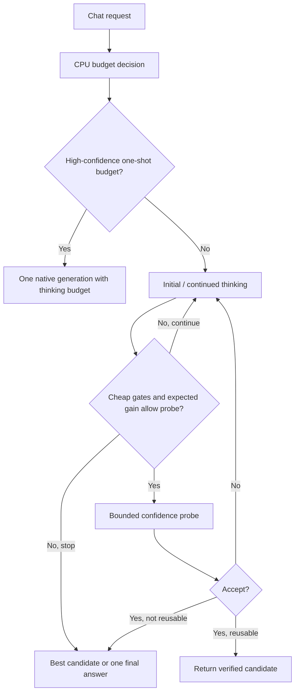

# CoTController 性能分析与优化设计

## 1. 目的与分析边界

本文分析 DEER 与 Think Budget 服务内控制器的端到端时延成本，目标是在质量约束下尽量降低“预算估算 + 置信度校验 + 多阶段调度”的额外耗时。

分析基线：2026-07-20，仓库 revision `43bf906e533d99ebb91b6d12509888175ddf496c`。当前环境没有 `/vllm-workspace/vllm`、目标模型和推理设备，因此结论分为“实测”“源码确定”“待验证假设”。服务器端验证步骤见第 9 节。

## 2. 结论摘要

1. **当前 DEER 没有达到时延盈亏平衡。** 16 个样本平均只减少 300.06 个可见 token（6.44%），平均时延却增加 24.48 秒（35.02%）。以 `baseline 总时延 / baseline 可见 token` 得到的 15.01 ms/token 作为偏乐观的 TPOT 上界，300 token 最多只值约 4.50 秒；当前控制器额外成本估计在 24.48–28.99 秒/请求之间。
2. **最贵的“置信度计算”不是 Python 中求几何平均，而是为求置信度额外生成一条 trial answer。** 若执行 `k` 次校验，常见路径有 `2k+2` 次独立 `generate()`。这些隐藏 token 不进入客户端 completion-token 统计。
3. **Think Budget 的风险比简化版 DEER 更大。** 任务类型预算把单次 `check_answer_len` 设为 2000–4000，轮次为 3–15；冷启动还可能给出 99 轮。试答 token 没有计入 `max_tokens_temp`，`api_call_count` 也没有实际更新，因此现有“总预算”不能约束控制器真实成本。
4. **先减少 probe 次数和 probe token，再优化 KV。** `mtp_off.txt` 的一个样本中，10 段思考与 9 个置信度分支的重复 prefill 合计 7.79 秒，只占 202.50 秒 E2E 的 3.85%。这证明重复 prefill 确实存在，但在该样本中不是最大项。
5. **“新 request_id 导致 KV 必然清零”和“一个外部请求同时占 N 个 scheduler slot”都不成立。** 状态机顺序等待每个 phase；开启 Automatic Prefix Caching 时，新请求可按内容复用完整 prefix block。真正应测的是每个子请求的 `num_cached_tokens` 和 prefill 时间。
6. **MTP 存在严重退化现象，但根因尚未闭环。** 4 并发日志中 `Running=4, Waiting=0` 时 acceptance 从 15.1% 降至 0%，生成吞吐约 5.6 token/s 并持续数分钟；`mtp_on.txt` 还出现大段 `!` 退化输出。需要 Controller × MTP 的 2×2 实验，不能仅凭时间相关性归因于状态切换。

## 3. 成本模型

### 3.1 正确的端到端账本

对同一个样本，定义：

```text
T_vanilla
= T_http + T_queue + T_prefill(prompt) + T_decode(visible_baseline)

T_controller
= T_decision_cpu
+ Σ T_think_phase
+ Σ T_confidence_probe
+ T_final_answer
+ T_controller_cpu

净收益
= T_vanilla - T_controller
= visible_tokens_saved × TPOT
- controller_overhead
```

其中：

```text
T_confidence_probe
= queue
+ prefill(reasoning_prefix + probe_suffix)
+ decode(hidden_probe_tokens, with logprobs)
+ confidence_cpu
```

`hidden_probe_tokens` 不应与对外可见的 thinking/final token 混在一起。对每次 probe 还应计算边际收益：

```text
probe_expected_gain
= P(本轮可停止)
× E(若停止可省的后续思考 token)
× TPOT
- probe_cost
```

只有 `probe_expected_gain > 0` 才值得做本轮校验。

### 3.2 当前汇总的盈亏平衡

数据来自 [`docs/log/test_results/_SUMMARY.csv`](../log/test_results/_SUMMARY.csv)：

| 指标 | Vanilla | DEER | 差值 |
|---|---:|---:|---:|
| 样本数 | 16 | 16 | — |
| 平均时延 | 69.9077 s | 94.3911 s | **+24.4834 s / +35.02%** |
| 时延中位数 | 69.9773 s | 93.1414 s | **+23.1641 s / +33.10%** |
| 时延 P95 | 84.0568 s | 110.2560 s | **+26.1992 s / +31.17%** |
| 平均可见 token | 4658.38 | 4358.31 | **-300.06 / -6.44%** |
| 总可见 token | 74534 | 69733 | **-4801** |

`1118.5239 s / 74534 token = 15.0069 ms/token` 包含 TTFT/prefill/固定开销，因此只能作为 TPOT 的偏乐观上界，而不是精确 TPOT。即便使用这个上界：

- 每请求 300.06 token 的最大收益约 `4.503 s`；
- 控制器额外成本约为 `24.483 + [0, 4.503] = 24.48–28.99 s/请求`；
- 若额外成本不变，至少要节省约 1932 token/请求才可能盈亏平衡，是当前节省量的 6.44 倍；
- 若保持当前 300-token 节省量，则额外成本必须压到 4.50 秒以下，真实目标还应更低。

## 4. 当前执行路径与成本放大器

### 4.1 DEER 调用次数

[`deer/state.py`](../../deer/state.py) 中初始思考、每轮增量思考、每轮 trial answer 和最终答案都会单独调用 `engine_client.generate()`。若有 `k` 次置信度校验且思考没有自然闭合：

```text
generate_calls = 1 initial + k rethink + k probe + 1 final = 2k + 2
hidden_probe_tokens <= k × trial_answer_length
```

[`deer_confidence.txt`](../log/deer_confidence.txt) 记录了 4 次校验后置信度达到阈值（0.8710、0.7653、0.8738、0.9696）。对应典型路径是 10 次 `generate()`，其中 4 个 trial answer 对客户端不可见。前三次校验在事后看都没有产生早停收益。

Python 的 `_calculate_average_max_prob_from_logprobs()` 只遍历最多几十个 token。它存在 `torch.tensor()` 逐 token 分配等微优化空间，但与额外模型 decode 相比不是主矛盾。

### 4.2 Think Budget 的无界隐藏成本

[`think_budget_vllm_adapter/optimizations/task_type_budget.py`](../../think_budget_vllm_adapter/optimizations/task_type_budget.py) 的任务类型默认值为：

| 任务类型 | 最大校验轮次 | 单次试答上限 |
|---|---:|---:|
| retrieval / classification | 3–4 | 2000 token |
| coding / math | 12–15 | 4000 token |
| reasoning / knowledge / planning / general | 6–8 | 3000 token |
| tool_call / fault_diagnosis | 8 | 4000 token |

同时存在以下实现缺口：

- `max_tokens_temp` 只扣减思考 token，不扣减 trial-answer token；最后一轮思考也没有 `min(remaining_budget, stride)`。
- `api_call_count` 只定义、不递增，因此不能形成 API/generate 次数安全门。
- `budget_disabled=True` 只让决策链返回几个关闭标志，仍然创建状态机并执行 probe，不是真正的 vanilla bypass。
- `enable_safety_gate` 默认关闭；即使触发，当前状态机也进入 `_AnswerState` 再做一次最终生成，并没有调用已导入的 `build_safety_fallback()`。
- `enable_soft_truncation` 对应的截断函数已定义但未调用，初始思考的分支只是 `pass`。
- `min_think_tokens` 在 trial answer 已生成之后才进入 `make_accept_decision()`；若思考长度不足，本次昂贵 probe 注定不能被接受。

这些问题说明“算法预算”与“真实服务成本预算”目前不是同一个量。

### 4.3 重复 prefill：存在，但不应夸大

新 phase 使用新 `request_id`，所以它确实是一个新的 scheduler 请求，并产生新的排队、输出处理和 phase 边界。另一方面，vLLM v0.20.2 scheduler 会对新请求调用 `kv_cache_manager.get_computed_blocks(request)`；开启 prefix caching 时，完整的共同 prefix block 可被复用。

[`docs/log/API_simulations/mtp_off.txt`](../log/API_simulations/mtp_off.txt) 中已有一次更直接的打点：

| 项目 | 数值 |
|---|---:|
| E2E | 202495.11 ms |
| 10 个 thinking segment 的 prefill | 4308.10 ms / 2.13% |
| 9 个 confidence branch 的 prefill | 3484.74 ms / 1.72% |
| 已打点 prefill 合计 | 7792.84 ms / 3.85% |

这份样本没有分解最终答案 prefill，也没有给出各分支生成 token，不能据此断言所有场景都只有 3.85%；但它足以否定“只优化 KV 就能解决 202 秒 E2E”的判断。

### 4.4 并发与 MTP：已知现象、未知因果

[`deer_throughoutput.txt`](../log/deer_throughoutput.txt) 在 4 个外部请求并发时显示：

- 10:07:03–10:08:43：`Running=4, Waiting=0`，MTP acceptance 逐步下降；
- 10:08:53：平均 draft acceptance 降至 15.1%；
- 10:09:03 起：acceptance 为 0%，generation throughput 约 5.6–5.9 token/s；
- 直到 10:13 左右仍是 `Running=4, Waiting=0`。

状态机对同一个外部请求是顺序 `await`：一个 phase 结束后才提交下一个 phase。因此 4 个外部请求通常对应 4 个活跃内部请求，不是 `4 × phase 数` 个同时运行请求。日志没有显示 `max_num_seqs` 排队饱和。

可成立的结论只有：MTP 在该并发、模型、prompt/输出形态下严重退化，且退化发生在部分请求进入迭代阶段附近。候选解释包括 phase prompt 分布变化、特定序列退化污染聚合指标、MTP/Ascend 图形状切换问题或版本缺陷；必须通过第 9 节 2×2 实验区分。

## 5. 优化优先级

### P0：先改变模型调用账本

#### 5.1 在 probe 前执行便宜门控

把以下检查放在创建 trial-answer 请求之前：

- `actual_len < min_think_tokens`：直接继续思考；
- 剩余可节省 token 的价值小于最近 probe 成本：跳过 probe 或直接结束；
- 达到 `max_probe_rounds`、`max_hidden_probe_tokens`、`max_controller_ms`、`max_generate_calls`：停止新增 probe；
- safety gate 触发且已有 candidate：直接使用最佳 candidate，不再生成 final。

这项改动不改变置信度公式，只消除“结果必然不能接受”的校验。

#### 5.2 把 trial answer 从 2000–4000 token 降为任务所需的最小 probe

建议先做 `64 / 128 / 256 / 当前值` 的质量—时延消融，而不是直接拍定单一值。工具调用和分类任务可使用受约束的短 JSON/标签；规划与代码任务可先生成摘要式 candidate，只有决定接受时再生成完整答案。

为避免 [`mtp_on.txt`](../log/API_simulations/mtp_on.txt) 中的大段重复 `!`，probe 还应有明确 stop 条件和重复输出保护。vLLM v0.20.2 已有 `repetition_detection` sampling 参数，可在目标模型上单独验证其质量影响。

#### 5.3 降低校验频率

当前策略是每个 stride 后都 probe。替代方案按风险从低到高排列：

1. 最低思考长度前不 probe；之后用指数/递增间隔，例如 128、256、512、1024。
2. 按历史 task type 学习首个 probe 位置与最多 probe 次数。
3. 在线维护 `probe_cost_ms`、早停命中率和预计剩余 token，只有预期净收益为正时 probe。
4. 若上游预算预测置信度高，直接走一次原生生成并使用 vLLM `thinking_token_budget`，仅把少量不确定请求送入多轮控制器。

`deer_confidence.txt` 的前三次置信度都未过阈值，是“推迟首个 probe”可能获益的直接样本，但需要更多请求验证。

#### 5.4 复用已经验过的 candidate

Think Budget 已经为 trial answer 计算完整评分，却在接受后进入 `_AnswerState` 再生成一次答案。对于短答案/工具调用，可直接把被接受 candidate 作为最终输出，消除一次 final prefill + decode，并保证“交付的答案就是被校验的答案”。

实现前要修复流式聚合：当前 `trial_chunk` 只保留最后一个 delta，不能代表完整 candidate。长规划/代码答案可保留重新生成路径，或采用“短 probe 决策 + 单次完整 final”的两级策略。

#### 5.5 建立真实成本预算与真 bypass

新增 `BudgetLedger`，统一扣减：

- visible thought token；
- hidden probe token；
- 每个 phase 的 queue/prefill/decode 时间；
- generate 调用次数；
- controller wall time。

`enable=false` / `budget_disabled=true` 必须在 serving 入口直接进入原生单次生成路径。否则既无法保证安全回退，也无法做可信 A/B。

### P1：降低调度与 KV 成本

#### 5.6 透传完整原生调用上下文并固定 DP 亲和性

当前 patch 在提取 `data_parallel_rank` 之前劫持请求；thought/final 还没有统一传递 `priority`。控制器应接收并在每个 phase 透传：

```text
priority, lora_request, trace_headers, data_parallel_rank,
prompt_text, reasoning_ended, reasoning_parser_kwargs
```

同一个 parent 的所有 phase 固定在同一 DP rank，才能稳定利用该 rank 的 prefix cache，也避免不同 phase 的优先级被改变。

#### 5.7 先测 APC，再决定是否做 resumable/streaming input

应记录每个子请求的 `RequestOutput.num_cached_tokens` 与 `request_prefill_kv_computed_tokens`。如果 probe/continue phase 的缓存命中已经很高，重构为 resumable 的收益可能小于复杂度。

vLLM v0.20.2 的 streaming input 能把同一 request 置于 `WAITING_FOR_STREAMING_REQ` 后续写并保留 session，但当前实现明确不支持 `FINAL_ONLY` 和 stop string。更重要的是，confidence probe 是从主思考链分叉、失败后需丢弃的分支；单一 resumable session 不能直接替代 KV fork。因此可行的研究方向是：

- 主思考链用 resumable session；
- probe 仍是独立分支并依赖 APC；
- 或改用不需要生成分支的 readiness/confidence 信号。

不要把 streaming input 当作可直接替换现有 `generate()` 的低风险修复。

#### 5.8 单独处理 MTP 交互

完成 2×2 实验后再选择：

- 若 vanilla 和 controller 都退化：优先解决模型/后端 MTP 问题；
- 若只有 controller+MTP 退化：缩短/约束 probe，检查图形状与 sampling/logprobs 组合；
- 若只有特定 probe 退化：将 probe 路由到无 MTP 的服务池，或在后端确有请求级开关时只关闭 probe 的 speculative decoding；
- 在原因不明前，不把“全局关闭 MTP”作为默认优化，因为它可能损失正常答案 decode 的收益。

### P2：Python 与对象管理微优化

这些改动低风险，但要在 P0 后评估：

- DEER 只需要 sampled-token logprob；vLLM 在 `logprobs=0` 时仍返回 sampled token，可替代 `logprobs=1`。长 probe 可评估 `flat_logprobs=True` 以降低 GC。
- 用 `math.exp(logprob)` 替代逐 token `torch.exp(torch.tensor(...)).item()`，并用 `next(iter(values))` 避免临时 list。
- trial prompt 使用浅拷贝 + 新 token list，避免 `copy.deepcopy(engine_prompt)`。
- 缓存 prompt 文本/think-tag 状态，不在每次校验时解码完整增长中的 prompt。
- 避免深拷贝完整 `RequestOutput` 只为插入 `</think>`；构造最小输出或让 stop string 按协议输出。
- 用结构化 logger 代替每轮 `print(..., flush=True)`；热路径日志不要逐 token flush。
- 将 producer/queue/orchestrator 合并为单一 async generator 可减少上下文切换和无界队列风险，但预期收益应由 CPU profile 证明。
- 初始对齐公式当前在 prompt 已是 128 倍数时仍额外加 128 token；若对齐确有必要，应验证是否改为 `(-prompt_len) % 128`，否则会无意增加 1–128 个思考 token。

## 6. 建议的控制器接口

### 6.1 核心数据结构

```python
@dataclass(frozen=True)
class EngineCallContext:
    parent_request_id: str
    priority: int
    lora_request: object | None
    trace_headers: dict | None
    data_parallel_rank: int | None
    prompt_text: str | None
    reasoning_ended: bool | None
    reasoning_parser_kwargs: dict | None

@dataclass
class BudgetLedger:
    visible_think_tokens: int = 0
    hidden_probe_tokens: int = 0
    generate_calls: int = 0
    controller_ms: float = 0.0
    probe_ms_ema: float = 0.0
    max_hidden_probe_tokens: int = 0
    max_generate_calls: int = 0
    deadline_ns: int = 0

@dataclass
class PhaseResult:
    phase: str
    round: int
    child_request_id: str
    output: object
    prompt_tokens: int
    cached_prompt_tokens: int
    generated_tokens: int
    queue_ms: float
    prefill_ms: float
    decode_ms: float
    wall_ms: float
```

### 6.2 内部接口

```python
async def generate_phase(
    call_ctx: EngineCallContext,
    ledger: BudgetLedger,
    phase: str,
    round_id: int,
    prompt,
    sampling_params,
    *,
    visible: bool,
) -> PhaseResult:
    """统一透传 engine kwargs、收集 metrics、更新成本账本并输出一条 JSONL。"""

def should_probe(
    ledger: BudgetLedger,
    actual_think_tokens: int,
    predicted_remaining_tokens: int,
    stop_probability: float,
    tpot_ms: float,
) -> bool:
    """先过硬预算/最低思考门，再比较预期节省与 probe 成本。"""
```

### 6.3 目标流程



## 7. 一致性与风险检查

- **流式/非流式**：内部 phase 使用 DELTA 或 FINAL_ONLY 时，token、text、logprobs 的聚合语义必须一致；不能只保存最后一个 delta。
- **取消**：客户端断开要中止当前 child request，并保证 parent 不再提交后续 phase。
- **错误**：orchestrator 不能只记日志后返回一个看似成功的空 200；错误应转换为 OpenAI error response。
- **预算**：所有隐藏 token 和 final 之外的模型调用都进入 ledger；任何路径都不能绕过上限。
- **质量**：减少 probe 或复用 candidate 必须同时报告任务正确率/完整性，不能只比较时延。
- **公平性**：同一 parent 的 priority、DP rank、LoRA、采样参数和 tracing 上下文保持一致。
- **指标**：Prometheus 低基数标签只用 `phase`/`variant`，不要把 request_id 放进 metric label；request_id 只进入 JSONL/trace。

## 8. Agent 可读的性能产物

每次服务器实验建立：

```text
docs/log/perf/<run_id>/
├── manifest.json
├── requests.jsonl
├── controller_phases.jsonl
├── phase_summary.csv
├── metrics.before.prom
├── metrics.after.prom
├── server.log
├── quality_summary.csv
├── torch_profile/ or ascend_profile/
└── RESULT.md
```

`manifest.json` 至少记录：commit、dirty diff hash、vLLM/vLLM-Ascend/torch/torch-npu/CANN 版本、模型与 tokenizer revision、完整启动命令、设备、TP/DP、`max_num_seqs`、prefix cache、MTP 参数、数据集 hash、并发和随机种子。

`controller_phases.jsonl` 每行一个 phase，推荐格式：

```json
{"schema":1,"parent_request_id":"chatcmpl-x","child_request_id":"chatcmpl-x_probe_2","variant":"deer","phase":"confidence_probe","round":2,"wall_ms":912.4,"queue_ms":3.1,"prefill_ms":381.5,"decode_ms":524.0,"controller_cpu_ms":3.8,"prompt_tokens":3584,"cached_prompt_tokens":3456,"generated_tokens":50,"visible":false,"confidence":0.7653,"accepted":false,"stop_reason":"length"}
```

写单行 JSON，时间用 `time.perf_counter_ns()`，不要把完整 prompt、答案或逐 token 事件写入热路径。

## 9. 服务器 profiling runbook

### 9.1 第一级：低开销、每次实验必做

1. 保存环境与启动参数：

```bash
python -m vllm.collect_env > collect_env.txt
python -m pip show vllm vllm-ascend torch torch-npu > packages.txt
npu-smi info > npu_smi.txt
curl -s http://127.0.0.1:8000/version > version.json
curl -s http://127.0.0.1:8000/metrics > metrics.before.prom
```

2. 在 `generate_phase()` 统一打 phase JSONL。优先从最终 `RequestOutput` 读取：

- `num_cached_tokens`；
- `metrics.queued_ts / scheduled_ts / first_token_ts / last_token_ts`；
- `len(output.token_ids)`、stop/finish reason。

这些字段可按 child request 分解 engine 侧 queue、首次调度至首 token、decode 的墙钟区间，而不是从 10 秒全局日志猜测。这里的“首次调度至首 token”不是纯 NPU kernel 时间；若要继续拆算子、图编译或同步开销，使用下一节 profiler。

3. 请求结束后保存 `/metrics`。重点指标：

```text
vllm:e2e_request_latency_seconds
vllm:request_queue_time_seconds
vllm:request_prefill_time_seconds
vllm:request_decode_time_seconds
vllm:request_prompt_tokens
vllm:request_generation_tokens
vllm:request_prefill_kv_computed_tokens
vllm:prefix_cache_queries / vllm:prefix_cache_hits
vllm:num_requests_running / vllm:num_requests_waiting
SpecDecoding accepted/drafted/acceptance metrics
```

Prometheus histogram是聚合值；请求级归因以 phase JSONL 为主，前后快照用于交叉校验总量。

### 9.2 第二级：Ascend 服务流程与算子 profile

日志出现 `acl_graph.py`，优先按 vLLM-Ascend 的 Service Profiling Guide 使用 Ascend PyTorch Profiler：

```bash
vllm serve <model> \
  <原启动参数> \
  --profiler-config '{"profiler":"torch","torch_profiler_dir":"./ascend_profile","torch_profiler_with_stack":false}'

curl -X POST http://127.0.0.1:8000/start_profile
# 只发送预热后的 1–3 个目标请求
curl -X POST http://127.0.0.1:8000/stop_profile
```

采集后执行：

```python
from torch_npu.profiler.profiler import analyse
analyse("./ascend_profile/<generated>_ascend_pt/")
```

回传给 Agent 时优先给这些已分析文件，而不是只给巨大 trace：

- `step_trace_time.csv`
- `operator_details.csv`
- `op_statistic.csv`
- `kernel_details.csv`
- `api_statistic.csv`
- `trace_view.json`（需要时间线时）

要看 Python/service 状态机而非算子时，使用 MS Service Profiler，将 `BudgetController.handle_request`、`generate_phase`、四个 state handle、`AsyncLLM.add_request`、scheduler add/schedule、model runner execute 标为 symbol，导出 Chrome Trace + CSV。

Profiler 只对少量请求开启，且不与正式延迟数字混用；profile 本身会改变时延。

### 9.3 第三级：API Server CPU sampling

当 phase JSONL 显示 `controller_cpu_ms` 明显时，对 APIServer PID 做采样：

```bash
py-spy record --pid <APISERVER_PID> --format speedscope \
  --output apiserver.speedscope.json --duration 60
```

重点检查 tokenizer decode/encode、`deepcopy`、logprob 对象构造、history 统计、JSON/logging 和 asyncio queue。若 CPU 占比低，就停止做 Python 微优化。

## 10. 最小实验矩阵

### 10.1 先闭环 MTP 因果

在同一服务构建、同一请求集上执行：

| 组 | Controller | MTP | 并发 |
|---|---|---|---:|
| A | Vanilla | Off | 1、4 |
| B | DEER | Off | 1、4 |
| C | Vanilla | On | 1、4 |
| D | DEER | On | 1、4 |

每组独立预热，固定 seed 和到达节奏；每个 case 至少 3 次重复，正式结论扩展到足够覆盖分位数的样本。报告 E2E/TTFT/TPOT、可见 token、隐藏 token、phase prefill/decode、MTP acceptance 和质量。

### 10.2 再做 P0 消融

在 MTP 原因可控后比较：

1. Vanilla。
2. 固定思考预算、无 probe（一次生成 fast path）。
3. 当前 DEER/Think Budget。
4. probe 前置 min-think gate。
5. gate + probe 长度 64/128/256。
6. gate + 递增 probe 间隔。
7. 可复用 candidate 时省略 final generation。

Think Budget 的 history 文件和缓存必须冻结或每组使用相同快照，否则动态预算会污染配对实验。`budget_disabled` 在修复前不能作为 vanilla 对照。

## 11. 验收标准

主指标：

```text
paired_net_gain_ms = vanilla_e2e_ms - controller_e2e_ms
```

同时满足：

- 平均和 P95 `paired_net_gain_ms > 0`；
- 任务质量达到预先定义的非劣界；
- `hidden_probe_tokens`、`probe_rounds`、`generate_calls` 有硬上限且日志可审计；
- 在当前约 300-token 节省量下，额外成本低于 4.50 秒/请求（这是偏宽松上界）；
- 流式取消、非流式聚合、异常、超时和 DP/priority 透传测试通过；
- Controller × MTP 的结果能排除或确认交互退化，不再依赖聚合日志猜因果。

## 12. 外部版本依据

- [vLLM v0.20.2 `AsyncLLM`：streaming input、resumable 与 profiler](https://github.com/vllm-project/vllm/blob/v0.20.2/vllm/v1/engine/async_llm.py)
- [vLLM v0.20.2 scheduler：prefix block 查询与 streaming session](https://github.com/vllm-project/vllm/blob/v0.20.2/vllm/v1/core/sched/scheduler.py)
- [vLLM v0.20.2 `RequestOutput`：metrics 与 `num_cached_tokens`](https://github.com/vllm-project/vllm/blob/v0.20.2/vllm/outputs.py)
- [vLLM v0.20.2 `RequestStateStats`：请求级时间戳字段](https://github.com/vllm-project/vllm/blob/v0.20.2/vllm/v1/metrics/stats.py)
- [vLLM v0.20.2 SamplingParams：logprobs=0、flat_logprobs、repetition_detection](https://github.com/vllm-project/vllm/blob/v0.20.2/vllm/sampling_params.py)
- [vLLM v0.20.2 Prometheus logger 指标](https://docs.vllm.ai/en/v0.20.2/api/vllm/v1/metrics/loggers/)
- [vLLM-Ascend Service Profiling Guide](https://docs.vllm.ai/projects/ascend/en/main/developer_guide/performance_and_debug/service_profiling_guide.html)

## 13. 变更记录

| 日期 | 变更 | 原因 |
|---|---|---|
| 2026-07-20 | 重写性能分析；建立完整成本模型、优化优先级和服务器 runbook | 校正早期文档对 scheduler slot、KV cache 和 MTP 因果的过度推断，并纳入新日志证据 |
