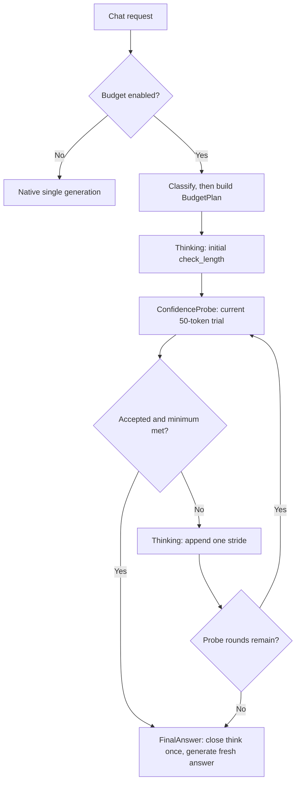

# CoTController 性能分析与优化设计

## 1. 目的与分析边界

本文分析 DEER 与 Think Budget 服务内控制器的端到端时延成本，目标是在质量约束下尽量降低“预算估算 + 置信度校验 + 多阶段调度”的额外耗时。

数据基线更新到 2026-07-21 的 v0.23.0 汇总和 [`run_00`](../log/perf/run_00/RESULT.md) 请求级 phase 数据；上游源码基线为本地只读 checkout：vLLM `v0.23.0`（`0fc695f`）与 vLLM-Ascend `v0.23.0rc1`（`f4a08bd`）。当前环境没有目标模型和推理设备，因此结论分为“实测”“源码确定”“待验证假设”。服务器端验证步骤见第 9 节。

## 2. 结论摘要

1. **最新 Think Budget 仍未达到时延盈亏平衡。** 16 个样本平均只减少 278.31 个可见 token（6.35%），平均时延却增加 30.25 秒（42.63%）。以 `baseline 总时延 / baseline 可见 token` 得到的 16.19 ms/token 作为偏乐观的 TPOT 上界，278 token 最多只值约 4.51 秒；当前控制器额外成本估计在 30.25–34.75 秒/请求之间。
2. **最贵的“置信度计算”不是 Python 中求几何平均，而是为求置信度额外生成一条 trial answer。** 若执行 `k` 次校验，常见路径有 `2k+2` 次独立 `generate()`。这些隐藏 token 不进入客户端 completion-token 统计。
3. **历史 Think Budget 的风险比简化版 DEER 更大，但裁决后已增加硬边界。** run_00 对应实现会让任务预算把单次 probe 放大到 2000–4000 token；当前 adapter 已固定为最多 50 token，并把 `max_internal_calls` 默认设为 20。试答 token 仍不进入 OpenAI usage，因此必须继续使用隐藏 phase 账本验证总工作量。
4. **先减少 probe 次数和 probe token，再优化 KV。** `mtp_off.txt` 的一个样本中，10 段思考与 9 个置信度分支的重复 prefill 合计 7.79 秒，只占 202.50 秒 E2E 的 3.85%。这证明重复 prefill 确实存在，但在该样本中不是最大项。
5. **“新 request_id 导致 KV 必然清零”和“一个外部请求同时占 N 个 scheduler slot”都不成立。** 状态机顺序等待每个 phase；开启 Automatic Prefix Caching 时，新请求可按内容复用完整 prefix block。真正应测的是每个子请求的 `num_cached_tokens` 和 prefill 时间。
6. **run_00 已直接确认隐藏 probe 是主项。** 63 次 probe 生成 74871 个隐藏 token，wall/decode 分别占客户端 E2E 的 64.85%/62.90%；客户端 E2E 与 hidden token 的请求级相关系数为 0.933。已记录 controller CPU 只有 22.2 ms/请求。
7. **run_00 的死 probe 已由新状态顺序消除，路由异常仍需独立处理。** 历史第四轮 15 次 probe 无论接受与否都进入最终回答，却消耗 433.54 秒；当前状态机在最后一次失败 probe 后只完成 stride 再 final。16/16 个长故障诊断/规划 prompt 被选项正则误判为 classification 的问题仍需单独回归，不能与本轮状态重构混为同一变量。

## 3. 成本模型

### 3.1 正确的端到端账本

对同一个样本，定义：

$$
T_{vanilla} \\
= T_{\text{http}} + T_{\text{queue}} + T_{\text{prefill(prompt)}} + T_{\text{decode(visible_baseline)}}
$$

$$
T_{controller} \\
= T_{\text{decision_cpu}} + Σ T_{\text{think_phase}} + Σ T_{\text{confidence_probe}} + T_{\text{final_answer}} + T_{\text{controller_cpu}}
$$

$$
净收益
= T_{vanilla} - T_{controller} \\
= \text{visible_tokens_saved} × TPOT - \text{controller_overhead}
$$

其中：

$$
T_{\text{confidence_probe}}
= {\text{queue}}
+ {\text{prefill(reasoning_prefix + probe_suffix)}}
+ {\text{decode(hidden_probe_tokens, with logprobs)}}
+ {\text{confidence_cpu}}
$$

`hidden_probe_tokens` 不应与对外可见的 thinking/final token 混在一起。对每次 probe 还应计算边际收益：

$$
{\text{probe_expected_gain}}
= P(本轮可停止)
× E(若停止可省的后续思考 token)
× TPOT
- {\text{probe_cost}}
$$

只有 `probe_expected_gain > 0` 才值得做本轮校验。

### 3.2 当前汇总的盈亏平衡

最新同日汇总来自 [`docs/log/test_results/_SUMMARY.csv`](../log/test_results/_SUMMARY.csv)：

| 指标 | Vanilla (2026-07-21) | Think Budget (2026-07-21) | 差值 |
|---|---:|---:|---:|
| 样本数 | 16 | 16 | — |
| 平均时延 | 70.9483 s | 101.1941 s | **+30.2458 s / +42.63%** |
| 时延中位数 | 65.7790 s | 105.8646 s | **+40.0856 s / +60.94%** |
| 时延 P95 | 96.8884 s | 125.5645 s | **+28.6761 s / +29.60%** |
| 平均可见 token | 4381.00 | 4102.69 | **-278.31 / -6.35%** |
| 总可见 token | 70096 | 65643 | **-4453** |

`1135.1728 s / 70096 token = 16.1946 ms/token` 包含 TTFT/prefill/固定开销，因此只能作为 TPOT 的偏乐观上界，而不是精确 TPOT。即便使用这个上界：

- 每请求 278.31 token 的最大收益约 `4.507 s`；
- 控制器额外成本约为 `30.246 + [0, 4.507] = 30.25–34.75 s/请求`；
- 若额外成本不变，至少要节省约 1868–2146 token/请求才可能盈亏平衡，是当前节省量的 6.7–7.7 倍；
- 若保持当前 278-token 节省量，则额外成本必须压到 4.51 秒以下，真实目标还应更低。

**证据边界：** `_SUMMARY.csv` 只有聚合行，未保留每个样本的 ID/时延/token，因此上述是同日同样本数的聚合对照，尚不能计算严格的逐请求 paired delta。下一次实验必须同时保存 client 结果明细与稳定 sample ID。

### 3.3 run_00 请求级归因

[`run_00/RESULT.md`](../log/perf/run_00/RESULT.md) 保存完整分析。关键账本如下：

| Phase | 调用数 | wall | 客户端 E2E 占比 | decode | 生成 token |
|---|---:|---:|---:|---:|---:|
| initial_think | 16 | 164.44 s | 5.55% | 128.17 s | 6066 |
| iterative_think | 63 | 211.35 s | 7.13% | 150.26 s | 6212 |
| confidence_probe | 63 | **1922.17 s** | **64.85%** | **1864.57 s** | **74871** |
| final_answer | 16 | 664.05 s | 22.40% | 649.99 s | 27188 |

**实测：** phase wall 合计 2962.16 秒，客户端 E2E 合计 2964.20 秒，只差 2.04 秒。总模型生成量 114337 token，其中隐藏 probe 占 65.48%；同日 vanilla 可见生成量为 70096，因此 run_00 虽减少可见输出，真实生成量仍多 44241 token。

**采集边界：** before/after Prometheus 快照的进程启动时间不同，不能直接相减；after 的 158 call、591201 prompt、181248 cache hit、114337 generated 与 phase JSONL 完全一致，只作为绝对计数交叉校验。质量分和服务器源码 SHA 未采集。

## 4. 当前执行路径与成本放大器

### 4.1 DEER 调用次数

[`deer/state.py`](../../deer/state.py) 中初始思考、每轮增量思考、每轮 trial answer 和最终答案都会单独调用 `engine_client.generate()`。若有 `k` 次置信度校验且思考没有自然闭合：

```text
generate_calls = 1 initial + k rethink + k probe + 1 final = 2k + 2
hidden_probe_tokens <= k × trial_answer_length
```

[`deer_confidence.txt`](../log/deer_confidence.txt) 记录了 4 次校验后置信度达到阈值（0.8710、0.7653、0.8738、0.9696）。对应典型路径是 10 次 `generate()`，其中 4 个 trial answer 对客户端不可见。前三次校验在事后看都没有产生早停收益。

Python 的 `_calculate_average_max_prob_from_logprobs()` 只遍历最多几十个 token。它存在 `torch.tensor()` 逐 token 分配等微优化空间，但与额外模型 decode 相比不是主矛盾。

### 4.2 Think Budget 的隐藏成本边界

裁决后实现不再使用任务预算中的 legacy `check_answer_len`。所有
confidence probe 由 `PerformancePolicy` 固定为最多 50 token，并通过
`hidden_probe_tokens` 单独记账。任务预算只决定 `BudgetVector` 的首段、
最小思考、轮数和 stride。

当前实现边界：

- `hard_think_token_limit` 只约束可见思考；隐藏 probe 仍需按
  `probe_round × 实际 trial token` 单列，不能并入外部 completion usage。
- `max_internal_calls` 默认 20，并在可选 think/probe 前为 final 保留调用
  槽位；它与 50-token policy 共同限制隐藏调用，但不等于总 token 预算。
- v0.23.0 serving 补丁在入口检查 `BUDGET_ENABLED`；关闭时应走原生单次
  生成，仍需服务器验证 stream/non-stream bypass。
- safety 默认关闭；触发时只提前进入新鲜 FinalAnswer，不做时间放大或候选
  fallback。
- `min_think_budget` 仍在 probe 决策时门控；若模型没有提前输出
  `</think>`，首段小于 minimum 时可能先产生一次不能按分数接受的 probe。
  该额外成本要用服务器 phase 账本量化。
- DELTA/FINAL_ONLY/CUMULATIVE trial 已按明确 output kind 聚合完整文本、
  token ids 和 logprob 位置；不存在 candidate/answer-list 复用路径。

因此“思考硬预算”和“真实总模型工作量”仍是两个口径，但所有隐藏工作现在
都有固定单次上限和独立 phase 账本。

### 4.3 重复 prefill：存在，但不应夸大

新 phase 使用新 `request_id`，所以它确实是一个新的 scheduler 请求，并产生新的排队、输出处理和 phase 边界。另一方面，vLLM v0.20.2 scheduler 会对新请求调用 `kv_cache_manager.get_computed_blocks(request)`；开启 prefix caching 时，完整的共同 prefix block 可被复用。

[`docs/log/API_simulations/mtp_off.txt`](../log/API_simulations/mtp_off.txt) 中已有一次更直接的打点：

| 项目 | 数值 |
|---|---:|
| E2E | 202495.11 ms |
| 10 个 thinking segment 的 prefill | 4308.10 ms / 2.13% |
| 9 个 confidence branch 的 prefill | 3484.74 ms / 1.72% |
| 已打点 prefill 合计 | 7792.84 ms / 3.85% |

这份样本没有分解最终答案 prefill，也没有给出各分支生成 token，不能据此断言所有场景都只有 3.85%；但它足以否定“只优化 KV 就能解决 202 秒 E2E”的判断。

## 5. 优化优先级

### P0：先改变模型调用账本

#### 5.1 probe 前的便宜门控

把以下检查放在创建 trial-answer 请求之前：

- 达到思考硬预算、context 上限或 `max_internal_calls`：保留 final，不再新增
  probe；
- 达到 `num_thinking` 后：最后失败 probe 只追加 stride，再进入 final；
- safety gate 触发：进入新鲜 final，不选择 trial candidate；
- `min_think_budget` 前若模型尝试输出 `</think>`：继续思考，不发起 probe。

当前实现仍可能在模型没有尝试早停时，于首段小于 `min_think_budget` 的情况
先做一次 probe。是否应无条件把 minimum 检查前移属于后续算法改动，需要用
接受轮次、质量和时延做配对实验。

#### 5.2 固定 50-token trial

裁决后 `PerformancePolicy.trial_answer_length=50`，任务类型和历史预算不能覆盖。
collector 不要求 trial 形成完整 JSON/答案；它只为当前轮置信度提供证据，接受
后仍重新生成完整 final。

为避免 [`mtp_on.txt`](../log/API_simulations/mtp_on.txt) 中的大段重复 `!`，probe 还应有明确 stop 条件和重复输出保护。目标 vLLM v0.23.0 提供 `repetition_detection` sampling 参数，可在目标模型上单独验证其质量影响。

#### 5.3 降低校验频率

当前策略是每个 stride 后都 probe。替代方案按风险从低到高排列：

1. 最低思考长度前不 probe；之后用指数/递增间隔，例如 128、256、512、1024。
2. 按历史 task type 学习首个 probe 位置与最多 probe 次数。
3. 在线维护 `probe_cost_ms`、早停命中率和预计剩余 token，只有预期净收益为正时 probe。
4. 若上游预算预测置信度高，直接走一次原生生成并使用 vLLM `thinking_token_budget`，仅把少量不确定请求送入多轮控制器。

`deer_confidence.txt` 的前三次置信度都未过阈值，是“推迟首个 probe”可能获益的直接样本，但需要更多请求验证。

#### 5.4 不复用短 trial candidate

当前 policy 明确丢弃最多 50-token 的 trial，并从单调主思考 prompt 新鲜生成
final。这避免把截断或结构不完整的隐藏分支直接交付给用户，但保留一次 final
prefill + decode 成本。

trial 的流式聚合已经修复。若未来实验候选续写或复用，必须新建 policy
version，并验证 child sequence 续写、LoRA/DP/parser 上下文、usage 和格式
完整性；本轮不实现。

#### 5.5 建立真实成本预算与真 bypass

新增 `BudgetLedger`，统一扣减：

- visible thought token；
- hidden probe token；
- 每个 phase 的 queue/prefill/decode 时间；
- generate 调用次数；
- controller wall time。

请求未设置 `enable_think_budget=true`，或服务端 `BUDGET_ENABLED=false` 时，
必须在 serving 入口直接进入原生单次生成路径。旧 `budget_disabled` 字段已
退出请求契约，不能只关闭部分算法后继续状态机。

### P1：降低调度与 KV 成本

#### 5.6 透传完整原生调用上下文并固定 DP 亲和性

v0.23.0 patch 现已在提取 `data_parallel_rank` 后劫持请求，并把以下上下文写入仅存在于服务进程的 route identity；各 child `generate()` 再统一透传：

```text
priority, lora_request, trace_headers, data_parallel_rank,
prompt_text, reasoning_ended, reasoning_parser_kwargs
```

同一个 parent 的所有 phase 固定在同一 DP rank，才能稳定利用该 rank 的 prefix cache，也避免不同 phase 的优先级被改变。源码补丁已通过本地 vLLM `v0.23.0` 的 `git apply --check`；LoRA/DP/trace/structured-output 的运行时一致性仍须服务器测试。

#### 5.7 先测 APC，再决定是否做 resumable/streaming input

应记录每个子请求的 `RequestOutput.num_cached_tokens` 与 `request_prefill_kv_computed_tokens`。如果 probe/continue phase 的缓存命中已经很高，重构为 resumable 的收益可能小于复杂度。

vLLM v0.23.0 的 streaming input 能把同一 request 置于 `WAITING_FOR_STREAMING_REQ` 后续写并保留 session，但当前实现明确不支持 `FINAL_ONLY` 和 stop string。更重要的是，confidence probe 是从主思考链分叉、失败后需丢弃的分支；单一 resumable session 不能直接替代 KV fork。因此可行的研究方向是：

- 主思考链用 resumable session；
- probe 仍是独立分支并依赖 APC；
- 或改用不需要生成分支的 readiness/confidence 信号。

不要把 streaming input 当作可直接替换现有 `generate()` 的低风险修复。

### P2：Python 与对象管理微优化

这些改动低风险，但要在 P0 后评估。标为“已实现”的项目尚不能据此宣称 NPU 端 E2E 已改善：

- DEER 只需要 sampled-token logprob；vLLM 在 `logprobs=0` 时仍返回 sampled token，可替代 `logprobs=1`。长 probe 可评估 `flat_logprobs=True` 以降低 GC。
- 用 `math.exp(logprob)` 替代逐 token `torch.exp(torch.tensor(...)).item()`，并用 `next(iter(values))` 避免临时 list。
- **已实现：** trial prompt 使用浅拷贝 + 新 token list，避免 `copy.deepcopy(engine_prompt)`；多模态等其他 EngineInput 对象保持共享只读引用。
- **已实现：** 缓存静态 prompt suffix 的 token，并维护增长中的 prompt text，不再为每次置信度判定解码完整 prompt。
- **已实现：** 只浅拷贝 `RequestOutput → CompletionOutput` 两层对象来补发 `</think>`，不复制 prompt ids/logprobs/metrics。
- **已实现：** 默认关闭每个 state 的 enter/complete flush；每个模型 phase 只输出一条结构化 `TB_PHASE` JSON。
- 将 producer/queue/orchestrator 合并为单一 async generator 可减少上下文切换和无界队列风险，但预期收益应由 CPU profile 证明。
- 初始对齐公式当前在 prompt 已是 128 倍数时仍额外加 128 token；若对齐确有必要，应验证是否改为 `(-prompt_len) % 128`，否则会无意增加 1–128 个思考 token。

## 6. 建议的控制器接口

### 6.1 核心数据结构

```python
@dataclass(frozen=True)
class EngineCallContext:
    parent_request_id: str
    priority: int
    lora_request: object | None
    trace_headers: dict | None
    data_parallel_rank: int | None
    prompt_text: str | None
    reasoning_ended: bool | None
    reasoning_parser_kwargs: dict | None

@dataclass
class BudgetLedger:
    visible_think_tokens: int = 0
    hidden_probe_tokens: int = 0
    generate_calls: int = 0
    controller_ms: float = 0.0
    probe_ms_ema: float = 0.0
    max_hidden_probe_tokens: int = 0
    max_generate_calls: int = 0
    deadline_ns: int = 0

@dataclass
class PhaseResult:
    phase: str
    round: int
    child_request_id: str
    output: object
    prompt_tokens: int
    cached_prompt_tokens: int
    generated_tokens: int
    queue_ms: float
    prefill_ms: float
    decode_ms: float
    wall_ms: float
```

### 6.2 内部接口

```python
async def generate_phase(
    call_ctx: EngineCallContext,
    ledger: BudgetLedger,
    phase: str,
    round_id: int,
    prompt,
    sampling_params,
    *,
    visible: bool,
) -> PhaseResult:
    """统一透传 engine kwargs、收集 metrics、更新成本账本并输出一条 JSONL。"""

def should_probe(
    ledger: BudgetLedger,
    actual_think_tokens: int,
    predicted_remaining_tokens: int,
    stop_probability: float,
    tpot_ms: float,
) -> bool:
    """先过硬预算/最低思考门，再比较预期节省与 probe 成本。"""
```

### 6.3 目标流程



## 7. 一致性与风险检查

- **流式/非流式**：内部 phase 使用 DELTA 或 FINAL_ONLY 时，token、text、logprobs 的聚合语义必须一致；不能只保存最后一个 delta。
- **取消**：客户端断开要中止当前 child request，并保证 parent 不再提交后续 phase。
- **错误**：orchestrator 不能只记日志后返回一个看似成功的空 200；错误应转换为 OpenAI error response。
- **预算**：所有隐藏 token 和 final 之外的模型调用都进入 ledger；任何路径都不能绕过上限。
- **质量**：减少 probe 或调整预算必须同时报告任务正确率/完整性，不能只比较时延。
- **公平性**：同一 parent 的 priority、DP rank、LoRA、采样参数和 tracing 上下文保持一致。
- **指标**：Prometheus 低基数标签只用 `phase`/`variant`，不要把 request_id 放进 metric label；request_id 只进入 JSONL/trace。

## 8. Agent 可读的性能产物

每次服务器实验建立：

```text
docs/log/perf/<run_id>/
├── manifest.json
├── requests.jsonl
├── controller_phases.jsonl
├── phase_summary.csv
├── metrics.before.prom
├── metrics.after.prom
├── server.log
├── quality_summary.csv
├── torch_profile/ or ascend_profile/
└── RESULT.md
```

`manifest.json` 至少记录：commit、dirty diff hash、vLLM/vLLM-Ascend/torch/torch-npu/CANN 版本、模型与 tokenizer revision、完整启动命令、设备、TP/DP、`max_num_seqs`、prefix cache、MTP 参数、数据集 hash、并发和随机种子。

从 [`run_00/manifest.template.json`](../log/perf/run_00/manifest.template.json) 复制后填写。模板保留了 run_00 的版本基线和缺口状态；`installed_version`、实际 checkout SHA、dirty 状态、模型、设备和启动参数仍必须按目标服务器实填，不能只相信模板值。

`controller_phases.jsonl` 每行一个 phase，推荐格式：

```json
{"schema":1,"parent_request_id":"chatcmpl-x","child_request_id":"chatcmpl-x_probe_2","variant":"deer","phase":"confidence_probe","round":2,"wall_ms":912.4,"queue_ms":3.1,"prefill_ms":381.5,"decode_ms":524.0,"controller_cpu_ms":3.8,"prompt_tokens":3584,"cached_prompt_tokens":3456,"generated_tokens":50,"visible":false,"confidence":0.7653,"accepted":false,"stop_reason":"length"}
```

写单行 JSON，时间用 `time.perf_counter_ns()`，不要把完整 prompt、答案或逐 token 事件写入热路径。

## 9. 服务器 profiling runbook

### 9.1 第一级：低开销、每次实验必做

1. 保存环境与启动参数：

```bash
python -m vllm.collect_env > collect_env.txt
python -m pip show vllm vllm-ascend torch torch-npu > packages.txt
npu-smi info > npu_smi.txt
curl -s http://127.0.0.1:8000/version > version.json
curl -s http://127.0.0.1:8000/metrics > metrics.before.prom
```

版本字符串不足以证明服务器源码身份；每轮还必须采集实际 editable checkout、TB 源码和配置 hash：

```bash
TB_REPO=/opt/p00906181/260707/TB
for repo in "$TB_REPO" /vllm-workspace/vllm /vllm-workspace/vllm-ascend; do
  echo "repo=$repo"
  git -C "$repo" remote get-url origin
  git -C "$repo" rev-parse HEAD
  git -C "$repo" status --porcelain
done > source_versions.txt

sha256sum \
  "$TB_REPO/think_budget_vllm_adapter/config/budget_config.yaml" \
  run_server_qwen36.sh > config_hashes.txt

find /usr/local/Ascend/ascend-toolkit/latest -maxdepth 3 -type f \
  \( -name 'version.cfg' -o -name '*install.info' -o -name 'version.info' \) \
  -print -exec sed -n '1,80p' {} \; > cann_version.txt
```

模型不是固定 revision checkout 时，至少记录 `readlink -f` 后的真实路径及 `config.json`、tokenizer 配置文件 hash。测试后先核对两份 metrics 的 `process_start_time_seconds`；不同则 counter delta 整体无效，不能选择性使用其中某些差值。

2. 控制器默认对每个 phase 输出一条 `TB_PHASE` JSON。优先从最终 `RequestOutput` 读取：

- `num_cached_tokens`；
- `metrics.queued_ts / scheduled_ts / first_token_ts / last_token_ts`；
- `len(output.token_ids)`、stop/finish reason。

这些字段可按 child request 分解 engine 侧 queue、首次调度至首 token、decode 的墙钟区间，而不是从 10 秒全局日志猜测。这里的“首次调度至首 token”不是纯 NPU kernel 时间；若要继续拆算子、图编译或同步开销，使用下一节 profiler。若 vLLM 关闭 stats 或字段缺失，JSON 写 `null`，不能伪装为 0 ms。

请求完成后从服务日志提取标准产物：

```bash
python tools/extract_tb_phase_metrics.py \
  docs/log/perf/<run_id>/server.log docs/log/perf/<run_id>/
```

脚本生成 `controller_phases.jsonl`、`requests.jsonl` 和 `phase_summary.csv`；其中 `requests.jsonl.accounted_phase_wall_ms` 是顺序 phase 的计量和，不等于客户端 HTTP E2E，必须按 `parent_request_id` 与客户端结果配对。

3. 请求结束后保存 `/metrics`。重点指标：

```text
vllm:e2e_request_latency_seconds
vllm:request_queue_time_seconds
vllm:request_prefill_time_seconds
vllm:request_decode_time_seconds
vllm:request_prompt_tokens
vllm:request_generation_tokens
vllm:request_prefill_kv_computed_tokens
vllm:prefix_cache_queries / vllm:prefix_cache_hits
vllm:num_requests_running / vllm:num_requests_waiting
SpecDecoding accepted/drafted/acceptance metrics
```

Prometheus histogram是聚合值；请求级归因以 phase JSONL 为主，前后快照用于交叉校验总量。

### 9.2 第二级：Ascend 服务流程与算子 profile

日志出现 `acl_graph.py`，优先按 vLLM-Ascend 的 Service Profiling Guide 使用 Ascend PyTorch Profiler：

```bash
vllm serve <model> \
  <原启动参数> \
  --profiler-config '{"profiler":"torch","torch_profiler_dir":"./ascend_profile","torch_profiler_with_stack":false}'

curl -X POST http://127.0.0.1:8000/start_profile
# 只发送预热后的 1–3 个目标请求
curl -X POST http://127.0.0.1:8000/stop_profile
```

采集后执行：

```python
from torch_npu.profiler.profiler import analyse
analyse("./ascend_profile/<generated>_ascend_pt/")
```

回传给 Agent 时优先给这些已分析文件，而不是只给巨大 trace：

- `step_trace_time.csv`
- `operator_details.csv`
- `op_statistic.csv`
- `kernel_details.csv`
- `api_statistic.csv`
- `trace_view.json`（需要时间线时）

要看 Python/service 状态机而非算子时，使用 MS Service Profiler，将
`BudgetController.handle_request`、三个 state handle、
`AsyncLLM.add_request`、scheduler add/schedule、model runner execute 标为
symbol，导出 Chrome Trace + CSV。

Profiler 只对少量请求开启，且不与正式延迟数字混用；profile 本身会改变时延。

### 9.3 第三级：API Server CPU sampling

当 phase JSONL 显示 `controller_cpu_ms` 明显时，对 APIServer PID 做采样：

```bash
py-spy record --pid <APISERVER_PID> --format speedscope \
  --output apiserver.speedscope.json --duration 60
```

重点检查 tokenizer decode/encode、`deepcopy`、logprob 对象构造、history 统计、JSON/logging 和 asyncio queue。若 CPU 占比低，就停止做 Python 微优化。

## 10. 验收标准

主指标：

```text
paired_net_gain_ms = vanilla_e2e_ms - controller_e2e_ms
```

同时满足：

- 平均和 P95 `paired_net_gain_ms > 0`；
- 任务质量达到预先定义的非劣界；
- `hidden_probe_tokens`、`probe_rounds`、`generate_calls` 有硬上限且日志可审计；
- 在当前约 278-token 节省量下，额外成本低于 4.51 秒/请求（这是偏宽松上界）；
- 流式取消、非流式聚合、异常、超时和 DP/priority 透传测试通过；

## 11. 本轮实现与下一轮实验

### 11.1 已落地但尚待服务器量化

- `TimingCollector` 增加真实模型工作账本：`visible_think_tokens`、`hidden_probe_tokens`、`final_answer_tokens`、`generate_calls`。
- 每个 `decision / initial_think / iterative_think / confidence_probe / final_answer` 输出 schema 1 的 `TB_PHASE`；若 vLLM stats 可用，则从 child `RequestOutput` 计算 queue/prefill/decode，并记录 `num_cached_tokens`。
- trial prompt 与合成 `</think>` 从递归深拷贝改成受控浅拷贝；静态 suffix token 以 parent request 为单位缓存。
- state enter/complete 与重复 `TB_CONFIDENCE` flush 默认关闭，保留 `verbose_stage_logging=true` 作为故障调试开关。
- v0.23.0 route 在 DP rank 解析后执行，子请求透传 priority、LoRA、trace headers、DP rank、prompt/reasoning parser context；外层响应分别继续使用原生流式 reasoning parser、非流式统一 parser 与 chat template kwargs。
- adapter 算法层已取消 DEER 字段投影，状态机改为 Thinking / ConfidenceProbe / FinalAnswer；首段后立即 probe，最后失败 probe 后仍完成 stride，主 prompt 只追加。
- trial 上限由 `PerformancePolicy` 固定为 50，DELTA/FINAL_ONLY/CUMULATIVE 使用完整 collector；Value Min 缺少完整 bottom-k 时降级平均置信度，无可用 logprob 时 fail-open。
- 在线历史增加 parent request 幂等、非阻塞 JSONL writer 和未评分语义；error/cancel 不进入 token 分位数。
- `dtb.patch` 已在固定的 vLLM `v0.23.0` checkout 上通过 `git apply --check`；本地 39 个无模型单元测试覆盖预算分支与覆盖优先级、三状态轨迹、trial collector、置信度、历史闭环、写入失败隔离、phase 账本、浅拷贝、`n=1` 契约与原生路由上下文。

这些属于**源码确定/本地测试**，不是目标 NPU 的性能实测。尤其结构化 phase 日志本身仍有一次 JSON 序列化与 flush 成本；它替代了更多旧日志，但必须在服务器用 A/B 量化。

### 11.2 run_00 已确认的假设

- **H1 已支持：** probe decode 占客户端 E2E 62.90%，不是原先设定的最低 20% 边界问题，而是绝对主项。
- **H2 已否定：** 整体 APC 命中率只有 30.66%；iterative/probe 分别 32.78%/33.03%，缓存 token 只出现 0 或 1536，没有随 parent 轮次增长。
- **H3 得到数量级支持：** 已记录 controller CPU 平均 22.2 ms/请求，phase 与客户端未解释差值平均 127.6 ms/请求，普通 Python 微优化远小于平均 120.1 秒的 probe wall。
- **新增发现：** 63 次 confidence score 全部低于 0.90；第四轮 15 次 probe 不改变后续控制流，却占总 E2E 14.63%。

### 11.3 下一轮服务器测试

使用完全相同的 16 个 sample ID，按交错顺序运行 `vanilla → 当前生产 DTB → 本轮 DTB`，至少 3 个随机化重复；每组都重新执行同样的 warmup/cache policy。比较：

1. paired HTTP E2E、TTFT、可见 token 与质量分；
2. `hidden_probe_tokens`、probe rounds、generate calls；
3. phase wall/queue/prefill/decode 与 `cached_prompt_tokens / prompt_tokens`；
4. `sum(phase.wall_ms)` 与客户端 E2E 的未解释差值；
5. 当前生产 DTB 与裁决后重构版的输出、accept round 与 quality；算法差异
   必须按 fixed / task+difficulty / history 分支分层解释，不能再把全部差值
   归因为工程微优化。

继续验证：

- 首段后立即 probe、失败后追加 stride、最后失败 probe 后不再发起额外
  probe 的新轨迹，是否减少无效调用且保持质量。
- 并发 1、单样本时 cached token 是否仍固定为 1536；若仍固定，查 child token/block hash/cache salt/生成 block 保留，若随轮次增长则查并发容量淘汰。
- 记录 `confidence_method`、Value-Min raw、平均 confidence、pair 完整性和
  fail-open 次数，解释接受轮次变化。

### 11.4 固定 50-token probe 验证

裁决后 `trial_answer_length=50` 是 `PerformancePolicy` 不变量，不再由
`RUNTIME` 或 `TASK_TYPES.*.check_answer_len` 覆盖。本轮只比较当前生产
probe 与固定 50-token probe；若未来重新做长度消融，必须先形成新的算法
裁决和 policy version，不能临时修改 YAML。

每个变体报告：

- paired E2E 平均/P50/P95；
- hidden probe token、probe 命中轮次和最终可见 token；
- 任务正确率、JSON/工具调用完整率、规划完整性及预先声明的非劣界；
- 截断/length stop 比例与 value-min 分数分布。

50-token trial 无论是否形成完整答案都不会直接复用；接受后必须从主思考
prompt 新鲜生成 final。只有质量达到非劣界且 paired 净收益为正，当前 policy
才能进入生产。

## 12. 外部版本依据

- [vLLM v0.23.0 `AsyncLLM.generate()`](https://github.com/vllm-project/vllm/blob/v0.23.0/vllm/v1/engine/async_llm.py)
- [vLLM v0.23.0 chat completion serving](https://github.com/vllm-project/vllm/blob/v0.23.0/vllm/entrypoints/openai/chat_completion/serving.py)
- [vLLM v0.23.0 `RequestOutput`：metrics 与 `num_cached_tokens`](https://github.com/vllm-project/vllm/blob/v0.23.0/vllm/outputs.py)
- [vLLM v0.23.0 `RequestStateStats`：请求级时间戳字段](https://github.com/vllm-project/vllm/blob/v0.23.0/vllm/v1/metrics/stats.py)
- [vLLM v0.23.0 SamplingParams](https://github.com/vllm-project/vllm/blob/v0.23.0/vllm/sampling_params.py)
- [vLLM-Ascend Service Profiling Guide](https://docs.vllm.ai/projects/ascend/en/main/developer_guide/performance_and_debug/service_profiling_guide.html)

## 13. 变更记录

| 日期 | 变更 | 原因 |
|---|---|---|
| 2026-07-23 | 同步裁决后 adapter 重构：独立 AlgorithmConfig、三状态、固定 50-token 完整 trial collector、fail-open 和在线历史闭环；更新服务器实验口径 | 实现、默认参数和 probe 策略已变化，旧四状态/可配置 probe 消融描述不再适用 |
| 2026-07-21 | 纳入 run_00 请求级 phase、环境和客户端明细；确认 probe decode 主导、APC 增长前缀未命中、最后一轮死 probe 与 classification 误路由；补齐 manifest/RESULT | 用 158 个 engine call 的实测账本替代历史聚合假设，并明确下一轮的首改与采集缺口 |
| 2026-07-21 | 纳入 v0.23.0 最新 DTB 汇总；落地 phase ledger、浅拷贝/日志优化、v0.23.0 调用上下文透传、manifest 模板与日志提取工具 | 先获得隐藏 probe 与 child phase 的请求级证据，再对 2000–4000 token probe 做质量约束消融 |
| 2026-07-20 | 重写性能分析；建立完整成本模型、优化优先级和服务器 runbook | 校正早期文档对 scheduler slot、KV cache 和 MTP 因果的过度推断，并纳入新日志证据 |
