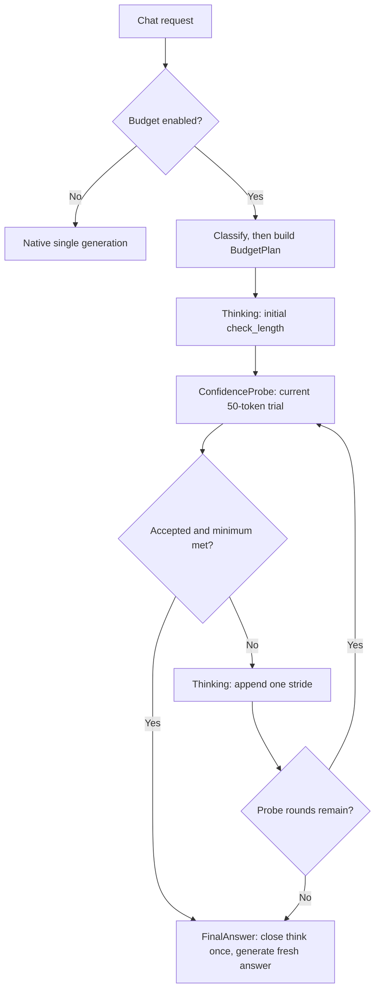

# CoTController 性能分析与优化设计

## 1. 目的与分析边界

本文分析 DEER 与 Think Budget 服务内控制器的端到端时延成本，目标是在质量约束下尽量降低“预算估算 + 置信度校验 + 多阶段调度”的额外耗时。

数据基线更新到 2026-07-24 的 v0.23.0 汇总、[`run_00`](../log/perf/run_00/RESULT.md)
和 [`run_01`](../log/perf/run_01/RESULT.md) 请求级 phase 数据；上游源码基线
为本地只读 checkout：vLLM `v0.23.0`（`0fc695f`）与 vLLM-Ascend
`v0.23.0rc1`（`f4a08bd`）。当前环境没有目标模型和推理设备，因此结论
分为“实测”“源码确定”“假设”。服务器端验证步骤见第 9 节。

## 2. 结论摘要

1. **run_01 平均值已略优于 vanilla，但尾延迟仍退化。** 16 请求平均
   `67.9792 s`，比 vanilla 低 `2.76%`；中位数低 `4.65%`，P95 却高
   `12.38%`。可见 token 少 `44.63%`，说明 token 收益仍被多阶段执行成本
   大量抵消。
2. **固定 50-token probe 已解决 run_00 的主要故障。** hidden probe 从
   74871 降至 2401 token，probe wall 从 1922.17 降至 107.38 秒；run_01
   总 E2E 相比 run_00 降 `63.31%`，15/16 个 paired 请求更快。
3. **当前主成本已迁移到可见思考。** initial + iterative thinking wall 为
   `832.24 s`，占 E2E `76.52%`；固定 `1024 + N×512` 的预算是下一轮
   第一优化变量，不能继续沿用“优先缩短 probe”的旧结论。
4. **短 probe 当前有净收益。** 2401 个 hidden token 使可见思考相对全部
   走满 3072 token 少 14329 token；直接取消 probe 反而可能增加总模型工作。
5. **阈值存在可测空间，但必须绑定质量。** 对已记录轨迹静态回放，
   `prob_th=0.88/0.875` 分别可少走 125.77/131.34 秒已观测 phase wall；
   较早 final 的真实时延和语义质量尚未测量。
6. **工程优化的上界已经较小。** prefill 占 E2E `9.32%`，排除首次
   initial prefill 后的绝对上界为 `7.71%`；queue、decision、phase residual
   和客户端 gap 均非主项。
7. **质量只完成结构检查。** run_01 的 16/16 个最终答案可解析为目标 JSON
   且 final 全部自然 stop；语义正确率与非劣界仍未采集，不能据此上线更激进
   的阈值或预算。

## 3. 成本模型

### 3.1 正确的端到端账本

对同一个样本，定义：

$$
T_{vanilla} \\
= T_{\text{http}} + T_{\text{queue}} + T_{\text{prefill(prompt)}} + T_{\text{decode(visible_baseline)}}
$$

$$
T_{controller} \\
= T_{\text{decision_cpu}} + Σ T_{\text{think_phase}} + Σ T_{\text{confidence_probe}} + T_{\text{final_answer}} + T_{\text{controller_cpu}}
$$

$$
净收益
= T_{vanilla} - T_{controller} \\
= \text{visible_tokens_saved} × TPOT - \text{controller_overhead}
$$

其中：

$$
T_{\text{confidence_probe}}
= {\text{queue}}
+ {\text{prefill(reasoning_prefix + probe_suffix)}}
+ {\text{decode(hidden_probe_tokens, with logprobs)}}
+ {\text{confidence_cpu}}
$$

`hidden_probe_tokens` 不应与对外可见的 thinking/final token 混在一起。对每次 probe 还应计算边际收益：

$$
{\text{probe_expected_gain}}
= P(本轮可停止)
× E(若停止可省的后续思考 token)
× TPOT
- {\text{probe_cost}}
$$

只有 `probe_expected_gain > 0` 才值得做本轮校验。

### 3.2 当前汇总的盈亏平衡

最新同日汇总来自 [`docs/log/test_results/_SUMMARY.csv`](../log/test_results/_SUMMARY.csv)：

| 指标 | Vanilla | run_01 | 差值 |
|---|---:|---:|---:|
| 样本数 | 16 | 16 | — |
| 平均时延 | 69.9077 s | **67.9792 s** | **-1.9285 s / -2.76%** |
| 时延中位数 | 69.9773 s | **66.7248 s** | **-3.2525 s / -4.65%** |
| 时延 P95 | **84.0568 s** | 94.4605 s | **+10.4037 s / +12.38%** |
| 平均可见 token | 4658.38 | **2579.25** | **-2079.13 / -44.63%** |
| 总可见 token | 74534 | **41268** | **-33266** |

**聚合实测：** run_01 已跨过平均时延盈亏平衡，但 44.63% 的可见 token
下降只转化为 2.76% 的平均时延下降，而且 P95 仍退化。这比单纯“是否比
vanilla 快”更能说明后续目标：减少阶段化思考 decode、改善尾部接受轮次，
并量化多 phase 对 batching/TPOT 的损失。

**证据边界：** 当前保存了 run_01 和 run_00 的请求明细，可按 QA_ID 配对；
工作区没有 vanilla 明细与 phase 数据，因此 run_01 对 vanilla 仍只能做聚合
对照。sampling params、seed、warmup 和 cache 初态也未采集，不能把 2.76%
视为严格代码因果。

### 3.3 run_00 请求级归因

[`run_00/RESULT.md`](../log/perf/run_00/RESULT.md) 保存完整分析。关键账本如下：

| Phase | 调用数 | wall | 客户端 E2E 占比 | decode | 生成 token |
|---|---:|---:|---:|---:|---:|
| initial_think | 16 | 164.44 s | 5.55% | 128.17 s | 6066 |
| iterative_think | 63 | 211.35 s | 7.13% | 150.26 s | 6212 |
| confidence_probe | 63 | **1922.17 s** | **64.85%** | **1864.57 s** | **74871** |
| final_answer | 16 | 664.05 s | 22.40% | 649.99 s | 27188 |

**实测：** phase wall 合计 2962.16 秒，客户端 E2E 合计 2964.20 秒，只差 2.04 秒。总模型生成量 114337 token，其中隐藏 probe 占 65.48%；同日 vanilla 可见生成量为 70096，因此 run_00 虽减少可见输出，真实生成量仍多 44241 token。

**采集边界：** before/after Prometheus 快照的进程启动时间不同，不能直接相减；after 的 158 call、591201 prompt、181248 cache hit、114337 generated 与 phase JSONL 完全一致，只作为绝对计数交叉校验。质量分和服务器源码 SHA 未采集。

### 3.4 run_01 请求级归因

[`run_01/RESULT.md`](../log/perf/run_01/RESULT.md) 保存完整计算和实验方案。
关键账本如下：

| Phase | 调用数 | wall | 客户端 E2E 占比 | prefill | decode | 生成 token |
|---|---:|---:|---:|---:|---:|---:|
| initial_think | 16 | 355.32 s | 32.67% | 17.50 s | 332.25 s | 16384 |
| iterative_think | 37 | 476.93 s | **43.85%** | 27.50 s | 446.26 s | 18439 |
| confidence_probe | 49 | 107.38 s | 9.87% | 44.25 s | 58.11 s | 2401 |
| final_answer | 16 | 145.97 s | 13.42% | 12.14 s | 132.63 s | 6450 |

**实测：** phase 解释客户端 E2E 的 99.8177%；同进程 metrics 的 call、
prompt 和 generated counter delta 与 phase 完全一致。run_01 相比 run_00
少生成 70663 个 engine token，但 visible thinking 增加 22545，成本中心已
由 hidden probe 转到固定思考预算。

**实测：** 12/16 个请求在 1–4 轮 probe 内接受，4 个走满；50-token probe
成本为 2401 hidden token，却相对“所有请求都走满 3072 thinking token”
少生成 14329 visible token，当前不应直接取消。

## 4. 当前执行路径与成本放大器

### 4.1 DEER 调用次数

[`deer/state.py`](../../deer/state.py) 中初始思考、每轮增量思考、每轮 trial answer 和最终答案都会单独调用 `engine_client.generate()`。若有 `k` 次置信度校验且思考没有自然闭合：

```text
generate_calls = 1 initial + k rethink + k probe + 1 final = 2k + 2
hidden_probe_tokens <= k × trial_answer_length
```

[`deer_confidence.txt`](../log/deer_confidence.txt) 记录了 4 次校验后置信度达到阈值（0.8710、0.7653、0.8738、0.9696）。对应典型路径是 10 次 `generate()`，其中 4 个 trial answer 对客户端不可见。前三次校验在事后看都没有产生早停收益。

Python 的 `_calculate_average_max_prob_from_logprobs()` 只遍历最多几十个 token。它存在 `torch.tensor()` 逐 token 分配等微优化空间，但与额外模型 decode 相比不是主矛盾。

### 4.2 Think Budget 的隐藏成本边界

裁决后实现不再使用任务预算中的 legacy `check_answer_len`。所有
confidence probe 由 `PerformancePolicy` 固定为最多 50 token，并通过
`hidden_probe_tokens` 单独记账。任务预算只决定 `BudgetVector` 的首段、
最小思考、轮数和 stride。

当前实现边界：

- `hard_think_token_limit` 只约束可见思考；隐藏 probe 仍需按
  `probe_round × 实际 trial token` 单列，不能并入外部 completion usage。
- `max_internal_calls` 默认 20，并在可选 think/probe 前为 final 保留调用
  槽位；它与 50-token policy 共同限制隐藏调用，但不等于总 token 预算。
- v0.23.0 serving 补丁在入口检查 `BUDGET_ENABLED`；关闭时应走原生单次
  生成，仍需服务器验证 stream/non-stream bypass。
- safety 默认关闭；触发时只提前进入新鲜 FinalAnswer，不做时间放大或候选
  fallback。
- `min_think_budget` 仍在 probe 决策时门控；若模型没有提前输出
  `</think>`，首段小于 minimum 时可能先产生一次不能按分数接受的 probe。
  该额外成本要用服务器 phase 账本量化。
- DELTA/FINAL_ONLY/CUMULATIVE trial 已按明确 output kind 聚合完整文本、
  token ids 和 logprob 位置；不存在 candidate/answer-list 复用路径。

因此“思考硬预算”和“真实总模型工作量”仍是两个口径，但所有隐藏工作现在
都有固定单次上限和独立 phase 账本。

### 4.3 重复 prefill：存在，但不应夸大

新 phase 使用新 `request_id`，所以它确实是一个新的 scheduler 请求，并产生新的排队、输出处理和 phase 边界。另一方面，vLLM v0.20.2 scheduler 会对新请求调用 `kv_cache_manager.get_computed_blocks(request)`；开启 prefix caching 时，完整的共同 prefix block 可被复用。

[`docs/log/API_simulations/mtp_off.txt`](../log/API_simulations/mtp_off.txt) 中已有一次更直接的打点：

| 项目 | 数值 |
|---|---:|
| E2E | 202495.11 ms |
| 10 个 thinking segment 的 prefill | 4308.10 ms / 2.13% |
| 9 个 confidence branch 的 prefill | 3484.74 ms / 1.72% |
| 已打点 prefill 合计 | 7792.84 ms / 3.85% |

这份样本没有分解最终答案 prefill，也没有给出各分支生成 token，不能据此断言所有场景都只有 3.85%；但它足以否定“只优化 KV 就能解决 202 秒 E2E”的判断。

## 5. 优化优先级

### P0：语义质量门与严格 Vanilla 配对

run_01 只证明 16/16 个最终答案 JSON 结构完整，尚未证明诊断规划语义非劣。
在继续减少 thinking 前，必须保存 vanilla 明细和同口径 phase，固定
sampling params、seed、到达顺序、warmup、cache 初态，并预先声明质量非劣界。

### P1：先校准置信度阈值

保持 `check=1024 / stride=512 / rounds=4 / probe=50`，做单变量
`0.90 → 0.88 → 0.875`；`0.85` 只作为探索下界。run_01 轨迹静态回放：

| prob_th | 改变请求 | 静态少走 phase wall | 少生成 visible think |
|---:|---:|---:|---:|
| 0.88 | 4 | 125.77 s | 4096 |
| 0.875 | 5 | 131.34 s | 4280 |
| 0.85 | 11 | 393.90 s | 13319 |

这些不是已测收益；阈值改变 final prompt 和答案，必须按相同 QA_ID 做质量/E2E
配对。

### P1：再缩减可见思考预算

分别测试 `check_length=512`、`think_stride=256`、`num_thinking=3`，不要一开始
做全因子。run_01 中 8 个请求到达 round 4；若轮数改为 3，已观测路径会少走
8 次 round-4 probe 和 4 次 terminal stride，wall 合计 57.69 秒。首段和
stride 减半有更大 token 上界，但也更可能改变质量与接受轮次。

`fixed_num_thinking=4` 全失败时的最大思考量实际是
`1024 + 4×512 = 3072`；`fixed_budget_tokens=10000` 不绑定，只是硬上限。

### P2：保持语义的 APC / resumable

run_01 prefill 合计 101.40 秒，占 E2E 9.32%；排除首次 initial prefill 后，
所有后续 prefill 的绝对上界为 83.90 秒 / 7.71%。iterative/probe/final 的
phase cache 比例已经达到 53.28% / 42.35% / 57.12%，且 cached token 随
轮次出现 1536、3072、4608，不再是 run_00 的固定 1536。

先校正 phase 与 Prometheus cached token 相差 1536 的口径，再做并发 1/4
对照。只有增长前缀仍有稳定缺口时，才在 DEER 验证“主思考链 resumable、
probe 独立分支”的方案；不能改变 token 序列、采样状态、取消语义或原生
priority/LoRA/trace/DP 上下文。

### P3：暂缓普通 Python 与调度微优化

queue、decision、phase residual 加客户端 gap 的量级不足以解释当前时延。
除非 CPU profiler 给出新证据，不优先改 JSON 序列化、对象复制、置信度
arithmetic、producer queue 或 `max_num_seqs`。50-token probe 已产生净 token
收益，也不应作为当前第一缩减变量。

## 6. 建议的控制器接口

### 6.1 核心数据结构

```python
@dataclass(frozen=True)
class EngineCallContext:
    parent_request_id: str
    priority: int
    lora_request: object | None
    trace_headers: dict | None
    data_parallel_rank: int | None
    prompt_text: str | None
    reasoning_ended: bool | None
    reasoning_parser_kwargs: dict | None

@dataclass
class BudgetLedger:
    visible_think_tokens: int = 0
    hidden_probe_tokens: int = 0
    generate_calls: int = 0
    controller_ms: float = 0.0
    probe_ms_ema: float = 0.0
    max_hidden_probe_tokens: int = 0
    max_generate_calls: int = 0
    deadline_ns: int = 0

@dataclass
class PhaseResult:
    phase: str
    round: int
    child_request_id: str
    output: object
    prompt_tokens: int
    cached_prompt_tokens: int
    generated_tokens: int
    queue_ms: float
    prefill_ms: float
    decode_ms: float
    wall_ms: float
```

### 6.2 内部接口

```python
async def generate_phase(
    call_ctx: EngineCallContext,
    ledger: BudgetLedger,
    phase: str,
    round_id: int,
    prompt,
    sampling_params,
    *,
    visible: bool,
) -> PhaseResult:
    """统一透传 engine kwargs、收集 metrics、更新成本账本并输出一条 JSONL。"""

def should_probe(
    ledger: BudgetLedger,
    actual_think_tokens: int,
    predicted_remaining_tokens: int,
    stop_probability: float,
    tpot_ms: float,
) -> bool:
    """先过硬预算/最低思考门，再比较预期节省与 probe 成本。"""
```

### 6.3 目标流程



## 7. 一致性与风险检查

- **流式/非流式**：内部 phase 使用 DELTA 或 FINAL_ONLY 时，token、text、logprobs 的聚合语义必须一致；不能只保存最后一个 delta。
- **取消**：客户端断开要中止当前 child request，并保证 parent 不再提交后续 phase。
- **错误**：orchestrator 不能只记日志后返回一个看似成功的空 200；错误应转换为 OpenAI error response。
- **预算**：所有隐藏 token 和 final 之外的模型调用都进入 ledger；任何路径都不能绕过上限。
- **质量**：减少 probe 或调整预算必须同时报告任务正确率/完整性，不能只比较时延。
- **公平性**：同一 parent 的 priority、DP rank、LoRA、采样参数和 tracing 上下文保持一致。
- **指标**：Prometheus 低基数标签只用 `phase`/`variant`，不要把 request_id 放进 metric label；request_id 只进入 JSONL/trace。

## 8. Agent 可读的性能产物

每次服务器实验建立：

```text
docs/log/perf/<run_id>/
├── manifest.json
├── requests.jsonl
├── controller_phases.jsonl
├── phase_summary.csv
├── metrics.before.prom
├── metrics.after.prom
├── server.log
├── quality_summary.csv
├── torch_profile/ or ascend_profile/
└── RESULT.md
```

`manifest.json` 至少记录：commit、dirty diff hash、vLLM/vLLM-Ascend/torch/torch-npu/CANN 版本、模型与 tokenizer revision、完整启动命令、设备、TP/DP、`max_num_seqs`、prefix cache、MTP 参数、数据集 hash、并发和随机种子。

从 [`manifest.template.json`](../log/perf/manifest.template.json) 复制到
`docs/log/perf/<run_id>/manifest.json` 后填写。模板保留当前优化阶段固定的
vLLM、vLLM-Ascend、CANN、运行时、硬件、模型路径和服务启动基线；每轮仍须
确认 TB commit/dirty、三个仓库的 dirty 状态、控制参数、采样参数和 metrics
进程连续性。任何环境变化必须写入 `baseline_overrides`，不能只因为 package
version 相同就认定实验环境一致。

`controller_phases.jsonl` 每行一个 phase，推荐格式：

```json
{"schema":1,"parent_request_id":"chatcmpl-x","child_request_id":"chatcmpl-x_probe_2","variant":"deer","phase":"confidence_probe","round":2,"wall_ms":912.4,"queue_ms":3.1,"prefill_ms":381.5,"decode_ms":524.0,"controller_cpu_ms":3.8,"prompt_tokens":3584,"cached_prompt_tokens":3456,"generated_tokens":50,"visible":false,"confidence":0.7653,"accepted":false,"stop_reason":"length"}
```

写单行 JSON，时间用 `time.perf_counter_ns()`，不要把完整 prompt、答案或逐 token 事件写入热路径。

## 9. 服务器 profiling runbook

### 9.1 第一级：低开销、每次实验必做

1. 保存环境与启动参数：

```bash
python -m vllm.collect_env > collect_env.txt
python -m pip show vllm vllm-ascend torch torch-npu > packages.txt
npu-smi info > npu_smi.txt
curl -s http://127.0.0.1:41016/version > version.json
curl -s http://127.0.0.1:41016/metrics > metrics.before.prom
```

版本字符串不足以证明服务器源码身份；每轮还必须采集实际 editable checkout、TB 源码和配置 hash：

```bash
TB_REPO=/opt/p00906181/260707/TB
for repo in "$TB_REPO" /vllm-workspace/vllm /vllm-workspace/vllm-ascend; do
  echo "repo=$repo"
  git -C "$repo" remote get-url origin
  git -C "$repo" rev-parse HEAD
  git -C "$repo" status --porcelain
done > source_versions.txt

sha256sum \
  "$TB_REPO/think_budget_vllm_adapter/config/budget_config.yaml" \
  run_server_qwen36.sh > config_hashes.txt

cat /usr/local/Ascend/ascend-toolkit/latest/aarch64-linux/ascend_toolkit_install.info \
  > docs/log/perf/cann.txt
```

模型不是固定 revision checkout 时，至少记录 `readlink -f` 后的真实路径及 `config.json`、tokenizer 配置文件 hash。测试后先核对两份 metrics 的 `process_start_time_seconds`；不同则 counter delta 整体无效，不能选择性使用其中某些差值。

2. 控制器默认对每个 phase 输出一条 `TB_PHASE` JSON。优先从最终 `RequestOutput` 读取：

- `num_cached_tokens`；
- `metrics.queued_ts / scheduled_ts / first_token_ts / last_token_ts`；
- `len(output.token_ids)`、stop/finish reason。

这些字段可按 child request 分解 engine 侧 queue、首次调度至首 token、decode 的墙钟区间，而不是从 10 秒全局日志猜测。这里的“首次调度至首 token”不是纯 NPU kernel 时间；若要继续拆算子、图编译或同步开销，使用下一节 profiler。若 vLLM 关闭 stats 或字段缺失，JSON 写 `null`，不能伪装为 0 ms。

请求完成后从服务日志提取标准产物：

```bash
python tools/extract_tb_phase_metrics.py \
  docs/log/perf/<run_id>/server.log docs/log/perf/<run_id>/
```

脚本生成 `controller_phases.jsonl`、`requests.jsonl` 和 `phase_summary.csv`；其中 `requests.jsonl.accounted_phase_wall_ms` 是顺序 phase 的计量和，不等于客户端 HTTP E2E，必须按 `parent_request_id` 与客户端结果配对。

3. 请求结束后保存同一端口的 `/metrics`：

```bash
curl -s http://127.0.0.1:41016/metrics > metrics.after.prom
```

随后先比较前后快照的 `process_start_time_seconds`，再计算 counter delta。重点
指标：

```text
vllm:e2e_request_latency_seconds
vllm:request_queue_time_seconds
vllm:request_prefill_time_seconds
vllm:request_decode_time_seconds
vllm:request_prompt_tokens
vllm:request_generation_tokens
vllm:request_prefill_kv_computed_tokens
vllm:prefix_cache_queries / vllm:prefix_cache_hits
vllm:num_requests_running / vllm:num_requests_waiting
SpecDecoding accepted/drafted/acceptance metrics
```

Prometheus histogram是聚合值；请求级归因以 phase JSONL 为主，前后快照用于交叉校验总量。

### 9.2 第二级：Ascend 服务流程与算子 profile

日志出现 `acl_graph.py`，优先按 vLLM-Ascend 的 Service Profiling Guide 使用 Ascend PyTorch Profiler：

```bash
vllm serve <model> \
  <原启动参数> \
  --profiler-config '{"profiler":"torch","torch_profiler_dir":"./ascend_profile","torch_profiler_with_stack":false}'

curl -X POST http://127.0.0.1:8000/start_profile
# 只发送预热后的 1–3 个目标请求
curl -X POST http://127.0.0.1:8000/stop_profile
```

采集后执行：

```python
from torch_npu.profiler.profiler import analyse
analyse("./ascend_profile/<generated>_ascend_pt/")
```

回传给 Agent 时优先给这些已分析文件，而不是只给巨大 trace：

- `step_trace_time.csv`
- `operator_details.csv`
- `op_statistic.csv`
- `kernel_details.csv`
- `api_statistic.csv`
- `trace_view.json`（需要时间线时）

要看 Python/service 状态机而非算子时，使用 MS Service Profiler，将
`BudgetController.handle_request`、三个 state handle、
`AsyncLLM.add_request`、scheduler add/schedule、model runner execute 标为
symbol，导出 Chrome Trace + CSV。

Profiler 只对少量请求开启，且不与正式延迟数字混用；profile 本身会改变时延。

### 9.3 第三级：API Server CPU sampling

当 phase JSONL 显示 `controller_cpu_ms` 明显时，对 APIServer PID 做采样：

```bash
py-spy record --pid <APISERVER_PID> --format speedscope \
  --output apiserver.speedscope.json --duration 60
```

重点检查 tokenizer decode/encode、`deepcopy`、logprob 对象构造、history 统计、JSON/logging 和 asyncio queue。若 CPU 占比低，就停止做 Python 微优化。

## 10. 验收标准

主指标：

```text
paired_net_gain_ms = vanilla_e2e_ms - controller_e2e_ms
```

同时满足：

- 平均和 P95 `paired_net_gain_ms > 0`；
- 任务质量达到预先定义的非劣界；
- `hidden_probe_tokens`、`probe_rounds`、`generate_calls` 有硬上限且日志可审计；
- 在当前约 278-token 节省量下，额外成本低于 4.51 秒/请求（这是偏宽松上界）；
- 流式取消、非流式聚合、异常、超时和 DP/priority 透传测试通过；

## 11. 本轮实现与下一轮实验

### 11.1 已落地但尚待服务器量化

- `TimingCollector` 增加真实模型工作账本：`visible_think_tokens`、`hidden_probe_tokens`、`final_answer_tokens`、`generate_calls`。
- 每个 `decision / initial_think / iterative_think / confidence_probe / final_answer` 输出 schema 1 的 `TB_PHASE`；若 vLLM stats 可用，则从 child `RequestOutput` 计算 queue/prefill/decode，并记录 `num_cached_tokens`。
- trial prompt 与合成 `</think>` 从递归深拷贝改成受控浅拷贝；静态 suffix token 以 parent request 为单位缓存。
- state enter/complete 与重复 `TB_CONFIDENCE` flush 默认关闭，保留 `verbose_stage_logging=true` 作为故障调试开关。
- v0.23.0 route 在 DP rank 解析后执行，子请求透传 priority、LoRA、trace headers、DP rank、prompt/reasoning parser context；外层响应分别继续使用原生流式 reasoning parser、非流式统一 parser 与 chat template kwargs。
- adapter 算法层已取消 DEER 字段投影，状态机改为 Thinking / ConfidenceProbe / FinalAnswer；首段后立即 probe，最后失败 probe 后仍完成 stride，主 prompt 只追加。
- trial 上限由 `PerformancePolicy` 固定为 50，DELTA/FINAL_ONLY/CUMULATIVE 使用完整 collector；Value Min 缺少完整 bottom-k 时降级平均置信度，无可用 logprob 时 fail-open。
- 在线历史增加 parent request 幂等、非阻塞 JSONL writer 和未评分语义；error/cancel 不进入 token 分位数。
- `dtb.patch` 已在固定的 vLLM `v0.23.0` checkout 上通过 `git apply --check`；本地 39 个无模型单元测试覆盖预算分支与覆盖优先级、三状态轨迹、trial collector、置信度、历史闭环、写入失败隔离、phase 账本、浅拷贝、`n=1` 契约与原生路由上下文。

这些属于**源码确定/本地测试**，不是目标 NPU 的性能实测。尤其结构化 phase 日志本身仍有一次 JSON 序列化与 flush 成本；它替代了更多旧日志，但必须在服务器用 A/B 量化。

### 11.2 run_01 已确认的结论

- **实测：** run_01 相比 run_00 总 E2E 降 63.31%，15/16 个 paired
  QA_ID 更快；固定 50-token probe 已将 hidden probe token 降 96.79%。
- **实测：** thinking wall 占 E2E 76.52%，probe wall 只占 9.87%；优化
  第一变量必须从 probe 长度转向 threshold 与 visible budget。
- **实测：** 50-token probe 以 2401 hidden token 换回 14329 visible
  thinking token 的提前退出空间，当前有正的模型工作量收益。
- **实测：** APC 已出现随轮次增长的 1536/3072/4608 cached token；
  prefill 的总上界只有 9.32%，不是第一收益项。
- **实测：** 16/16 final JSON 结构完整且自然 stop；语义质量未评分。
- **采集缺口：** phase 与 Prometheus cached token 相差 1536，运行时配置
  hash、sampling params、seed、warmup/cache 初态和 vanilla 明细仍缺失。

### 11.3 下一轮服务器测试

使用相同 16 个 QA_ID，按随机交错顺序运行，至少 3 个重复。第一批只做阈值
单变量：

```text
T0 = prob_th 0.90
T1 = prob_th 0.88
T2 = prob_th 0.875
T3 = prob_th 0.85（探索）
```

第二批以 T0 为控制，分别测试：

```text
B1 = check_length 512
B2 = think_stride 256
B3 = num_thinking 3
```

每个变体报告 paired E2E 平均/P50/P95、accept round、visible/hidden/final
token、phase wall/queue/prefill/decode、JSON 结构分和语义质量分。单变量通过
非劣界后再组合，不允许先组合阈值和预算导致无法归因。

另做两个工程诊断：

1. 为 vanilla 保存同口径客户端明细与 phase/metrics，解释“少 44.63%
   可见 token 但平均仅快 2.76%”的 batching/TPOT 差异；
2. 并发 1/4 对照 APC，校正 cached-token 口径，再决定是否研究 resumable
   main chain。

### 11.4 继续固定 50-token probe

`trial_answer_length=50` 继续作为当前 `PerformancePolicy` 不变量。48/49 个
run_01 probe 以 length 结束，不能直接复用为平均 403-token 的 final。若未来
重新做 probe 长度消融，必须建立新 policy version，并与 threshold/budget
实验分开。

## 12. 外部版本依据

- [vLLM v0.23.0 `AsyncLLM.generate()`](https://github.com/vllm-project/vllm/blob/v0.23.0/vllm/v1/engine/async_llm.py)
- [vLLM v0.23.0 chat completion serving](https://github.com/vllm-project/vllm/blob/v0.23.0/vllm/entrypoints/openai/chat_completion/serving.py)
- [vLLM v0.23.0 `RequestOutput`：metrics 与 `num_cached_tokens`](https://github.com/vllm-project/vllm/blob/v0.23.0/vllm/outputs.py)
- [vLLM v0.23.0 `RequestStateStats`：请求级时间戳字段](https://github.com/vllm-project/vllm/blob/v0.23.0/vllm/v1/metrics/stats.py)
- [vLLM v0.23.0 SamplingParams](https://github.com/vllm-project/vllm/blob/v0.23.0/vllm/sampling_params.py)
- [vLLM-Ascend Service Profiling Guide](https://docs.vllm.ai/projects/ascend/en/main/developer_guide/performance_and_debug/service_profiling_guide.html)

## 13. 变更记录

| 日期 | 变更 | 原因 |
|---|---|---|
| 2026-07-24 | 纳入 run_01 的 16 请求客户端明细、134 条 phase 和同进程 metrics；确认平均时延略优于 vanilla、P95 仍退化，成本中心由长 probe 转为可见思考；新增阈值/预算/APC 分级方案 | 重构后的 hidden probe 已降 96.79%，旧“先缩 probe”优先级不再适用 |
| 2026-07-24 | 将 manifest 模板移到 `docs/log/perf/` 作为优化阶段公共基线，固化 vLLM/vLLM-Ascend commit、CANN 9.0.1 和既有运行环境；补充逐轮 override/dirty/配置/完整性要求 | 避免每轮重复填固定环境，同时防止把固定版本误当成已确认的运行时源码与配置身份 |
| 2026-07-23 | 同步裁决后 adapter 重构：独立 AlgorithmConfig、三状态、固定 50-token 完整 trial collector、fail-open 和在线历史闭环；更新服务器实验口径 | 实现、默认参数和 probe 策略已变化，旧四状态/可配置 probe 消融描述不再适用 |
| 2026-07-21 | 纳入 run_00 请求级 phase、环境和客户端明细；确认 probe decode 主导、APC 增长前缀未命中、最后一轮死 probe 与 classification 误路由；补齐 manifest/RESULT | 用 158 个 engine call 的实测账本替代历史聚合假设，并明确下一轮的首改与采集缺口 |
| 2026-07-21 | 纳入 v0.23.0 最新 DTB 汇总；落地 phase ledger、浅拷贝/日志优化、v0.23.0 调用上下文透传、manifest 模板与日志提取工具 | 先获得隐藏 probe 与 child phase 的请求级证据，再对 2000–4000 token probe 做质量约束消融 |
| 2026-07-20 | 重写性能分析；建立完整成本模型、优化优先级和服务器 runbook | 校正早期文档对 scheduler slot、KV cache 和 MTP 因果的过度推断，并纳入新日志证据 |
