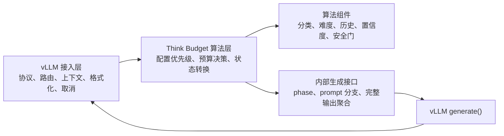
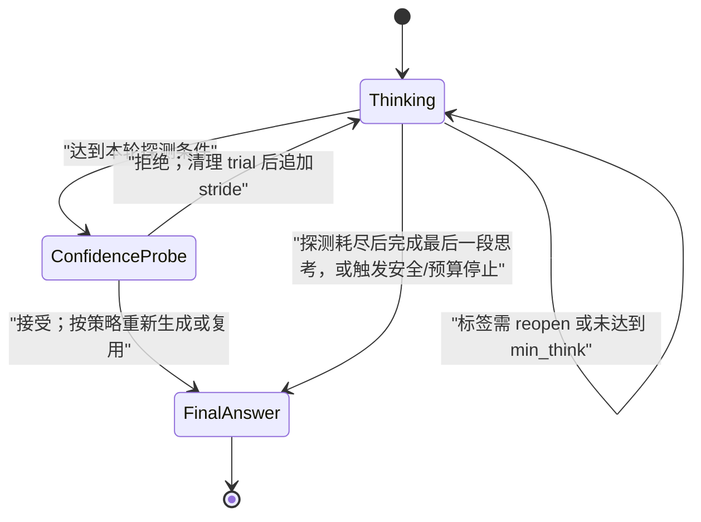

# think_budget_vllm_adapter 算法一致性检视与重构方案

## 1. 文档目的

本文检视 `think_budget_vllm_adapter` 是否符合以下迁移原则：

> 覆盖 `think_budget` 的算法实现，复用 DEER 集成 vLLM 的接口。

本次只做源码、设计文档、日志和无模型测试检视，不修改控制器、状态机、配置或 vLLM 补丁源码。

### 1.1 检视边界

允许复用 DEER 的部分：

- vLLM 参数注册和协议字段；
- 对 `_create_chat_completion` 的路由/接管；
- 流式与非流式响应格式适配；
- 请求取消、异常传递和原生调用上下文透传；
- 用状态转换表达提交阶段的设计模式。

必须由 `think_budget` 覆盖的部分：

- 配置项、默认值和覆盖优先级；
- 任务分类、难度、历史预算和固定预算的决策；
- 思考、置信度探测、上下文清理、安全门和最终答案选择的分支行为；
- Value Min Confidence、trial evaluator、self-consistency 等置信度算法；
- 历史反馈闭环。

已批准的特例：

- `TRIAL_ANSWER_LENGTH=50`，不沿用参考实现中较长的 trial answer 上限；
- 置信度达标时可以丢弃 50-token trial answer，关闭 `</think>` 后重新生成最终答案。

该特例只覆盖“置信度达标后的 trial answer 复用”。它不自动覆盖安全回退、探测耗尽、配对标签、上下文清理和 `answer_list` 的其他用途。

### 1.2 基线和证据口径

算法基线采用线上入口实际调用的同步实现：

- `think_budget/naie/api_server.py` 调用
  `naie.inference.think_budget.call_model`；
- 主循环位于
  `think_budget/naie/models/budget_forcing.py`；
- 配置基线位于
  `think_budget/naie/config/settings.py` 和
  `think_budget/naie/inference/think_budget.py::_cfg_to_params`。

异步参考实现存在部分额外分支，但当前服务入口没有调用它。是否将这些分支也纳入迁移目标，列入第 6 节待裁决项，不据此给当前实现定性。

证据标记：

- **实测**：日志、测试或可重复的本地脚本直接支持；
- **源码确定**：可由当前仓库和固定版本上游源码直接推出；
- **假设**：候选解释或预期收益，必须通过实验验证；
- **待裁决**：存在多种合理语义，本文不替代产品/算法决策。

固定上游版本：

- 本仓库：`7e94e4a598dc49bbbe95a3f79d0b8055fcf10a5e`；
- vLLM：`v0.23.0`，
  `0fc695fc6d1d82e9a5ac6835ac8e4e1c83703665`；
- vLLM-Ascend：`v0.23.0rc1`，
  `f4a08bddd0cc65a0bd8c3d377b158ae5ca7527db`。

## 2. 结论

**当前实现不符合“算法由 think_budget 覆盖、DEER 只提供 vLLM 集成接口”的原则。**

结论由两部分组成：

1. **vLLM 接口复用大体成立。** 路由接管、原生禁用回退、请求上下文透传、流式/非流式格式化、取消和异常收敛基本沿用了 DEER 的集成能力。
2. **算法覆盖没有完成。** 当前状态机仍以 DEER 的
   “初始思考 → 迭代思考 → 置信度探测 → 新鲜最终答案”
   为骨架，再把部分 Think Budget 决策投影到 DEER 字段；参考实现中的配置优先级、首次探测时机、配对标签、最小思考预算、历史闭环、安全回退、Value Min Confidence 和候选答案选择均存在缺失或语义改变。

因此，这不是一次局部补丁即可修正的问题。建议保留已验证的 vLLM 适配层，重写算法配置、决策器和三个算法状态的内部逻辑。

### 2.1 边界符合度

| 能力 | 判定 | 说明 |
| --- | --- | --- |
| `_create_chat_completion` 接管 | 基本符合 | Think Budget 请求在原生调度前路由到控制器。 |
| `BUDGET_DISABLED` 原生回退 | 符合 | 禁用时回到原生单次生成路径，没有继续运行状态机。 |
| LoRA、priority、DP rank、trace、parser 上下文 | 基本符合 | `engine_request_kwargs()` 和 formatter 路径已透传主要原生上下文。 |
| 流式/非流式输出适配 | 部分符合 | 最终响应格式可透传，但流式 trial 文本聚合存在算法输入错误，见 F-08。 |
| 取消与异常 | 基本符合 | managed generator 能在请求结束时关闭内部生成器；仍需目标服务验证。 |
| `TRIAL_ANSWER_LENGTH=50` | 符合已批准特例 | 当前常量为 50；尚无 50-token 版本的端到端性能实测。 |
| 配置和决策算法 | 不符合 | 仍有 DEER 字段投影，且缺少或改变 Think Budget 的覆盖顺序。 |
| 思考/探测状态行为 | 不符合 | 阶段顺序和分支条件仍是 DEER 语义。 |
| 置信度与候选选择 | 不符合 | 结构 token、完整 trial 文本、候选复用和安全回退不一致。 |
| 历史反馈闭环 | 不符合 | 有记录函数，但服务路径没有调用，运行中历史不会更新。 |

## 3. 已确认的不一致项

以下问题均不依赖第 6 节的待裁决事项。

### F-01：状态顺序仍是 DEER，而不是同步 Think Budget 主循环

**优先级：P0。证据：源码确定。**

当前 `deer_think_budget/state.py` 的主要顺序是：

```text
InitialThinking
  -> IterativeThinking
  -> ConfidenceCheck
  -> IterativeThinking / Answer
```

同步参考实现的主要顺序是：

```text
初始 check_length 思考
  -> 第一次 confidence probe
  -> 探测失败后追加 think_stride
  -> 下一次 confidence probe
  -> ...
```

差异造成：

- 第一次探测前，adapter 会额外执行一次迭代思考；
- adapter 将初始思考上限向上对齐到下一个 128-token 边界，
  参考算法没有该规则；
- adapter 在最后一次探测之后直接进入最终答案，参考算法会先处理
  trial、清理上下文并追加一次思考，再生成最终答案；
- 自然生成 `</think>` 时，adapter 直接进入 `_AnswerState`，
  绕过参考算法的候选评分和安全回退路径。

这会同时改变模型调用次数、隐藏 token、可见思考长度和最终上下文，属于核心算法差异。

### F-02：配对标签、最小思考预算和 reopen 分支缺失

**优先级：P0。证据：源码确定。**

参考实现根据以下条件决定“立即探测、重新打开思考、继续思考或进入答案”：

- 输出中 `<think>` / `</think>` 是否配对；
- `min_think_budget` 是否满足；
- `new_task_unlimited`、固定预算和动态预算的组合；
- 是否需要 `make_induced_prompt()`；
- `enable_clean_context` 是否清理失败 trial。

当前 adapter：

- 没有完整实现 paired/unpaired 判定和 reopen；
- 把配置投影为 DEER 的 `initial_thought_limit`、`think_ratio`、
  `token_budget` 等字段；
- 非代码路径的 trial prompt 不显式关闭 `</think>`，而是加入
  DEER 风格的 “I have to give ... **Final Answer**”；
- 没有可配置的 clean-context 分支，实际总是从浅拷贝 child prompt
  探测，失败 trial 不进入主上下文；
- `is_code` 仍参与 prompt 分支，但当前分类决策没有设置它。

因此，即使状态数保留为三个，状态内部也不能继续复用这些 DEER 条件。

### F-03：配置模型没有覆盖 Think Budget 的参数与覆盖优先级

**优先级：P0。证据：源码确定。**

`BudgetConfig` 继承 `ThinkBudgetConfig`，而后者仍保存多项 DEER
运行字段。`BudgetController` 再把算法决策投影到
`initial_thought_limit`、`thought_iteration_limit`、
`thought_iteration_token_limit` 和
`confidence_threshold`。这使 DEER 数据模型成为算法接口，而不只是
vLLM 适配实现。

已确认的配置差异包括：

| 类别 | 参考实现 | 当前 adapter |
| --- | --- | --- |
| trial 长度 | `CHECK_ANSWER_LENGTH=4000` | 固定 50；属于已批准特例 |
| 最大 API 调用 | 默认 20 | YAML 默认 0，语义已改变 |
| clean context | `enable_clean_context` | 没有配置，行为写死 |
| soft truncation | `enable_soft_truncation` | 没有开关，行为写死 |
| 新任务 unlimited | `new_task_unlimited` | 缺失 |
| 任务覆盖 | `task_type_override` | 缺失 |
| 固定预算 | `FIXED_BUDGET_TOKEN` 及子参数 | 主字段或部分子参数缺失 |
| 置信度覆盖 | `CONFIDENCE_THRESHOLD`、`PERCENTILE_STEP` | 缺失 |
| 难度预算 | 多组 base/max 参数 | 没有完整纳入配置，使用不同默认值 |
| 历史聚类 | auto-cluster、新任务检测和统计字段 | 仅保留少数字段 |
| trial evaluator | trial length、boost 等参数 | 长度固定 50，boost 未迁移 |
| stop/safety | 相关停止与回退配置 | 只迁移部分开关 |

公开请求只允许覆盖少数固定预算字段本身可以是产品接口选择，但所有参考算法参数仍应在服务端 `AlgorithmConfig` 中有唯一来源，并保持原来的默认值、优先级和分支语义。当前尚未做到。

### F-04：固定预算、任务、难度和历史预算的优先级被改写

**优先级：P0。证据：源码确定。**

参考同步实现的关键规则包括：

- 关闭预算时同时关闭置信度和动态预算；
- 固定预算同时设置 `check_length`、`min_think_budget`、轮数和步长，
  并跳过动态预算；
- 场景分类是通用步骤；
- 难度决策可读取历史统计，并使用配置化 base/max；
- 历史预算在没有难度预算时可覆盖完整预算字段；
- 即使启用难度预算，历史步长仍有独立作用；
- 最后再应用固定子参数和置信度覆盖。

当前 `_decide()`：

- 固定预算路径没有同步设置 `min_think_budget`；
- 只有命中特定非 general 任务时才执行难度决策；
- 难度预算没有接收完整历史统计和配置化 base/max；
- 历史预算是否生效依赖 adapter 新增的 `task_matched` 策略；
- 命中任务且已有历史时，参考实现允许的历史 stride 可能完全不应用；
- 最后通过 DEER 字段名把结果交给状态机。

因此，同一请求和同一配置可能得到不同的首段长度、最小思考长度、
轮数、步长和阈值。

### F-05：历史预算没有形成服务内反馈闭环

**优先级：P0。证据：源码确定。**

adapter 中存在 `record_inference()`，但当前服务调用链没有调用它。
结果是：

- 运行中的请求不会把 task type、budget、confidence、quality 等结果
  回写历史；
- 历史预算只能依赖启动前已有数据，不能按参考算法持续更新；
- 新任务检测被简化为计数条件，没有复用参考实现的相似度/聚类语义；
- auto-register 阈值和部分历史判断写死或缺失。

如果不恢复闭环，“历史预算”只是静态查询，不是原算法功能。

### F-06：安全门只迁移了检查，没有迁移预算放大和回退行为

**优先级：P0。证据：源码确定。**

参考实现：

- 根据 probe 次数放大有效 safety time limit，最高到基线的 3 倍；
- hard violation 可从 `answer_list` 选择已生成的最好候选；
- 没有候选时可关闭思考后回退，而不一定再发起完整模型调用。

当前 adapter 只调用 `safety_gate_check()`，触发后进入
`_AnswerState` 新鲜生成最终答案：

- 没有有效时间上限放大；
- 没有 `build_safety_fallback()`；
- 没有从已有候选中回退；
- 额外生成可能继续超过 safety 目标。

“置信度达标时丢弃 50-token trial”的特例不覆盖 safety violation，
所以该差异仍是不一致。

### F-07：Value Min Confidence 的结构 token 集合和计算分母不一致

**优先级：P0。证据：源码确定 + 本地实测。**

参考 `_struct_token_core.py`：

- 把 JSON、数学/代码运算符、空白和特殊 token 作为结构 token；
- 在推理模块导入时注入业务 key name；
- `cal_confidence()` 跳过 `None` 的分子项，但分母仍使用原
  `logprobs` 长度。

adapter 的 `confidence.py`：

- 使用更小且不同的结构 token 集合；
- 没有注入业务 key name；
- 把 `true`、`false`、`</think>` 等加入了不同集合；
- 分母改为有效 logprob 数量。

本地可重复结果：

| 输入 | 参考实现 | adapter |
| --- | ---: | ---: |
| `faultNumber` 是否结构 token | true | false |
| `=` 是否结构 token | true | false |
| `true` 是否结构 token | false | true |
| `</think>` 是否结构 token | false | true |
| `[-1, None]` 的平均置信度 | 0.1839397 | 0.3678794 |

这会直接改变 bottom-k token 的选择和接受阈值，不能视为接口层差异。

### F-08：流式请求的 trial 文本可能只有最后一个 delta

**优先级：P0。证据：源码确定。**

vLLM `v0.23.0` 中，外部请求 `stream=True` 时
`to_sampling_params()` 使用 `RequestOutputKind.DELTA`。当前
`_ConfidenceCheckState` 聚合了每个 chunk 的 logprobs，但最终只读取
最后一个 `trial_chunk.outputs[0].text` 作为：

- self-consistency 输入；
- trial evaluator 输入；
- `answer_list` 候选；
- 完整性判定输入。

非流式路径使用 `FINAL_ONLY`，因而同一请求的算法决策会随
`stream` 开关变化。这不是输出格式差异，而是算法输入不一致。

修复时必须在 adapter 层累积完整 trial 文本，或让内部 probe 强制使用
完整累积输出；不能改变外部流式语义。

### F-09：soft truncation 造成“已流式发送内容”和“主上下文内容”不一致

**优先级：P1。证据：源码确定。**

当前 `consume_output()` 先把模型生成的思考 chunk 发送给用户，再在
phase 结束时寻找自然断点并截断，随后只把截断后的 token 写回主
prompt。结果可能是：

- 用户已经看到被截掉的尾部；
- 后续 probe 和最终答案看不到该尾部；
- 无 phase metrics 时，账本用截断后 token 数代替实际引擎生成数，
  低估控制器总工作量。

参考算法把 soft truncation 作为显式配置。重构应先在算法层决定保留
范围，再统一更新可见输出、主上下文和实际/保留 token 统计；流式下若
无法回收已发送 token，应禁用这种事后截断或改成在线断点停止。

### F-10：`answer_list` 被记录但最终选择路径没有使用

**优先级：P1。证据：源码确定。**

当前 `_AnswerState` 明确采用 DEER 逻辑：关闭 `</think>` 后重新生成
最终答案，不比较 `answer_list`。

其中，“置信度已达标但 trial 只有 50 token”属于已批准特例，可以重新
生成。以下场景则尚未被该特例覆盖：

- safety gate 触发；
- 多轮 probe 已生成多个部分或完整候选；
- trial evaluator 识别到完整、稳定答案；
- 最终新鲜答案的评分低于已有完整候选。

至少应保留参考实现的候选数据结构和评分信息，使安全回退、实验策略及
将来的直接复用可实现。第 6.5 节需要用户裁决哪些场景允许选择候选。

### F-11：任务分类器增加了未声明的算法分支

**优先级：P1。证据：源码确定。**

adapter 增加了 `statistics_aggregation` 分类，但参考任务分类器没有
该类型。该扩展可能合理，但目前没有：

- 迁移设计中的显式算法变更记录；
- 与参考分类器的兼容策略；
- 预算映射和回归样本。

另需注意，`[A-D]` 选择题正则误判普通文本的风险在参考实现中已经存在，
不能把它归因于 DEER；若要修复，应作为独立算法变更并做 A/B 回归。

### F-12：vLLM 协议约束和原生请求语义尚未完整复用

**优先级：P1。证据：源码确定 + 本地静态检查。**

`dtb.patch` 可干净应用到固定的 vLLM `v0.23.0` checkout，但还有两类
接口缺口：

1. `protocol_patch.py` 要求
   `ChatCompletionRequest.model_config = ConfigDict(extra="forbid")`，
   实际 `dtb.patch` 没有加入。上游基类使用 `extra="allow"`，因此未知
   Think Budget 字段可能被静默接受并忽略。
2. 原生 serving 对 `use_beam_search=true` 有独立
   `BeamSearchParams` 分支；控制器始终调用 `to_sampling_params()`。
   同时状态消费器只处理 `outputs[0]`，没有定义 `n>1` 的算法语义。

应明确选择“完整支持”或“在协议层拒绝”。静默改变原生请求语义不符合
复用集成接口的原则。

### F-13：现有测试只能证明部分接口行为，不能证明算法覆盖

**优先级：P1。证据：本地实测。**

使用工作区 Python 运行：

```text
python -m unittest discover -s tests -v
```

结果为 10 项通过。覆盖内容主要是：

- child prompt 浅拷贝；
- route context 和 formatter parser 上下文；
- `</think>` 只发送一次；
- phase telemetry。

没有覆盖：

- 参考实现与 adapter 的逐请求决策一致性；
- 三状态转换轨迹；
- fixed/task/difficulty/history 覆盖矩阵；
- paired/unpaired/min-think/clean-context；
- Value Min、SC、trial evaluator；
- safety fallback 和 `answer_list`；
- streaming probe 的完整文本；
- 历史回写。

测试期间还出现 PyYAML 未安装并回退内置默认值的警告，因此配置文件
本身也没有在本地测试中生效。

## 4. 目标模块边界

建议把实现拆成三层，防止算法再次通过 DEER 字段渗入接口层。



### 4.1 vLLM 接入层

保留现有实现中可复用的能力：

- `_create_chat_completion` 路由；
- 原生禁用回退；
- `engine_request_kwargs()`；
- 流式/非流式 formatter；
- cancellation、异常和 usage 汇总；
- phase telemetry 接口。

该层不应出现任务类型、难度、阈值、轮数、think ratio 或候选评分。

### 4.2 Think Budget 算法层

新建独立 `AlgorithmConfig` 和 `BudgetDecision`：

- 字段名使用参考算法原名，不再使用 DEER 投影字段；
- 配置合并顺序集中在一个纯函数；
- 明确记录每个字段的来源：
  `default / yaml / request / fixed / task / difficulty / history`；
- 已批准的 50-token 特例放入显式 `AdapterPolicy`，不散落成多处常量。

建议的核心数据结构：

```text
AlgorithmConfig
  - 参考实现的全部开关、默认值和覆盖参数

AdapterPolicy
  - trial_answer_length = 50
  - accepted_trial_strategy = fresh_final
  - unsupported_native_modes = reject/support

BudgetDecision
  - check_length
  - min_think_budget
  - num_thinking
  - think_stride
  - confidence_threshold
  - percentile_step
  - source_by_field

ProbeCandidate
  - full_text
  - token_count
  - logprobs
  - complete
  - confidence_score
  - decision_score
  - accept_reason
  - round

RequestAlgorithmState
  - accumulated_thought
  - paired_tags
  - actual_generated_tokens
  - retained_tokens
  - probe_count
  - answer_list
  - safety_elapsed
```

### 4.3 三状态方案

三个状态足以描述同步 Think Budget 算法，不需要照搬 DEER 的四状态：



状态职责：

1. `ThinkingState`
   - 首次只生成 `check_length`；
   - 失败 probe 后只生成 `think_stride`；
   - 实现 paired/unpaired、reopen、min-think 和 soft truncation；
   - 判断下一步是 probe 还是 final。
2. `ConfidenceProbeState`
   - 构造参考算法一致的 induced prompt；
   - 无论外部是否 stream，都聚合完整 50-token trial 文本和 logprobs；
   - 执行 Value Min、SC、trial evaluator 和候选记录；
   - 只输出算法决策，不直接耦合外部响应格式。
3. `FinalAnswerState`
   - 实施已批准的 accepted-trial 策略；
   - 实施 safety fallback 和经裁决的 `answer_list` 选择；
   - 统一关闭标签、parser 上下文和最终生成上限。

## 5. 整体重构计划

### 阶段 0：冻结语义基线

- 处理第 6 节待裁决项；
- 把 `docs/design/budget_forcing_migration.md` 前文与末尾变更记录统一；
- 建立参考同步实现的分支清单和参数清单；
- 将 50-token 特例写成显式兼容策略。

交付物：算法行为表、配置优先级表、例外策略表。

### 阶段 1：建立黄金轨迹测试

在不启动模型的情况下，用 scripted/fake generator 同时驱动参考语义模型
和新状态机，比较：

- 每次调用的 phase 和 `max_tokens`；
- prompt/token ids 的追加和分支；
- paired/unpaired、min-think、clean-context；
- 接受/拒绝原因；
- answer list 和最终选择；
- 历史写入事件。

先固化测试，再替换当前状态内部逻辑。

### 阶段 2：统一配置与预算决策

- 建立不继承 DEER 的 `AlgorithmConfig`；
- 完整迁移参考默认值和覆盖顺序；
- 对所有写死参数建立清单；
- 用 `source_by_field` 记录最终预算来源；
- 删除算法层对 `think_ratio`、`token_budget` 等 DEER 字段的依赖。

### 阶段 3：重写三个算法状态

- 按“首次思考后立即 probe”的顺序重写；
- 补齐标签配对、reopen、min-think、clean-context；
- 使最后一次失败 probe 后仍执行参考算法规定的思考；
- 将外部 streaming 与内部 probe 聚合解耦；
- 分开统计 actual、retained、hidden 和 visible token。

### 阶段 4：迁移算法组件和反馈闭环

- 复用参考结构 token 集合和业务 key 注入；
- 恢复 safety time amplification 和 fallback；
- 恢复历史新任务检测、动态注册、stride 和结果回写；
- 对所有刻意修复参考实现疑似缺陷的地方增加兼容开关和回归测试，
  不以“顺手修复”名义静默改变算法。

### 阶段 5：收紧 vLLM 接口契约

- 协议模型拒绝未知字段；
- 明确 `beam_search`、`n>1` 和其他原生模式的支持策略；
- 核对 stream/non-stream、reasoning parser、tool parser、priority、
  LoRA、trace headers 和 DP rank；
- 验证所有内部调用保持同一外部请求的 DP 亲和性。

### 阶段 6：服务器验证与灰度

本地没有目标模型和 NPU，只能完成静态检查和无模型测试。目标服务器按
runbook 验证：

- 相同样本、采样参数、随机种子、到达节奏、并发度和 prefix cache；
- vLLM `v0.23.0`、vLLM-Ascend `v0.23.0rc1`，MTP 保持生产默认；
- paired request 差值优先，再比较总体分位数；
- 每个内部 phase 记录 queue/prefill/decode、prompt/cached/generated
  token、visible、round 和 stop reason；
- 隐藏 50-token probe 单列，不用外部 completion usage 代替总工作量；
- 流式和非流式均验证取消、错误和最终答案。

## 6. 需要用户裁决的模糊语义

以下项目不计入第 2 节的“不符合”结论依据；确定后才能写入最终重构规范。

### 6.1 是否同时覆盖未被服务入口调用的异步实现

同步实现是当前 `api_server.py` 的实际基线；异步实现还包含部分动态调整
等分支。

需要选择：

- 只保证当前同步线上语义；
- 以同步实现为基线，再显式吸收异步实现中已认可的功能；
- 把两者先合并成唯一参考实现，再迁移。

建议采用第二种，但每个吸收项必须单独列为算法变更，不能笼统称为
“保持一致”。

### 6.2 置信度输入不完整时是 fail-open 还是 fail-closed

参考实现遇到 sampled pair 或部分 logprob 缺失时，会继续降级到较弱
模式或平均置信度。adapter 当前更偏向 fail-closed。

- fail-open 更接近参考算法，但可能过早结束；
- fail-closed 更保守，但会增加思考和延迟。

需要用缺失 logprob、单 token、空结构 token 等样本确定产品策略。

### 6.3 Full-chain confidence 使用“最新一段”还是“累计全部思考”

同步参考实现每轮把 `reasoning_logprobs` 更新为最新思考段；adapter 累积
全部轮次。累计语义可能更符合 “full chain” 名称，但属于算法改变。

建议同时记录两种得分，在离线回放中比较接受轮次、质量和 token，再决定。

### 6.4 Trial evaluator 的 early-stop 与 confidence boost

参考同步源码先设置 trial evaluator 的接受结果，随后又调用普通接受
判定，存在覆盖前一结果的疑似缺陷；adapter 则直接 early-stop，但没有
迁移 confidence boost。

这不能简单归类为“参考行为”或“正确修复”。应明确：

- 严格复现可执行参考行为；
- 采用 early-stop；
- 只做 confidence boost，再统一判定。

三者需要黄金样本和延迟/质量实验。

### 6.5 除“置信度达标”外，哪些场景允许使用 `answer_list`

已决定置信度达标时先丢弃 50-token trial 并重新生成。仍需确定：

- safety violation 是否直接选择最好完整候选；
- probe 耗尽时是否允许选择完整候选；
- trial evaluator 判定完整时是否允许继续生成而不是完全丢弃；
- 新鲜最终答案是否需要和完整候选再次比较。

建议至少保留参考 safety fallback；其余通过第 7 节实验决定。

## 7. 50-token trial answer 复用实验

`docs/log/perf/run_00/RESULT.md` 的旧实现中，confidence probe 生成
74,871 个隐藏 token，耗时 1,922 秒，占被分析端到端时延的 64.85%。
该 run 的 probe 上限远大于 50，能够证明“不限制 trial 会显著拖慢”，
但不能证明 50 是最优值，也没有实测当前 50-token 策略。

建议比较：

| 方案 | 行为 |
| --- | --- |
| A：当前基线 | probe 最多 50 token；达标后丢弃，关闭思考并新鲜生成 |
| B：完整才直返 | 仅当 50 token 内自然完整、parser/格式校验通过时直返，否则同 A |
| C：从 trial 续写 | 达标后保留 trial 分支及 KV 前缀，继续生成到完整答案 |

方案 C 只有在 vLLM 接口能够可靠续写同一 child sequence、保持 DP/LoRA/
parser 上下文且正确统计 usage 时才进入服务器实验。

主要指标：

- 配对端到端延迟和 p50/p95/p99；
- 每请求可见 token、隐藏 probe token、最终答案 token、总生成 token；
- queue、prefill、decode 和 prefix cache 命中；
- 质量评分、格式/工具调用有效率、截断率；
- trial 可直接复用率和错误复用率；
- 取消、超时和安全回退成功率。

实验必须固定样本、seed、采样参数、并发、到达节奏和 cache 状态。

**假设：** B 在短答案和结构化答案上可能减少一次最终生成，但覆盖率较低；
C 可能减少重复 prefill/decode，但实现复杂度和格式风险更高。两项都必须
由配对实验验证，不能只依据可见 completion token 下结论。

## 8. 验收标准

重构完成至少满足：

1. 算法层不再继承或投影 DEER 配置字段。
2. 参考同步实现的每个配置项都有“迁移、显式弃用或批准变更”记录。
3. 固定、任务、难度、历史和请求覆盖的组合有表驱动测试。
4. scripted generator 能验证三状态轨迹与参考分支一致。
5. stream/non-stream 对同一内部输出做出相同算法决策。
6. trial 文本、logprobs、候选列表和 safety fallback 都使用完整数据。
7. 历史预算在服务路径中完成读、决策、写的闭环。
8. `budget_disabled` 继续走原生单次生成；不支持的原生模式明确拒绝。
9. actual/retained/visible/hidden token 分开记账。
10. 目标服务器质量不退化，且净时延收益按请求级 phase metrics 证实。

## 9. 本次验证记录与限制

已完成：

- 阅读根目录和 DEER 的 `AGENTS.md`；
- 对照迁移设计、既有设计复审、run_00 结果和两套实现源码；
- 固定 vLLM/vLLM-Ascend checkout 的 tag、commit 和 dirty 状态；
- `dtb.patch` 对 vLLM `v0.23.0` 执行 `git apply --check` 通过；
- 本地 10 项无模型单元测试通过；
- 对结构 token 和 `None` logprob 分母差异做了本地复现。

未完成且不能描述为已通过：

- 目标模型/NPU 上的真实生成；
- vLLM-Ascend 流式、取消、DP 亲和性和 parser 联调；
- 50-token trial 的端到端性能和质量实验；
- 重构后的算法一致性测试，因为本次按要求不修改源码。

## 10. 变更记录

- 2026-07-23：首次检视；确认接口复用基本可保留，算法层需要整体重写；
  将五项模糊语义单列为待裁决事项。
