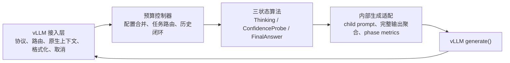
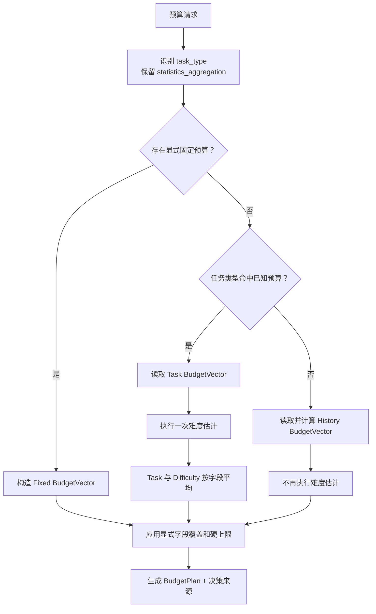
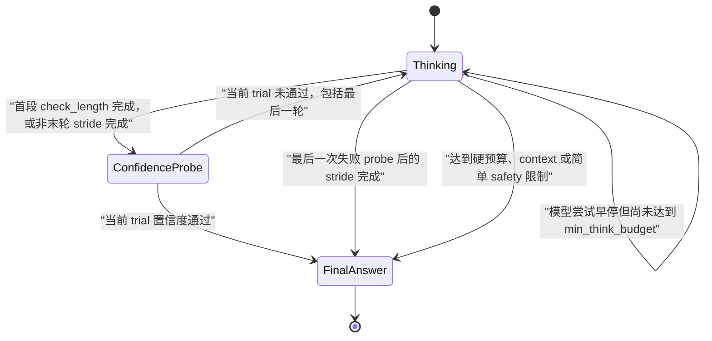
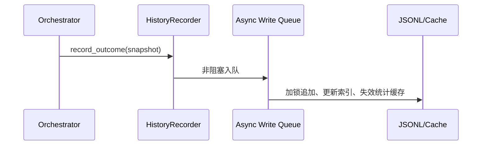

# think_budget_vllm_adapter 裁决后重构计划

## 1. 设计目的

本文把算法一致性检视结果和用户裁决转换为可实施的重构计划。目标不再是
逐行复现 `think_budget`，而是：

> 保留 Think Budget 的有效预算和置信度算法，复用 DEER 的 vLLM 接入能力，
> 同时优先降低端到端时延和隐藏生成开销。

设计起点：

- 本仓库基线：`7e94e4a598dc49bbbe95a3f79d0b8055fcf10a5e`；
- 历史模块参考提交：`6f2de8c0`；
- vLLM：`v0.23.0`，
  `0fc695fc6d1d82e9a5ac6835ac8e4e1c83703665`；
- vLLM-Ascend：`v0.23.0rc1`，
  `f4a08bddd0cc65a0bd8c3d377b158ae5ca7527db`。

本次只更新设计与修改计划，不修改 adapter 或 vLLM 源码。

### 1.1 最终原则

1. 只保证当前同步线上算法的核心效果迁移，不覆盖未被线上入口使用的异步
   扩展行为。
2. vLLM 接入层继续复用 DEER；算法配置、预算决策和状态条件不再投影到
   DEER 字段。
3. trial answer 固定最多 50 token，置信度通过后丢弃 trial，重新生成最终
   答案。
4. trial 永远基于主思考 prompt 的浅拷贝生成，失败 trial 永远不写回主
   上下文。
5. 不维护 `answer_list`，不做跨轮答案复用、self-consistency 或依赖候选
   列表的 early-stop。
6. 删除 soft truncation，保持主思考 token 前缀稳定，优先获得连续生成和
   prefix KV cache 收益。
7. 对参考算法的主动偏离必须集中记录为 `PerformancePolicy`，不得再次散落
   为隐式分支。

## 2. 检视项最终处置

| 检视项 | 最终处置 | 是否修改源码 | 目标行为 |
| --- | --- | ---: | --- |
| F-01 状态顺序 | 接受差异，修复 | 是 | 首段思考后立即 probe；失败后再追加 stride |
| F-02 标签/clean context | 部分修复 | 是 | 永远 clean context；删除 `is_code` 和 DEER 配置投影；标签改由状态标志控制 |
| F-03 配置模型 | 接受差异，修复 | 是 | 完整收编同步参考配置及优先级，批准偏离项除外 |
| F-04 预算决策 | 采用用户指定的新算法 | 是 | 任务命中：任务预算与难度预算平均；未命中：只走历史预算 |
| F-05 历史闭环 | 接受差异，修复 | 是 | 参考 `6f2de8c0` 建立在线写入、缓存和统计闭环 |
| F-06 safety 放大/回退 | 批准偏离 | 否 | 不迁移时间放大和候选回退；简单 safety 停止后新鲜回答 |
| F-07 Value Min | 部分修复 | 是 | 除 `</think>` 外对齐结构 token 和计算；缺失输入 fail-open |
| F-08 流式 trial 文本 | 接受差异，修复 | 是 | 内部 collector 累积完整 trial 文本、token ids 和 logprobs |
| F-09 soft truncation | 批准删除 | 是 | 完全移除事后自然断点截断 |
| F-10 `answer_list` | 批准删除 | 是 | 不记录、不选择、不复用候选答案 |
| F-11 `statistics_aggregation` | 批准扩展 | 否 | 保留分类并纳入任务命中路径 |
| F-12 协议/beam search | 不纳入本轮 | 否 | 保持 `extra="allow"`；不支持、不验证 beam search |
| F-13 测试不足 | 补齐 | 是 | 增加配置、状态、置信度、历史和流式一致性测试 |

用户裁决的原第 6 节问题同步关闭：

- 只以同步线上算法为迁移基线；
- logprob/sample pair 不完整时 fail-open；
- 置信度只使用当前轮 trial answer；
- 删除 trial evaluator early-stop；
- 删除 `answer_list`。

## 3. 设计逻辑

### 3.1 模块边界



边界约束：

- 接入层可以继续使用 DEER 的队列、formatter、route context 和 managed
  generator。
- 预算控制器不得输出 `initial_thought_limit`、`think_ratio`、
  `token_budget` 等 DEER 算法字段。
- 状态机只接收 `BudgetPlan` 和 `PerformancePolicy`。
- 历史写入是预算控制器的生命周期职责，不放进 formatter 或 vLLM
  serving 补丁。

### 3.2 新概念：BudgetVector

任务预算、难度预算和历史预算先归一化为同一组可合并的生成预算字段：

```text
BudgetVector
  check_length: int
  min_think_budget: int
  num_thinking: int
  think_stride: int
```

以下字段不是“预算向量”，不参与任务预算与难度预算的算术平均：

- `trial_answer_length`：性能策略固定为 50；
- `confidence_threshold`、`percentile_step`：采用配置覆盖优先级；
- enable/disable 开关；
- safety、history 和分类策略；
- context window、请求 `max_tokens` 等硬上限。

任务和难度都提供某字段时，按字段计算：

```text
merged = clamp(round_half_up((task_value + difficulty_value) / 2))
```

整数约束：

- token 字段最小为 1，并受请求剩余 token/context 上限约束；
- `num_thinking` 最小为 1；
- 某一来源没有字段时，使用另一来源；
- 所有取整和 clamp 结果记录到 `source_by_field`，便于回放。

这一定义把“预算进行平均”限定为 token/轮数预算，避免把置信度阈值和功能
开关做无意义平均。

### 3.3 最终预算决策树

任务分类是每个启用预算请求的第一步，包括显式固定预算请求；固定预算仍是
最终预算的最高优先级。



详细顺序：

1. `budget_disabled` 在 serving 层回到原生单次生成，不进入决策树。
2. 分类任务类型；`statistics_aggregation` 视为正式可命中类型。
3. 若请求或服务端指定完整 fixed budget，跳过任务/难度/历史预算计算，
   但保留已识别 task type 供 telemetry 和历史写入。
4. 没有 fixed budget 时：
   - 命中已知任务预算：执行难度估计，将两个 `BudgetVector` 按字段平均；
   - 未命中：只执行历史估计，不再执行难度估计。
5. 最后应用合法的固定子字段、置信度覆盖、请求 context/token 硬上限。
6. 输出 `BudgetPlan`，每个字段都记录最终值和来源。

该决策树是有意偏离旧同步参考实现的目标算法，后续一致性测试应对照本节，
而不是再对照旧的 task/difficulty/history 覆盖顺序。

### 3.4 三状态执行模型



#### ThinkingState

- 首次生成严格使用 `check_length`，删除向上对齐 128 token 的 DEER
  规则。
- 首段完成后立即进入 `ConfidenceProbeState`。
- probe 失败后，每轮只追加 `think_stride`；包括最后一次 probe 失败后也先
  完成该 stride。仍有 probe 轮次时再次探测，否则进入最终答案。
- 删除 soft truncation 和自然断点回切；实际生成 token 全部保留在主 prompt。
- `min_think_budget` 仍保留，但不通过重新插入 `<think>` 实现。

#### ConfidenceProbeState

- 永远从主 prompt 浅拷贝 child prompt。
- 使用统一 induced prompt，不再区分 `is_code`。
- trial 固定最多 50 token，不对用户可见，也不写回主 prompt。
- 只用当前轮 trial 的完整文本、token ids 和 logprobs 计算置信度。
- 通过后丢弃 trial，进入新鲜最终答案；失败后只返回预算状态。
- 不维护 `answer_list`，不运行跨轮 self-consistency 或 trial evaluator
  early-stop。

#### FinalAnswerState

- 只负责把主思考轨迹关闭一次，并从主 prompt 新鲜生成最终答案。
- 不选择或复用 trial 候选。
- 简单 safety 条件只会提前进入该状态；不做时间上限放大或候选 fallback。

### 3.5 `<think>` 标签简化

无需扫描整条输出计算 `<think>` / `</think>` 是否配对。状态上下文只保存：

```text
reasoning_state = OPEN | CLOSED
```

规则：

1. 进入预算状态机时为 `OPEN`。
2. 思考子请求把 `</think>` 配置为 stop；停止字符串不写入主 prompt。
3. 模型在达到 `min_think_budget` 前尝试停止，只记录
   `attempted_early_stop=true`，主轨迹仍为 `OPEN`，继续下一段思考。
4. 只有 `FinalAnswerState` 可以执行 `OPEN -> CLOSED`，并向可见输出和主
   prompt 各写入一次 `</think>`。
5. `CLOSED` 后禁止回到 Thinking 或 ConfidenceProbe。

因此一条推理轨迹始终只有一组标签和一次闭合，不需要 paired/unpaired
扫描，也不需要 reopen 第二个 `<think>`。

为防止模型或 tokenizer 绕过 stop，内部 collector 仍应把原始
`</think>` 视为控制标记并剥离，但它不参与 Value Min 结构 token 过滤。

### 3.6 完整 trial 输出聚合

F-08 的修复不能只保存最后一个 `RequestOutput`。新增专用接口：

```text
consume_trial_output(gen) -> TrialObservation
```

`TrialObservation` 至少包含：

```text
full_text
all_token_ids
sample_logprobs
sampled_token_ids
generated_tokens
finish_reason
stop_reason
last_output
```

实现约束：

- 复用 DEER/adapter `consume_output()` 的消费模式，但 trial 不转发到外部
  result queue。
- 内部 probe 的 `RequestOutputKind` 固定为 `DELTA` 时，逐 chunk 追加
  `out.text` 和 `out.token_ids`。
- 如果保留 FINAL_ONLY/CUMULATIVE 兼容路径，必须根据明确的 output kind
  做替换或追加，不能通过“最后一个 chunk”猜测完整文本。
- `generated_tokens` 来自所有 token ids 的总数，不依赖是否返回 logprobs。
- logprob 与 sampled token id 按 chunk 配对；缺失 pair 不丢弃对应文本和
 总 token 计数。
- stream 和 non-stream 外部请求必须得到相同 `TrialObservation` 和置信度
  决策。

### 3.7 Value Min 和 fail-open

迁移规则：

1. 对齐同步参考实现的结构 token 集合，包括 JSON、数学/代码运算符、空白、
   特殊 token 和业务 key name 注入。
2. `</think>` 不作为本算法需要关心的结构 token，因为 trial 使用 vLLM
   stop 参数，正常情况下不会进入 trial observation。
3. sampled token/logprob pair 不完整时不直接拒绝：
   - 对可解析 token 尽量过滤结构 token；
   - 使用剩余有效输入；
   - 无法形成严格 bottom-k 时降级到参考实现的平均置信度计算；
   - 仍按参考实现处理 `None` 项和计算分母。
4. 不要求 trial 形成完全闭合答案，不用完整性作为置信度前置条件。
5. 计算输入只包含当前 trial；不累计主思考 logprobs，也不累计历史 trial。
6. 没有任何可用 logprob 时，记录 `confidence_unavailable` 并按 fail-open
   进入最终答案，避免 50-token 截断导致每轮都被强制判为失败。

最后一条是本计划对 “fail-open” 的明确操作定义，必须通过空 logprob 和
部分 pair 测试锁定。

### 3.8 删除 soft truncation

删除：

- `enable_soft_truncation` 及其运行分支；
- 自然断点回切；
- retained token 和 actual token 的双重 prompt 语义；
- 已对用户流式发送后再从主 prompt 删除尾部的行为。

每段思考实际生成的 token 全部进入主 prompt。phase 指标仍需区分可见与
隐藏 token，但不再存在“生成后丢弃的思考尾部”。

**性能假设：** 稳定的单调 token 前缀可减少连续子请求的重复 prefill，
特别是避免多轮提交落在不利的 KV block 边界。该收益必须在目标服务器用
`cached_prompt_tokens`、TTFT、prefill_ms 和配对 E2E 延迟验证。

## 4. 配置与核心数据结构

### 4.1 AlgorithmConfig

`AlgorithmConfig` 不继承 DEER 配置，字段名使用 Think Budget 语义。应收编
同步参考实现的配置和覆盖顺序，包括：

- `check_length`、`min_think_budget`、`num_thinking`、`think_stride`；
- fixed budget 和各固定子字段；
- task type、difficulty、history 的开关及参数；
- confidence threshold、percentile、Value Min 参数；
- max internal calls/context/token 硬上限；
- history warm/hot、percentile、multiplier 和注册参数。

参考配置中的以下功能不进入 `AlgorithmConfig`，由明确策略替代：

- `check_answer_len`：由 policy 固定为 50；
- `enable_clean_context`：始终为 true，不再提供分支；
- `enable_soft_truncation`：删除；
- answer-list、self-consistency、trial evaluator early-stop；
- safety time amplification 和 answer-list fallback；
- 异步实现独有的动态调整。

### 4.2 PerformancePolicy

```text
PerformancePolicy
  trial_answer_length = 50
  clean_context_only = true
  fresh_final_answer = true
  retain_answer_list = false
  enable_soft_truncation = false
  confidence_missing_input = FAIL_OPEN
  confidence_scope = CURRENT_TRIAL
  enable_safety_amplification = false
  enable_safety_candidate_fallback = false
```

这些值在当前版本不是普通调参项，而是经裁决的算法约束。配置加载时打印
一次，phase telemetry 中记录 policy version。

### 4.3 BudgetPlan

```text
BudgetPlan
  task_type
  task_matched
  decision_branch: FIXED | TASK_DIFFICULTY | HISTORY
  budget: BudgetVector
  confidence_threshold
  percentile_step
  source_by_field
  history_snapshot_id
  policy_version
```

### 4.4 RequestAlgorithmState

```text
RequestAlgorithmState
  reasoning_state: OPEN | CLOSED
  attempted_early_stop
  thinking_tokens
  probe_round
  current_trial: TrialObservation | None
  last_confidence
  api_call_count
  budget_plan
  completion_status
```

不再包含：

- `answer_list`；
- accumulated trial texts；
- trial evaluator stable count；
- soft-truncated/retained thought；
- `is_code`、`think_ratio` 等 DEER 算法字段。

## 5. 历史闭环

### 5.1 对 `6f2de8c0` 的源码确认

该提交中的 `think_budget_refactored_final` 已提供：

- JSONL 追加写入；
- `_HISTORY_LOCK`；
- async 上下文中通过 executor 卸载文件 I/O；
- 内存 cache、task/scene index 更新；
- 聚合统计 cache 失效；
- 周期淘汰；
- task type、scene、difficulty、budget 和 result 的记录结构。

但当前调用点位于 `evaluation/runner.py` 和
`evaluation/parallel_runner.py`。在线 `naie/api_server.py` 会读取历史统计，
没有在普通 chat completion 完成后调用 `record_inference()`。

因此 adapter 不能只复制读取逻辑，必须新增在线完成路径写入。

### 5.2 在线写入时机

预算控制器在外部请求生命周期收口时写入一次：



要求：

- 成功、错误和取消都记录 `completion_status`；
- 写入不阻塞最终 token 或 HTTP/SSE 收口；
- 队列满或写入失败只影响 history telemetry，不吞掉最终答案；
- 进程退出时提供有界 flush；
- 同一 `parent_request_id` 幂等写入一次。

### 5.3 在线历史记录

```text
HistoryOutcome
  parent_request_id
  timestamp
  question_hash / preview
  task_type / scene_type
  decision_branch
  difficulty
  budget_plan
  thinking_tokens
  hidden_probe_tokens
  final_answer_tokens
  total_generated_tokens
  elapsed_ms
  completion_status
  quality_score: optional
  quality_observed: bool
```

普通线上请求通常没有 reference 或 judge 结果。不得把缺失分数默认成 0，
否则 `6f2de8c0` 的统计逻辑会把所有未评分线上请求当作失败。

统计规则：

- token 分位数只使用成功完成且 token 数据完整的记录；
- success/failure rate 只使用 `quality_observed=true` 的记录；
- error/cancel 可用于可靠性统计，不进入正常预算分位数；
- 历史分支只读取请求开始前的 snapshot，本请求写入不反向改变自身预算。

## 6. 文件级修改计划

### 6.1 `think_budget_vllm_adapter/context.py`

- 将 `BudgetConfig` 改为独立 `AlgorithmConfig`，取消继承 DEER 算法配置；
- 完整收编同步参考配置；
- 新增 `BudgetVector`、`BudgetPlan`、`PerformancePolicy`；
- 删除 trial/answer-list/soft-truncation 相关无效字段；
- `TRIAL_ANSWER_LENGTH=50` 只保留一个权威定义。

### 6.2 `think_budget_vllm_adapter/deer_think_budget/context.py`

- 保留 vLLM route context、child prompt、engine kwargs 和 formatter 上下文；
- 用 `RequestAlgorithmState` 替代 DEER 算法状态字段；
- 删除 `is_code`、`think_ratio`、`answer_list` 等字段；
- 增加单调 reasoning state 和 `current_trial`。

### 6.3 `think_budget_vllm_adapter/budget_controller.py`

- 用第 3.3 节决策树重写 `_decide()`；
- 实现 `BudgetVector` 字段平均和来源记录；
- 固定预算请求仍执行任务分类，但跳过动态预算计算；
- 未命中任务只走 history，不调用 difficulty；
- 接入异步 history recorder，确保所有终止路径只写一次；
- 保留 DEER 的路由、managed generator、取消和 formatter 代码。

### 6.4 `think_budget_vllm_adapter/deer_think_budget/state.py`

- 删除独立初始 DEER 语义，重写为三个状态；
- 首段后立即 probe，失败后再生成 stride；
- 删除 128-token 首段对齐；
- 永远 shallow-copy clean context；
- 删除 `is_code` trial prompt；
- 新增 `consume_trial_output()`；
- 删除 answer list、SC、trial evaluator early-stop 和 soft truncation；
- 最终阶段只关闭一次标签并新鲜生成。

### 6.5 置信度和优化模块

- `confidence.py` 对齐参考平均置信度和 Value Min 计算；
- `_struct_token_core.py`/token filter 对齐结构 token 与业务 key 注入；
- confidence gate 改为 fail-open 降级链；
- 所有置信度只接受当前 `TrialObservation`；
- 删除依赖历史 trial 文本的算法入口。

### 6.6 历史模块

- 从 `think_budget_refactored_final` 迁移线程安全写入、cache/index 和淘汰
  机制；
- 增加非阻塞 writer、幂等 parent request id 和有界 flush；
- 修正未评分记录被当作失败的问题；
- 历史预算只服务未命中任务分支。

### 6.7 配置、补丁和文档

- YAML 对齐同步参考默认值，另设固定 policy version；
- 不给协议模型添加 `ConfigDict(extra="forbid")`；
- 不修改 beam search；
- `n=1` 作为本轮控制器契约，其他候选数不纳入本轮验证；
- 同步更新 `docs/design/budget_forcing_migration.md`，删除与本计划冲突的
  旧状态和 answer-list 描述。

## 7. 测试计划

### 7.1 配置与预算决策

表驱动覆盖：

- budget disabled；
- fixed budget；
- 已知任务 + 不同难度；
- `statistics_aggregation` + 难度；
- 未知任务 + cold/warm/hot history；
- 未知任务没有历史；
- 固定子字段和阈值覆盖；
- token/context clamp。

逐项断言 `BudgetPlan`、`source_by_field` 及 difficulty/history 调用次数。
关键约束：

- 已知任务只调用一次 difficulty，不调用 history budget；
- 未知任务只调用 history budget，不调用 difficulty；
- fixed budget 两者都不调用。

### 7.2 三状态黄金轨迹

用 scripted generator 验证：

| 场景 | 期望 phase |
| --- | --- |
| 首个 trial 通过 | think(check) → probe(50) → final |
| 第 2 个 trial 通过 | think(check) → probe → think(stride) → probe → final |
| probe 全失败 | think(check) → probe → … → 最后一次 think(stride) → final |
| min-think 前尝试 `</think>` | think → think，主轨迹仍只有一个开放标签 |
| context/预算耗尽 | 直接关闭一次标签 → final |
| safety 简单停止 | 不放大、不选候选 → final |

### 7.3 Trial collector

同一 token 序列分别模拟：

- 多个 DELTA chunk；
- 单个 FINAL_ONLY chunk；
- 多个 cumulative chunk；
- 部分 chunk 没有 logprobs；
- token ids 与 logprobs 数量不等；
- stop reason 出现在最后一块。

断言 full text、all token ids、generated tokens 和置信度一致。

### 7.4 Value Min

- 参考结构 token 回归集；
- 业务 key name；
- 数学/代码操作符；
- `None` logprob；
- sampled pair 部分缺失；
- 没有任何有效 logprob；
- trial 中不出现 `</think>`；
- 置信度只使用当前轮，前一轮输入不影响结果。

### 7.5 历史闭环

- 成功请求写入一次；
- 错误/取消状态写入但不污染 token 分位数；
- 未评分记录不计为失败；
- cache/index 在写入后立即可读；
- 并发写入无 JSONL 交错；
- 重复 parent request id 幂等；
- writer 故障不影响最终响应；
- 下一请求可使用上一请求的历史，本请求不能使用自身结果。

### 7.6 vLLM 接口回归

继续验证：

- stream/non-stream 算法决策相同；
- reasoning/tool parser 上下文；
- priority、LoRA、trace header、DP rank；
- 取消、异常和最终答案不丢失；
- `budget_disabled` 原生单次生成；
- 默认 `n=1`，beam search 不在验证范围。

## 8. 性能验证

目标服务器采用相同样本、采样参数、seed、到达节奏、并发度和 prefix
cache 状态，MTP 保持生产默认。至少比较：

1. 当前 adapter；
2. 仅修复 F-01/F-03/F-08 的中间版本；
3. 完整裁决版（含 soft truncation 删除和新决策树）。

每个 phase 记录：

- queue/prefill/decode；
- prompt/cached prompt/generated token；
- visible/hidden；
- trial 实际 token；
- round、stop reason；
- history decision 和写入排队时间。

重点验证：

- 首段后立即 probe 是否减少无效 stride；
- 50-token probe 的隐藏 token 和 decode 时间；
- 删除 soft truncation 后 cached prompt tokens、TTFT 和 prefill 是否改善；
- history recorder 是否不影响最终 token 延迟；
- task+difficulty 平均相对单一 task budget 的质量/时延变化；
- stream/non-stream 的 probe 决策是否完全一致。

结论仍以配对请求净时延和质量为准，不以外部 completion usage 代替总模型
工作量。

## 9. 实施顺序与验收

### 9.1 实施顺序

1. 先建立 `BudgetVector`、`BudgetPlan` 和决策树测试。
2. 重构配置，取消 DEER 字段投影。
3. 新增完整 trial collector，先修复 stream/non-stream 不一致。
4. 重写三状态顺序和标签状态，删除 soft truncation/answer list。
5. 对齐 Value Min 和 fail-open。
6. 接入历史 writer 和未评分统计语义。
7. 补齐接口回归与静态检查。
8. 按 runbook 在目标服务器做分阶段性能验证。

### 9.2 验收标准

1. 算法配置和状态不再依赖 DEER 算法字段。
2. 首段思考后第一次内部调用必定是 50-token probe。
3. 同一 trial 在 stream/non-stream 下产生相同完整文本和置信度。
4. 主思考 prompt 只追加、不回切；不存在 soft-truncated tail。
5. 每条轨迹只有一次 `<think>` 开启和一次 `</think>` 关闭。
6. 已知任务走 task+difficulty 平均，未知任务只走 history。
7. 当前轮 trial 是唯一置信度输入；缺失 pair 按 fail-open 处理。
8. 没有 `answer_list`、SC、trial evaluator early-stop 或候选 fallback。
9. 每个完成的线上请求产生至多一条幂等历史记录，未评分不算失败。
10. `budget_disabled`、取消、异常、parser、LoRA、priority 和 DP 上下文不
    回归。
11. 目标服务器质量不退化，并用请求级 phase metrics 证实净时延收益。

## 10. 明确假设

- “任务预算与难度预算平均”解释为仅平均 `BudgetVector` 的四个生成预算
  字段；阈值和功能开关不参与平均。
- fixed budget 仍为最终最高优先级，但任务分类先执行，用于 telemetry 和
  历史记录。
- 本轮只保证 `n=1`；`n>1` 和 beam search 不属于本次控制器契约。
- 普通线上历史没有质量标签；只用其 token/时延统计，不能推导成功率。

若上述任一解释与预期不同，应在编码前修改本节及对应黄金测试。

## 11. 变更历史

| 日期 | 变更内容 | 原因 |
| --- | --- | --- |
| 2026-07-23 | 创建裁决后重构计划 | 根据检视反馈，以端到端时延优先重新界定迁移范围 |
| 2026-07-23 | 引入 BudgetVector、单调标签状态和完整 TrialObservation | 消除 DEER 配置投影、标签扫描和流式 trial 不完整问题 |
| 2026-07-23 | 历史闭环参考 `6f2de8c0`，补充在线写入及未评分语义 | 原提交只有 evaluation runner 写入，在线请求不能直接照搬质量统计 |
| 2026-07-23 | 按计划完成 adapter 重构并增加 39 项无模型测试 | 落地独立配置、三状态、trial collector、fail-open、历史闭环和文档同步；目标 NPU 验证仍待服务器执行 |
