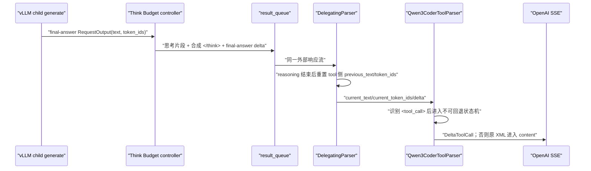

# Think Budget 工具调用流式解析修复与服务器验证方案

## 1. 设计目的

本方案针对 vLLM `v0.23.0`、`qwen3` reasoning parser、`qwen3_coder` tool parser
和 Think Budget 控制器组合下的概率性工具调用解析失败。目标不是让控制器重新实现
Qwen 工具协议，而是恢复以下边界契约：

> Think Budget 只改变可见思考的长度；控制器提交给原生 reasoning/tool parser 的
> 逻辑 token 序列、结构标记、增量顺序、结束状态和多轮消息语义，应与模型完成一次
> 原生生成时一致。

设计起点为 2026-08-13 工作区，目标上游为固定的 vLLM `v0.23.0`
（`0fc695fc6d1d82e9a5ac6835ac8e4e1c83703665`）。本机没有目标模型和 NPU，本文的
“本地通过”只指无模型单元测试；根因闭环和发布结论必须由服务器实验完成。

## 2. 现有证据与根因分层

### 2.1 已实测

[`chunks-4-fail.jsonl`](tool_call/chunks-4-fail.jsonl) 显示：

- 第 7～23 行把 `function=bash>... </tool_call>` 送入 `delta.content`，没有任何
  `delta.tool_calls`；
- 拼接 `content` 后，工具 XML 前缺少 `<tool_call>\n<`；
- 第 25～26 行又出现 `\nuser\n<t`，属于一个 assistant 工具调用回合之后不应暴露的
  role 尾流；
- 同一请求在未开启压缩时正常，开启压缩约 5% 概率失败。

这证明了“原生 parser-facing 等价”没有闭合，但客户端 SSE 本身不能判断标记是在
engine 输出、控制器队列还是 `DelegatingParser` 内丢失。

### 2.2 源码确定

数据路径如下：



由目标源码可以确定：

1. `DelegatingParser.parse_delta()` 在 reasoning 结束的 delta 内提取剩余
   `current_text/current_token_ids`，随后交给 tool parser，并在第一次交接时清空 tool
   侧历史；
2. `Qwen3CoderToolParser.extract_tool_calls_streaming()` 同时以 token-id 或字符串检测
   `<tool_call>`，但进入状态后仍依赖累计字符串定位 `<tool_call>` 和 `<function=`；
3. 该 parser 使用 `if not previous_text` 推断新流并重置状态。空文本是合法增量，并不
   等价于新请求；若结构 token 已从 token-id 被识别、其文本却没有进入累计字符串，
   下一批文本可触发二次重置，之后 XML 会作为普通 `content` 泄漏；
4. Think Budget 把多个 child generation 和一个合成 reasoning 边界串成一个外部流，
   因而比单次原生生成多出 parser 必须跨越的空文本/子请求边界；
5. `ChatCompletionRequest.to_sampling_params()` 在 vLLM `v0.23.0` 已正确设置
   `stream=True → DELTA`、`stream=False → FINAL_ONLY`，因此“控制器忘记设置
   output_kind”不是当前根因；
6. 多轮 request 的 `messages` 由原生 `render_chat_request()` 生成一次
   `engine_inputs`，控制器没有重排消息；scene 分类会逆序寻找最新 user 消息，而不是把
   最后的 tool result 当 user。多轮本身没有发现静态丢失，但过去缺少协议级回归测试。

### 2.3 待服务器证实的最小根因

当前最强假设是：final-answer 的某个 speculative batch 中，`token_ids` 已含
`<tool_call>`，但增量 `output.text` 只暴露其后缀（失败样本对应 `f`），导致 tool
parser 的 token-id 状态和累计字符串状态分叉。概率性来自 batch/增量边界，而不是
任务内容本身。

服务器日志必须在以下三个候选中作唯一裁决：

| 裁决 | `TB_TOOL_STREAM.raw_text/token_ids` | `parser_text` | SSE | 结论 |
| --- | --- | --- | --- | --- |
| A | token-id 有 start，raw text 缺 start | 修复后有 start | 有 tool call | 控制器边界文本/token 不一致，当前修复命中 |
| B | token-id 和 raw text 都缺 start | 仍缺 start | 无 tool call | final child/structured-output 生成已缺标记，继续查 engine 请求状态 |
| C | parser text 完整含 start/function | 完整 | 无 tool call | 原生 Delegating/Qwen parser 状态错误，需要最小上游补丁 |

在取得 `TB_TOOL_STREAM` 之前，不把 A 写成“服务器实测根因”。

## 3. 修复设计

### 3.1 Parser-facing 结构文本恢复

实现位于
`think_budget_vllm_adapter/deer_think_budget/context.py` 的
`RequestStateContext.stream_output()`：

1. 只处理 `phase=final_answer` 且请求确实带 tools 的输出；
2. 从同一 tokenizer 的 vocab 获取 `<tool_call>`、`</tool_call>` token-id；
3. 只有 delta token-id 含结构 token、原 `text` 缺少其字面量时才尝试恢复；
4. 用同一批 token-id、`skip_special_tokens=False` 解码；只有解码文本包含全部缺失标记，
   且以原文本结尾时才替换 parser-facing `text`；
5. 浅拷贝 `RequestOutput` 和第一个 completion，不修改 engine 原对象、token-id、metrics、
   finish/stop reason；普通 delta 不拷贝也不改写；
6. 流式与非流式都经过相同 result queue，因此非流式完整 parser 也获得同一修复。

这不是第二套 tool parser。它只恢复可由同批 token-id 无歧义推出的结构文本；若 token-id
本身缺失或解码结果与原文本不是后缀关系，则保持原样并由服务器裁决继续处理。

### 3.2 多轮请求边界

多轮请求必须保持以下不变量：

- system/user/assistant/tool 消息顺序不变；
- assistant `tool_calls[].id` 与后续 tool `tool_call_id` 一一对应；
- 只把生成中的思考 token 和一次 closing suffix 追加到已渲染 assistant 前缀；
- hidden probe 使用浅拷贝 child prompt，不能污染主 prompt；
- final child 复用 LoRA、priority、DP rank、trace headers、reasoning/parser kwargs 和原生
  sampling 参数；
- 工具调用后不得出现 role 尾流，不能把 `stop`、Judge 错误和 parser failure 合并统计。

专用 replay 工具在发请求前检查历史 tool-call ID 闭合，避免把非法输入误判为 DTB
错误。

## 4. 独立 DEBUG 遥测

启动服务前设置：

```bash
export TB_TOOL_STREAM_DEBUG=1
```

控制器会在 result queue、也就是原生 `DelegatingParser` 消费之前打印一行：

```text
TB_TOOL_STREAM {json}
```

schema 1 字段包括：

```text
source=controller_pre_parser
parent_request_id / child_request_id / phase / sequence
raw_text / parser_text / decoded_token_text
raw_text_sha256 / parser_text_sha256 / token_ids / repaired_tags
finish_reason / stop_reason
```

它与 `TB_PHASE` 完全独立，不改变
[`think_budget_generalization_plan.md`](../design/think_budget_generalization_plan.md)
的性能 telemetry schema 和提取器。该日志含模型正文与工具参数，可能包含敏感信息；只在
隔离排障窗口开启，限制日志访问，完成分析后按环境的数据保留规则删除，禁止进入常规
性能归档。

## 5. 专用复现和分析工具

### 5.1 旧脚本问题

原 [`test.py`](tool_call/test.py) 只能对每行发送一次请求，并把“是否出现过任意
tool_calls delta”作为唯一判断；它不能区分 XML 泄漏、参数 JSON 不完整、tool 后内容、
finish reason 或非法多轮历史。此外原脚本引用了未定义的 `args.api_key`，且默认总会
清空 chunk 文件。这两个直接问题已修正，但后续裁决使用新工具。

### 5.2 重复 paired replay

[`replay_tool_calls.py`](tool_call/replay_tool_calls.py) 提供：

- 同一 JSONL 行按 Vanilla/DTB 顺序重复回放；
- 每次请求显式唯一 `request_id`；
- 保存原始 SSE 行和解析 chunk；
- 按 tool index 重组 name/arguments，并验证 arguments 是完整 JSON；
- 检测 XML 泄漏、预期 tool call 缺失、tool delta 后 content、role 尾流和错误
  `finish_reason`；
- 请求前验证多轮 assistant tool-call ID 与 tool result ID 的对应关系；
- 输出 `manifest.json`、`chunks.jsonl`、`summary.jsonl`，异常时返回非零退出码。

### 5.3 服务日志关联

[`analyze_tool_call_run.py`](tool_call/analyze_tool_call_run.py) 按 response request ID
从共享 `server.log` 提取 `TB_TOOL_STREAM`，将控制器 raw/parser 文本与 SSE 结果关联，
输出 `analysis.json` 和 A/B/C 类裁决。它不是性能 telemetry 提取器，也不应接入
`tools/extract_tb_phase_metrics.py`。

## 6. 服务器执行方案

### 6.1 固定实验身份

每轮先记录：

```bash
python - <<'PY'
import json, platform, torch, vllm
try:
    import vllm_ascend
    ascend = getattr(vllm_ascend, "__version__", "unknown")
except Exception as exc:
    ascend = f"unavailable:{exc}"
print(json.dumps({
    "python": platform.python_version(),
    "vllm": vllm.__version__,
    "vllm_ascend": ascend,
    "torch": torch.__version__,
}, ensure_ascii=False))
PY
git -C /opt/p00906181/TB-main rev-parse HEAD
git -C /path/to/vllm rev-parse HEAD
git -C /path/to/vllm-ascend rev-parse HEAD
```

同时记录模型路径/权重 revision、CANN、torch-npu、启动参数、seed、MTP、并发、prefix
cache 和代码 dirty 状态。本次是正确性排障，不能把 paired replay 的时延作为性能结论。

### 6.2 启动

用 [`start.sh`](tool_call/start.sh) 的既有参数启动，排障 run 额外开启日志：

```bash
cd /opt/p00906181/TB-main
TB_TOOL_STREAM_DEBUG=1 bash docs/debug/tool_call/start.sh
```

确认 `server.log` 中只有一个目标服务进程，并保存启动头、版本和 controller 配置。

### 6.3 第一轮：原问题 paired 复现

5% 事件在 100 次中至少出现一次的理论概率约为 99.4%。先串行执行，避免并发改变分片和
归属：

```bash
python docs/debug/tool_call/replay_tool_calls.py \
  --file docs/debug/tool_call/task29-pass1-26.jsonl \
  --start 4 --end 4 \
  --repetitions 100 \
  --mode both \
  --url http://127.0.0.1:9000/v1/chat/completions \
  --model qwen3.6-27b \
  --output-dir docs/debug/tool_call/run_after_fix
```

随后关联服务日志：

```bash
python docs/debug/tool_call/analyze_tool_call_run.py \
  docs/debug/tool_call/run_after_fix \
  server.log
```

回传 `manifest.json`、`summary.jsonl`、`chunks.jsonl`、`analysis.json` 和仅含对应 request
ID 的 `TB_TOOL_STREAM`/`TB_ERROR`/`TB_ROUTE` 日志。不要上传无关请求正文。

### 6.4 第二轮：定位分片敏感性

只在第一轮仍失败或需要证明概率来源时执行：

1. 保持模型、请求、seed、sampling、并发和 cache 不变；
2. 建立“修复前 DTB / 修复后 DTB / Vanilla”三个独立服务 run；
3. MTP 关闭只作为 parser 分片诊断对照，不作为 vLLM `v0.23.0` 性能变量或生产建议；
4. 每个 cell 至少 100 次，分别统计 hard failure 率及 95% 置信区间；
5. 若关闭 MTP 仅改变失败概率而 A 类日志成立，结论仍是前端 text/token 边界未闭合，
   不能归因为 vLLM `v0.20.2` 的历史 MTP 性能 bug。

### 6.5 第三轮：协议矩阵

修复候选必须覆盖：

| 维度 | 样例 |
| --- | --- |
| stream | `true`、`false` |
| 对话 | 单轮 user、多轮 assistant tool call → tool result → 下一工具调用 |
| 工具数 | 单工具、55 工具、连续/并行多个 tool call |
| 输出 | 纯 content、reasoning + content、reasoning + tool call |
| 边界 | start token 单独一批、start + `<f` 同批、完整 parameter 同批、空文本 delta |
| 终止 | 正常 EOS、tool call、max_tokens、客户端取消 |

非流式可使用同一 request body 将 `stream=false`，检查最终 `message.tool_calls`、content、
finish reason 和 arguments JSON。服务端尚无自动模型矩阵脚本时，先由 replay 工具覆盖
流式主路径，并把非流式结果保存为独立 JSONL，不能口头宣称已通过。

## 7. 验收与回滚

### 7.1 发布门

目标请求至少满足：

```text
DTB 100/100 返回至少一个 tool_call
tool_xml_leaked_to_content = 0
invalid_tool_arguments_json = 0
content_after_tool_delta = 0
role_tail_in_content = 0
tool_call_without_tool_calls_finish_reason = 0
服务器 TB_ERROR = 0
```

协议矩阵中流式与非流式的 tool name、arguments JSON、content/reasoning 分区和结束语义
一致；Vanilla 不得因本修复回归。还需确认普通非工具请求没有 `repaired_tags`，修复不会
改变 token 数、phase 账本或 `TB_PHASE` schema。

### 7.2 根因闭环条件

只有出现以下完整证据链才可写“根因已实测”：

```text
同一 parent/child/sequence 的 raw_text + token_ids
→ parser_text 是否恢复
→ SSE tool_calls/content/finish_reason
→ 修复前失败与修复后成功的重复统计
```

若落入 B 或 C：保留本次诊断产物，暂不宣称当前适配器修复完成；B 回到 final child 的
structured-output/reasoning_ended/stop 配置，C 为 vLLM `v0.23.0` 制作最小 parser
回归测试和补丁。不得用吞掉异常 content 或事后正则拼 tool call 作为发布修复。

回滚只需撤销 parser-facing 文本恢复；`TB_TOOL_STREAM_DEBUG` 默认为关闭，可独立关闭，
不影响 `TB_PHASE`。

## 8. 本地验证状态

截至 2026-08-13：

- 已知失败 chunks 的离线分类测试通过；
- parser-facing 结构标记恢复、源对象不变、普通 final delta 不改写和 debug 日志测试通过；
- adapter 状态机和 prompt-copy 相关无模型测试通过；
- Python 语法检查通过；
- 未在本机运行目标 tokenizer、vLLM parser 或真实模型/NPU 测试。

## 9. 变更历史

| 日期 | 变更 | 原因 |
| --- | --- | --- |
| 2026-08-13 | 建立 parser-facing 等价契约、保守结构文本恢复、独立日志、paired replay 和服务器验收矩阵 | 修复压缩模式概率性工具调用 XML 泄漏 |
