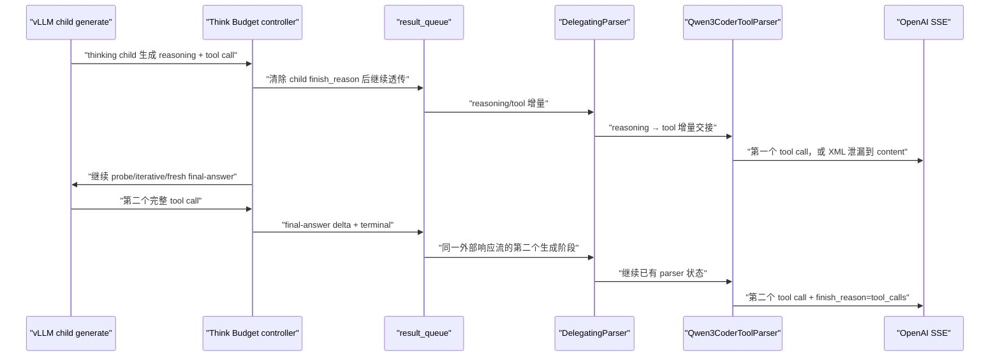
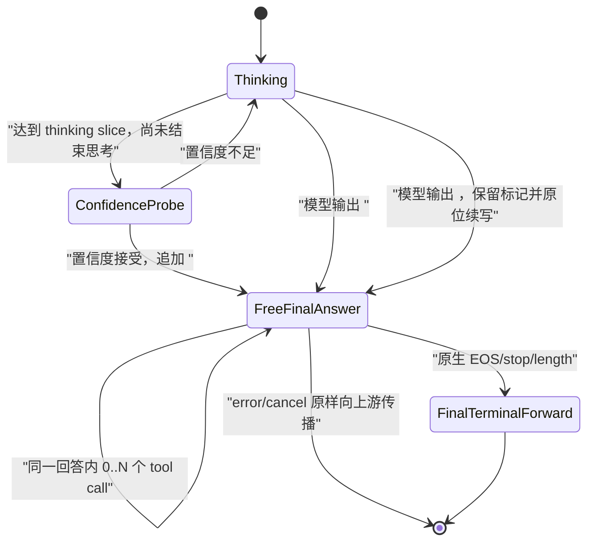

# Think Budget 工具调用流式解析修复与服务器验证方案

## 1. 设计目的

本方案针对 vLLM `v0.23.0`、`qwen3` reasoning parser、`qwen3_coder` tool parser
和 Think Budget 控制器组合下的概率性工具调用解析失败。目标不是让控制器重新实现
Qwen 工具协议，而是恢复以下边界契约：

> Think Budget 只改变可见思考的长度；控制器提交给原生 reasoning/tool parser 的
> 逻辑 token 序列、结构标记、增量顺序、结束状态和多轮消息语义，应与模型完成一次
> 原生生成时一致。

这里的“结束状态”不仅指最终只有一个 `finish_reason`，还包括最后一个 child
`RequestOutput` 中正文、`token_ids` 与 `finished/finish_reason/stop_reason` 的绑定关系。
DTB 可以消费中间 child 的终止，但不得把最终 child 的一个非空 terminal 人工拆成
“未结束正文 + 合成空 terminal”，也不得为了推动 parser 注入空白、重复结构标记或重分片
Qwen XML。

设计起点为 2026-08-13 工作区，目标上游为固定的 vLLM `v0.23.0`
（`0fc695fc6d1d82e9a5ac6835ac8e4e1c83703665`）。本机没有目标模型和 NPU，本文的
“本地通过”只指无模型单元测试；根因闭环和发布结论必须由服务器实验完成。

## 2. 现有证据与根因分层

### 2.1 已实测

[`chunks-4-fail.jsonl`](tool_call/chunks-4-fail.jsonl) 显示：

- 第 7～23 行把 `function=bash>... </tool_call>` 送入 `delta.content`，没有任何
  `delta.tool_calls`；
- 拼接 `content` 后，工具 XML 前缺少 `<tool_call>\n<`；
- 第 25～26 行又出现 `\nuser\n<t`，属于一个 assistant 工具调用回合之后不应暴露的
  role 尾流；
- 同一请求在未开启压缩时正常，开启压缩约 5% 概率失败。

这证明了“原生 parser-facing 等价”没有闭合，但客户端 SSE 本身不能判断标记是在
engine 输出、控制器队列还是 `DelegatingParser` 内丢失。

2026-08-13 的
[`run_after_fix`](tool_call/run_after_fix) 对同一多轮请求执行了 100 次 Vanilla/DTB
paired replay。环境与原复现环境一致，本轮不再使用 manifest 解释差异。结果如下：

| 结果 | Vanilla | DTB |
| --- | ---: | ---: |
| 请求数 | 100 | 100 |
| 至少返回一个结构化 tool call | 100 | 100 |
| 任意协议异常 | 0 | 98 |
| XML 泄漏并带 role 尾流 | 0 | 48 |
| tool delta 后继续输出 content | 0 | 50 |
| arguments JSON 不完整 | 0 | 10 |

DTB 的 52 个响应解析出了两个 tool call；另外 48 个响应把第一个工具调用 XML 泄漏到
`content`，随后又解析出 final-answer child 生成的第二个 tool call。已有分析器报告的 2 个
`pass` 也包含两个来自不同 child generation 的 tool call，只是没有命中现有 content
异常规则，因而是验收假阳性。

`analysis.json` 还证明：100/100 DTB final-answer 的 `raw_text` 和 `parser_text` 都包含一对
完整 `<tool_call>...</tool_call>`，保守恢复触发次数为 0。因此，“final-answer 在进入
parser 前缺少结构文本”已被本轮实验否定；需要分析的是 final-answer 之前的可见 thinking
child，以及控制器为何在第一次工具调用之后继续运行。

2026-08-14 的
[`run_after_terminal_fix`](tool_call/run_after_terminal_fix) 在相同请求和环境上再次完成
100 次 Vanilla/DTB paired replay：

| 结果 | Vanilla | DTB |
| --- | ---: | ---: |
| 请求数 | 100 | 100 |
| 完整通过 | 100 | 78 |
| completion epoch 和 terminal flush 均为 1 | 100 | 100 |
| 缺少 `<tool_call>\n<` 并把 XML 泄漏到 content | 0 | 13 |
| 已识别 tool call，但 arguments JSON 缺最后一个 `}` | 0 | 9 |
| role 尾流、tool 后 content、terminal 后 chunk | 0 | 0 |

本轮 100 个 DTB 请求的 reasoning boundary 全部是 `think_end`，`tool_call` boundary 覆盖数
为 0。因此，本轮实测证明当时设计的
`</think> → FreeFinalAnswer → TerminalFlush` 在“单 completion、单终止计数”上闭合，但后续
证据否定了 TerminalFlush 的 parser-facing 等价性；`Thinking → <tool_call> boundary` 分支仍需
独立服务器覆盖。分析器中
`no_fresh_final_after_tool_boundary=100` 在该 run 是无覆盖条件下的真值，不能单独证明
`<tool_call>` 分支通过。

13 个 XML 泄漏请求的 final-answer child raw text 都直接从 `function=bash>` 开始，固定
缺少 `<tool_call>\n<`；所有 controller raw/forwarded 哈希相同。9 个 JSON 异常的模型 raw
XML 均包含完整的 `</parameter></function></tool_call>`，只有 parser 生成的 arguments 缺少
闭合 `}`。前者属于本轮要解决的增量交接问题；后者属于独立的 parser finalization 问题，
不能按模型 JSON 能力忽略。

stop-boundary alignment 落地后的第 4 轮
[`run_after_handoff_fix`](tool_call/run_after_handoff_fix) 再次对第 4 条请求执行 100 次
Vanilla/DTB paired replay：

| 结果 | Vanilla | DTB |
| --- | ---: | ---: |
| 请求数 | 100 | 100 |
| 至少返回一个结构化 tool call | 100 | 100 |
| XML 泄漏、预期 tool call 缺失 | 0 | 0 |
| completion epoch、terminal flush 均为 1 | 100 | 100 |
| stop-boundary alignment 命中 | 不适用 | 100 |
| `<tool_call>` reasoning boundary 覆盖 | 不适用 | 0 |
| 完整通过 | 100 | 88 |
| arguments JSON 缺最后一个 `}` | 0 | 12 |

100 个 alignment 中，86 个丢弃 `[271]`，14 个丢弃
`[271, 248058, 198, 27]`；全部满足 raw IDs = forwarded IDs + dropped IDs、text 哈希不变、
controller passthrough violation 为 0。该结果实测证明历史 13 次 `<tool_call>` 前缀交接缺失
已经在本次 `think_end → final_answer` 路径消失；模型在 thinking child 内直接命中
`<tool_call>` boundary 的分支仍无服务器覆盖，不能由本轮外推为已通过。具体 ID 对应文本仍
可用相同 revision 的 Qwen3.6-27B tokenizer 离线确认，但不再影响“对齐前后 token 前缀关系
正确”的裁决。

剩余 12 次失败的 raw XML 全部各有一对完整 `<tool_call>`、`<function>` 和闭合标签，
source finish 均为 `stop`。失败时最后一个 raw delta 同时完成最后一个
`</parameter>`、`</function>` 和 `</tool_call>`；成功样本则由后一个 delta 单独补完
`</function>`。SSE 在失败样本中已经发出函数名、`{` 和全部参数，只缺 parser 生成的 `}`。
这证明故障由最后参数与闭合标签的 delta 分片触发，不是模型 JSON 能力；但当前 DTB 还改变了
最终非空 delta 与 `finished=True` 的绑定关系，因此在恢复原生终止行为前，不能把责任只归给
原生 parser。

第 14 条 attempt 1 的客户端 chunk 对比把现象缩小到一个字符：Vanilla 依次输出最后一个
`workdir` 参数、独立的 `arguments="}"`、再输出空的 `finish_reason="tool_calls"`；DTB 输出
最后一个 `workdir` 参数后直接进入 `finish_reason="tool_calls"`。DTB telemetry 同时证明其
final child 的真实最后一批并非空 delta，而是
`ter>\n</function>\n</tool_call>`，携带非空 token IDs 和 source `finish_reason=stop`；控制器先
清除终止字段把它作为 `terminal_body` 发送，再构造 `text=""/token_ids=[]` 的 terminal。
因此“客户端最后收到空 finish chunk”不能反推“parser 输入端应人工发送空 delta”：Vanilla
的 `}` 已由之前的非空闭合标签输入产生，而 DTB 的空 terminal 到达时 parser 尚未完成关闭。

commit `821ded` 还提供了直接反事实：第 23 条 attempt 3（失败）与 attempt 4（成功）的完整
`raw_visible_text` 逐字符相同，均为 955 字符；失败样本最后一批是
`ter>\n</function>\n</tool_call>`，成功样本把最后参数尾部和 `</function>` 分到相邻两批。
最终 SSE arguments 长度分别为 460 和 461，唯一差异就是缺失的 `}`。同一模型文本仅因
合法 delta 分片不同而得到不同结构化结果，已经排除模型内容差异。

全集旧 [`test.py`](tool_call/test.py) 单次运行曾报告第 11、14、21、23 条为“DTB 无
tool_call、Vanilla 有 tool_call”。commit `821ded` 随后的逐场景 5 次 paired replay 结果为：

| 行号 | Vanilla | DTB | DTB 的实际异常 |
| ---: | --- | --- | --- |
| 11 | 5/5 有完整 tool call | 5/5 有 tool call | 5/5 final child 恰好生成 2048 token 后 `length`；第 6 个 tool XML 未闭合 |
| 14 | 5/5 有完整 tool call | 5/5 有 tool call | 5/5 raw XML 完整、arguments 缺 `}` |
| 21 | 5/5 有完整 tool call | 5/5 有完整 tool call | 0/5 协议异常 |
| 23 | 5/5 有完整 tool call | 5/5 有 tool call | 1/5 raw XML 完整、arguments 缺 `}` |

因此“这四条存在稳定的无 tool-call 缺陷”没有被重复实验复现，不能把旧脚本的四个布尔值
直接归到同一个 parser 根因。旧脚本不会区分请求错误、普通 content、XML 泄漏、arguments
损坏或真正未调用工具，也没有唯一 request ID 和可关联 telemetry；若当时未显式覆盖 URL，
其默认 `71.77.153.223:41016` 还与 paired manifest 的 `127.0.0.1:9000` 不同。该一次性观察
只能作为待复现信号，不能覆盖 commit `821ded` 的结构化证据。

第 11 条则发现了独立且确定的预算语义错误：DTB 5 次 final child 均恰好生成 2048 token，
而 Vanilla 第一次 paired completion 使用 3958 token 并完成 13 个 tool calls；DTB 只生成
6 个 tool-call start、5 个 end。`max_tokens=32000` 且上下文仍有空间，但
`_FinalAnswerState` 又用默认 `final_answer_max_tokens=2048` 截断最终阶段。这直接违反“只缩短
思考、不额外缩短最终逻辑答案”的原生等价原则。

### 2.2 源码确定

数据路径如下：



由目标源码可以确定：

1. Qwen3 reasoning parser 把 `</think>` 视为显式思考结束，把 `<tool_call>` 视为隐式
   思考结束；后者同时是最终工具调用正文的开始，而不是 thinking 内容；
2. 终止语义修复前，thinking child 的 sampling stop 只加入 `</think>`；`consume_output()` 清除所有
   可见 child delta 的 `finish_reason/stop_reason`，状态机也只对
   `stop_reason == </think>` 作特殊处理。因此，thinking child 已进入或完成工具调用后，
   控制器仍会把 tool XML 追加为 thinking，继续 confidence probe、iterative thinking，
   最后再启动 fresh final-answer；
3. `DelegatingParser.parse_delta()` 在 reasoning 结束的 delta 内提取剩余
   `current_text/current_token_ids`，随后交给 tool parser，并在第一次交接时清空 tool
   侧历史；
4. `Qwen3CoderToolParser.extract_tool_calls_streaming()` 同时以 token-id 或字符串检测
   `<tool_call>`，但进入状态后仍依赖累计字符串定位 `<tool_call>` 和 `<function=`；
5. 该 parser 使用 `if not previous_text` 推断新流并重置状态。空文本是合法增量，并不
   等价于新请求；若结构 token 已从 token-id 被识别、其文本却没有进入累计字符串，
   下一批文本可触发二次重置，之后 XML 会作为普通 `content` 泄漏；
6. Think Budget 把多个 child generation 和一个合成 reasoning 边界串成一个外部流，
   因而比单次原生生成多出 parser 必须跨越的空文本/子请求边界；
7. `ChatCompletionRequest.to_sampling_params()` 在 vLLM `v0.23.0` 已正确设置
   `stream=True → DELTA`、`stream=False → FINAL_ONLY`，因此“控制器忘记设置
   output_kind”不是当前根因；
8. 多轮 request 的 `messages` 由原生 `render_chat_request()` 生成一次
   `engine_inputs`，控制器没有重排消息；scene 分类会逆序寻找最新 user 消息，而不是把
   最后的 tool result 当 user。多轮本身没有发现静态丢失，但过去缺少协议级回归测试。
9. vLLM v1 detokenizer 在一个 speculative batch 中依次把全部 `new_token_ids` 加入内部
   token 序列，再检测 stop string；命中 stop 时只把 `output_text` 截断到 stop string 末尾，
   不同步删除该批中 stop 后的 token IDs。`OutputProcessor` 随后可能构造出
   `text="...</think>"`，但 `token_ids` 仍包含
   `</think><tool_call>\n<` 的 `CompletionOutput`；
10. DTB 的 `consume_output()` 过去原样转发这组不一致的 `text/token_ids`，
    `append_thinking()` 又把全部 token IDs 追加到 continuation prompt。final-answer child
    因而认为 `<tool_call>\n<` 已经存在，从 `function=bash>` 继续生成，但 parser-facing text
    从未收到该前缀；
11. `_FinalAnswerState` 当前把 final child 的非空 terminal 拆成两条 parser-facing 输出：第一条
    保留原始 `text/token_ids`，但清除 `finish_reason/stop_reason` 并设置 `finished=False`；第二条
    清空 `text/token_ids`，恢复原始终止字段并设置 `finished=True`。原生 chat serving 则把
    `output.text/output.token_ids` 与 `finished = output.finish_reason is not None` 在同一次
    `DelegatingParser.parse_delta()` 调用中交付。两者终止语义不等价。
12. `Qwen3CoderToolParser` 的 parameter 循环虽然能在一个 speculative delta 中处理全部
    完整参数，但只要产生 `json_fragments` 就立即返回，不能在同一次调用继续执行后面的
    `</function>` 收尾分支。terminal-only 空 delta 又被 parser 顶部的
    `if not delta_text` 直接返回；`DelegatingParser(finished=True)` 的 remaining-args 兜底也
    因没有可追加的 tool delta、且 parser 尚未把完整参数写回 `prev_tool_call_arr` 而无效。
    `finished=True` 只能追加已经解析但尚未 streamed 的差值，不会让 tool parser 继续消费
    尚未执行的状态转换。
13. Vanilla SSE 中独立的空 finish chunk 位于 parser 之后；它只能证明 OpenAI 响应可以用空
    chunk 携带最终 `finish_reason`，不能证明 parser 之前的 engine/queue 层存在“空 delta
    flush”协议。原设计混淆了 parser 输入的 `RequestOutput` 与 parser 输出后的 SSE chunk。
14. `_FinalAnswerState` 当前使用
    `min(remaining_context, final_answer_max_tokens, requested_limit)`，默认
    `final_answer_max_tokens=2048`。它没有把外部 `max_tokens` 解释成整个逻辑 completion 的
    剩余额度，而是在完成压缩思考后给 final child 施加新的 2048 硬上限；第 11 条复现的
    `generated_tokens=2048` 和 `finish_reason=length` 与此完全一致。
15. Chat serving 只要已经流出任意 tool delta，就把终止原因改成 `tool_calls`，即使底层
    `output.finish_reason` 实际是 `length`。因此第 11 条未闭合的第 6 个工具调用被错误包装为
    `finish_reason="tool_calls"`，进一步掩盖了内部 final-answer 截断。

### 2.3 根因结论与证据边界

当前证据区分出四个缺陷；前两个已经修复，后两个仍阻塞最终发布：

1. **终止语义错误（修复前主因，实测 + 源码确定）。** `</think>` 和 `<tool_call>` 都是思考
   结束边界；前者进入普通最终回答，后者进入工具调用形式的最终回答。修复前 DTB 只接受
   `</think>`，并在第一次工具调用后继续状态机，造成重复生成、role 尾流和第二个
   fresh tool call。
2. **增量交接问题（历史失败路径已由第 4 轮实测修复）。**
   `run_after_terminal_fix` 的 13 次失败都在 final-answer child raw text 中固定缺少
   `<tool_call>\n<`。vLLM 源码确定 stop string 可以只截断 text、不截断同批 token IDs；DTB
   源码确定这些额外 token IDs 会同时进入 parser 和 continuation prompt。stop-boundary
   alignment 后 100/100 命中对齐、100/100 不再泄漏 XML，已经闭合 `think_end` 路径的该
   根因；`<tool_call>` reasoning boundary 分支仍需定向覆盖。token ID 的离线文本解码只用于
   增强可读性，不再是修复成立的必要条件。
3. **终止绑定与参数 finalization 问题（DTB 违约已实测并由源码确定；parser 责任待离线
   裁决）。** 第 4 轮 12 次以及额外第 14、23 条复现的 raw XML 完整，arguments 只缺 parser
   负责生成的最终 `}`。当前 DTB 已确定把非空 source terminal 改写为未结束正文，再发送合成
   空 terminal；空 terminal 不能推动 Qwen parser 越过 parameter fragment 的提前返回。恢复
   原生终止绑定后，必须用同一逻辑文本、同一 token 序列的合法分片等价测试判断当前 parser
   是否仍依赖“闭合标签另占一个非空 delta”。在该测试完成前不修改原生 parser，也不把本项
   简化为单一 parser 根因。
4. **最终答案预算与 finish 语义错误（实测 + 源码确定，待修复）。** 默认 2048 final-child
   上限可在外部 `max_tokens` 和上下文仍充足时截断工具序列；serving 随后又将已经流出工具
   header 的 `length` 覆盖成 `tool_calls`。第 11 条 5/5 稳定复现该问题。它既可能产生损坏的
   tool call，也可能在模型较晚开始工具 XML 时表现为旧脚本所称的“无 tool_call”。

修复顺序为：先恢复正确的思考边界和 stop-boundary `text/token_ids` 对齐；然后**只修改
DTB**，取消人工 terminal 拆分并原样透传 final child 的真实 terminal；再构造离线无模型
分片等价测试，在原生 parser 不变的条件下比较合法分片；只有测试证明恢复 DTB 契约后 parser
仍对分片敏感，才单独评审最小上游 parser 修复。最终答案预算与真实 finish reason 作为独立
问题后续处理，不与本轮 terminal/parser 裁决混合。

## 3. 修复设计

### 3.1 取消 parser-facing 保守恢复

删除 `RequestStateContext.stream_output()` 中根据 Qwen 结构 token-id 重新解码并改写
`output.text` 的逻辑，同时删除对应的 `parser_structural_token_ids`、`decoded_token_text`
和 `repaired_tags` 语义。原因是：

- `run_after_fix` 中恢复逻辑 0 次命中，不能解释或修复实测故障；
- adapter 不应理解并重写 Qwen 工具协议；
- 重新解码会掩盖真正的 child 终止、增量来源和 parser 状态问题；
- 原生 parser-facing 等价要求 DTB 透传模型的逻辑 token 序列，而不是在 parser 前猜测
  缺失结构。

`stream_output()` 仍可为清除中间 child 的终止字段而浅拷贝对象，但不得改写非空
`text/token_ids`。唯一例外是 3.3 定义的内部 stop boundary 对齐：它不补写或重解码文本，
只丢弃已经被 vLLM stop string 从可见文本截掉、因 speculative batch 仍残留在 token IDs
中的非逻辑后缀。

### 3.2 统一思考结束边界

定义 `ReasoningBoundary`：模型从 thinking 转入最终答案的逻辑事件。当前模型至少有两类：

| 边界 | 含义 | 最终阶段入口 |
| --- | --- | --- |
| `</think>` | 显式结束思考 | 从标记之后自由生成普通 content 或 tool calls |
| `<tool_call>` | 隐式结束思考，同时是工具调用正文的第一个结构 token | 保留该标记一次，从标记之后原位续写工具调用 |

thinking child 的 stop 条件应保留请求原有 stop，再加入这两个 reasoning boundary；边界标记
必须进入外部逻辑 token 流和 continuation prompt，不能丢失或重复。`<tool_call>` 分支不得
再合成 `</think>`，也不得重新启动一个与已有工具调用无关的 fresh answer。

状态转换如下：



一旦进入 `FreeFinalAnswer`，禁止再进入 confidence probe、iterative thinking、合成 reasoning
boundary 或第二个 fresh final-answer child。自由生成阶段允许模型在同一回答中输出零个、
一个或多个连续 `<tool_call>...</tool_call>`；`</tool_call>` 不是控制器重新决策的边界。
这里的“自由生成”是从已累计 prompt 的 reasoning boundary 之后继续生成，使用剩余最终答案
预算和原生 sampling/stop 语义，不再受 thinking stride、probe 或置信度决策控制。

若 speculative delta 在同一批中包含 reasoning boundary 及其后缀，必须先区分两种情况：

- 后缀同时存在于 text 和 token IDs，且 child 并非因该 boundary stop：它是逻辑输出，整批
  只透传一次，boundary 及可见后缀计入 final answer，并原样进入 continuation prompt；
- `source_stop_reason` 等于 boundary、text 恰好结束于 boundary，但 token IDs 在 boundary
  后仍有后缀：后缀已被 vLLM stop 语义排除，不属于逻辑输出，必须在 queue 和 continuation
  prompt 前丢弃。

若工具调用已开始但 child 因内部切片上限结束，下一 child 只能从已进入逻辑输出的
`<tool_call>` 后原位续写，不得重新生成工具调用头。

### 3.3 stop boundary 的 text/token IDs 对齐

引入 **stop boundary alignment**：只修正 vLLM 内部 string-stop 产生的可见 text 与
生成 token IDs 不一致，不从 token IDs 猜测或恢复任何 parser-facing 文本。由于
`include_stop_str_in_output=true` 时 boundary 文本可以横跨多个 DELTA，不能假设终止
delta 自身包含完整 marker；实现必须同时维护 child 的累计 raw text/token IDs。

对 thinking child 的每个 delta，按以下条件和顺序执行：

```text
raw_text_so_far += current_raw_text
raw_token_ids_so_far += current_raw_token_ids
boundary = detect(current_raw_text, current_raw_token_ids, source_stop_reason)
if source_stop_reason == boundary.marker
   and raw_text_so_far 恰好结束于 boundary.marker
   and boundary.marker_ids 是 raw_token_ids_so_far 的最后一个精确子序列
   and marker_ids 后仍有 token:
       current_marker_end = cumulative_marker_end - previous_raw_token_count
       forwarded_text = current_raw_text
       forwarded_token_ids = current_raw_token_ids[: current_marker_end]
       dropped_token_ids = current_raw_token_ids[current_marker_end:]
else:
       forwarded_text/token_ids = current_raw_text/current_raw_token_ids
```

约束如下：

- 只作用于 DTB 新增的 `</think>`、`<tool_call>` thinking stop；不改写 final-answer delta、
  普通 length/EOS、无 boundary delta 或带可见 boundary 后缀的 delta；
- raw `RequestOutput` 不可原地修改；telemetry 必须同时保存 raw、forwarded 和 dropped IDs；
- queue、thinking 账本、主 prompt 和 final child prompt 必须使用同一份 aligned token IDs；
- boundary marker 在 text 中可见、却无法在 token IDs 中精确定位时立即报错，禁止静默猜测
  token 长度；
- marker 可以从前一个 delta 开始并在终止 delta 中结束；已经传给 parser 的前缀保持不变，
  只允许裁掉终止 delta 内 marker 之后的 token。若定位结果要求撤回既有 token，立即报错；
- 对齐后的 text 不变，forwarded IDs 必须是 raw IDs 的严格前缀，且丢弃数量必须大于 0；
- 该实现不依赖 `transformers`，运行时使用服务已经持有的 tokenizer 对 boundary marker
  编码。后续可在离线诊断环境用 `transformers.AutoTokenizer` 加载与服务端完全相同 revision
  的 Qwen3.6-27B 词表，对 `raw/forwarded/dropped_token_ids` 执行
  `convert_ids_to_tokens()` 和 `decode(skip_special_tokens=False)`，验证实际后缀文本；该验证
  不能成为生产运行时依赖。

### 3.4 final child 原生 terminal 原样透传

中间 child 的 `finish_reason` 可以被控制器消费，但整个外部 assistant completion 只能结束
一次。这个约束不要求 DTB 合成一个新的空 terminal：final-answer child 本身已经提供了整个
逻辑 completion 的真实 terminal，应直接作为唯一外部 terminal。

当前实现和目标实现的区别如下：

| 层次 | 当前实现 | 目标实现 |
| --- | --- | --- |
| final source terminal | 非空 `text/token_ids`，携带真实 finish/stop，`finished=True` | 保持不变 |
| 第一次 queue 输出 | 保留正文，清除 finish/stop，改成 `finished=False` | 不再构造 |
| 第二次 queue 输出 | 合成空 `text/token_ids`，恢复 finish/stop，`finished=True` | 不再构造 |
| parser-facing terminal | 正文与终止被拆成两次调用 | source terminal 原样一次交付 |

实现顺序只修改 DTB，不修改 `DelegatingParser` 或 `Qwen3CoderToolParser`：

1. thinking、probe 等中间 child 的 terminal 继续由控制器消费，不得提前结束外部 completion；
2. final-answer child 的非 terminal delta 仍按既有 stop-boundary 规则透传；
3. final-answer child 的 terminal `RequestOutput` 原样进入 result queue 一次，保留
   `text`、`token_ids`、`finish_reason`、`stop_reason` 和 `finished`；
4. 若引擎自然产生空 terminal，就原样透传该空 terminal；若引擎 terminal 含正文，禁止把它
   拆成正文和空 terminal；
5. 发送真实 terminal 后立即关闭 result queue，不得再发送 content、role、人工空 delta 或
   第二个 terminal。

人工空 delta 不再承担 parser flush 职责。原方案错误地把 `finished=True` 当成“让 tool
parser 继续消费累计文本”的 EOF 信号；实际 remaining-args 逻辑只能追加已经解析但尚未
streamed 的差值，不能推进 `Qwen3CoderToolParser` 尚未执行的 `</function>` 状态转换。

本阶段明确禁止：在 adapter 中识别 `</parameter>`/`</function>` 后人工拆分 delta、注入空格
或重复 closing tag、重新解码 token 后按 Qwen XML 重分片、在 SSE 后处理层补写 `}`。这些做法
即使能规避当前样本，也会把 adapter 变成模型专用 parser，并破坏层次一致性。

### 3.5 离线无模型分片等价测试与 parser 决策门

完成 3.4 后，保持固定 vLLM `v0.23.0` 的原生 parser 源码不变，在
`docs/debug/tool_call/` 增加离线无模型测试。测试不启动模型或推理服务，只构造 parser 所需
的最小 tokenizer/tool schema/request，并回放已归档的逻辑 XML、token IDs、delta 边界和
`finished` 标志。若最小 tokenizer stub 不能覆盖 token-id 分支，再使用与服务器相同 revision
的 `AutoTokenizer` 作为可选增强；下载模型权重不是测试前提。

同一条完整工具调用至少构造三种输入轨迹：

| 轨迹 | 最后参数与关闭标签 | terminal 绑定 | 用途 |
| --- | --- | --- | --- |
| `separate_close` | 最后参数和 `</function></tool_call>` 分属相邻非空 delta | 关闭标签后自然终止 | 已知成功分片基线 |
| `bundled_source_terminal` | 最后参数尾部与全部关闭标签在同一非空 delta | 该非空 delta 同时 `finished=True` | 恢复 DTB 后必须支持的原生形态 |
| `synthetic_empty_terminal` | 与上一轨迹正文分片相同 | 先清除非空 delta 的 finished，再追加人工空 terminal | 复现被取消方案，作为历史反例 |

三条轨迹必须满足：拼接后的输入 text 完全相同、拼接后的 token IDs 完全相同、各有且只有一个
`finished=True`。测试逐次记录 `DeltaMessage`、tool parser 关键状态和最终重组结果，并校验：

```text
tool call index/name 序列相同
拼接后的 arguments 字节相同
每个 arguments 均可 json.loads()
不存在 XML content 泄漏
不存在 terminal 后输出
```

测试的决策规则是：

- `separate_close` 与 `bundled_source_terminal` 都通过：原生 parser 在本问题上满足合法分片
  等价，不修改 parser；进入服务器 DTB 回归；
- `separate_close` 通过而 `bundled_source_terminal` 失败：在 DTB 已恢复原生终止绑定的前提
  下，证明 parser 对合法 speculative 分片敏感；此时才另立最小上游 parser 修复设计和测试，
  本阶段仍不修改 parser；
- 两者都失败：先核对离线 harness、累计 `previous/current/delta` 参数和 tokenizer stub，不能
  直接归因 parser；
- 离线两者都通过但服务器仍失败：说明实际 queue 输入尚未与 source terminal 等价，返回
  DTB telemetry 排查，不能通过修改 parser 掩盖。

`synthetic_empty_terminal` 的结果只用于解释历史失败，不作为原生 parser 必须支持的输入契约。
无论它是否通过，都不得恢复人工空 delta 方案。

### 3.6 多轮请求边界

多轮请求必须保持以下不变量：

- system/user/assistant/tool 消息顺序不变；
- assistant `tool_calls[].id` 与后续 tool `tool_call_id` 一一对应；
- 只把生成中的逻辑 token 和一次 reasoning boundary 追加到已渲染 assistant 前缀；
- hidden probe 使用浅拷贝 child prompt，不能污染主 prompt；
- final child 复用 LoRA、priority、DP rank、trace headers、reasoning/parser kwargs 和原生
  sampling 参数；
- 同一 assistant completion 内允许多个 tool calls，但进入工具调用最终阶段后不得重新进入
  thinking/probe；
- 工具调用后不得出现 role 尾流，不能把 `stop`、Judge 错误和 parser failure 合并统计。

专用 replay 工具在发请求前检查历史 tool-call ID 闭合，避免把非法输入误判为 DTB
错误。

### 3.7 最终答案预算与真实 finish reason

外部 `max_tokens/max_completion_tokens` 约束的是整个逻辑 assistant completion，而不是
每个 DTB child。压缩控制器可以减少可见 thinking，但不能再给 final child 施加默认 2048
上限。应维护 `emitted_completion_tokens`：只累计已经送入 parser 的 aligned 可见 token，
包括 synthetic `</think>`，不包含 hidden probe 和 stop 后 dropped IDs。final child 的额度为：

```text
external_remaining = requested_completion_limit - emitted_completion_tokens
answer_limit = min(model_context_remaining, external_remaining)
```

`final_answer_max_tokens` 应从默认生产路径移除或改为“仅显式配置才启用”的非等价安全策略；
默认值不能再是 2048。若保留显式 cap，telemetry 和响应必须标记实际生效的 cap，且对应实验
不能声称原生 parser-facing/生成预算等价。

若 final child 真实结束原因为 `length`，必须原样向 SSE 传播 `finish_reason="length"`。
即使此前已经流出 tool header，也不得改写为 `tool_calls`；未闭合的工具序列是 hard failure，
不能由 parser 猜测补齐。只有模型正常完成一个逻辑 tool-call 序列时才返回
`finish_reason="tool_calls"`（named tool choice 继续遵循原生语义）。预算计算在 adapter
实现；`length` 优先级修正在 vLLM chat serving 的最小 patch 中实现，二者不能互相替代。

## 4. 独立 DEBUG 遥测

启动服务前设置：

```bash
export TB_TOOL_STREAM_DEBUG=1
```

控制器会在 result queue、也就是原生 `DelegatingParser` 消费之前打印一行：

```text
TB_TOOL_STREAM {json}
```

取消保守恢复后，调试 schema 聚焦“原始 child 输出、stop boundary 对齐、状态转换、queue
透传和最终 SSE”的对应关系，当前实现已升级为 schema 3：

```text
source=controller_pre_parser
parent_request_id / child_request_id / phase / sequence
completion_epoch / reasoning_boundary / controller_state
raw_text / raw_text_sha256 / token_ids
source_finish_reason / source_stop_reason
forwarded_text_sha256 / forwarded_token_ids_sha256 / forwarded_token_ids
stop_boundary_aligned / alignment_dropped_token_ids / alignment_dropped_token_count
terminal_flush / next_state
```

3.4 实现时将 debug schema 升级为 schema 4；既有 schema 3 字段保持兼容，新增：

```text
raw_finished
forwarded_finish_reason / forwarded_stop_reason / forwarded_finished
terminal_origin=none|source|synthetic
final_terminal_passthrough
synthetic_terminal
```

`raw_text` 和 `token_ids` 必须取自清除中间终止字段之前的 child `RequestOutput`；
`source_finish_reason/source_stop_reason` 也必须保存原值。非 terminal 的
`forwarded_text/token_ids` 默认应与 raw 完全相同；唯一允许的差异是
`stop_boundary_aligned=true`，此时 text 哈希必须相同、forwarded IDs 必须是 raw IDs 的严格
前缀、`alignment_dropped_token_ids` 必须精确等于剩余后缀。任何不满足这些条件的差异都判为
controller 透传违约。`reasoning_boundary` 取 `none/think_end/tool_call`，用于证明模型首次
跨过思考边界后，控制器没有重新进入 thinking/probe。

final-answer source terminal 还必须满足 raw/forwarded 的 text、token IDs、finish、stop 和
finished 五项完全相同，`terminal_origin=source`、`final_terminal_passthrough=true`。任何
`terminal_origin=synthetic` 都是本轮 DTB 终止契约违约；引擎自然产生的空 source terminal
仍标记为 `source`，不能因为正文为空而误报为 synthetic。历史 `terminal_flush` 只用于读取
旧 run，不再作为新实现的成功指标。

schema 2 已经在 `server.log` 的 `token_ids` 字段保存 raw IDs；
`run_after_terminal_fix/analysis.json` 看不到 ID，是因为该归档没有 `server.log`，且旧分析器
只保存聚合文本，并非 schema 2 没有记录。schema 3 进一步显式保存 forwarded/dropped IDs；
`analyze_tool_call_run.py` 会把所有可见 sequence 的 raw/forwarded IDs 写入
`analysis.json.requests[].children[].stream_deltas`，并把 alignment sequence 的三组 IDs
写入 `analysis.json.requests[].stop_boundary_alignments`。因此下一轮即使不回传完整
`server.log`，也能重建跨 delta 的 token 序列并完成边界裁决。

它与 `TB_PHASE` 完全独立，不改变
[`think_budget_generalization_plan.md`](../design/think_budget_generalization_plan.md)
的性能 telemetry schema 和提取器。该日志含模型正文与工具参数，可能包含敏感信息；只在
隔离排障窗口开启，限制日志访问，完成分析后按环境的数据保留规则删除，禁止进入常规
性能归档。

预算修复需要在同一独立 debug 流增加 `event=final_answer_budget`，至少记录
`requested_completion_limit`、`emitted_completion_tokens`、`model_context_remaining`、
`configured_final_cap`、`effective_answer_limit` 和 `limit_source`。terminal 记录继续保存底层
`source_finish_reason`，分析器将其与最终 SSE finish reason 对账。字段只用于本问题裁决，
不改变既有 `TB_PHASE` 性能口径。

## 5. 专用复现和分析工具

### 5.1 旧脚本问题

原 [`test.py`](tool_call/test.py) 只能对每行发送一次请求，并把“是否出现过任意
tool_calls delta”作为唯一判断；它不能区分 XML 泄漏、参数 JSON 不完整、tool 后内容、
finish reason 或非法多轮历史。此外原脚本引用了未定义的 `args.api_key`，且默认总会
清空 chunk 文件。这两个直接问题已修正，但后续裁决使用新工具。

第 11、14、21、23 条的单次“无 tool_call”与随后 20/20 DTB 有 tool call 的 paired 结果
说明：`test.py` 的 `True/False` 只能用于筛选候选，不能作为根因或验收证据。若仍保留该入口，
至少必须显式指定与目标服务相同的 `--url`、保存 chunks、记录 request ID/status/finish
reason/content/reasoning；更推荐直接让它调用 paired replay 的 observation 逻辑，避免两套
判断标准继续分叉。

### 5.2 重复 paired replay

[`replay_tool_calls.py`](tool_call/replay_tool_calls.py) 提供：

- 同一 JSONL 行按 Vanilla/DTB 顺序重复回放；
- 每次请求显式唯一 `request_id`；
- 保存原始 SSE 行和解析 chunk；
- 按 tool index 重组 name/arguments，并验证 arguments 是完整 JSON；
- 检测 XML 泄漏、预期 tool call 缺失、tool delta 后 content、role 尾流和错误
  `finish_reason`；
- 请求前验证多轮 assistant tool-call ID 与 tool result ID 的对应关系；
- 输出 `manifest.json`、`chunks.jsonl`、`summary.jsonl`，异常时返回非零退出码。

当前实现已补充：

- 统计结构化 tool call 数量、tool index、terminal chunk 数量及其事件顺序；
- 允许一次 assistant completion 内存在 0～N 个 tool calls，不能把 `tool_calls.Count > 1`
  直接判错；
- 在预期工具调用的样本中校验至少一个完整 tool call，并校验所有 arguments JSON；
- 将“第一次 tool delta 后出现普通 content”“多个 terminal”“terminal 后仍有 chunk”分别
  判错；
- paired Vanilla 只用于对照协议和任务质量，不能以 tool call 数量相等替代 completion
  生命周期审计。

下一次工具更新还应把 usage、底层 source finish reason 和每个 child 的生成 token 数写入
逐请求摘要，显式区分“模型/内部额度 length 截断”和“raw XML 完整但 parser JSON 不完整”。

### 5.3 服务日志关联

[`analyze_tool_call_run.py`](tool_call/analyze_tool_call_run.py) 按 response request ID
从共享 `server.log` 提取 `TB_TOOL_STREAM`，将控制器 raw/forwarded 摘要与 SSE 结果关联，
输出 `analysis.json` 和终止语义/增量层裁决。它不是性能 telemetry 提取器，也不应接入
`tools/extract_tb_phase_metrics.py`。

旧实现只拼接 `phase=final_answer`，会漏掉第一个工具调用所在的 `initial_think` 或
`iterative_think`，并把两个跨 child 的 tool calls 误报为通过。当前实现已经：

- 按 sequence 保留所有可见 phase 的原始记录，而不是只保留 final-answer；
- 输出每个 child 的 raw text、原始终止原因、reasoning boundary 和 next state；
- 在每个 child 的 `stream_deltas` 中逐 delta 保留 raw/forwarded token IDs，支持重建跨
  delta boundary，并供后续 AutoTokenizer 离线解码；
- 对 schema 3 校验 stop boundary alignment 的 raw/forwarded 前缀关系，并在
  `stop_boundary_alignments` 保留 raw、forwarded 和 dropped IDs；
- 对旧 schema 计算 `terminal_flush_count`，对 schema 4 计算 `final_source_terminal_count`、
  `final_terminal_passthrough_count`、`synthetic_terminal_count`，并继续计算
  `completion_epoch_count`、`fresh_final_after_tool_boundary` 和
  `thinking_or_probe_after_tool_boundary`；
- 在 `analysis.json.summary.dtb_acceptance` 汇总上述逐请求门槛，便于直接核对 100 次发布门；
- 把“同一 completion 内多个 tool calls”和“跨 fresh generation 重复 tool call”分开；
- 关联第一个泄漏 XML 的 raw `text/token_ids`，裁决增量缺失发生在 controller 前还是 parser
  内。

下一版分类不得继续把所有 invalid arguments 归为同一个
`downstream_parser_or_finish_failure`：

- source finish 为 `length` 且命中额外内部 final cap：
  `controller_final_answer_cap_truncation`；若只命中外部 request/context 上限，则单列
  `request_or_context_length_truncation`；
- raw tool/function start/end 不平衡作为独立 `raw_tool_sequence_incomplete` 事实字段，不根据
  标签本身猜测由谁截断；
- source finish 为正常 `stop`、raw XML 平衡且 SSE arguments 无法解析：若 final terminal
  raw/forwarded 不等价，记 `controller_terminal_binding_failure`；只有五项完全相同且离线
  `bundled_source_terminal` 同样失败时，才记 `tool_parser_partition_failure`；否则暂记
  `terminal_or_parser_finalization_undetermined`；
- raw/forwarded 前缀违约继续属于 controller handoff；
- 没有任何 raw `<tool_call>` 且响应正常结束，才是 `model_selected_no_tool`。

### 5.4 离线 parser 分片等价工具

新增 `docs/debug/tool_call/test_parser_partition_equivalence.py`，只读取仓库内 fixture，不调用
HTTP 服务。fixture 至少保存：

```text
case_id / source_run / source_request_id
tools schema
logical_text / logical_token_ids
deltas[].text / deltas[].token_ids / deltas[].finished
expected tool index/name/arguments
```

工具对每种轨迹新建独立 parser 实例，避免状态串扰；调用参数必须同时维护
`previous_text/current_text/delta_text` 和三组 token IDs，不能只把字符串切片后直接调用局部
helper。输出逐步 trace 和机器可读 summary，至少包含每次返回的 `DeltaMessage`、重组
arguments、JSON 校验结果及第一处分歧。随机 tool-call ID 在比较前归一化，但 tool index、name
和 arguments 不得归一化。

同一 fixture 运行两层 harness：第一层直接调用 `Qwen3CoderToolParser`，用于定位 parameter、
function-close 和内部 streamed/expected arguments 的状态；第二层调用原生
`DelegatingParser.parse_delta(..., finished=...)`，用于覆盖 reasoning → tool handoff、
`finished=True` 和 remaining-args 兜底。最终裁决以第二层的 parser-facing 完整行为为准，第一层
只用于解释分歧位置，不能用直接 tool-parser 通过代替 DelegatingParser 通过。

第一批 fixture 使用第 14 条 attempt 1 和第 23 条 attempt 3/4 的归档内容，覆盖
`separate_close`、`bundled_source_terminal`、`synthetic_empty_terminal`。后续再增加同一
speculative delta 内多个完整 parameter、多个 tool call，以及 raw XML 被 `length` 截断的
负例；负例不得由测试工具或 parser 自动补齐。

## 6. 服务器执行方案

### 6.1 启动

用 [`start.sh`](tool_call/start.sh) 的既有参数启动，排障 run 额外开启日志：

```bash
cd /opt/p00906181/TB-main
TB_TOOL_STREAM_DEBUG=1 bash docs/debug/tool_call/start.sh
```

确认 `server.log` 中只有一个目标服务进程，并保存启动头、版本和 controller 配置。

### 6.2 第一轮：原问题 paired 复现

5% 事件在 100 次中至少出现一次的理论概率约为 99.4%。先串行执行，避免并发改变分片和
归属：

```bash
python docs/debug/tool_call/replay_tool_calls.py \
  --file docs/debug/tool_call/task29-pass1-26.jsonl \
  --start 4 --end 4 \
  --repetitions 100 \
  --mode both \
  --url http://127.0.0.1:9000/v1/chat/completions \
  --model qwen3.6-27b \
  --output-dir docs/debug/tool_call/run_after_handoff_fix
```

随后关联服务日志：

```bash
python docs/debug/tool_call/analyze_tool_call_run.py \
  docs/debug/tool_call/run_after_handoff_fix \
  server.log
```

回传 `manifest.json`、`summary.jsonl`、`chunks.jsonl`、`analysis.json` 和仅含对应 request
ID 的 `TB_TOOL_STREAM`/`TB_ERROR`/`TB_ROUTE` 日志。不要上传无关请求正文。

### 6.3 第五轮：DTB 原生 terminal 恢复与 parser 离线裁决

第 4 轮已经完成历史增量前缀交接阶段门。下一轮严格分两步，期间不修改原生 parser，也不把
completion-budget 修复混入实验：

1. **先只修改 DTB。** 删除 `terminal_body + synthetic empty terminal`，实现 3.4 的 final
   source terminal 原样透传；同步 schema 4 telemetry 和分析器计数。本地单元测试先证明非空
   source terminal 不再被拆分、自然空 source terminal 仍可透传、中间 child terminal 不泄漏；
2. **再构造离线无模型分片等价测试。** 使用未修改的固定 vLLM parser 执行 3.5/5.4 的三类
   轨迹，先输出事实结果和第一处分歧，再决定是否需要另立 parser 修复，不在本阶段顺手修改
   parser 使测试变绿。

完成上述两步后启动只含 DTB terminal 修复的服务，与未压缩 Vanilla 做 paired replay：

1. 第 4 条先 20 次 smoke，再 100 次，检查 final terminal raw/forwarded 五项完全相同，且
   `synthetic_terminal_count=0`；
2. 第 14、23 条各先 20 次，保留所有最后参数/关闭标签同批和分批样本；不得只按最终是否出现
   tool call 裁决；
3. 第 21 条作为多工具无回归对照；第 11 条的 2048 completion cap 仍按独立已知问题报告，
   本轮不把它作为 terminal 修复失败或成功的依据；
4. 每个失败同时记录 source terminal、forwarded terminal、raw tool/function 标签平衡、
   parser arguments 和最终 SSE finish reason；
5. 保持模型、sampling、并发、cache 和 MTP 不变。关闭 MTP 只能作为后续 delta 分片诊断，
   不能作为生产修复。

若 `bundled_source_terminal` 离线失败而服务器恰好 100/100 通过，只能说明服务器本轮未命中
不利分片，不能宣称 parser 分片等价已经闭合。只有离线测试证明 parser 责任后，下一阶段才可
设计 single-delta drain 的最小上游补丁；若无需 parser 修改，则继续单独处理 completion
budget 与真实 finish reason。

### 6.4 第三轮：协议矩阵

修复候选必须覆盖：

| 维度 | 样例 |
| --- | --- |
| stream | `true`、`false` |
| 对话 | 单轮 user、多轮 assistant tool call → tool result → 下一工具调用 |
| 工具数 | 单工具、55 工具、连续/并行多个 tool call |
| 输出 | 纯 content、reasoning + content、reasoning + tool call |
| 边界 | `</think>`、`<tool_call>`、标记单独一批、标记与不可见 speculative 后缀同批、标记与可见 `<f` 同批、完整 parameter 同批、空文本 delta |
| 终止 | 正常 EOS、单/多 tool call、max_tokens、非空 source terminal、自然空 source terminal、客户端取消 |

非流式可使用同一 request body 将 `stream=false`，检查最终 `message.tool_calls`、content、
finish reason 和 arguments JSON。服务端尚无自动模型矩阵脚本时，先由 replay 工具覆盖
流式主路径，并把非流式结果保存为独立 JSONL，不能口头宣称已通过。

## 7. 验收与回滚

### 7.1 发布门

“一个逻辑 tool-call 序列”在本文中不表示“只能有一个 tool call”。正式定义为：每个外部
请求只有一个连续的 assistant completion 生命周期；该生命周期可以包含 0～N 个
`<tool_call>...</tool_call>`，共享连续 parser 状态，并且只终止一次。内部可以有多个
child generate，但它们只能续写同一逻辑 completion，不能在工具调用已经开始后再创建
fresh answer。

增量交接修复可先按独立阶段门验收，不被尚未修复的 arguments finalization 混淆：

```text
expected_tool_call_missing = 0
tool_xml_leaked_to_content = 0
controller_passthrough_violation = 0
invalid_stop_boundary_alignment = 0
若 stop_boundary_alignment_covered > 0：
  raw_token_ids = forwarded_token_ids + dropped_token_ids
  raw_text_sha256 = forwarded_text_sha256
  dropped_token_ids 数量 > 0
  final child 不再从 function= 开始
```

若 100 次 run 没有任何 `stop_boundary_alignment_covered`，只能证明无回归，不能证明本修复
命中实际 speculative suffix；需要继续重复，或使用受控无模型/模型边界用例覆盖。arguments
JSON 不完整可以在这一阶段单列，但最终发布门仍要求为 0。

第 4 轮已经通过 `think_end` 历史失败路径的增量交接阶段门：alignment 100/100 命中，预期
tool call 缺失、XML 泄漏、controller passthrough violation 均为 0；直接 `<tool_call>`
boundary 因覆盖为 0 仍待定向验收。该版本没有通过最终发布门，因为仍有 12 次 parser
finalization failure；额外第 11 条还暴露 final-answer 2048 截断。

下一阶段先独立验收 DTB 原生 terminal 恢复，不以 arguments 是否已经全部修复替代终止契约
检查：

```text
final_source_terminal_count = 1
final_terminal_passthrough_count = 1
synthetic_terminal_count = 0
source terminal text = forwarded terminal text
source terminal token_ids = forwarded terminal token_ids
source/forwarded finish_reason、stop_reason、finished 全部相同
terminal 后无任何 queue 或 SSE 输出
```

离线 parser 分片等价是另一个阶段门：`separate_close` 与
`bundled_source_terminal` 的逻辑输入相同，重组后的 tool index/name/arguments 也必须相同。
在 parser 未修改的首轮测试中若不相同，应记录为“parser 修改决策成立”，而不是把本轮 DTB
terminal 恢复判失败；最终发布门仍要求二者全部闭合。

100 次目标请求至少满足：

```text
预期工具调用样本 100/100 返回至少一个完整 tool_call
assistant_completion_epoch_count = 1
final_source_terminal_count = 1
final_terminal_passthrough_count = 1
synthetic_terminal_count = 0
fresh_final_after_tool_boundary = 0
thinking_or_probe_after_tool_boundary = 0
duplicate_reasoning_boundary = 0
invalid_stop_boundary_alignment = 0
tool_xml_leaked_to_content = 0
invalid_tool_arguments_json = 0
raw_tool_call_start_count = raw_tool_call_end_count
raw_function_start_count = raw_function_end_count
expected_tool_call 场景不得命中内部 final_answer_max_tokens
source finish_reason=length 时 SSE finish_reason 必须仍为 length
content_after_tool_delta = 0
role_tail_in_content = 0
tool_call_without_tool_calls_finish_reason = 0
chunk_after_terminal = 0
服务器 TB_ERROR = 0
```

同一 completion 内允许多个 tool calls；所有 index 必须连续、name 存在、arguments 是完整
JSON，并在一个 `finish_reason="tool_calls"` 前完成。不得仅因工具调用数量大于 1 判错，
也不得仅因最终存在任意 tool call 判为通过。

若 Vanilla 在同一外部 completion budget 内完成逻辑工具序列，而 DTB 因额外内部 final cap
提前 `length`，即使已经返回若干合法 tool calls 也必须判 hard failure。`tool_calls` 不能掩盖
底层 `length`，未闭合 raw XML 也不能由 parser 自动补齐。

协议矩阵中流式与非流式的 tool name、arguments JSON、content/reasoning 分区和结束语义
一致；Vanilla 不得因本修复回归。普通 content 和 reasoning + content 请求不得因新增
boundary 判断提前终止。phase 账本必须把 boundary 前 token 计为 visible thinking、boundary
及其后 token 计为 final answer，hidden probe 仍独立；不得改变 `TB_PHASE` schema。

### 7.2 根因闭环条件

只有出现以下完整证据链才可写“根因已实测”：

```text
同一 parent/child/sequence 的原始 raw_text + token_ids + source finish/stop
→ reasoning boundary 分类和 next state
→ raw/forwarded/dropped token IDs 的 boundary 前缀关系
→ SSE reasoning/content/tool_calls/finish_reason
→ completion epoch、child phase、source terminal 与原样透传 terminal
→ 修复前失败与修复后成功的重复统计
```

若终止语义修复后仍有 XML 泄漏：保留本次诊断产物，暂不宣称 adapter 修复完成；raw 或
forwarded 已缺标记时回到 child generation、detokenizer 和 queue；只有 raw 完整、forwarded
一致、parser 后仍泄漏时，才为 vLLM `v0.23.0` 制作最小 parser 回归测试并重新评审是否
修改上游。不得用吞掉异常 content、事后正则拼 tool call 或关闭 MTP 作为发布修复。

本轮 DTB terminal 修复可以独立回滚，但不得恢复“人工空 delta 用于 parser flush”的设计；
reasoning boundary 和 stop-boundary alignment 已有独立实测证据，不随本轮回滚。保守恢复逻辑
同样不恢复。`TB_TOOL_STREAM_DEBUG` 默认为关闭，可独立关闭，不影响 `TB_PHASE`。

## 8. 本地验证状态

截至 2026-08-17：

- 已知失败 chunks 的离线分类测试通过；
- `run_after_fix` 已完成 100 次 paired replay：Vanilla 100/100 正常，DTB 98/100 命中现有
  协议异常；另 2 次因分析器未审计跨 child generation 而假通过；
- 100/100 final-answer parser-facing 文本完整，保守恢复 0 次命中，已决定取消该方案；
- `run_after_terminal_fix` 已完成 100 次 paired replay：Vanilla 100/100 正常；DTB 78/100
  完整通过、13 次固定缺 `<tool_call>\n<`、9 次 raw XML 完整但 arguments 缺 `}`；100/100
  completion 生命周期闭合，但 `tool_call` reasoning boundary 覆盖为 0；
- `run_after_handoff_fix` 已完成 100 次 paired replay：Vanilla 100/100 正常；DTB 100/100
  返回结构化 tool call、stop-boundary alignment 100/100 命中、XML 泄漏为 0，证明增量前缀
  交接修复在 `think_end` 历史失败路径有效；`tool_call` boundary 覆盖仍为 0；DTB 仍有 12 次
  raw XML 完整但 arguments 缺 `}`；
- commit `821ded` 的第 11、14、21、23 条各 5 次 paired replay 均未复现“无 tool call”；
  第 14 条 5/5、第 23 条 1/5 命中 parser finalization，第 21 条 5/5 通过；第 11 条 5/5
  恰好在 2048 final-answer token 以 `length` 截断，确认默认 final cap 是独立 hard failure；
- 已删除保守恢复，实现 `ReasoningBoundary`、模型边界后的 continuation final 和 stop boundary
  alignment；2026-08-17 已进一步删除“非空 terminal body + 合成空 terminal”的拆分，final
  source terminal 现在以同一对象、同一 `text/token_ids/finish_reason/stop_reason/finished` 原样
  进入 result queue；中间 child terminal 仍由控制器消费；
- “人工空 delta 触发 remaining arguments flush”的假设已由服务器结果和源码路径共同否定；
  schema 4 `TB_TOOL_STREAM` 已增加 source/forwarded finished、terminal origin、原样透传和
  synthetic terminal 字段，分析器兼容旧 schema 并增加相应计数；离线无模型分片等价工具仍是
  下一步待实现项；
- 当前没有批准修改 `Qwen3CoderToolParser`；是否需要 single-delta drain，必须等待 DTB 终止
  契约恢复后的离线 `separate_close/bundled_source_terminal` 对比结果；
- schema 3 保存 raw/forwarded/dropped IDs，分析器校验显式 alignment 而不把它误报为任意
  parser-facing 篡改；
- 本轮无模型完整测试共运行 100 项，其中 99 项通过、1 项因 bundled runtime 缺少 PyYAML 按
  既有条件跳过；覆盖非空 terminal 原对象透传、自然空 source terminal、单终止约束、schema 4
  对账和旧 schema 分析兼容，尚未在目标服务器验证；
- 本机没有目标模型和 NPU，不能把设计更新描述为运行时修复已通过。

## 9. 变更历史

| 日期 | 变更 | 原因 |
| --- | --- | --- |
| 2026-08-13 | 建立 parser-facing 等价契约、保守结构文本恢复、独立日志、paired replay 和服务器验收矩阵 | 修复压缩模式概率性工具调用 XML 泄漏 |
| 2026-08-14 | 根据 `run_after_fix` 取消保守恢复方案；将根因拆分为终止语义错误和增量交接问题，设计 `</think>/<tool_call>` 统一边界、自由生成最终答案、空 delta flush、单 completion 生命周期与分阶段 parser 决策 | 100 次实验显示恢复 0 次命中，DTB 在第一次工具调用后继续状态机并生成第二个 fresh tool call |
| 2026-08-14 | 落地双 reasoning boundary、continuation final、terminal-only flush、schema 2 debug telemetry，并升级 replay/analyzer 与无模型回归测试 | 先修复终止语义和 completion 生命周期，再由服务器 telemetry 裁决是否仍存在 parser 增量交接缺陷 |
| 2026-08-14 | 根据 `run_after_terminal_fix` 落地 stop boundary text/token IDs 对齐，将 debug telemetry 升级为 schema 3 并保留 raw/forwarded/dropped IDs | 13 次失败固定缺少 `<tool_call>\n<`；vLLM string stop 只截断 text，而 DTB 把同批 stop 后 token IDs 送入 parser 和 continuation prompt |
| 2026-08-14 | 根据 `run_after_handoff_fix` 和 commit `821ded` 将增量交接标记为已实测修复；撤销“空 terminal 可完成参数 flush”的假设，设计原生 parser single-delta drain、外部 completion 剩余额度和真实 finish reason | 主实验 100/100 不再缺 tool 前缀，但 12 次 raw XML 完整而 JSON 缺 `}`；第 11 条 5/5 被默认 2048 final cap 截断并把 `length` 误报为 `tool_calls` |
| 2026-08-17 | 将参数 finalization 拆为“DTB 终止绑定违约”和“原生 parser 分片等价待裁决”；取消人工空 terminal 方案，先只恢复 final source terminal 原样透传，再用未修改 parser 做离线无模型分片等价测试 | Vanilla 的空 SSE finish 位于 parser 之后，不能作为 parser 输入 flush 协议；当前 DTB 把非空 source terminal 拆成未结束正文与人工空 terminal，已经违反 parser-facing 等价原则 |
| 2026-08-17 | 落地 DTB final source terminal 原样透传和 schema 4 terminal 对账，保持原生 parser 不变 | 先消除已确定的 DTB 终止绑定违约，再由下一阶段离线分片等价测试裁决 parser 行为 |
