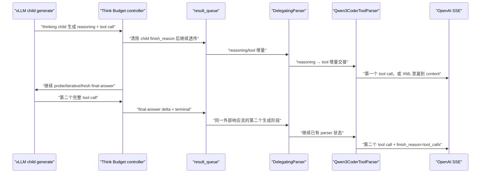
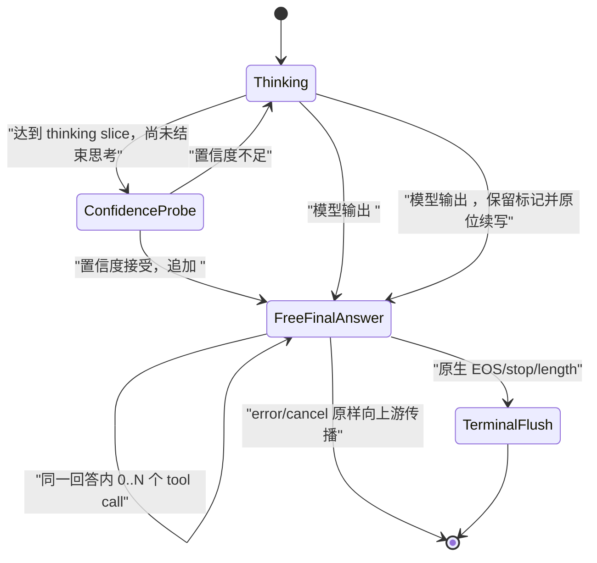

# Think Budget 工具调用流式解析修复与服务器验证方案

## 1. 设计目的

本方案针对 vLLM `v0.23.0`、`qwen3` reasoning parser、`qwen3_coder` tool parser
和 Think Budget 控制器组合下的概率性工具调用解析失败。目标不是让控制器重新实现
Qwen 工具协议，而是恢复以下边界契约：

> Think Budget 只改变可见思考的长度；控制器提交给原生 reasoning/tool parser 的
> 逻辑 token 序列、结构标记、增量顺序、结束状态和多轮消息语义，应与模型完成一次
> 原生生成时一致。

设计起点为 2026-08-13 工作区，目标上游为固定的 vLLM `v0.23.0`
（`0fc695fc6d1d82e9a5ac6835ac8e4e1c83703665`）。本机没有目标模型和 NPU，本文的
“本地通过”只指无模型单元测试；根因闭环和发布结论必须由服务器实验完成。

## 2. 现有证据与根因分层

### 2.1 已实测

[`chunks-4-fail.jsonl`](tool_call/chunks-4-fail.jsonl) 显示：

- 第 7～23 行把 `function=bash>... </tool_call>` 送入 `delta.content`，没有任何
  `delta.tool_calls`；
- 拼接 `content` 后，工具 XML 前缺少 `<tool_call>\n<`；
- 第 25～26 行又出现 `\nuser\n<t`，属于一个 assistant 工具调用回合之后不应暴露的
  role 尾流；
- 同一请求在未开启压缩时正常，开启压缩约 5% 概率失败。

这证明了“原生 parser-facing 等价”没有闭合，但客户端 SSE 本身不能判断标记是在
engine 输出、控制器队列还是 `DelegatingParser` 内丢失。

2026-08-13 的
[`run_after_fix`](tool_call/run_after_fix) 对同一多轮请求执行了 100 次 Vanilla/DTB
paired replay。环境与原复现环境一致，本轮不再使用 manifest 解释差异。结果如下：

| 结果 | Vanilla | DTB |
| --- | ---: | ---: |
| 请求数 | 100 | 100 |
| 至少返回一个结构化 tool call | 100 | 100 |
| 任意协议异常 | 0 | 98 |
| XML 泄漏并带 role 尾流 | 0 | 48 |
| tool delta 后继续输出 content | 0 | 50 |
| arguments JSON 不完整 | 0 | 10 |

DTB 的 52 个响应解析出了两个 tool call；另外 48 个响应把第一个工具调用 XML 泄漏到
`content`，随后又解析出 final-answer child 生成的第二个 tool call。已有分析器报告的 2 个
`pass` 也包含两个来自不同 child generation 的 tool call，只是没有命中现有 content
异常规则，因而是验收假阳性。

`analysis.json` 还证明：100/100 DTB final-answer 的 `raw_text` 和 `parser_text` 都包含一对
完整 `<tool_call>...</tool_call>`，保守恢复触发次数为 0。因此，“final-answer 在进入
parser 前缺少结构文本”已被本轮实验否定；需要分析的是 final-answer 之前的可见 thinking
child，以及控制器为何在第一次工具调用之后继续运行。

### 2.2 源码确定

数据路径如下：



由目标源码可以确定：

1. Qwen3 reasoning parser 把 `</think>` 视为显式思考结束，把 `<tool_call>` 视为隐式
   思考结束；后者同时是最终工具调用正文的开始，而不是 thinking 内容；
2. 当前 thinking child 的 sampling stop 只加入 `</think>`；`consume_output()` 清除所有
   可见 child delta 的 `finish_reason/stop_reason`，状态机也只对
   `stop_reason == </think>` 作特殊处理。因此，thinking child 已进入或完成工具调用后，
   控制器仍会把 tool XML 追加为 thinking，继续 confidence probe、iterative thinking，
   最后再启动 fresh final-answer；
3. `DelegatingParser.parse_delta()` 在 reasoning 结束的 delta 内提取剩余
   `current_text/current_token_ids`，随后交给 tool parser，并在第一次交接时清空 tool
   侧历史；
4. `Qwen3CoderToolParser.extract_tool_calls_streaming()` 同时以 token-id 或字符串检测
   `<tool_call>`，但进入状态后仍依赖累计字符串定位 `<tool_call>` 和 `<function=`；
5. 该 parser 使用 `if not previous_text` 推断新流并重置状态。空文本是合法增量，并不
   等价于新请求；若结构 token 已从 token-id 被识别、其文本却没有进入累计字符串，
   下一批文本可触发二次重置，之后 XML 会作为普通 `content` 泄漏；
6. Think Budget 把多个 child generation 和一个合成 reasoning 边界串成一个外部流，
   因而比单次原生生成多出 parser 必须跨越的空文本/子请求边界；
7. `ChatCompletionRequest.to_sampling_params()` 在 vLLM `v0.23.0` 已正确设置
   `stream=True → DELTA`、`stream=False → FINAL_ONLY`，因此“控制器忘记设置
   output_kind”不是当前根因；
8. 多轮 request 的 `messages` 由原生 `render_chat_request()` 生成一次
   `engine_inputs`，控制器没有重排消息；scene 分类会逆序寻找最新 user 消息，而不是把
   最后的 tool result 当 user。多轮本身没有发现静态丢失，但过去缺少协议级回归测试。

### 2.3 根因结论与证据边界

本问题由两个缺陷叠加：

1. **终止语义错误（主因，实测 + 源码确定）。** `</think>` 和 `<tool_call>` 都是思考
   结束边界；前者进入普通最终回答，后者进入工具调用形式的最终回答。当前 DTB 只接受
   `</think>`，并在第一次工具调用后继续状态机，造成重复生成、role 尾流和第二个
   fresh tool call。
2. **增量交接问题（实测现象，具体丢失层待补齐原始记录）。** 48 次请求中，第一个调用
   从 `content="f"` 开始并泄漏至 `</tool_call>`，即客户端缺少
   `<tool_call>\n<`；另外 52 次相同位置能被 parser 正常识别。现有 `analysis.json` 只保留
   `final_answer` phase 的 raw/parser 文本，未保留第一个调用所在 phase 的逐条原始记录，
   因而不能仅凭该归档断言标记是在 controller→queue 之前丢失，还是在
   `DelegatingParser` 内的 reasoning→tool 交接时丢失。

修复顺序以主因优先：先恢复正确的思考边界和单一 completion 生命周期，并保持 raw
`text/token_ids` 原样透传；随后重新实验判断增量交接现象是否仍存在。第一阶段不修改原生
parser，不把 adapter 变成 Qwen tool parser 的补丁层。

## 3. 修复设计

### 3.1 取消 parser-facing 保守恢复

删除 `RequestStateContext.stream_output()` 中根据 Qwen 结构 token-id 重新解码并改写
`output.text` 的逻辑，同时删除对应的 `parser_structural_token_ids`、`decoded_token_text`
和 `repaired_tags` 语义。原因是：

- `run_after_fix` 中恢复逻辑 0 次命中，不能解释或修复实测故障；
- adapter 不应理解并重写 Qwen 工具协议；
- 重新解码会掩盖真正的 child 终止、增量来源和 parser 状态问题；
- 原生 parser-facing 等价要求 DTB 透传模型的逻辑 token 序列，而不是在 parser 前猜测
  缺失结构。

`stream_output()` 仍可为清除中间 child 的终止字段而浅拷贝对象，但不得改写非空
`text/token_ids`。

### 3.2 统一思考结束边界

定义 `ReasoningBoundary`：模型从 thinking 转入最终答案的逻辑事件。当前模型至少有两类：

| 边界 | 含义 | 最终阶段入口 |
| --- | --- | --- |
| `</think>` | 显式结束思考 | 从标记之后自由生成普通 content 或 tool calls |
| `<tool_call>` | 隐式结束思考，同时是工具调用正文的第一个结构 token | 保留该标记一次，从标记之后原位续写工具调用 |

thinking child 的 stop 条件应保留请求原有 stop，再加入这两个 reasoning boundary；边界标记
必须进入外部逻辑 token 流和 continuation prompt，不能丢失或重复。`<tool_call>` 分支不得
再合成 `</think>`，也不得重新启动一个与已有工具调用无关的 fresh answer。

状态转换如下：



一旦进入 `FreeFinalAnswer`，禁止再进入 confidence probe、iterative thinking、合成 reasoning
boundary 或第二个 fresh final-answer child。自由生成阶段允许模型在同一回答中输出零个、
一个或多个连续 `<tool_call>...</tool_call>`；`</tool_call>` 不是控制器重新决策的边界。
这里的“自由生成”是从已累计 prompt 的 reasoning boundary 之后继续生成，使用剩余最终答案
预算和原生 sampling/stop 语义，不再受 thinking stride、probe 或置信度决策控制。

若 speculative delta 在同一批中包含 reasoning boundary 及其后缀，整批必须只透传一次；
边界前 token 计入 visible thinking，边界及其后 token 计入 final answer，并将完全相同的
token 序列作为 continuation prompt。若工具调用已开始但 child 因内部切片上限结束，下一
child 只能从已有 `<tool_call>` 后原位续写，不得重新生成工具调用头。

### 3.3 单次 terminal 与空 delta flush

中间 child 的 `finish_reason` 可以被控制器消费，但整个外部 assistant completion 只能结束
一次。`FreeFinalAnswer` 获得原生终止后，控制器发送一个 terminal-only `RequestOutput`：

```text
text=""
token_ids=[]
finish_reason=<final child 原始 finish_reason>
stop_reason=<final child 原始 stop_reason>
```

final child 最后一个非空正文 delta 应先清除 child 级终止字段并原样透传，随后再发送该空
terminal delta。空 delta 不补写正文，只用于让原生 parser 以 `finished=True` 执行剩余
arguments flush，再由 serving 层根据是否已产生工具调用输出一次
`finish_reason="tool_calls"`。terminal flush
之后立即关闭 result queue；不得再发送 content、role 文本或第二个 terminal。

### 3.4 增量交接与原生 parser 决策

第一阶段不修改 vLLM `DelegatingParser` 或 `Qwen3CoderToolParser`。DTB 侧只保证：

- 同一逻辑 assistant completion 使用连续的 parser 状态；
- reasoning boundary 的 `text/token_ids` 及同批后缀只进入 queue 一次；
- child 边界不产生伪造正文或中间 terminal；
- 空 delta 只用于最终 flush，不作为 parser 重置提示；
- telemetry 记录所有可见 phase，而不改写 parser-facing 数据。

修复后若仍出现 XML 泄漏，必须用同一 `parent/child/sequence` 的原始
`text + token_ids → SSE` 证明：若 controller 前已缺标记，继续查 engine/detokenizer；若
controller 前完整而 parser 后泄漏，再单独评审原生 parser 的最小修复。未取得这条证据前
不修改上游 parser，也不采用 SSE 后处理、正则拼接或丢弃异常 content。

### 3.5 多轮请求边界

多轮请求必须保持以下不变量：

- system/user/assistant/tool 消息顺序不变；
- assistant `tool_calls[].id` 与后续 tool `tool_call_id` 一一对应；
- 只把生成中的逻辑 token 和一次 reasoning boundary 追加到已渲染 assistant 前缀；
- hidden probe 使用浅拷贝 child prompt，不能污染主 prompt；
- final child 复用 LoRA、priority、DP rank、trace headers、reasoning/parser kwargs 和原生
  sampling 参数；
- 同一 assistant completion 内允许多个 tool calls，但进入工具调用最终阶段后不得重新进入
  thinking/probe；
- 工具调用后不得出现 role 尾流，不能把 `stop`、Judge 错误和 parser failure 合并统计。

专用 replay 工具在发请求前检查历史 tool-call ID 闭合，避免把非法输入误判为 DTB
错误。

## 4. 独立 DEBUG 遥测

启动服务前设置：

```bash
export TB_TOOL_STREAM_DEBUG=1
```

控制器会在 result queue、也就是原生 `DelegatingParser` 消费之前打印一行：

```text
TB_TOOL_STREAM {json}
```

取消保守恢复后，调试 schema 聚焦“原始 child 输出、状态转换、queue 透传和最终 SSE”的
对应关系，当前实现已升级为 schema 2：

```text
source=controller_pre_parser
parent_request_id / child_request_id / phase / sequence
completion_epoch / reasoning_boundary / controller_state
raw_text / raw_text_sha256 / token_ids
source_finish_reason / source_stop_reason
forwarded_text_sha256 / forwarded_token_ids_sha256
terminal_flush / next_state
```

`raw_text` 和 `token_ids` 必须取自清除中间终止字段之前的 child `RequestOutput`；
`source_finish_reason/source_stop_reason` 也必须保存原值。非 terminal 的
`forwarded_text/token_ids` 应与 raw 完全相同，可以只记录哈希和长度；若不同则直接判为
controller 透传违约。`reasoning_boundary` 取 `none/think_end/tool_call`，用于证明模型首次
跨过思考边界后，控制器没有重新进入 thinking/probe。

它与 `TB_PHASE` 完全独立，不改变
[`think_budget_generalization_plan.md`](../design/think_budget_generalization_plan.md)
的性能 telemetry schema 和提取器。该日志含模型正文与工具参数，可能包含敏感信息；只在
隔离排障窗口开启，限制日志访问，完成分析后按环境的数据保留规则删除，禁止进入常规
性能归档。

## 5. 专用复现和分析工具

### 5.1 旧脚本问题

原 [`test.py`](tool_call/test.py) 只能对每行发送一次请求，并把“是否出现过任意
tool_calls delta”作为唯一判断；它不能区分 XML 泄漏、参数 JSON 不完整、tool 后内容、
finish reason 或非法多轮历史。此外原脚本引用了未定义的 `args.api_key`，且默认总会
清空 chunk 文件。这两个直接问题已修正，但后续裁决使用新工具。

### 5.2 重复 paired replay

[`replay_tool_calls.py`](tool_call/replay_tool_calls.py) 提供：

- 同一 JSONL 行按 Vanilla/DTB 顺序重复回放；
- 每次请求显式唯一 `request_id`；
- 保存原始 SSE 行和解析 chunk；
- 按 tool index 重组 name/arguments，并验证 arguments 是完整 JSON；
- 检测 XML 泄漏、预期 tool call 缺失、tool delta 后 content、role 尾流和错误
  `finish_reason`；
- 请求前验证多轮 assistant tool-call ID 与 tool result ID 的对应关系；
- 输出 `manifest.json`、`chunks.jsonl`、`summary.jsonl`，异常时返回非零退出码。

当前实现已补充：

- 统计结构化 tool call 数量、tool index、terminal chunk 数量及其事件顺序；
- 允许一次 assistant completion 内存在 0～N 个 tool calls，不能把 `tool_calls.Count > 1`
  直接判错；
- 在预期工具调用的样本中校验至少一个完整 tool call，并校验所有 arguments JSON；
- 将“第一次 tool delta 后出现普通 content”“多个 terminal”“terminal 后仍有 chunk”分别
  判错；
- paired Vanilla 只用于对照协议和任务质量，不能以 tool call 数量相等替代 completion
  生命周期审计。

### 5.3 服务日志关联

[`analyze_tool_call_run.py`](tool_call/analyze_tool_call_run.py) 按 response request ID
从共享 `server.log` 提取 `TB_TOOL_STREAM`，将控制器 raw/forwarded 摘要与 SSE 结果关联，
输出 `analysis.json` 和终止语义/增量层裁决。它不是性能 telemetry 提取器，也不应接入
`tools/extract_tb_phase_metrics.py`。

旧实现只拼接 `phase=final_answer`，会漏掉第一个工具调用所在的 `initial_think` 或
`iterative_think`，并把两个跨 child 的 tool calls 误报为通过。当前实现已经：

- 按 sequence 保留所有可见 phase 的原始记录，而不是只保留 final-answer；
- 输出每个 child 的 raw text/token 摘要、原始终止原因、reasoning boundary 和 next state；
- 计算 `completion_epoch_count`、`terminal_flush_count`、`fresh_final_after_tool_boundary`、
  `thinking_or_probe_after_tool_boundary`；
- 在 `analysis.json.summary.dtb_acceptance` 汇总上述逐请求门槛，便于直接核对 100 次发布门；
- 把“同一 completion 内多个 tool calls”和“跨 fresh generation 重复 tool call”分开；
- 关联第一个泄漏 XML 的 raw `text/token_ids`，裁决增量缺失发生在 controller 前还是 parser
  内。

## 6. 服务器执行方案

### 6.1 启动

用 [`start.sh`](tool_call/start.sh) 的既有参数启动，排障 run 额外开启日志：

```bash
cd /opt/p00906181/TB-main
TB_TOOL_STREAM_DEBUG=1 bash docs/debug/tool_call/start.sh
```

确认 `server.log` 中只有一个目标服务进程，并保存启动头、版本和 controller 配置。

### 6.2 第一轮：原问题 paired 复现

5% 事件在 100 次中至少出现一次的理论概率约为 99.4%。先串行执行，避免并发改变分片和
归属：

```bash
python docs/debug/tool_call/replay_tool_calls.py \
  --file docs/debug/tool_call/task29-pass1-26.jsonl \
  --start 4 --end 4 \
  --repetitions 100 \
  --mode both \
  --url http://127.0.0.1:9000/v1/chat/completions \
  --model qwen3.6-27b \
  --output-dir docs/debug/tool_call/run_after_terminal_fix
```

随后关联服务日志：

```bash
python docs/debug/tool_call/analyze_tool_call_run.py \
  docs/debug/tool_call/run_after_terminal_fix \
  server.log
```

回传 `manifest.json`、`summary.jsonl`、`chunks.jsonl`、`analysis.json` 和仅含对应 request
ID 的 `TB_TOOL_STREAM`/`TB_ERROR`/`TB_ROUTE` 日志。不要上传无关请求正文。

### 6.3 第二轮：定位剩余增量交接问题

只在第一轮仍失败或需要证明概率来源时执行：

1. 保持模型、请求、seed、sampling、并发和 cache 不变；
2. 建立“修复前 DTB / 修复后 DTB / Vanilla”三个独立服务 run；
3. MTP 关闭只作为 parser 分片诊断对照，不作为 vLLM `v0.23.0` 性能变量或生产建议；
4. 每个 cell 至少 100 次，分别统计 hard failure 率及 95% 置信区间；
5. 对第一个 `<tool_call>` 所在 sequence 比较 child raw `text/token_ids`、forwarded 哈希和
   SSE：raw 已缺前缀则查 engine/detokenizer；raw 完整、forwarded 相同而 SSE 泄漏，才把
   原生 parser 列为候选；
6. 若关闭 MTP 只改变分片或失败概率，结论仍是增量边界未闭合，不能归因为 vLLM
   `v0.20.2` 的历史 MTP 性能 bug，也不能以关闭生产 MTP 作为修复。

### 6.4 第三轮：协议矩阵

修复候选必须覆盖：

| 维度 | 样例 |
| --- | --- |
| stream | `true`、`false` |
| 对话 | 单轮 user、多轮 assistant tool call → tool result → 下一工具调用 |
| 工具数 | 单工具、55 工具、连续/并行多个 tool call |
| 输出 | 纯 content、reasoning + content、reasoning + tool call |
| 边界 | `</think>`、`<tool_call>`、标记单独一批、标记 + `<f` 同批、完整 parameter 同批、空文本 delta |
| 终止 | 正常 EOS、单/多 tool call、max_tokens、空 terminal flush、客户端取消 |

非流式可使用同一 request body 将 `stream=false`，检查最终 `message.tool_calls`、content、
finish reason 和 arguments JSON。服务端尚无自动模型矩阵脚本时，先由 replay 工具覆盖
流式主路径，并把非流式结果保存为独立 JSONL，不能口头宣称已通过。

## 7. 验收与回滚

### 7.1 发布门

“一个逻辑 tool-call 序列”在本文中不表示“只能有一个 tool call”。正式定义为：每个外部
请求只有一个连续的 assistant completion 生命周期；该生命周期可以包含 0～N 个
`<tool_call>...</tool_call>`，共享连续 parser 状态，并且只终止一次。内部可以有多个
child generate，但它们只能续写同一逻辑 completion，不能在工具调用已经开始后再创建
fresh answer。

100 次目标请求至少满足：

```text
预期工具调用样本 100/100 返回至少一个完整 tool_call
assistant_completion_epoch_count = 1
terminal_flush_count = 1
fresh_final_after_tool_boundary = 0
thinking_or_probe_after_tool_boundary = 0
duplicate_reasoning_boundary = 0
tool_xml_leaked_to_content = 0
invalid_tool_arguments_json = 0
content_after_tool_delta = 0
role_tail_in_content = 0
tool_call_without_tool_calls_finish_reason = 0
chunk_after_terminal = 0
服务器 TB_ERROR = 0
```

同一 completion 内允许多个 tool calls；所有 index 必须连续、name 存在、arguments 是完整
JSON，并在一个 `finish_reason="tool_calls"` 前完成。不得仅因工具调用数量大于 1 判错，
也不得仅因最终存在任意 tool call 判为通过。

协议矩阵中流式与非流式的 tool name、arguments JSON、content/reasoning 分区和结束语义
一致；Vanilla 不得因本修复回归。普通 content 和 reasoning + content 请求不得因新增
boundary 判断提前终止。phase 账本必须把 boundary 前 token 计为 visible thinking、boundary
及其后 token 计为 final answer，hidden probe 仍独立；不得改变 `TB_PHASE` schema。

### 7.2 根因闭环条件

只有出现以下完整证据链才可写“根因已实测”：

```text
同一 parent/child/sequence 的原始 raw_text + token_ids + source finish/stop
→ reasoning boundary 分类和 next state
→ forwarded 哈希与 raw 是否一致
→ SSE reasoning/content/tool_calls/finish_reason
→ completion epoch、child phase 和单次 terminal flush
→ 修复前失败与修复后成功的重复统计
```

若终止语义修复后仍有 XML 泄漏：保留本次诊断产物，暂不宣称 adapter 修复完成；raw 或
forwarded 已缺标记时回到 child generation、detokenizer 和 queue；只有 raw 完整、forwarded
一致、parser 后仍泄漏时，才为 vLLM `v0.23.0` 制作最小 parser 回归测试并重新评审是否
修改上游。不得用吞掉异常 content、事后正则拼 tool call 或关闭 MTP 作为发布修复。

实现回滚应同时撤销新增 reasoning boundary 状态转换和 terminal-only flush；保守恢复逻辑
不恢复。`TB_TOOL_STREAM_DEBUG` 默认为关闭，可独立关闭，不影响 `TB_PHASE`。

## 8. 本地验证状态

截至 2026-08-14：

- 已知失败 chunks 的离线分类测试通过；
- `run_after_fix` 已完成 100 次 paired replay：Vanilla 100/100 正常，DTB 98/100 命中现有
  协议异常；另 2 次因分析器未审计跨 child generation 而假通过；
- 100/100 final-answer parser-facing 文本完整，保守恢复 0 次命中，已决定取消该方案；
- 已确认主要修复方向是终止语义和 completion 生命周期；第一个工具调用的增量缺失层仍需
  保留全 phase 原始 telemetry 后裁决；
- 已删除保守恢复，实现 `ReasoningBoundary`、模型边界后的 continuation final、单次空
  terminal flush、schema 2 `TB_TOOL_STREAM`、replay 生命周期审计和全 phase 分析；
- 无模型完整测试共运行 93 项，其中 92 项通过、1 项因 bundled runtime 缺少 PyYAML 按既有
  条件跳过；该 YAML 一致性测试已在默认 runtime 单独通过，尚未在目标服务器验证；
- 本机没有目标模型和 NPU，不能把设计更新描述为运行时修复已通过。

## 9. 变更历史

| 日期 | 变更 | 原因 |
| --- | --- | --- |
| 2026-08-13 | 建立 parser-facing 等价契约、保守结构文本恢复、独立日志、paired replay 和服务器验收矩阵 | 修复压缩模式概率性工具调用 XML 泄漏 |
| 2026-08-14 | 根据 `run_after_fix` 取消保守恢复方案；将根因拆分为终止语义错误和增量交接问题，设计 `</think>/<tool_call>` 统一边界、自由生成最终答案、空 delta flush、单 completion 生命周期与分阶段 parser 决策 | 100 次实验显示恢复 0 次命中，DTB 在第一次工具调用后继续状态机并生成第二个 fresh tool call |
| 2026-08-14 | 落地双 reasoning boundary、continuation final、terminal-only flush、schema 2 debug telemetry，并升级 replay/analyzer 与无模型回归测试 | 先修复终止语义和 completion 生命周期，再由服务器 telemetry 裁决是否仍存在 parser 增量交接缺陷 |
