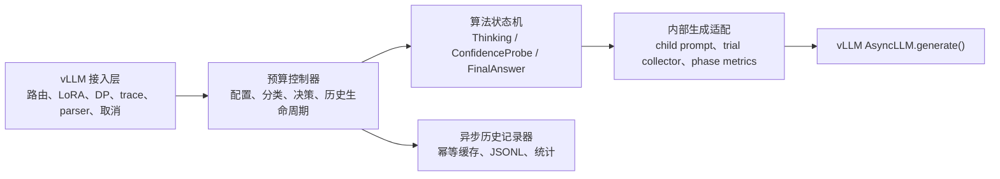
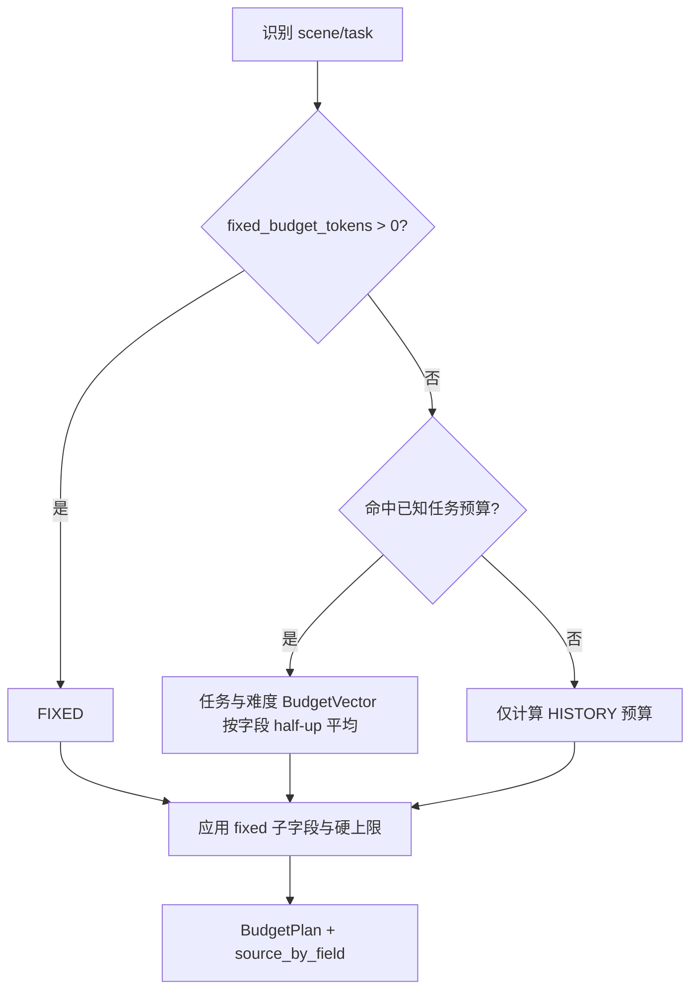
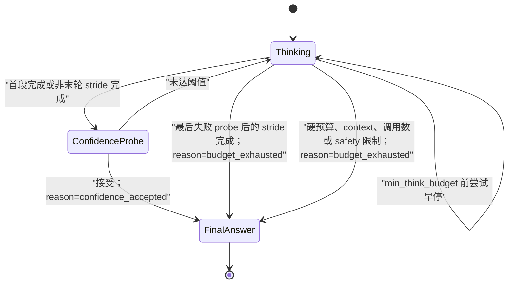
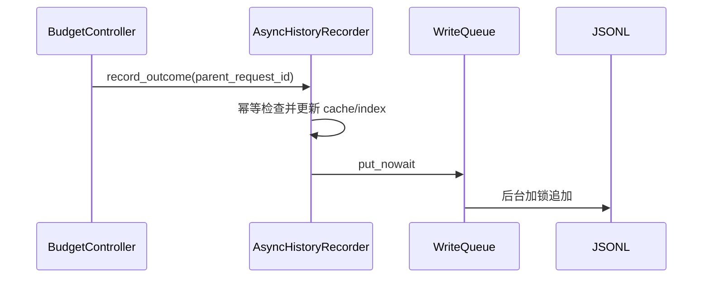

# Think Budget 服务内迁移设计

## 1. 设计目的

本设计从仓库基线 `7e94e4a598dc49bbbe95a3f79d0b8055fcf10a5e`
出发，把同步线上 Think Budget 的有效预算与置信度算法迁移到 vLLM
`v0.23.0` 服务进程，同时复用 DEER 已验证的路由、原生调用上下文、输出
格式化和取消机制。

重构目标不是逐行复制参考实现，也不是只减少外部 completion token，而是
在质量不退化的前提下降低端到端时延：

```text
净时延收益
= 减少的可见生成 token × 基线 TPOT
- 隐藏 probe、重复 prefill、排队和控制器 CPU 等额外成本
```

本设计的最终裁决以
`docs/debug/think_budget_vllm_adapter_refactor_plan.md` 为准。旧设计中
四状态、DEER 字段投影、`answer_list`、self-consistency、trial evaluator、
候选回退和 soft truncation 的描述已经废弃。

## 2. 设计逻辑

### 2.1 模块边界



职责约束：

- 接入层不判断任务难度、预算和置信度。
- 预算控制器不输出 `initial_thought_limit`、`trial_answers`、
  `token_budget`、`think_ratio` 等 DEER 算法字段。
- 状态机只消费 `BudgetPlan` 和不可调的 `PerformancePolicy`。
- trial 使用浅拷贝 child prompt；失败或成功的 trial 都不写回主 prompt。
- 历史写入由父请求生命周期收口触发，不放进 formatter 或 serving patch。

### 2.2 预算决策

每个启用请求先分类；fixed 预算仍具有最高预算优先级。



`BudgetVector` 只有四个可做算术合并的字段：

- `check_length`
- `min_think_budget`
- `num_thinking`
- `think_stride`

任务和难度同时提供字段时使用
`(task + difficulty + 1) // 2`。只有一方提供时直接使用该来源；两方都没有
时使用运行时默认。置信度阈值、开关和 context/request 上限不参与平均。

完整 `fixed_budget_tokens` 会把 `min_think_budget` 设为总 fixed budget，
并用 `ceil((budget - check_length) / think_stride)` 派生轮数；合法的
`fixed_*` 子字段再覆盖相应值。置信度阈值按
`fixed_prob_th > 非默认全局 confidence_threshold > task/history 阈值 >
运行时默认` 选择。历史百分位按参考实现的 sentinel 规则选择：非默认
`percentile_step` 优先，否则使用 `history_stride_percentile`。

已知任务分支不读取 history budget；未命中任务分支不调用 difficulty；
fixed 分支不调用两者。最终值和 clamp 原因都写入 `source_by_field`。

### 2.3 三状态执行



Thinking 首段严格请求 `check_length`，不再做 128 token 对齐。首段完成后
立即 probe；probe 失败后追加一次 `think_stride`。最后一次 probe 失败后
仍追加 stride，再进入最终答案。每个真实生成的思考 token 都单调追加到主
prompt，不做自然断点回切。

思考期间 `reasoning_state=OPEN`。模型输出 `</think>` 被视为控制标记并从
可见思考中剥离；如果还没达到 `min_think_budget`，只记录
`attempted_early_stop` 并继续思考。只有 FinalAnswer 可以执行一次
`OPEN -> CLOSED`。外部输出只补一次 `</think>`；主 prompt 根据明确的
`final_answer_reason` 选择关闭后缀。

ConfidenceProbe 使用统一 induced prompt，最多生成 50 token。collector
依据明确的 `RequestOutputKind` 聚合：

- `DELTA`：追加 text、token ids 和对齐后的 logprob 位置；
- `FINAL_ONLY` / `CUMULATIVE`：用当前完整快照替换；
- 缺失 logprob 不影响完整文本和真实 generated token 计数。

FinalAnswer 丢弃当前 trial，从单调主思考 prompt 新鲜生成答案，不选候选、
不复用 trial，也不做 safety candidate fallback。其模型 prompt 分为两条：

- `confidence_accepted`：只追加 `</think>`，让模型自由生成；
- `budget_exhausted`：追加
  `Considering the limited time by the user, I have to give the solution based on the thinking directly now.\n</think>\n\n`
  后生成。probe 轮次耗尽、硬预算、context、内部调用数或 safety 限制都属于
  强制回答路径。

限时提示仅进入模型 prompt，不进入外部可见思考；状态机提前为该后缀和至少
一个答案 token 预留 context。

### 2.4 置信度降级链

置信度输入只能是当前 `TrialObservation`：

1. sampled token/logprob 完整且 Value token 数达到 bottom-k 时使用
   Value Min；
2. pair 部分缺失、Value token 不足或只剩结构 token 时，降级到同步参考
   实现的平均置信度；
3. 没有任何可用 sampled logprob 时标记
   `confidence_unavailable_fail_open`，直接进入 FinalAnswer。

平均置信度保持参考分母语义：`None` 不进入分子，但仍计入原列表长度。
结构 token 集合对齐参考实现，包括 JSON、数学/代码运算符、空白、特殊
token 和 NAIE 业务 key；`</think>` 按裁决不属于 Value Min 结构 token。

### 2.5 在线历史闭环

请求开始时读取历史 snapshot，当前请求的结果不会反向改变自身预算。请求
收口后同步更新轻量内存 cache/index，并把 JSONL 文件 I/O 放入有界异步
队列：



成功、错误和取消都保留 `completion_status`。只有成功且 token 数据完整的
记录进入预算分位数；只有 `quality_observed=true` 的记录进入质量成功率。
普通线上请求没有 judge 标签，因此不能把缺失分数当成 0。

## 3. 核心数据结构

### 3.1 `AlgorithmConfig`

独立的服务端算法配置，使用 Think Budget 字段名。包含四项基础预算、
fixed 子字段、task/difficulty/history 开关与参数、置信度参数、safety、
最大内部调用数、最大思考 token 和最终答案上限。

不包含 clean-context、soft-truncation、answer-list、self-consistency、
trial evaluator 或 safety candidate fallback 开关。

### 3.2 `PerformancePolicy`

当前版本的裁决不变量：

```text
trial_answer_length = 50
clean_context_only = true
fresh_final_answer = true
retain_answer_list = false
enable_soft_truncation = false
confidence_missing_input = FAIL_OPEN
confidence_scope = CURRENT_TRIAL
enable_safety_amplification = false
enable_safety_candidate_fallback = false
```

policy 版本进入每条 phase telemetry。YAML 中的同名节只用于部署清单校验，
不能覆盖代码不变量。

### 3.3 `BudgetPlan`

保存任务命中、决策分支、最终 `BudgetVector`、阈值、字段来源、历史
snapshot、policy 版本和思考硬上限。状态机不再读取动态配置模块。

### 3.4 `RequestAlgorithmState`

保存单调标签状态、early-stop 标志、思考 token、probe 轮次、当前 trial、
最后置信度、`final_answer_reason`、内部调用数、完成状态和 token 账本。不存在 `answer_list`、
历史 trial 累积、soft-truncated tail 或 DEER 算法字段。

### 3.5 `TrialObservation`

保存完整 trial text、全部 token ids、按位置对齐的 raw sample logprobs、
sampled token ids、真实 generated token 数、finish/stop reason 和最后一个
`RequestOutput`。

## 4. 主要接口与修改点

```python
BudgetController._decide(...) -> BudgetPlan
```

执行纯预算决策；可在无 vLLM 环境下用表驱动测试验证调用次数、平均、来源和
clamp。

```python
_BaseState.consume_trial_output(gen, output_kind=...) -> TrialObservation
```

消费隐藏 trial，不转发外部队列，并显式区分 DELTA 与完整快照语义。

```python
assess_trial_confidence(observation, ...) -> ConfidenceAssessment
```

只接受当前 trial，返回 Value Min、平均降级或不可用 fail-open 结果。

```python
RequestStateContext.close_reasoning(prompt_suffix) -> bool
```

只执行一次 `OPEN -> CLOSED`；`FinalAnswerState` 根据显式原因传入单标签后缀或
带限时指令的关闭后缀。

```python
AsyncHistoryRecorder.record_outcome(outcome) -> bool
AsyncHistoryRecorder.flush(timeout_s) -> bool
```

前者不等待文件 I/O并按 `parent_request_id` 幂等；后者供服务退出或测试做
有界 flush。

原生调用上下文仍由 `RequestStateContext.engine_request_kwargs()` 透传
priority、LoRA、trace headers、DP rank、prompt text 和 reasoning/parser
参数。外部 stream/non-stream formatter 继续使用 vLLM 原生接口。

协议模型保留 vLLM 的 `extra="allow"`。对外只声明总开关和六个 fixed
字段；控制器显式拒绝已知旧字段。本轮控制器契约为 `n=1`，beam search 不
在验证范围。

## 5. 一致性校验

### 5.1 本地可验证项

- **源码确定**：算法配置没有
  `initial_thought_limit/think_ratio/token_budget/trial_answers/is_code`。
- **本地单测**：known task 只调用 difficulty，unknown task 只调用
  history，fixed 跳过两者。
- **本地单测**：首个/第二个 probe 接受、全失败最后 stride、
  min-think early-stop 和空 logprob fail-open 的 phase 轨迹。
- **本地单测**：置信度接受只向模型 prompt 追加 `</think>`；预算耗尽追加
  完整限时提示，外部仍只看到一次关闭标签。
- **本地单测**：DELTA、FINAL_ONLY、CUMULATIVE 得到一致的完整 trial。
- **本地单测**：未评分历史不计失败，error/cancel 不进入 token 分位数，
  重复 parent id 只写一次。
- **源码确定**：主 prompt 只追加；只有 FinalAnswer 关闭标签；trial child
  prompt 不写回主 prompt。

### 5.2 异常与可靠性

- 内部生成异常设置 `completion_status=error`，向外部 generator 暴露失败，
  并尝试只关闭一次标签。
- 客户端取消会取消父请求的生产任务，状态记为 `cancelled`。
- 历史队列满或写入失败只记录 warning，不吞掉最终响应。
- max internal calls 会为最终答案保留调用槽位。
- context、请求 token 或 fixed budget 触发 hard clamp 时记录字段来源。

### 5.3 必须在目标服务器验证

本地没有目标模型或 NPU，以下不能描述为已通过：

- vLLM `v0.23.0` + vLLM-Ascend `v0.23.0rc1` 的真实生成；
- LoRA、DP 亲和性、trace、reasoning/tool parser 的端到端联调；
- 流式取消、异常和最终答案完整性；
- `cached_prompt_tokens`、prefill、decode、TTFT 和配对 E2E 净时延；
- 50-token probe 和 task+difficulty 平均对质量的影响。

服务器实验必须固定样本、seed、采样参数、并发、到达节奏和 prefix cache，
并单列隐藏 probe token。

## 6. 变更历史

| 日期 | 变更内容 | 原因 |
| --- | --- | --- |
| 2026-07-10 | 初版迁移设计 | 建立 Think Budget 服务内迁移范围 |
| 2026-07-23 | 按裁决重写为独立算法配置、三状态、当前 trial 置信度和在线历史闭环 | 原四状态与 answer-list/soft-truncation 设计已被性能优先裁决废弃 |
| 2026-07-23 | 增加实现接口、一致性校验和服务器未验证项 | 使设计、实现和证据强度保持一致 |
| 2026-08-13 | 明确 FinalAnswer 两种关闭后缀及显式触发原因 | 对齐 `deer/state.py:218-233`，避免从 trial 或最后可见 chunk 的 stop reason 推断 |
