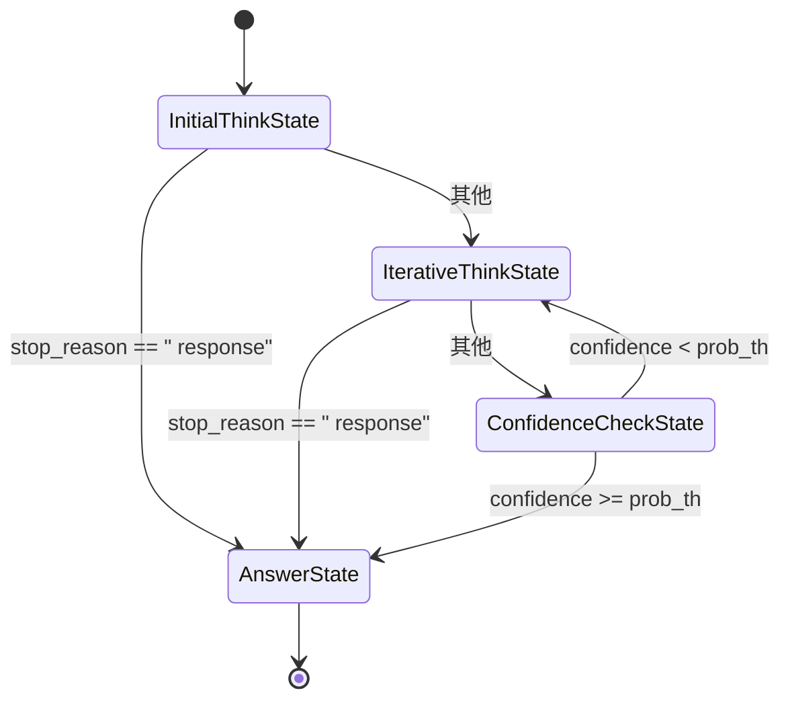

# BudgetForcing 迁移设计文档 — 评审意见

> 历史评审：以下缺陷、路径和建议针对 2026-07-10 的设计及源码。`naie/` 等旧路径不是
> 当前生产入口，不据此新增兼容镜像或重复修复。当前实现与状态见[设计索引](README.md)。

> **评审对象**: `docs/design/budget_forcing_migration.md`
>
> **评审时间**: 2026-07-10
>
> **评审范围**: 设计文档全文，对照 `naie/optimizations/budget_forcing.py` 及 `naie/` 下相关模块的实际代码

---

## 1. 总体评价

设计文档结构完整，对 DEER 模块的现状和 BudgetForcing 迁移目标描述清晰。但**算法流程描述与 BudgetForcing 实际实现存在多处显著偏差**，需要重点修正。以下按严重程度排序。

| 类别 | 严重程度 | 数量 |
|---|---|---|
| 算法流程描述错误 | 🔴 严重 | 4 处 |
| BudgetConfig 字段遗漏 | 🔴 严重 | ~50 个 |
| 函数签名错误 | 🔴 严重 | 5 处 |
| 预算优先级链顺序错误 | 🔴 严重 | 1 处 |
| 接口一致性表缺失 | 🟡 中等 | 4 个模块 |
| 线程安全问题未提及 | 🟡 中等 | 1 处 |
| ASCII Art 未替换 | 🟡 中等 | 1 处 |
| 语义说明不清晰 | 🟢 轻微 | 1 处 |

---

## 2. 源文件路径验证（✅ 正确）

| 设计文档引用路径 | 实际路径 | 状态 |
|---|---|---|
| `naie/models/confidence.py` | ✅ 存在 | ✅ |
| `naie/optimizations/confidence_gates.py` | ✅ 存在 | ✅ |
| `naie/optimizations/early_stopping.py` | ✅ 存在 | ✅ |
| `naie/optimizations/context_control.py` | ✅ 存在 | ✅ |
| `naie/optimizations/safety_gate.py` | ✅ 存在 | ✅ |
| `naie/optimizations/_struct_token_core.py` | ✅ 存在 | ✅ |
| `naie/optimizations/token_filter.py` | ✅ 存在 | ✅ |

**结论**：所有引用的源文件路径均正确。

---

## 3. BudgetConfig 字段完整性（🔴 严重缺失）

设计文档第 4 节列出了约 20 个字段，但实际 `call_model()` 签名有 **~80 个参数**。以下为设计文档**遗漏的关键字段**（按功能分组）：

### 3.1 停止条件与循环控制

| 遗漏字段 | 类型 | 说明 |
|---|---|---|
| `stop_condition` | `Literal['length', 'thinking_words']` | 停止条件模式 |
| `consecutive_same_stop` | `bool` | 连续相同答案停止 |
| `min_think_tokens` | `int` | 最小思考 token 数 |
| `max_api_calls` | `int` | 最大 API 调用次数 |

### 3.2 置信度与双通道

| 遗漏字段 | 说明 |
|---|---|
| `enable_dual_channel` | 是否启用双通道评分 |
| `reasoning_min_percentile` | reasoning 通道最小百分位 |
| `enable_full_chain_confidence` | 是否启用全链置信度 |
| `full_chain_min_percentile` | 全链最小百分位 |

### 3.3 任务类型与历史预算

| 遗漏字段 | 说明 |
|---|---|
| `enable_task_type_budget` | 是否启用任务类型预算 |
| `default_task_type` | 默认任务类型 |
| `custom_task_types_path` | 自定义任务类型 JSON 路径 |
| `enable_history_budget` | 是否启用历史预算 |
| `history_budget_multiplier` | 历史预算乘数 |
| `history_warmup_count` / `history_warmup_strategy` | 预热参数 |

### 3.4 固定预算模式

| 遗漏字段 | 说明 |
|---|---|
| `fixed_budget_tokens` | 固定预算 token 数 |
| `fixed_num_thinking` | 固定思考轮数 |
| `fixed_think_stride` | 固定步长 |
| `fixed_check_length` | 固定校验长度 |
| `fixed_prob_th` | 固定置信度阈值 |
| `fixed_min_think_tokens` | 固定最小思考 token |

### 3.5 其他

| 遗漏字段 | 说明 |
|---|---|
| `reference` | 参考信息 |
| `enable_deer_trial` / `deer_trial_stable_rounds` / `deer_trial_answer_len` / `deer_confidence_boost` | DEER trial 相关（兼容性） |
| `history_avg_tokens` / `history_failure_rate` / `history_category_avg_tokens` / `history_category_failure_rate` / `history_count` | 历史统计输入 |
| `enable_soft_truncation` | 软截断 |
| `auto_cluster_threshold` | 自动聚类阈值 |
| `new_task_unlimited` | 新任务无限预算 |
| `history_stride_percentile` | 历史步长百分位 |
| `history_low_success_boost` | 低成功率提升 |
| `BUDGET_ENABLED` / `FIXED_BUDGET_TOKEN` / `CONFIDENCE_THRESHOLD` / `PERCENTILE_STEP` | 内部常量 |

**建议**：补充完整字段列表，或至少说明"仅列出核心字段，完整参数见 `call_model()` 签名"。

---

## 4. 预算优先级链顺序（🔴 错误）

设计文档第 5 节列出了 10 级优先级链，但**顺序与 `budget_forcing.py` 实际代码不一致**。

### 实际代码顺序（`budget_forcing.py:173-361`）

```
Step 0:  BUDGET_ENABLED == False → 跳过所有预算逻辑
Step 0.5: FIXED_BUDGET_TOKEN > 0 → 使用固定 token 数，跳过所有动态预算
Step 1:  fixed_budget_tokens > 0 → 使用固定预算，跳过 Step 2-4
Step 2:  task_type_budget → 任务类型预算
Step 3:  difficulty_budget → 难度预算
Step 4:  history_budget → 历史预算
Step 5:  fixed_* 子参数覆盖（fixed_num_thinking, fixed_think_stride 等）
Step 6:  CONFIDENCE_THRESHOLD / PERCENTILE_STEP 覆盖
```

### 设计文档顺序（有误）

设计文档的 10 级链将 `fixed_budget_tokens` 放在第 8 级，且缺少 `FIXED_BUDGET_TOKEN` 这个"跳过所有动态预算"的快捷路径。

**建议**：按实际代码顺序重写优先级链，并补充 `FIXED_BUDGET_TOKEN` 分支。

---

## 5. 算法流程描述（🔴 多处错误）

### 5.1 `_InitialThinkState` — 描述错误

设计文档说 `_InitialThinkState` 是"首次长程思考，使用 `initial_thought_limit` 作为 max_tokens"。

**实际代码**（`budget_forcing.py:450-498`）：

- BudgetForcing **没有**单独的"initial think"状态
- 首次调用 `_call(prompt, check_length, thinking_words)` 和后续迭代调用**使用同一个函数**
- 区别仅在于：首次调用时 `thinking_words` 为空，后续迭代时追加了 ` thinking` 标签

**建议**：删除 `_InitialThinkState` 作为独立状态的描述，改为"统一的 `_call()` 函数，首次调用与迭代调用使用相同参数"。

### 5.2 `_IterativeThinkState` — Think 标签逻辑遗漏

设计文档的状态转换表（第 6.2 节）遗漏了**"留在循环内继续思考"的路径**。

**实际代码**（`budget_forcing.py:459-498`）：

```
if is_think_tag_paired(prompt) AND stop_reason == 'stop' AND actual_len < min_think_tokens:
    → reopen_think_tag + 继续思考（留在循环，不进入 ConfidenceCheck）
elif NOT is_think_tag_paired AND stop_reason == 'stop' AND actual_len < min_think_tokens:
    → 继续思考（留在循环）
else:
    → induced_prompt = make_induced_prompt(prompt) → 进入 trial answer
```

**建议**：在状态转换表中补充"留在循环"的路径。

### 5.3 `_ConfidenceCheckState` — 流程顺序错误

设计文档说 ConfidenceCheck 先计算置信度，然后检查 safety gate。

**实际代码**（`budget_forcing.py:500-540`）：

```
1. 计算 confidence 和 perplexity（cal_confidence + cal_perplexity）
2. 检查 safety gate（safety_gate_check）
3. 计算决策分数（compute_dual_channel_score / compute_decision_score）
4. 检查连续相同答案（check_consecutive_same）
5. trial evaluator 评估
6. make_accept_decision 做最终决策
```

**建议**：按实际顺序重写，并补充 `perplexity` 计算步骤。

### 5.4 `_AnswerState` — 答案选择逻辑错误

设计文档说 `_AnswerState` 使用 `_UNLIMITED_ANSWER_TOKENS = 65536` 无条件生成。

**实际代码**（`budget_forcing.py:556-590`）：

```
1. 从 answer_list 中按 decision_score（index 5）选择最佳答案
2. 检查答案是否已完整（stop_reason == 'stop' AND think_tag_paired）
3. 如果已完整 → 直接返回，不生成更多 token
4. 如果未完整 → 才生成剩余 token
```

**建议**：修正为"先选最佳答案，检查完整性，按需生成"。

---

## 6. 函数签名错误（🔴 多处）

| 函数 | 设计文档签名 | 实际签名 | 差异 |
|---|---|---|---|
| `safety_gate_check` | `(elapsed: float, ...)` | `(elapsed_fn: Callable, ...)` | 参数是 callable 而非 float |
| `build_safety_fallback` | `(prompt, answer_list, ...)` | `(prompt, answer_list, current_sc_rounds, ...)` | 缺少 `current_sc_rounds` |
| `compute_dual_channel_score` | `(*, confidence, perplexity, ...)` | `(reasoning_logprobs, reasoning_tokens, ans_logprobs, ans_tokens, confidence, perplexity, ...)` | 前 4 个位置参数缺失 |
| `make_accept_decision` | `(*, decision_score_raw, ...)` | `(decision_score_raw, ...)` | 非 keyword-only |
| `cal_full_chain_confidence` | 未明确列出 | `(chain_logprobs, chain_tokens, ans_logprobs, ans_tokens)` | 4 个位置参数 |

---

## 7. 接口一致性校验表缺失（🟡 中等）

设计文档第 6.3 节列出了 7 个模块的接口映射，但以下模块**有接口但未列入表**：

| 模块 | 关键导出函数 |
|---|---|
| `scene_classifier.py` | `classify_scene()` |
| `task_type_budget.py` | `classify_task_type()`, `get_task_type_budget()` |
| `difficulty_estimator.py` | `estimate_difficulty()`, `compute_budget_from_difficulty()` |
| `history_budget.py` | `compute_history_budget()` |
| `trial_evaluator.py` | （设计文档 2.10 节提及，但未在接口表中列出） |

**建议**：补充这些模块的接口映射。

---

## 8. 线程安全问题（🟡 中等）

`_struct_token_core.py` 使用**模块级可变状态**：

```python
_struct_tokens: set = set()
_key_names: list = []
```

`set_task_key_names()` 和 `set_extra_struct_tokens()` 修改这些全局变量。在 vLLM 的 async 并发环境中，多个请求同时调用会导致**数据竞争**。

设计文档未提及此问题。建议：

- 将状态改为 per-request 实例（如 `RequestStateContext` 持有）
- 或添加 `threading.Lock` / `asyncio.Lock`

---

## 9. ASCII Art 问题（🟡 中等）

设计文档第 6.1 节的状态机图使用 ASCII Art：

```
_InitialThinkState ──→ _IterativeThinkState ──→ _ConfidenceCheckState
       │                       │                        │
       ▼                       ▼                        ▼
   _AnswerState ←─────────────────────────────────────────
```

**建议**：替换为 Mermaid 状态图：



---

## 10. `apply_clean_context` 语义说明（🟢 轻微）

设计文档描述正确（"丢弃诱导语，不累积试探答案"），但函数名 `apply_clean_context` 容易误解——它实际上是"应用清理上下文"= "不累积"。建议在文档中加一句注释说明命名含义。

---

## 11. 汇总与优先级建议

### 必须修正（🔴）

1. **重写算法流程描述**（第 6 节）——当前描述与 BudgetForcing 实际实现偏差较大，尤其是 `_InitialThinkState` 不存在、`_IterativeThinkState` 的 think 标签逻辑遗漏、`_AnswerState` 的答案选择逻辑错误
2. **修正预算优先级链顺序**（第 5 节）——补充 `FIXED_BUDGET_TOKEN` 快捷路径，调整 `fixed_budget_tokens` 优先级
3. **补充 BudgetConfig 字段**（第 4 节）——至少补充 `stop_condition`、`min_think_tokens`、`consecutive_same_stop`、`enable_dual_channel`、`enable_full_chain_confidence`、`enable_task_type_budget`、`enable_history_budget` 等关键字段
4. **修正函数签名**（第 6.3 节）——`safety_gate_check`、`build_safety_fallback`、`compute_dual_channel_score`、`make_accept_decision`、`cal_full_chain_confidence`

### 建议修正（🟡）

5. **补充接口一致性表**——增加 `scene_classifier`、`task_type_budget`、`difficulty_estimator`、`history_budget`、`trial_evaluator` 模块
6. **补充线程安全分析**——`_struct_token_core.py` 的模块级可变状态在并发环境下的风险
7. **替换 ASCII Art 为 Mermaid 状态图**

### 可选修正（🟢）

8. **补充 `apply_clean_context` 命名说明**
