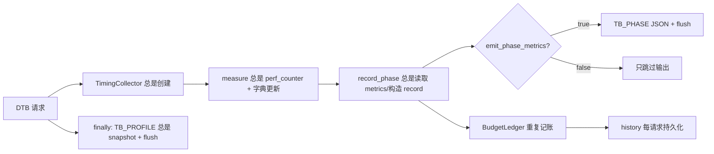
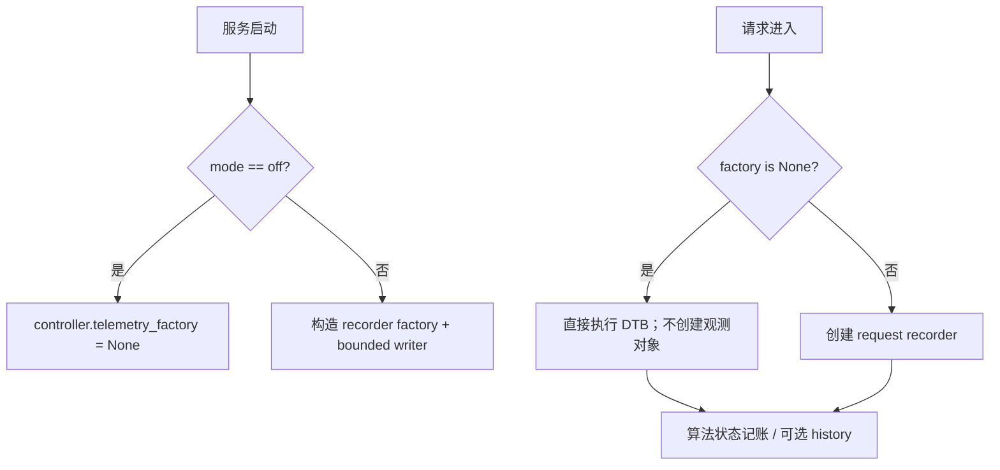

# DTB 代码清理与 Telemetry 重构计划

## 1. 设计目的

本计划面向 Dynamic Think-Budget Control（下文统一简称 **DTB**）的生产实现，解决当前
`think_budget_vllm_adapter` 在多轮迁移和工具调用排障后形成的命名混杂、职责耦合、默认热路径
观测开销和实验资产残留问题。

设计起点：

- 基线 revision：`bc142570103f86ca53ed656c75afd999bd13cbbd`；
- 设计日期：2026-08-20；
- 目标运行环境：vLLM `v0.23.0`、vLLM-Ascend `v0.23.0rc1`；
- 算法和实验口径：[`think_budget_generalization_plan.md`](think_budget_generalization_plan.md)；
- 性能账本和服务器验证：
  [`deer_performance_analysis.md`](../debug/deer_performance_analysis.md)；
- 历史三状态语义：
  [`think_budget_vllm_adapter_refactor_plan.md`](../debug/think_budget_vllm_adapter_refactor_plan.md)；
- 工具调用 parser-facing 契约：
  [`tool_call_streaming_debug_plan.md`](../debug/tool_call_streaming_debug_plan.md)。

本次工作的目标是重构和清理，不改变已经由 `run_07` 与工具调用 replay 固化的算法、路由、
parser-facing 输出和取消语义：

1. 产品、代码、配置和结构化事件统一使用 DTB 术语；DEER 只作为历史集成来源，不再出现在
   生产算法包边界内。
2. telemetry 默认关闭。关闭态不计时、不构造事件、不序列化、不 hash、不复制 token、不启动
   writer、不输出成功路径日志；只能留下算法本来就需要的状态更新和异常日志。
3. 保留 `bc1425` 中有复用价值的 phase 账本和工具流审计能力，但把低基数性能 telemetry、
   高基数 stream audit、异常日志分成三个边界清晰的通道。
4. 删除已确认无调用的模块、兼容别名、重复配置和重复账本；拆分三个过大的生产文件。
5. 从主分支移除不可维护或含原始模型正文的实验产物，只保留最小回归 fixture、可复现工具、
   聚合结论和部署 patch。

### 1.1 非目标

- 不重新选择 13 场景预算，不改变 fixed、scene、difficulty、history 的优先级；
- 不改变 Thinking → ConfidenceProbe → FinalAnswer 三状态行为；
- 不借重构实现阶段二 native bypass；
- 不把 vLLM `v0.23.0` 或 vLLM-Ascend 源码复制进本仓库；
- 不在首轮内部重构中修改公网请求字段 `enable_think_budget`。是否迁移为 `enable_dtb` 必须作为
  单独的协议版本变更处理；不能为了命名整洁同时保留两套永久别名。

### 1.2 “关闭态无性能影响”的定义

“无性能影响”不能只解释为“不打印日志”，也不宣称增加一个条件分支在物理上绝对零成本。
本计划采用两层判据：

1. **源码判据：** telemetry 关闭时，不执行任何 telemetry 专属的时钟读取、metrics 反射、
   字典/dataclass 构造、JSON 序列化、文本/token hash、列表复制、队列写入、后台任务创建或
   stdout/logger I/O。phase 边界最多保留一次对请求级不可变开关的判断。
2. **实测判据：** 相同 revision、相同 DTB 算法配置和相同负载下，重构后 `off` 相对重构前
   无 telemetry 代码基线的 paired E2E、P50、P95 和吞吐均不得出现超出重复实验噪声的退化。
   目标 NPU 实验完成前，只能称为“源码关闭”，不能称为“性能已验证无影响”。

## 2. 当前实现检视

以下结论来自基线 revision 的源码和 Git 资产；“源码确定”不等于已经在目标 NPU 实测。

| ID | 发现 | 证据 | 影响 | 处置 |
| --- | --- | --- | --- | --- |
| F-01 | DTB、Think Budget、DEER、`TB_*` 四套名称并存 | `think_budget_vllm_adapter/__init__.py`、`deer_think_budget/`、日志前缀 | 模块归属和维护边界不直观 | 统一内部名称为 DTB，原子更新 import 和 patch |
| F-02 | phase telemetry 实际默认开启 | `unified_config.py:61`、`budget_config.yaml:42`、`context.py:219`、`telemetry.py:81` 均为 `True` | 生产默认执行结构化日志热路径 | 默认改为 `off`，观测配置从算法配置拆出 |
| F-03 | `emit_phase_metrics=false` 只跳过最后的 `print` | `TimingCollector.record_phase()` 在开关判断前读取 metrics、构造 record、更新 ledger | “关闭”仍有 CPU、分配和反射成本 | 关闭态不创建 recorder，调用点在计时/构造前短路 |
| F-04 | `TB_PROFILE` 每个请求无条件 `snapshot()`、打印并 `flush` | `state.py:976-982` | 即使 phase 输出关闭仍有请求末尾 I/O | request summary 归入启用态 sink |
| F-05 | `TB_ROUTE` 和 `TB_POLICY` 不受统一观测开关控制 | 根目录 serving patch、旧 `patches/serving_patch.py`、`context.py:81-91` | 无法通过一个开关得到安静的成功路径 | 成功事件归 telemetry；异常日志始终保留 |
| F-06 | 工具流审计关闭态设计正确，但实现嵌入核心请求上下文 | `deer_think_budget/context.py:198-346` | context 引入 `os/json/hashlib` 和大段高基数诊断职责 | 迁入独立 `stream_audit`；保留构造前短路 |
| F-07 | telemetry `BudgetLedger` 与算法状态重复计数 | `BudgetLedger` 和 `RequestAlgorithmState` 同时维护 thinking/probe/final/calls | 双写可能漂移；history 反向依赖 telemetry | history 读取算法状态，删除 telemetry ledger |
| F-08 | history 默认关闭但 recorder 仍在 controller 构造时加载文件，并在每个请求结束后写入 | `BudgetController.__init__()`、`_record_history()`、`AsyncHistoryRecorder.__init__()` | 默认路径有磁盘检查、内存索引、任务和写入副作用 | 仅 `enable_history_budget=true` 时构造和记录 |
| F-09 | 配置并非真正单一来源，且每次查询检查文件 mtime | YAML 与 `_RUNTIME_DEFAULTS`/`_SCENE_DEFAULTS` 重复；`load_budget_config()` 被请求路径多次调用 | 漂移风险和无意义系统调用 | 启动时一次性加载并校验 YAML；失败即 fail-fast |
| F-10 | 三个核心文件职责过载 | `budget_controller.py` 约 980 行、runtime context 约 485 行、state 约 991 行 | 预算解析、vLLM 接入、推理控制和 telemetry 难以独立验证 | 按 integration/budgeting/reasoning/observability 拆分 |
| F-11 | 存在仅供旧导入或旧测试的兼容层 | `BudgetConfig`、`ThinkBudgetConfig`、`BudgetRequestContext`、四个旧 state alias、`_build_budget_config` 等 | 保留已删除概念并扩大 API 面 | 仓库内原子迁移后删除，不建立第二代别名 |
| F-12 | 难度估计属于原始算法设计，但生产默认关闭，部分组件没有进入当前调用链 | `enable_difficulty_estimator=false`；`complexity_analyzer.py` 仅被重导出；一致性检视 F-03/F-04 指出难度配置、历史输入和覆盖顺序曾迁移不完整 | 无调用既可能是冗余，也可能是集成遗漏，当前证据不足以删除 | 全量随 `budgeting/difficulty` 迁移；结构重构完成后单独做算法一致性检视 |
| F-13 | vLLM 集成有两份表达 | 根目录 deployable patch 与 `patches/serving_patch.py`/`protocol_patch.py` 说明性副本 | 容易发生 patch 与说明代码漂移 | 两个 deployable patch 统一进入版本化 patch 目录；删除说明性 Python 副本 |
| F-14 | 自动化测试反向依赖 `docs/debug` 脚本和原始结果 | `tests/test_tool_call_debug.py` import `docs.debug.tool_call.*` | 文档目录变成代码依赖，无法清理实验资产 | 可复用逻辑迁入 `tools/dtb/`，fixture 迁入 `tests/fixtures/` |
| F-15 | 主分支仍有约 7 MB 单个原始 replay 文件 | `docs/debug/tool_call/task29-pass1-26.jsonl` 为 7,065,753 bytes | 仓库体积、敏感正文和长期维护成本 | 从主分支删除，保留归档 commit 和聚合结论 |

### 2.1 当前 telemetry 实际数据流



关闭 `emit_phase_metrics` 后，图中只有 `TB_PHASE` 输出节点被跳过；这不符合默认关闭目标。

### 2.2 `bc1425` 中应保留与应收敛的内容

应保留：

- reasoning boundary 的 text/token ID 对齐审计；
- raw/forwarded digest、丢弃 token 和 terminal origin；
- final child terminal 原样透传的回归测试；
- native parser 分片等价验证和固定版本 parser patch；
- phase 级 queue/prefill/decode、visible/hidden/final token 账本。

应收敛：

- `TB_TOOL_STREAM_DEBUG` 从每请求读取的环境变量改为启动时解析的 DTB 观测配置；
- raw stream audit 与低基数 phase telemetry 分开命名、分开 schema、分开开关；
- per-delta 记录器从核心 context 移出，仅启用时 lazy import/构造；
- 删除单次 replay 大文件、人工脚本和迭代过程文档，保留最小 fixture、工具和最终结论。

## 3. 目标概念与命名

### 3.1 统一概念

| 概念 | 定义 |
| --- | --- |
| DTB | Dynamic Think-Budget Control，产品算法和所有生产代码的唯一名称 |
| state | DTB 控制状态，只允许 Thinking、ConfidenceProbe、FinalAnswer |
| phase | 一次 decision 或一次 vLLM child generate 的可计量工作单元 |
| probe | 不对客户端可见、但消耗模型算力的 trial answer |
| phase telemetry | 默认关闭、低基数、用于性能账本的结构化事件 |
| stream audit | 默认关闭、高基数、可能含模型正文/token ID 的 parser 取证事件 |
| operational log | warning/error/cancel 等运维日志，不用于性能统计 |
| history store | DTB 算法的可选在线历史输入，不属于 telemetry |

“telemetry” 不再泛指所有打印；尤其不能把包含 raw text 的 stream audit 描述为低开销性能
telemetry。

### 3.2 包和文件命名

目标生产结构：

```text
dtb/
├── request_controller.py         # DTB 请求门面；连接接入、预算与推理控制
├── config/
│   ├── loader.py                 # 启动时一次性加载和校验
│   ├── schema.py                 # DtbAlgorithmConfig、DtbObservabilityConfig
│   └── budget_config.yaml        # 唯一部署配置源
├── budgeting/
│   ├── budget_decision.py        # ThinkingBudget、DtbBudgetDecision
│   ├── budget_resolver.py        # 按优先级解析各预算来源并生成最终决策
│   ├── scene_router.py
│   └── difficulty/
│       ├── estimator.py          # 难度特征和评分
│       ├── complexity.py         # 原始复杂度分析，先保留迁移
│       └── budget.py             # difficulty → budget 映射
├── reasoning/
│   ├── state_machine.py          # Thinking/Probe/FinalAnswer 状态迁移
│   ├── request_state.py          # DtbRequestState，算法状态与模型工作账本
│   ├── request_context.py        # vLLM identity、prompt 和输出队列
│   ├── generation_states.py      # 三个生成状态的 child request 行为
│   ├── parser_boundary.py        # parser-facing text/token/terminal 契约
│   └── confidence.py
├── history/
│   ├── budget_policy.py
│   └── store.py
├── observability/
│   ├── config.py
│   ├── phase_recorder.py
│   ├── stream_audit.py
│   └── event_writer.py
└── integration/vllm/
    ├── request_adapter.py        # 原生请求上下文读取与 DTB 输入适配
    └── response_adapter.py       # 原生 stream/non-stream formatter 适配

patches/vllm/v0.23.0/
├── dtb_serving.patch             # DTB protocol/serving 接入制品
├── qwen3_coder_parser.patch      # 固定版本 parser 分片修复制品
└── README.md                     # 上游身份、应用顺序、契约和验证命令
```

目标结构不使用 `model.py`、`plan.py`、`planner.py` 或 `executor.py`：

- `budgeting/budget_decision.py` 明确保存“最终思考预算决策”，不会与基础大模型或任务规划混淆；
- `budgeting/budget_resolver.py` 明确执行 fixed/scene/difficulty/history 的来源解析和优先级合并；
- `reasoning/state_machine.py` 明确只驱动 DTB 三状态，不承担 vLLM model executor、worker 或
  scheduler 的职责；
- 可变请求状态属于 DTB 推理状态机生命周期，因此放在 `reasoning/request_state.py`，不与不可变
  `DtbBudgetDecision` 放在同一文件。

命名规则固定为“领域对象 + 领域动作”。`manager`、`handler`、`model`、`plan`、`planner`、
`executor`、`utils` 等弱名称不进入目标生产结构；确需使用时必须由完整路径消除歧义。

### 3.3 Patch 制品与契约

这里的“patch 契约”是指两个 patch 必须保持的行为约束，而不是再写一份与 patch 内容近似的
Python 示例：

- DTB disabled 必须回到原生单次生成；
- priority、LoRA、trace headers、DP rank 和 parser 上下文必须完整透传；
- DTB 只缩短思考，不能改变原生 parser-facing token、结构标记、增量顺序和 terminal；
- 两个 patch 各自固定上游 revision、应用顺序、SHA 和 apply-check 命令。

两个实际 patch 都是针对固定 vLLM checkout 的部署制品，放入
`patches/vllm/v0.23.0/` 比放入可 import 的 `dtb` Python 包更清楚。移动本身不会改变 patch 内
相对上游仓库的文件路径，也不会影响 `git apply`；需要同步处理的问题只有：

1. 生产部署命令、runbook 和 CI apply-check 的旧路径；
2. manifest 中记录的 patch path/hash；
3. 固定并记录应用顺序，分别执行 `git apply --check`；当前两者修改不同文件，顺序不影响结果，
   但固定顺序有利于复现实验；
4. Python wheel/sdist 不应把部署 patch 当作运行时 package data 隐式携带。

因此目标不是“不移动 patch”，而是**移动两个唯一 deployable 制品，删除说明性实现副本**。
内部包重命名时先更新 patch 内容，制品路径移动放在独立提交中，便于区分代码兼容问题和部署
路径问题。

### 3.4 类型和事件迁移表

| 当前名称 | 目标名称 | 说明 |
| --- | --- | --- |
| `BudgetController` | `DtbRequestController` | DTB 请求级稳定门面，不表示预算算法本身 |
| `AlgorithmConfig` | `DtbAlgorithmConfig` | 只含算法和推理控制配置 |
| `PerformancePolicy` | `DtbAlgorithmPolicy` | 仅保留真正的算法不变量和 policy version |
| `BudgetVector` | `ThinkingBudget` | 明确是思考预算，不是通用向量 |
| `BudgetPlan` | `DtbBudgetDecision` | fixed/scene/difficulty/history 解析后的不可变决策结果 |
| `RequestAlgorithmState` | `DtbRequestState` | 算法必需状态和模型工作量唯一账本 |
| `RequestStateContext` | `DtbRequestContext` | vLLM 请求身份和可变 prompt |
| `AsyncReasoningOrchestrator` | `DtbStateMachine` | 只驱动 Thinking/ConfidenceProbe/FinalAnswer 状态迁移 |
| `TimingCollector` | 删除并拆分 | 变为可选 `DtbPhaseRecorder` 和异步 sink |
| `TB_PHASE` | `DTB_PHASE` schema 3 | 提取器过渡期双读，生产只写新前缀 |
| `TB_TOOL_STREAM` | `DTB_STREAM_AUDIT` schema 1 | 明确高成本和敏感性 |
| `TB_PROFILE` | `DTB_REQUEST_SUMMARY` | 仅 phase telemetry 启用时输出 |

内部 import 和版本化 serving patch 在同一提交原子切换，不新增 `think_budget_vllm_adapter → dtb` 的长期
shim。外部 HTTP 字段保持原名，直到有独立的客户端迁移计划。

## 4. Telemetry 设计

### 4.1 配置模型

观测配置不再属于 `DtbAlgorithmConfig`：

```python
class DtbTelemetryMode(str, Enum):
    OFF = "off"
    PHASE = "phase"
    STREAM_AUDIT = "stream_audit"


@dataclass(frozen=True)
class DtbObservabilityConfig:
    mode: DtbTelemetryMode = DtbTelemetryMode.OFF
    queue_capacity: int = 4096
    stream_request_ids: frozenset[str] = frozenset()
```

规则：

1. 配置只在服务启动时解析一次；请求不能覆盖。
2. `OFF` 是 YAML、dataclass 和无 YAML 测试构造的唯一默认值。
3. `PHASE` 记录 decision 和各 child phase，不访问模型正文。
4. `STREAM_AUDIT` 包含 phase telemetry，并允许记录 raw/forwarded 内容；生产启用时必须显式
   配置 request ID allowlist。空 allowlist 不审计任何请求，防止误采全量正文。
5. `TB_STAGE`/`TB_CONFIDENCE` 不再作为第四套模式保留；有价值的字段进入 phase 或 stream
   schema，其余删除。

### 4.2 关闭态路径



具体约束：

- `decision_trace` 只在 recorder 存在时创建；
- `DtbBudgetDecision.to_event_dict()` 只在 telemetry/history 确有消费者时调用；
- phase start/end 的 `perf_counter_ns()` 只在 recorder 存在时读取；
- `_interval_ms()`、vLLM metrics 反射和 stop reason 规范化只在 `finish_phase()` 内发生；
- `stream_output()` 的普通路径只做 parser-facing 处理和 `result_queue.put()`；stream audit 参数、
  token list 和 digest 在启用分支内部构造；
- `DTB_REQUEST_SUMMARY`、route、policy 事件只由 recorder 发出；
- warning/error 使用标准 logger，禁止正常完成路径 `print(..., flush=True)`。

### 4.3 算法账本与 telemetry 解耦

`DtbRequestState` 是模型工作量的唯一运行时账本：

```text
thinking_tokens
hidden_probe_tokens
final_answer_tokens
child_generate_calls
completion_status
```

这些字段本来就参与预算、调用上限和 history，因此不算 telemetry 开销。删除
`telemetry.BudgetLedger`，避免同一 token 在状态机与 telemetry 双写。

- history 开启时，从 `DtbRequestState` 构造 `HistoryOutcome`；
- phase telemetry 开启时，从同一状态生成 request summary；
- 两者都关闭时，不构造任何 dict 或持久化对象。

### 4.4 启用态写入

phase 结束后，request recorder 只提取 primitive 字段并用 `put_nowait()` 提交给有界 writer；
JSON 序列化和日志写入不在请求 coroutine 中执行。队列满时：

- 不阻塞请求，不丢最终答案；
- 增加 `dropped_events` 计数并限频输出一次 warning；
- 本轮性能 run 因 telemetry 不完整而不可用于裁决，不能静默继续排名。

服务退出和测试可显式 `flush(timeout)`；正常请求不等待 flush。事件仍以
`parent_request_id + child_request_id + phase + round` 关联，不依赖日志物理顺序。

### 4.5 Schema 和兼容策略

`DTB_PHASE` schema 3 保留当前 schema 2 的有效字段，并统一：

- `variant: "dtb"`；
- `policy_version`；
- decision 的 route、effective plan、`source_by_field` 和模块耗时；
- child phase 的 queue/prefill/decode、prompt/cache/generated token；
- probe assessment 和 final answer reason。

`tools/extract_dtb_phase_metrics.py` 在一个过渡周期内同时读取：

- 历史 `TB_PHASE` schema 1/2；
- 新 `DTB_PHASE` schema 3。

写端不双写，避免性能 run 重复计数。完成现存历史 run 回放测试后再删除旧 schema 解析；旧日志
文件本身不需要重写。

`DTB_STREAM_AUDIT` 是独立 schema，不进入 phase 提取器。它必须记录安全告警：事件可能含模型
正文、token ID 和工具参数，只能用于定向取证，不得作为常驻生产日志。

## 5. 模块清理计划

### 5.1 直接删除项

以下项目属于兼容层、重复配置或说明性实现；完成一次外部部署 import 审计后删除：

- `BudgetConfig`、`ThinkBudgetConfig`、`BudgetRequestContext`；
- `_build_budget_config`、`_emit_think_end_once`；
- `_InitialThinkState`、`_IterativeThinkState`、`_ConfidenceCheckState`、`_AnswerState`；
- request context 中仅服务旧日志命名的 `trial_count`、`api_call_count`、`thinking_rounds` proxy；
- 不可配置却重复写入 YAML 的 `PERFORMANCE_POLICY` flags 和
  `get_performance_policy_config()`；policy version 与固定 50-token probe 改为源码不变量；
- `patches/serving_patch.py`、`patches/protocol_patch.py` 说明性副本；部署实现只保留
  版本化目录中的实际 patch。

删除前要求 `rg` 在生产包、测试、版本化 patch 和服务器启动脚本中均无剩余消费者。不能因为
名称像旧代码就直接删除。

### 5.2 难度估计模块保留与后置检视

难度估计是原始 Think Budget 算法的组成部分，不能用“当前没有生产调用”直接推导为“应删除”。
[`think_budget_vllm_adapter_consistency_review.md`](../debug/think_budget_vllm_adapter_consistency_review.md)
已经指出历史集成至少存在以下风险：

- 多组 difficulty base/max 参数没有完整迁移或曾使用不同默认值；
- 难度决策应读取历史统计，当前接线可能没有提供完整输入；
- difficulty 与 history stride、fixed override 的覆盖顺序可能发生过变化。

当前实现虽然在 `_decide()` 中保留条件调用，但生产配置默认
`enable_difficulty_estimator=false`；`complexity_analyzer.py` 和若干 helper 没有进入现有调用
链。两种事实都不能证明这些组件在目标算法中无用。

本轮处理规则：

1. `complexity_analyzer.py`、`difficulty_estimator.py` 和相关 helper 全量迁入
   `dtb/budgeting/difficulty/`，按 estimator/complexity/budget 职责拆文件但不做行为删减；
2. 目录迁移测试只证明调用和结果没有变化，不裁决算法是否完整；
3. DTB 主体重构通过后，建立独立“难度估计一致性检视”，对照离线参考实现检查调用入口、配置
   字段、history 输入、预算合并顺序和 source_by_field；
4. 使用 difficulty on/off、scene hit/reject、history cold/warm 和 fixed override 的表驱动测试
   固化结论；
5. 只有专项检视证明某个函数与目标算法均无关系后，才能另行提交删除。

### 5.3 配置收敛

当前 Python `_SCENE_DEFAULTS` 与约 500 行 YAML 重复。目标为：

1. `budget_config.yaml` 是 scene、runtime 和 history 参数唯一来源；
2. 启动时加载为不可变 `DtbServiceConfig` 并完成全部 unknown-key、类型、范围和 scene 引用校验；
3. 缺失 PyYAML、配置缺失或配置非法时服务启动失败，不能静默回退到另一套预算；
4. 请求路径只读取已解析对象，不做 `exists/getmtime/open/yaml.safe_load`；
5. 若未来确需 reload，提供显式、原子替换且有配置签名的管理动作，不在 getter 中隐式 reload。

这既是清理，也是实验身份约束：静默 fallback 会使 manifest 中记录的配置与实际预算不一致。

### 5.4 请求控制与推理状态机拆分

`DtbRequestController` 只保留：

- 检查 server enable；
- 取得 vLLM 原生 route identity；
- 调用 budget resolver；
- 组装 request context 与 state machine；
- 把 state machine 输出交回原生流式/非流式 formatter；
- 在取消/异常/finally 中收敛可选 history 与 telemetry 生命周期。

下列逻辑移出 request controller：

- 最新用户消息提取 → `integration/vllm/request_adapter.py`；
- fixed/scene/difficulty/history 合并与 clamp → `budgeting/budget_resolver.py`；
- 输出队列聚合 → `integration/vllm/response_adapter.py`；
- response formatter 参数适配 → `integration/vllm/response_adapter.py`。

`reasoning/request_context.py` 不再包含 JSON/hash/env/logging；`reasoning/parser_boundary.py` 独立
维护 text/token/logprobs/terminal 的 parser-facing 不变量，防止普通状态重构再次破坏工具调用。

### 5.5 History 边界

history 是可选算法模块，不是“顺便采集”的 telemetry：

- `enable_history_budget=false` 时不创建 recorder、不读历史文件、不维护索引、不写结果；
- history store 路径、容量和保留期进入显式服务配置；
- `record_inference()` 这类离线入口移到工具层，生产 store 只提供 `lookup()`、`record()`、
  `flush()`；
- error/cancel 仍可记录诊断状态，但不进入有效 token 分位数；
- native first observation 未实现前继续按泛化计划标记为阶段二缺口。

### 5.6 实验资产清理

| 当前资产 | 处理 | 保留的长期价值 |
| --- | --- | --- |
| `docs/debug/tool_call/task29-pass1-26.jsonl`（约 7.1 MB） | 从主分支删除；用归档 commit 标识原始证据 | 聚合结论和 commit ID |
| `docs/debug/tool_call/chunks-4-fail.jsonl` | 裁剪为 `tests/fixtures/tool_call/chunks-4-fail.jsonl` | 约 7.6 KB 最小失败回归 |
| `docs/debug/tool_call/test.py`、`start.sh` | 删除；有效命令写入 runbook | 可执行说明 |
| `analyze_tool_call_run.py`、`replay_tool_calls.py` | 去掉现场路径和重复逻辑后迁入 `tools/dtb/` | 可复现 paired replay/分析 |
| `test_parser_partition_equivalence.py` | 迁入 `tools/dtb/parser_partition_equivalence.py`，最小断言进入 `tests/` | 固定上游 parser 等价验证 |
| `tests/test_tool_call_debug.py` | 改为 import `tools/dtb` 并使用最小 fixture | 自动化回归 |
| 约 100 KB 的工具调用排障长文 | 提炼为 parser 契约、最终根因、补丁身份和 run 汇总；迭代日记留在历史 commit | 可维护设计依据 |
| 根目录 `dtb.patch`、parser patch | 迁入 `patches/vllm/v0.23.0/`，同步部署命令、hash 和应用顺序 | 唯一、版本化 deployable 制品 |
| `think_budget_refactored_final/` 源码镜像 | 把仍有效的历史裁决迁入 `docs/archive/` 后删除镜像 | 历史说明，不保留第二套可执行实现 |

`think_budget/` 继续作为 AGENTS.md 定义的离线参考实现；`deer/` 继续作为历史集成语义参考；
结构化 `docs/log/perf/<run_id>/` 不属于本轮清理对象，仍按 manifest 和 RESULT 规则保存。

## 6. 核心接口

关键内部接口控制在以下范围：

```python
class DtbBudgetResolver:
    def resolve(
        self,
        prompt_text: str,
        config: DtbAlgorithmConfig,
        phase_recorder: DtbPhaseRecorder | None,
        *,
        hard_token_limit: int | None = None,
        reference: str = "",
        decision_trace: dict | None = None,
    ) -> DtbBudgetDecision: ...


class DtbStateMachine:
    def __init__(self, context: DtbRequestContext) -> None: ...
    async def run(self) -> None: ...


class DtbPhaseRecorder:
    def record_phase(self, **phase_fields: object) -> dict[str, object]: ...
    def record_request_summary(
        self,
        *,
        parent_request_id: str,
        state: DtbRequestState,
        error: str | None,
    ) -> dict[str, object]: ...


class AsyncHistoryRecorder:
    def record_outcome(self, outcome: HistoryOutcome) -> bool: ...
    async def flush(self, timeout_s: float) -> bool: ...
```

关系为：request controller 调用 budget resolver 得到不可变 `DtbBudgetDecision`，state machine
只消费 budget decision 和 request context；history 只通过 budget resolver lookup 和请求完成后的
record 参与；telemetry recorder 是可选旁观者，任何返回值都不能改变状态迁移、输出或错误处理。

## 7. 实施顺序

### P0：冻结语义和基线

1. 固定基线 revision、两份原 patch hash、YAML hash 和当前测试清单；
2. 为三状态黄金轨迹、stream/non-stream、取消、工具调用 terminal、fixed/scene/history 决策保存
   测试基线；
3. 记录当前默认配置下实际输出的 `TB_*` 事件，作为“需要消失”的反向基线；
4. 在目标服务器准备 telemetry-off A/B 清单，但本地不宣称性能通过。

### P1：统一术语和目录，不改行为

1. 先建立本文件第 3 节术语；
2. 机械迁移 `think_budget_vllm_adapter` → `dtb`，再按职责拆为 `reasoning` 等领域子包；
3. 原子更新 tests、版本化 patch、工具和文档 import；
4. 保持 HTTP 字段、日志 schema 和算法输出不变；
5. 全仓 `rg` 确认生产代码不再出现旧包名和 DEER 算法命名。

P1 单独提交，便于通过 diff 确认只有 move/rename/import，没有行为变化。

### P2：Telemetry 真正默认关闭

1. 引入独立 observability config，默认 `off`；
2. 将 phase recorder 和 stream audit 从算法 config/context 拆出；
3. 先建立关闭态测试，再移动计时、record 构造和 summary 输出；
4. 将 `TB_ROUTE`、`TB_POLICY`、`TB_PROFILE`、stage/confidence 成功日志纳入统一模式或删除；
5. 将 stream audit 改为 allowlist、lazy construction；
6. 提取器双读新旧 phase schema。

### P3：去重和模块拆分

1. 先让 history 读取 `DtbRequestState`，再删除 `BudgetLedger`；
2. 拆分 request controller、budget resolver、reasoning state machine 和 parser boundary；
3. 删除兼容 alias、已确认重复的实现和固定 policy 配置；难度估计模块只迁移、不删减；
4. 配置改为启动时单次、强校验、无 fallback；
5. history disabled 路径不实例化 store。

P3 完成后另开难度估计一致性检视；其算法裁决不与结构重构混在同一提交。

每个小步都保持黄金轨迹不变，禁止一次提交同时改变预算算法和文件布局。

### P4：实验资产和文档收口

1. 先生成最小 fixture 并让测试通过；
2. 再移动可复现工具，解除 tests → docs/debug 依赖；
3. 将 DTB 和 parser patch 一并迁入版本化目录，更新部署/CI/runbook/manifest 路径；
4. 提炼长文和历史裁决；
5. 最后删除原始 JSONL、一次性脚本和历史源码镜像；
6. 更新 `AGENTS.md`、adapter README、两份背景文档和变更记录。

### P5：服务器验收

按 [`deer_performance_analysis.md`](../debug/deer_performance_analysis.md) runbook 在目标服务器执行：

1. 同一重构 revision、同一数据集、同一顺序/并发/seed/cache，至少三次 Vanilla 与 DTB `off`；
2. 分别运行 `phase` 和定向 `stream_audit`，确认字段完整并单列启用成本；
3. telemetry off 的正式性能结果中不得出现 `DTB_PHASE`、`DTB_REQUEST_SUMMARY`、
   `DTB_STREAM_AUDIT` 或成功路径 `TB_*`；
4. phase wall、Prometheus 和客户端 E2E 仍按原口径闭合；
5. 工具调用 paired replay、流式/非流式、取消和 parser partition 测试全部通过。

## 8. 验收标准

### 8.1 代码与命名

- 生产包统一为 `dtb`；`deer_think_budget` 不再存在；
- 除历史文档、兼容读取和 HTTP 协议字段外，生产代码不出现 `Think Budget`/`TB_*`；
- request controller、budgeting、reasoning、history、observability、vLLM integration 依赖方向单向；
- tests 不 import `docs/debug`；
- 删除项均有全仓零引用证据。

### 8.2 Telemetry 关闭态

- 默认配置为 `off`；
- off 下 recorder/writer/history（未启用时）均不构造；
- off 下 telemetry builder、serializer、hash、stdout flush 的 spy 调用数均为 0；
- off 与 phase/stream mode 产生完全相同的 parser-facing output、token IDs、finish/stop reason 和
  状态迁移；
- error/cancel 不因 telemetry 关闭而被吞掉。

### 8.3 Telemetry 启用态

- phase schema 可按 parent/child request ID 完整提取，visible/hidden/final token 不重不漏；
- stream audit 只命中 allowlist，请求正文不意外进入普通 phase 日志；
- writer 满载不阻塞请求，丢事件有显式计数并使 run 完整性门失败；
- 旧 run 的 schema 1/2 提取回归保持通过，新写端只输出 schema 3。

### 8.4 性能和功能

- 本地无模型测试、静态检查和两份版本化 patch apply-check 通过；
- 目标 NPU telemetry-off paired E2E、P50、P95、吞吐无可测退化；
- phase/stream 启用成本单列，不混入正式 DTB 性能排名；
- DTB 的质量、hard failure、取消、工具调用和 parser-facing 契约不退化。

## 9. 一致性校验

- **概念一致性：** DTB 是产品名；phase telemetry、stream audit、operational log、history store
  无同义异名。
- **状态一致性：** telemetry 是旁观者，不能返回下一状态或修改 prompt/token/output。
- **层次一致性：** vLLM 特有对象只进入 integration/reasoning；budget resolver 不 import vLLM；
  tests 不 import 文档目录。
- **配置一致性：** YAML 是部署参数唯一来源；源码只保留真正不可调的不变量。
- **性能一致性：** 算法必需的计数与 elapsed 不伪装成 telemetry 开销；telemetry 专属工作在 off
  下为零。
- **数据一致性：** 原始实验正文不留在主分支；结构化 perf run 仍按 AGENTS.md 的证据规则处理。
- **升级一致性：** 内部 Python import 原子迁移；外部 HTTP 字段另行版本化，不叠加永久 alias。

## 10. 实施结果（2026-08-20）

P0～P4 已在工作区基线 `f8f7a052e5475217415fcaf532b12148a6f5e068` 上完成：

1. 生产包迁为 `dtb/`，并按 `config / budgeting / reasoning / history / observability /
   integration.vllm` 拆分；公开入口为 `DtbRequestController`，不保留旧包兼容 alias。
2. `DtbBudgetDecision` 取代弱语义 plan，`DtbBudgetResolver` 负责预算解析；
   `DtbRequestState` 是 thinking/probe/final/call 的唯一账本。难度模块随迁到
   `dtb/budgeting/difficulty/`，默认关闭且没有在结构重构中删除或重新裁决。
3. 配置改为启动时单次 fail-fast 加载。默认 `OBSERVABILITY.mode: "off"`；`phase` 与
   `stream_audit` 互斥，后者必须 request-ID allowlist。队列满时 request 线程只记 dropped
   counter，告警由后台 writer 发出。
4. 生产写端只输出 `DTB_PHASE` schema 3、`DTB_REQUEST_SUMMARY` 或
   `DTB_STREAM_AUDIT` schema 1；提取器和 analyzer 兼容读取历史事件，不双写旧前缀。
5. vLLM 制品迁入 `patches/vllm/v0.23.0/`；Python 包内旧 patch 说明副本和根目录 patch 已删除。
   当前 SHA-256 为：
   - `dtb_serving.patch`：`60ed3cb93e9717f95e1c37da35927bcfe405ae303ccfb2f3989fcf80dd7cff14`；
   - `qwen3_coder_parser.patch`：`2f78be9d87a3e090a5385dcb588296670e6b3291c17fff729ad18927ad3e3288`；
   - `budget_config.yaml`：`cc4fff5de2618282e6bb567e689cbd1c05489e8484ce5c3dceb19933463b2595`。
6. 可复现工具迁入 `tools/dtb/`，小型失败 fixture 迁入 `tests/fixtures/tool_call/`；一次性启动/
   实验脚本及约 7 MB 原始模型输出从主工作树删除；`think_budget_refactored_final/` 的 6 份
   说明迁入 `docs/archive/think_budget_refactored_final/` 后删除重复源码镜像。历史仍可由 Git
   revision 定位。

本地验证结果：

- 93 个源码、DTB、提取器和工具测试通过；
- 使用带 Pillow 的工作区运行时，5 个报表回归测试通过；
- `python -m compileall -q dtb tools tests` 与 `git diff --check` 通过；
- 两份 patch 均在只读、固定 vLLM `v0.23.0` checkout 上通过 `git apply --check`。

P5 尚未完成：本机没有目标模型/NPU，因此不能声称 telemetry-off 的 E2E、P50、P95 或吞吐
已经实测无回归。所有后续实验必须基于本重构结构，按权威 runbook 分别运行 `off` 正式 run
与同身份 `phase` 账本 run；难度模块另开专项检视。

## 11. 风险与回退

| 风险 | 控制 |
| --- | --- |
| 大规模 rename 掩盖行为 diff | P1 只做机械 move/import，使用 `--find-renames` 复核 |
| 删除 alias 破坏服务器 patch | 同提交更新并在固定 vLLM checkout 执行 apply/import smoke test |
| async telemetry 丢日志 | 有界队列、dropped counter、run 完整性门、显式 flush |
| 配置 fail-fast 降低“带错启动”的可用性 | 把配置校验放到部署预检；宁可拒绝启动，不静默换预算 |
| history 关闭后历史样本不再积累 | 这是开关语义修复；需要学习时必须显式启用并写入 manifest |
| 删除原始数据影响复盘 | 记录归档 commit/hash，保留最小 fixture 和聚合 RESULT |

任一阶段出现 parser-facing token、终止语义或质量变化时，回退该阶段提交；不能通过重新开启旧
兼容 alias 或吞掉 terminal 来“修复”。

## 12. 变更记录

| 日期 | 变更 | 原因 |
| --- | --- | --- |
| 2026-08-20 | 完成 P0～P4 实施、版本化 patch 和工具/fixture 收口；记录 98 个分环境本地测试、静态检查与 apply-check；P5 明确保留为目标 NPU 任务 | 区分源码/本地证据与真实服务器性能，不把默认关闭的结构保证夸大为硬件实测 |
| 2026-08-20 | 将弱语义的 controller/plan/planner/executor/runtime 命名收敛为 request controller、budget decision、budget resolver、reasoning state machine，并同步目录、类型和接口 | 避免与任务规划、基础大模型和 vLLM executor/runtime 概念重叠，使模块名直接表达 DTB 领域职责 |
| 2026-08-20 | 根据检视意见保留难度估计模块并增加重构后专项审计；拆分不可变预算决策与可变请求状态；明确两个 vLLM patch 的版本化制品目录和契约含义 | 避免把可能漏集成的原始算法模块误删，消除 model 术语歧义，并让 patch 的运行时、部署和文档职责分离 |
| 2026-08-20 | 基于 `bc1425` 完成当前实现、命名、telemetry 热路径、history、配置和实验资产检视，给出分阶段重构与验收计划 | 在保留工具流排障能力的同时，使 DTB 生产边界清晰、默认安静且可证明无额外观测工作 |
