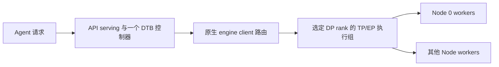
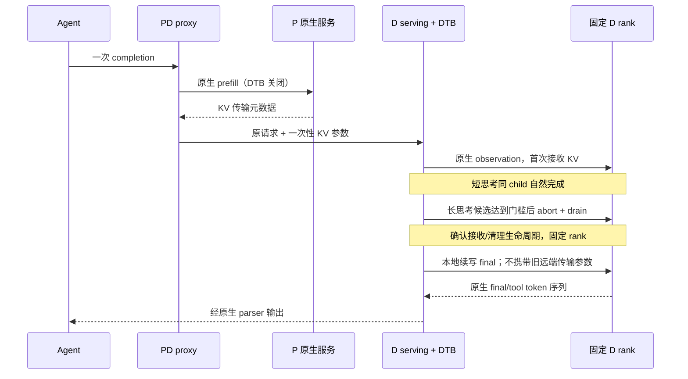

# DTB 在 GLM-5.3 Agent 场景的加速计划

## 1. 目标、起点与结论

目标是在工具协议与 Agent 任务质量不退化的前提下，减少 GLM-5.3 完成整条任务的时间。
本计划以 2026-09-15 的 TB `46b94d4ea17501c5e628cb8fba5f32d696087b69` 为起点。
当前阶段完成 tokenizer 实测和源码分析，尚无用户新轨迹、GLM 实机或 PD 性能结果；
本文没有已达成加速比例，也不将 Qwen 的参数/收益视为 GLM 的证据。

证据身份：

| 对象 | 本次身份 |
| --- | --- |
| vLLM 只读 checkout | `v0.23.0` / `0fc695fc6d1d82e9a5ac6835ac8e4e1c83703665`，clean |
| vLLM-Ascend 只读 checkout | `v0.23.0rc1` / `f4a08bddd0cc65a0bd8c3d377b158ae5ca7527db`，clean |
| 本机分析环境 | Windows / CPython 3.14.7 / Transformers 5.17.0 / tokenizers 0.23.2 |
| Tokenizer 身份 | [固定快照、SHA256 与实测](../tokenizer/README.md)，Qwen3.6-27B 与官方 GLM-5.3 |
| 目标服务器身份 | 待回填实际模型/量化/后训练版本、两个源码 commit、镜像 digest、PyTorch、torch-npu、CANN、代理与 connector commit |

结论分三层：

1. **实测：tokenizer 可立即用于离线分析。** 六个必要文件已在 `docs/tokenizer/`，
   `AutoTokenizer(..., local_files_only=True, trust_remote_code=False)` 加载、marker 编码和
   多轮工具模板渲染已通过；未下载权重。
2. **源码确定：不能只改两个 token ID。** 流式 DTB 只支持 Qwen parser 组合；GLM 需要
   独立协议绑定、模板/停止语义回放与配置。现有安全回退意味着原生生成，不代表 DTB 生效。
3. **源码确定 + 待验证设计：多机共置与 PD 分离要分别处理。** 共置通常能复用 serving
   集成，但 DP 亲和性必须闭合；真正 PD 还需要一次性 KV 传输和内部 child 生命周期适配。
   在每个 Node 安装相同代码是部署一致性的措施，不是完整的 PD 适配方案。

用户链接的 [GLM5.3 部署文档](https://docs.vllm.ai/projects/ascend/en/latest/tutorials/models/GLM5.3.html#51-multi-node-deployment)
中，5.1 是多机共置，5.2 才是 PD 分离；截至本次查阅，官方注明 GLM-5.3 的 PD 未测试，
并引用 [GLM-5.2 的 PD 配置](https://docs.vllm.ai/projects/ascend/en/v0.23.0/tutorials/models/GLM5.2.html)。
`latest` 页面及正式镜像不能冒充本地 rc1 checkout 的同一实现，上线前必须核对差异。

## 2. 关键问题一：GLM 协议适配

### 2.1 需要改变的模型契约

完整 token 表在 [tokenizer 说明](../tokenizer/README.md)。最关键的变化：

| 内容 | 当前 Qwen3.6 | GLM-5.3 |
| --- | --- | --- |
| `<think>` / `</think>` | 248068 / 248069 | 154841 / 154842 |
| `<tool_call>` / `</tool_call>` | 248058 / 248059 | 154843 / 154844 |
| 参数格式 | function/parameter XML | arg_key/arg_value XML |
| 原生 parser | qwen3 + qwen3_coder | glm45 + glm47 |
| 已确认的历史策略参数 | preserve_thinking | clear_thinking |

这些 reasoning/tool marker 虽为 singleton token，但快照中 `special=false`。
仍应按精确 ID 判断，不能从 special-token 列表推断。Role/EOS 与 generation config
另行校验，尤其 GLM user/observation 标记也在官方生成 EOS 集中。

### 2.2 当前实现的具体限制（源码确定）

- [`schema.py`](../../dtb/config/schema.py) 的 `ReasoningProtocolAdapter` 只有 `QWEN3`；
  [`parser_boundary.py`](../../dtb/reasoning/parser_boundary.py) 的绑定函数要求
  `Qwen3ReasoningParser` 与 `Qwen3CoderToolParser`，并验证 `<tool_call>` 可作为 reasoning
  自然结束。更改 YAML 的 ID 不会让 GLM 通过绑定。
- [`request_controller.py`](../../dtb/request_controller.py) 对流式绑定失败保留空协议；
  [`deferred_observation.py`](../../dtb/reasoning/deferred_observation.py) 返回
  `unbound_protocol`，同一个原生 child 继续完成。上线必须审计实际 intervention 状态。
- vLLM [`reasoning/__init__.py`](../../third_party/vllm/vllm/reasoning/__init__.py)
  将 `glm45` 绑定到 `DeepSeekV3ReasoningWithThinkingParser`，它包装内部 parser；
  不应假设表层对象拥有 Qwen 的 `end_token_id`。
- GLM thinking parser 通过 `</think>` 判断结束，没有 Qwen 补丁的“tool-start 也结束
  reasoning”约定。不能为了复用 DTB 而凭空合成一套 GLM 原生输出中没有的边界语义。
- 当前 Qwen 的 synthetic boundary 为 token-only/空 text；GLM 原生 parser 的部分路径
  仍用 `delta_text.find('</think>')` 分割正文。GLM 的 singleton boundary、混合正文 batch、
  marker text 被终止 detokenizer 删除时必须实测回放，不能直接搬用 Qwen 补丁。
- [`generation_states.py`](../../dtb/reasoning/generation_states.py) 的 final cue 与
  trial cue 为现有模型验证过的英文提示；probe 是自由试答，未必输出可执行工具动作。
  它们在 GLM 上是否稳定、是否增加重复思考，需要独立实验。
- [`token_filter.py`](../../dtb/reasoning/token_filter.py) 的结构过滤主要面向 JSON/Qwen，
  并非 GLM arg/role 语法的完整过滤器。当前默认平均置信度还会受模板 token 概率影响；
  `0.93/0.95` 不能直接当作 GLM 正确率。Value-Min 默认关闭，不应为了迁移顺便开启。

非流式目前直接进入三状态生成，不经过上述 streaming capability guard；因此不能推断
“不支持的 GLM/PD 非流式请求也必然自动原生回退”。首轮部署在未通过协议门的模式中
关闭 `enable_think_budget` 或服务总开关，走原生单次 generate。

### 2.3 建议的最小适配边界（设计，尚未实现）

复用现有 `ReasoningBoundaryProtocol`，增加 GLM 专用绑定。让自然边界集合支持只声明
`THINK_END`，不要强制所有模型都有隐式 `TOOL_CALL` reasoning boundary；如线上原生
证据证明需要别的边界，再以 parser 契约扩展。绑定失败继续保持原生生成。

| 模块 | 拟改内容 |
| --- | --- |
| `dtb/config/{schema,loader}.py` | 增加 GLM adapter 配置；按模型验证边界集合、模板身份，保持 Qwen 旧配置兼容 |
| `dtb/reasoning/parser_boundary.py` | GLM parser wrapper 感知的绑定、自然/强制边界输出；不得硬套 Qwen 空文本语义 |
| `dtb/request_controller.py` | 统一流/非流 capability 判断；保留原生禁用路径 |
| `dtb/reasoning/generation_states.py` | 验证后选择 GLM cue；后续候选支持零 probe 或最多一次 probe |
| 版本化 patch | 保留原生 glm45/glm47；仅在实际回放证明缺陷后新增 GLM 专用最小 patch |
| 无模型回放工具 | 扩展实际 GLM tokenizer + 原生 parser fixture；不用字符 tokenizer 的通过代替真实 token 证据 |

**多轮模板门：** GLM 模板默认保留历史思考；`reasoning_effort` 接受 low/high，否则为 max。
本次模板对 `enable_thinking=false` 不改变 generation prompt，而 parser 可切为 identity，
必须防止两者设置相互矛盾。保留历史时，本轮截断还会改变后续轮次输入，故必须闭环回放。
不同 history/effort 策略分别建立 Vanilla；不要把修改模板的收益归给早退控制器。

### 2.4 四个 parser 的源码与真实 tokenizer 回放补充（2026-09-16）

详见 [Qwen3.6 / GLM-5.3 parser 对比](dtb_qwen36_glm53_parser_comparison.md)。
`glm45` 实际包装 DeepSeekR1/Identity，`glm47` 的流式行为主要继承 GLM4 父类。
本地真实 tokenizer + 源码回放已复现：GLM 无换行零参数工具流式缺失、array/number
分片参数错误（包括 JSON 合法但值改变）、正文与 stripped `</think>` ID 同 delta 时
reasoning/content 错分。Qwen 仓库 patch 的 30 个工具回放与非流式一致；GLM 原版 30 个中
12 个不一致。这些是合成输入诊断，不是服务器故障率，也不是 GLM 性能结论。

调整 S2：先关闭 DTB 验证 GLM Vanilla 原生协议，将上述三个已复现项作为本地修复门，
再验证 DTB；Vanilla/DTB 使用同样的 parser 修复版本，避免将上游协议修复归因于预算算法。
本次未修改 parser 或生产 DTB。

## 3. 关键问题二：部署拓扑、DP 与 PD 生命周期

### 3.1 多机共置：复用集成，但补齐路由



控制器运行在处理 chat 请求的 API 进程，headless worker 不会因为安装 serving patch
就独立执行一次控制器。应在所有节点部署一致的镜像/代码/模型配置，并在所有 API 实例
安装 DTB；不需要每个 worker 都再增加一个独立 DTB 状态机。

[`DtbRequestContext.engine_request_kwargs()`](../../dtb/reasoning/request_context.py)
已透传 priority、LoRA、trace、parser kwargs 和 `data_parallel_rank`。
但 vLLM serving 从 `X-data-parallel-rank` 读取路由，未提供时允许 None；
[`DPAsyncMPClient.get_core_engine_for_request()`](../../third_party/vllm/vllm/v1/engine/core_client.py)
在 rank 为空时对每个 EngineCoreRequest 按负载选 rank。**透传 None 不等于亲和性。**

建议：由可信入口为一个外部请求选择一次 rank 并传递给所有 child，或通过 engine-client
扩展返回 observation 的实际 rank、再绑定续写。前者适合首轮验证，后者更贴近原生负载
均衡但需要额外接口。不必跨整个 Agent 会话永久绑定 rank；先保证一个外部 completion
内部一致，再测跨轮 session affinity 对热点与缓存的权衡。

共置拓扑不改变三状态顺序 await 的性质，不能把所有历史 child 计成同时占用 seq slots。
不同 child ID 也不能证明 APC 从零开始；必须测 cached tokens、cache eviction 与重算。

### 3.2 真正 PD：现有代码不能仅靠逐节点替换生效

当前 Ascend 代理与 connector 的源码路径：

1. [`build_prefill_request()`](../../third_party/vllm-ascend/examples/disaggregated_prefill_v1/load_balance_proxy_server_example.py)
   将 P 请求设成非流式、`max_tokens=1` / `min_tokens=1`，请求 remote decode。
2. 代理从 P 响应取得 `kv_transfer_params`，传给 D，并分配请求/实例身份。
3. vLLM [`ChatCompletionRequest.to_sampling_params()`](../../third_party/vllm/vllm/entrypoints/openai/chat_completion/protocol.py)
   把 KV 参数放入 `SamplingParams.extra_args`。
4. DTB streaming switching guard 对非空 `extra_args` 返回 `sampling_state`；即便完成 GLM
   parser 绑定，也仍不执行切换。该保护不能通过简单删除判断来解决。
5. 每个 DTB child 直接调用当前 D 服务的 `engine_client.generate()`，不经 PD HTTP 代理，
   不会自动为新增 thinking/cue/probe prompt 调用 P。
6. [`MooncakeConnectorScheduler`](../../third_party/vllm-ascend/vllm_ascend/distributed/kv_transfer/kv_p2p/mooncake_connector.py)
   使用 remote request/block/engine 身份，接收登记后将 `do_remote_prefill` 设为 false；
   P 的 blocks 存在延迟释放及接收完成通知。DTB 每次 `to_sampling_params()` 又从原请求
   构造参数，不能把首个传输元数据原样重用于带增长前缀的新 child。

以上是已读代理和 MooncakeConnector 实现的源码事实；实际选择 MooncakeConnectorV1、
其他插件或不同版本时，需追踪其注册类与代码，不能假定所有 connector 完全同构。

特别是 **P 必须原生 bypass**：原代理浅复制外部请求，若继承 enable_think_budget=true，
P 的非流式 one-token warmup 可能进入现有三状态机。应在 P 服务总开关关闭，且代理
显式清理/覆盖 DTB flag，保持原生 prefill 结束及 KV handoff 响应。

### 3.3 推荐实施路线



**第一候选（设计）：P 一次传输，D 本地少量续写。** 保留原代理首次 P→D；D 上新增
明确的传输状态适配，首次 observation 使用原生参数，后续 child 使用已消费状态对应的
本地续写参数，并固定同一 D rank。新 cue/思考前缀需要的 KV 在 D 侧计算；APC 只能复用
确实保留且命中的块，不能承诺零 prefill。先验证 zero-probe 的一次强制 final，再测试
最多一次 probe；本轮只设计，不在现有服务中绕过 guard。

传输适配应只处理已识别的 connector 元数据，不清空其他 `extra_args`；未知 sampling
状态继续原生回退。不能根据首个 token 已返回就臆造“remote lease 可重复使用”，也不能
在 abort 未 drain 完成时启动依赖它的续写。取消、超时和失败必须幂等释放双方状态。

| 后续路线 | 适用条件 | 额外工作 / 风险 |
| --- | --- | --- |
| 每个 child 经 PD 编排 | D 本地重算实测占主要成本，且完整 KV 生命周期支持 | 需要 token-ID 级 phase 接口、每次新传输身份、取消传播；不能把内层 prompt 当新 chat 重套模板；防止递归 DTB |
| 同 engine request 内切换 thinking→final | child 排队/abort/prefill 成本仍吞噬收益 | 涉及 scheduler/output processor 状态更新，是独立中长期方案；不能由 serving monkey patch 假装完成 |

### 3.4 成本模型与证伪方式

```text
单次模型调用净收益
= 被省去的 thinking decode 时间
- 增量 queue / prefill / KV transfer / abort+drain / probe / controller CPU
- final-answer 时间变化

Agent 完成时间收益
= 完整任务 Vanilla wall time - 候选 wall time
```

token×基线 TPOT 仅作筛选近似。PD 上 queue、prefill、transfer 可以重叠，不能机械相加
各节点 wall time；必须按 request/phase 建立时间线，分开关键路径 elapsed 与设备总工作量。
Agent 工具轮次、工具耗时、重试及并行路径也会改变，不能把单轮 token 减少直接称为任务加速。

待证伪假设：D 本地一次续写的新增成本小于省去的长尾 reasoning decode。
用同拓扑/同 prefix 长度/同负载下 Vanilla 与 zero-probe candidate 的 paired replay，
测 D 缓存命中、重算 tokens、handoff 等待和 E2E；若重算/尾延迟持续抵消收益，停止调小
思考预算，转评估上述 phase 编排或同请求切换。

## 4. 关键问题三：用户轨迹分析与语义早退

### 4.1 现在就应保留的数据

轨迹尚在获取中；本节是输入契约，未报告任何真实分布。保留原始文本与 token IDs 的
并行视图。只有 API 解析后的 reasoning 文本时可复编码统计，但标记为估计，不能恢复
已被丢弃的 boundary、EOS、历史思考或模型原始生成 token 数。

每行一个外部 assistant completion，字段建议如下：

| 分组 | 字段 |
| --- | --- |
| 关联 | trace_id、turn_id、parent_request_id、attempt_id、父子/并行步骤关系、scene、数据集/sample_id |
| 模型身份 | repo/revision、权重版本、tokenizer/template hash、模型实际采样 seed、请求 stop、reasoning_effort、clear_thinking 等 kwargs |
| 请求 | 原始 messages（含 reasoning_content、tool_calls、tool results）、tools schema、实际渲染 prompt/token IDs、长度/上下文上限 |
| 原生输出 | 按顺序记录生成 token IDs、delta text、stream sequence、边界、finish/stop reason、reasoning/content/tool 参数及 usage |
| 时延 | 请求开始、首 token、思考结束、首工具名、工具参数完成、模型完成、工具开始/完成、重试开始、整条任务开始/结束 |
| 结果 | tool 参数校验、执行成功、任务验收、Judge 原值/invalid、人工 override、hard failure、客户端错误 |
| 部署 | P/D 实例、DP rank、connector、proxy attempt/request ID、cache 状态、并发/到达节奏 |

生产常规测量仍用 observability off；正文/token 序列在隔离的显式白名单采集通道获取，
不能为了采集真实用户轨迹在全量生产打开 stream_audit。敏感值脱敏会改变分词时，保存
脱敏规则和原始端计数，分析报告声明这个边界。原始轨迹不默认上传到模型仓库或外部服务。

### 4.2 分布计算流程

1. 按 tokenizer/template/模型身份分桶，按 trace 分割 search/validation/holdout，不能把
   同一任务相邻轮次分别放训练与测试。先核对 ID 唯一性、缺段、重试与取消。
2. 有原始 token IDs 时按 generation prompt 的初始 reasoning 状态解析边界：模板常已
   包含 `<think>`，不能强求输出中再次出现 opener。分开正文 thinking、结构 token、
   最终答案、tool 名/参数、EOS；截断/缺闭合标记归入 censored/invalid，不当作完整短思考。
3. 仅有 reasoning/content 文本时用 `encode(text, add_special_tokens=False)`，记录
   `measurement=retokenized_text`。先拼接完整有序 SSE 文本，再编码；不能逐 chunk 编码求和。
   跨 token 边界重新编码可能不等于原始 IDs，必须单列。
4. 同一文本可用两套 tokenizer 做分词粒度对照，但“用 Qwen tokenizer 编码 GLM 思考”
   只能说明编码差异，不能代替 GLM 模型生成长度，更不能按比例搬用 Qwen 预算。
5. 按规划/工具选择/参数填充/工具结果解释/失败恢复/最终总结、工具风险、上下文长度、轮次
   分层，报告 N、缺失率、P50/P75/P90/P95/P99、思考占比、时间占比、tool 轮数和 retry。
   当前 scene router 只取最新 user，可能无法区分同一 user 后的多个 tool turn；先离线
   检查，再决定是否为已有 scene router 增加显式 Agent stage 输入。
6. 报告请求加权与场景宏平均，另报整条任务关键路径；完整模型生成量应分 visible thinking、
   hidden probe、final/tool。历史 reasoning 进入 prompt 的 token 数另列，避免重复计成新生成。

### 4.3 “可早退”的可检验定义

定义候选点为：**截至该前缀，下一步动作及执行所需参数已有充分依据，继续思考没有
为该动作带来必要信息；从这里强制收束后，原生生成的动作和任务结果仍通过验收。**
不能仅凭一句“已经确定”、重复词或末尾置信度高就认定可早退。

离线语义标注建议（人工审阅或受控评审，评审只能看到当前前缀）：

| 标签 | 判断重点 |
| --- | --- |
| evidence_missing | 关键事实/参数仍未知，应该查工具或继续推理 |
| action_candidate | 已选工具/方向，但仍有分支未排除或必填参数未绑定 |
| action_ready | 关键约束已核对，工具与参数来源明确，没有未决冲突 |
| redundant_tail | 动作已稳定，后续仅复述/展开；离线候选，不直接当线上规则 |
| reconsideration | 后续发现错误并改换动作，前面看似 ready 的点是假阳性 |

候选切点先取句段结束、`action_ready` 标注点及若干分位预算，保留负例：长复杂推理、
异常工具结果、参数歧义、相互冲突的证据。工具 XML 生成开始后不再裁剪参数；早退发生在
thinking 内，后续 tool call 由模型完整生成。反事实回放必须保持 tokenizer 边界合法。

完整轨迹可用于事后定位“后来有没有反悔”，但线上判定/训练输入只能用截至切点的信息。
用户轨迹本身不足以证明某切点安全；必须从保存的模型/工具状态做反事实分支验证。

### 4.4 两级回放与候选选择

**固定前缀回放：** 对同一个 turn 的原始输入重放候选切点，对比自然结束、强制边界、
GLM cue、单次 probe；记录工具名、schema/必填参数、关键值一致性、finish reason 和生成成本。
首轮用有界候选集，不对所有 token 切点执行昂贵模型试验。

**Agent 闭环回放：** 从相同任务初态分别执行 Vanilla/候选。如果候选改变了工具或参数，
只能在可重复 sandbox/模拟工具中执行相应动作；不能继续喂入原轨迹的工具结果假装路径相同。
评估任务完成率、必要工具轮次、失败恢复、最终结果与任务 E2E。危险外部写操作使用隔离环境。

优先比较：

- 原生 GLM：与服务器原生 reasoning_effort/history 策略相同，构成新 Vanilla。
- 现有 DTB 算法移植：完成适配后作为算法对照；必须证明已实际介入。
- 场景预算 + 最低介入门槛 + zero probe：验证最少切换是否已足够。
- 同一门槛 + 最多一次 action-aware probe：仅当增加的质量收益覆盖成本时保留。
- 语义 gate：先离线标注/校准；在线分类器或另一次模型评审的成本全部进入控制器账本。

官方 `reasoning_effort=low/high/max` 可单列对照，但其参数意义不等于硬 token 上限。
若原生 effort 策略已优于 DTB，不能用不匹配的 Vanilla 来制造 DTB 收益。

## 5. 核心数据结构与接口（拟议，非已实现 API）

复用现有 `DtbRequestState` 工作量账本与 `ReasoningBoundaryProtocol`，避免另建重复状态机。
PD 增加一个小的传输上下文，由 vLLM integration 管理，不让预算算法操作 remote blocks。

```text
PdContinuationContext
  connector_identity
  original_transfer_metadata       # 不可变原始证据
  transfer_state                   # pending / receiving / local_ready / released / failed
  selected_decode_instance, selected_dp_rank
  parent_request_id, proxy_attempt_id, first_child_id

AgentTurnRecord
  trace_id, turn_id, attempt_id, parent_request_id
  model_identity, tokenizer_identity, template_kwargs
  messages, tools, prompt_token_ids, generated_token_ids
  segments, timestamps, tool_outcomes, quality

ExitCandidate
  trace_id, turn_id, prefix_token_count
  evidence_label, unresolved_constraints, proposed_action
  policy_version, counterfactual_replay_result
```

拟议接口职责：

| 接口 | 输入 → 输出 / 责任 |
| --- | --- |
| `bind_reasoning_boundary_protocol(...)` | 模型配置 + tokenizer + 原生 parser → 已验证协议或不支持 |
| `prepare_child_sampling(phase, native_params, pd_context)` | vLLM integration 构造首个 remote 或后续 local 参数；只消费明确支持的 KV 字段 |
| `on_transfer_event(event, pd_context)` | connector 的真实接收/释放/失败证据推进状态；无事件来源不臆造 ready |
| `abort_and_drain(child_id)` | 复用现有取消契约，补齐 PD 资源所有权；禁止吞掉非本次拥有的取消 |
| `analyze_turn(record, tokenizer)` | 离线生成分段计数、来源等级与完整性状态 |
| `evaluate_exit(prefix, action_schema)` | 离线输出候选标注；线上化前另行评估成本与校准 |

首版是否需要 connector 事件接口，取决于目标 connector 能提供的可验证生命周期；若只能
靠不稳定内部字段猜测，应保留 PD 原生回退，先完成共置收益验证。

## 6. 实施顺序与验收门

| 阶段 | 交付 / 动作 | 通过条件 |
| --- | --- | --- |
| S0 已完成 | tokenizer 六文件、SHA、环境版本、18 组模板与 marker 审计 | 离线加载、模板文本与 token 编码一致；无权重 |
| S1 等待轨迹 | 原始数据契约、分布与 action-ready 标注、小规模候选集 | 归属闭合，真实/复编码/缺失分开，trace 级 holdout |
| S2 待实施 | GLM parser 适配，先单实例/多机共置 smoke，再固定 rank | 流与非流、自然与强制结束、工具返回后下一轮均保持原生 parser-facing 契约 |
| S3 待实施 | PD Vanilla 验证、P bypass、D 传输/亲和性适配 | 真正介入且无 stale KV、资源泄漏、挂起或重复输出；两个模式都验证 |
| S4 服务器 | Vanilla、dtb_default、scene/fixed 候选及少 probe 消融 | telemetry off paired 性能；另跑 phase 账本；质量与时延同时通过 |
| S5 服务器 | Agent 闭环 holdout、真实并发/到达节奏、回归与回退 | 任务质量无可接受范围外退化，hard failure 为 0，任务 E2E/P95 通过预先冻结的标准 |

质量非劣界、最小业务收益和置信区间标准应在看 holdout 结果前冻结；当前没有用户指定
阈值，不能编造“加速 20% 即达标”。报告逐任务配对差值及 bootstrap 区间；少量样本零错误
不构成可靠性证明。旧 13 场景保持独立回归；新 Agent 场景按预先定义的分层宏平均报告，
不能硬塞进旧 13 场景后稀释退化。

协议必测：token-only/marker-present、split marker、一个 speculative batch 同含边界和
正文、多个 tool call、空参数、中文/嵌套 JSON/多行参数、无工具和 no-thinking、EOS/length、
completion 极小额度、取消、工具后 role、非流式完整解析、工具结果后再次推理。
不将短思考或 token 降低作为接受工具 XML 泄漏/JSON 不完整的理由。

PD 必测：首次 remote 接收、D 本地续写 cache hit/miss/eviction、多个 DP rank、有/无显式
路由、传输前/中/后取消、P/D 故障、代理重试、abort 与自然结束竞态、远端释放、重复 child
与 parent 关联。P warmup 生成工作量与内部 probe 都计入服务工作量，不混入外部 usage。

性能账本至少增加 P queue/prefill、transfer 等待与字节、D queue/prefill/decode、
cached/uncached prompt tokens、abort/drain、proxy 重试、controller CPU、final/tool 输出量。
跨节点用本地单调时钟测 phase 持续时间，关联 wall clock 需时钟校准；并行 phase 用区间并集
与关键路径解释 E2E 缺口。当前单 server.log 提取器不能直接宣称已支持分布式归属，先规范化
多节点记录和映射，再按原有单 run 契约输出。

正式 run 遵循 [泛化计划第 6 节](think_budget_generalization_plan.md)：新模型/拓扑使用
同身份 Vanilla，固定采样/seed/并发/到达节奏/cache；off 排名与 phase 裁决分开；完整性
先于性能，Judge invalid、客户端错误、hard failure 分开；结果写入同 run `RESULT.md`。
MTP 维持目标生产配置，除非出现新回归证据，不把它重新列为常规调参轴。

## 7. 本次一致性检查与证据边界

- 下载身份与仓库 Qwen 27B 起点一致，但服务器定制 tokenizer 身份仍待核对。
- 本机已验证 tokenizer；GLM parser 和 PD 修改均为设计，没有声称已实现或服务器测试通过。
- 区分 DP（副本路由）和 PD（prefill/decode 分离）；安装位置、首个传输与后续续写职责明确。
- 边界配置不继承未经证明的 Qwen 假设；禁用路径、未知能力回退、取消/错误都有明确要求。
- tokenizer 给出长度，语义标注给出候选；反事实与闭环质量验收才证明候选早退是否安全。
- 所有收益均等待同身份服务器测量；文档中的候选预算、阈值与接口不改变当前生产默认值。

## 8. 变更历史

| 日期 | 变更 | 原因 |
| --- | --- | --- |
| 2026-09-16 | 补充四个 parser 源码及真实 tokenizer 回放，收紧 S2 为先验证 GLM Vanilla 协议 | 复现零参数、非 string 增量参数和 stripped reasoning boundary 差异；不以非流式成功替代流式验收 |
| 2026-09-15 | 首版；完成本地 tokenizer 审计，确认 GLM parser、DP 亲和性、PD KV 生命周期适配边界；定义轨迹与闭环验收计划 | 将 GLM Agent 加速建立在真实 token/协议与端到端成本证据上 |
