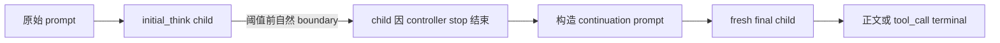
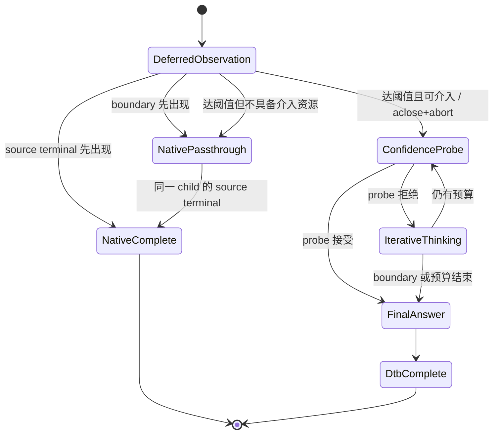

# DTB 最低介入值机制设计（初稿）

## 1. 设计目的

本文为 agent 多轮工具调用场景设计 DTB 的最低介入值机制。目标是在保留 DTB 对超长
reasoning 的压缩能力时，让阈值以内自然结束的请求继续使用同一个 vLLM generation 完成
reasoning、正文或工具调用，避免当前“thinking child 停止，再启动 final child”的固定成本与
轨迹扰动。

设计基线为仓库提交 `cc9bfbed8d61848edff567afee1b9a83a72a53af`，目标运行时是
vLLM `v0.23.0`、vLLM-Ascend `v0.23.0rc1` 和 Qwen3.6 流式协议。本阶段只设计
streaming 路径；non-streaming 保持现状。

run-05 的实测背景见 `docs/log/perf/agent_run05/RESULT.md`：完整 9 场景的 301 个 Vanilla
请求中，292 个（97.01%）reasoning 不超过 `fixed_check_length=850`。现有实现对这些请求仍会
停止 initial child 并启动 fresh-final，估算中心成本约为 `0.66 s/请求`，映射到 Vanilla 轨迹约为
`192.7 s`，相当于 Vanilla LLM E2E 的 8.99%。因此，消除短请求 handoff 是必要优化，但它只能
解释 run-05 DTB/Vanilla 总差距的一部分，不能代替后续长请求净收益验证。

### 1.1 从场景级请求到 Agent 任务的分布迁移

此前 DTB 的场景级测试集以独立请求为实验单元，每个分类内部的 reasoning 长度覆盖相对均匀，
中长 reasoning 样本占有足够权重。固定在首个检查点介入时，长请求节省不会被大量短请求的控制器
成本迅速稀释，因此可以在逐场景请求 E2E 上观察到收益。

直接把同一套 always-on 策略开启在 Agent 执行场景后，实验对象已经改变。一个 Agent 任务由多轮
reasoning→content/tool→tool result 反馈组成；绝大多数轮次只需很短的动作判断，只有少数规划、
排障或收敛轮产生超长 reasoning，形成极端长尾。run-05 中 97.01% 的 Vanilla 请求不超过 850
token，正是这一分布迁移的实测表现。

| 维度 | 原场景级测试集 | Agent 多轮执行场景 |
| --- | --- | --- |
| 实验单元 | 独立、已分类的单请求 | 包含多次模型与工具交互的完整任务 |
| 分类内 reasoning 分布 | 各长度段相对均匀 | 大量极短轮次与少数超长轮次混合 |
| DTB 成本暴露 | 中长请求有足够占比摊薄控制成本 | short-path 税被每个短轮次重复支付 |
| 输出反馈 | 单请求输出后结束 | 一个 tool/action 会改变工作区和所有后续 prompt |
| 原先主要指标 | 质量门后的逐请求/逐场景 E2E | 质量门后的完整 Agent task wall |

因此，Agent 场景测不到端到端优化的根本背景不是“长 reasoning 不可压缩”，而是**测试场景和
reasoning 分布发生了变化**：少数长尾收益需要覆盖绝大多数短请求的固定负优化，并且任一被介入
轮次还可能改变后续工具轨迹。最低介入值首先解决其中的 short-path 税和短轨迹扰动，再为只在
长尾上衡量 DTB 净收益建立可用前提。

### 1.2 最终目标与指标层级

本设计的最终目标固定为：

> 在 Agent 执行场景中，保证系统可用性和任务正确率不低于同实验身份 Vanilla，并使完整任务的
> 端到端时延下降。

成功标准不是单独满足“reasoning token 变少”“某个长请求更快”或“原场景级测试集仍有收益”。
指标按以下层级裁决：

1. **发布硬门：**工具协议 hard failure 为 0、每个任务均生成评测报告、严格正确率不低于
   Vanilla；
2. **最终主指标：**LightCode/Agent 任务的 `evaluation_results.json` 中逐任务
   `start_time → end_time` paired wall，以及任务等权和累计结果；
3. **因果辅指标：**proxy 累计 LLM E2E、外部 Agent 轮次、首次轨迹分叉、工具/编译/测试 wall；
4. **机制诊断指标：**单请求 TTFT/E2E、child 数、visible/hidden token、phase wall、abort 和
   threshold overshoot。

旧场景级测试集继续承担算法能力与回归检查，但不再决定 Agent 版本是否获得性能收益。即使某候选
在旧场景集保持正收益，只要完整 Agent task wall 没有改善，就没有达成本设计目标。

## 2. 结论

方案可行，推荐采用**同子请求观察、自然短请求直通、到阈值后内部取消**的实现：

1. 初始 generation 不设置 DTB 拥有的 reasoning boundary stop，也不把
   `max_tokens` 设置为介入阈值；它保留原请求的 stop、EOS、`min_tokens`、采样参数以及完整
   completion/context 上限。
2. DTB 在原生 `RequestOutput` 进入 reasoning/tool parser 前，只读取增量 `token_ids`，累计仍处于
   reasoning 状态的 token 数，并检查协议声明的 canonical boundary token。
3. boundary 或原生 terminal 先于阈值出现时，DTB 解除介入武装，继续把同一 generation 的原始
   delta 和 terminal 不改写地传给原生 parser；不 probe、不合成 `</think>`、不追加 answer cue、
   不创建 final child。
4. 首个完整 delta 使 reasoning token 数达到阈值，且该 delta 仍无 boundary/terminal 时，先原样
   透传该 delta，再显式关闭当前 async generator。vLLM `AsyncLLM.generate()` 会在
   `GeneratorExit` 路径执行内部 abort；取消成功后，DTB 把已经透传的准确 token 前缀追加到
   continuation prompt，并直接进入现有 confidence probe。
5. 介入后的 iterative thinking 继续使用
   `docs/design/dtb_reasoning_boundary_token_stop.md` 定义的 token-stop 和 parser patch。最低介入
   不是 token-stop 的替代方案：观察期不使用控制器 stop，介入后的 DTB 子请求仍必须使用统一的
   token boundary。
6. 第一版把现有 `budget.check_length` 直接解释为最低介入值，不增加第二个数值旋钮。
   `fixed_check_length` 和 scene 的 `check_length` 仍是实验与自动配置入口；只新增一个显式的
   `intervention_mode=eager|deferred` 行为开关。
7. request-level replay 只负责证明短路径无负优化、长路径存在净收益候选；阈值和策略最终必须按
   完整 Agent task wall 排名，不能沿用原场景级请求 E2E 作为发布结论。

这个方案达到的是**原生等价的同子请求直通**，不是严格意义的 serving 原生 bypass。DTB 仍需在
请求开始前构造上下文、执行当前 budget decision，并让输出经过一个轻量 observer/queue；因为是否
应启用 DTB 取决于未来生成长度，请求开始前不可能同时作出真正的原生旁路决定。若同子请求直通后
仍有可测的短路径控制器开销，再单独评估延迟预算解析或移除 queue hop，不在首版扩大改动面。

2026-09-04 前置决策：先独立实施
[输入去 decode 与 Token ID 权威续写](dtb_token_authoritative_prompt.md)，完成 eager 配对验收后
再实施本文机制。分类直接复用 serving 已有文本，缺失时不 decode 兜底；原始全文只作不可变
快照，不维护续写文本镜像。这不是 lazy budget resolve，也不消除 eager 的二次提交成本。
该前置重构已完成本地实现和 229 tests / 1966 subtests 回归；服务器 eager 配对验收仍待执行，
本文 deferred 机制尚未实施。

## 3. 范围与非目标

### 3.1 本阶段范围

- `request.stream=true` 的 DTB 请求；
- Qwen3.6 已绑定的 `think_end` 与 `tool_call_begin` canonical token；
- 初始生成的同子请求直通、阈值触发、内部 abort 和现有 DTB 状态机衔接；
- reasoning/content/tool parser 的 token/text 连续性；
- completion 总额度、取消、错误和唯一 terminal 契约；
- phase telemetry、stream audit、paired replay、旧场景集回归和 Agent/LightCode 任务级验收。

### 3.2 非目标

- 不改变 non-streaming 的 full-response parser 和现有 stop 行为；
- 不新增面向外部代理的 HTTP cancel endpoint；
- 不承诺停止已经提交到 NPU 的当前 kernel，只要求 vLLM Scheduler 尽快结束 request 生命周期、
  丢弃迟到输出并释放资源；
- 不在首版引入精确 token 级 delta 切分、额外 grace window 或预测式长短分类；
- 不把 `min_think_tokens` 改名或改变其置信度接受门槛语义；它不是最低介入值；
- 不把本机制直接宣布为整体 DTB 已获得净时延收益，长请求的 probe、重复 prefill 和 final child
  成本仍需独立闭账。

## 4. 当前行为与问题

当前 `DtbStateMachine` 固定从 `_ThinkingState` 开始。第一次 `_ThinkingState.handle()` 使用
`budget.check_length` 作为 initial child 的 `max_tokens`，再由 `configure_thinking_stop()` 增加
reasoning boundary stop。若模型在这个上限前自然生成 `</think>` 或 `<tool_call>`，
`consume_output()` 会移除 source terminal 并把边界作为非 terminal delta 透传；随后状态机进入
`_FinalAnswerState`，启动新的 generation 继续正文或工具调用。



这会让短请求固定承担：

- 一次额外 child 入队与首 token；
- continuation prompt 的再次提交和可能的 prefill；
- Automatic Prefix Caching 未命中完整尾块时的额外计算；
- 随机采样轨迹被切断后重新开始；
- boundary、工具 XML 和 terminal 跨 child 拼接的正确性风险。

只把字符串 stop 换成 `stop_token_ids` 能修复结构边界歧义，但不会消除这个短路径 handoff。

## 5. 核心设计

### 5.1 状态流

新增 `_DeferredInterventionState`，仅在 `stream=true`、
`intervention_mode=deferred`、协议已绑定且当前 assistant completion 确认从 reasoning 状态开始时
作为首状态。`reasoning_ended=True` 的请求不应重新武装 reasoning 观察器，而应走单 child 原生
直通；non-streaming 和 eager 路径继续从现有 `_ThinkingState` 开始。



`NativePassthrough` 可以是 `_DeferredInterventionState` 内的 disarmed 分支，不必单独创建状态类。
它必须继续消费同一个 async generator，不能返回状态机后重新调用 `generate()`。

### 5.2 阈值来源

首版不新增 `minimum_intervention_tokens` 数值字段，定义：

```text
minimum_intervention_tokens = budget_decision.budget.check_length
```

原因是 `check_length` 本来就是第一次 probe 的检查点。再增加一个阈值会产生以下不明确组合：

```text
minimum_intervention_tokens < check_length：达到介入值后是否先空等到 check_length？
minimum_intervention_tokens > check_length：原有第一次 probe 应何时发生？
```

在 deferred 模式下，达到 `check_length` 后立即执行第一次 probe；若 probe 拒绝，后续仍按
`think_stride` 进入 `_ThinkingState`。因此现有 `fixed_check_length` 可以直接用于阈值搜索，scene
配置也不需要增加新的维度。

新增配置建议为：

```yaml
RUNTIME:
  intervention_mode: deferred  # eager | deferred
```

- `eager`：保持当前行为，用于回滚和 A/B；
- `deferred`：启用本文机制；
- 首个实现版本默认 `eager`，通过定向 replay 和 LightCode 门禁后再把生产默认改为
  `deferred`。

固定参数实验仍按现有请求接口传入，例如：

```json
{
  "enable_think_budget": true,
  "fixed_budget_tokens": 20000,
  "fixed_check_length": 850,
  "fixed_think_stride": 500,
  "fixed_num_thinking": 5,
  "fixed_min_think_tokens": 1,
  "fixed_prob_th": 0.93,
  "stream": true
}
```

不需要增加 `fixed_minimum_intervention_tokens`。如果以后证明第一次 probe 点与最低介入值确实需要
独立调节，再通过新设计拆分，不能在首版预留含糊字段。

### 5.3 初始 generation 参数

初始观察 child 的参数必须尽可能等同原生请求：

| 参数/上下文 | deferred observation 行为 |
| --- | --- |
| `max_tokens` | 使用 serving 已由 `get_max_tokens()` 计算的完整 `completion_token_limit`，再受真实 model context 限制；不得设为 `check_length` |
| DTB boundary `stop` / `stop_token_ids` | 不添加 |
| 用户 `stop` / `stop_token_ids` | 原样保留 |
| EOS、`ignore_eos`、`min_tokens` | 原样保留，不强制把 `min_tokens` 改为 0 |
| temperature、top-p、top-k、seed | 原样保留 |
| priority、LoRA、trace headers、DP rank | 通过 `engine_request_kwargs()` 原样传递 |
| `reasoning_ended`、parser kwargs | 原样传递 |
| output kind | streaming 必须为 `DELTA`，否则 deferred mode fail closed 到 eager/禁用 |

“不配置最大上下文”不能按字面实现。vLLM 仍需要 bounded `max_tokens`，外部 completion 限额和
model context 也必须遵守。这里取消的是“用介入阈值作为 child 最大生成长度”，不是取消请求自身的
长度保护。

观察 child 不调用 `configure_thinking_stop()`。否则 boundary 仍会终止 child，短请求仍然需要
二次提交。

### 5.4 增量观察与裁决顺序

observer 不调用或复制一套 stateful reasoning/tool parser，只使用绑定协议的 token ID 分类函数：

```python
protocol.find_first_boundary(delta_token_ids)
```

该函数与 `detect_reasoning_boundary()` 的职责不同：后者验证“配置了 token stop 的 DTB thinking
child 是否以正确 stop_reason 停止”；前者观察一个**没有 controller stop** 的原生流，因此
canonical boundary 正常出现时不会带 controller-owned `stop_reason`。

每个 source delta 的处理顺序固定为：

1. 校验仅有一个 choice、DELTA 输出和 token/text 基本结构；
2. 若仍 armed，在 `delta_token_ids` 中查找第一个 canonical boundary，并按 token 位置更新
   reasoning/final 计数；
3. 将 source `RequestOutput` 对象原样放入 parser-facing queue，不复制、不清空
   `finish_reason`/`stop_reason`、不修改 text/token IDs；
4. 若 source 已 terminal，执行 native terminal passthrough 并结束；
5. 若本 delta 出现 boundary，设为 disarmed，后续不再做阈值判断，继续消费同一 generator；
6. 否则，当累计 reasoning token `>= check_length` 且具备介入资源时，触发内部 abort；不具备
   资源则 disarm 并继续原生生成。

一旦 boundary 使 observer disarm，后续 source token 全部只计入 final/tool 侧账本，不再进入
observed reasoning prefix，也不再参与阈值判断。

伪代码如下：

```python
generator = engine_client.generate(native_prompt, native_params, child_id, ...)
triggered = False
try:
    async for result in generator:
        boundary = protocol.find_first_boundary(result.outputs[0].token_ids)
        account_source_delta(result, boundary)
        await stream_source_unchanged(result)

        if is_coherent_source_terminal(result):
            return None
        if boundary is not None:
            armed = False
            continue
        if armed and observed_reasoning_tokens >= check_length:
            if not can_enter_dtb_after_prefix(context):
                armed = False
                continue
            triggered = True
            break
finally:
    if triggered:
        await generator.aclose()

append_observed_reasoning_prefix_once(context)
return _ConfidenceProbeState
```

实际代码必须区分正常 terminal、用户取消和 threshold abort，不能在 `finally` 中把所有退出都
转换成内部 abort。

### 5.5 delta 粒度的软阈值

第一版使用**完整 delta 软阈值**，不在 speculative/MTP accepted batch 内切 token：

```text
effective_intervention_tokens
= 首个使累计 token >= check_length 的完整 source delta
```

如果 `check_length=850`，上一 delta 累计 849 token，下一 delta 含 4 个 accepted token，则实际在
853 token 后 abort，`threshold_overshoot_tokens=3`。若同一 delta 内还包含 canonical boundary，
boundary 优先，整个请求继续原生直通。

这是有意的轻量化选择：

- source delta 的 text 由 vLLM 增量 detokenizer 生成；只截 token IDs 而切不出完全对应的 text，
  会破坏 parser-facing 连续性；
- 重新 decode token 前缀仍可能因跨 delta UTF-8、special token 和 cleanup 规则与 source text
  不一致；
- `stream_interval=1` 不能保证一次只接受一个 token，MTP 仍可能返回多个 accepted token；
- 小量、可计量的 overshoot 比引入 text/token 不一致和 tool parser hard failure 更安全。

必须记录 source delta 宽度和 overshoot。只有实测表明 overshoot 对长请求收益有显著影响，才设计
token/text 同步切分器；不能把它混入第一版。

### 5.6 触发后的取消接口与生命周期 ownership

当前 DTB 与 vLLM OpenAI serving 运行在同一进程路径，持有
`serving_chat.engine_client.generate()` 返回的 async generator，因此不应从外部 proxy 调 HTTP
取消，也不需要给普通 ChatCompletion 新增 cancel route。

vLLM `v0.23.0` 的 `AsyncLLM.generate()` 在捕获 `GeneratorExit` 或
`asyncio.CancelledError` 后会执行：

```python
await self.abort(q.request_id, internal=True)
```

因此首选实现是显式 `await generator.aclose()`。它让创建 generator 的代码同时拥有关闭责任，
并使用 vLLM 已知的 internal request ID，避免以下双重取消形状：

```text
engine_client.abort(external_child_id)
+ generator.aclose()
= external abort 与 internal abort 竞争
```

`await engine_client.abort(child_request_id)` 是可用的备选公共 Python 接口，但不应与 `aclose()`
同时调用。若将来生成器 ownership 发生变化，改用该接口时必须传实际调用 `generate()` 的 external
child ID，而不是客户端原始 JSON ID，也不能自行寻找 EngineCore 随机 internal ID。

`aclose()`/abort 的保证边界是结束 Scheduler 中的 request 生命周期；已经提交的 Ascend kernel
可能跑完，迟到结果会被丢弃。故 abort 并不等于零成本，需要单列 `abort_wall_ms`，并在有并发的
容量实验中关注已取消 in-flight 计算对其他请求的影响。

### 5.7 continuation 与 completion 额度

threshold abort 后只允许把已经 parser-facing 透传的完整 delta token IDs 追加一次：

```text
continuation prompt
= observed_reasoning_token_ids
```

约束如下：

- token IDs 是 continuation 的事实源；不得把累计 text 重新 tokenize 后替换它们；
- 依照前置 [Token ID 账本设计](dtb_token_authoritative_prompt.md)，已有初始全文仅保留为不可变
  调试快照；source delta text 继续透传 parser/按需审计，不累计为 child `prompt_text` 镜像；
- 内部 abort 后迟到但未透传的 token 不得进入 continuation；
- source 前缀已计入 `emitted_completion_tokens` 和 `thinking_tokens`；
- hidden probe 不占外部 completion 额度；
- controller forced boundary 与 final answer 继续共享外部剩余额度；
- prefix、forced cue/boundary/separator 和至少 1 个 answer token 放不进剩余 context/completion 时，
  不得在阈值处 abort，应解除武装并继续原生 child；
- `max_internal_calls` 不足以容纳至少一次 probe 和一次 final 时同样不介入。

达到阈值后的状态直接是 `_ConfidenceProbeState`。观察前缀记为第一个 thinking segment；probe
拒绝后 `_ThinkingState` 读取 `thinking_segments > 0`，因此生成 `think_stride`，不会再次生成
一个 `check_length` 段。

### 5.8 原生直通 terminal

当前 `consume_output()` 会把 thinking child 的 terminal 清空，交给 final child 生成唯一 terminal。
deferred 短路径不能复用这段逻辑，必须增加 native passthrough 专用入口：

- 非 terminal delta：原对象、原 text、原 token IDs、原 logprobs；
- terminal：原对象、原 `finish_reason`、原 `stop_reason`、原 `finished=True`，只透传一次；
- boundary：不合成、不删除、不把 source terminal 改成非 terminal；
- terminal 之后的任何 source 输出都报错；
- 用户 stop、EOS、length terminal 即使在 threshold 同批到达，也以 native terminal 为准，不启动
  DTB。

这条规则也覆盖“模型在阈值前结束 reasoning，并在同一 child 中继续正文或工具调用”的核心场景：
observer 看到 boundary 后只解除武装，原生 generation 不停止，直到真实 terminal。

## 6. 核心数据结构与接口

建议新增以下运行时结构；命名可在实现时调整，但语义不能合并进现有
`ReasoningState.OPEN/CLOSED`：reasoning 是否结束与 DTB 是否已介入是两个正交维度。

```python
class InterventionMode(str, Enum):
    EAGER = "eager"
    DEFERRED = "deferred"

class InterventionStatus(str, Enum):
    ARMED = "armed"
    DISARMED_BOUNDARY = "disarmed_boundary"
    DISARMED_TERMINAL = "disarmed_terminal"
    DISARMED_NO_CAPACITY = "disarmed_no_capacity"
    TRIGGERED = "triggered"

@dataclass
class DeferredObservation:
    threshold_tokens: int
    status: InterventionStatus
    reasoning_token_ids: list[int]
    reasoning_text_parts: list[str]
    observed_reasoning_tokens: int = 0
    threshold_overshoot_tokens: int = 0
    abort_count: int = 0
    boundary: ReasoningBoundary | None = None
```

建议接口职责：

| 接口 | 职责 |
| --- | --- |
| `ReasoningBoundaryProtocol.find_first_boundary(token_ids)` | 在无 controller stop 的原生 delta 内按 canonical ID 找边界及位置 |
| `DtbRequestContext.stream_native_delta()` | 原样透传非 terminal source delta并记账 |
| `DtbRequestContext.stream_native_terminal()` | 原样、唯一地透传 source terminal |
| `can_enter_dtb_after_prefix()` | 在 abort 前检查 context、completion、hard budget、call room 和协议能力 |
| `close_owned_generator()` | 仅对 threshold-triggered child 调一次 `aclose()`，记录 abort wall/error |
| `commit_observed_prefix()` | 将已透传 reasoning token 前缀一次性追加到 continuation prompt |

`DtbRequestState` 至少新增 mode/status/threshold/overshoot/abort count；`child_generate_calls` 仍把
observation child 计为一次真实模型调用。

## 7. parser 与 tool-call 影响

### 7.1 短路径

短路径比当前实现更接近原生 parser 输入：同一个 vLLM child 连续产出 boundary、正文、工具 XML
与 terminal，DTB 不再跨 child 补 boundary 或重新构造工具前缀。它应降低而不是增加当前的
tool-call parser 风险。

observer 只能旁路读取 token IDs，不能提前调用原生 unified parser；否则同一个 stateful parser
会被消费两次。真正的 reasoning/tool 状态转换仍由
`chat_completion_stream_generator(... parser.parse_delta())` 完成。

### 7.2 长路径

长路径在 threshold abort 前没有 boundary，原生 parser 仍处于 reasoning 状态。后续 probe 是
hidden，不进入 parser；iterative/final child 的 parser-facing 输出继续沿用现有跨 child 状态。
controller forced close 仍必须使用协议 token，且只发一次。

### 7.3 与 token-stop 重构的关系

- observation child：不配置 controller boundary stop，只按 canonical token ID 观察；
- threshold 后的 iterative thinking child：配置 `248069`/`248058` token stops；
- final/probe：不配置 controller boundary stop；
- 非流式：保持 legacy string/full-parser 路径。

因此 `dtb_reasoning_boundary_token_stop.md` 及同版 Qwen streaming tool parser patch 是启用
deferred mode 的前置门禁。协议绑定失败时不能降级为 decoded string 观察，应禁用 deferred mode
或回到显式配置的 eager 兼容路径。

## 8. 一致性与异常处理

### 8.1 必须保持的不变量

1. short native path 的 source text、token IDs、增量顺序、logprobs、boundary 和 terminal
   parser-facing 等价；
2. 每个外部 assistant completion 恰好一个 source terminal；threshold abort 不生成或透传
   `FinishReason.ABORT` terminal；
3. 每个 engine generator 恰好一个 owner，threshold、客户端取消、异常三条路径最多关闭一次；
4. 已透传 token 与 continuation prompt 的 observed prefix 完全一致，无丢失、重复和重排；
5. `emitted_completion_tokens <= completion_token_limit`；
6. boundary 出现后永不再次触发 DTB；
7. threshold 前不添加 answer cue、synthetic boundary、controller stop 或 fresh child；
8. priority、LoRA、trace、DP affinity 和 parser 参数对所有后续 child 保持现有透传契约；
9. client cancellation 和 engine error 必须向外传播，不能被状态机 `controller_end` 静默变成成功。

### 8.2 竞态与裁决表

| 同一 delta/事件 | 裁决 |
| --- | --- |
| boundary 与 threshold 同时出现 | boundary 胜出，继续原生 child |
| terminal 与 threshold 同时出现 | terminal 胜出，原样完成 |
| boundary 与 terminal 同时出现 | 记录 boundary，原样透传 terminal并完成 |
| client cancel 与 threshold abort 竞争 | client cancel 语义优先；generator owner 保证最多关闭一次，不启动 probe |
| `aclose()`/abort 报错 | 不启动下一 child，外部请求失败并记录 orchestration error |
| threshold 达成但 continuation 资源不足 | 不 abort，解除武装并继续原生 child |
| boundary token 出现在 boundary 后正文 | observer 已 disarm，不再分类；交由原生 parser 处理 |
| 普通 token 解码拼出 `</think>` | 不是 boundary，不解除武装 |

## 9. 可观测性设计

正式性能 run 仍必须使用 `OBSERVABILITY.mode=off`。单独的 phase/stream-audit run 增加以下字段：

```text
intervention_mode
intervention_status
minimum_intervention_tokens
observed_reasoning_tokens
threshold_overshoot_tokens
boundary_won_same_delta
activation_skipped_reason
observation_child_request_id
observation_child_calls
abort_count
abort_wall_ms
native_same_child_completed
source_terminal_passthrough_count
```

一个 short native child 同时覆盖 reasoning 与 final/tool 阶段，不能把它的全部时间伪记为
`initial_think`。phase 账本建议使用同一个 `child_request_id` 记录两个逻辑区间：

- `initial_think`：launch 到 canonical boundary，含 queue/prefill 和 boundary 前 token；
- `native_final_continuation`：boundary 到 source terminal，只含同 child 后续 decode；
- 若未出现 boundary 就 terminal，则只记录 `native_passthrough` composite，并明确无法拆分 final。

如果现有 vLLM metrics 只在 terminal 提供 child 总 queue/prefill/decode，则保留一条
`native_passthrough` child 总账，再在 request summary 单列 boundary 前后 token 与 wall，不得复制
同一 child 的 queue/prefill 到两条 phase 造成双计数。

`total_model_generated_tokens` 继续包含 visible thinking、hidden probe 和 final answer。abort 后未被
frontend 接收的 in-flight kernel 工作无法从 completion usage 推出，应把它作为容量侧待测成本，
不能记为 0。

### 9.1 两层请求数与任务时延分解

Agent 场景必须区分两种“请求数”：

- `N_external_turn`：Agent 经 proxy 发起的 chat/completions 请求，即一次 reasoning→content/tool
  决策；run-05 的 `272 → 404` 属于这一层；
- `N_engine_child`：DTB 为一次外部请求启动的 observation/think/probe/final engine child；hidden
  probe 和 fresh-final 属于这一层，proxy 不会把它们计成新的 Agent 轮次。

因此内部 probe 不会直接把 272 变成 404。它只能改变本轮 parser-facing 输出、工具选择、参数或
代码状态，再由 Agent/工具反馈形成新的外部请求。任务级差异应按下式审计：

```text
ΔT_task
= ΔN_external_turn × 后续轮次成本
+ 相同外部轮次上的 ΔT_model
+ ΔT_tool / compile / test / evaluation
+ error、retry、平台等待差异

触发轮的 ΔT_model
= - 被消除的 visible reasoning decode
+ hidden probe decode
+ continuation/final child queue、prefill、TTFT
+ abort、MTP overshoot、controller CPU
```

每增加一个后期 Agent 轮次，还会携带更长的 messages，因此不能只按固定单轮均值估算；新增轮次会
同时增加 prompt prefill，并可能继续产生工具与下一轮请求，形成反馈放大。

### 9.2 run-05 外部轮次放大的原因分类

排除 case 36 后，run-05 外部请求增加 132 个（+48.53%），但不是均匀发生：case 28 的请求从
41 增至 127，case 35 从 26 增至 82；两者合计贡献 8-task LLM E2E 增量的 78.5%。两侧实际启动的
Agent session 反而是 Vanilla 27、DTB 25，因此当前证据不支持“DTB 普遍生成了更多子 Agent”；
主要增量来自少数主 Agent 循环变长，case 28 的主 Agent 请求为 32→118，case 35 为 18→73。

可能原因必须分层，不得全部归给 DTB：

| 原因层 | 机制 | run-05 证据与边界 |
| --- | --- | --- |
| DTB 输出轨迹扰动 | short boundary 后停止并重新采样、forced cue、长链提前结束或 probe 裁决会改变下一个 tool/content | 源码确定存在这些改变；但缺少固定 seed 的整任务反事实，不能由总请求数单独证明因果 |
| 规划粒度变小 | reasoning 被压缩后，模型可能从“先形成完整计划再执行”变为“执行一步再观察”，增加 read/bash/edit/check 轮次 | 合理假设；需比较首次触发轮前后的动作粒度和 tool 序列验证 |
| 输出质量导致返工 | 错误编辑或不完整工具参数引发 compile/test 失败，再进入诊断、修改、重试 | case 2 有真实 DTB 代码回归；case 28 存在大量反复修复，但其起因包含基线编译问题，不能全归 DTB |
| 成功路径比失败路径做了更多有效工作 | 一侧提前失败，另一侧继续应用 test patch、编译、执行 DT 和写报告；请求更多不等于效率更差 | case 35 的 DTB 编译并通过 36/36 测试，Vanilla 提前失败，是明确样例 |
| 工具/环境反馈放大 | 首个不同动作改变工作区；stash/pop、patch 失败、依赖不可达或命令位置错误会产生新的上下文和修复循环 | case 28 出现基线编译问题、stash 后修改丢失和手工 test patch；属于实测轨迹，DTB 因果待定 |
| 原生采样随机性 | 相同 prompt 也可能得到不同 reasoning 长度、下一工具和完成策略 | 同一归档 request body 的 30 次 Vanilla replay 已观察到 reasoning 大幅波动，部分输入的下一工具也变化 |
| 协议 hard failure | malformed/missing tool call 或无 terminal 会触发重试、等待或缺报告 | case 36 属于已知 stop 碰撞；token-stop/parser 门禁通过前必须单列，不能当性能噪声 |
| 评测流程不一致 | test patch、测试命令、依赖状态或覆盖范围不同会改变必须执行的工作量 | case 29 的 87/87 与 8/8 表明即使等级相同，工作量也未必相同 |

其中最低介入值主要消除第一行中**短请求的 stop+resample**。它不会自动修复长请求上的规划改变、
工具环境问题、成功/失败工作量不对称或原生随机性。

### 9.3 最低介入值实装后的剩余净加速风险

即使 deferred short path 完全正确，Agent E2E 仍可能没有加速：

1. **可优化份额太小。** 阈值 850 时，run-05 Vanilla 只有 2.99% 请求会触发，它们占 LLM E2E
   10.35%。即便把这些请求的整个 LLM 时间降为 0，理论上也只能改善约 10.35% 的 LLM E2E；实际
   只能省其中的冗余 reasoning decode，prompt prefill、必要 reasoning、final/tool 输出仍存在，真实
   上限远低于此值。映射到包含工具和评测的 task wall，上限更低。
2. **越过阈值不等于存在足够长的可压缩尾部。** 模型可能在阈值后几个 token 就自然结束；此时
   abort、probe 和 fresh-final 的成本大于 `L - threshold` 的 decode 节省。应按阈值后的原生剩余
   reasoning 长度分桶，而不是只看是否触发。
3. **hidden work 抵消 visible token 节省。** confidence probe、失败 probe 后的 stride、final child
   以及它们的 queue/prefill/TTFT 都是真实串行成本，但 response completion usage 不含 hidden
   probe。
4. **abort 不是即时停止 NPU。** Scheduler 会结束 request 生命周期，但已提交的 kernel 可能完成；
   MTP delta overshoot 和迟到计算会消耗容量。单并发 E2E 可能不明显，服务负载下会反映为其他
   请求 queue 增长。
5. **长请求仍会改变 Agent 策略。** deferred 只保证首个 boundary 在阈值前的请求原生等价；任何
   一个被触发的长请求都可能改变下一工具和工作区，随后放大为更多外部轮次。一次触发足以使整条
   task 轨迹与 Vanilla 分叉。
6. **更短 reasoning 可能换来更多动作。** 若控制器把全局计划压成局部决策，每轮更快但轮次更多；
   后期 prompt 越来越长，额外 prefill 和工具 wall 可能超过单轮节省。
7. **confidence 参数处于两难区。** 阈值或置信度过保守会多次 probe、几乎不压缩；过激则可能降低
   代码/tool 质量，产生返工或提前失败。质量非劣是时延排名的前置条件。
8. **最终输出可能变长。** reasoning 缩短不保证 content、tool arguments 或后续 conversation
   变短；run-05 排除 case 36 后 completion token 仍增加 17.03%，本地 reasoning token 增加
   28.33%，主要由外部轮次增长驱动。
9. **短路径仍有 residual wrapper tax。** budget decision、observer token 检查、result queue 和
   Python 调度仍存在。若它们在 97% 短请求上的累计成本可测，需要第二阶段 lazy budget resolve
   或更薄的直通生成器。
10. **实验方差可能淹没有限收益。** sampling/seed、Automatic Prefix Caching、服务负载、任务顺序、
    依赖可达性和工具返回都会改变结果；9 个任务单轮 A/B 无法稳定识别一个百分点量级的收益。
11. **观测模式本身会改变时延。** stream-audit/phase run 只能做归属和机制账本；正式性能排名必须
    使用相同 `OBSERVABILITY.mode=off` 进程。

### 9.4 轨迹首分叉审计

任务级验证不应只比较最终请求数。Vanilla/deferred 两条轨迹应按 root prompt、Agent role、
messages/tool-result hash 和 turn index 找到**首个不可配对的外部轮次**，并记录此前每轮是否触发
threshold：

| 首分叉位置 | 首要解释 |
| --- | --- |
| 首次 threshold trigger 之前 | short path 非原生等价、seed/sampling 未锁定、工具结果或环境不同；不能归为长链 DTB 收益/损失 |
| 恰在 threshold-triggered 轮 | DTB 介入改变了 content/tool/action，是控制器因果候选 |
| trigger 后且前一工具结果已不同 | 下游反馈放大；需把新增轮次分类为有效进展、验证、返工或故障恢复 |
| 全程无 trigger 但轨迹不同 | deferred 实现未达到原生等价，或实验身份/随机性未受控 |

每个 task 至少输出 `first_divergence_turn`、`trigger_count_before_divergence`、两侧 tool name/arguments
hash、tool result hash、workspace checkpoint、后续新增轮次分类。这样才能回答“请求数增加是否由
DTB 造成”，并把机制延迟与 Agent 策略反馈分开。

## 10. 实现改动面

以下改动以 [输入去 decode 前置重构](dtb_token_authoritative_prompt.md)已独立验收为起点；
不在同一 changeset 混入该项改动，以便以冻结后的 eager 版本衡量 deferred 的增量收益。

首版预计修改：

1. `dtb/config/schema.py`、`dtb/config/budget_config.yaml`：增加并校验
   `intervention_mode`；
2. `dtb/reasoning/state_machine.py`：按 stream capability 和 mode 选择首状态；
3. `dtb/reasoning/generation_states.py`：新增 deferred observation，复用现有 probe/stride/final；
4. `dtb/reasoning/parser_boundary.py`：增加无 stop_reason 的只读 token boundary classifier；
5. `dtb/reasoning/request_state.py`、`request_context.py`：增加 intervention 账本、native delta/terminal
   passthrough 和 prefix commit；
6. `dtb/observability/*`、提取/分析脚本：记录并校验同 child 直通、abort 与 overshoot；
7. `tests/`：增加 async generator ownership、parser 连续性和状态机 golden trace；
8. `patches/vllm/v0.23.0/dtb_serving.patch`：若 mode 仅来自服务 YAML，则不需要新增 vLLM 请求字段
   或 cancel route；现有 `fixed_check_length` 已能传递数值实验参数。

不得在 `proxy/agent_dtb_proxy.py` 的外部 HTTP 转发层实现 token 观察与取消。该层看到的是 post-parser
SSE，未必保留 canonical token ID，而且普通 ChatCompletion 没有现成 cancel endpoint；在外部
实现会额外引入请求 ID 映射、HTTP 往返和竞态。

## 11. 验证方案

### 11.1 无模型单元测试

至少覆盖：

1. think-end 在 threshold 前：一个 generate、无 probe/final child、source terminal 原样一次；
2. tool-start 在 threshold 前，且同 delta 含工具 XML 前缀：完整原样直通；
3. boundary 后正文含 canonical 或字面 marker：不再次介入；
4. 普通拆分 token 解码为 `</think>`：不判 boundary；
5. threshold 达成且无 boundary：最后一个完整 delta 透传、`aclose()` 一次、随后第一次 probe；
6. MTP delta 跨 threshold：记录 overshoot，不切 text/token；
7. MTP delta 同时跨 threshold 和 boundary：boundary 胜出，不 abort；
8. source EOS/user-stop/length 与 threshold 同批：terminal 胜出；
9. context/completion/call room 不足：不 abort，继续 native；
10. client cancellation：当前 generator 关闭一次，不启动后续 child；
11. `aclose()` 抛错：错误向外传播，不伪造成功 terminal；
12. completion token、thinking/final/hidden token 和 child call 账本守恒；
13. non-streaming 与 eager 模式的 golden trace 不变。

fake engine 应暴露 `started/closed/aborted` 计数，不能只断言可见文本。

### 11.2 目标服务器定向 replay

先固定 `fixed_check_length=850` 验证正确性，三 variant 使用同一 parser patch、模型、请求体和
服务器参数：

```text
V: Vanilla
E: DTB eager（当前行为）
D: DTB deferred（本文行为）
```

输入至少包括：

- run-05 Vanilla reasoning `<850` 的普通 answer 与 tool-call 回合；
- reasoning 接近 850 且 boundary 与阈值可能同批的回合；
- reasoning `>850` 的 case 3/26/28/29/35/37 长尾回合；
- 既有 paired replay 的 literal `</think>`、tool XML 与多工具样例；
- EOS、用户 stop、外部 max completion 边界样例。

单并发、stream interval 保持默认 1；每个输入每 variant 至少 30 次，顺序交替，记录 sampling/seed、
cache 状态、服务/模型/patch SHA。stream-audit 只用于正确性小样本，正式时延比较以
observability off 的独立服务进程运行。

正确性硬门：

```text
short D child_generate_calls = 1
short D hidden_probe_tokens = 0
short D synthetic boundary count = 0
short D source terminal passthrough count = 1
D parser-facing source/forwarded text 与 token IDs 完全相同
long D threshold abort count = 1
long D continuation prefix = 已透传 prefix
tool XML 完整、arguments JSON 合法、hard failure = 0
```

短路径性能门建议预注册为：paired `D - V` 中位数的 95% bootstrap CI 上界不超过 `0.15 s`，且
明显低于当前 E 路径约 `0.66 s` 的 handoff 成本。`0.15 s` 是首版工程门槛，不是现有实测结论；
若失败，先按 controller decision、queue hop、observer CPU 和 telemetry 分解，再决定是否做 lazy
budget resolution。

### 11.3 阈值搜索、场景回归与 Agent E2E

正确性通过后再比较 256、512、850 三个阈值：

| 阈值 | run-05 Vanilla 预计直通率 | 预计介入率 | 长组占 reasoning token | 长组占 Vanilla LLM E2E |
| ---: | ---: | ---: | ---: | ---: |
| 256 | 86.71% | 13.29% | 66.50% | 25.74% |
| 512 | 95.68% | 4.32% | 41.03% | 12.41% |
| 850 | 97.01% | 2.99% | 34.32% | 10.35% |

850 适合作为首个系统可用性门，因为改动触发面最小；256/512 用于判断更早介入能否捕获更多可
优化工作量。不能只按 reasoning token 份额选阈值，必须计算：

```text
长请求净收益
= 减少的 visible reasoning decode
- hidden probe
- abort/状态切换
- continuation prefill/queue
- final child 首 token
```

验证分三层，不能由前一层直接替代后一层：

1. **请求级机制筛选：**用相同 prompt 的 paired replay 排除 short path 仍变慢、长 path 没有
   `长尾节省 - 新控制成本 > 0` 的阈值；
2. **原场景集回归：**确认既有逐分类质量和可用性没有回归，用于证明最低介入值没有破坏已验证的
   DTB 能力；该层的 E2E 只作兼容证据，不用于选择 Agent 发布版本；
3. **Agent 最终验收：**执行同一实验身份的 9 场景 Vanilla/DTB 单并发 LightCode，先要求每轮
   9/9 评测报告完整、工具协议 hard failure 为 0、字面量 `True` 的 Judge 正确率不低于 Vanilla，
   再以逐任务 `start_time → end_time` paired wall、任务等权结果和累计 wall 判断是否加速。

Agent 最终验收至少执行两轮相反 variant 顺序；若 task wall 波动仍足以改变结论，则增加重复而不是
用请求级 token 收益替代任务级结果。同时报告 proxy 累计 LLM E2E、外部请求数、首次轨迹分叉、
请求级 P50/P95 和 phase 总模型工作量，用于解释主指标，不得把它们提升为主指标。

已知 stop 缺陷不能再从统计中临时排除，因为 token-stop/parser patch 是 deferred mode 的启用
前置条件。最终只有“质量/完整性门通过且 Agent task wall 下降”的阈值能够进入 Agent 场景配置；
如果 request-level replay 有收益但 Agent task wall 不降，应继续分析触发后的规划粒度与轨迹放大，
不能宣称最低介入值已经完成性能目标。

## 12. 实施前需要确认的设计点

以下为初稿建议，进入实现前应冻结：

| 设计点 | 推荐决定 | 影响 |
| --- | --- | --- |
| 数值来源 | 复用 `check_length` | 不新增参数维度；现有 fixed/scene 配置直接可用 |
| 阈值粒度 | 完整 delta 软阈值 | 保持 text/token 原生等价；接受少量可测 overshoot |
| 取消 ownership | generator owner 显式 `aclose()` | 使用 vLLM internal abort，避免双重取消和 HTTP 接口 |
| boundary/threshold 同批 | boundary 胜出 | 最大化短路径原生直通，避免批内切分 |
| 资源不足 | 解除武装并原生继续 | 不为进入 DTB 而制造无答案或 completion 超限 |
| budget decision | 首版保持请求前解析 | 降低实现风险；若短路径仍有显著税，再做 lazy resolve |
| rollout 默认 | 首版 `eager`，验收后改 `deferred` | 保留一键回滚与严格 A/B |

若这七项无异议，首版不需要再探索 vLLM 的新停止接口；实现重点是 observation state、async
generator 生命周期、native terminal passthrough、账本以及 replay 门禁。

## 13. 变更历史

| 日期 | 变更内容 | 原因 |
| --- | --- | --- |
| 2026-09-04 | 增加输入去 decode/Token ID 权威续写前置设计；不再允许累计 child 全文镜像 | 用户决定先移除重复输入处理，再独立实施最低介入值并衡量增量收益 |
| 2026-09-03 | 初稿：复用 `check_length` 作为最低介入值，设计同 child 原生直通、delta 软阈值和 `aclose()` 内部 abort | run-05 显示 97.01% 请求短于 850，当前 stop + fresh-final 对短请求是系统性负优化 |
| 2026-09-03 | 增加 Agent 外部轮次/DTB engine child 两层请求模型、run-05 轨迹放大归因、实装后的剩余净加速风险和首分叉审计 | 最低介入值只能消除短请求 handoff，不能自动保证任务级请求数和 E2E 降低 |
| 2026-09-03 | 补充场景级均匀长度分布到 Agent 极端长尾分布的实验对象迁移；把 Agent task wall 明确为最终主指标，旧场景集降为能力回归 | 直接沿用场景级请求结论无法证明 Agent 多轮执行端到端优化 |
