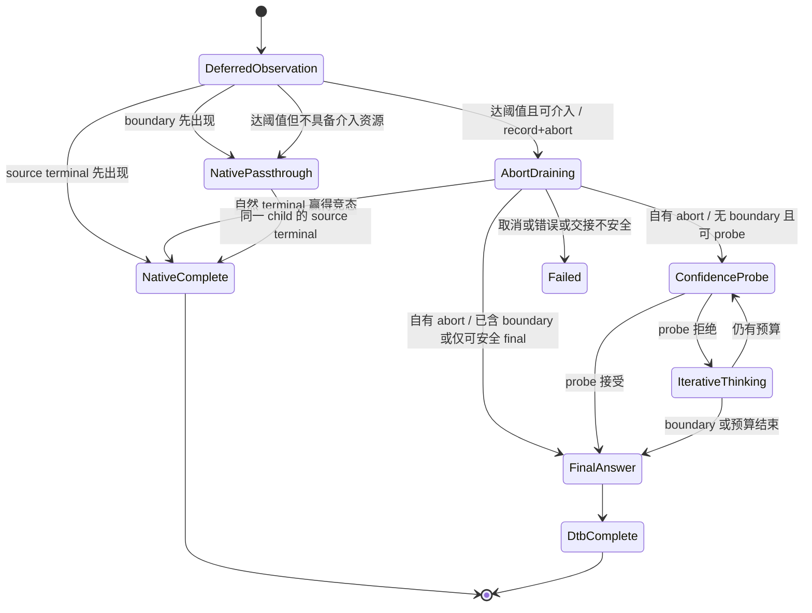

# DTB 最低介入值机制设计

## 1. 设计目的

本文为 agent 多轮工具调用场景设计 DTB 的最低介入值机制。目标是在保留 DTB 对超长
reasoning 的压缩能力时，让阈值以内自然结束的请求继续使用同一个 vLLM generation 完成
reasoning、正文或工具调用，避免当前“thinking child 停止，再启动 final child”的固定成本与
轨迹扰动。

设计基线为仓库提交 `cc9bfbed8d61848edff567afee1b9a83a72a53af`，目标运行时是
vLLM `v0.23.0`、vLLM-Ascend `v0.23.0rc1` 和 Qwen3.6 流式协议。本阶段只设计
streaming 路径；non-streaming 保持现状。

run-05 的实测背景见 `docs/log/perf/agent_run05/RESULT.md`：完整 9 场景的 301 个 Vanilla
请求中，292 个（97.01%）reasoning 不超过 `fixed_check_length=850`。现有实现对这些请求仍会
停止 initial child 并启动 fresh-final，估算中心成本约为 `0.66 s/请求`，映射到 Vanilla 轨迹约为
`192.7 s`，相当于 Vanilla LLM E2E 的 8.99%。因此，消除短请求 handoff 是必要优化，但它只能
解释 run-05 DTB/Vanilla 总差距的一部分，不能代替后续长请求净收益验证。

### 1.1 从场景级请求到 Agent 任务的分布迁移

此前 DTB 的场景级测试集以独立请求为实验单元，每个分类内部的 reasoning 长度覆盖相对均匀，
中长 reasoning 样本占有足够权重。固定在首个检查点介入时，长请求节省不会被大量短请求的控制器
成本迅速稀释，因此可以在逐场景请求 E2E 上观察到收益。

直接把同一套 always-on 策略开启在 Agent 执行场景后，实验对象已经改变。一个 Agent 任务由多轮
reasoning→content/tool→tool result 反馈组成；绝大多数轮次只需很短的动作判断，只有少数规划、
排障或收敛轮产生超长 reasoning，形成极端长尾。run-05 中 97.01% 的 Vanilla 请求不超过 850
token，正是这一分布迁移的实测表现。

| 维度 | 原场景级测试集 | Agent 多轮执行场景 |
| --- | --- | --- |
| 实验单元 | 独立、已分类的单请求 | 包含多次模型与工具交互的完整任务 |
| 分类内 reasoning 分布 | 各长度段相对均匀 | 大量极短轮次与少数超长轮次混合 |
| DTB 成本暴露 | 中长请求有足够占比摊薄控制成本 | short-path 税被每个短轮次重复支付 |
| 输出反馈 | 单请求输出后结束 | 一个 tool/action 会改变工作区和所有后续 prompt |
| 原先主要指标 | 质量门后的逐请求/逐场景 E2E | 质量门后的完整 Agent task wall |

因此，Agent 场景测不到端到端优化的根本背景不是“长 reasoning 不可压缩”，而是**测试场景和
reasoning 分布发生了变化**：少数长尾收益需要覆盖绝大多数短请求的固定负优化，并且任一被介入
轮次还可能改变后续工具轨迹。最低介入值首先解决其中的 short-path 税和短轨迹扰动，再为只在
长尾上衡量 DTB 净收益建立可用前提。

### 1.2 最终目标与指标层级

本设计的最终目标固定为：

> 在 Agent 执行场景中，保证系统可用性和任务正确率不低于同实验身份 Vanilla，并使完整任务的
> 端到端时延下降。

成功标准不是单独满足“reasoning token 变少”“某个长请求更快”或“原场景级测试集仍有收益”。
指标按以下层级裁决：

1. **发布硬门：**工具协议 hard failure 为 0、每个任务均生成评测报告、严格正确率不低于
   Vanilla；
2. **最终主指标：**LightCode/Agent 任务的 `evaluation_results.json` 中逐任务
   `start_time → end_time` paired wall，以及任务等权和累计结果；
3. **因果辅指标：**proxy 累计 LLM E2E、外部 Agent 轮次、首次轨迹分叉、工具/编译/测试 wall；
4. **机制诊断指标：**单请求 TTFT/E2E、child 数、visible/hidden token、phase wall、abort 和
   threshold overshoot。

旧场景级测试集继续承担算法能力与回归检查，但不再决定 Agent 版本是否获得性能收益。即使某候选
在旧场景集保持正收益，只要完整 Agent task wall 没有改善，就没有达成本设计目标。

## 2. 结论

方案可行，推荐采用**同子请求观察、自然短请求直通、到阈值后内部取消**的实现：

1. 初始 generation 不设置 DTB 拥有的 reasoning boundary stop，也不把
   `max_tokens` 设置为介入阈值；它保留原请求的 stop、EOS、`min_tokens`、采样参数以及完整
   completion/context 上限。
2. DTB 在原生 `RequestOutput` 进入 reasoning/tool parser 前，只读取增量 `token_ids`，累计仍处于
   reasoning 状态的 token 数，并检查协议声明的 canonical boundary token。
3. boundary 或原生 terminal 先于阈值出现时，DTB 解除介入武装，继续把同一 generation 的原始
   delta 和 terminal 不改写地传给原生 parser；不 probe、不合成 `</think>`、不追加 answer cue、
   不创建 final child。
4. 首个完整 delta 使 reasoning token 数达到阈值，且该 delta 仍无 boundary/terminal 时，先原样
   透传该 delta并记录触发点，再显式调用 `engine_client.abort(child_id)`，保留原
   generator 消费至前端 terminal 和正常耗尽。内部 `finish_reason="abort"` 不交给外层 parser；
   接纳到排空点的完整前缀；仍无 boundary 才进入 probe，已含 boundary 则直接续写正文/tool。
   若自然 terminal 抢先完成，则原样完成该请求，不启动 probe。drain 本身不是任意切点安全证明。
5. 介入后的 iterative thinking 继续使用
   `docs/design/dtb_reasoning_boundary_token_stop.md` 定义的 token-stop 和 parser patch。最低介入
   不是 token-stop 的替代方案：观察期不使用控制器 stop，介入后的 DTB 子请求仍必须使用统一的
   token boundary。
6. 第一版把现有 `budget.check_length` 直接解释为最低介入值，不增加第二个数值旋钮。
   `fixed_check_length` 和 scene 的 `check_length` 仍是实验与自动配置入口。观察后决定是否介入成为
   支持范围内的默认行为，不增加生产 `intervention_mode` 开关；eager 只作为冻结的实验基线。
7. request-level replay 只负责证明短路径无负优化、长路径存在净收益候选；阈值和策略最终必须按
   完整 Agent task wall 排名，不能沿用原场景级请求 E2E 作为发布结论。

这个方案达到的是**原生等价的同子请求直通**，不是严格意义的 serving 原生 bypass。DTB 仍需在
请求开始前仅取得介入阈值、验证原生生成能力，并让输出经过一个轻量 observer/queue；完整 budget
decision 延迟到达到介入阈值后才执行。短路径只承担阈值读取、增量观察和转发成本；queue 可保留，
但必须测量其累计开销。没有触发的请求不得为 DTB 创建可变长 prompt 副本或解析完整预算。

2026-09-04 前置决策：先独立实施
[输入去 decode 与 Token ID 权威续写](dtb_token_authoritative_prompt.md)，完成 eager 配对验收后
再实施本文机制。分类直接复用 serving 已有文本，缺失时不 decode 兜底；原始全文只作不可变
快照，不维护续写文本镜像。这不是 lazy budget resolve，也不消除 eager 的二次提交成本。
该前置重构已完成本地实现和 229 tests / 1966 subtests 回归；服务器 eager 配对验收仍待执行，
本文 deferred 机制已完成本地实现；实现范围、测试结果和部署前可用性门禁见第 11.4 节。
本地无目标模型/NPU，不能据此认定真实 tokenizer 连续性或 Agent E2E 已验证。

**2026-09-09 决策交接：**G0 已发现固定 token 流重启的 prompt/H 回显；用户决定先用当前实现
做完整 9 场景的**诊断性**端到端实验，观察真实触发路径与任务影响，再决定是否实施
“保留 P-IDs、仅重编码 abort 后普通思考 H”的局部规避。完整候选、证据边界和决策清单见
第 12.1–12.8 节。候选尚未实现或验收，不替代本文当前 token-ID 权威实现；诊断轮不是 G2/G3
通过，也不因一次未复现而注销 G0 反例。

## 3. 范围与非目标

### 3.1 本阶段范围

- `request.stream=true` 的 DTB 请求；
- Qwen3.6 已绑定的 `think_end` 与 `tool_call_begin` canonical token；
- 初始生成的同子请求直通、阈值触发、内部 abort 和现有 DTB 状态机衔接；
- reasoning/content/tool parser 的 token/text 连续性；
- completion 总额度、取消、错误和唯一 terminal 契约；
- phase telemetry、stream audit、paired replay、旧场景集回归和 Agent/LightCode 任务级验收。

### 3.2 非目标

- 不改变 non-streaming 的 full-response parser 和现有 stop 行为；
- 不新增面向外部代理的 HTTP cancel endpoint；
- 不承诺停止已经提交到 NPU 的当前 kernel，只要求 vLLM Scheduler 尽快结束 request 生命周期、
  丢弃迟到输出并释放资源；
- 不在首版引入精确 token 级 delta 切分、额外 grace window 或预测式长短分类；
- 不把 `min_think_tokens` 改名或改变其置信度接受门槛语义；它不是最低介入值；
- 不把本机制直接宣布为整体 DTB 已获得净时延收益，长请求的 probe、重复 prefill 和 final child
  成本仍需独立闭账。

## 4. 当前行为与问题

当前 `DtbStateMachine` 固定从 `_ThinkingState` 开始。第一次 `_ThinkingState.handle()` 使用
`budget.check_length` 作为 initial child 的 `max_tokens`，再由 `configure_thinking_stop()` 增加
reasoning boundary stop。若模型在这个上限前自然生成 `</think>` 或 `<tool_call>`，
`consume_output()` 会移除 source terminal 并把边界作为非 terminal delta 透传；随后状态机进入
`_FinalAnswerState`，启动新的 generation 继续正文或工具调用。


这会让短请求固定承担：

- 一次额外 child 入队与首 token；
- continuation prompt 的再次提交和可能的 prefill；
- Automatic Prefix Caching 未命中完整尾块时的额外计算；
- 随机采样轨迹被切断后重新开始；
- boundary、工具 XML 和 terminal 跨 child 拼接的正确性风险。

只把字符串 stop 换成 `stop_token_ids` 能修复结构边界歧义，但不会消除这个短路径 handoff。

## 5. 核心设计

### 5.1 状态流

新增 `_DeferredInterventionState`，在 DTB 启用、`stream=true`、协议已绑定且当前 assistant completion
确认从 reasoning 状态开始时作为默认首状态。`reasoning_ended=True` 或暂不支持安全切换的请求使用
同 child 原生直通。不因能力不足静默回到 eager。non-streaming 本阶段保持原实现；“默认观察”不
等于已经证明所有模型、parser 和输出模式均可安全切换。



`NativePassthrough` 可以是 `_DeferredInterventionState` 内的 disarmed 分支，不必单独创建状态类。
它必须继续消费同一个 async generator，不能返回状态机后重新调用 `generate()`。

### 5.2 阈值来源

首版不新增 `minimum_intervention_tokens` 数值字段，定义：

```text
minimum_intervention_tokens = threshold_snapshot.check_length
```

原因是 `check_length` 本来就是第一次 probe 的检查点。再增加一个阈值会产生以下不明确组合：

```text
minimum_intervention_tokens < check_length：达到介入值后是否先空等到 check_length？
minimum_intervention_tokens > check_length：原有第一次 probe 应何时发生？
```

在 deferred 模式下，达到 `check_length` 后发起取消；排空后仍无 boundary 且预算允许才执行
第一次 probe，已含 boundary 则直接 final。若 probe 拒绝，后续仍按
`think_stride` 进入 `_ThinkingState`。因此现有 `fixed_check_length` 可以直接用于阈值搜索，scene
配置也不需要增加新的维度。

阈值读取与完整预算解析分开。固定参数请求直接读取 `fixed_check_length`；自动模式只做必要的
scene 阈值选择，使用对应 `check_length`，未匹配时使用 runtime `check_length`。该轻量选择的
结果和来源按请求冻结，不在观察期间被 history/difficulty 改写。完整预算（probe 次数、stride、
置信度等）只在阈值到达后解析，且不得追溯降低已冻结的介入阈值。

固定参数配置规则为 `0 < fixed_check_length <= fixed_budget_tokens`（两个固定值均启用时）。
非法组合在启动/请求校验时拒绝，不能静默 clamp。原生 context/completion 不够到达阈值时继续
原生生成至真实 terminal，不把阈值下调。达到阈值后，预算或续写空间不足则解除武装，继续原生。
DTB 算法 hard-think budget 仅约束激活后的压缩路径；原请求 context/completion 始终由原生引擎
约束。阈值等于 hard budget 或同批越过它时，若已经没有可用压缩预算，直接原生完成。

不新增 `intervention_mode` YAML/API 字段。生产支持路径默认观察；回滚使用版本回滚或既有 DTB
总开关。eager/deferred 名称仅用于实验识别，比较时使用冻结部署，而不是长期维护双算法模式。

固定参数实验仍按现有请求接口传入，例如：

```json
{
  "enable_think_budget": true,
  "fixed_budget_tokens": 20000,
  "fixed_check_length": 850,
  "fixed_think_stride": 500,
  "fixed_num_thinking": 5,
  "fixed_min_think_tokens": 1,
  "fixed_prob_th": 0.93,
  "stream": true
}
```

不需要增加 `fixed_minimum_intervention_tokens`。如果以后证明第一次 probe 点与最低介入值确实需要
独立调节，再通过新设计拆分，不能在首版预留含糊字段。

**语义说明（2026-09-07）：**最低介入值回答“何时有资格打断原生生成”，首次检查点回答
“何时评估一次 probe 是否值得结束思考”；两者概念不同，首版复用 `check_length` 数值。
达到该值不是精确截断指令，也不保证发起 probe：同批 boundary/terminal 优先，资源检查可解除
武装，abort drain 后还会按实际前缀重新决定分支。`min_think_tokens` 仍是可用置信度的接受门槛，
`fixed_num_thinking=0` 仍表示未覆盖而非禁用 probe。本文不因上述概念区分增加参数或改变当前行为。
将来若实验要求独立检查点或无 probe 策略，应单独定义语义；是否值得拆分仍由校验成本与净收益裁决。

### 5.3 初始 generation 参数

初始观察 child 的参数必须尽可能等同原生请求：

| 参数/上下文 | deferred observation 行为 |
| --- | --- |
| `max_tokens` | 使用 serving 已由 `get_max_tokens()` 计算的完整 `completion_token_limit`，再受真实 model context 限制；不得设为 `check_length` |
| DTB boundary `stop` / `stop_token_ids` | 不添加 |
| 用户 `stop` / `stop_token_ids` | 原样保留 |
| EOS、`ignore_eos`、`min_tokens` | 原样保留，不强制把 `min_tokens` 改为 0 |
| temperature、top-p、top-k、seed | 原样保留 |
| priority、LoRA、trace headers、DP rank | 通过 `engine_request_kwargs()` 原样传递 |
| `reasoning_ended`、parser kwargs | 原样传递 |
| output kind | streaming 必须为 `DELTA`；不支持的请求保留原生路径，不静默回 eager |

“不配置最大上下文”不能按字面实现。vLLM 仍需要 bounded `max_tokens`，外部 completion 限额和
model context 也必须遵守。这里取消的是“用介入阈值作为 child 最大生成长度”，不是取消请求自身的
长度保护。

观察 child 不调用 `configure_thinking_stop()`。否则 boundary 仍会终止 child，短请求仍然需要
二次提交。

### 5.4 增量观察与裁决顺序

observer 不调用或复制一套 stateful reasoning/tool parser，只使用绑定协议的 token ID 分类函数：

```python
protocol.find_first_boundary(delta_token_ids)
```

该函数与 `detect_reasoning_boundary()` 的职责不同：后者验证“配置了 token stop 的 DTB thinking
child 是否以正确 stop_reason 停止”；前者观察一个**没有 controller stop** 的原生流，因此
canonical boundary 正常出现时不会带 controller-owned `stop_reason`。

每个 source delta 的处理顺序固定为：

1. 校验仅有一个 choice、DELTA 输出和 token/text 基本结构；
2. 若仍 armed，在 `delta_token_ids` 中查找第一个 canonical boundary，并按 token 位置更新
   reasoning/final 计数；
3. 非 terminal 的 source `RequestOutput` 原样放入 parser-facing queue；正常 terminal 暂存，
   generator 正常耗尽后只调用一次 terminal passthrough，不先走普通 delta 发送入口；
4. source error terminal 按现有错误路径传播并结束；普通 generator 耗尽却没有 terminal 时标记
   error 并结束，不启动 probe、不合成成功 terminal；
5. 若本 delta 出现 boundary，设为 disarmed，后续不再做阈值判断，继续消费同一 generator；
6. 否则，当累计 reasoning token `>= check_length` 且具备介入资源时，触发内部 abort；不具备
   资源则 disarm 并继续原生生成。

一旦 boundary 使 observer disarm，后续 source token 全部只计入 final/tool 侧账本，不再进入
observed reasoning prefix，也不再参与阈值判断。

因资源/切换能力不足而 disarm 时，reasoning 未必结束。该分支也停止 classifier，但不能把后续
token 全部冒充 final；总 completion 继续准确计数，reasoning/final 未分解部分标记为 unknown，
审计需要细分时使用独立 parser/原生统计证据。短路径不为补齐诊断字段增加全程二次解析。

伪代码如下：

```python
generator = engine_client.generate(native_prompt, native_params, child_id, ...)
armed = True
triggered = False
terminal = None
drain = None
try:
    async for result in generator:
        validate_no_output_after_terminal(terminal, result)
        propagate_source_error_if_any(result)
        boundary = (protocol.find_first_boundary(result.outputs[0].token_ids)
                    if armed else None)
        account_delta_once(result, boundary)  # reasoning/final 账本
        if is_coherent_source_terminal(result):
            terminal = result
            continue
        await stream_native_delta(result)  # 仅此入口增加 emitted 账本
        if boundary is not None:
            armed = False
            release_observation_prefix()
            continue
        if armed and observed_reasoning_tokens >= check_length:
            decision = resolve_budget_once_at_activation()
            if not can_switch_safely_and_enter_dtb(context, decision):
                armed = False
                release_observation_prefix()
                continue
            triggered = True
            record_trigger_point()  # 冻结计数快照，不冻结 continuation
            await engine_client.abort(child_id)  # 不关闭仍需消费的 generator
            drain = await drain_owned_source(generator)  # raw 输出；不直接转发
            break
finally:
    await close_owned_generator(generator)  # drain 正常耗尽时为空操作；异常/取消才关闭

if triggered:
    if drain.is_owned_abort:
        await accept_drained_prefix_once(drain)  # 接纳全部 payload，只剥离内部 abort 终止语义
        commit_prefix_without_recounting()  # P + G + R，包括 boundary 后全部 token
        return select_post_drain_state()  # 第 5.6.3 节；boundary 优先，重检剩余预算
    # 自然结束已在 frontend 完成，abort 可为 no-op；不等待永远不会出现的 abort
    await forward_quarantined_native_deltas_once(drain)
    terminal = drain.native_terminal
if terminal is None:
    raise RuntimeError("observation ended without terminal")
await stream_final_terminal(terminal)  # terminal 内容与 emitted 计数各一次
mark_success()
return None
```

伪代码中的 helper 是设计职责，不是已有 API。`drain_owned_source()` 必须读至合法 terminal 后
再正常耗尽，拒绝无 terminal 耗尽、terminal 后输出和非自有 abort；隔离暂存时不计可见 token，
也不再判断阈值。接纳 drain 时仅在尚无 boundary 的前缀中分类一次，首个 boundary 后停止
classifier，但保留之后全部 token。自然完成分支按原顺序透传，只计入此前未发送的增量。
关闭 helper 必须区分正常耗尽、阈值、转发错误和
客户端取消；若 vLLM 已在 CancelledError 中清理，则不得再主动发送一次 abort。保留原始异常，
清理错误不得把取消/失败改判为成功。未见 terminal 的耗尽属于错误结束。

当前 `_FinalAnswerState.handle()` 已采用“非 terminal 循环内发送、正常 terminal 暂存到循环后
调用 `stream_final_terminal()`”的结构，源码没有双发问题；本节将观察期伪代码对齐该结构。

### 5.5 delta 粒度的软阈值

第一版使用**完整 delta 软阈值**，不在 speculative/MTP accepted batch 内切 token：

```text
trigger_prefix_tokens
= 首个使累计 token >= check_length 的完整 source delta 结束时的累计 token 数
restart_prefix_tokens = trigger_prefix_tokens + drained_tail_tokens
```

如果 `check_length=850`，上一 delta 累计 849 token，下一 delta 含 4 个 accepted token，则实际在
853 token 后发起 abort，`threshold_overshoot_tokens=3`；若再排空 6 个 token，则从 859 token
前缀重启，`drain_overshoot_tokens=6`。不为等待这些 token 添加 grace window。若触发 delta
内还包含 canonical boundary，
boundary 优先，整个请求继续原生直通。

这是有意的轻量化选择：

- source delta 的 text 由 vLLM 增量 detokenizer 生成；只截 token IDs 而切不出完全对应的 text，
  会破坏 parser-facing 连续性；
- 重新 decode token 前缀仍可能因跨 delta UTF-8、special token 和 cleanup 规则与 source text
  不一致；
- `stream_interval=1` 不能保证一次只接受一个 token，MTP 仍可能返回多个 accepted token；
- 小量、可计量的 overshoot 比引入 text/token 不一致和 tool parser hard failure 更安全。

必须记录 source delta 宽度和 overshoot。只有实测表明 overshoot 对长请求收益有显著影响，才设计
token/text 同步切分器；不能把它混入第一版。

完整 delta 保证已收到的 source 增量原样交付，但不证明旧 detokenizer 没有尚未输出的文本。
vLLM `v1/engine/detokenizer.py` 在用户 string stop 且不包含 stop 输出时，会暂扣最多
`max(len(stop))-1` 个字符。例如 stop 为 `STOP!`、已解码文本为 `abcdef`，非 terminal text 可以
只输出 `ab`，对应 token 已进入 output token IDs。取消后丢弃旧输出不会让新 child 自动补发
`cdef`：它们已经属于新 child 的 prompt。用户 stop 的跨 child 匹配状态同样不会自动继承。
这是已有增量的延迟显示问题，不是后续采样 token 是否丢弃的问题。

UTF-8/Unicode 不完整片段是否可由新 child 的 prompt priming 恢复，依赖实际 tokenizer 和
detokenizer，暂列待测，不能从上述 string-stop 例子外推为必然丢字。开发前按第 11.1.1 节进行
无模型重启测试。暂不支持的形状默认观察/原生直通，不强制进入 DTB；测试通过的普通无 string-stop
路径可先启用切换。不得每 chunk 重新 decode 全部前缀来检查安全性。

### 5.6 触发后的取消接口与生命周期 ownership

当前 DTB 与 vLLM OpenAI serving 运行在同一进程路径，持有
`serving_chat.engine_client.generate()` 返回的 async generator，因此不应从外部 proxy 调 HTTP
取消，也不需要给普通 ChatCompletion 新增 cancel route。

vLLM `v0.23.0` 的 `AsyncLLM.generate()` 在捕获 `GeneratorExit` 或
`asyncio.CancelledError` 后会执行：

```python
await self.abort(q.request_id, internal=True)
```

上述 `aclose()` 是异常/客户端取消的清理机制，**不再作为正常 threshold handoff 的主路径**。
正常介入采用 `await engine_client.abort(child_id)` 加原 generator drain。传入的 ID 必须是本次
`generate()` 的唯一 external child ID，不是客户端原始 JSON ID，也不是自行推测的 internal ID。
只允许一个 owner 消费原 generator；不另开竞争消费者，不关闭后再试图读取它。

#### 5.6.1 源码依据与可行性边界

本次核对参考对话“源码分析取消接口”的最新分析，并以下列本地固定源码为依据，而非把对话结论
直接视为验证结果。源码根为 `third_party/vllm/`，commit
`0fc695fc6d1d82e9a5ac6835ac8e4e1c83703665`（目标 v0.23.0）；行号对应此 checkout。
服务器的 vLLM/Ascend commit、patch 和实际 tokenizer 仍需在实验 manifest 中核对。

| 源码位置（相对源码根） | 源码确定的行为 | 对设计的约束 |
| --- | --- | --- |
| `vllm/v1/engine/async_llm.py:709`，`AsyncLLM.abort` | 先同步调用 frontend `abort_requests`，再 await core abort 发送 | drain 等到的是前端结束输出，不是 NPU 停止确认 |
| `vllm/v1/engine/output_processor.py:450`，`abort_requests` | external→internal 映射，pop 请求状态；尚存请求构造 `new_token_ids=[]`、`FinishReason.ABORT`、`stop_reason=None` 并入 queue | 已自然清理的请求可能不产生 abort terminal；不能只接受 abort 而无限等待 |
| 同文件 `:272` / `:376`，`make_request_output` / `_new_completion_output` | finish reason 非空则 finished；DELTA text 调用 `get_next_output_text(True, True)` | abort terminal 可以含暂扣文本，不是必定空 payload |
| `vllm/v1/engine/detokenizer.py:148` | finished 时去掉 stop-buffer 的显示保留长度，返回已解码但未发送文本 | 能 flush string-stop 显示缓冲；没有证明会 flush tokenizer 内部尚未解码的字节 |
| `vllm/v1/engine/output_processor.py:45` 与 `vllm/outputs.py:145` | collector 会合并未消费 DELTA，拼接 text/IDs，并采用后一个 finish reason | 实际读到的 abort terminal 可能含非空 token IDs，不能按其构造时的空列表处理 |
| `vllm/v1/engine/async_llm.py:575` / `:591` / `:633` | yield finished output 后下一次迭代退出并 close queue；GeneratorExit 会另走 abort | terminal 后应让 generator 正常耗尽；不要见 abort 就 break 再 aclose |
| `vllm/v1/engine/core_client.py:1111` / `:1508` | ABORT 通过 IPC 发送，DP 路径向所属 engine 路由 | 不新增 scheduler polling、设备 barrier 或固定 sleep |
| `vllm/v1/engine/detokenizer.py:183` | 新 DecodeStream 用 prompt token IDs priming | token 权威重启有原生入口，但 Unicode 切点仍须用实际 tokenizer 验证 |
| `vllm/entrypoints/openai/chat_completion/serving.py:824` | parser/工具状态可将外层 finish reason 改为 tool_calls | 必须在 pre-parser `RequestOutput` 层截获 abort，而非在 HTTP SSE 层判断 |

结论为**源码确定的生命周期可行、受能力约束的安全重启**。不能将其表述为“收到 abort 后，任意
token 前缀均已恢复全部流式状态”。`finish_reason` 位于 `result.outputs[0]`，同时验证外层
`result.finished=True`、choice/index/child 归属与 `stop_reason=None`；仅隐藏本控制器发起的 abort。

#### 5.6.2 触发点决定取消，排空点决定重启

用户已决定采用排空点，不再丢弃 generator 排空期间收到的完整增量。定义：

- **触发前缀 G：**达到阈值的完整 delta 为止，已经透传的 canonical token IDs；只保留触发点计数快照。
- **排空尾部 R：**触发后从同一 frontend generator 收到的新增 IDs，包括 collector 合入
  abort terminal 的 IDs。它们可能在调用 abort 前就已生成，只是尚未被观察层消费。
- **排空前缀 H：**`G+R`，新 child 的权威输入为 `P+H`。H 可以包含 reasoning boundary、
  正文、工具 XML/JSON 的部分或完整前缀，不能再命名为“纯 reasoning 前缀”。

正常路径：记录触发点 → 发送 abort → 隔离消费至 terminal 与正常耗尽 → 按原顺序接纳所有
payload → commit `P+H` → 根据 H 中 boundary 与剩余预算选择后续状态。
例如 G 为 853 token，R 为 6 token，重启前缀为 859 token。R 全部透传并计入 emitted 一次；
不为了保持触发点而截 token 或拆 text。阈值是取消检查点，不是强制精确停止长度。

这消除了将合并文本拆成“属于 G 的补尾”和“属于 R 的文本”的需要；不新增人为等待窗口。
frontend 移除后引擎产生、但未交给 generator 的迟到工作不属于 R，不能凭空纳入 continuation。

#### 5.6.3 接纳 payload 与 boundary 分支

**先区分结束原因，再按完整前缀裁决。** 自然 terminal 分支始终优先，不需要因其含 boundary 而
重启。只有自有 abort 才剥离内部结束语义并选择以下后续状态：

| 排空结果 | 输出与状态选择 |
| --- | --- |
| 自然 stop/length terminal | 隔离增量按原顺序原样发送，terminal 原样一次，结束；不 probe、不 final child |
| 自有 abort，H 无 boundary | 接纳全部 payload，保持 reasoning OPEN；重检预算后进入 probe，或仅能安全 final 时沿用现有预算耗尽收尾 |
| 自有 abort，H 首个 boundary 为 think-end | boundary 及之后正文全部接纳，标记 reasoning CLOSED；跳过 probe，直接从 P+H 续写正文 |
| 自有 abort，H 首个 boundary 为 tool-call-begin | 工具标记及其后 name/arguments 前缀全部接纳，标记 reasoning CLOSED；跳过 probe，从 P+H 接续工具调用 |
| error、非自有 abort、无 terminal 耗尽、超时/取消 | 错误/取消结束，不创建后续 child |

增量处理规则：

1. 普通 drain delta 原样交付；内部 abort terminal 创建非 terminal 副本，保留全部 source
   text、token IDs 和请求/choice 归属，设置 `finished=False`、`finish_reason=None`、
   `stop_reason=None`。不原地修改 source audit 对象，不调用外部 terminal 入口。
2. 保留对应新增 IDs 的合法 logprobs，不复制终态专属字段或重复 logprobs；尤其原生 abort
   构造及 collector 合并后的空 IDs/logprobs 形状需测试。只有 payload 确实全空时才可省略发送。
3. text 非空、IDs 为空的 abort 输出仍须作为 text-only delta 发送，token 计数不增加；
   text 为空、IDs 非空仍须交付，不能因没有显示字符而丢 token。
4. 在 R 中查找首个 canonical boundary；只用其位置划分 reasoning 与 final/tool 账本，
   **不按 boundary 切掉同 delta 后缀**。boundary 本身按既有协议计数规则只记一次。
   首个 boundary 之后不再运行 classifier，普通文本中后续 marker 不重新触发 DTB。
5. 全部旧 payload 必须先进入同一个 parser-facing queue，再发送任何新 child 的可见输出；
   不重新初始化外层 reasoning/tool parser。隐藏的是 abort 终止语义，不是其 token/text。
6. H 中即使已有完整工具 JSON 或闭合 XML，也不能由 observer 猜测请求已经完成并伪造
   tool_calls terminal。没有自然 terminal 时仍走受限的续写/错误路径，真正结束由原生解析决定。

例如 stop=`STOP!`，G 解码为 `abcdef`、已显示 `ab`，R 又解码为 `gh`，collector 可返回
text=`cdefgh` 与 R 的 IDs。接纳整个 payload 后，外部得到 `abcdefgh`，prompt 为 P+G+R；
不需要判断这六个字符分别属于哪个切点。但这个例子只说明显示缓冲的交接，**不能证明跨
child 的 string-stop matcher 已恢复**。未验证的用户 string-stop 请求仍原生完成、不介入。

**复用现有 final 状态的具体条件（源码确定）：** 当前
`dtb/reasoning/generation_states.py:683` 的 `_FinalAnswerState` 支持模型自然 boundary。
进入前应设置 `FinalAnswerReason.MODEL_THINK_END` 或 `MODEL_TOOL_CALL`、`reasoning_state=CLOSED`、
对应 `reasoning_boundary` 及 `reasoning_boundary_emitted=True`，并将完整 H 提交到 prompt。
这些字段表示 boundary 已进入同一个 FIFO 输出流，不要求等待外层 parser 消费确认。
当前代码在 CLOSED 且 boundary 已发出时不执行 OPEN 分支中的强制 cue/close；后续 generate
使用 `reasoning_ended=True`。因此可以复用其续写循环，但不能复用会再次追加 boundary 或
重复计数的旧 thinking 消费入口。应增加明确的“drain model-boundary”进入 helper 与回归测试。

两种 boundary 分支均不得再 probe、补 `</think>`、answer cue、separator、工具起始标记，
也不得重放已经发送的 content/tool 前缀。think-end 后同批已有 tool-call-begin 时，仍按首次
reasoning boundary 关闭；整个工具前缀继续保留，由原生 parser 接续。此分支是“取消后的续写”，
不是短请求的同 child 原生旁路，应单列其 handoff 成本。

**排空后的预算重新校验：** abort 前的资源检查只是预检查，R 可能继续消耗 context、
外部 completion 与 hard-think 预算。接纳并计数后，用实际 `len(P+H)` 和 emitted 数重新计算；
boundary 后正文/tool token 不计入 thinking，但计入 completion。boundary 分支仅需 final 的
剩余额度与调用空间，不为 probe 预留；无 boundary 且 probe 空间不足时，若仍可安全强制
收尾则直接 final。若已经完全无合法 continuation 空间，当前 final 状态会报错，首版必须明确
错误结束，不能丢 R、越额生成或把 abort 假装成自然 length。用 completion/context 边界定向
测试检验该竞态；若实际出现导致可用性退化，应先增强额度耗尽收尾契约，不能带故障发布。
自然 terminal 已到达时不做这一续写检查，直接原样完成。

Token IDs 恢复模型输入前缀，不自动恢复 RNG 位置、generated-vs-prompt penalty、min_tokens、
grammar/stop matcher 或 KV 生命周期。新 child 沿用现有 DTB 能力门禁与剩余额度规则；不支持
恢复的形状在 abort 前选择原生路径。完整排空仍须通过实际 tokenizer 的 Unicode/forced-close
测试，不能承诺同 seed 等于 Vanilla 原后缀，不能重新套 chat template 或 decode/encode 全 prompt。

#### 5.6.4 自然完成竞态、清理与时延

drain 接受两类合法结束：自有 abort，以及原生 stop/length terminal。后者表示自然完成已经在
frontend 赢得竞态；按原顺序释放隔离的普通 delta，最后原样透传自然 terminal，各计数一次，
不进入 probe。engine error、非自有 abort、无 terminal 耗尽、drain 超时和客户端取消均不重启。
客户端取消继续向下传播；实现另对 abort 发送加 drain 设置代码内 10 秒故障上限
（`ABORT_DRAIN_TIMEOUT_S`），避免不存在上层 deadline 时无限等待。它不是 grace window，
不等待指定时长、不增加常态 sleep，也不是 telemetry 计时开关；超时错误结束、不重启。

正常成功路径显式 abort 一次，drain 自然耗尽，不再主动 aclose。异常/超时/客户端取消时 owner
负责关闭未耗尽 generator；vLLM 的 GeneratorExit/CancelledError 可能再调用幂等 abort，因此
不能把“底层 abort 方法在所有异常竞态下严格只调用一次”作为契约。应保证无重复有效终止、无
资源泄漏、无第二个消费者和无取消后的 probe，分别记录调用次数与有效终止次数。

`await abort()` 返回及收到 abort terminal 都不代表 EngineCore/NPU 已清空。await 发送完成并
排空前端后立即进入 DTB，不等设备确认；这替换此前“aclose 后立即 probe”的设计，并非增加
设备串行屏障。短请求不运行此流程。长请求新增成本是 frontend drain、payload 接纳/状态选择和
Python 调度；按 `trigger→abort返回→drain耗尽→下一 child 提交` 的互斥 wall 区间统计，不把嵌套
时间相加。旧请求在途计算可能与新 child 竞争资源，另用服务器账本验证，不称为零成本切换。

### 5.7 continuation 与 completion 额度

threshold abort 后只允许把已经 parser-facing 透传的完整 delta token IDs 追加一次：

```text
continuation prompt token IDs
= original_prompt_token_ids + accepted_prefix_token_ids  # H = G + R
```

约束如下：

- token IDs 是 continuation 的事实源；不得把累计 text 重新 tokenize 后替换它们；
- 依照前置 [Token ID 账本设计](dtb_token_authoritative_prompt.md)，已有初始全文仅保留为不可变
  调试快照；source delta text 继续透传 parser/按需审计，不累计为 child `prompt_text` 镜像；
- generator 排空得到的 R 必须完整透传并进入 H；未交付给 generator 的引擎迟到结果不在此范围；
- H 全部计入 `emitted_completion_tokens`；仅 boundary 前的 reasoning 按协议计入 `thinking_tokens`；
- 切换时只提交 token 前缀并设置 `thinking_segments=1`，不重复增加上述计数；现有
  `append_thinking()` 同时追加 token 与计数，不能未经拆分直接复用；
- hidden probe 不占外部 completion 额度；
- controller forced boundary 与 final answer 继续共享外部剩余额度；
- prefix、forced cue/boundary/separator 和至少 1 个 answer token 放不进剩余 context/completion 时，
  不得在阈值处 abort，应解除武装并继续原生 child；
- `max_internal_calls` 不足以容纳至少一次 probe 和一次 final 时同样不介入。

上述是当前已实现契约。第 12 节的待决策候选仅为“自有 abort、排空后仍 OPEN 的普通思考”
提出例外：原始输出账本仍保留 H，模型 prompt 改用重编码的 Ĥ，二者不再承诺 IDs 相等。
候选若获准实现，必须同步修订第 8.1/11 节对应断言及 Token ID 账本文档；不得悄悄放宽现有测试。

排空后无 boundary 且资源允许时进入 `_ConfidenceProbeState`；已含 boundary 则直接 final，
不 probe。观察到的 reasoning 记为第一个 thinking segment；probe
拒绝后 `_ThinkingState` 读取 `thinking_segments > 0`，因此生成 `think_stride`，不会再次生成
一个 `check_length` 段。

### 5.8 原生直通 terminal

当前 `consume_output()` 会把 thinking child 的 terminal 清空，交给 final child 生成唯一 terminal。
deferred 短路径不能复用这段逻辑，必须增加 native passthrough 专用入口：

- 非 terminal delta：原对象、原 text、原 token IDs、原 logprobs；
- terminal：原对象、原 `finish_reason`、原 `stop_reason`、原 `finished=True`，只透传一次；
- boundary：不合成、不删除、不把 source terminal 改成非 terminal；
- terminal 之后的任何 source 输出都报错；
- 用户 stop、EOS、length terminal 即使在 threshold 同批到达，也以 native terminal 为准，不启动
  DTB。

这条规则也覆盖“模型在阈值前结束 reasoning，并在同一 child 中继续正文或工具调用”的核心场景：
observer 看到 boundary 后只解除武装，原生 generation 不停止，直到真实 terminal。

## 6. 核心数据结构与接口

建议新增以下运行时结构；命名可在实现时调整，但语义不能合并进现有
`ReasoningState.OPEN/CLOSED`：reasoning 是否结束与 DTB 是否已介入是两个正交维度。

```python
class InterventionStatus(str, Enum):
    ARMED = "armed"
    DISARMED_BOUNDARY = "disarmed_boundary"
    DISARMED_TERMINAL = "disarmed_terminal"
    DISARMED_NO_CAPACITY = "disarmed_no_capacity"
    ABORT_DRAINING = "abort_draining"
    TRIGGERED = "triggered"  # 自有 abort 与安全交接均完成

@dataclass
class DeferredObservation:
    threshold_tokens: int
    status: InterventionStatus
    prefix_token_ids: list[int]  # 观察期为 G；激活时转交 AbortHandoff，避免再复制 G
    observed_reasoning_tokens: int = 0
    threshold_overshoot_tokens: int = 0
    abort_count: int = 0
    boundary: ReasoningBoundary | None = None

@dataclass
class AbortHandoff:  # 仅达到阈值后创建；不得给全部短请求分配 drain 缓冲
    child_request_id: str
    trigger_prefix_length: int  # 只作快照
    accepted_prefix_token_ids: list[int]  # H，接纳后包含 boundary 及正文/tool
    quarantined_outputs: list[RequestOutput]  # 自然完成竞态下按原顺序释放
    first_boundary: ReasoningBoundary | None = None
    drained_token_count: int = 0
    source_terminal: RequestOutput | None = None
    abort_requested: bool = False
    generator_exhausted: bool = False
```

建议接口职责：

| 接口 | 职责 |
| --- | --- |
| `ReasoningBoundaryProtocol.find_first_boundary(token_ids)` | 在无 controller stop 的原生 delta 内按 canonical ID 找边界及位置 |
| `DtbRequestContext.stream_native_delta()` | 原样透传非 terminal source delta并记账 |
| `DtbRequestContext.stream_native_terminal()` | 原样、唯一地透传 source terminal |
| `can_enter_dtb_after_prefix()` | 在 abort 前检查 context、completion、hard budget、call room 和协议能力 |
| `drain_owned_source()` | 显式 abort 后隔离消费同一 generator 至合法 terminal 与正常耗尽；不写外部 queue、不重计 token |
| `accept_drained_prefix_once()` | 原序接纳全部 drain payload；仅剥离内部 abort 终止语义，分类首个 boundary 并计数一次 |
| `select_post_drain_state()` | 按 H 的模型 boundary 进入无 cue final，或按剩余预算选择 probe/受限收尾；非法空间报错 |
| `close_owned_generator()` | 仅清理未耗尽的异常/取消路径；正常 drain 耗尽不另发 abort，记录关闭原因 |
| `commit_observed_prefix()` | 将已透传完整 H（包含正文/tool）一次性追加到 continuation prompt，不重复计数 |

观察状态至少新增 status/threshold/source/overshoot/abort count。短路径不要求有效
`DtbBudgetDecision`；达到介入阈值后才创建并附加完整 decision。history、summary 和 context 的
调用者必须兼容 `budget_decision=None`，不能为填日志提前运行 resolver。`child_generate_calls`
仍把 observation child 计为一次真实模型调用。

## 7. parser 与 tool-call 影响

### 7.1 短路径

短路径比当前实现更接近原生 parser 输入：同一个 vLLM child 连续产出 boundary、正文、工具 XML
与 terminal，DTB 不再跨 child 补 boundary 或重新构造工具前缀。它应降低而不是增加当前的
tool-call parser 风险。

observer 只能旁路读取 token IDs，不能提前调用原生 unified parser；否则同一个 stateful parser
会被消费两次。真正的 reasoning/tool 状态转换仍由
`chat_completion_stream_generator(... parser.parse_delta())` 完成。

### 7.2 长路径

触发 abort 时尚无 boundary，但排空期间可能已经出现。无 boundary 分支的 probe 是 hidden，
不进入 parser；已含 boundary 分支跳过 probe，原生 parser 接收完整 boundary/content/tool
前缀，再接续新 final child。只有 reasoning 仍 OPEN 的控制器强制收尾才允许合成一次协议
boundary；自然 boundary 分支不合成、不加 cue，详见第 5.6.3 节。

### 7.3 与 token-stop 重构的关系

- observation child：不配置 controller boundary stop，只按 canonical token ID 观察；
- threshold 后的 iterative thinking child：配置 `248069`/`248058` token stops；
- final/probe：不配置 controller boundary stop；
- 非流式：保持 legacy string/full-parser 路径。

因此 `dtb_reasoning_boundary_token_stop.md` 及同版 Qwen streaming tool parser patch 是启用
实际介入的前置门禁。协议能力不满足时使用原生路径，不降级为 decoded string 观察或 eager。

## 8. 一致性与异常处理

### 8.1 必须保持的不变量

1. short native path 的 source text、token IDs、增量顺序、logprobs、boundary 和 terminal
   parser-facing 等价；
2. 每个成功的外部 assistant completion 恰好一个 source terminal；threshold abort 在内部生成并
   消费 `FinishReason.ABORT` terminal，但绝不透传其终止语义；失败/取消不能伪造成功 terminal；
3. 每个 engine generator 恰好一个 owner；正常 threshold 路径显式 abort 后 drain 正常耗尽，
   异常/取消关闭未耗尽 generator，允许底层幂等清理，不并发消费或重复终止外部响应；
4. 已透传 token 与 continuation prompt 的 observed prefix 完全一致，无丢失、重复和重排；
5. `emitted_completion_tokens <= completion_token_limit`；
6. boundary 出现后永不再次触发 DTB；
7. threshold 前不添加 answer cue、synthetic boundary、controller stop 或 fresh child；
8. priority、LoRA、trace、DP affinity 和 parser 参数对所有后续 child 保持现有透传契约；
9. client cancellation 和 engine error 必须向外传播，不能被状态机 `controller_end` 静默变成成功。

第 4 项适用于当前实现及第 12 节候选的非适用分支；候选适用分支拟改为“外部 H 原样且只发送/
计数一次，模型 P 原样、Ĥ 的改写可审计”。这是一项尚未批准部署的前缀改写，不是无损 decoder
恢复；外层 parser 的跨 child 连续性仍必须验证，其他不变量不放宽。

### 8.2 竞态与裁决表

| 同一 delta/事件 | 裁决 |
| --- | --- |
| boundary 与 threshold 同时出现 | boundary 胜出，继续原生 child |
| terminal 与 threshold 同时出现 | terminal 胜出，原样完成 |
| boundary 与 terminal 同时出现 | 记录 boundary，原样透传 terminal并完成 |
| client cancel 与 threshold abort 竞争 | client cancel 语义优先；generator owner 保证最多关闭一次，不启动 probe |
| `aclose()`/abort 报错 | 不启动下一 child，外部请求失败并记录 orchestration error |
| abort 前自然 terminal 已进入 frontend queue | drain 到自然 terminal 并耗尽，释放隔离输出并原样完成，不等 abort |
| abort terminal 合并未消费的 token/text | 接纳全部 R/text，仅隐藏自有 abort 终止语义；不重复计数 |
| R 中包含 boundary | 接纳 boundary 和其后正文/tool，直接 final 续写；不是同 child 恢复 |
| 非自有 abort、无 terminal 耗尽、drain 超时 | 错误/取消结束，不 probe；未耗尽 generator 由 owner 清理 |
| threshold 达成但 continuation 资源不足 | 不 abort，解除武装并继续原生 child |
| boundary token 出现在 boundary 后正文 | observer 已 disarm，不再分类；交由原生 parser 处理 |
| 普通 token 解码拼出 `</think>` | 不是 boundary，不解除武装 |

## 9. 可观测性设计

正式性能 run 仍必须使用 `OBSERVABILITY.mode=off`。单独的 phase/stream-audit run 增加以下字段：

实现将结构化介入账本放在 `DTB_PHASE(native_passthrough).intervention` 和
`DTB_REQUEST_SUMMARY.intervention`；仅 `phase` 模式分配此字典并计时。
`observer_forward_wall_ms` 是增量分类/记账/入队的 wall，包含在 observation wall 中；
`handoff_wall_ms` 与其中 drain payload 的 forward 时间也有包含关系，不能再次相加。
未单独测量的 `controller_cpu_ms` 为 null，不将未知 CPU 成本记为 0。
`stream_audit` 使用已有 pre-parser text/IDs 字段记录 `abort_payload` 的 raw/forwarded 对照，
不创建 phase recorder；`off` 不创建 recorder/writer，也不运行仅供 telemetry 的计时。
阈值计数、前缀、completion 额度和取消 watchdog 是算法/生命周期状态，仍必须保留。

```text
intervention_policy_version
intervention_status
minimum_intervention_tokens
observed_reasoning_tokens
threshold_overshoot_tokens
boundary_won_same_delta
activation_skipped_reason
observation_child_request_id
observation_child_calls
abort_count
abort_wall_ms
abort_drain_wall_ms
handoff_wall_ms
abort_terminal_seen
abort_lost_to_native_terminal
trigger_prefix_tokens
restart_prefix_tokens
drain_overshoot_tokens
drain_boundary_kind
post_drain_branch
drained_tail_tokens
accepted_drain_tokens
handoff_text_only_chars
handoff_safety_failure
native_same_child_completed
source_terminal_passthrough_count
```

一个 short native child 同时覆盖 reasoning 与 final/tool 阶段，不能把它的全部时间伪记为
`initial_think`。phase 账本建议使用同一个 `child_request_id` 记录两个逻辑区间：

- `initial_think`：launch 到 canonical boundary，含 queue/prefill 和 boundary 前 token；
- `native_final_continuation`：boundary 到 source terminal，只含同 child 后续 decode；
- 若未出现 boundary 就 terminal，则只记录 `native_passthrough` composite，并明确无法拆分 final。

如果现有 vLLM metrics 只在 terminal 提供 child 总 queue/prefill/decode，则保留一条
`native_passthrough` child 总账，再在 request summary 单列 boundary 前后 token 与 wall，不得复制
同一 child 的 queue/prefill 到两条 phase 造成双计数。

`total_model_generated_tokens` 的已知部分包含 visible thinking、hidden probe、final answer 以及
接纳的 R（其中 reasoning/final 部分已包含在上述可见分类中，不是额外第四项）；R 与 observation
child 总生成量对账，不能在 child 总数之外再次相加。abort 后未被 frontend 接收的 in-flight
kernel 工作无法从 completion usage 推出，应把它作为容量侧待测成本，不能记为 0；仅有前端
数据时总量标记为已知下界，不宣称模型工作量已经闭合。

### 9.1 两层请求数与任务时延分解

Agent 场景必须区分两种“请求数”：

- `N_external_turn`：Agent 经 proxy 发起的 chat/completions 请求，即一次 reasoning→content/tool
  决策；run-05 的 `272 → 404` 属于这一层；
- `N_engine_child`：DTB 为一次外部请求启动的 observation/think/probe/final engine child；hidden
  probe 和 fresh-final 属于这一层，proxy 不会把它们计成新的 Agent 轮次。

因此内部 probe 不会直接把 272 变成 404。它只能改变本轮 parser-facing 输出、工具选择、参数或
代码状态，再由 Agent/工具反馈形成新的外部请求。任务级差异应按下式审计：

```text
ΔT_task
= ΔN_external_turn × 后续轮次成本
+ 相同外部轮次上的 ΔT_model
+ ΔT_tool / compile / test / evaluation
+ error、retry、平台等待差异

触发轮的 ΔT_model
= - 被消除的 visible reasoning decode
+ hidden probe decode
+ continuation/final child queue、prefill、TTFT
+ abort、MTP overshoot、controller CPU
```

每增加一个后期 Agent 轮次，还会携带更长的 messages，因此不能只按固定单轮均值估算；新增轮次会
同时增加 prompt prefill，并可能继续产生工具与下一轮请求，形成反馈放大。

### 9.2 run-05 外部轮次放大的原因分类

排除 case 36 后，run-05 外部请求增加 132 个（+48.53%），但不是均匀发生：case 28 的请求从
41 增至 127，case 35 从 26 增至 82；两者合计贡献 8-task LLM E2E 增量的 78.5%。两侧实际启动的
Agent session 反而是 Vanilla 27、DTB 25，因此当前证据不支持“DTB 普遍生成了更多子 Agent”；
主要增量来自少数主 Agent 循环变长，case 28 的主 Agent 请求为 32→118，case 35 为 18→73。

可能原因必须分层，不得全部归给 DTB：

| 原因层 | 机制 | run-05 证据与边界 |
| --- | --- | --- |
| DTB 输出轨迹扰动 | short boundary 后停止并重新采样、forced cue、长链提前结束或 probe 裁决会改变下一个 tool/content | 源码确定存在这些改变；但缺少固定 seed 的整任务反事实，不能由总请求数单独证明因果 |
| 规划粒度变小 | reasoning 被压缩后，模型可能从“先形成完整计划再执行”变为“执行一步再观察”，增加 read/bash/edit/check 轮次 | 合理假设；需比较首次触发轮前后的动作粒度和 tool 序列验证 |
| 输出质量导致返工 | 错误编辑或不完整工具参数引发 compile/test 失败，再进入诊断、修改、重试 | case 2 有真实 DTB 代码回归；case 28 存在大量反复修复，但其起因包含基线编译问题，不能全归 DTB |
| 成功路径比失败路径做了更多有效工作 | 一侧提前失败，另一侧继续应用 test patch、编译、执行 DT 和写报告；请求更多不等于效率更差 | case 35 的 DTB 编译并通过 36/36 测试，Vanilla 提前失败，是明确样例 |
| 工具/环境反馈放大 | 首个不同动作改变工作区；stash/pop、patch 失败、依赖不可达或命令位置错误会产生新的上下文和修复循环 | case 28 出现基线编译问题、stash 后修改丢失和手工 test patch；属于实测轨迹，DTB 因果待定 |
| 原生采样随机性 | 相同 prompt 也可能得到不同 reasoning 长度、下一工具和完成策略 | 同一归档 request body 的 30 次 Vanilla replay 已观察到 reasoning 大幅波动，部分输入的下一工具也变化 |
| 协议 hard failure | malformed/missing tool call 或无 terminal 会触发重试、等待或缺报告 | case 36 属于已知 stop 碰撞；token-stop/parser 门禁通过前必须单列，不能当性能噪声 |
| 评测流程不一致 | test patch、测试命令、依赖状态或覆盖范围不同会改变必须执行的工作量 | case 29 的 87/87 与 8/8 表明即使等级相同，工作量也未必相同 |

其中最低介入值主要消除第一行中**短请求的 stop+resample**。它不会自动修复长请求上的规划改变、
工具环境问题、成功/失败工作量不对称或原生随机性。

### 9.3 最低介入值实装后的剩余净加速风险

即使 deferred short path 完全正确，Agent E2E 仍可能没有加速：

1. **可优化份额太小。** 阈值 850 时，run-05 Vanilla 只有 2.99% 请求会触发，它们占 LLM E2E
   10.35%。即便把这些请求的整个 LLM 时间降为 0，理论上也只能改善约 10.35% 的 LLM E2E；实际
   只能省其中的冗余 reasoning decode，prompt prefill、必要 reasoning、final/tool 输出仍存在，真实
   上限远低于此值。映射到包含工具和评测的 task wall，上限更低。
2. **越过阈值不等于存在足够长的可压缩尾部。** 模型可能在阈值后几个 token 就自然结束；此时
   abort、probe 和 fresh-final 的成本大于 `L - threshold` 的 decode 节省。应按阈值后的原生剩余
   reasoning 长度分桶，而不是只看是否触发。
3. **hidden work 抵消 visible token 节省。** confidence probe、失败 probe 后的 stride、final child
   以及它们的 queue/prefill/TTFT 都是真实串行成本，但 response completion usage 不含 hidden
   probe。
4. **abort 不是即时停止 NPU。** Scheduler 会结束 request 生命周期，但已提交的 kernel 可能完成；
   MTP delta overshoot 和迟到计算会消耗容量。单并发 E2E 可能不明显，服务负载下会反映为其他
   请求 queue 增长。
5. **长请求仍会改变 Agent 策略。** deferred 只保证首个 boundary 在阈值前的请求原生等价；任何
   一个被触发的长请求都可能改变下一工具和工作区，随后放大为更多外部轮次。一次触发足以使整条
   task 轨迹与 Vanilla 分叉。
6. **更短 reasoning 可能换来更多动作。** 若控制器把全局计划压成局部决策，每轮更快但轮次更多；
   后期 prompt 越来越长，额外 prefill 和工具 wall 可能超过单轮节省。
7. **confidence 参数处于两难区。** 阈值或置信度过保守会多次 probe、几乎不压缩；过激则可能降低
   代码/tool 质量，产生返工或提前失败。质量非劣是时延排名的前置条件。
8. **最终输出可能变长。** reasoning 缩短不保证 content、tool arguments 或后续 conversation
   变短；run-05 排除 case 36 后 completion token 仍增加 17.03%，本地 reasoning token 增加
   28.33%，主要由外部轮次增长驱动。
9. **短路径仍有 residual wrapper tax。** 完整 budget decision 已按本设计延迟；阈值选择、observer
   token 检查、result queue 和 Python 调度仍存在，应测量它们在短请求上的累计成本。
10. **实验方差可能淹没有限收益。** sampling/seed、Automatic Prefix Caching、服务负载、任务顺序、
    依赖可达性和工具返回都会改变结果；9 个任务单轮 A/B 无法稳定识别一个百分点量级的收益。
11. **观测模式本身会改变时延。** stream-audit/phase run 只能做归属和机制账本；正式性能排名必须
    使用相同 `OBSERVABILITY.mode=off` 进程。

### 9.4 轨迹首分叉审计

任务级验证不应只比较最终请求数。Vanilla/deferred 两条轨迹应按 root prompt、Agent role、
messages/tool-result hash 和 turn index 找到**首个不可配对的外部轮次**，并记录此前每轮是否触发
threshold：

| 首分叉位置 | 首要解释 |
| --- | --- |
| 首次 threshold trigger 之前 | short path 非原生等价、seed/sampling 未锁定、工具结果或环境不同；不能归为长链 DTB 收益/损失 |
| 恰在 threshold-triggered 轮 | DTB 介入改变了 content/tool/action，是控制器因果候选 |
| trigger 后且前一工具结果已不同 | 下游反馈放大；需把新增轮次分类为有效进展、验证、返工或故障恢复 |
| 全程无 trigger 但轨迹不同 | deferred 实现未达到原生等价，或实验身份/随机性未受控 |

每个 task 至少输出 `first_divergence_turn`、`trigger_count_before_divergence`、两侧 tool name/arguments
hash、tool result hash、workspace checkpoint、后续新增轮次分类。这样才能回答“请求数增加是否由
DTB 造成”，并把机制延迟与 Agent 策略反馈分开。

## 10. 实现改动面

以下改动以 [输入去 decode 前置重构](dtb_token_authoritative_prompt.md)已独立验收为起点；
不在同一 changeset 混入该项改动，以便以冻结后的 eager 版本衡量 deferred 的增量收益。

首版预计修改：

1. `dtb/config/schema.py`、`dtb/config/budget_config.yaml`：校验固定阈值不超过固定预算，
   不增加 mode 开关；预算入口分为轻量 threshold snapshot 与激活时完整 resolver；
2. `dtb/reasoning/state_machine.py`：按 stream capability 默认观察，支持无完整 decision 的短路径；
3. `dtb/reasoning/deferred_observation.py`：独立实现 observation/abort-drain，复用现有 probe/stride/final；
4. `dtb/reasoning/parser_boundary.py`：增加无 stop_reason 的只读 token boundary classifier；
5. `dtb/reasoning/request_state.py`、`request_context.py`：增加 intervention 账本、native delta/terminal
   passthrough 和 prefix commit；
6. `dtb/observability/*`、提取/分析脚本：记录并校验同 child 直通、abort 与 overshoot；
7. `tests/`：增加 async generator ownership、parser 连续性和状态机 golden trace；
8. `patches/vllm/v0.23.0/dtb_serving.patch`：不新增 mode 请求字段或 cancel route；
   现有 `fixed_check_length` 传递数值实验参数，能力判断在启动原生生成前完成。

不得在 `proxy/agent_dtb_proxy.py` 的外部 HTTP 转发层实现 token 观察与取消。该层看到的是 post-parser
SSE，未必保留 canonical token ID，而且普通 ChatCompletion 没有现成 cancel endpoint；在外部
实现会额外引入请求 ID 映射、HTTP 往返和竞态。

## 11. 验证方案

### 11.1 无模型单元测试

至少覆盖：

1. think-end 在 threshold 前：一个 generate、无 probe/final child、source terminal 原样一次；
2. tool-start 在 threshold 前，且同 delta 含工具 XML 前缀：完整原样直通；
3. boundary 后正文含 canonical 或字面 marker：不再次介入；
4. 普通拆分 token 解码为 `</think>`：不判 boundary；
5. threshold 达成且无 boundary：最后一个完整 delta 透传、显式 abort 一次、drain 自有 terminal
   并正常耗尽、不额外 aclose、随后第一次 probe；
6. MTP delta 跨 threshold：记录 overshoot，不切 text/token；
7. MTP delta 同时跨 threshold 和 boundary：boundary 胜出，不 abort；
8. source EOS/user-stop/length 与 threshold 同批：terminal 胜出；
9. context/completion/call room 不足：不 abort，继续 native；
10. client cancellation：当前 generator 关闭一次，不启动后续 child；
11. `aclose()` 抛错：错误向外传播，不伪造成功 terminal；
12. completion token、thinking/final/hidden token 和 child call 账本守恒；
13. non-streaming 行为保持；冻结 eager 测试作为历史对照，不要求新流式 trace 等于 eager；
14. 无 terminal 耗尽、转发失败、关闭失败均结束为 error，不启动 probe；
15. boundary 后不再调用 classifier，prefix commit 不重计 token，短路径不调用完整 resolver。
16. collector 无积压时 abort 的空 IDs/非空 text，以及有积压时非空 IDs/text 的合并 terminal；
17. 自然 stop/length 已入 queue、abort 为 no-op：释放全部隔离输出与自然 terminal，不 probe；
18. abort 与 client cancel、engine error、timeout 竞争：异常传播，无资源泄漏，无后续 child；
19. R 含 think-end+正文、tool-call-begin+部分参数、think-end+tool 标记：全部进入 prompt/parser，
    不 probe、不补 boundary/cue，后续工具结果与固定后缀连续基准一致；
20. 空文本 token、text-only 补尾、超宽 DELTA 均完整接纳，无重复 IDs/logprobs/terminal；
21. R 消耗剩余额度：排空点重检预算、probe 不可用时安全 final；完全无空间明确 error，禁止超额；
22. R 中完整工具 XML 但无自然 terminal：不得猜测成功；首个 boundary 后 classifier 不再调用。

fake engine 应暴露 `started/closed/aborted` 计数，不能只断言可见文本。

#### 11.1.1 开发前的 detokenizer 重启试验（无需模型推理）

在具有目标 tokenizer 文件和目标版本 vLLM 的环境执行，使用固定 token 序列人工驱动实际
IncrementalDetokenizer；不采样、不启动模型/NPU。fake tokenizer 只能验证生命周期，不能证明
真实 Unicode/detokenizer 连续性。

1. 构造原始 prompt `P` 与固定输出 `G`。文本覆盖 ASCII、中文、emoji、组合字符、特殊 boundary
   和工具 XML；用实际 tokenizer encode，并遍历每个 token 切点及不同 delta 分组。
2. 连续组：以 `P` 初始化 detokenizer，依次输入全部 `G`，保存每次返回的 text/token IDs 和 terminal。
3. 重启组：输入 `G[:k]` 后只保留真实已输出 text，不手工 flush。销毁旧解码器，以
   `P + G[:k]` 初始化新解码器，输入相同 `G[k:]`。比较两组拼接后的 text/token 序列。
4. 分别使用无 stop、用户 string stop、stop 跨切点、不同 special-token 输出参数。复用原生
   Qwen reasoning/tool parser 消费两组 delta，比较结构化结果；只有边界 token 位置和输出语义
   一致才通过，不能只比较最终 token 数。
5. 记录 `k`、delta 分组、旧已发文本、旧缓冲文本（只在测试内读取）、新首 delta、最终差异。
   再增加 DTB forced-close 分支，检查放弃原后缀、追加协议 boundary 时是否留下残缺字符。
6. 上述直接销毁组保留为负对照；新增正式 abort-drain 组，驱动真实 `RequestState`、
   `RequestOutputCollector` 和 `OutputProcessor.abort_requests()`，而不是手造空 abort。
   在 k 记录 G，分别在 collector 中预放 0、1、多组 R，制造 pending delta 与 abort 合并；
   验证第 5.6.3 节矩阵。另让原生 terminal 先入 queue，覆盖 abort no-op。
7. 无 R 时验证补尾后重启；有 R 时接纳 H=G+R，分别验证无 boundary 的 probe/forced-close，
   以及已有 think-end/tool-start 时的无 cue final。以相同 H 与相同选定后缀的连续解码/parser
   作为基准，不要求 DTB 压缩后等于原生采样轨迹。
   记录 tokenizer/library 版本和配置，特别检查无 string-stop 下的 Unicode 部分字节切点。

string-stop 缓冲丢失是源码支持的确定性 fixture；Unicode 结果以实测为准。若发现问题，优先明确
不介入的能力范围或设计仅激活时的状态交接，再考虑前端 detokenizer 适配；不以恢复全 prompt
decode 作为解决方案。本节是待执行测试方案，未宣称已通过目标 tokenizer 验证。

### 11.2 目标服务器定向 replay

先固定 `fixed_check_length=850` 验证正确性，三 variant 使用同一 parser patch、模型、请求体和
服务器参数：

```text
V: Vanilla
E: DTB eager（当前行为）
D: DTB deferred（本文行为）
```

输入至少包括：

- run-05 Vanilla reasoning `<850` 的普通 answer 与 tool-call 回合；
- reasoning 接近 850 且 boundary 与阈值可能同批的回合；
- reasoning `>850` 的 case 3/26/28/29/35/37 长尾回合；
- 既有 paired replay 的 literal `</think>`、tool XML 与多工具样例；
- EOS、用户 stop、外部 max completion 边界样例。

单并发、stream interval 保持默认 1；每个输入每 variant 至少 30 次，顺序交替，记录 sampling/seed、
cache 状态、服务/模型/patch SHA。stream-audit 只用于正确性小样本，正式时延比较以
observability off 的独立服务进程运行。

正确性硬门：

```text
short D child_generate_calls = 1
short D hidden_probe_tokens = 0
short D synthetic boundary count = 0
short D source terminal passthrough count = 1
D parser-facing source/forwarded text 与 token IDs 完全相同
long D 成功介入时 effective threshold abort count = 1
long D 正常 handoff 无额外 aclose，内部 abort terminal 对外计数 = 0
long D drain 的完整 H/text 进入 parser/prompt；R 计入 emitted 恰好一次
long D drain 已含 boundary：probe=0，重复 boundary/cue=0
long D continuation prefix = 已透传 prefix
tool XML 完整、arguments JSON 合法、hard failure = 0
```

短路径检查 child=1、probe=0、完整 resolver=0，并报告 paired E2E 的均值、中位数和尾延迟。
旧 `0.15 s` 容忍值不作为发布门：按真实 Agent 请求频率累计的短路径新增成本，必须低于长路径
实测净节省，并预留任务轨迹波动余量。旧 eager 的 `0.66 s` 仅是历史成本标尺，不是新实现收益。

### 11.3 阈值搜索、场景回归与 Agent E2E

先依据 Vanilla 的原生 reasoning 分布和尾部剩余长度筛选阈值，再执行正确性及性能验证；
256、512、850 只作为现有分布的候选检查点，不要求机械遍历：

| 阈值 | run-05 Vanilla 预计直通率 | 预计介入率 | 长组占 reasoning token | 长组占 Vanilla LLM E2E |
| ---: | ---: | ---: | ---: | ---: |
| 256 | 86.71% | 13.29% | 66.50% | 25.74% |
| 512 | 95.68% | 4.32% | 41.03% | 12.41% |
| 850 | 97.01% | 2.99% | 34.32% | 10.35% |

850 可用于首个系统可用性检查，但最终候选应由 Vanilla 尾部收益空间决定。对每个场景及 Agent
role、prompt 长度桶，统计 `P(L>T)`、`E[(L-T)+]` 和刚超过 T 的比例；相同 prompt 的原生重复
也要保留，不能只选一次生成中的长样本。先测量切换/probe/final 的成本标尺 C，再估计：

```text
候选乐观净收益(T)
= TPOT × Σ max(L_i - T, 0) - N(L_i > T) × C - 全量观察成本
```

这是把阈值后全部 reasoning 都假定可消除的乐观筛选，不是性能预测；若连该空间都不能覆盖成本，
则该阈值没有优先实验价值。纯 Vanilla 长度数据只能确定可节省空间，缺少 C 时不能证明某个 token
点之前“绝无收益”。保留尾部可能足够长的候选，再验证实际可压缩比例、质量和任务轨迹。
成本项使用互不重叠的 wall 区间，TTFT 已含 queue/prefill 时不得重复计入。实际还须计算：

```text
长请求净收益
= 减少的 visible reasoning decode
- hidden probe
- abort/状态切换
- continuation prefill/queue
- final child 首 token
```

验证分三层，不能由前一层直接替代后一层：

1. **请求级机制筛选：**用相同 prompt 的 paired replay 排除 short path 仍变慢、长 path 没有
   `长尾节省 - 新控制成本 > 0` 的阈值；
2. **原场景集回归：**确认既有逐分类质量和可用性没有回归，用于证明最低介入值没有破坏已验证的
   DTB 能力；该层的 E2E 只作兼容证据，不用于选择 Agent 发布版本；
3. **Agent 最终验收：**执行同一实验身份的 9 场景 Vanilla/DTB 单并发 LightCode，先要求每轮
   9/9 评测报告完整、工具协议 hard failure 为 0、字面量 `True` 的 Judge 正确率不低于 Vanilla，
   再以逐任务 `start_time → end_time` paired wall、任务等权结果和累计 wall 判断是否加速。

Agent 最终验收至少执行两轮相反 variant 顺序；若 task wall 波动仍足以改变结论，则增加重复而不是
用请求级 token 收益替代任务级结果。同时报告 proxy 累计 LLM E2E、外部请求数、首次轨迹分叉、
请求级 P50/P95 和 phase 总模型工作量，用于解释主指标，不得把它们提升为主指标。

已知 stop 缺陷不能再从统计中临时排除，因为 token-stop/parser patch 是 deferred mode 的启用
前置条件。最终只有“质量/完整性门通过且 Agent task wall 下降”的阈值能够进入 Agent 场景配置；
如果 request-level replay 有收益但 Agent task wall 不降，应继续分析触发后的规划粒度与轨迹放大，
不能宣称最低介入值已经完成性能目标。

### 11.4 已实现范围与可用性验证计划（2026-09-07）

#### 11.4.1 本地交付与能力边界

- Controller 的流式入口默认进入 `_DeferredInterventionState`；non-streaming 保留原三状态路径。
  没有增加请求/YAML mode 开关；内部 context 标志只用于入口分派，不是对外实验旋钮。
- `InterventionThreshold` 只读取固定值或匹配 scene 的 check_length；固定阈值路径不运行 scene
  分类，动态阈值的路由结果复用到激活后的 resolver。difficulty/history/完整 decision 延迟到触发。
- 原始 prompt 在 observation 中只读；激活后才复制可变 prompt 并追加完整 H，不 decode 全文。
  短路径 `budget_decision=None` 合法，不为写 history 伪造预算记录；该路径暂不写预算型 history。
- 用户 string stop、非零 min_tokens、非默认 penalty、structured outputs、logits processors/
  extra_args、多模态输入、已结束 reasoning、未绑定协议/没有 abort 能力时不介入，使用同 child
  原生完成。流式 n>1 或非 DELTA 直接走原生 generator/响应入口，不产生 DTB phase 账本。
- 目前未绑定协议及不支持切换的观察路径不额外运行 boundary classifier，不能分解的 token 写
  `unclassified_completion_tokens`；不把它们误记为正文或 reasoning。
- 正常介入一次显式 abort，保留并消费原 generator 到终态和耗尽；已含模型 boundary 时使用
  `MODEL_THINK_END`/`MODEL_TOOL_CALL` 进入无 cue final。自然 terminal 获胜时不创建新 child。
- 提取器新增 `intervention`、`budget_resolution` 和 observation reasoning/final/unknown
  计数，短路径没有 decision 不再被该提取结果冒充为裁决日志丢失。原有完整性审计在检查短路径时
  应接受 `not_required_native`，实际进入 probe 的请求仍必须有有效 decision。

本地命令：

```bash
python -m pytest tests -q -p no:cacheprovider --tb=short
python -m compileall -q dtb tools/validate_dtb_intervention_detokenizer.py
```

新增 `tests/test_dtb_intervention.py` 覆盖完整 delta 软阈值、classifier disarm、lazy decision、
完整 drain、两类 boundary+正文/tool 同批、自然结束竞态、probe 接受/拒绝后 stride、外部额度、
路由身份、无 terminal/超时/取消/转发错误和 `off` 不计时。旧 facade 流式测试改为验证同 child
原生完成，非流式仍验证旧两次提交；并未删除原有 eager 状态级 golden 测试。

本地实测：完整套件 **265 tests / 1966 subtests 全部通过**，其中新增介入值测试 36 项；
`compileall` 与 `git diff --check` 通过。一次非 PTY 运行有 3 项 parser 子进程因 Windows
无效 stdin 句柄未执行断言，改用 PTY 后该 3 项及完整套件均通过，未通过修改断言规避失败。
真实 tokenizer 脚本只完成本地语法与 CLI 检查，未在目标环境执行；不能把下述 G0–G3 标为已通过。

#### 11.4.2 G0：部署身份与真实 tokenizer 门禁（CPU-only）

2026-09-08 实验回填：`run_server_01` 已执行 G0/G1，完整结论见
[G0/G1 结果与下一轮计划](../log/perf/agent_minimum_intervention/run_server_01/RESULT.md)。
G0 在支持的无 string-stop 路径发现 Unicode 重启文本重复，门禁未通过；G1 phase 记录了
31 次原生旁路与 1 次介入，尚未覆盖排空含 boundary 等分支。下文命令保留为初始验证计划，
不因已执行回放而标记全部验收通过；下一轮先按结果文档执行 G0-R/G1-R。

在目标服务的 Python 环境、实际 tokenizer 文件上执行；本机没有目标 tokenizer，以下未执行。
确认部署包含新增 `deferred_observation.py`，按现有顺序应用同版本三个 vLLM patch，不混用旧
parser。manifest 记录仓库 commit/dirty diff、vLLM/Ascend commit、patch/YAML/tokenizer hash、
模型、硬件软件栈和 observability mode。eager 对照必须使用前置去 decode 重构后的冻结版本。

```bash
python tools/validate_dtb_intervention_detokenizer.py \
  --tokenizer /path/to/deployed/tokenizer \
  > docs/log/perf/agent_minimum_intervention/run_server_01/detokenizer.jsonl
```

先创建上述全新 run 目录；不要覆盖旧实验。脚本不加载权重或启动推理，使用实际 vLLM
`OutputProcessor`、`RequestOutputCollector`、`IncrementalDetokenizer` 和 tokenizer，枚举中英文、
emoji/组合字符、结构标记的 token 切点，制造 0/1/4 个待消费 token 与 abort 合并，检查 H 的
token 保全及重启文本对照，最后输出 `tested/failed`；非零退出码即失败。

硬门：拟支持的无 string-stop 路径全部通过，IDS/text 连续，processor 请求表无残留。
脚本中的 string-stop 是排障对照，通过也不解除该形状的能力门禁；它没有验证跨 child matcher。
脚本也不验证原生 tool parser、RNG 恢复或模型质量，不能替代 G1。任何支持路径失败都先定位并
修复或明确缩小支持范围，不能直接进入 Agent 性能发布。

#### 11.4.3 G1：服务器定向 streaming replay，先证明可用

单并发、`stream_interval=1`、固定模型/采样/cache 策略。沿用已归档的真实输入和 replay 工具：

```bash
python tools/dtb/replay_tool_calls.py \
  --file docs/log/perf/agent_tool_call_run04_paired_replay/input/cases.jsonl \
  --mode both --order alternating --repetitions 30 --stream \
  --url http://127.0.0.1:8000/v1/chat/completions \
  --fixed-budget-tokens 20000 --fixed-check-length 850 \
  --fixed-think-stride 500 --fixed-num-thinking 5 \
  --fixed-min-think-tokens 1 --fixed-prob-th 0.93 \
  --request-id-run intervention-g1 \
  --output-dir docs/log/perf/agent_minimum_intervention/run_server_01/replay
```

先使用同一组参数加 `--list-dtb-request-ids` 生成白名单，写入 YAML 的
`OBSERVABILITY.stream_request_ids`，以 `mode=stream_audit` **重启服务**后执行小样本协议排障。
然后另开 `mode=phase` 服务/run 做结构化账本；两个 mode 不同时启用，不将二者混在性能基线中。
上述归档还需补入 run-05 Vanilla 短、中、长轮次；每个请求体只与自己的 Vanilla/DTB 回放配对。

| 必须覆盖的分支 | 检查与通过条件 |
| --- | --- |
| T 前 boundary，含同 delta 正文/tool 前缀 | child=1、probe=0、完整 resolver=0、无 cue/合成 boundary，source/forwarded 完全相同 |
| T 后 abort，排空仍无 boundary | abort 后正常耗尽，H 含全部 R，probe 从 P+H 开始，不重计；拒绝后用 stride |
| 排空出现 think-end+正文 | probe=0，MODEL_THINK_END，无 cue/额外 close，正文无丢失/重复 |
| 排空出现 tool-call-begin+部分参数或多个结构标记 | probe=0，完整 tool 前缀保留，后续工具名/arguments JSON/terminal 均正确 |
| 自然 stop/length 赢得 abort 竞态 | terminal 原样一次，无下一 child；不误报等待 abort 超时 |
| string-stop/min_tokens/penalty/多模态等不支持切换 | 原生完成、不 abort，不吞用户 stop 或额度约束 |
| 客户端断连、engine error、drain 超时 | 外部错误/取消语义正确、旧请求最终回收、无取消后的 probe/final |
| completion/context 接近耗尽，R 耗尽预算 | 触发前可 disarm；触发后不得超额或丢 R。若真实产生无安全续写空间错误，则为可用性阻断项，修复后重测 |

850 下若没有覆盖 drain-boundary，可为指定输入把阈值设在其 Vanilla boundary 附近，或仅在
诊断 run 降低阈值。此举用于分支覆盖，不参与阈值收益排名，也不改 `stream_interval`。
模型回放无法稳定制造的取消/终态竞态以本地确定性测试补充，但不得声称服务器已观测到该分支。
所有内部 abort 终止语义对外计数必须为 0，成功外部 completion 恰好一个真实 terminal；输出
工具 XML 泄漏、JSON 不完整、role 尾流和无报告仍按 hard failure 裁决。

#### 11.4.4 G2：9 场景完整 Agent 可用性，再做 G3 时延

2026-09-09 补充：允许在 G0 未关闭时先进行一次隔离环境的完整 Agent **诊断轮**，以核对真实
切换覆盖、回显与工具/任务影响，详见第 12.7 节；这不是下述正式 G2 准入，更不是发布或性能验收。
分析 session 应区分“允许收集真实端到端证据”和“已通过重启安全门”，不继续将前者一概阻断。

G0/G1 通过后，以相同环境快照执行 Vanilla/新 DTB 的 9 场景 LightCode 单并发。回传 proxy
按 session 拆分日志及关联产物、evaluation_results、请求体/seed、服务 manifest 和错误日志。
先要求两侧 9/9 评测报告完整、工具协议无新增 hard failure、严格正确率不低于 Vanilla；失败项
必须定位首次轨迹分叉，不把客户端/Judge 错误当成模型判错，也不从统计中临时排除。

G3 使用另启的 `OBSERVABILITY.mode=off` 正式性能 run，至少两轮相反 variant 顺序；同时报告
配对 task wall、proxy LLM E2E、短路径累计额外成本、长路径净收益、外部轮次和首次轨迹分叉。
只有质量/可用性门通过且 Agent task wall 下降才发布参数；token 下降、单个长请求变快或 G0
通过都不能代替最终目标。任何 hard failure 或额度耗尽竞态回归先停止发布，通过既有 DTB 总
开关回到原生生成，修复后重跑门禁。

完整原始服务日志过大时回传请求白名单提取产物；结构化数据至少保留 `DTB_PHASE` 与
`DTB_REQUEST_SUMMARY` 的完整 intervention 字段、replay request/chunks/summary 和 RESULT。
`extract_dtb_phase_metrics.py` 仍要求其既有 CSV/run 目录契约，不应直接把仅含 replay JSONL 的
目录当成满足提取器输入格式。每个 run 的 RESULT 标记实测/源码确定/假设，以及未覆盖项。

## 12. 实施前需要确认的设计点

以下为初稿建议，进入实现前应冻结：

| 设计点 | 推荐决定 | 影响 |
| --- | --- | --- |
| 数值来源 | 复用 `check_length` | 不新增参数维度；现有 fixed/scene 配置直接可用 |
| 阈值粒度 | 完整 delta 软阈值 | 保持 text/token 原生等价；接受少量可测 overshoot |
| 取消 ownership | owner 显式 `abort(child_id)` 后消费原 generator 至 terminal 与耗尽 | 不丢失前端结束输出；aclose 仅作异常清理，不等设备 barrier |
| 切点与交接 | 采用排空点，接纳 H=G+R 及全部 text；仅隐藏自有 abort 终止语义 | 避免字符归属拆分；Unicode/stop 状态仍需门禁 |
| 排空已含 boundary | 接纳全部正文/tool 前缀并直接 final，不 probe、不 cue | 复用自然 boundary 收尾，按排空点重检额度 |
| boundary/threshold 同批 | boundary 胜出 | 最大化短路径原生直通，避免批内切分 |
| 资源不足 | 解除武装并原生继续 | 不为进入 DTB 而制造无答案或 completion 超限 |
| budget decision | 阈值到达后、abort 前解析并验证完整预算 | 短请求不运行完整 resolver；无资源时仍可原生完成 |
| rollout 默认 | 支持的流式路径默认观察，无 mode 开关 | eager 仅作冻结实验基线；不支持切换时原生完成 |

接口层不需要新增停止能力；部署验收前必须完成第 11.1.1 节支持路径的 detokenizer/collector
实验，冻结可介入能力范围。当前先完成本地实现与 fake-engine 回归，不将缺失的服务器门禁
冒充通过。实现重点是 observation state、abort drain ownership、原生完成
竞态、排空 boundary 分支、native terminal passthrough、账本以及 replay 门禁。

### 12.1 候选状态、目标与证据（2026-09-09）

**候选名：abort 后普通思考前缀文本归一化。状态：仅讨论设计，等待实际端到端结果后决策；
未修改运行时、默认参数、parser 或测试 oracle。** 原设计基线保持不变，本节是后续可用性候选，
仍以短请求原生直通、抓大放小、质量不退化前提下 Agent task wall 下降为目标。

依据与强度：

- **实测归档：**[run_server_03/RESULT.md](../log/perf/agent_minimum_intervention/run_server_03/RESULT.md)
  对 `010ce` 的复核中，生产 profile 固定流出现 IDs 守恒但文本回显；H1 的
  `g0_production/baseline/H1/failures/000001.json` 在 H 最后 ID=59720 后重启，S 首 ID=102。
  旧流已显示 `分析中文与 emoji`，新流首 delta 却是
  `assistant\n<think>\n分析中文与 emoji 👩`，连续旧流该步只输出 ` 👩`。这不是重新采样。
- **源码支持的解释：**vLLM `FastIncrementalDetokenizer` 以 prompt IDs 新建 DecodeStream；
  tokenizers 0.22.2 的预填文本若以 U+FFFD 结尾，会暂不建立已输出 prefix，后续字符补齐时可能
  返回预填全文。参见 [DecodeStream](https://github.com/huggingface/tokenizers/blob/v0.22.2/tokenizers/src/tokenizer/mod.rs)
  及 run_server_03 第 9 节。Work 的小词表复现不是目标 Qwen 修复验收。
- **用户提供的历史观察：**既有 `finish_reason="length"` 再续写未观察到回显。它支持本次先不改
  length 路径，但未提供完整覆盖分母，不能推出任意长度切点安全。
- **讨论采用的范围判断：**canonical 结构 token 为 reasoning/tool 的协议边界，继续保留已验证的
  token-ID 续写路径；不是声称所有 stop ID 都自动恢复 decoder 状态。结构标记、跳过 special
  token 与其前后字符的组合仍以实际 tokenizer/parser 回归为准。
- **尚未证明：**真实 Agent 的故障发生率、各 child 可达性、重编码是否只改变 H 尾部、归一化后
  parser 连续性和实际净时延。不能称本候选“100% 有效”或用固定矩阵失败比例估计线上故障率。

本候选不恢复旧 decoder 内部状态，而是主动从已完整显示的思考文本重新建立模型前缀。
它允许放弃未显示的字节片段，并可能改变 H 的 token 切分；这是需要质量验收的取舍。

### 12.2 核心概念与适用分支

| 符号 | 定义与归属 |
| --- | --- |
| P | serving 已应用 chat template 等原生预处理后交给 DTB 的初始 `prompt_token_ids`；保持原样 |
| H | 观察与排空接纳的 source IDs，即 G+R；包含空文本 delta 的 IDs，永远保留真实输出账本语义 |
| V(H) | 从同一 child 按顺序透传的 source delta text 拼接；含排空及 text-only 补尾，排除内部 abort 结束语义；不是 `decode(H)`，也不是 HTTP post-parser 字段 |
| Ĥ | `tokenizer.encode(V(H), add_special_tokens=False)` 的结果；候选使用的模型前缀，不冒充原始生成 token |

具体入口是内部 token prompt `P + Ĥ`，不是把整个请求改成文本 HTTP 请求；不重编码 P，不重新套
chat template，不引入第二次 Agent 消息提交，也不恢复全 prompt decode。后续 child 仍使用 IDs。

| 实际分支 | 本候选处理 |
| --- | --- |
| 未触发、阈值同批 boundary/terminal、资源不足 disarm | 同 child 原生完成，不做 H 编码 |
| abort 排空后自然 stop/length 抢先完成 | 全部 payload/terminal 原样一次；不归一化、不创建 child |
| 自有 abort，排空后仍 OPEN，H 为可支持的普通思考 | 构造 P+Ĥ 一次；按重检预算进入 probe 或现有受限 final |
| 自有 abort，排空已含 think-end、tool-start 或后续正文/参数 | **不应用本规避**；保留完整 P+H，沿现有无 probe、无 cue final 分支；不是宣称该路径已证明安全 |
| 后续结构 token 停止或 iterative_think 的 length 停止 | 不扩展改动范围，继续现有 token-ID 路径；新发现问题时另行决策 |
| 非自有 abort、错误、超时、取消、无 terminal 耗尽 | 保持错误/取消语义，不重启 |

“触发时无 boundary”不等于“排空后的 H 无 boundary”。资格判断必须放在完整 drain 接纳和
boundary 分类之后，不能在 trigger 时就决定丢弃 H 的 IDs。无 canonical boundary 也不自动等于
没有任何 special token；实施前需固定实际 tokenizer 的 special ID 集和可支持条件。

`skip_special_tokens=True` 在已确认 H 不含需保留的 special token 时不是该转换的主要障碍。
但 V(H) 已可能跳过标记；encode 没有该 skip 参数，不能据此补回缺失结构。普通引用文本里的
`</think>` 也可能在重编码后变成 canonical special ID，必须检查 Ĥ 是否新引入结构标记。
不能通过删除该文本或换掉协议 token 来“修复”测试。排空 boundary 分支明确留在候选之外。

### 12.3 运行顺序、账本与最小改动面

候选若被选中，流程为：

1. 继续现有 native observation/threshold/abort/drain；source text、IDs、logprobs 及 FIFO
   顺序不变。接纳排空增量，先处理自然 terminal、错误和 boundary 分支。
2. 对适用分支，join 已保存的 V(H)，只 encode 一次得到 Ĥ。验证文本/结构条件，保留转换结果，
   不能在每个 probe/stride 之前重复执行转换。
3. 在首次 commit 时构造 `P + Ĥ`，**不是**在已追加 H 的 prompt 后再追加 Ĥ。原始 P/路由上下文
   保持不变；陈旧 `prompt` 文本字段不得与新 IDs 一起提交。
4. 用实际 `len(P+Ĥ)` 重检 context 和 probe/cue/final 空间；外部 completion 剩余额度仍按已发送
   H 的实际数量计算。Ĥ 变短不返还已消耗 completion 或 thinking budget，变长也不虚增输出 usage。
5. 只设置一次 `thinking_segments=1`，不得调用同时追加和计数的 `append_thinking()` 重计 H。
   不重新发送 V(H)/Ĥ，不把 Ĥ 当生成量或给它合成 logprobs，不重新初始化外层 parser。
6. 所有后续 probe、拒绝后的 iterative thinking 和 final 都基于同一个已归一化主 prompt。
   probe 的 trial suffix 只属于 child，不写回主 prompt；后续真实输出继续按现有规则追加其 IDs。
7. 接纳后的原始 H 仍用于真实计数和按需审计。临时文本与旧前缀引用尽快释放，不长期维护全量
   continuation 文本镜像；取消/异常传播不变，不新增 sleep、设备 barrier 或隐式重试。

建议概念接口（**非现有 API，具体命名待实施**）：

| 职责 | 输入 / 输出 | 所属位置 |
| --- | --- | --- |
| 判断归一化资格 | 自有终态、完整 H/boundary、已绑定协议、tokenizer 能力 → 适用/原因 | `deferred_observation.py`，不复制 tool parser |
| 构造归一化前缀 | H、V(H)、tokenizer → Ĥ / 验证失败 | 薄 helper，复用现有 tokenizer，不改上游 checkout |
| 一次性提交前缀 | P、选定 H 或 Ĥ → 主 token prompt；不改已发计数 | `request_context.py`，与现有 prompt ownership 配合 |
| 记录转换证据 | source/model 前缀长度、原因、成本 → intervention telemetry | 现有 observability/extractor，见 12.5 |

失败策略必须在实施前冻结：已 abort 后不能声称还能原生旁路。编码异常、归一化不保真、新增
结构 ID、无合法续写空间等，不得静默回落到已知危险的原 H 来掩盖失败；可以维持显式失败契约，
或另行验证一种安全回退后再采用。未解决此项前不启用候选；自然 boundary 等明确非适用分支
沿现有路径并记录未覆盖范围，不混同为“转换失败后的安全 fallback”。

**与现有契约的差异：**输出账本的 H 与模型输入 Ĥ 被显式分离。旧 G0 中 `H+S` 的严格 token
守恒不能作为 Ĥ 的断言；外层 parser 仍看到原 H 的 IDs 和文本，随后看到新 child 的 IDs/text。
跨 child 的空文本 token/未完成字符不会因为模型 prompt 改写就自动被 parser 修复，必须做
固定流 parser 回归。不得删除已经发送的 H、修改历史 usage，或把这个例外推广到工具参数。

### 12.4 获取 V(H) 的轻量实现与性能代价

当前 observer 主要保留 IDs，不保留完整 H 文本。若要求 V(H) 与实际 source 输出严格相同，
不能等 abort 后才凭空取得此前的 text，也不能用 `decode(H)` 冒充 V(H)。候选建议在 armed
期间保留非空 source text 的片段引用，在接纳 drain 时追加其 text（包括空 IDs 补尾），介入
成功后才 join/encode；disarm、自然结束、异常时释放。避免保留整个 RequestOutput/logprobs，
避免每 chunk 字符串累加、decode 或重编码。

这意味着短请求可能新增轻量 list append/引用保存与临时内存成本，**不能宣称短路径绝对零新增
成本**。只有 H 编码和最终 join 能延迟到真正介入后。若现有层能以明确 ownership 提供这些文本
而不重复保存，可复用，但不得依赖生产 `off` 时不存在的 telemetry 缓冲。
内存按实际接纳字符/片段计量，不假设每个 delta 只有一个 token 或字符数永远受 T 严格限制。

缓存与时延裁决：

- P 是已模板化的 token 输入，候选逐 ID 保留；不会因 H 重编码而破坏 P 内完整块的匹配条件。
  实际命中仍要求 APC、块驻留、相同 DP/LoRA/cache 条件；跨 P/H 的末尾块可能变化。
- `encode(V(H))` 不保证仅删除原 H 最后几个 token；模型生成切分与重编码切分可能不同。
  必须测 H/Ĥ 最长公共 token 前缀（LCP），再分析 H 对应完整块的可复用部分。
- 不把整个新 child TTFT 都归给本规避；原 token-ID 方案也有 abort、child 提交、queue/prefill。
  额外项是差量，且 TTFT 与其中 queue/prefill 不重复相加。生成轨迹改变的成本另列。

```text
规避增量成本
= 全量 eligible observer 的文本片段保留成本
+ 各适用 abort 的 join/encode/校验/commit 增量
+ 相对原 token-ID 重启的额外 prefill/queue/传输成本
+ 后续 probe、思考、final 和 Agent 轨迹变化的时间差
```

历史 run-05 的 301 请求中 9 个 reasoning>850。假设轨迹不变、每个各转换一次，且先不计全量
观察保留成本与轨迹变化，则下表仅用于敏感性分析，不是服务器实测或上线预测：

| 每次转换及其净后续开销（假设） | 9 次累计 | /历史 LLM E2E 2143.578s | /历史评测 wall 4302.263s |
| ---: | ---: | ---: | ---: |
| 10 ms | 0.09 s | 0.004% | 0.002% |
| 100 ms | 0.9 s | 0.042% | 0.021% |
| 1 s | 9 s | 0.42% | 0.21% |
| 5 s | 45 s | 2.10% | 1.05% |

真实开销和触发数未知；LLM 时间也未必等量进入 task wall。不能用历史 eager 短路径的 0.66s
替代这里的 encode 成本。应优先测局部 H 编码与 LCP，再测实际 cache/prefill；没有依据声称
P 的 14K–126K tokens 必须全重算。单并发先验收，另注意同步编码在共享事件循环中对其他请求的阻塞。

### 12.5 需要的 telemetry 与证据字段

本节“记录/测量”指**若实施候选，同步扩展现有 telemetry 和提取器**，不是新增无条件打印。
下列字段为拟议字段，当前服务不保证存在；`OBSERVABILITY.mode=phase` 在启动时启用，
`off` 不创建 recorder、哈希或仅供诊断的计时。算法必需的文本保留/校验不受 mode 控制。

建议在 intervention 中增补：`handoff_prefix_mode`（`token_ids`/`text_normalized`）、
`normalization_applied`、`normalization_skip_reason`、`accepted_source_prefix_tokens`、
`model_restart_prefix_tokens`、`normalized_prefix_chars`、`prefix_token_count_delta`、
`normalization_wall_ms`。原 `restart_prefix_tokens` 继续表示已接纳 H 数量，避免静默改字段语义。
`normalization_wall_ms` 包含在 handoff/controller 时间内，不能再次叠加到 phase wall。

H/Ĥ 的 LCP、文本重解码对照、special-ID 差异、原始/归一化 IDs hash 优先在离线审计测量；
若在线 phase 采集，需单列 audit 开销，不把它作为生产成本。每个 child 保留实际 prompt token
数量、cached prompt tokens（不可得则 null）、queue/prefill/首输出、generated/hidden token。
源码身份、tokenizer/backend hash、采样与 cache 条件继续写 manifest。

原始 P/H/V(H)/Ĥ 和内部 delta 可能包含业务数据，只在隔离且获准的定向产物或
`stream_audit` 白名单中保存，不写入普通 phase 日志。`phase` 与 `stream_audit` 是互斥模式；
phase 单独不能证明 prompt 回显，proxy SSE 单独也看不到 hidden probe。

### 12.6 实施前必须确认的信息与验证顺序

| 待确认问题 | 必须取得的证据 | 对决策的影响 |
| --- | --- | --- |
| 当前实际 E2E 是否介入、在哪个 child 首次异常 | parent→observation/abort→probe/stride/final 归属，原始异常 delta/终态 | 无介入的成功不能验证重启；只改 abort 未必覆盖实际失败位置 |
| H 真的是普通思考吗 | 排空后首 boundary、special IDs、text-only/empty-text 形状 | boundary/结构遗漏分支不能套用本候选 |
| V(H) 是否完整且无重放 | source 顺序、drain 合并、实际发送文本；保留/释放生命周期 | 防止重建漏掉 G 或重复 R，量化短路径新增成本 |
| 编码是否保留可见文本与结构语义 | 目标 tokenizer 的 Ĥ、解码结果、H/Ĥ LCP、结构 ID 差异 | 不预设只少末尾几个 token；禁止引用 marker 被升级为协议 boundary |
| 改写后的流能否交给当前 parser | 原 H 已发、再接新 child 的固定流；Unicode 空文本 token 与工具参数审计 | 模型前缀完整不替代 parser-facing 连续性 |
| 账本与预算是否一致 | P 不变、H 原计数、Ĥ prompt 长度、probe 隐藏量、唯一 terminal | 不返还已用额度、不重计 H、后续 child 不误回原 H |
| 是否有净时延余量 | join/encode P50/P95、缓存命中、额外 prefill、短 observer 成本、实际 task wall | 质量先通过，再决定是否值得采用 |
| 失败策略与能力范围 | 编码失败、新结构 ID、无容量、排空 boundary 的明确定义 | abort 后不能假装原生恢复；不得用未验证 fallback 掩盖失败 |

验证顺序建议：

1. **先读取实际端到端诊断结果**，依第 12.7 节分类，不自动开发或切换生产参数。
2. 如选择候选，先在目标 tokenizer 的 CPU-only 实验中比较原 H 与 Ĥ；保留 G0 旧连续/重启
   反例作对照。覆盖真实 H、Unicode 未完成尾部、literal marker、排空 boundary、text-only 补尾。
3. 对 Ĥ 使用匹配其新前缀的 decoder 基准；不能机械复用旧 S 的续字节 token 并要求等于原 H+S。
   候选已放弃该未显示部分，旧 S 可能不再是新前缀的合法字符接续。先用明确完整的固定后缀隔离
   回显，再用实际生成后缀验证质量；外层 parser 则必须接收真实已发 H 的流，不得在测试中偷偷
   把历史改成 Ĥ。转换 oracle 不应通过删除回显、替换字符或放宽工具协议断言来制造通过。
4. 无模型状态机回归：所有表中分支、一次归一化、P 不变、无重复输出/计数、容量变化、取消及
   错误；确认 `off` 无诊断工作、短路径无 encode，片段引用按时释放。
5. 同一服务身份进行原 token-ID 实现/候选的定向 paired replay：至少覆盖真实 probe 拒绝后的
   stride、接受后的 final，以及候选不处理的 drain-boundary 与 length 路径。一次固定流通过
   不等于跨 child 全部安全，也不新增 stream_interval 实验维度。
6. 小样本机制与协议通过后，再比较真实 9 场景的可用性/质量；正式性能使用独立 off 运行。
   若需要改变结构 token/length 分支或改为持久 decoder 状态恢复，另行评审，不在本候选里扩展。

### 12.7 当前完整端到端诊断轮的裁决方法

用户已决定可以先在可重建、与真实业务隔离的评测环境运行完整 9 场景，用实际轨迹判断问题影响，
而非为了寻找可能低频事件无限扩大合成矩阵。本节是分析交接，不新增执行脚本或声称测试已运行。
沿用生产 T=850、其他 fixed 参数、stream_interval=1、单并发，保存同身份 Vanilla；不先降阈值
改变任务轨迹来充当生产结果。

至少回传：部署 manifest、proxy 分片 full_log 与 chunks、LightCode 主/子 session 和
evaluation_results、完整 `DTB_PHASE`/`DTB_REQUEST_SUMMARY`，按 parent/session/task 关联。
若启用额外输出采集，记录其开关，不能混入 off 性能基线。发现疑似回显后，以同一请求历史中
足够长且独特的文本片段核对，不仅搜索 `system`/`assistant`/`<think>` 等可能合法引用的短词。
内部异常可能表现为少量新增 IDs 对应巨量 text；post-parser SSE 可能拆分、改字段或失败，
客户端不保证收到一个完整的大 chunk。hidden probe 需要内部取证，客户端无异常不足以排除。

| 端到端观察 | 允许结论与下一步 |
| --- | --- |
| 无实际 abort/后续 child | 旁路证据；不裁决重启，继续定向 G1 |
| 有介入、未见回显、报告/质量正常 | 本轮真实覆盖内未观察到；可暂缓候选开发并补充覆盖，不能宣布任意切点安全或 G0 通过 |
| 回显确认但任务成功 | 真实保真问题成立；检查是否落入 OPEN abort 候选域，再决定局部规避；任务成功不抵消协议契约 |
| 回显与工具污染/任务失败关联 | 固化最早异常 parent/child/H，优先修复其可达路径；符合候选域时做 12.6 验证 |
| 异常发生于 drain-boundary、length 或其他候选外分支 | 本候选不充分；转向该分支或 decoder 状态恢复，不套用普通 H 重编码 |
| 任务失败但没有回显证据 | 分别检查模型语义、工具环境、parser/终态；不能全部归因 G0 |
| phase/原始流/归属不足 | 标记不可裁决，补证据；不把“没有记录”解释为“没有发生” |

本轮允许报告实际 task wall/LLM E2E 差值，但不归因正式性能收益。发布仍需第 1.2/11 节质量和
协议契约；若暂不采用候选，应记录已知 G0 风险与残余未覆盖路径，而不是重新标成可无损重启。

### 12.8 其他 session 的决策输出要求

分析实际结果后，在对应 run 的 RESULT 中至少写出：

1. `采用候选 / 暂缓候选 / 候选不覆盖根因 / 证据不足`，并引用具体 parent、child、任务和文件。
2. 当前确认的触发域、special/boundary 情况、首个异常 delta；明确哪些是实测、源码确定、假设。
3. 若采用：冻结 H→Ĥ 资格和失败策略，列出 12.6 的待验证项；本设计不是自动实施授权。
4. 原始 H 与模型 Ĥ 账本例外、短路径文本保留开销和 cache/LCP 结果；不得只报告 token 减少。
5. G0/G1、诊断性 E2E、正式 G2/G3 分别处于什么状态，下一步实验及停止条件。

目前没有 H 局部重编码的服务器耗时或净收益实测，本节不预置通过结论、不增加生产 YAML/HTTP
开关。若需 A/B，可用冻结实现版本标识实验；是否引入临时诊断开关另行决定。

## 13. 变更历史

| 日期 | 变更内容 | 原因 |
| --- | --- | --- |
| 2026-09-09 | 增加 12.1–12.8 的 abort 后普通 H 文本归一化候选：保留 P-IDs、分支范围、H/Ĥ 账本、文本保留成本、cache/LCP、telemetry/验证和跨 session 决策清单；明确诊断性完整 E2E 可先运行，候选未实现 | 用户要求保存讨论方案，供其他 session 根据真实端到端触发及质量/时延证据决定，不将局部规避写成无损恢复或已通过发布门 |
| 2026-09-07 | 补充最低介入值与首次检查点的概念区别及当前复用语义；短路径 observer/queue 简化待本机制验收结果后再实验 | 用户确认优先验证抓大放小，算法持续关注校验成本与压缩效果的权衡；本次不改变运行时策略 |
| 2026-09-07 | 实现默认 streaming observation、lazy budget/prompt ownership、abort-drain 完整前缀与自然 boundary final；扩展 phase/extractor，新增无模型回归、真实 tokenizer CPU-only 脚本和 G0–G3 可用性验证计划 | 用户要求按已确认设计开发；正式发布前必须验证真实 tokenizer、parser 和 Agent 端到端结果 |
| 2026-09-08 | 链接 run_server_01 实测审计，标明 G0 Unicode 重启门禁失败、G1 短旁路正向证据及切换覆盖不足；下一轮先执行 G0-R/G1-R | 实测证明完整排空和 token 保全仍不能单独保证重启文本保真，不能跳过可用性门禁进行性能发布 |
| 2026-09-07 | 决定采用排空点并完整接纳 H=G+R；增加排空已含 think/tool boundary 时的无 probe、无 cue final 续写，按实际前缀重检预算，更新接口/账本/测试 | 用户确认接纳完整排空前缀；减少字符归属切分，保持 parser 连续性 |
| 2026-09-07 | 将正常介入改为显式 abort + pre-parser drain；增加固定源码依据、G/R/F 划分、自然 terminal 竞态、补尾能力门禁、异常清理及独立时延账本 | 核对“源码分析取消接口”最新对话；保留 frontend abort 输出可取回暂扣文本，但 collector 合并和 tokenizer 状态使其不能成为任意切点安全保证 |
| 2026-09-07 | 默认观察、延迟完整预算、固定阈值约束；对齐 terminal 单发与异常清理，明确 prefix 不重计、abort 不等设备屏障；补充无模型解码重启测试和 Vanilla 尾部阈值筛选 | 用户澄清抓大放小的默认行为，消除短路径固定成本并在开发前验证切换语义 |
| 2026-09-04 | 增加输入去 decode/Token ID 权威续写前置设计；不再允许累计 child 全文镜像 | 用户决定先移除重复输入处理，再独立实施最低介入值并衡量增量收益 |
| 2026-09-03 | 初稿：复用 `check_length` 作为最低介入值，设计同 child 原生直通、delta 软阈值和 `aclose()` 内部 abort | run-05 显示 97.01% 请求短于 850，当前 stop + fresh-final 对短请求是系统性负优化 |
| 2026-09-03 | 增加 Agent 外部轮次/DTB engine child 两层请求模型、run-05 轨迹放大归因、实装后的剩余净加速风险和首分叉审计 | 最低介入值只能消除短请求 handoff，不能自动保证任务级请求数和 E2E 降低 |
| 2026-09-03 | 补充场景级均匀长度分布到 Agent 极端长尾分布的实验对象迁移；把 Agent task wall 明确为最终主指标，旧场景集降为能力回归 | 直接沿用场景级请求结论无法证明 Agent 多轮执行端到端优化 |
