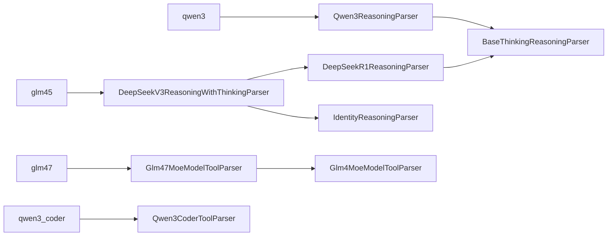

# Qwen3.6 / GLM-5.3 的 vLLM parser 对比

## 1. 范围与结论

2026-09-16，补充 [GLM-5.3 Agent 加速计划](dtb_glm53_agent_acceleration_plan.md)。
分析固定的 vLLM `v0.23.0`，commit `0fc695fc6d1d82e9a5ac6835ac8e4e1c83703665`。
上游 checkout 保持只读；Qwen 同时比较上游原版和 TB 两个 parser patch 在内存应用后的版本。
没有安装 vLLM、修改生产 DTB 或声称 GLM 服务器测试通过。

**结论：移植需要同时处理模型协议差异和原生 parser 的分片问题。**
只换 token ID、只改 parser 名称，或直接复制 Qwen patch，都不充分。特别是 GLM
非流式正确解析不能证明流式正确，JSON 可解码也不能证明参数值没变。

证据层次：

- **源码确定**：注册映射、继承、参数转换、流式/非流式行为和 serving 结束规则。
- **本机实测**：真实本地 tokenizer + 固定 parser 源码的合成回放；协议对象及外围依赖使用
  轻量替身，实际 schema/coercion 辅助函数从源码加载。包含统一 `DelegatingParser` 路径。
- **待服务器验证**：实际 detokenizer、speculative 输出形状、HTTP SSE、取消/finish_reason、
  NPU 生成质量、故障发生频率与时延。回放不代表 GLM 模型必然生成某种 fixture。

## 2. CLI 名称与真正实现

| CLI 配置 | 实际类 | 主要依赖 |
| --- | --- | --- |
| `--reasoning-parser qwen3` | `Qwen3ReasoningParser` | `BaseThinkingReasoningParser` |
| `--tool-call-parser qwen3_coder` | `Qwen3CoderToolParser` | `ToolParser`，TB 另有版本化 patch |
| `--reasoning-parser glm45` | `DeepSeekV3ReasoningWithThinkingParser` | 包装 `DeepSeekR1ReasoningParser` 或 `IdentityReasoningParser` |
| `--tool-call-parser glm47` | `Glm47MoeModelToolParser` | 继承 `Glm4MoeModelToolParser`；主要改两个 regex |

注册入口是 [reasoning 注册表](../../third_party/vllm/vllm/reasoning/__init__.py) 和
[tool parser 注册表](../../third_party/vllm/vllm/tool_parsers/__init__.py)。因此搜索
`glm45_reasoning_parser.py` 会漏掉实际实现；仅阅读 `glm47_moe_tool_parser.py` 也不足以
了解流式解析，必须继续读父类。



## 3. Reasoning parser：相同 marker，不同边界契约

| 维度 | Qwen3 | GLM45 |
| --- | --- | --- |
| `<think>` / `</think>` ID | 248068 / 248069 | 154841 / 154842 |
| 输出不带 `<think>` opener | 支持模板已经打开思考 | DeepSeekR1 补充逻辑支持模板已经打开思考 |
| 自然结束 | `</think>`；也支持 `<tool_call>` 隐式结束 | thinking 分支仅以 `</think>` 结束 |
| `<tool_call>` 的 content IDs | 可包含该 marker，交给 tool parser | 没有相同的隐式 tool-start 规则 |
| 默认 thinking | true | 两个开关均未给时设 true |
| 显式关闭 | `enable_thinking=false`，须与模板一致 | `thinking` 与 `enable_thinking` 取逻辑 OR；两者都为 false 才选 Identity |
| 表层 token 属性 | 可直接读 start/end IDs | wrapper 将调用委托内部 parser，不能假设表层存在 end_token_id |
| 无闭合标记的非流式文本 | thinking 开启时全属 reasoning，但 tool-start 可切换 | thinking 分支无 `</think>` 时全属 reasoning |

源码：
[Qwen3](../../third_party/vllm/vllm/reasoning/qwen3_reasoning_parser.py)、
[GLM wrapper](../../third_party/vllm/vllm/reasoning/deepseek_v3_reasoning_parser.py)、
[DeepSeekR1](../../third_party/vllm/vllm/reasoning/deepseek_r1_reasoning_parser.py)、
[BaseThinking](../../third_party/vllm/vllm/reasoning/basic_parsers.py)。

Qwen 还区分 prompt 中的完整 `<tool_call>…</tool_call>` 示例与尚未闭合的工具起始，
避免仅因 prompt 包含工具示例就认为思考已经结束。不能把“词表存在 marker”直接视为
当前请求已经切换状态。

### 3.1 本机回放：正文 + 被剥离的结束 marker

构造 parser 输入：text 为 `analysis`，IDs 为该模型真实 tokenizer 编码的
`analysis</think>`。这是“末尾 stop marker 的 text 被删除，ID 保留”的输入形状，
本回放不模拟 native detokenizer 如何生成它。

| 版本 | reasoning | content |
| --- | --- | --- |
| Qwen 上游原版 | 无，返回 None | 无 |
| Qwen + TB reasoning patch | `analysis` | 无 |
| GLM 原版 | `analysi` | `s` |

**本机实测 + 源码确定：** GLM 底层解析用 `delta_text.find('</think>')`，未找到时返回
`-1`，后续切片把正文错误切开。更长文本可造成错误范围更大甚至内容重叠，不能泛称为
“只丢最后一个字”。Qwen patch 针对末尾 end ID 保留整个 reasoning 前缀；它修改的是
Qwen 专用类，不会覆盖 DeepSeekR1/BaseThinking 路径。

单独 token-only `</think>`（空 text、只有边界 ID）在三者中都返回 None，并由统一 parser
识别结束；这不能证明“正文和边界同 batch”也安全。含 marker 文本的普通
`analysis</think>answer` 在三者均正确分离。

### 3.2 本机回放：未闭合思考直接开始工具

Qwen 把 `analysis<tool_call>…` 拆为 reasoning + 工具 content，并返回 ended=true。
GLM 返回 ended=false，整段仍是 reasoning。GLM 的 DTB 协议首版应以显式 `</think>`
为已知自然边界，不要把 Qwen 的隐式结束规则直接变成 GLM 特性。

本地 GLM-5.3 模板始终以 `<think>` 打开 generation prompt，忽略 `enable_thinking`；
`glm45` parser 却会响应这些开关。二者必须一起核对，见 [tokenizer 审计](../tokenizer/README.md)。

## 4. Tool parser：结构、类型转换和增量策略

相同逻辑调用的模型原始语法：

```text
Qwen: <tool_call><function=lookup><parameter=x>ok</parameter></function></tool_call>
GLM:  <tool_call>lookup<arg_key>x</arg_key><arg_value>ok</arg_value></tool_call>
```

| 维度 | Qwen 原版 / TB patch | GLM47 / GLM4 父类 |
| --- | --- | --- |
| 非流式工具内容 | function/parameter regex；部分未闭合输入也可能被容错提取 | 完整 tool-call 区间 + arg-key/value pairs；GLM47 支持同一行名称及零参数 |
| 类型转换 | 根据 schema 调用 `coerce_to_schema_type` | 明确 string 类型保留原文；其他值先 json.loads，再 safe_literal_eval，再原文 |
| 参数换行 | 每个值去掉最多一个首/尾换行 | schema string 值保留空白；非 string trim |
| 原生流式 | 多个状态字段追踪参数、JSON 开闭和工具序号 | 每个 delta 重扫累计文本，重建到目前为止的 JSON，再按已发字符长度取后缀 |
| TB Qwen patch | 工具名可提前发；参数在 `</function>` 完整后一次发出 | 当前无对应 GLM patch |
| token-only 工具 opener | TB patch 用 token ID 补 parser 内部逻辑前缀 | GLM 按 current_text 查找工具区间，没有同等 ID 恢复路径 |
| required/named | `supports_required_and_named` 与 strict 环境配置有关，默认 true | false；绕过标准 JSON guided 路径，仍走模型 XML parser |
| request 调整 | Qwen 没有同名专用 adjust override；继承基础逻辑 | 启用工具时设置 skip_special_tokens=false；required/named 避免强制 JSON 输出 |

源码：[Qwen 工具类](../../third_party/vllm/vllm/tool_parsers/qwen3coder_tool_parser.py)、
[GLM47](../../third_party/vllm/vllm/tool_parsers/glm47_moe_tool_parser.py)、
[GLM4 父类](../../third_party/vllm/vllm/tool_parsers/glm4_moe_tool_parser.py)、
[类型转换 helpers](../../third_party/vllm/vllm/tool_parsers/utils.py)、
[ToolParser 基类](../../third_party/vllm/vllm/tool_parsers/abstract_tool_parser.py)。

容错解析和 required/named 路由不等于 schema 验证：未声明工具、必填参数缺失、
值类型错误必须另行校验。GLM 不应因跳过 JSON guided decoding 就被描述为已保证
required/named 约束，实际生成仍需验收。

### 4.1 零参数：非流式支持，流式丢工具

输入：`<tool_call>lookup</tool_call>`。
GLM47 的非流式 regex 可以得到 `lookup({})`；继承的流式
`_extract_tool_name_from_region()` 只用换行或 `<arg_key>` 判定名称结束，没有把完整
工具区间末尾作为零参数名称的终点。结果是即便完整工具已到达，仍没有名称/工具 delta。

**本机实测：** 直接 tool parser 与统一 reasoning→tool parser，按 1 token、4 tokens、
整段三种分片均复现。必须补零参数流式路径，不能只看 GLM47 文件头的支持说明。

### 4.2 非 string 参数：按长度求 diff 不保证内容是前缀

GLM 流式的 partial 非 string 值直接发原始文本；参数闭合后再 json.loads + json.dumps，
可能增加空格、规范化数值。`_compute_args_diff()` 按已发长度切后缀，不检查新 JSON 是否
以旧 JSON 为前缀。已经发给客户端的字符无法撤回。

**本机实测的有效模型 XML 输入：**

| 值 / 分片 | 非流式期望 | 流式拼接实际结果 |
| --- | --- | --- |
| `[1,2]`，直接/统一 parser，1 token | `{"x": [1, 2]}` | `{"x": [1,2]]}`，JSON 非法 |
| `[1,2]`，统一 parser，4 tokens | `{"x": [1, 2]}` | `{"x": [1,22]}`，JSON 合法但值错误 |
| `1e2`，直接/统一 parser，1 token | `{"x": 100.0}` | `{"x": 1e2.0}`，JSON 非法 |

第二行是不能仅测 `json.loads` 成功的直接证据。此次 schema string 的转义/换行例和
小写 boolean 例均通过，不把一个特定类型的问题泛化成所有字符串流式都失败。

修复方向：非 string 值闭合前暂存，完成后按规范形式首次发出；或实现能够证明前缀
稳定的增量序列化。字符串可继续提前发，只要转义和闭合状态维持前缀不变。
整个函数闭合后一次发参是更保守的备选，但会推迟长参数的可见时间；这应计入
time-to-arguments-complete / 首参数延迟，而非只看 TTFT。

### 4.3 token-only 工具起始

工具 parser 接收首个 delta `text=""`、IDs=`[tool_start_id]`，随后收到没有 opener 的
函数体。TB Qwen patch 维护 parser-local 的一个逻辑 `<tool_call>` 前缀，避免 marker
缺失或重复；不会把这个补偿写回 SSE content、token 计数或 continuation prompt。
GLM 当前按文本找工具区间，不能把 Qwen 的空文本 marker 透传方式原样套过去。
该输入形状的直接 parser 结果也保存在审计 JSON 中；GLM 实际原生流是否产生该形状，
需要服务器验证，不能称为普遍的 GLM 原生故障。

## 5. 统一解析与 finish_reason 必须一起验收

[DelegatingParser](../../third_party/vllm/vllm/parser/abstract_parser.py) 先判断 prompt 是否
已结束思考，再调用 reasoning parser；遇到边界后取 content IDs，重置工具侧累计状态，
同一个 delta 可同时含 reasoning 与 tool call。只对独立工具类做正则测试会漏掉这里的交接。

同一外部 completion 的 parser 状态应跨 DTB child 保持连续；新的 assistant 轮次则重新
建立状态。不能为了 child 续写而重置 parser、重复打开工具或重复发名称/参数。

[chat serving](../../third_party/vllm/vllm/entrypoints/openai/chat_completion/serving.py)
决定最终 finish_reason：流式已发工具且非 named choice 时通常为 `tool_calls`；named
choice 按原生规则处理，不能笼统要求所有工具路径都为 `tool_calls`。解析器少发了工具
可能进一步改变结束语义，这里是源码推导；本机 harness 没有执行 HTTP serving finalization。

GLM `skip_special_tokens=false`、生成 EOS、reasoning_stop 和请求 stop 必须分别保留原生
含义。`</think>` 是思考边界，`</tool_call>` 是工具 XML 结束，都不能简单当成整个
assistant completion 的统一 EOS。

## 6. 回放方式、结果与边界

执行：

```powershell
python tools/dtb/compare_model_parsers.py
```

脚本使用 [本地 tokenizer](../tokenizer/README.md)，可在 `HF_HUB_OFFLINE=1` 下运行。
只在内存应用 Qwen patch，不改 `third_party/`。每组均是五种 fixture（零参数、转义字符串、
array、number、boolean）× 直接/统一 parser × 1/4/整段 token 分片。
非流式抽取的规范化工具名/参数值作为 oracle，随机 tool-call ID 不纳入比较。

| 版本 | 工具回放数 | 与非流式工具结果不一致 |
| --- | ---: | ---: |
| Qwen 上游原版 | 30 | 15 |
| Qwen + 仓库两份 parser patch | 30 | 0 |
| GLM 原版 | 30 | 12 |

另有 12 个 reasoning 输入和 3 个 token-only tool-start 输入。记录见
[`parser_comparison.json`](../tokenizer/parser_comparison.json)，含源码/patch SHA256、
真实 token IDs、所有输出 delta、期望与实际值。退出码 0 表示诊断执行完成，**不表示所有
parser 等价检查通过**；JSON 的 `matches_nonstream_tools=false` 就是待处理差异。

限制：该小样本集不代表线上失败率；按固定 token 个数分片是合成 partition；原生
detokenizer/stop clipping、OpenAI/Pydantic 模型验证、guided decoding、随机 ID 唯一性、
HTTP finish_reason 和性能均不在本次实测范围。无模型回放通过仍需目标服务器复验。

## 7. 对迁移计划的具体调整

1. **先验证 GLM Vanilla 的协议。** 上述 GLM 工具问题在没有 DTB 时也能由源码回放复现，
   不应归因于思考压缩。修复后的 Vanilla 与 DTB 必须使用相同 parser 版本。
2. **增加 GLM 专属协议绑定。** 默认只绑定显式 `</think>`；感知 wrapper；强制边界的
   text/IDs 必须与实际 detokenizer/parser 契约一致，不能复用 Qwen 的两边界断言。
3. **把三个已复现项设为本地门禁：** GLM 零参数流式、非 string 参数前缀稳定、
   正文 + stripped end token 保真。优先做模型范围明确的最小修复；修改共享 DeepSeek
   类时需覆盖其其他使用模型，不能只验证 GLM 一个名字。
4. **保留 Qwen 回归。** 用相同真实 tokenizer harness 对补丁前后做控制组；Qwen 的
   30/30 工具比较通过不等于所有协议已经充分覆盖。
5. **再做 serving/PD/质量与时延。** 加入 malformed/truncated、多工具、required/named/none、
   混合 batch、角色边界及多轮工具返回；预算/置信度实验只能在协议门通过后比较。

本次仅增加诊断与文档，不实施 parser 修复。确定 GLM 服务器的实际源码和输出分片后，
再决定新增 `patches/vllm/v0.23.0/` 的 GLM patch 范围，避免把合成复现直接当成部署现状。

## 8. 变更历史

| 日期 | 变更 | 原因 |
| --- | --- | --- |
| 2026-09-16 | 对比四个 CLI parser 的源码与 Qwen patch；增加真实 tokenizer、直接/统一 parser 回放 | 将迁移风险细化为可复现的边界与参数错误，区分原生问题和 DTB 新引入问题 |
