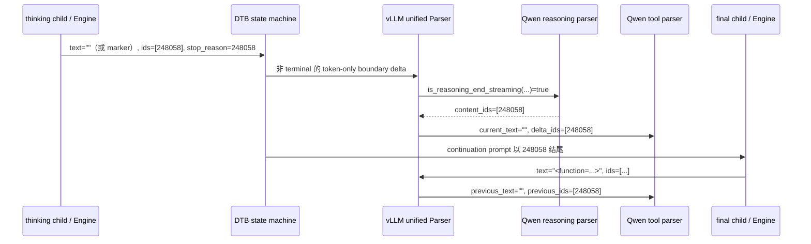

# DTB reasoning boundary 的 token-stop 迁移设计

## 1. 设计目的

本文定义 DTB 在 Qwen3.6 **流式路径**上用 `stop_token_ids` 取代控制器追加的全部
reasoning-boundary 字符串 `stop` 的必要重构，并定义边界发现、流式 reasoning/tool parser
适配、配置校验和验证方案。非流式路径暂不迁移，保持当前字符串 stop 与完整响应 parser 行为。

实现基线包含提交 `09ac650` 对 final-answer `</think>` stop 的删除，本文复核时仓库
HEAD 为 `b67b1be`。目标运行时为 vLLM `v0.23.0`、
vLLM-Ascend `v0.23.0rc1` 和 Qwen3.6-27B。当前部署已核对并应显式配置：

| marker | token IDs | 协议含义 |
| --- | --- | --- |
| `</think>` | `[248069]` | 显式结束 reasoning |
| `<tool_call>` | `[248058]` | 隐式结束 reasoning，同时开始工具 XML |

目标不是改变模型可生成的正文，而是让 DTB 的内部 thinking child 在结构边界精确结束，
并让后续 continuation 和原生 reasoning/tool parser 看到与一次原生生成等价的逻辑 token 流。
表中的 marker 只描述 Qwen3.6 协议，不能提升为 DTB 的跨模型常量；其他模型的 reasoning
结束 token、可见文本乃至“显式结束标记”是否存在都可能不同。

## 2. 结论

**必须在同一流式版本中把 thinking child 的两个控制器边界全部迁移到结构 token stop：
explicit-end `248069` 与 tool-start `248058` 原子启用，同时修改 Qwen streaming tool parser
消费 token-only tool-start。迁移不扩散到 final/probe、用户 `stop` 或非流式路径。**

具体决策如下：

1. `_ThinkingState` 中控制器追加的 explicit-end string stop 应改为配置声明的
   `think_end_token_id`（当前 Qwen3.6 部署值为 `248069`）。Scheduler 能在 speculative
   accepted batch 内逐 token 截断，直接消除字符串 stop 造成的 text 已截断、token IDs 仍带
   后缀问题。
2. tool-start 同时改为配置声明的 `tool_call_begin_token_id`（当前值为 `248058`）。重构前的
   patched Qwen 工具 parser 仍以 `current_text.find("<tool_call>")` 建立工具区间，并以空
   `previous_text` 判断新流；本次原子 changeset 已增加 token-only tool-start 状态和 parser
   内部 structural prefix，不保留 `<tool_call>` 字符串 stop 作为流式 fallback。
3. `_FinalAnswerState` 不得添加这两个 token ID，也不得恢复字符串 `</think>` stop。
   同一 token 在 final-answer 阶段可以是工具参数、源码和说明文字的 payload；token stop
   与 string stop 都会在这里截断合法答案。token stop 解决的是停止层次，不解决阶段误配。
4. `_ConfidenceProbeState` 是 reasoning 已结束后的隐藏试答，不应把 `</think>` 作为
   控制器 stop；当前 `params.stop = [THINK_END_TAG]` 不应机械替换成
   `stop_token_ids=[248069]`，而应删除该控制器 stop，并保留请求原生 stop/EOS/max-token
   语义。
5. 用户请求本身携带的字符串 `stop` 必须继续保留。vLLM 0.23 的
   `stop_token_ids` 只表达多个单 token ID 的 OR，不表达多-token 序列，因此不是
   OpenAI `stop` 的通用替代品。
6. 当前字符串-stop 对齐器只保留给未迁移的非流式/兼容路径。流式 thinking 不再追加任何
   controller marker string stop，也不依赖对齐器裁掉 speculative 后缀；source token IDs 是边界
   事实源。
7. DTB 不应内置 marker 文本或 token ID。启动配置明确声明当前部署的 boundary role→token ID；
   协议适配器只定义 Qwen3 的状态语义并校验配置能被当前 tokenizer/parser 接受，不能根据假定
   marker 自动发现或覆盖配置值。
8. continuation 主 prompt 应采用 **token-authoritative** 表示：`prompt_token_ids` 是唯一可变
   事实源，初始 `prompt_text` 只作为路由/诊断的不可变可选视图，不再随 thinking、cue 和
   boundary 反复拼接。该调整与 token-stop 兼容，但应作为独立优化阶段实施和计量。
9. `915bec9` 的服务器回放进一步暴露了 explicit-end 混合 delta 的 reasoning 保真缺陷。
   新增独立 `qwen3_reasoning_parser.patch`，仅保留“末尾 end ID 存在、marker text 已剥离”
   时的正常 reasoning 前缀；不修改 include-stop 默认值、implicit tool 边界或 merge 行为。
   详细决策见 3.3.1；当前流式部署需同时具备该补丁。

因此，这是一个**流式边界与 parser 的原子正确性重构**，不是修复 final-answer 截断的替代方案，
也不应被宣称为独立的显著时延优化。当前对齐器已经缓解字符串 stop 的已知后缀问题；迁移的
主要收益是从源头消除该问题、减少控制器补偿分支和少量无效 speculative token。

### 2.1 run_server_03 对边界语义的补充证据

`docs/log/perf/agent_tool_call_run04_paired_replay/run_server_03` 中两条 DTB hard failure
支持以下目标模型假设：

> 在 thinking 阶段，Qwen3.6 只有真正作出 reasoning→content/tool 状态转换时才生成 canonical
> boundary token `248069`；引用、解释或处理字面量 `</think>` 时使用普通 token 序列，不能把
> 解码后碰巧相同的文本当作结构边界。

这里的“真正结束思考”是**模型协议层的状态决定**，不是人对整句话是否已经说完的自然语言判断。
即使 canonical token 位于一段看似尚未引用完的错误消息中，原生 streaming parser 仍必须把它
解释为 reasoning 已结束；后续 final child 继续该句，不构成它是普通引用文本的反证。

| 样例/形状 | 实测 token 证据 | 协议解释 |
| --- | --- | --- |
| 58 个成功 DTB initial-think terminal | 均包含 `248069` | canonical explicit-end，reasoning 结束 |
| `a26` 普通引用文本 | 已生成 `</`=`510`、`think`=`26003`，尚未生成 `>` | 普通 payload；不能提前提升为边界 |
| `a9` 普通引用文本 | 停在 ``test data using ` ``，正要引用 marker | 与 `a26` 相同的 decoded-string collision 形状 |

当前字符串 stop 同时观察“结构 token 解码出的 `</think>`”和“普通 token 拼出的
`</think>`”，无法表达这一区别。`align_stop_boundary_delta()` 又要求命中文本后一定能找到独立
编码 `[248069]`，于是普通引用文本触发字符串 stop 时会进入不可满足的对齐分支。这不是应该扩充
文本对齐器的 corner case，而是 stop 抽象层选错：目标 Qwen streaming 协议的边界事实源必须是
`248069`/活动 parser，而不是 decoded substring。

这项结论的边界是：它已由当前目标模型、tokenizer 和 replay 支持，不能自动推广到其他模型或
tokenizer revision。反例判据也应预先固定：若后续 stream audit 观察到**仍处于 thinking phase、
且按原生 continuation 可证明只是普通引用**的完整 canonical `248069`，才推翻该模型假设；
普通拆分 token 解码成 `</think>` 不算反例。

### 2.2 实施决策与门禁

| 设计点 | 当前结论/建议 | 实现门禁 |
| --- | --- | --- |
| 边界语义 | thinking 中 canonical `248069` 是结构结束；拆分 token 是普通 payload | 锁定；检测逻辑不得再以 text marker 为依据 |
| 迁移 ownership | 只替换控制器拥有的 thinking boundary；用户字符串 stop、EOS、max token 保留 | 锁定；必须能区分 controller stop 与 request stop |
| 首次交付范围 | `248069`、`248058` 与 streaming tool parser patch 同版原子交付 | 任一部分缺失都不得启用 streaming token-boundary mode |
| token ID 来源 | 启动期 `REASONING_PROTOCOL` 配置是事实源；tokenizer/parser 只做绑定校验，不根据固定 marker 动态发现 ID | 锁定；ID、vocab、singleton、parser 行为任一校验失败即禁用 streaming token-mode DTB |
| `SamplingParams` 修改时点 | 不能只在 `to_sampling_params()` 之后 append `stop_token_ids` | 必须由 vLLM adapter 原子同步 `stop_token_ids` 与 `_all_stop_token_ids`，或在 post-init 前构造；两者一致性必须测试 |
| `min_tokens` | thinking child 固定为 `0`，允许首 token 自然结束 | 锁定；外部 `min_tokens` 的总 completion 语义不在本重构中顺便重定义 |
| tool-start 空文本 | reasoning parser 能从 delta ID 转换状态，但当前 tool parser 丢失空文本 start 且会在下一 delta 再次 reset | 同时修改初始化判据和 token-only structural prefix，并做增量、多工具、speculative batch 回归 |
| 非流式响应 | 本阶段不处理，继续使用现有 string stop/full parser | token mode 必须以 `request.stream` capability gate 隔离；不得改变非流式请求参数和输出 |
| forced close | 自然 boundary 与 controller 合成 boundary 使用同一协议 token；cue 与 boundary 分离 | 必须明确 synthetic token 的预算计数、只追加一次以及 stream/full parser 的消费方式 |
| confidence probe | 已处于 answer 语义，不应有 controller `</think>` stop | 建议同一正确性版本删除，但需单列 probe token/置信度回归，避免把工作量变化误归因给 token-stop |
| 用户传入同名字面量 stop | 用户 `stop=["</think>"]` 仍按 OpenAI 字符串 stop 工作，但不能被分类成 controller boundary | 必须记录 stop ownership；仅 canonical token/整数 stop reason 驱动 reasoning 状态转换 |
| rollout/回滚 | 协议能力按 request 固化，telemetry 记录 parser/tokenizer/ID/stop mode | streaming 部署版本原子包含两个 ID 的使用点和 parser 能力；非流式保持 legacy |

实现 changeset 据此固定为：protocol 与 SamplingParams 原子配置、两个 boundary token、Qwen
streaming tool parser 状态改造和对应 fixture 必须一起完成、一起启用、一起回滚。非流式与
continuation prompt 的 token-authoritative 优化均不进入该 changeset。

## 3. 源码确定的行为

### 3.1 字符串 `stop`

vLLM 在 `vllm/v1/engine/detokenizer.py` 中先把本轮全部 `new_token_ids` 解码并追加到
detokenizer，再执行 `check_stop_strings()`。命中后只裁剪 `output_text`。如果同一个
speculative batch 是：

```text
reasoning, 248069, suffix_1, suffix_2
```

字符串 stop 可以让 text 结束于 `</think>`，但 detokenizer 的 token IDs 已经包含后两个
token。当前 `align_stop_boundary_delta()` 正是为这种不一致补裁 token IDs。

### 3.2 `stop_token_ids`

vLLM Scheduler 在 `_update_request_with_output()` 中逐个 append accepted token，并在每个 token
后调用 `check_stop()`：

```text
append token -> last_token_id in stop_token_ids -> FINISHED_STOPPED
             -> 删除当前 accepted batch 中剩余 token
```

因此对 `[248069]` 和 `[248058]`，EngineCore 返回的 `new_token_ids` 最后一个 token 就是边界，
不会包含同批 speculative 后缀。`stop_reason` 是命中的整数 token ID，而不是 marker 字符串。

这也比文本匹配更符合 Qwen 原生 parser 的定义：原生 reasoning parser 以
`end_token_id`/`tool_call_token_id` 判定状态转换。即使某组普通 token 偶然解码拼成相同字符，
它也不应被 DTB 提升为结构边界；反过来，结构 token 即使被 `skip_special_tokens` 从 text 隐去，
仍必须触发边界。

### 3.3 stop token 的 text/token 输出

**源码确定：**`include_stop_str_in_output=False` 时，V1 detokenizer 在构造 engine
`RequestOutput.text` 前不让最后一个 stop token 参与 text 解码，但仍把该 token 保存在
`CompletionOutput.token_ids`。设置为 `True` 时该 token 参与解码，实际 text 是否出现 marker
还受 tokenizer 的 `skip_special_tokens` 行为影响。ChatCompletionRequest 的默认值是 `False`；
本设计的 streaming token mode 保留该请求值，因此默认路径预期产生 token-only boundary。

**公共 API 实测（2026-09-01）：**流式请求配置 `stop_token_ids=[248069]` 后，OpenAI terminal
`delta` 为空，上一个可见 delta 只有 `"\n"`，整个 SSE 没有出现 `</think>`。该观测发生在
reasoning/tool parser 之后，只能证明 post-parser 外部输出不含 marker，**不能证明 parser-facing
`RequestOutput.text` 为空**。目标部署实际的 pre-parser 形状仍需读取 DTB stream audit 的
`raw_text`、`token_ids`、`source_stop_reason`，或在 parser 调用前增加隔离调试日志。

因此不能假设以下任一关系恒成立：

```text
stop_reason == 248069  => output.text 一定以 </think> 结束
stop_reason == 248058  => output.text 一定以 <tool_call> 结束
```

#### 3.3.1 terminal reasoning prefix 的保真修复（2026-09-04）

修改起点仍是本文原生 parser 等价目标；本节是 `915bec9` 上传的 vLLM 0.23.0 +
vLLM-Ascend 0.23.0 / Qwen3.6 streaming 证据所要求的补充，不改变初始设计时间线。

**实测**：60 个 explicit-end source delta 中，13 个 text 为空，47 个带有边界前的普通正文，
但均不含 `</think>` marker 文本。47 个 delta 的正文在公共 reasoning 中丢失，共 268 字符、
117 个非边界 token。controller raw/forwarded 一致；未修改的原生 Qwen reasoner 重放可复现。
这与 tool-call 中断/缺参是独立问题，没有证据证明二者存在因果关系。

本节把这种输入称为 **terminal reasoning prefix**：其 text 是正常解码的 reasoning 前缀，
其 delta IDs 末尾另有已被 detokenizer 从 text 中剥离的 end ID，例如：

```text
text = " different approach.\n"
ids  = [2086, 5313, 13, 198, 248069]
```

它不是损坏的输入。`include_stop_str_in_output=False` 的原生 detokenizer 有意保留 stop ID、
跳过其文本解码。停止位置、token 账本与公开文本是三个不同的契约。

两种方法的取舍如下：

| 方法 | 能解决什么 | 副作用与裁决 |
| --- | --- | --- |
| include-stop=True | 让 terminal stop token 参与解码；当前 tokenizer 若如用户确认是 non-special added token，marker 会进入 text，由原 parser 正常消费 | 不改变 token-stop 为字符串 stop，但改变同一请求所有 stop 的文本可见性；还受 skip-special/tokenizer 影响。仅用于隔离 workaround/验证，不改生产默认值或强制覆盖调用者参数 |
| reasoning parser 的末尾 ID 特判 | 在合法 token/text mismatch 下保留已解码的 prefix | 不需要改变任何采样或 token 账本；仅增加一个受保护分支。采用此方法作为正式修复 |

即使只在 DTB thinking child 强制 include-stop=True，也会影响该 child 继承的用户 stop；
该字段不是 per-token/per-owner 配置。不要为本问题设置 `skip_special_tokens=False`，否则会
扩大到其他控制 token 的可见性。当前 tokenizer 的 added-token 属性来自用户确认，不推广到
其他模型 revision；部署时可记录 `added_tokens_decoder[id].special` 和 decode 结果补证。
若做 include-stop=True 对照，应从请求参数进入 SamplingParams 构造，不要仅在 post-init 后
修改 bool 而遗漏与用户字符串 stop 有关的 `output_text_buffer_length` 一致性。

**最小实现**位于 Qwen reasoning parser，而不是 controller 或 detokenizer：

1. 保留现有“end ID 在 delta 中且 marker text 可见”的分支，继续按文本切分 reasoning/content。
2. 只有 marker text 不存在、且 `delta_token_ids[-1] == self.end_token_id` 时，将非空
   `delta_text` 原样返回为 `DeltaMessage.reasoning`；空 text 继续返回 `None`。
3. end ID 不在末尾时不能从 IDs 推断 text 分割点，保留现有行为，不将全部 text 当 reasoning。
4. 不新增状态、不改函数接口；不改 Qwen implicit `<tool_call>` 分支、unified merge/overwrite
   逻辑、非流式 parser 或 EngineCore/Scheduler。正常 `reasoning + end + content/tool` 的
   speculative delta 仍走原分支。

“不得泄漏 marker”指结构 token 的可见文本，不等于禁止 reasoning 引用由普通 token 拼成的
同名字面量 `</think>`；后者仍是应保留的 payload，不能用全局字符串 grep 为零作验收。

这个 guard 是有限输入契约，不是对任意 text/token 暂时不同步的通用修复。parser 本身不接收
stop_reason；判据只使用本轮末尾 ID 和 marker 缺失，不假定拿到了 EngineCore terminal 标志。

一致性与验证：

| 契约 | 验证方式/边界 |
| --- | --- |
| stop 位置、stop ID、usage/stop_reason 不变 | 补丁不改这些生产代码或参数；detokenizer→parser 测试核对 IDs 不变。真实 HTTP usage/stop_reason 仍须服务器复验 |
| include=False 的普通 prefix 不丢、不重、不泄漏 marker | 直接用 `encode(prefix)+[end_id]` 与不含 marker 的 text 构造 regression；空 prefix 也覆盖 |
| include=True 的 marker 正常消费 | 独立 fixture 验证公开 reasoning/content 无新增 marker |
| marker-present、implicit tool、speculative delta 不回归 | 未修改源码对照 + 新增 direct tests；不修改已有 tool 行为 |
| unified reasoning 结束后不能丢失本轮 prefix | 原生 DelegatingParser 回归及 BaseIncrementalDetokenizer.update/get_next_output_text 组合测试 |
| 真实记录中的正文恢复且工具内容不变 | 60 条 real text/IDs 经 reasoner→unified→tool 完整链路离线重放 |

实现制品为 `patches/vllm/v0.23.0/qwen3_reasoning_parser.patch`，同时附带上游
`tests/reasoning/test_qwen3_reasoning_parser.py` 的回归测试。该补丁与两个既有 patch 文件
独立，已有 `915bec9` 部署只增量应用它，无需重做 tool parser 修复。

**本地实测**：84 个无模型检查全部通过；未打补丁的负对照有 5 个合成/组合检查失败及
47 个录制请求失败，10 个原路径对照全部不变。恢复全部 268 字符，60 个请求的 tool name、
arguments、content 与原公共结果不变。这里的本地 gate 使用依赖/字符 tokenizer stub，
真实记录保留原 token IDs；不是完整 vLLM/NPU/HTTP 测试，也不是完整原生 pytest 已通过。
证据见 `docs/log/perf/agent_tool_call_run04_paired_replay/run_server_04_token_stop/REASONING_TAIL_FIX.md`。

新的服务器结果可通过 `reasoning_tail_fidelity.py --require-public-fidelity` 同时校验真实
公共 reasoning；仅对旧 raw 应用新 parser 的离线通过不能冒充原服务器已经恢复正文。

因此，**不得把“text 中找到 marker”设为边界成立条件，也不得为了表面对齐而向 source delta
补回 marker 文本。** parser-facing 的事实源是活动 reasoning parser 的协议、`stop_reason` 和
token IDs。Qwen 的统一 reasoning/tool parser 必须同时兼容“text 含 marker + 结构 token ID”与
“空 text + 结构 token ID”；`<tool_call>` 实际采用哪种形状需要 pre-parser audit 确认，不能由
公共 API 的 `</think>` 结果外推。
当前仓库的 `qwen3_coder_parser.patch` 在流式重算路径中通过 marker text 搜索
`tool_start_positions`，尚不满足这一门槛。

### 3.4 `min_tokens`

`stop_token_ids` 会进入 `all_stop_token_ids`。当 `min_tokens > 0` 时，vLLM 在采样前 mask
这些 token；字符串 stop 则只是暂不做文本匹配。这是行为变化，不可静默忽略。

DTB 的 reasoning boundary 必须能在任意 thinking child 的第一个自然边界结束，因此内部
thinking child 应使用 `min_tokens=0`。外部请求的 `min_tokens` 不应重复应用到每个内部 child；
final-answer 是否需要满足外部最小 completion 语义属于单独的 completion-budget 设计，不应由
boundary stop 隐式承担。

### 3.5 ID 范围风险

vLLM 0.23 只检查 `stop_token_ids` 的元素是整数，没有检查其落在当前 tokenizer/model vocab
范围内。错误配置 ID 还可能在 `min_tokens` logits mask 路径进入设备端索引。因此控制器必须
在生成请求进入 engine 前自行校验，不能把来自另一个 Qwen 版本的数字直接复用。

### 3.6 当前 prompt 已是双表示，额外成本来自文本镜像

当前 `DtbRequestContext.engine_prompt` 并非只保存字符。它直接引用 serving 产生的
`engine_inputs[0]`，其中已有 `prompt_token_ids`，并可能同时有 `prompt`；context 又单独保存
`prompt_text`。现有 continuation 路径实际上已经以 token IDs 驱动模型：

- `append_thinking()` 直接扩展 `engine_prompt["prompt_token_ids"]`；
- `append_prompt_suffix()` 先编码 suffix，再扩展 token IDs；
- `child_prompt()` 用主 prompt token IDs 加已缓存的 suffix token IDs 构造隐藏 child。

但三个方法还会同步拼接 `prompt_text` 并覆盖 `engine_prompt["prompt"]`。此外
`request_controller.py` 在做 scene/budget 分类前，无论 `conversation` 中是否已经存在最新用户
文本，都会对完整 `prompt_token_ids` 执行一次
`tokenizer.decode(..., skip_special_tokens=True)`。正常 chat 请求随后由
`visible_user_text()` 选择用户消息，因此这次
整 prompt decode 通常没有参与分类结果。

vLLM `v0.23.0` 的 `TokensPrompt` 明确只要求 `prompt_token_ids`，`prompt` 是可选字段；engine
请求、prefill、KV cache 和 token 预算使用 token IDs。可选文本会进入本地
`RequestOutput.prompt`，普通 chat 生成不依赖它，但 `return_prompt_text=true` 会把它返回 API。
由此可以移除 continuation 热路径的文本镜像，却必须在响应边界保留外部 prompt 文本契约；也
不能据此关闭生成结果的 detokenize，OpenAI 响应以及 reasoning/tool parser 仍需消费 child
生成的增量 text 与 token IDs。

### 3.7 非流式路径的已知差异与本阶段边界

vLLM `v0.23.0` 的 Qwen reasoning streaming parser 通过 `delta_token_ids` 中的
`end_token_id`/`tool_call_token_id` 转换状态；完整响应的 `extract_reasoning()` 却仍对
`model_output` 执行文本 `partition("</think>")`。DTB 当前非流式路径又会在
`aggregate_queue()` 中只拼接各 child 的 `output.text`，随后把该字符串交给
`chat_completion_full_generator(..., parser=response_parser)`。

因此 token-stop terminal 若按默认 params 形成源码预期的 `text=""`、`token_ids=[248069]`：

- 流式 parser 可以正确结束 reasoning；
- 完整响应 parser 看不到 boundary，可能把 final answer 继续归入 reasoning；
- 简单往聚合文本补一个 `</think>` 也不正确，因为 reasoning 中更早由普通 token 拼出的字面量
  会被 `partition()` 误认为真正边界。

本阶段只关注 streaming，因此不解决该接口不对称。实现必须在 sampling 配置入口按
`request.stream` 分流：streaming 使用两个 token boundary；non-streaming 完整保留现有 string
boundary/full parser，不共享 token-mode params。未来迁移非流式时，正确方案仍必须让完整响应
解析取得 token-authoritative boundary 位置，或让 DTB 在内部使用统一 streaming parser 聚合
结构化结果；不得仅靠合成 marker 文本继续维持 text-only full parser。

## 4. 设计逻辑

### 4.1 按生成阶段定义 stop ownership

| phase | 控制器 marker stop | 原请求 stop | 原因 |
| --- | --- | --- | --- |
| streaming `initial_think` / `iterative_think` | 活动协议声明的全部 singleton boundary token IDs；Qwen3.6 为 `248069`、`248058` | 保留 | 两种自然状态转换统一由 token identity 驱动 |
| non-streaming `initial_think` / `iterative_think` | 保持现有 `</think>`、`<tool_call>` string stop | 保留 | 本阶段明确不迁移完整响应 parser |
| `confidence_probe` | 无 | 保留 | 已进入试答，marker 字面量不是合法停止协议 |
| `final_answer` | 无 | 保留 | 必须允许正文和工具参数包含 marker 字面量 |
| controller 合成 boundary | 不发 engine 请求 | 不适用 | 发出 parser-native 的边界 token delta；Qwen3.6 的 text 为空、token IDs 为 `[248069]` |

“marker 是否是 stop”由生成阶段和实际 token identity 共同决定，不由解码文本决定。thinking 中
普通 token 拼出的 `</think>` 是 payload；canonical `248069` 是状态转换。final answer 不配置
controller boundary stop，因此其中的同名文本或 token 都是 payload。

### 4.2 ReasoningBoundaryProtocol

新增启动期配置对象和请求级、只读的已绑定协议对象。marker text 是 parser adapter 的可选诊断
信息，不是配置事实源：

```python
class ReasoningProtocolAdapter(str, Enum):
    QWEN3 = "qwen3"

@dataclass(frozen=True)
class DtbReasoningProtocolConfig:
    adapter: ReasoningProtocolAdapter
    think_end_token_id: int
    tool_call_begin_token_id: int

@dataclass(frozen=True)
class BoundaryTokenSpec:
    boundary: ReasoningBoundary
    token_id: int
    marker: str | None = None

@dataclass(frozen=True)
class ReasoningBoundaryProtocol:
    adapter: str
    natural_boundaries: tuple[BoundaryTokenSpec, ...]
    forced_close_token_ids: tuple[int, ...]
    forced_close_text: str

    def classify_stop(
        self,
        stop_reason: object,
        delta_token_ids: Sequence[int],
    ) -> ReasoningBoundary | None: ...
```

`DtbReasoningProtocolConfig` 是 **DTB 控制器的唯一 ID 输入源**；`ReasoningBoundaryProtocol` 是
它与当前活动 tokenizer、reasoning parser、unified response parser 成功绑定后的运行时快照。Qwen3 adapter
知道两个 ID 分别对应 explicit reasoning end 与 implicit tool start，但不能把 `</think>`、
`<tool_call>` 重新编码后当作配置替代品。serving patch 将 `reasoning_parser` 和
`response_parser` 都放入私有 route identity；controller 在创建 request context 前用二者完成
绑定，只把不可变的已绑定 protocol 固化到 context。

这里不需要把 DTB YAML 注入 vLLM parser。Qwen3 reasoning parser 和 Qwen3Coder tool parser
已经分别持有其模型专用的 `end_token_id` 和 `tool_call_start_token_id`。Qwen adapter 应优先使用
这些公开字段及 parser 行为做校验：explicit-end 要求 `reasoning_parser.end_token_id` 与配置相等；
implicit tool-start 同时要求 reasoning parser 对该 ID 返回结束、且
`response_parser.tool_parser.tool_call_start_token_id` 与配置相等。不要依赖 Qwen reasoning parser
的 `_tool_call_token_id` 私有字段。校验成功后才建立 protocol。

tool parser patch 识别其自身的 `self.tool_call_start_token_id`，不能再写字面量 `248058`。这种
tokenizer 查询只发生在**模型专用 parser 内部，用作原生 parser 的语义声明**，不同于 DTB 根据
固定 marker 文本做跨模型自动发现；后者仍然禁止。配置与 parser 是两份独立声明，必须一致，
但任何一方都不能静默覆盖另一方。

校验分两层执行：

1. **YAML schema 校验**：adapter 和两个 ID 必填；当前 adapter 只接受字面量 `qwen3`；两个 ID
   必须是非 bool 整数、非负、互不相同，未知字段直接报错；
2. **运行时绑定校验**：两个 ID 必须存在于活动 tokenizer vocab；Qwen reasoning parser 必须把
   配置的 `think_end_token_id` 识别为 explicit end、把 `tool_call_begin_token_id` 识别为 implicit
   end；Qwen tool parser 必须把后者识别为 start；
3. unified parser fixture 必须同时验证 marker-present 与 token-only delta，确保配置 ID 后的
   continuation 能生成结构化 tool call；
4. 可记录 `tokenizer.decode([token_id], skip_special_tokens=False)` 和 parser marker 作为诊断，
   但不得要求某个硬编码 marker 的 `encode()` 结果等于配置 ID，也不得用 decode 文本反向覆盖 ID。

任一校验失败时应 fail closed，不得静默改用 parser 推导值或代码硬编码 ID。若模型只有 multi-token reasoning
结束序列，vLLM 0.23 的 `stop_token_ids` 无法表达；应为该模型实现 parser-native sequence-stop
能力或禁用 DTB，不能把多个 ID 放入 `stop_token_ids`，也不能仅凭猜测的 marker 文本回退。

### 4.3 SamplingParams 修改

thinking child 的配置逻辑应：

```python
if request.stream:
    params.stop_token_ids = stable_union(
        params.stop_token_ids,
        protocol.natural_boundary_token_ids,
    )
    # params.stop 只保留原请求 stop，不追加 controller marker。
    params.min_tokens = 0
else:
    configure_legacy_string_boundary_stop(params)
```

不得清空或重写用户原有的 `params.stop` 和 `params.stop_token_ids`。streaming 模式不允许任何
controller boundary 进入 string fallback；Qwen 的两个 ID 必须同时存在。`stable_union` 保持原有
顺序并去重，便于日志和测试稳定。non-streaming 继续调用现有 legacy helper，避免本阶段行为变化。

这里存在 vLLM `v0.23.0` 的实现约束：`SamplingParams._all_stop_token_ids` 在 `post_init()` 中从
`stop_token_ids` 建立，并在 `min_tokens` logits mask 路径使用。当前 DTB 是先调用
`request.to_sampling_params()`、再修改 child params；若只改公开 list，内部 set 会陈旧。
版本化 vLLM adapter 必须提供一个原子 helper，在 clone 后同时更新二者，并至少断言：

```python
set(params.stop_token_ids).issubset(params.all_stop_token_ids)
```

不能用完全相等作断言，因为 `_all_stop_token_ids` 还可能包含 EOS/generation-config IDs。若未来
vLLM 提供公开 mutation API，应改用公开接口并删除对私有字段的直接依赖。

控制器不再为了 marker 改写 `include_stop_str_in_output`，而是保留原请求值；否则会同时改变用户
字符串 stop 的输出契约。目标 Qwen3.6 请求默认值为 `False`；按 vLLM 源码，此时 pre-parser
terminal 预期不解码 stop token，但该形状尚未在目标部署直接观测。无论该字段取值为何，正确性
都不依赖 text 中出现 marker。

### 4.4 parser-facing token 边界透传

token-stop terminal 的处理输入是原始 `text`、`token_ids` 和整数 `stop_reason`：

```text
1. 用协议适配器根据 stop_reason/token IDs 映射 ReasoningBoundary；
2. 断言 terminal token_ids 最后一个正是 boundary.token_id；
3. 断言边界后没有 token；
4. 原样透传 source text 和 token IDs；Qwen3.6 terminal 的 text 可以含 marker，也可以为空；
5. 把 boundary token 原样追加到 continuation prompt；
6. 对外清除 thinking child 的 terminal，最终只透传 final child terminal。
```

若 terminal 是用户字符串 stop（包括用户自己传入的 `"</think>"`），但 delta/累计 token 中没有
canonical boundary ID，则协议分类必须返回 `None`。控制器可以按“本 thinking child 因用户 stop
结束、但 reasoning 尚未自然关闭”继续既有预算状态机；不得根据字符串 stop reason 把它升级为
`MODEL_THINK_END`。stop ownership 应在 params 构造时保留到 telemetry，不能在去重后反推。

不得把 marker text 合成到 source delta。source 已含 marker 时原样保留；source 为空时也原样
保留，不能用公共 API 的结果猜测并补写。stream audit 应保存 source stop ID、raw text、token IDs、
`include_stop_str_in_output` 和协议分类结果，以裁决实际 parser-facing 形状。

旧 `align_stop_boundary_delta()` 仍处理用户/兼容路径触发的字符串 stop。token stop 路径若发现
boundary 后还有 token，必须报错而不是再次静默裁剪，因为这违反 vLLM Scheduler 的已知保证，
可能意味着版本或 patch 不一致。

### 4.5 控制器强制关闭 reasoning

模型自然生成 boundary 时可以原样透传；预算耗尽或置信度接受时，控制器必须主动构造一个
parser-native boundary。当前 `GUIDED_FINAL_PROMPT_V1`、`close_reasoning()` 和
`emit_reasoning_boundary_once()` 都硬编码 `</think>`，因此它们同样需要协议化：

1. continuation prompt 追加 `protocol.forced_close_token_ids`；
2. parser-facing synthetic delta 使用相同 token IDs；
3. synthetic delta 的 text 使用 `protocol.forced_close_text`，Qwen3.6 应为空字符串；
4. 引导语与 boundary token 分开建模，避免用一个含 `</think>` 的字符串同时承担自然语言 cue
   和协议关闭；
5. 没有安全 forced-close 能力的 parser/model 不启用强制 DTB 截断。

这解决了跨模型的根本问题：控制器关闭的是 parser 定义的 reasoning 状态，而不是搜索或拼接
某个固定文本。

### 4.6 配置策略

当前范围只支持一个 Qwen3.6 模型部署，因此推荐新增独立的启动期配置段：

```yaml
REASONING_PROTOCOL:
  adapter: "qwen3"
  think_end_token_id: 248069
  tool_call_begin_token_id: 248058
```

字段名必须带 `_token_id` 后缀；`think_end_token` 容易被误解为 marker 字符串或 token 对象，不采用。
该配置与 `RUNTIME` 同为进程启动时加载、修改后重启生效，但单独建段，因为它描述模型—parser
集成契约，不是预算算法调优参数。请求不得覆盖这些字段。

不增加 `streaming_boundary_mode` 配置开关：本 changeset 的流式协议固定使用 token boundary，
非流式固定保留 legacy string boundary。若为定向 A/B 临时保留旧流式实现，应通过独立部署版本或
测试注入选择，而不是留下一个可在生产中把 parser patch 与 stop 模式拆开的配置组合。

配置职责如下：

- **YAML 是数值事实源**：DTB 配置 thinking stop、分类 boundary 和 forced close 都只读取这里的 ID；
- **adapter 是语义事实源**：`qwen3` 定义 explicit-end、implicit tool-start、parser-local prefix 和
  forced-close 规则，但不持有具体数值；
- **tokenizer/parser 是校验依赖**：确认配置 ID 存在且当前 parser 确实承认对应角色，不做自动发现；
- **telemetry/manifest 是审计证据**：记录配置原值、adapter、活动 tokenizer/parser 标识、绑定
  结果、可选 decoded token 文本和 stop mode。

当前实现不支持同一进程内多个 boundary 协议不同的模型或 tokenizer。若活动模型/LoRA tokenizer
与配置不一致，Vanilla 仍可用，但该请求的 streaming token-mode DTB 必须 fail closed。未来确实
需要多模型服务时，再把本段扩展为显式 profile 列表，并用 serving 已解析的模型/tokenizer identity
选择 profile；不能仅用可变的 API served-model alias，也不能通过猜 marker 自动生成 profile。

配置与绑定的生命周期固定为：YAML 在 controller 初始化时只加载一次；仅当流式请求实际进入
DTB 路径、serving 已构造本请求的 parser 后执行绑定；绑定成功的不可变 protocol 固化到 request
context，不能在 child 之间重算。`budget_disabled`/Vanilla 原生路径不执行协议绑定。绑定失败必须在
启动第一个内部 child 前返回明确的 DTB protocol/config error，不能静默降级为 Vanilla；这样既不
让错误配置污染原生请求，也不会把实验 variant 偷换掉。

### 4.7 continuation prompt 的 token-authoritative 设计

2026-09-04：本节的独立性能重构细化为
[输入去 decode 与 Token ID 权威续写设计](dtb_token_authoritative_prompt.md)，并安排在最低
介入值实施之前。以下同步最新约束；接口、无文本行为和验收以新文档为准，token-stop 本身
的设计基线和已完成修复不变。
该独立重构现已完成本地实现/无模型回归（229 tests / 1966 subtests），三个 vLLM patch
保持不变；目标服务器 eager 配对验收与最低介入值实施尚未完成。

#### 4.7.1 状态结构

`DtbRequestContext` 应把“模型输入账本”和“可选文本视图”分开。可以新增一个轻量
`ContinuationPrompt`，也可以先在现有字段上保持同一不变量：

```python
@dataclass
class ContinuationPrompt:
    engine_fields: dict[str, Any]       # multimodal/cache 等非文本字段
    token_ids: list[int]                # 唯一可变事实源
    initial_text: str | None = None     # 不可变；仅供路由、诊断或兼容输出

    def append_tokens(self, token_ids: Sequence[int]) -> None: ...
    def fork(self, suffix_ids: Sequence[int]) -> dict[str, Any]: ...
    def engine_input(self) -> dict[str, Any]: ...
```

必须保持以下不变量：

1. thinking child 返回的 token IDs、自然 boundary token、forced-close token 和 cue 编码结果只
   追加到 `token_ids`；不得再通过生成文本重编码来恢复主 prompt；
2. cue 等静态字符串仍可在请求级缓存中编码一次；改为 token prompt 不等于模型不再接收 cue；
3. 每个 child 传入 vLLM 的字典保留原 `engine_inputs` 中仍适用的 multimodal、cache 等字段，
   但删除已经随 continuation 失效的 `prompt` 字段，避免 text 与 token IDs 不一致；
4. hidden probe 使用 fork 后的新 token list，不得与主账本共享可变 list；
5. `initial_text` 不随 thinking 增长，不作为模型 prompt 的权威表示；完整 continuation 文本
   仅允许在离线调试工具按 token 快照 decode，运行请求不恢复全文镜像或惰性 decode 兜底；
6. prompt token 数、外部剩余额度和 phase telemetry 均直接读取 token ledger 长度。

`prompt_text=None` 不会阻止 vLLM 处理 `TokensPrompt`。在当前 `AsyncLLM.add_request()` 路径中，
vLLM 会从实际 prompt 字典重新提取可选文本；纯 token prompt 的 `RequestOutput.prompt` 将为
`None`。普通 DTB chat 输出不依赖这个字段，但 `return_prompt_text=true` 依赖它。响应适配层应在
该选项启用时按原生外部请求语义提供 `initial_text`，而不是返回含隐藏 probe、thinking、cue 或
synthetic boundary 的内部 child prompt；还应检查服务日志或自定义插件是否读取
`RequestOutput.prompt`。不能只保留一个与 token IDs 已不一致的初始字符串并继续随 child
传给 engine。

#### 4.7.2 分类文本与 fallback

scene/budget 分类的优先级应改为：

```text
最新可见 user message
> serving 已有的 prompt_components.text
> 两者都无可用文本时标记 missing，分类输入为空，不 decode
```

分类选取仅在 adapter 入口执行一次，复用 serving 已提供的数据；原生 serving 没有 DTB 专属
的分类结果。`missing` 继续走现有 resolver 的 fixed/override 或 general/history/default 规则，
不因缺文本拒绝有效输入，也不静默改走 Vanilla。serving 全文与旧 decoded fallback 可能不等价，
缺文本时也可能改变分类；两类兼容入口须单列审计，不能冒称所有请求预算完全不变。

#### 4.7.3 能省与不能省的开销

该设计能够减少：

- scene/budget 决策前一次通常无用的完整 prompt decode；
- 每次 thinking/cue/boundary 追加时 Python 长字符串的复制和双份 prompt 常驻内存；
- text/token 双写不一致导致的兼容分支和检查成本。

该设计不能减少：

- serving 首次把 chat template 转成 token IDs 的必要 tokenization；进入 DTB 时这一步已经完成；
- 模型的 prefill/decode 计算量，prompt token 序列没有因此变短；
- child 输出为了 OpenAI 响应及原生 reasoning/tool parser 所做的增量 detokenize；
- token-stop 本身减少的 speculative boundary overshoot；那是另一个收益来源。

因此预期收益首先体现在 `decision.decode_prompt`、`controller_cpu` 和内存分配，端到端收益大概率
小于模型 phase wall。必须实测，不应把“prompt 改存 token IDs”描述为减少模型 decode token。

#### 4.7.4 独立实施顺序

这项性能优化自身的实施顺序为：

1. 独立 changeset 删除完整输入 decode，将 continuation 账本改成 token-authoritative，
   停止维护可变 prompt text，同时完成可选初始文本和外部 `return_prompt_text` 兼容；
2. 固定已部署 token-stop/parser 修复、eager 模式和算法参数，完成输入等价、协议与性能配对；
3. 冻结该基线后再实施最低介入值；分别列出输入去 decode 与 deferred 同 child 直通的增量收益。

### 4.8 token-only tool-start 对 streaming tool parser 的影响

#### 4.8.1 实际调用序列

`248058` 被 stop-token scheduler 接受后，DTB 清除 thinking child terminal、保留 token delta，
再从以 `248058` 结尾的 continuation prompt 启动 final child。按当前 vLLM 源码和请求默认
`include_stop_str_in_output=False`，纯 boundary delta 预期是空 text；若它还包含边界前正文，
text 不为空，不能把整个 delta 视为纯 marker（本次 explicit-end 修复不改该 implicit 分支）。
若实际 child 参数为 `True`
或目标 tokenizer 行为不同，也可能包含 marker。以下序列描述需要兼容的 token-only 分支：



unified parser 的 reasoning 状态转换已经是 token-aware，不需要修改。若 parser-facing text
包含 `<tool_call>`，tool parser 沿既有路径工作；若 text 为空，重构前
`qwen3_coder_parser.patch` 的 streaming tool parser 有三个问题：

1. 它在 `if not delta_text` 分支提前返回，没有把 `[248058]` 记录为工具区间开始；
2. 它用 `if not previous_text` 重置状态。boundary text 为空使下一 child 首 delta 再次 reset；
3. 修订版通过 `current_text.find("<tool_call>")` 建立所有 `tool_start_positions`。final child 从
   `<function=...>` 继续，累计 text 中永远缺少第一个 start marker，于是该 XML 会被当作普通
   content，或始终无法形成 tool call。

#### 4.8.2 新概念：TokenBackedToolPrefix

tool parser 应增加请求级的 **TokenBackedToolPrefix**：它表示“unified parser 已由 canonical
`248058` 进入 tool phase，但当前 parser-facing text 中没有对应 marker”。它只构造 parser
内部的逻辑 XML 视图，不修改 `DeltaMessage.content`、外部 SSE 或 unified parser 保存的原始 text。
source 已含 marker 时该能力保持关闭，完全走现有解析路径。

其状态至少需要区分：

```python
@dataclass
class ToolStreamBoundaryState:
    initialized: bool = False
    token_backed_prefix: bool = False
    start_token_id: int | None = None
```

处理规则：

1. 在空 `delta_text` early-return **之前**检查 `delta_token_ids`。命中 canonical start ID 时设置
   `token_backed_prefix=True`；普通 token 拼出的 `<tool_call>` 不设置；
2. 新流初始化使用显式 `initialized` 或 token continuity，不能再把空 `previous_text` 等价为新流；
   下一 delta 若 `previous_token_ids=[248058]`，必须延续已有状态；
3. 当 token-backed prefix 生效且累计 text 尚未含起始 marker 时，仅在 parser-local
   `logical_previous_text`/`logical_current_text` 前补一个 `<tool_call>`；两个视图必须使用同一前缀，
   使 `new_text_start`、span 和增量 content 计算保持一致；
4. 若 boundary delta 已含 marker text，不再补前缀，避免重复 start；
5. 当前完整函数后一次性发出 canonical JSON arguments 的策略不变，`prev_tool_call_arr`、
   `streamed_args_for_tool` 和 tool-call ID 仍按每个逻辑调用恰好初始化一次；
6. 后续第二个及更多 tool call 继续使用 final child 原生生成的 marker/text 和现有累计重算逻辑。
   回归必须覆盖“第一个 start 为 token-backed、后续 start 为普通流式生成”的多工具响应；
7. parser-local prefix 永不计入 output token、completion usage、content 或 reasoning，只用于把真实
   structural token 投影成当前 text-based XML parser 所需的内部视图。

这里允许 parser 内部补 logical prefix，与禁止向 source delta 补 marker 不冲突：前者是由
canonical token 证明的解析适配，后者会篡改对外流和 continuation 账本。

#### 4.8.3 对现有流式行为的影响边界

- **reasoning 输出**：`248058` 仍只触发一次 reasoning→tool 转换，不生成 content；
- **工具首包时机**：boundary 空 delta 不发 tool call，继续等到 `<function=...>` header 或完整
  function 满足当前 patch 的发包条件；
- **arguments 策略**：仍在 `</function>` 后一次性发出 canonical JSON，不恢复逐 parameter 流式；
- **finish reason**：thinking child terminal 继续被 DTB 清除，最终只由 final child/native serving
  产生一次 `finish_reason=tool_calls`；
- **普通 content**：explicit-end `248069` 后没有 tool start 时，tool parser 仍按当前逻辑透传
  final content；不得因 token-prefix 状态泄漏而吞掉正文；
- **字面量安全**：thinking 中普通 token 拼出的 `<tool_call>` 不停止也不进入 tool phase；final
  tool 参数中的字面量由现有 parser patch 处理，不因 stop 配置提前截断；
- **跨 child 状态**：parser 实例、unified `StreamState` 和 TokenBackedToolPrefix 必须覆盖 thinking
  boundary 与 final child，不能以 child request ID 为消息边界重置；
- **Vanilla 影响**：parser patch 是服务级制品，Vanilla 也会经过。TokenBackedToolPrefix 只在
  start token ID 已出现且对应 marker text 缺失时激活；原本 text 中含 `<tool_call>` 的 Vanilla
  delta 序列必须产生与旧 patch 完全相同的结构化增量；
- **错误策略**：canonical start 后若最终没有合法 function，不伪造 tool call、不把 XML 泄漏成
  content；保持显式 parser/协议失败，并与 Vanilla 的 malformed-output 策略对照。

### 4.9 非流式暂不迁移

非流式仍使用现有字符串 boundary 和 `response_parser.parse(output.text)`。本版本不增加
token-aware full parser，也不声称 stream/non-stream 等价。唯一要求是 streaming token capability
gate 不能改变 non-streaming 的 SamplingParams、聚合逻辑或返回结构。

## 5. 对现有实现的影响

| 位置 | 修改 | 影响 |
| --- | --- | --- |
| `dtb/config/schema.py` | 增加必填 `DtbReasoningProtocolConfig`，挂入 `DtbServiceConfig`；严格校验 adapter 与两个 singleton ID | 配置成为数值事实源 |
| `dtb/config/loader.py` | 严格加载顶层 `REASONING_PROTOCOL`，拒绝缺失/未知字段；沿用启动期缓存与重启生效语义 | 防止静默使用默认 ID |
| `dtb/config/budget_config.yaml` / `budget_config_quant.yaml` | 显式声明当前部署的 adapter 与两个 token ID | 两套部署配置保持协议一致 |
| `dtb/reasoning/parser_boundary.py` | 绑定配置与活动 parser/tokenizer；thinking stop 改为追加 IDs；token boundary 原样透传 | 核心修改 |
| `dtb/integration/vllm/request_adapter.py` 或专用 sampling adapter | 原子合并 child stop IDs，并同步 vLLM 内部 all-stop set | 防止 post-init 后修改造成 stop/min-token 状态分叉 |
| `dtb/reasoning/request_context.py` | 缓存 protocol；提供 ID→boundary 查询；关闭 reasoning 时追加协议 token；prompt token ledger 成为唯一可变事实源，文本只保留不可变/惰性视图 | 去除固定 marker 假设；减少字符串复制并消除双写漂移 |
| `dtb/request_controller.py` | 把 serving 已构造的 unified `response_parser` 保存在 context，以启动配置建立并缓存已绑定 protocol；分类优先使用 conversation/已有文本，只在缺失时 decode | 不依赖 parser 私有字段；去除正常 chat 的整 prompt decode |
| `dtb/integration/vllm/response_adapter.py` | 保持现有流式 native parser 入口；非流式路径不改 | 本阶段仅由 request/sampling capability gate 隔离两种 stop mode |
| `dtb/reasoning/generation_states.py` | thinking 使用 token stop；probe 删除 controller marker stop | final answer 保持无 controller stop |
| `GUIDED_FINAL_PROMPT_V1` / `emit_reasoning_boundary_once()` | cue 与 protocol close 分离；Qwen synthetic boundary 为 empty text + ID | 支持非 `</think>` 模型 |
| `detect_reasoning_boundary()` | 委托 protocol 识别 marker token ID、整数 stop reason | text marker 不再是必要证据 |
| `align_stop_boundary_delta()` | 保留 string-stop legacy；token-stop 只做 invariant check | token 模式不再 drop suffix/补 text |
| `qwen3_coder_parser.patch` | 在 early-return 前识别 `self.tool_call_start_token_id`；用显式流初始化替代空文本 reset；维护 TokenBackedToolPrefix，不直接读取 DTB 配置 | DTB adapter 另行断言 parser 字段等于配置；与两个 token stop 同版原子交付 |
| telemetry/analyzer | 同时保存配置 ID、绑定结果、raw stop ID、逻辑 boundary 和固定 stop mode | 旧脚本不能再只比较 `"</think>"` |
| manifest | 保存 `REASONING_PROTOCOL` 原值、配置 hash、活动 tokenizer/parser identity 和绑定结果 | 防止跨 tokenizer 误配并支持复现实验 |
| 单元/回放测试 | 增加两个 token stop、空文本 tool start、跨 child、多工具和 literal marker payload | 本阶段聚焦流式；非流式只做 unchanged guard |

`CompletionOutput.token_ids` 会保留命中的 stop token；这正是 continuation prompt 和原生 reasoning
parser 所需的逻辑序列。completion token 账本继续把该 token 计入外部 completion budget。迁移后
`raw_generated_tokens` 不应再包含 stop 后 speculative token，历史指标中的
`alignment_dropped_token_count` 应在 token 模式恒为 0。

## 6. 一致性校验

### 6.1 必须保持的外部契约

1. 协议的 explicit-end token 只负责 reasoning→content 转换，不出现在最终 `message.content`；
2. tool-start boundary 必须恰好一次进入统一 parser 的逻辑 token 输入；不要求 SSE 中出现 marker text；
3. continuation prompt 与 parser-facing 流拥有相同的边界 token 序列；
4. final answer 的合法正文或工具参数可以包含任意多个 `</think>`/`<tool_call>` 字面量；
5. final child 的 terminal、finish reason 和 stop reason仍只透传一次；
6. 用户原生 stop/EOS/max-token 行为不因 controller marker 迁移被删除；
7. non-streaming 请求继续使用迁移前的 SamplingParams 和完整响应 parser 路径；
8. `stop_token_ids` 与 vLLM 用于 `min_tokens` mask 的 all-stop set 始终一致；
9. TokenBackedToolPrefix 只存在于 tool parser 内部视图，不进入 SSE、usage 或 continuation prompt。

### 6.2 不能接受的实现

- 把 `[248069, 248058]` 同时添加到所有 child；
- 在 Python/patch 中把 `248069`、`248058` 写成运行时常量，而不是读取已校验配置；
- 用 token stop 修复 final-answer literal collision；
- 仅修改 SamplingParams，仍要求从 text 搜索 `</think>`；
- 因 terminal text 为空而向 source delta 补写 `</think>`/`<tool_call>`；
- 在当前 text-dependent Qwen tool parser 上直接启用 `stop_token_ids=[248058]`；
- 设置 `skip_special_tokens=False` 后把 EOS、chat-role 等其他 special token 一并泄漏给 parser；
- 用 served-model 名称直接查硬编码 ID，或按 `</think>`/`<tool_call>` 的固定文本动态推导 ID；
- parser/tokenizer 推导值与配置不同时静默覆盖配置，或允许请求级参数覆盖协议 ID；
- encode 得到多个 ID 时把它们全部放进 `stop_token_ids`；
- token-stop 路径继续静默裁剪 Scheduler 返回的边界后 token；
- post-init 后只修改 `params.stop_token_ids`，不更新 vLLM 内部 all-stop set；
- 非流式路径仅补写 `</think>` 后继续调用 text-only `partition()` parser；
- 以 `previous_text == ""` 重置 token-only tool stream；
- 把 parser-local `<tool_call>` prefix 写回外部 delta，或把它重复计入 token/usage；
- 只上线两个 stop ID 而没有同步部署对应的 tool parser patch。

## 7. 验证方案

### 7.1 无模型测试

至少新增以下测试：

1. loader 从 `REASONING_PROTOCOL` 读取 explicit-end `248069`、tool-start `248058`；缺失字段、未知
   字段、不支持的 adapter、bool/负数/重复 ID 均 fail fast，且请求参数不能覆盖配置；
2. Qwen adapter 用活动 tokenizer/reasoning parser/tool parser 绑定配置 ID；越界 ID、角色不匹配、
   parser 不承认边界和 multi-token-only 协议均 fail closed，不能自动发现或覆盖配置；
3. streaming thinking params 保留用户 stop，同时追加配置的 `248069`、`248058`，不追加 controller
   marker string，`min_tokens=0`，且 `stop_token_ids` 与 `all_stop_token_ids` 同步；
4. probe/final params 不含控制器边界 ID，并允许 payload 中多个 marker；
5. `stop_reason=248069`、token IDs 含 boundary 时，对 text 为空与含 marker 两种输入都保持
   source text/token 不变，原生 parser 正确切换到 content；
6. `stop_reason=248058` 分别覆盖 text 为空和含 marker：boundary 先单独到达，下一 child 再续写
   `<function=...>`；两种形状都不重复 reset、不泄漏 XML，并输出等价合法 tool call；
7. token stop terminal 后若仍有 token，状态机 fail closed；
8. token-only prefix 的 parser-local previous/current text 同步增长，header/arguments/tool ID 各只
   发一次；第一个 token-backed start 后连续两个及以上工具仍保持 index 连续；
9. 对当前 run_server_02/03 已保存的 Vanilla 原始 parser delta 做旧/新 parser 等价回放：marker
   text 已存在时，content、tool name、ID 数量、arguments delta、index 和 terminal 全部一致；
10. token-authoritative prompt 与旧实现对所有 final-answer reason 产生完全相同的 child
   `prompt_token_ids`，hidden fork 不修改主账本；
11. conversation 有用户文本或 serving 已提供文本时 mock tokenizer 的 `decode()` 调用数为 0；
   两者缺失时只 fallback 一次；
12. canonical `248069` 即使出现在自然语言上未完的引用附近也结束 reasoning；普通
    `[510,26003,29]` 在同 delta和跨 delta 中都保持 reasoning payload；普通 token 拼出的
    `<tool_call>` 同样不得进入 tool phase；
13. explicit-end 后的普通 content 不受 TokenBackedToolPrefix 状态污染；canonical tool-start
    后缺少合法 function 时显式失败，不伪造 tool call 或泄漏 XML；
14. non-streaming 参数和既有 string-stop fixture 与迁移前完全一致；
15. 纯 token prompt 的流式 DELTA、原生 parser、multimodal 字段保留和一次
    speculative batch 跨边界都覆盖；
16. `return_prompt_text=false` 不产生完整 continuation 文本，`true` 时返回值与同一外部 Vanilla
    请求的 prompt text 语义一致，且不包含隐藏 probe、内部 cue 或 synthetic boundary。

### 7.2 目标服务器定向实验

### 7.2.1 本次原子 changeset 的离线状态

截至 2026-09-02，本设计的首个流式原子版本已实现：必填协议配置、活动 tokenizer/两层
reasoning parser/tool parser 绑定、`SamplingParams.stop_token_ids` 与
`_all_stop_token_ids` 原子合并、两个 thinking boundary 的 token stop、单 token forced close、
probe controller stop 删除、token-only Qwen tool prefix、stream-audit 字段和 token-aware analyzer。
同一服务 tokenizer 的完整 vocab-ID 集只在首次流式 DTB 绑定时构造；后续请求仍逐次校验活动
request/unified/tool parser 的类型、边界字段与流式状态转换，但不重复支付 O(vocab) 集合构造成本。
非流式路径继续走原字符串 stop/full parser；第 4.7 节的输入去 decode/Token ID 账本仍是独立性能优化，
不属于本次正确性 changeset。

本地门禁结果：

- `python -m pytest tests -q`：145 passed、1966 subtests passed；
- 两个 v0.23.0 patch 均通过 `git apply --check`；
- patched Qwen parser 的历史 terminal/burst、单/多工具以及 marker-present/token-only `248058`
  fixture 均与非流式 oracle 等价；
- 同一门禁对未打 patch 的固定 v0.23.0 Qwen parser 返回非零，能检出历史 invalid-JSON/分片缺陷；
- 本地没有目标模型/NPU，不能把这些结果写成服务器运行时或 LightCode 可用性已通过。

### 7.2.2 服务器执行命令

以下保留首次实验的示例命名。reasoning-tail 修复复验应全程使用新的 run ID（例如
`run04-reasoning-tail-01`）和目录（例如 `run_server_05_reasoning_tail`），同步替换白名单；
禁止覆盖已经上传的 `run_server_04_token_stop`。旧部署只需增量应用新 reasoning patch，
见 `patches/vllm/v0.23.0/README.md`；下列 clean-checkout 流程用于完整新部署。

以下命令使用 run04 的第 5、10 条真实上下文，每条 Vanilla/DTB 交替 30 次、单并发。`VLLM_ROOT`
必须是实际服务将加载的 **clean v0.23.0 checkout**；若当前目录已应用旧 patch，应重新准备 clean
checkout，不要在旧 patch 上强行叠加。服务启动命令必须复用上一轮完整模板，保持默认
`stream_interval=1`、MTP、TP/DP、cache 和模型参数不变。既有 run02/run03 manifest 没有归档
启动命令，因此这里把实际生产 `start.sh` 路径作为必填的 `SERVER_START_SCRIPT`，并归档其 hash；
不得用本文猜测模型、并行或 Ascend 参数来替代该脚本。

```bash
set -euo pipefail

TB_ROOT=/opt/p00906181/TB
VLLM_ROOT=/vllm-workspace/vllm
VLLM_ASCEND_ROOT=/vllm-workspace/vllm-ascend
INPUT="$TB_ROOT/docs/log/perf/agent_tool_call_run04_paired_replay/input/cases.jsonl"
RUN_ID=run04-token-stop-audit-01
RUN_DIR="$TB_ROOT/docs/log/perf/agent_tool_call_run04_paired_replay/run_server_04_token_stop"
REPLAY_DIR="$RUN_DIR/replay"
DTB_CONFIG="$TB_ROOT/dtb/config/budget_config.yaml"
ALLOWLIST="$RUN_DIR/stream_request_ids.txt"
SERVER_LOG="$RUN_DIR/server.log"
SERVER_URL=http://127.0.0.1:9001/v1/chat/completions
METRICS_URL=http://127.0.0.1:9001/metrics

: "${SERVER_START_SCRIPT:?export SERVER_START_SCRIPT=/actual/path/to/production/start.sh}"
test -f "$SERVER_START_SCRIPT"
test ! -e "$RUN_DIR"
mkdir -p "$RUN_DIR"
cd "$TB_ROOT"

git rev-parse HEAD
git -C "$VLLM_ROOT" describe --tags --always --dirty
git -C "$VLLM_ROOT" status --short
test "$(git -C "$VLLM_ROOT" rev-parse HEAD)" = \
  "$(git -C "$VLLM_ROOT" rev-list -n 1 v0.23.0)"
test -z "$(git -C "$VLLM_ROOT" status --porcelain)"
git -C "$VLLM_ASCEND_ROOT" describe --tags --always --dirty
git -C "$VLLM_ASCEND_ROOT" status --short
test "$(git -C "$VLLM_ASCEND_ROOT" rev-parse HEAD)" = \
  "$(git -C "$VLLM_ASCEND_ROOT" rev-list -n 1 v0.23.0rc1)"
test -z "$(git -C "$VLLM_ASCEND_ROOT" status --porcelain)"
git -C "$VLLM_ROOT" apply --check \
  "$TB_ROOT/patches/vllm/v0.23.0/dtb_serving.patch"
git -C "$VLLM_ROOT" apply --check \
  "$TB_ROOT/patches/vllm/v0.23.0/qwen3_coder_parser.patch"
git -C "$VLLM_ROOT" apply --check \
  "$TB_ROOT/patches/vllm/v0.23.0/qwen3_reasoning_parser.patch"
git -C "$VLLM_ROOT" apply \
  "$TB_ROOT/patches/vllm/v0.23.0/dtb_serving.patch"
git -C "$VLLM_ROOT" apply \
  "$TB_ROOT/patches/vllm/v0.23.0/qwen3_coder_parser.patch"
git -C "$VLLM_ROOT" apply \
  "$TB_ROOT/patches/vllm/v0.23.0/qwen3_reasoning_parser.patch"
git -C "$VLLM_ROOT" diff --check
git -C "$VLLM_ROOT" diff --binary > "$RUN_DIR/applied_vllm.patch"

python tools/dtb/parser_partition_equivalence.py \
  --qwen-parser-source \
  "$VLLM_ROOT/vllm/tool_parsers/qwen3coder_tool_parser.py" \
  --summary-only --require-equivalence \
  > "$RUN_DIR/parser_partition_equivalence.json"

python -m pytest tests -q
sha256sum \
  patches/vllm/v0.23.0/dtb_serving.patch \
  patches/vllm/v0.23.0/qwen3_coder_parser.patch \
  patches/vllm/v0.23.0/qwen3_reasoning_parser.patch \
  "$RUN_DIR/applied_vllm.patch" \
  "$SERVER_START_SCRIPT" \
  "$DTB_CONFIG" \
  > "$RUN_DIR/source_hashes.txt"
```

先确定本轮 request ID，再原子写入协议与精确 audit allowlist。配置在进程启动时读取，写完必须
重启；audit 只列 DTB ID，Vanilla 不产生高基数正文日志。

```bash
python tools/dtb/replay_tool_calls.py \
  --file "$INPUT" \
  --lines 5,10 \
  --mode both \
  --repetitions 30 \
  --request-id-run "$RUN_ID" \
  --list-dtb-request-ids \
  > "$ALLOWLIST"

test "$(wc -l < "$ALLOWLIST")" -eq 60
cp "$DTB_CONFIG" "$RUN_DIR/budget_config.before.yaml"

python - "$DTB_CONFIG" "$ALLOWLIST" <<'PY'
import sys
from pathlib import Path
import yaml

config_path = Path(sys.argv[1])
ids_path = Path(sys.argv[2])
config = yaml.safe_load(config_path.read_text(encoding="utf-8"))
expected_protocol = {
    "adapter": "qwen3",
    "think_end_token_id": 248069,
    "tool_call_begin_token_id": 248058,
}
assert config["REASONING_PROTOCOL"] == expected_protocol
request_ids = [
    line.strip()
    for line in ids_path.read_text(encoding="utf-8").splitlines()
    if line.strip()
]
assert len(request_ids) == 60 and len(set(request_ids)) == 60
config["OBSERVABILITY"]["mode"] = "stream_audit"
config["OBSERVABILITY"]["stream_request_ids"] = request_ids
config_path.write_text(
    yaml.safe_dump(config, allow_unicode=True, sort_keys=False),
    encoding="utf-8",
)
PY

cp "$DTB_CONFIG" "$RUN_DIR/budget_config.stream_audit.yaml"
sha256sum "$DTB_CONFIG" > "$RUN_DIR/budget_config.stream_audit.sha256"
```

使用上一轮 manifest 的服务模板启动；不要增加 `--stream-interval`：

```bash
# 服务终端
export SERVER_START_SCRIPT=/actual/path/to/production/start.sh
RUN_DIR=/opt/p00906181/TB/docs/log/perf/agent_tool_call_run04_paired_replay/run_server_04_token_stop
SERVER_LOG="$RUN_DIR/server.log"
bash "$SERVER_START_SCRIPT" 2>&1 | tee "$SERVER_LOG"
```

服务就绪后，在回放终端记录运行时 import 身份并执行 paired replay：

```bash
TB_ROOT=/opt/p00906181/TB
RUN_ID=run04-token-stop-audit-01
RUN_DIR="$TB_ROOT/docs/log/perf/agent_tool_call_run04_paired_replay/run_server_04_token_stop"
REPLAY_DIR="$RUN_DIR/replay"
INPUT="$TB_ROOT/docs/log/perf/agent_tool_call_run04_paired_replay/input/cases.jsonl"
DTB_CONFIG="$TB_ROOT/dtb/config/budget_config.yaml"
SERVER_URL=http://127.0.0.1:9001/v1/chat/completions
METRICS_URL=http://127.0.0.1:9001/metrics
VLLM_ROOT=/vllm-workspace/vllm

cd "$TB_ROOT"
until curl -fsS http://127.0.0.1:9001/v1/models >/dev/null; do sleep 2; done

curl -fsS http://127.0.0.1:9001/v1/models \
  -o "$RUN_DIR/models.json"
npu-smi info > "$RUN_DIR/npu_smi.txt"

python - <<'PY' | tee "$RUN_DIR/runtime_identity.txt"
import hashlib
import importlib.metadata as metadata
import inspect
from pathlib import Path
import vllm
import dtb.request_controller as controller_module
from vllm.entrypoints.openai.chat_completion.serving import OpenAIServingChat
from vllm.tool_parsers.qwen3coder_tool_parser import Qwen3CoderToolParser
from vllm.reasoning.qwen3_reasoning_parser import Qwen3ReasoningParser

print(f"vllm_version={vllm.__version__}")
for dist in ("vllm-ascend", "torch", "torch-npu"):
    try:
        print(f"{dist}_version={metadata.version(dist)}")
    except metadata.PackageNotFoundError:
        print(f"{dist}_version=NOT_INSTALLED")
for name, value in (
    ("parser", Qwen3CoderToolParser),
    ("reasoning_parser", Qwen3ReasoningParser),
    ("serving", OpenAIServingChat),
    ("controller", controller_module),
):
    path = Path(inspect.getfile(value)).resolve()
    digest = hashlib.sha256(path.read_bytes()).hexdigest()
    print(f"{name}_path={path}")
    print(f"{name}_sha256={digest}")
PY

grep -F "parser_path=$VLLM_ROOT/vllm/tool_parsers/qwen3coder_tool_parser.py" \
  "$RUN_DIR/runtime_identity.txt"
grep -F "reasoning_parser_path=$VLLM_ROOT/vllm/reasoning/qwen3_reasoning_parser.py" \
  "$RUN_DIR/runtime_identity.txt"
grep -F "reasoning_parser_sha256=cdb64a46e7077ff6f2600ce02916cfbd4cdb5bb6f62937673013a68e6addea88" \
  "$RUN_DIR/runtime_identity.txt"
grep -F "serving_path=$VLLM_ROOT/vllm/entrypoints/openai/chat_completion/serving.py" \
  "$RUN_DIR/runtime_identity.txt"
grep -F "controller_path=$TB_ROOT/dtb/request_controller.py" \
  "$RUN_DIR/runtime_identity.txt"

curl -fsS "$METRICS_URL" -o "$RUN_DIR/metrics.before.prom"
set +e
python tools/dtb/replay_tool_calls.py \
  --file "$INPUT" \
  --lines 5,10 \
  --mode both \
  --repetitions 30 \
  --request-id-run "$RUN_ID" \
  --order alternating \
  --stream \
  --url "$SERVER_URL" \
  --output-dir "$REPLAY_DIR" \
  --fixed-budget-tokens 20000 \
  --fixed-check-length 850 \
  --fixed-think-stride 500 \
  --fixed-num-thinking 5 \
  --fixed-min-think-tokens 1 \
  --fixed-prob-th 0.93
REPLAY_RC=$?
set -e
test "$REPLAY_RC" -le 1
curl -fsS "$METRICS_URL" -o "$RUN_DIR/metrics.after.prom"

set +e
python tools/dtb/analyze_tool_call_run.py "$REPLAY_DIR" "$SERVER_LOG"
ANALYZE_RC=$?
set -e
test "$ANALYZE_RC" -le 1
printf 'replay_exit=%s\nanalyze_exit=%s\nstream_interval=1(default)\n' \
  "$REPLAY_RC" "$ANALYZE_RC" > "$RUN_DIR/exit_status.txt"
```

最后执行 token-boundary 硬门。若 `tool_call_boundary_covered` 失败，它表示这批随机生成没有覆盖
thinking→tool 的自然边界，不能据此判 patch 失败；应保留结果并增加能稳定直接调用工具的相同格式
case 后重跑，不能删除该覆盖断言。

```bash
python - "$REPLAY_DIR" <<'PY'
import json
import sys
from collections import Counter
from pathlib import Path

root = Path(sys.argv[1])
summaries = [
    json.loads(line)
    for line in (root / "summary.jsonl").read_text(
        encoding="utf-8").splitlines()
    if line.strip()
]
assert len(summaries) == 120, len(summaries)
assert Counter(row["variant"] for row in summaries) == {
    "vanilla": 60,
    "dtb": 60,
}
protocol_failures = [
    (row["client_request_id"], row["protocol_anomaly_reasons"])
    for row in summaries
    if row["protocol_anomaly_reasons"]
]
assert not protocol_failures, protocol_failures[:10]

analysis = json.loads((root / "analysis.json").read_text(encoding="utf-8"))
dtb = [row for row in analysis["requests"] if row["variant"] == "dtb"]
assert len(dtb) == 60
assert all(row["terminal_contract_valid"] for row in dtb)
assert all(row["token_stop_contract_record_count"] > 0 for row in dtb)
assert not any(row["token_stop_contract_violation_sequences"] for row in dtb)
assert not any(row["boundary_token_contract_violation_sequences"] for row in dtb)
assert not any(row["controller_passthrough_violation_sequences"] for row in dtb)
assert not any(row["stop_boundary_alignments"] for row in dtb)
assert all(
    row["reasoning_protocol_boundary_token_ids"]
    == {"think_end": 248069, "tool_call": 248058}
    for row in dtb
)
assert any(
    any(boundary["boundary"] == "think_end"
        for boundary in row["reasoning_boundaries"])
    for row in dtb
), "think_end_boundary_not_covered"
assert any(
    any(boundary["boundary"] == "tool_call"
        for boundary in row["reasoning_boundaries"])
    for row in dtb
), "tool_call_boundary_not_covered"
print("PASS: 60 DTB audits satisfy the token-boundary stream contract")
PY
```

审计结束并停止服务后恢复配置。后续正式时延实验必须以 `mode=off` 重启，不能复用 audit 进程：

```bash
cp "$RUN_DIR/budget_config.before.yaml" "$DTB_CONFIG"
grep -A5 '^REASONING_PROTOCOL:' "$DTB_CONFIG"
grep -A4 '^OBSERVABILITY:' "$DTB_CONFIG"
```

在 MTP 保持生产默认的服务器上，对同一请求体执行 `string_boundary_stop` 与
`token_boundary_stop` 各至少 30 次，顺序交替、单并发，且全部使用 `request.stream=true`。
两个 DTB variant 必须部署**同一份新 tool parser patch**；使用两个独立构建/部署或测试注入只
改变 boundary stop 实现，不增加生产 YAML mode 开关，避免把 parser 版本差异混入 stop 归因。
输入分别强制覆盖：

- 模型自然输出 `</think>`；
- 模型从 reasoning 直接输出 `<tool_call>`，采集实际 boundary delta 的 raw/forwarded text 与
  `token_ids=[248058]`，不从公共 SSE 反推其 pre-parser 形状；
- boundary 与下一 child 的 `<function=...>` 分属相邻 delta，并覆盖单工具/多工具；
- thinking 中用普通拆分 token 引用 `<tool_call>`，不得提前停止；
- speculative batch 在边界后还接受候选 token；
- final tool 参数和普通 content 中包含 1 次及多次字面量 `</think>`、`<tool_call>`。

stream audit 至少记录：parser/protocol identity、configured stop strings/IDs、
`include_stop_str_in_output`、raw stop reason、source raw text/token IDs、DTB forwarded text/token IDs、
boundary 后 token 数、parser 输出和 final terminal。当前 `stream_output()` 先把同一个 forwarded
result 写入 audit，再放入 `result_queue` 交给 native streaming parser，因此 `forwarded_text`/
`forwarded_token_ids` 就是 parser-facing 前一跳证据；如需排除后续框架变换，可再在
`parser.parse_delta()` 调用前增加仅对白名单 request ID 生效的隔离交叉日志。
公共 SSE 只用于核对最终 reasoning/content/tool-call 输出，不作为 parser-facing text 证据。
prompt 表示实验还应记录 `prompt_text_source`、`prompt_decode_fallback_count`、
`decision.decode_prompt` wall、controller CPU 和各 child prompt token 数；不得用 E2E 噪声替代
对被删除 decode 的直接验证。

通过条件：

```text
token mode 的 boundary 后 source token 数 = 0
token mode 的 alignment_dropped_token_count = 0
continuation prompt 中 boundary 数 = 1
parser-facing boundary token 数 = 1；marker text 数允许为 0
marker-present 与 token-only fixture 的结构化 parser 输出等价
raw tool XML 完整且 structured arguments JSON 合法
literal-marker final payload 不提前终止
TokenBackedToolPrefix 不出现在外部 text/token/usage
non-streaming 配置与迁移前一致
hard failure = 0
```

### 7.3 paired replay 与 LightCode 门禁

1. 复用 run04 的真实 Vanilla 上下文和现有异常 paired replay case；
2. 增加 `dtbtool-l4-a17-vanilla-run04-p0` 一类工具参数含多个 `</think>` 的定向 case；
3. 先用录制的 source delta 对旧/新 tool parser 做确定性 A/B，证明普通 Vanilla marker-text 路径
   的结构化输出不变；
4. 再对相同 request body 运行新 parser 下的 Vanilla、string-boundary DTB、token-boundary DTB；
5. 协议错误为 0 后再比较 E2E、generated token、边界后无效 token 和 phase wall；
6. 最终执行同配置 LightCode 9 场景，要求报告完整率和质量不低于 Vanilla。

性能报告必须把收益限定为实测结果。理论上 token stop 会减少边界同批的 speculative overshoot
和前端 abort 往返，但每请求通常只发生一次或少数几次，不能在服务器测量前推断其能显著降低
LightCode 端到端时延。

## 8. 变更历史

| 日期 | 变更内容 | 原因 |
| --- | --- | --- |
| 2026-09-04 | §4.7 收敛到独立输入去 decode 设计：删除运行时惰性 fallback，仅保存初始文本快照；安排在最低介入值之前独立验证 | 用户确定取消 prompt decode，并统一 Token ID 权威续写；避免旧设计与新实施顺序冲突 |
| 2026-09-04 | 增加独立 Qwen terminal reasoning prefix 修复、两方案取舍与受保护分支；附直接输入契约/原生组合测试和 60 条完整 parser 链路重放，部署增加第三个 patch 与 reasoner hash | token-stop 正常生效时，原生 reasoner 把“marker 文本被剥离”误当作“整个 chunk 无正文”，丢失 47 次边界前 prefix；不改 include-stop 默认值、implicit tool 或 merge 行为 |
| 2026-09-01 | 首版：确定仅迁移 thinking boundary，定义 token-stop 输出规范化、配置校验和 paired replay 门禁 | Qwen3.6 两个 reasoning marker 均为单 special token，且 string stop 已出现 speculative text/token 不一致 |
| 2026-09-01 | 修订为 parser-backed 模型协议；禁止用 text marker 证明或补写边界；协议化 forced close | 公共 SSE 在 token stop 后不含 `</think>`；不同模型结束协议不固定 |
| 2026-09-01 | 改为两阶段迁移：先 explicit-end 248069，tool-start 248058 等待 token-only parser 适配 | 当前 Qwen parser patch 通过 marker text 建立 tool span，不能消费空 text 的 tool-start boundary |
| 2026-09-01 | 增加 continuation prompt 的 token-authoritative 设计、惰性文本 fallback、成本边界和独立验证 | 当前实现已经使用 prompt token IDs，但仍无条件 decode 初始 prompt 并持续维护可变文本镜像 |
| 2026-09-02 | 将 token-stop 定为必要重构；写入 run_server_03 的 canonical/split-token 解释和反例判据 | 失败样例中的不完整 `</think>` 是普通引用 token，canonical `248069` 才是 thinking 协议边界 |
| 2026-09-02 | 增加 SamplingParams post-init 一致性，并记录 streaming/full parser 的事实源差异 | vLLM all-stop set 在 post-init 固化；Qwen streaming/full parser 分别以 token/text 为事实源 |
| 2026-09-02 | 收敛为 streaming 原子迁移两个 boundary ID，并把 Qwen tool parser patch 纳入同版交付；非流式保持 legacy | 所有流式 controller boundary stop 统一为 token；当前 tool parser 会丢失空文本 248058 并在跨 child 时重复 reset |
| 2026-09-02 | 更正空 terminal 的证据层级；tool parser 设计改为兼容 marker-present 与 token-only 两种输入 | 既有观测来自 post-parser 公共 API，不能直接证明 parser-facing text；vLLM 源码只在给定实际 SamplingParams 后提供条件性结论 |
| 2026-09-02 | 增加必填 `REASONING_PROTOCOL` 配置；token ID 由 YAML 显式声明，adapter 只解释语义并在流式 DTB child 启动前绑定校验 | 代码硬编码无法适配 tokenizer revision，按固定 marker 动态发现又不能覆盖不同模型协议 |
| 2026-09-02 | 完成首个流式原子 changeset、token-only Qwen parser gate、token-aware stream-audit/analyzer 和服务器 runbook | 同版闭合两个 boundary stop、parser 消费、配置绑定及可审计验收，非流式保持 legacy |
| 2026-09-02 | 完成离线收尾：协议 vocab 校验按服务 tokenizer 缓存、补丁正反向门禁、旧 run03 分析兼容检查，并修正服务器归档/replay 目录与启动身份门 | 避免每请求 O(vocab) 开销、假阳性 parser gate、回放器因输出目录已存在而无法启动，以及未归档启动命令导致的部署身份歧义 |
