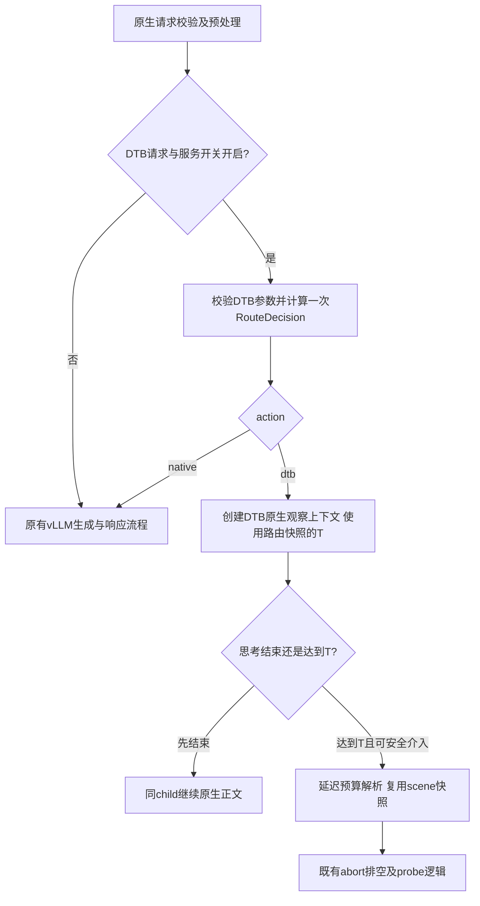

# System 场景规则与显式原生路由设计

## 1. 设计目的

日期：2026-09-11；设计起点：工作区HEAD `0019df8`。本文细化 [Agent预算初稿](dtb_agent_scene_budget_plan.md)，本轮只写设计，不修改生产源码、patch或部署配置。

两项新增能力：

1. 场景规则可匹配system身份信息，避免标题被其待处理代码/需求主题误分类。
2. 场景路由可明确选择原生生成：既支持命中场景后选择native，也支持拒识后选择native。

性能目标不是宣称路由零成本，而是将额外工作限定为**每外部请求一次、有界身份检查**，不新增模型调用、tokenize/decode、长上下文扫描、逐chunk处理、请求队列或同步日志。native请求在路由后直接回到原生serving流程。

范围：独立Agent配置优先落地；原问答配置默认行为保持兼容；最低介入算法、probe、finalization、completion额度和parser不在本次重构范围。正式性能仍以任务聚合LLM E2E及独立质量门验收。

## 2. 当前实现与复用边界

当前 [`request_controller.py`](../../dtb/request_controller.py) 在handle_request内构造配置、提取最新user文本、调用intervention_threshold，再创建上下文和队列；流式完整预算延后到达到介入值时解析。默认 [`scene_router.py`](../../dtb/budgeting/scene_router.py) 根据完整分类文本遍历关键词/结构规则。

当前 [`dtb_serving.patch`](../../patches/vllm/v0.23.0/dtb_serving.patch) 已支持功能关闭时落回原生分支，但场景拒识仍进入RUNTIME/history预算。新增能力应复用这个原生分支，**不是给观察器设置一个巨大阈值**。

既有`DtbBudgetDecision`要求存在正值ThinkingBudget，不能拿它表示native，也不能伪造budget=0。新增轻量路由结果置于预算决策之前，预算对象仅为选择DTB且需要预算的请求创建。

## 3. 设计逻辑

### 3.1 两阶段决策与原生落点



路由调用放在serving原生校验/预处理完成后、**现有DTB专用分支构造completion额度/trace元数据/额外parser实例之前**。原生自身已经完成的预处理不算新增DTB工作，不重新执行。

`action=native`时不调用`handle_request()`；不进入`_managed_generator()`，不创建`DtbRequestContext`、`DtbRequestState`、asyncio.Queue、producer task、观察器、history recorder或请求级phase recorder。不重新实现一份engine.generate参数拼装，直接执行原来功能关闭时使用的原生代码。

保留请求的`enable_think_budget`值，不为旁路改成false，避免现有`enable_deer and not enable_think_budget`分支误启DEER。不要用捕获任意异常后回原生的方式隐藏配置/程序错误；native只能来自明确的正常路由结果。

### 3.2 配置模式与低成本信息提取

新增服务级 `ROUTING.mode`，取值：

- `legacy_text`：默认，继续使用现有最新user/serving fallback与评分规则。旧配置省略ROUTING时行为不变，不额外提取system。
- `system_prefix`：Agent专用，匹配声明的system身份前缀与可选首条user前缀；不运行通用代码块/SQL等结构评分，不拼接历史文本。

新模式是规则匹配方式，不是模型专属算法分支。配置只在启动时选择一种模式，不同时跑两套分类器。

v1限定支持的消息形状：

1. 请求已通过原生协议校验；使用原始类型化`request.messages`的角色和文本字段，不用chat template解码结果猜身份。
2. 唯一system位于首条；后续没有额外system或developer。v1保守拒识多指令形状，未来如需支持应显式扩展规则，不拼接后猜测优先级。
3. 最多检查4096条消息的**角色元数据**。`len(messages)`超限直接拒识；在上限内一次循环验证指令形状、定位首条user，不读取assistant/tool正文。不复制消息列表。这是O(消息数)的有界检查，不是O(上下文字符数)全文扫描。
4. system内容须为字符串，只读取所需身份头，最多512字符；标题规则需要的首条user只读前256字符。多模态/list内容v1拒识，不序列化/flatten完整内容。
5. 比较是大小写敏感的精确`startswith`；v1不做全串strip/casefold、模糊相似、正则或中文分词。模板空白/BOM变化先拒识，测试后再显式支持规范化。
6. 同一请求最多取一次system短视图；首条user内容仅当候选规则需要时读取。tools_empty只检查是否声明工具，不扫描schema或参数。

角色检查是为了避免存在后置developer/system时仍用旧身份头误判。它不能证明任意指令的语义一致性；未知模板、前缀后藏有矛盾指令不做自然语言推理检测。身份路由是性能策略而非安全授权边界，不能授予工具权限。

Agent配置的三个身份前缀相互不重叠。启动时拒绝相同或互为前缀的规则，包括试图仅靠user guard区分相同system前缀的规则；运行时每个场景最多一次startswith，命中唯一system候选后检查guard并返回。guard失败即拒识，不再用宽泛候选兜底。这样无需每请求构建scores/ranked/sort，也没有同分优先级争议。

### 3.3 预算与动作分离

路由结果至少包含`scene`、`scene_matched`、`action`、`reason`及必要的预算/匹配快照。`action`仅为`dtb`或`native`；拒识不是第三种执行动作。

- scene命中：读取该节点`action`，缺省为dtb以兼容旧配置。
- scene拒识：读取`ROUTING.on_unmatched`。`native`表示原生退出；`budget`表示现有默认/history预算回退，转换为action=dtb。
- Agent文件设置on_unmatched=native；旧文件默认budget。
- 场景设置action=native时不要求预算字段；配置中同时填写预算则启动报错，避免“看似在调参、实际永不介入”。native不是在状态机内跳过probe。
- system_prefix模式的dtb场景须显式填写T、stride、num_thinking、min、prob_th、max_think_tokens，并校验T≤max_think_tokens。scene阈值与硬上限无歧义。

路由的DTB快照直接供intervention_threshold及延迟resolve使用；不在resolve里再调用classify_scene。非流式同样可按route选择原生，但dtb动作仍保持既有非流式状态机，不宣称拥有流式最低介入收益。

system_prefix首版要求scene预算开启、history/difficulty关闭、scene_override为空，违者启动失败；符合Agent候选现状，也避免在短路径为了历史/难度输入读取完整user。该模式下`PromptTextViews.initial_text`继续引用原生prompt供必要响应元数据使用；分类无需完整question_text，history关闭时不得为了填遥测或question字段强行复制需求正文。legacy_text仍保留原提取语义。

### 3.4 显式fixed与兼容规则

| 情况 | 处理 |
| --- | --- |
| 请求/服务功能关闭 | 完全跳过本次路由，维持原生/既有DEER选择语义 |
| DTB参数类型/范围非法 | 保持报错，不因可能native而吞掉非法参数 |
| 有效fixed_budget_tokens>0 | 视为显式固定预算实验，action=dtb，不被自动native规则拦截；system_prefix不做身份扫描 |
| 只有fixed_check_length等正值，fixed_budget_tokens=0 | 自动路由仍决定动作；仅action=dtb时应用逐字段覆盖，不能用单字段覆盖把native场景强制改成dtb |
| legacy_text旧配置，没有action/ROUTING | 预算、拒识、阈值和场景评分与现状一致；保持fixed阈值的既有短路，不能增加一次重复全文分类 |
| legacy_text显式配置native动作 | 必须先得到唯一scene/reject再分流，不能用T预测是否native；复用该次分类结果 |

自动验收两侧代理/服务fixed_*必须为0；以fixed_budget_tokens>0主动绕过场景是显式实验权限，不作为系统安全边界。不要更改已知fixed接口的预算数值语义。旧兼容快速路径与新显式动作路径由启动时编译的配置能力决定，不每请求扫描配置判断是否含native。

## 4. 核心数据结构与接口

### 4.1 最小新增结构

| 结构 | 关键字段/职责 |
| --- | --- |
| DtbRoutingConfig | mode、on_unmatched；缺省legacy_text/budget |
| CompiledSceneRule | scene、action、system_prefix、可选first_user_prefix/tools_empty、只读scene预算引用；启动校验后生成 |
| DtbRouteDecision | scene、matched、action、reason、可选InterventionThreshold/scene快照；短字段，不复制prompt |
| PreparedDtbRequest | 合并后的有效algorithm config与route；仅请求内部使用，避免handle_request再合并/再分类 |

配置对象和规则元组启动创建一次；请求只创建小的结果对象，拒识可共享不可变常量。不要把整个输入、完整配置副本或所有规则得分放进结果。现有DtbBudgetDecision只用于真正预算解析，不新增“假native budget”。

职责分配：

- `config/schema.py`、`loader.py`：新增字段和规则校验，编译只读规则；未知字段fail-fast。
- `integration/vllm/request_adapter.py`：有界消息身份视图，屏蔽dict/类型化message访问差异，不调用tokenizer。
- `budgeting/scene_router.py`：两种匹配模式及action解析，保留legacy算法；可拆内部小函数，不新增第二套预算路由平台。
- `request_controller.py`：新增同步`prepare_request_route(request, conversation)`，校验配置覆盖并返回PreparedDtbRequest或既有配置错误；handle_request只消费prepared结果。对直接调用handle_request的旧内部测试保留“无prepared则内部prepare一次”的兼容入口，并用调用计数测试防止双算。
- 版本化serving patch：调用prepare，native fallthrough；dtb分支才建立原有route identity、额度和parser元数据并调用handle_request。Prepared对象作为内部显式可选参数传递，不新增公开HTTP字段。
- `budget_resolver.py`：接收路由快照；保留延迟resolve和固定字段/硬额度优先级，不改probe算法。

这一接口仍运行在已完成原生请求校验的边界；不让prepare创建engine请求，不创建新的异步任务。

### 4.2 拟议YAML接口（实现后才有效）

以下是接口草案片段，**当前loader不能加载ROUTING/match/action，不是现成部署文件**。完整Agent制品保留预算文档中的RUNTIME、协议、观测等区块。

```yaml
ROUTING:
  mode: system_prefix
  on_unmatched: native

SCENES:
  agent_title:
    action: dtb
    match:
      system_prefix: "You are a title generator. You output ONLY a thread title. Nothing else."
      first_user_prefix: "Generate a title for this conversation:"
      tools_empty: true
    check_length: 500
    think_stride: 500
    num_thinking: 5
    min_think_tokens: 1
    prob_th: 0.90
    max_think_tokens: 20000

  agent_business:
    action: dtb
    match:
      system_prefix: "You are opencode, an interactive CLI tool that helps users with software engineering tasks."
    check_length: 850
    think_stride: 500
    num_thinking: 5
    min_think_tokens: 1
    prob_th: 0.90
    max_think_tokens: 20000

  agent_context_summary:
    action: native
    match:
      system_prefix: "You are an anchored context summarization assistant for coding sessions."

  general:
    description: "拒识审计标签；执行动作由on_unmatched决定"

SCENE_PRIORITY: [agent_title, agent_business, agent_context_summary, general]
```

system_prefix中general只作拒识标签，不参与前缀匹配；SCENE_PRIORITY保留配置兼容/展示顺序，不决定含糊匹配的胜者。legacy_text可以给现有场景加action=native，仍用原评分/拒识规则；不可在同一个节点混用match与indicators。

Agent文件仍采用已设计的停服、备份、复制候选到规范`budget_config.yaml`、记录hash、重启方式；不新增每请求文件读取、环境变量动态切换或热加载。

## 5. 可观测性与成本约束

### 5.1 仅在phase模式记录路由事件

使用现有OBSERVABILITY.mode，不再增加记录开关：

- off：不创建route日志字典、计时器或writer任务，不输出成功路由事件。
- phase：新增每请求一条`DTB_ROUTE`（独立schema=1），含parent_request_id、mode、scene、matched、action、reason、路由wall_ms、可选T、rule_id/匹配字段名；无system正文、无token IDs。复用现有异步writer，不新建线程/队列，不同步落盘。
- native动作只有route记录，不伪造DTB_PHASE或DTB_REQUEST_SUMMARY；该事件表示路由意图，不证明生成成功，完成/异常由原生响应及客户端记录裁决。
- dtb动作仍按原schema输出phase/summary，引用route信息；初始分类时间单列，不能重复计入延迟decision.total与route wall后相加。
- stream_audit不自动等价于phase，不为native新增逐chunk观察；需原始流取证时另用已有隔离取证设施。

提取/分析工具须区分“route-native无DTB phase”为合法与“route-dtb缺应有账本”为缺失，并继续按客户端白名单关联。事件写入丢失时标记coverage不完整，不把缺日志推断为native或off。不改变所有off正式性能请求仍无成功事件的契约。

### 5.2 避免新增明显耗时的实现清单

| 项目 | 约束 |
| --- | --- |
| 文件及规则 | 启动一次读取/校验；请求不读磁盘、不排序、不编译正则 |
| 请求文本 | system最多512字符、首user guard最多256；不join/序列化/解码完整prompt，不读取tool正文 |
| 分类 | 单次、三条身份规则；结果复用到阈值与完整预算；不遍历问答规则 |
| 缓存 | v1不增加跨请求LRU或hash整个system的缓存；短前缀比较足够简单，无锁/淘汰/身份污染问题 |
| native输出 | 不新增生成包装器、逐chunk计数、queue或producer task |
| DTB输出 | 不修改现有观察/排空循环，不在每chunk重新分类 |
| 观测 | off零成功日志；phase每请求一条短事件，不记录敏感正文 |

不能承诺Python检查绝对为零。开发验收建议：在服务CPU上预热后进行纯路由微基准，已知消息长度分布下新增route耗时P95目标<0.2ms、P99<1ms；4096消息压力组单列。这是工程预算，不是实测结果，也不是用统计排除慢样本。测量失败应profiling，不直接放宽阈值。当前历史最大消息条数只有119/121。

端到端回归关注稳定新增开销；不用输出长度不同的V/D E2E直接估计路由CPU。最终正式off模型实验才裁决净收益。

## 6. 证据、验证计划与一致性审计

### 6.1 本次已执行的离线身份核对

用已关联原始full-log检查精确system头、第一user guard、工具声明及消息形状，不调用LLM：

| 数据 | 标题 | 普通业务 | 其他身份 | 最大消息数 |
| --- | ---: | ---: | ---: | ---: |
| Vanilla-06，392请求 | 9 | 382 | 1 | 119 |
| DTB-06-closed，364请求 | 9 | 355 | 0 | 121 |

两侧18条标题均匹配标题规则，无已知业务误入标题。Vanilla额外一条为case35的`2f7fb09597bd4cd1`，system明确是上下文摘要助手；不是无SSE的`7774ec46a9f245c9`。因此新增agent_context_summary显式native规则，用作“命中但旁路”的真实样例。样本只有1条，native是缺乏压缩证据时的保守选择，不宣称摘要不值得优化。

该核对验证预算文档候选身份规则的可用输入证据，不是新loader/router实现测试。以上数据参与规则设计，不是holdout泛化验证；未来模板改变须拒识并保留记录。

### 6.2 无模型测试

1. loader：旧YAML完全兼容；新mode/action类型、缺字段、超长/空/重叠prefix、native带预算、混用match/indicators、非法system模式history/difficulty配置均报错。
2. 信息源：dict和原生类型化message等价；首user不误取最后user；tool/assistant/源码引用中的身份串无效；额外developer/system、多模态、缺system、超4096、guard失败均拒识。system截取外的文本长度变化不增加读取范围。
3. 路由：显式native命中、未知native、旧budget拒识、partial fixed覆盖、fixed_budget实验优先、开关关闭均断言准确action/source；分类调用计数最多一次。
4. native集成：spy断言handle_request/预算resolver/DTB上下文/队列/观察器不被调用，原生generate恰一次；priority/LoRA/trace/DP/parser参数、流式terminal、非流式响应、取消及错误路径与功能关闭对照一致；两开关同时true时不得转入DEER。
5. dtb集成：T500/T850、scene快照复用、无二次初始思考、短请求无完整预算解析，安全能力拒绝仍走现有同child路径；旧最低介入测试全部保持。
6. telemetry：off无事件构造/成功日志；phase路由事件parent闭合，native无虚假summary，提取器不会报伪缺失；写入失败显式coverage不足。
7. 性能：微基准只调用身份提取/路由，不把JSON读取时间放进路由成本；固定消息数增长tool正文至大上下文，确认不随正文长度线性增长；改变消息数单列O(M)元数据成本。

### 6.3 服务器验证

复用既有G1输入和固定流fixture；不重新做一套全部旁路实验。新增最小验证只覆盖此次新边界：显式native摘要、未知native、标题dtb、业务dtb，以及短思考+长工具正文。原生对照匹配sampling、服务身份与cache，遇到输出长度差异单列，不伪称逐token等价。

单独phase小样本验证DTB_ROUTE/action/阈值，然后正式off执行预算文档的A0自动等价、标题T500定向和A1全量计划。启用自动模式不是保留proxy fixed注入后改配置名称；必须核对实际请求字段与部署YAML/close/patch hash。

### 6.4 一致性结论

- 新增的是规则信息源及路由动作，不是新停止接口；T前自然旁路仍是现有机制。
- 拒识native不等于错误吞掉，非法配置/请求按既有错误语义处理。
- native复用原生分支，DTB复用既有状态机；不要建立第二份native generate上下文透传实现。
- 问答默认保持旧评分和budget回退，Agent明确选择system_prefix/native，影响范围可审计。
- 独立配置减少规则/文本扫描，但无法据此许诺>5%净时延收益；必须与标题预算效果、业务轨迹成本分开验证。

## 7. 变更历史

| 日期 | 变更 | 原因 |
| --- | --- | --- |
| 2026-09-11 | 设计system有界前缀规则、显式scene/reject native动作、serving提前分流、一次路由快照、phase路由记录及成本门禁；核对756条真实输入 | 支持Agent专用自动预算且不引入明显短路径/逐chunk开销 |
