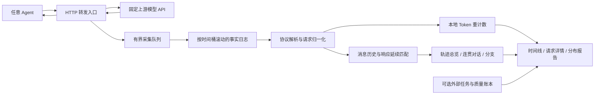

# 通用 Agent 透传观测代理：需求分析与开发设计

## 1. 设计目的与范围

为 LightCode 以外的 Agent 收集可复算、便于人工阅读的模型调用记录，回答“哪些场景主要是短思考，哪些存在值得介入的长尾”，为 DTB 超参候选及后续实验提供依据。代理通过替换 Agent 的模型 API base URL 接入，不依赖 Agent 的 session 导出、插件或内部实现。

设计起点：2026-09-16，仓库 HEAD `46b94d4ea17501c5e628cb8fba5f32d696087b69`，参考实际文件 [`proxy/agent_dtb_proxy.py`](../../proxy/agent_dtb_proxy.py)。用户输入的 `proxy\agent\_dtb\_proxy.py` 在当前仓库对应此文件。本文由需求与设计起步，首版实现已落在 `proxy/`；当前实现范围、验证和与目标设计的差异见 7.4，运行方式见 [使用说明](../../proxy/README-observation.md)。

用户已确认：**首版完整支持 OpenAI 兼容 Chat Completions 的流式与非流式统计；其他 HTTP API 透传并标记统计未支持。** “通用”首先指跨 Agent、跨模型配置和跨请求并发，不等于首版完成所有模型协议解析。

### 1.1 需求及验收产物

| 需求 | 设计结果 | 用户如何验收 |
| --- | --- | --- |
| 按时间保存对话 | 以请求到达时间按 UTC 日期/小时归档，生成按到达时间排序的请求时间线 | 混合多个 Agent 并发调用，按时间找到每次输入与输出，无需先识别 session |
| 统计 Token | 上游 usage 与本地文本重计数分别保存，附来源、版本、完整性 | 同一原始记录可离线复算；缺失值不冒充 0 |
| 人类可阅读 | 时间概览、逐请求详情、完整思考、正文、工具参数及输入上下文链接 | 长文本不挤占总览；能从异常/长尾指标定位到具体调用 |
| 从多轮 prompt 重建轨迹 | 展开单个请求携带的历史，按消息延续证据串联多个请求；公共历史折叠，分支分别呈现 | 无 session ID 也能阅读可恢复的完整消息链，区分实采轮次、历史补全与不确定连接 |
| 跨 Agent 透传 | 原始应用消息转发，标签仅用于观测 | 不要求 LightCode task/session 元数据，不注入 prompt |
| 分布支撑调参 | 分层分位数、直方图、长尾贡献、阈值扫描和样本入口 | 识别候选 `check_length`，并明确哪些超参还需服务端证据 |
| 持续采集可审计 | 每请求独立生命周期、增量落盘、完整性清单 | 崩溃、取消、日志丢失和未支持协议在报告中显式出现 |

### 1.2 首版边界

- 支持固定上游的 HTTP 反向代理；Chat Completions 包括多 choice、工具调用、错误响应和取消。未知路径照常转发并记录请求摘要，模型类未支持接口仍可保存原始 body。
- 默认纯观测：`append_body: {}` 时请求 body 原样透传，不自动设置 `stream_options.include_usage`，不重试生成。允许操作者显式配置固定 `append_body`，覆盖 Chat Completions POST 请求的顶层字段（包括 model、DTB 和采样参数）；记录原始请求与实际发送请求及覆盖规则，实验间修改配置并重启。
- 不实现 WebSocket/Realtime、CONNECT 隧道、协议转换、自动 session 猜测、工具执行、在线预算控制或自动修改 `budget_config.yaml`。不支持的连接升级应明确拒绝，不能称为透传成功。
- 能观察的思考是 API 暴露的 reasoning 文本或 usage 字段。隐藏 probe、服务端未输出的思考、队列/prefill/decode 时间不能从代理还原；使用 `null/not_observable`，需要另接服务端 telemetry。
- 一次 HTTP 调用不是完整 Agent 任务。代理不把 LLM 请求时延之和命名为 task wall；质量和任务边界由外部评测账本提供。
- 首版包含基于多轮 `messages` 的离线轨迹重建。轨迹是有证据的阅读视图，不承担在线请求归属；无外部身份时仍可恢复消息链，但不生成官方 session/task/父子 Agent 身份。

## 2. 现状、取舍与模块边界

### 2.1 源码确定的现状

以下结论来自当前源码，不是新性能实测：

| 位置 | 现有行为 | 通用观测的影响 |
| --- | --- | --- |
| `SessionManager.process_request()` / `Session.add_turn()` | 单个 active session；用 messages 数量及完成后的状态判断片段 | 交错请求不能代表逻辑对话；不能作为通用存储主键 |
| `proxy_request()` | 仅凭 body 含 `messages` 分类，合并 `APPEND_BODY`；部分流式请求加入 usage 选项 | 会改变被观测请求，也可能把其他 messages 协议当成 Chat Completions |
| `handle_stream_response()` | 按行读取后重新编码输出，仅累积 `choices[0]` 和 `reasoning` | 不保留原 body 字节；遗漏多 choice、`reasoning_content` 及复杂 SSE 情况 |
| `handle_normal_response()` | 同样只读第一个 choice 的 `reasoning` | 不足以统计不同模型 parser 暴露的 reasoning 字段 |
| `count_tokens()` / `compute_thinking_ratio()` | tokenizer 缺失返回 0；比例分母不含工具参数 | 未知值伪装成短思考，工具密集轮次的比例可能误导 |
| 日志与时钟 | 完成时 full-log 已独立写出；可读日志等待 session finalize；耗时用本地墙钟相减 | 应保留逐请求写出的优点，解除可读产物对 session 的依赖 |
| `FullLogShardWriter` | 16 MiB 目标滚动、UTF-8 JSONL、单进程锁、残缺尾行保留 | 可复用存储能力；其 session 路径及 manifest 不应被伪装为时间桶 |

原代理以固定实验参数和 LightCode 关联为目标，仍有独立用途。新增入口 `proxy/agent_observation_proxy.py`，不在原入口上叠加大量模式开关，不改变旧实验产物格式。

### 2.2 三个核心设计选择

**一：以请求时间归档，身份只作为标签。** 每次 HTTP 调用生成独立 `request_id`。时间桶只是文件分区；task/session/parent ID 若由调用方明确提供，可以保存和筛选，但不决定落盘，也不用相邻时间或 prompt 相似性猜测身份。

**二：转发与解释分离。** 默认网络路径只转发并复制观测数据到有界队列；只有显式启用 body 附加时，才在发往上游前执行有界的请求 JSON 解析/覆盖。SSE 解析、tokenizer 和 Markdown 渲染均由后台消费或离线执行。观测解析失败只降低统计可用性，不能破坏已正确返回的响应。原字节采集保留未知字段、工具片段和协议异常供复核。

**三：事实日志与派生视图分离。** 增量事实日志保存生命周期和 body；请求表、Token 表、可读报告都是可重建视图。不为时间排序阻塞响应，也不在完成时维护全局有序大文件。物理追加顺序可以交错，阅读顺序由请求到达时间决定。

在阅读层引入 **消息轨迹（MessageTrajectory）**：由 prompt 中有序历史消息、实际采集响应及其延续证据构成的消息链或分支图。即使某些历史调用没经过代理，后续 prompt 也可能已携带足以阅读的完整历史。存储层继续按时间保存独立请求；轨迹层利用历史内容恢复上下文，两层独立演进。



### 2.3 封装与复用

| 能力 | 归属与策略 |
| --- | --- |
| ASGI 请求、HTTP 连接池、取消 | 原生 ASGI + Uvicorn + httpx 薄封装；直接处理 raw path/header/send，保留底层流式响应及超时配置能力 |
| HTTP 消息转发 | 新 transport；参考原代理路由，但不直接导入带启动副作用、硬编码参数的旧模块 |
| JSONL 锁、字节滚动、残缺尾恢复 | 从 `full_log_writer.py` 提取通用 `RollingJsonlWriter`；旧 `FullLogShardWriter` 保留 session 布局包装及回归测试 |
| 协议解释 | 独立 Chat Completions adapter；将来 Responses/Messages 增加 adapter，不改 transport |
| tokenizer | 一次运行对应一个实际模型，代理持有一个固定本地 tokenizer；别名共用，实时与退出分析复用，不下载模型权重 |
| 消息轨迹重建 | 新离线 `trajectories` 模块消费 RequestRecord 与消息引用；匹配规则、节点出处和歧义随报告保存，不写回采集归属 |
| LightCode 关联 | 继续属于 `tools/dtb/correlate_lightcode_proxy.py`；新代理不依赖它，也不伪造其 session schema |
| 质量/性能裁决 | 遵守 [泛化实验流程第 6 节](think_budget_generalization_plan.md#6-阶段一实验与数据采集)，由独立实验报告完成 |

## 3. 时间归档、透传与生命周期

### 3.1 时间与标识

- `capture_id` 标识一次采集；`process_id` 区分重启。一个采集目录同一时刻只允许一个 writer 进程，启动获取排他锁。重启可显式续写，保留进程启动记录。
- `request_id` 使用完整 UUID；`arrival_seq` 为进程内递增到达序号；上游响应 ID、客户端 request ID 分开保存，不能相互覆盖。默认不注入追踪 header；需要服务端关联时另行显式配置并记录。
- `started_at_utc` 在 ASGI 收到请求时记录，按该时刻确定不可变 `bucket=YYYY-MM-DD/HH`。跨小时或跨日完成仍归原桶，不移动文件。
- 事实事件同时记录 UTC 墙钟和进程内单调时钟。时延只用单调时钟差；展示默认转为 `Asia/Shanghai` 并显示时区。UTC 桶消除夏令时歧义。
- 时间线按 `(started_at_utc, process_id, arrival_seq, request_id)` 稳定排序；单请求事件按 `event_seq`。墙钟回拨时标记异常，单进程实际先后由 `arrival_seq` 补充；不同主机无时钟同步时不声称精确全局先后。
- 时间筛选采用开始时间区间 `[from, to)`。可另选 overlap 筛选查看跨窗请求；不把二者混用。所有时间参数必须带时区。

目录示例为设计样例：

```text
<output>/<capture_id>/
  manifest.json
  processes/<process_id>.json
  archive/2026-09-16/06/part-00001.jsonl
  archive/2026-09-16/07/part-00001.jsonl
  derived/<analysis_id>/
    analysis_manifest.json
    requests.jsonl
    token_usage.csv
    integrity.json
    distribution.json
    threshold_scan.csv
    trajectories.jsonl
    trajectory_edges.jsonl
    SUMMARY.md
    timeline/2026-09-16/06.md
    requests/2026-09-16/06/063012.123456Z_<request_id>.md
    trajectories/<trajectory_id>.md
```

`archive` 是权威事实；`derived` 可删除重建。后台 worker 可持续刷新实时视图，正式分析使用不可变 `analysis_id` 和已确认的日志偏移快照。运行中的小时页标记“快照时间/尚有 N 个进行中请求”，不是已封闭的统计窗口。

实验采集放在 `docs/log/perf/<capture_id>/`，manifest 使用 `experiment_role=agent_distribution`，与已有 DTB phase run 区分。新事件流不满足 `extract_dtb_phase_metrics.py` 的输入契约，不直接交给该提取器；将来关联 phase 证据时使用显式请求 ID 映射。

### 3.2 HTTP 透传契约

保持方法、原始路径语义、query 的重复键及编码、响应状态和响应 body；请求 body 除显式配置的附加规则外保持原样。上游 base path 采用明确的前缀映射，不用字符串 `startswith` 猜测路径重叠。客户端 Host 由上游目标替换；逐跳 header 及 `Connection` 指定字段按 HTTP 规则处理，其余端到端 header 保留重复值，不折叠成普通 dict。[HTTP 依据：RFC 9110 §7.6.1](https://www.rfc-editor.org/rfc/rfc9110.html#section-7.6.1)。

body 采用未自动解压的原始字节流转发，保留与 body 一致的 `Content-Encoding`；解析支路单独解压。这里的字节等价指应用 body，不要求 HTTP chunk framing、网络包边界或 header 大小写一致。HEAD、无 body 状态码、压缩响应和重复 header 均单独验证。

请求附加模式是上述请求 body 等价规则的显式例外：非空 `append_body` 只处理配置路径上的 Chat Completions POST。先收齐 JSON，以 `{**incoming, **append_body}` 顶层覆盖，嵌套对象整体替换；gzip/deflate 输入先解压，上游发送未压缩 UTF-8 JSON，重设 Content-Type/Content-Length，移除原编码及失效的 body 摘要 header。原始、解压后、修改后的大小受 `upstream.request_body_max_bytes` 限制（默认 32 MiB）；坏 JSON/非对象返回 400，不支持的类型/编码返回 415，超限返回 413，不发往上游。未启用附加及其他协议不受此缓冲限制。

归档新增 `request_body_transform`（顶层覆盖规则、配置参数、发送 header）及 `forwarded_request_body_fragment`。`request_body_fragment` 始终保存客户端原始字节。派生明细的 `request` 为有效发送版本，`original_request` 为修改前内容，`request_transform` 为修改证据；请求页面展示两者，轨迹和参数分析使用有效发送版本，避免将原请求误认为真实模型输入。

首版使用进程生命周期共享连接池；不启用 cookie 状态复用，避免一个 Agent 的上游 `Set-Cookie` 隐式进入另一请求。认证默认逐请求透传，可配置固定上游凭据覆盖并在 manifest 记录模式，不记录凭据内容。重定向原样返回，不自动跟随；代理不自动重试，客户端重试形成新的请求记录。

所有响应走同一流式转发骨架，不能因接口“统计未支持”就整包缓冲未知 SSE。已向客户端发送响应后遇到上游断流时终止当前流，记录异常，不补 `[DONE]`、不补工具参数、不伪造成功结束。发送响应头之前的连接失败返回明确的代理 502/504，并与上游 HTTP 错误区分。

### 3.3 采集、背压与故障

事实事件包括 `request_started`、`request_body_fragment`、`upstream_headers`、`response_body_fragment`、`request_terminal`，另外允许 `capture_gap`。body 片段附方向、字节偏移和 base64 数据；后台可合并至 64 KiB 或每 250 ms 刷新一次，终止时强制刷新。合并仅作用于日志，不延迟响应；默认不保存每个网络 chunk 的独立事件，避免把 chunk 数当成 token 数。

合并记录内保留轻量的 `observation_marks`（原输入块结束偏移、接收单调时刻），解析器用语义事件结束偏移查找对应接收时刻，不把后台处理时间当成首输出时间。base64 约增加三分之一正文存储量，是保留任意字节的取舍；容量测试计入该成本，归档压缩可离线进行且须更新文件索引，不能原地破坏已有报告的 RawRef。

有界队列按字节限额（拟定 64 MiB），单 writer 批量追加、每事件一行，按序列化 UTF-8 字节数滚动（拟定 16 MiB）。大请求拆为多个事实事件，而非拆断 JSON 行；完整请求由 `request_id + event_seq + offset` 重建。仍为超大元数据事件保留“独占超限 part”规则与告警。

默认 `on_overflow=drop_capture`：优先保持转发；丢失的观测字节计入 gap、该请求标记 `capture_incomplete`。一旦正文出现 gap，停止该请求的语义统计，后续仅尽力保留元数据，不能把剩余片段拼成完整回答。预留独立小型控制队列给开始/终止/gap 事件；其也失败时记录进程级丢失计数和 stderr 告警，整段采集不满足完整性门。磁盘满时不承诺告警本身可落盘；缺少正常关闭标记的进程按不完整处理。

不在首版增加阻塞写盘模式：日志系统满时阻塞模型流会改变被测分布和耗时。无损性与低干预之间通过**容量监控、显式缺口、失败采集重跑**解决，不宣称二者在任何负载下都保证。

后台解析/计数设置有限 worker 数及单请求内存阈值，大 body 和累积文本溢写到临时文件；排队任务只存 RawRef。实时报告落后时允许稍后从事实日志补算，不能让派生视图队列无限增长，或反向阻塞网络转发。首版不做历史 messages 去重压缩，避免共享内容索引引入新的恢复依赖。

| 情形 | 请求/采集处理 |
| --- | --- |
| 正常 EOF 且协议终止有效 | `transport_status=completed`；usage 缺失单独标记，不等于传输失败 |
| 客户端取消 | 关闭上游流、释放连接；在有界清理期保存终止状态；传播取消 |
| 上游超时/断流 | 保留已观测片段，`upstream_error`；reasoning 长度只作为部分观测值 |
| EOF 缺少所选协议要求的终止证据 | `parse_status=incomplete`；不以连接正常关闭冒充生成完整 |
| 解析异常/未支持协议 | 响应照传；事实照存；`parse_error/unsupported` |
| 进程崩溃 | 启动记录无终止事件的请求记 `interrupted_unknown`，不猜测模型是否完成 |
| 优雅关闭 | 停止接收，等待活跃流（CLI 最多 30 秒，超时取消），停止并等待实时分析，排空日志并关闭归档，再执行一次离线分析 |

append 成功不等于断电持久化。拟定每秒批量 flush/fsync，manifest 保存策略；进程/机器崩溃可能丢失未持久化尾部。尾行不完整则保留原文件、新开 part，审计报告坏行和缺失终止事件。启动/终止事件的 `finally` 路径应有防重复标记，避免取消与正常完成重复记账。

### 3.4 时间指标的边界

记录 `request_body_end`、`upstream_dispatch`、`upstream_headers`、`first_body_byte`、`first_semantic_delta`、`upstream_eof`、`downstream_send_end`。`proxy_observed_e2e_ms` 从接收到最后一次 ASGI send 完成，不代表客户端实际接收完成；不能仅在 generator yield 最后一个块时结束计时。

`ttfb_ms` 是首 body 字节；`first_semantic_delta_ms` 是首个非空 reasoning/content/tool delta。心跳和 role-only delta 不算首个语义输出，后者仍不等于精确模型 TTFT。统计生成后处理耗时、日志队列深度/峰值、丢失字节、转发等待，帮助测量代理自身开销。

## 4. 协议解析、Token 口径与核心结构

### 4.1 Chat Completions 归一化

按明确配置的端点匹配选择 adapter（默认 `/v1/chat/completions`）；响应类型决定 JSON/SSE 解析。不能仅凭请求含 `messages` 判断协议。

SSE 支路使用增量 UTF-8 解码和完整事件解析，支持 CRLF/LF/CR、空行分界、注释、多行 `data:` 以及跨任意字节边界；未知字段与解析失败片段仍保留原始证据。[解析依据：WHATWG Server-sent events](https://html.spec.whatwg.org/multipage/server-sent-events.html#parsing-an-event-stream)。

- 以 `choice.index` 分组，保留每个 choice 的 finish reason。usage 常是请求级，不给每个 choice 重复分摊。
- usage 多次出现时按协议 profile 的快照/增量语义处理；Chat Completions 默认取终止阶段有效 usage 快照，不把累计快照相加。保存原事件及冲突告警，非法负数/非数值字段不进入汇总。
- reasoning profile 显式选择 `reasoning_content` 或 `reasoning`，另一字段仅在首选缺失时回退。二者同时非空且冲突时标记歧义，不相加。不能全局声称 API reasoning usage 恒为 0。
- 工具调用按 `(choice.index, tool_call.index)` 累积 ID、name、arguments；参数原始字符串保留，终止后再尝试 JSON 解析。缺 index、同一 key 冲突或 arguments 不完整均报告。`legacy function_call` 如出现单独归一化并标记来源。
- 不把 content 中任意 `<think>` 子串认作思考。特定模型需要从正文分离 marker 时，必须启用具名 profile，验证起止规则，记录 adapter 版本，且不修改客户端响应。
- input messages 支持字符串、文本块、工具结果及多模态引用。图片/音频/加密块只保留类型及原始引用，不对其做文本 Token 估算，不下载外链资源。
- 只统计本次 response 新生成的输出；request messages 中历史 assistant reasoning 可供阅读，不能再次加到“本次生成 Token”。

### 4.2 Token 是带来源的观测值

| 指标 | 来源与含义 |
| --- | --- |
| `prompt_tokens_api` / `completion_tokens_api` / `total_tokens_api` | 完整保留上游 usage 对应字段；未知为 null；不因缺少一项而臆造其他项 |
| `cached_prompt_tokens_api` / `reasoning_tokens_api` | 保存上游明示的细分项及原字段路径；通常属于主项的子集，不能再次相加 |
| `reasoning_tokens_local` | 对本次暴露的完整 reasoning 文本，以匹配模型的 tokenizer 重编码 |
| `content_tokens_local` | 对本次正文文本重编码 |
| `tool_name_tokens_local` / `tool_arguments_tokens_local` | 工具名与 arguments 原始字符串分别计数，不包含代理美化 JSON 引入的空白 |
| `output_text_tokens_local` | 上述本地分项之和；定义为文本组件之和，不冒充模型实际输出 Token |
| `prompt_tokens_local` | 首版默认 null；仅确证上游 chat template、工具模板及选项完全一致时才允许单独估计 |
| `hidden_probe_tokens` / `total_model_generated_tokens` | 代理单独运行时 null；只有外接服务端账本完成归属后才能提供 |

每个值携带 `source`、`status`、`scope`；status 至少区分 `known`、`missing`、`unsupported`、`partial`、`ambiguous`、`tokenizer_unavailable`。零只在对应范围被完整观测且确实为空，或上游明确报告 0 时成立。上游报告 0 与暴露 reasoning 非空可以并存，作为 discrepant usage 展示，不偷偷改写。

一次代理运行对应一个实际模型，配置单个 `tokenizer.path`。`ObservationProxy` 启动时加载并长期持有同一个 TokenCounter/tokenizer；不同请求与响应 model 别名共用，不按请求实例化。实时分析线程退出后，最终离线分析继续复用该对象，二者不并发使用 tokenizer。加载失败也缓存失败状态，后续不反复加载；缺失不联网兜底、不按字符数猜 Token。模型切换需重启新运行，由操作者保证配置制品匹配实际模型；模型名称仍按响应优先、请求回退记录，并不由名称证明模型权重身份。记录 tokenizer 文件 hash、实现版本和 `add_special_tokens=false`，只允许本地文件且 `trust_remote_code=false`。

独立离线 CLI 在自身进程中加载一次；兼容旧采集 manifest 的 `tokenizers` 映射，但新运行配置使用单数 `tokenizer`。正常 lifespan shutdown（包括 Ctrl+C）只生成一次最终报告，重复 close 不重复执行。日志排空后才分析，发布 `derived/<analysis_id>/SUMMARY.md` 并打印路径，另写 `shutdown_analysis.json` 状态；分析失败保留归档供手工重算。最终分析时间不受前述活跃请求等待 30 秒限制。强杀或连续中断不能保证收尾完成。

重计数在完整组件拼接后做，不能把每个 delta 的编码长度相加；多个工具参数/choice 按各自组件分界求和并保留明细。重编码即使使用同一 tokenizer 也不保证恢复原始生成 token ID 序列；结构 token、特殊标记、分段边界及隐藏推理会产生差异。差值可以报告，但不能简单解释为 hidden reasoning。

主要比例定义：

```text
R = reasoning_tokens_local
C = content_tokens_local
T = tool_name_tokens_local + tool_arguments_tokens_local
visible_reasoning_share = R / (R + C + T)
reasoning_content_share_legacy = R / (R + C)  # 仅与旧报告对照
```

分母为 0 或任意必要分项未知时比例为 null。单请求比例均值与 `sum(R)/sum(R+C+T)` 分别命名，绝不混称平均思考占比。二者仅在同一有效样本集上计算。

### 4.3 核心数据结构

| 结构 | 关键字段 | 约束 |
| --- | --- | --- |
| `CaptureManifest` | schema、capture_id、repo SHA/dirty、配置 hash、开始时间、上游别名、agent/scenario/variant 标签、model/tokenizer 身份、日志/采样/持久化策略 | 使用独立 schema `agent_observation.capture.v1`，不冒充旧 full-log schema 2；记录实际版本的未知项 |
| `RequestContext` | request_id、process_id、arrival_seq、started_at_utc、bucket、单调时间基点、显式 correlation 标签 | 创建后归属不变；并发请求没有共享 Session 状态 |
| `CaptureEvent` | schema、request_id、event_seq、event_time、kind、direction、offset、payload、gap 信息 | 一行一个事实事件；事件去重键为 request_id + event_seq；冲突不能静默覆盖 |
| `RequestRecord` | context、method/path、model、protocol、status、timing、choices、usage 原值、TokenValue、raw_refs、warnings | 派生结构；大正文以原始引用/组件引用定位，不再次复制全部上下文 |
| `TokenValue` | value: int/null、source、status、scope、tokenizer_ref | API、本地重计数及不可观测状态可共存 |
| `AnalysisManifest` | analysis_id、输入 shard/offset/hash、adapter/tokenizer 版本、筛选条件、排除计数、annotation hash | 同一快照和规则产生同一指标；增量快照与正式完整报告明确区分 |
| `MessageOccurrence` | occurrence_id、request_id、message_index/choice_index、role、payload_ref、exact_hash、match_hash、origin | 消息的具体出现位置；origin 为 captured_response / prompt_history，不能只按内容 hash 合并不同位置的重复动作 |
| `TrajectoryEdge` | source/target occurrence 或 request、relation、evidence_refs、match_profile、omitted_fields、status、candidate_ids | 区分历史顺序、严格延续、profile 延续及候选重叠；不把内容延续等同于官方身份 |
| `MessageTrajectory` | trajectory_id、root_ref、nodes、edges、branches、unique_request_ids、coverage、open_boundaries | 允许共享前缀和缺口；ID 在同一 analysis 内稳定，不充当 session_id |

`RequestRecord` 的 `transport_status`、`capture_status`、`parse_status`、`usage_status`、`tokenizer_status` 分开表示：HTTP 200 不意味着工具 JSON 完整；日志缺失也不意味着模型调用失败。

## 5. 人类阅读与分布分析

### 5.1 可读报告

`SUMMARY.md` 首屏显示采集身份、时间范围、请求数、统计覆盖率、排除原因、按 agent/model/scenario 的概览、小时页及轨迹入口。小时页按请求开始时间排序，即使晚开始的请求先完成也不改变顺序。后台完成一个请求即可生成其详情，不等下个 session 或代理关闭；轨迹视图随新历史到达增量更新。

每条总览行包含：带时区时间、短 request ID、agent/scenario、model、耗时、API 输入/输出 Token、本地 R/C/T、结束状态、工具名、详情链接。未知显示 `—（原因）`，不能显示为 0。

详情包括：

1. 身份、起止时间、Token 来源、完整性和原始日志定位。
2. 当前请求输入摘要：最后 user/tool 消息；完整 messages 按 role/顺序可展开查看。没有确证上下文链接时不标“本轮新增消息”。
3. 每个 choice 的完整 reasoning、content、工具名及原始/格式化 arguments，保留输出顺序索引。没有 reasoning 暴露时显示原因。
4. Tool result 是本次请求携带的输入；tool call 是本次响应输出，严格分开。不能把历史工具返回误写成代理执行的结果。

概览预览可以截断并标出原长度，详情正文及 raw 不默认截断。超大详情按组件拆页并链接，避免单页不可打开。Markdown 对不可信内容做转义或动态长度代码围栏，隐藏 HTML 按文本展示，外部图片只显示引用。所有格式化只改变派生展示，不改变原始证据。

### 5.2 分布与样本集合

主分析集合是 `capture 完整 + adapter 支持 + 正常生成完成 + reasoning 可观察 + tokenizer 匹配` 的调用；HTTP 错误、取消、输出达到长度上限、缺少终止、日志缺口分别列出。长度受限/中断请求的已观测 R 是下界，不混入完整长度分位数；另报截断比例及下界分布，避免“长请求失败所以看起来更短”的幸存者偏差。

按 `agent / scenario / upstream-model-version / tokenizer / variant / protocol-profile` 分层。场景来自用户在启动配置 `capture.labels` 中声明的静态运行标签，不解析请求特征，也不通过 header 动态覆盖。需要区分多个 agent 时分别启动不同端口的代理并设置 labels；共用入口且来源不明时填写 `unknown`。提示词聚类只可作为离线待复核提示，不能据此声称命中 DTB scene；不从 User-Agent 猜成确定身份。

每层报告 n、known/unknown/partial 数、零思考数、P50/P75/P90/P95/P99/max、均值、固定桶直方图、top 1%/5% 请求的 reasoning Token 贡献和代理观察耗时贡献。分位数采用 nearest-rank（`ceil(p*n)`），n=0 输出 null；top k 使用 `ceil(q*n)`，按 R 降序、request_id 打破平局，明确小样本大小。

默认 `n=1` 请求进入用于 DTB 调参的主集合；多 choice 另外输出 choice 级长度分布和请求级 API usage，不能把并行候选相加后当作一次 reasoning 长度。重复完整 prompt 不自动去重：真实重复调用和重试同样消耗资源；只有显式 retry/task ID 支持时才生成另一个分析视图。

输入 Token 求和表示 API 输入工作量，其中含多轮重复上下文，不表示唯一对话内容。请求加权结果与场景等权结果分开；有外部 task 身份后才增加 task 等权视图，防止长任务的多轮请求支配全部结论。跨模型 Token 长度分别展示，不把相同 Token 阈值解释为相同计算量。

### 5.3 从分布到超参候选

对同一有效集合中的 reasoning 长度 `R_i` 和候选阈值 H 输出：

```text
short_fraction(H) = count(R_i <= H) / N
tail_fraction(H)  = count(R_i > H) / N
tail_token_share(H) = sum(R_i * 1[R_i > H]) / sum(R_i)
excess_tokens(H) = sum(max(R_i - H, 0))
```

零分母为 null。报告边界 `R=H` 的数量；本地重计数存在边界误差，不能据此断言服务端实际介入次数。`excess_tokens` 只是超阈值文本量，不是可安全节省量。

| 参数 | 本代理能提供的依据 | 必须补充的验证 |
| --- | --- | --- |
| `fixed_check_length` / scene `check_length` | 短请求覆盖、长尾规模、阈值附近样本 | 服务端真实 token 边界与介入次数、短路径成本 |
| `fixed_budget_tokens` / scene `max_think_tokens` | 长度分位数、极端长尾样本 | 截断后质量和完整任务成功率 |
| `fixed_think_stride` / `fixed_num_thinking` | 长尾超过 H 的跨度，用于缩小试验网格 | hidden probe 成本、迭代收益、质量与 task wall |
| `fixed_min_think_tokens` / `fixed_prob_th` | 只能提供待复核样本 | 置信度分布、正确性校准、服务端 phase 账本；不能从长度直接拟合 |

**源码确定**：当前 `DtbBudgetResolver.intervention_threshold()` 优先采用 `fixed_check_length`，否则按配置选择 runtime/scene 的 `check_length`；不能把 `fixed_min_think_tokens` 当作同一个最低介入阈值。

流程为：先采集配置已确认的 Vanilla 分布 → 输出候选阈值扫描与长尾样本 → 单独的 phase 账本实验闭合隐藏工作量 → 相同身份、参数与采集设置下做正式 off 配对实验 → 质量门通过后比较完整 Agent task wall → 人工审核再写入 SCENES。代理自身无法证明请求没带 DTB 参数就一定是 Vanilla，服务端配置须记录。

不得由 `excess_tokens × TPOT` 直接宣称实测收益。若提供探索估算，须显式标“假设”，输入可压缩比例、TPOT 和控制器成本范围，并用服务器实验证伪。代理观测无法替代 [最低介入值设计](dtb_minimum_intervention_threshold.md) 的状态机和性能验证。

### 5.4 基于多轮 prompt 的消息轨迹重建

目标是让用户连贯阅读“问题 → 思考 → 工具调用 → 工具返回 → 下一轮思考 → 回答”，减少逐个打开大 prompt 并手动寻找新增部分的成本。**单个多轮 prompt 已经是一份有序的历史快照**，因此不必先找到 session 或所有原始请求才能展示消息轨迹。跨请求匹配进一步为这些历史消息补上实采响应、时间、Token 和原始日志链接。

#### 5.4.1 先展开快照，再连接请求

1. 对每个请求保留完整 messages 顺序，将 system/developer、user、assistant、tool 分别显示。历史 assistant/tool 节点即使没有匹配到原始请求，也立即可读，出处标“来自 Rn 的历史消息”。历史出现顺序可知，原始执行时间未知。
2. 为消息构造精确指纹，包含 role、name、content、reasoning、tool_calls、tool_call_id 及其他保留字段。只稳定 JSON 对象键顺序，保留数组顺序、文本空白、大小写、缺失/null 差异和工具参数原字符串。原始值不变，hash 命中后仍核对结构内容。
3. 在同一分析快照内按消息序列前缀和 assistant 响应指纹建立索引，寻找后一个请求是否包含先前的输入历史及其输出。匹配可以跨小时/跨日，不以时间相邻作为连接证据；显式隔离标签或外部身份冲突时不自动连接。相同公共 system prompt 或首个 user prompt 只形成公共上下文，不足以串联请求。
4. 优先按完整前缀加完整响应建立延续边。若 Rb 的历史以 `Ra.messages + Ra.choice[k].assistant` 开头，且后续只有当前工具结果/用户续问等输入，可形成“严格延续”候选。必须核对实际响应消息，而不只是 `Ra.messages` 是前缀；中间另有未采集 assistant 消息时标明历史补全及调用缺口，不声称 Ra、Rb 是相邻模型轮次。
5. 同一内容若有多个原始请求候选（例如重复采样、重试输出相同），保留候选集合；历史消息自身仍显示，但不强配一个 request_id、耗时或 usage。能够唯一连接，也只证明在所采集数据内消息延续可对应，不证明真实 session 身份。

匹配证据如下：

| relation | 证据 | 默认呈现 |
| --- | --- | --- |
| `history_order` | 同一 prompt 内的 messages 顺序 | 连贯展示历史节点；没有原调用的时间及 usage |
| `exact_continuation` | 完整输入前缀和已采集响应吻合、候选唯一、已知时序不矛盾 | 串联实采轮次，显示对应请求指标与出处 |
| `profile_continuation` | 通过具名规则才能吻合，例如客户端不回传 reasoning、content 的 null/空值转换 | 可串联阅读，但标出转换和未参与匹配字段；与严格匹配分开计数 |
| `overlap_candidate` | 上下文截断后只剩部分后缀，或存在摘要/改写 | 显示“可能延续”链接与匹配片段；默认不合并正文或统计 |
| `ambiguous` | 多个前驱均满足条件，或 ID/内容/时序存在冲突 | 展示候选和冲突，不任选最近请求 |

首版实现前缀/响应的严格匹配，并提供显式 profile 的匹配接口；profile 默认关闭，启用时保存规则版本和忽略字段。没有匹配的分离片段同样保留并可阅读；文本相似度、LLM 推断及摘要语义关联不作为首版自动连接手段。

时序校验以匹配内容已经被代理观察到的时刻和后续请求 body 接收时刻为依据。缺少细粒度证据时标 `time_unverified`，不能因前一流最后的 usage/关闭事件稍晚，就误判内容不可能被后一个 prompt 引用。已知矛盾不自动连接，循环边拒绝。

#### 5.4.2 并发、工具与分支

- 相同历史后出现不同请求或不同 choice 的输出，显示共享前缀和分支，不能强制压成单链。输入相同的两次实采请求仍是两次调用；是否为重试或子 Agent 由外部身份解释。
- 工具调用与结果按已匹配上下文中的 `tool_call_id` 连接，同时保留名称、参数和结果出处。结果返回顺序可以不同于调用数组顺序；不根据 messages 排列推出真实工具并行度或执行顺序。无 ID、重复 ID、孤立结果显式标记，不只按工具名连接。
- 后续 prompt 可能省略 reasoning。若有唯一可靠的原始响应对应，可在该 assistant 轮下补充展示“采集响应中的思考”；它没有被后续 prompt 携带这一事实也要保留。未采集到的历史 reasoning 无法补造。
- 如果 prompt 因窗口截断、压缩或系统提示变更无法精确延续，显示“此处上下文发生变化”及两个快照的差异。不要为追求连续阅读隐去改变或填补未经观测的动作。

#### 5.4.3 面向人类的轨迹页

每个轨迹页默认是对话式阅读顺序：公共 system/developer 和历史前缀折叠一次，每轮只展开新增 user/tool 输入、assistant 思考、正文和工具调用。匹配后省略的重复展示可随时展开回到原 prompt；去重仅作用于阅读视图。

示例为虚构轨迹，前两轮仅出现在后续 prompt 中：

| 阅读顺序 | 页面内容 | 来源与可显示指标 |
| --- | --- | --- |
| 问题 | 用户：修复登录错误 | R4.messages[1]；历史时刻未知 |
| 历史轮 1 | assistant 调用 `read_file`；工具返回文件内容 | R4 中的历史；原始请求未采集，耗时/生成 usage 未知 |
| 历史轮 2 | assistant 调用 `grep`；工具返回匹配结果 | R4 中的历史；同上 |
| 实采轮 R4 | 思考 2,400 Token → `apply_patch` | 实采响应，14:00:08–14:00:26；完整指标及原始链接 |
| 后续输入 | `apply_patch` 返回“修改成功” | R6.messages 中的 tool；首次被代理看到为 R6 接收时刻，不是工具完成时刻 |
| 实采轮 R6 | 修复说明 | R6 实采响应；与 R4 对应消息的延续证据可展开 |

遇到分支显示“同一历史的分支 A / B”，点击分别阅读；公共节点只展示一次并提供回链。轨迹标题取用户问题短预览，附轨迹 ID，身份未知时不命名为“Agent A 的任务”。时间总览、请求页和轨迹页互相链接，读者既能按真实请求时间找记录，也能沿消息顺序读过程。

轨迹页顶部单独列出：

- **消息覆盖**：当前快照内可连续阅读的消息范围；起点可能更早、末尾可能仍在继续。
- **调用覆盖**：可对应的实际请求数、只有历史文本的 assistant 轮次数、歧义数、分支数。
- **边界**：`open_start/open_end/context_changed`；最后出现普通回答不自动表示任务结束。只有外部明确的任务完成证据才能标记完整任务。

可以称“该 prompt 保留范围内的完整消息轨迹”；不能因此声称捕获了全部原始调用、全部隐藏思考或整个任务。历史消息里的文本可单独重计数，但标为 `history_text_tokens_local`，不得补进“实际生成量”或请求级分布。

#### 5.4.4 统计和可复算性

轨迹页的实采 Token/耗时汇总只按唯一 `(capture_id, request_id)` 集合取数，共享前缀不重复加总，多 choice 不重复分摊请求 usage。轨迹的请求集合可能重叠，不能把各轨迹总量直接相加成全局总量；全局请求分布仍由请求账本独立计算。

每条延续边记录匹配双方的消息位置、choice、hash、profile 和排除/歧义原因。默认关闭的 profile、阅读去重和人工关联均不改变原始记录。跨时间窗口寻找上下文时须显式扩展匹配输入快照，记录依赖；窗口外请求可作为阅读上下文，但不进入窗口内分布分母。

## 6. 配置、接口与开发拆分

### 6.1 配置示例（待实现）

```yaml
listen: {host: "127.0.0.1", port: 9000}
upstream:
  base_url: "http://127.0.0.1:9001"
  path_mapping: {incoming_prefix: "/", upstream_prefix: "/"}
  auth_mode: forward
  trust_env: false
  timeout: {connect_seconds: 30, read_seconds: null, write_seconds: 30, pool_seconds: 30}
capture:
  output_root: "docs/log/perf"
  label: "agent-a-baseline"
  labels: {agent: "agent-a", scenario: "coding", variant: "baseline_unverified"}
  bucket: hour_utc
  shard_max_bytes: 16777216
  queue_max_bytes: 67108864
  on_overflow: drop_capture
  body_fragment_bytes: 65536
  flush_interval_ms: 250
  fsync_interval_ms: 1000
  metadata_only_paths: ["/metrics", "/health", "/v1/models"]
protocols:
  chat_completions:
    paths: ["/v1/chat/completions"]
    reasoning_fields: ["reasoning_content", "reasoning"]
tokenizer:
  path: "docs/tokenizer/Qwen3.6-27B"
  local_files_only: true
  trust_remote_code: false
append_body: {}  # 可显式配置 model / enable_think_budget / fixed_budget_tokens 等顶层覆盖字段
report: {timezone: "Asia/Shanghai", thresholds: [256, 512, 850, 1024, 2048, 4096]}
trajectories: {enabled: true, matching: exact, projection_profiles: [], show_prompt_history: true}
```

以上数值是开发起点，不是已验证的容量或最佳阈值。读超时默认无上限但可配置，避免长思考被任意固定时长截断；仍必须正确响应客户端取消。配置中相对路径统一相对配置文件目录，manifest 保存解析后的有效配置。

凭据通过环境变量引用；Authorization、Cookie、API key 类 header 和配置中的密钥不进入日志。header/query 的日志副本按显式规则脱敏，转发副本不变；body 默认完整采集以支持复算，因此输出目录不自动加入版本库，上传前单独处理。若启用 body 脱敏，只能在 Token 统计后生成分享副本并标记不能原样复算，不冒充完整 raw。只允许配置的固定上游，不能由客户端 URL 指定任意转发目的地。

### 6.2 命令与内部接口

```bash
# 启动一个采集入口；自动生成 capture_id
python -m proxy.agent_observation_proxy --config <config.yaml>

# 复算、审计及生成可读报告；运行中的采集使用日志高水位快照
python -m proxy.observation.analysis <capture_dir> \
  --from 2026-09-16T14:00:00+08:00 --to 2026-09-16T16:00:00+08:00 \
  --thresholds 256,512,850,1024,2048,4096

# 查询原始请求及明细，不触发模型回放
python -m proxy.observation.inspect_request <capture_dir> --request-id <uuid>
```

| 内部接口 | 职责 |
| --- | --- |
| `begin_request(http_meta, clocks) -> RequestContext` | 在入口冻结身份、时间桶和标签 |
| `offer_event(context, event) -> CaptureResult` | 非阻塞入队；显式返回 accepted/gap，维护缺口与完整性 |
| `finish_request(context, terminal)` | 最多产生一个终止事实；后台排空不吞取消 |
| `RollingJsonlWriter.append(partition_key, event) -> RawRef` | 路径安全、原子行、字节滚动及偏移；不识别 session 语义 |
| `ProtocolAdapter.consume(event)` / `finalize() -> NormalizedResponse` | 从事实重建，不返回用于网络转发的 payload |
| `TokenCounter.measure(response, tokenizer_ref) -> TokenMetrics` | 完整文本组件重计数和来源记录 |
| `TrajectoryBuilder.build(records, match_profiles) -> TrajectoryGraph` | 展开历史快照、构建延续/分支及歧义证据，不分配 session 身份 |
| `render_trajectory(graph, trajectory_id, metrics) -> Markdown` | 折叠公共历史、按轮展示思考/工具/返回；标明历史补全与实采指标 |
| `analyze(snapshot, filters, annotations) -> AnalysisManifest` | 先审计，再归一化、计数、分布与渲染；不修改输入日志 |

后台实时视图与离线 CLI 使用同一归一化/计数实现，避免出现两套 Token 口径。重复执行对同一快照必须幂等；每请求完成后的后台视图可稍晚出现，但不能依赖新请求触发。分析失败也能通过原始请求检查工具定位记录。

外部关联通过 `analyze_capture --annotations <annotations.jsonl>` 导入。每行以 `(capture_id, request_id)` 为键，可附 task_id、agent_id、parent_agent_id、scenario、quality_result 和 source_ref；任务起止时刻另由具名 task 记录提供。重复键冲突、未知 request_id、模糊匹配都进入审计清单，不覆盖采集事实；没有外部证据时这些字段保持未知。关联文件 hash 和实际应用条数写入 AnalysisManifest。

### 6.3 开发步骤

| 阶段 | 主要文件/能力 | 交付门槛 |
| --- | --- | --- |
| P1 转发与采集 | 新入口；`proxy/observation/{config,transport,capture}.py`；通用 rolling writer | HTTP/流式等价、并发与取消、按时间归档、旧 writer 回归通过 |
| P2 Token 与阅读 | `proxy/observation/{chat_completions,tokens,trajectories,report}.py`；inspect/analyze CLI | SSE/JSON 一致归一化；未知不计零；时间线、请求详情及消息轨迹可重建，分支/缺口可见 |
| P3 分布与候选 | 分层统计、threshold scan、外部 annotation 入口 | 样本排除可审计、公式可复算、长尾可定位；不输出伪最优参数 |
| P4 接入验收 | 一种非 LightCode Agent；再加入第二种 Agent 与混合并发 | 真实环境端到端透传与数据闭合；代理开销测量完成 |

P1–P3 构成首版代码交付；P4 才能声称实际 agent 场景接入已验证。旧 proxy 迁移不是上线前提。旧数据若需对照，通过独立只读 importer 生成新的归一化记录，标明旧时间缺时区、原始 SSE 不可恢复等证据限制；不能直接把历史 full-log 当成新事件流读取。

## 7. 一致性校验与验收计划

### 7.1 关键不变量

1. 每个入站请求都有独立 RequestContext；时间桶永不随响应完成时刻/session 改变。
2. 未启用 body 附加时请求字节不变；启用时只做显式顶层覆盖，原始与实际发送版本可核对；响应字节不变，观测解析失败与 Token 失败不改变客户端 payload。
3. request events 的字节偏移连续、终止状态唯一；有 gap 或缺终止的记录不能混入完整分布。
4. 按请求重建不依赖 part 的全局行顺序；同一请求 event_seq 冲突必须报错。
5. 本地 Token、API usage、隐藏工作量是三个不同口径；没有统一成未经验证的“总生成量”。
6. 时间线保存全部独立调用；消息轨迹只表达历史顺序和有证据的内容延续，不将推导出的轨迹 ID 当作 session/task 身份。
7. 统计窗口、分层、有效 N、排除 N、模型和 tokenizer 身份随每个报告保存。
8. 不以请求时延之和推断 task wall；没有质量证据时不生成已验收的超参配置。
9. 历史补全不伪造原始调用的时间、usage 和缺失 reasoning；阅读折叠不删原始消息，分支共享请求不重复计入全局指标。

### 7.2 无模型测试矩阵

| 组别 | 有意义的检查 |
| --- | --- |
| HTTP 对照 | fake upstream 捕获请求，与代理入口 body/query/header 对账；响应逐字节比对；包含错误状态、重复 header、gzip、HEAD、路径前缀和鉴权 |
| SSE | 任意字节切分、中文跨 UTF-8 边界、多行 data、注释、CR/LF、usage-only 事件、未知事件；转发 body 相同，分片方式不影响归一化 |
| Chat | reasoning 两种字段、字段冲突、多 choice、并行工具 index、参数跨块 JSON、空正文、历史 reasoning、多模态、非流式同值结果 |
| 时间与并发 | 两个请求交错且反向完成；跨小时/跨日；墙钟回拨；请求排序和归桶正确 |
| Token | 已知 tokenizer fixture 下整段计数；组件 delta 分片不影响结果；缺 tokenizer/usage 为 null；工具参数进入比例分母；0/0 为 null |
| 故障 | 客户端取消关闭上游；头前错误/头后断流；队列满、磁盘失败、进程重启、残缺尾行均显式审计，不返回伪完整结果 |
| 报告 | 运行中快照、幂等重建、时间筛选、已知数组分位数/阈值公式、多 choice 排除、超长/Markdown 特殊内容可阅读 |
| 轨迹 | 单个多轮 prompt 即可呈现历史；无 session 的交错请求按内容正确延续；共享前缀分支、多 choice、相同输出重试保留歧义；缺原请求显示历史补全；reasoning 省略/profile、工具结果乱序、上下文压缩、跨窗依赖、时序矛盾均标注；重复阅读节点不重复统计 |
| 兼容 | 原 `tests/test_full_log_writer.py` 及 LightCode 读取路径保持通过；未知协议仍实时转发但不产生伪 Token |

上述矩阵用于约束实现，已执行的本地验证见 7.4。Windows 子进程测试必须显式设置 `stdin=subprocess.DEVNULL` 或显式提供输入。

### 7.3 真实环境验收与证据强度

- **实测待补**：同一客户端与 fake upstream 的直连/代理对照，报告新增 TTFB/E2E 的 P50/P95、吞吐、峰值内存、日志带宽、排队和丢失数。容量测试使用小/大上下文和目标并发；不能仅凭“后台写盘”声称低开销。
- **实测待补**：真实模型先做 Chat 流式/非流式和工具调用 smoke，再接非 LightCode Agent。记录 agent/model/server commit、模型版本、请求参数、采样、并发、cache 状态及代理 manifest；质量依赖真实任务评测，不以 HTTP 200 代替。
- **完整性门**：正式分布报告要求目标请求无 capture gap，已接受请求与终止/中断账本闭合；unknown/unsupported/partial 单独计数。未满足时只能产出标为“不完整观测”的诊断报告，不能排名或宣称场景全貌。
- **性能门**：真实代理开销预算应在第一次容量基线后写入验收配置；当前没有设备测量，暂不承诺毫秒值。DTB 正式比较必须两侧统一代理版本与采集设置，hidden probe 仍以服务端 phase 账本裁决。
- **假设待验证**：其他 agent 可能同样呈现短思考主体与长尾，但不能沿用 LightCode 的 850-token 覆盖率。新采集按模型/场景分层后即可验证或证伪。

### 7.4 首版实现检查点（2026-09-16）

已实现 `proxy/agent_observation_proxy.py`、`proxy/observation/` 中的配置/转发/采集/解析/计数/轨迹/报告，以及同包下的分析和请求检查 CLI。`FullLogShardWriter` 通过通用 `RollingJsonlWriter` 保留旧分片路径、manifest 和返回结构，旧 Agent 入口不变。

**本地实测**：`tests/test_agent_observation_proxy.py` 与 `tests/test_full_log_writer.py` 共 28 项通过，包括本机真实 Uvicorn/httpx 连接、原始 body/query、重复 header、gzip、Cookie 隔离、并发逆序、取消/断流、写盘失败、跨日桶、实时报告、缺失值、分布公式、历史/分支/profile 匹配及报告链接。已有本地 Qwen3.6 tokenizer 成功加载并完成文本重计数，无模型权重和推理设备参与。未测目标服务器性能、真实 Agent 任务质量或容量上限。

首版的明确实现选择：

- 使用原生 ASGI，默认转发原始 body；显式 `append_body` 只重建目标请求 JSON，响应始终原字节转发，分析在后台线程/离线 CLI。
- 每次启动创建独立 capture 目录，当前不开放既有目录续写。通用 writer 的重启/残缺尾恢复已有测试；恢复同一采集进程清单仍是后续接口。
- body 按接收块切为最多 64 KiB 的事件，每片保存接收时刻；首版未启用跨接收块合并，队列限额计入固定对象开销。可从未压缩 SSE 完整语义事件映射接收时刻；压缩响应该指标为 null。
- 实时报告仅在采集事件有变化时重建；采用临时 SQLite 索引与逐请求处理，正文解析每方向默认限 32 MiB，超限 raw 保留而语义统计排除。实时报告本身的 CPU/I/O 成本尚未量化，可关闭后离线分析。未实现大正文解析的无限制溢写/拆页，不能承诺任意大小的语义重建。
- `derived/live` 逐文件替换并最后更新 manifest；正式不可变报告独立保存，不能把 live 当作跨文件原子快照。轻量请求索引/轨迹指纹仍随样本量增长，百万级调用需后续容量测试。
- 严格轨迹匹配和显式 `omit_reasoning` profile 已实现，公共历史、工具结果映射、分支链接和歧义可读；摘要/裁剪后的模糊延续暂不自动连接。外部 annotations 保存证据且冲突审计，不自动覆盖标签或裁决质量。
- `threshold_scan.csv` 和可读分组页输出候选覆盖；仅支持操作者显式配置的固定参数附加，不根据统计自动选择参数，不自动修改 SCENES 或声明最优参数。

### 7.5 单模型运行及关闭分析（2026-09-17）

**源码确定**：单数 `tokenizer` 配置由代理实例持有，启动预加载，实时分析和最终离线分析串行复用同一个对象；`append_body` 恢复旧代理顶层覆盖语义，并归档原始/实际发送两个版本；lifespan shutdown 先等待已取消请求完成上游连接清理及终止记账，再排空日志并执行一次最终分析。

**本地实测**：上述两份测试共 42 项通过，新增 JSON/SSE 参数覆盖、压缩请求与大小限制、原始/有效请求复算、模型别名共用单实例、关闭幂等、分析失败保留归档、取消清理与日志关闭次序，以及真实 Uvicorn 子进程 SIGINT 触发最终报告。真实本地 Qwen3.6 tokenizer 重复 prepare 与别名访问保持同一对象，示例文本重计数为 7 tokens；未加载模型权重，未测目标服务器性能。

## 8. 变更历史

| 日期 | 变更 | 原因 |
| --- | --- | --- |
| 2026-09-17 | 单模型/单 tokenizer 长期复用；显式 append_body 顶层覆盖并审计修改前后请求；Ctrl+C 正常关闭后自动执行一次离线分析 | 用户明确一次运行对应一个模型，保留旧代理参数附加能力，并在退出时生成最终阅读与统计结果；本地 42 项测试通过，不声明服务器性能收益 |
| 2026-09-16 | 初始需求与设计；确定时间归档、独立请求生命周期、透明转发、Token 来源及分布到超参候选的证据边界 | 用于 LightCode 以外的 Agent 场景；用户确认首版完整解析 Chat Completions，其余协议透传且标记统计未支持 |
| 2026-09-16 | 增加基于多轮 prompt 的消息轨迹重建：历史快照、响应延续匹配、共享前缀/分支、对话式阅读及调用覆盖说明；同步结构、接口、P2 和验收 | 用户明确时间归档不妨碍利用 messages 恢复可阅读轨迹，无 session 归属也应尽量呈现完整历史 |
| 2026-09-16 | 落地通用代理首版、时间采集、Token/轨迹/分布报告与无模型测试；同步可执行命令及实现边界 | 用户要求开始在 proxy/ 构建；只声明本地功能验证，不声明目标服务器性能或真实任务质量通过 |
| 2026-09-16 | 删除 label_headers 配置及请求 header 到标签的映射，仅保留 capture.labels 静态运行标签；同步示例和说明 | 当前采集无需客户端额外配置 header，避免引入无实际接入需求的动态标签接口；header 透传保持原行为 |
