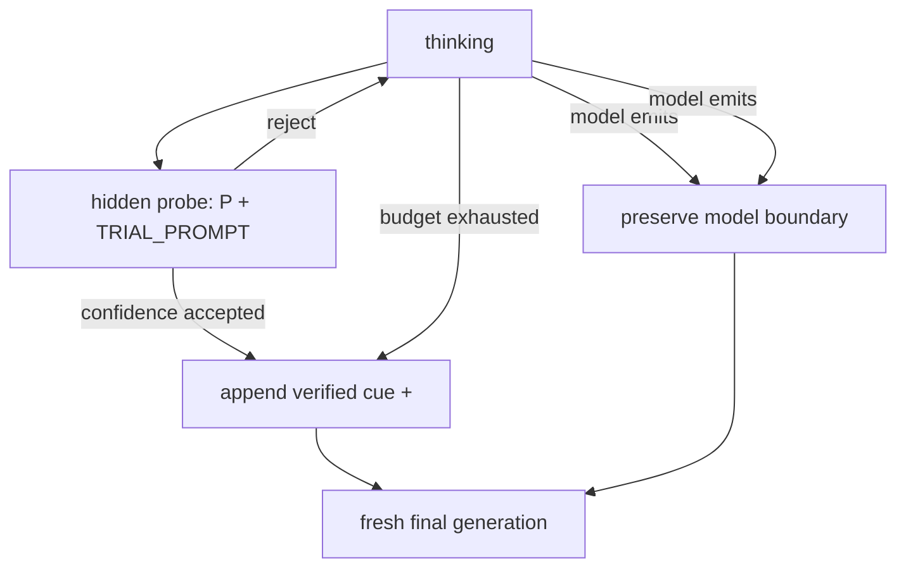
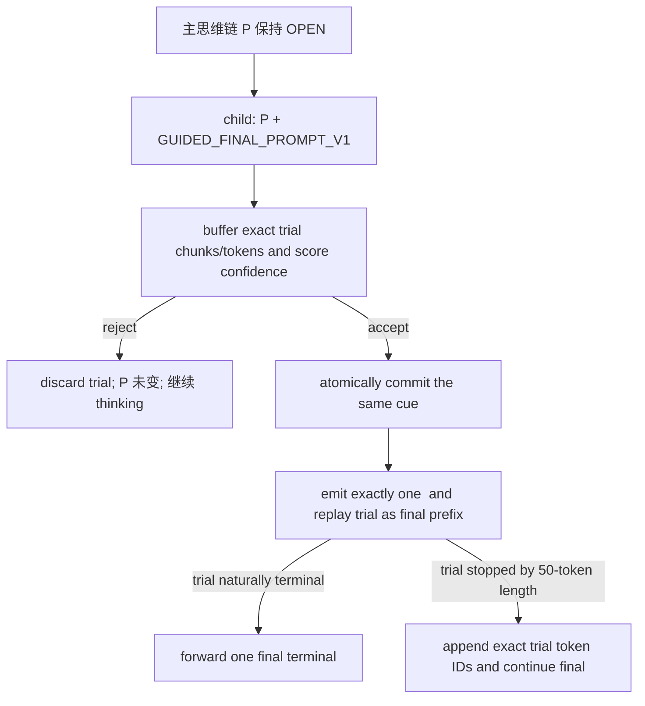

# DTB 最终答案生成兼容性设计

## 1. 设计目的

本文最初基于仓库 revision `bc142570103f86ca53ed656c75afd999bd13cbbd` 建立。
2026-08-21 已在重构后的 `dtb/` 生产代码中实现本轮设计，算法身份提升为
`dtb-algorithm-v3`；本地无模型回归已通过。2026-08-24 的
[`run_11/RESULT.md`](../log/perf/run_11/RESULT.md) 已获得目标服务器验收结果：guided cue 使
13 场景全集的空 final 降至 0/633，但完整 final 协议仍被两条 2,048-token final 长度截断
阻塞，量化权重的正式性能策略尚未收口。

2026-08-24 已按本文原生等价目标完成后续额度修复，算法身份提升为
`dtb-algorithm-v4`：移除默认 final 硬帽，复用 vLLM 原生有效 completion 上限，并统一维护
parser-facing 已输出额度。该修改已通过本地无模型回归，等待目标服务器定向验收；run_11
仍是 v3 历史证据，不回写其实验身份。

[`run_11_fixed_v5/RESULT.md`](../log/perf/run_11_fixed_v5/RESULT.md) 已提供首批服务器路径证据：
240/240 个 final 的额度字段闭合，`answer_limit` 均等于外部剩余额度，全部自然 `stop` 且没有
2,048 cap。该 run 的 final 最长只有 238 token，且不含两条历史截断和 48 条 no-final，因此
状态仍是“服务器路径部分通过、协议定向验收未完成”。

[`run_10_no_final/RESULT.md`](../log/perf/run_10_no_final/RESULT.md) 已实测：W8A8
量化、特定场景思维链压缩语料增训权重在 `confidence_accepted` 后只收到裸
`</think>` 时，48 条历史失败集中有 8 条立即停止且没有最终答案；将该 fresh-final 后缀改为
现有 `BUDGET_EXHAUSTED_FINAL_PROMPT` 后，空 final 从 8/48 降为 0/48，严格正确数从
34/48 升至 43/48。

本轮决策固定为：

> 2026-09-10 后续说明：下列“不修改 probe”是 v3/v4 当时的实验隔离范围，
> 不是 trial 无需 think-end 的实测结论。Agent run-06 后用户决定独立验证
> 仅给原 TRIAL_PROMPT 追加 `</think>\n\n`，保持 trial50/.93 和 fresh-final 不变。
> [实验补丁、输入与步骤](../log/perf/agent_run06/trial_close_experiment/README.md)
> 已准备但未应用到当前生产源码；不回写历史结果，也不包含 accepted trial 复用。

1. **不修改 confidence probe。** Probe 继续使用当前 `TRIAL_PROMPT`，不向其 prompt 添加
   `</think>`，trial 继续隐藏并在本轮实现中丢弃；
2. **只修改 `confidence_accepted` 的 fresh-final 后缀。** 它与 `budget_exhausted` 一样使用
   run_10 已验证的 answer cue；
3. **`budget_exhausted`、模型主动 `</think>` 和模型主动 `<tool_call>` 的逻辑保持不变；**
4. **不增加模型识别、YAML mode 或环境变量算法分支。** 开源权重和量化增训权重使用同一份
   DTB 算法行为；
5. accepted trial 复用作为后续独立优化保留在本文，但不进入本轮实现和验收。

该收口优先用最小行为改动修复已证实的协议错误，同时把 trial 复用对采样语义、流式 parser、
账本和 prefix caching 的影响从修复版本中解耦。

## 2. 修改前实现与问题证据

### 2.1 Probe 使用不含 `</think>` 的独立诱导语

v3 继续使用的 `dtb/reasoning/generation_states.py` 常量为：

```python
GUIDED_FINAL_PROMPT_V1 = (
    "Considering the limited time by the user, I have to give the solution "
    "based on the thinking directly now.\n</think>\n\n"
)
BUDGET_EXHAUSTED_FINAL_PROMPT = GUIDED_FINAL_PROMPT_V1
TRIAL_PROMPT = (
    "I have to give the answer based on the thinking directly "
    "without explanation now.\n**Final Answer**\n"
)
```

Probe 通过 `context.child_prompt(TRIAL_PROMPT)` 构造主思维链的浅拷贝。它传入
`reasoning_ended=True` 并以 `</think>` 为停止词，但 `</think>` 不在实际 child prompt token
序列中，主 prompt 也不会被修改。

Trial 完成后只用于 `assess_trial_confidence()`：

```python
state.current_trial = observation
state.hidden_probe_tokens += observation.generated_tokens
assessment = assess_trial_confidence(observation, ...)
if accepted:
    return enter_final_answer(CONFIDENCE_ACCEPTED)
```

当前测试明确断言 trial token 不进入 final prompt、trial 文本不向客户端输出。因此当前
`confidence_accepted` 表示“接受停止思考的决策”，不表示“接受该 trial 作为最终答案”。

### 2.2 v2 final 后缀不对称

修改前，v2 `_FinalAnswerState` 的 controller-forced 分支为：

```python
if reason is FinalAnswerReason.CONFIDENCE_ACCEPTED:
    prompt_suffix = THINK_END_TAG
elif reason is FinalAnswerReason.BUDGET_EXHAUSTED:
    prompt_suffix = BUDGET_EXHAUSTED_FINAL_PROMPT
```

两个分支都会调用 `context.close_reasoning(prompt_suffix)`，然后从主 prompt 发起一个新的
fresh-final child request。run_10 证明第一种裸 close 对量化增训权重不稳定。

### 2.3 v3 状态转换



Probe、trial 收集、置信度计算和 fresh-final 都保持现有结构；唯一行为差异是
`confidence_accepted` 从裸 `</think>` 改为已验证 cue。

## 3. 本轮设计决策

### 3.1 使用一个代码内 canonical cue

把 run_10 已验证的确切字节定义为语义中立的代码常量：

```python
GUIDED_FINAL_PROMPT_V1 = (
    "Considering the limited time by the user, I have to give the solution "
    "based on the thinking directly now.\n</think>\n\n"
)
```

`BUDGET_EXHAUSTED_FINAL_PROMPT` 可以作为迁移期别名，或由两个 controller-forced reason 直接
引用 canonical 常量。不能在本次修改中顺便缩短、翻译或中性化提示文案；任何字节变化都是
新的单变量实验。

后缀解析收口为：

```python
def controller_final_suffix(reason):
    if reason in {
        FinalAnswerReason.CONFIDENCE_ACCEPTED,
        FinalAnswerReason.BUDGET_EXHAUSTED,
    }:
        return GUIDED_FINAL_PROMPT_V1
    return None
```

`MODEL_THINK_END` 和 `MODEL_TOOL_CALL` 返回 `None`。模型已经生成原生边界时，控制器不得追加
cue 或第二个 `</think>`，否则可能破坏工具调用结构和多轮 parser 状态。

### 3.2 不增加配置分支

本次决策废弃初版文档提出的 `minimal_close_v1/guided_close_v1` 双 YAML 方案：

- 不修改 `dtb/config/budget_config.yaml`；
- 不增加 `FinalizationMode` 或模型类型字段；
- 不增加 `TB_FINAL_ANSWER_CUE` 环境变量；
- 不允许请求级 override；
- scene、`DtbBudgetDecision` 和 history 均不感知模型身份。

这是 code-owned 算法语义变化，`dtb/config/schema.py` 的 `POLICY_VERSION` 已从
`dtb-algorithm-v2` 提升为 `dtb-algorithm-v3`。实验 manifest 必须记录 DTB commit、policy
version 和 patch/YAML hash。若后续开源权重实测出现不可接受回归，再基于证据重新讨论显式
兼容配置，不能现在预设运行时分支。

### 3.3 不在本轮增加自动重试

本次实施范围只有后缀替换，不增加 `final_attempt`、空 final 自动重试或 stronger cue。空 final
仍必须在客户端结果和 hard-failure 审计中强制计错；若统一 cue 后仍出现，应作为新的协议缺陷
单独设计，不能由 Judge 的语义结果掩盖。

### 3.4 Prefix caching 成本

Probe 完全不变，因此不会把完整 cue 重复提交到每个 probe，也不会改变 probe 次数、prompt
token 或置信度分布。

只有 `confidence_accepted` 的既有 fresh-final child prompt 从 1-token `</think>` 变为 run_10
目标 tokenizer 上的 24-token cue。设进入 final 前主 prompt 为 `L`、prefix cache block size
为 `B`、实际命中前缀为 `H`，则该 child 的待计算 prompt 量近似为：

```text
U = (L - H) + suffix_tokens
```

相对旧实现只增加约 23 个 suffix token；不新增 child request，也不新增一次完整首 token
调用。APC 仍只能复用实际保留的完整共同 prefix block，尾部不完整 block 和 vLLM 为获得 logits
保留的最后 token 重算仍需在目标服务器按 `cached_prompt_tokens/prefill/TTFT` 实测。

`budget_exhausted` 已经使用同一 cue，因此该路径没有 token 或缓存行为变化。

## 4. 后续方案：避免 accepted trial 被丢弃

### 4.1 与本轮决策的边界

当前 trial 是在 `主思维链 + TRIAL_PROMPT` 上采样，而本轮 final 是在
`主思维链 + GUIDED_FINAL_PROMPT_V1` 上采样。两个条件前缀不同，所以不能把当前 trial 直接
拼接到 final：即使文本看起来像答案，它也不是 committed final prompt 下的合法采样前缀。

因此存在一个不可绕过的约束：**要安全复用 accepted trial，未来版本必须修改 probe，使其使用
与接受后提交完全一致的 `GUIDED_FINAL_PROMPT_V1`。** 这与“本轮不修改 probe”不冲突，因为
trial reuse 被明确推迟到独立算法版本。

### 4.2 事务式 accepted-trial replay

后续候选流程为：



这不是简单输出 `TrialObservation.full_text`。必须满足：

1. **条件前缀一致。** Probe child 和接受后主状态提交的 cue 必须逐 token 相同；
2. **事务性。** 置信度判定前不修改主 prompt；reject 后仍能继续 reasoning；
3. **精确 replay。** 缓存原始 chunk 顺序、`text`、`token_ids`、logprobs 和终止字段，不能把
   聚合文本重新 tokenize；
4. **终止语义。** 自然 `stop/eos` 的 accepted trial 可直接完成；50-token `length` 只是内部
   截断，replay 时必须清除中间 `finish_reason/stop_reason/finished`，续写后只暴露一个最终
   terminal；
5. **原生 stop 与 API 字段。** 可见 trial 必须采用 final-answer 的用户 stop、logprobs 和
   parser 参数语义；当前 probe 强制 `logprobs=1` 且覆盖 stop 的实现不能直接复用；
6. **工具调用连续性。** `<tool_call>`、参数 JSON 和结构 token 跨 trial/continuation 边界时，
   必须继续走原生 parser-facing 路径，不得泄漏 XML、重复标记或截断参数；
7. **取消和错误。** replay 或 continuation 期间取消时必须终止当前 child，不能留下第二个
   terminal 或后台生成。

### 4.3 账本语义

accepted trial 的模型工作只能计算一次：

- rejected trial 计入 `hidden_probe_tokens`；
- accepted 且 replay 的 trial 计入 `final_answer_tokens`，不再计入 hidden；
- phase 仍可标记为 `confidence_probe`，但要增加 `trial_reused=true` 和复用 token 数，使请求
  摘要满足：

```text
total_model_generated =
  visible_thinking + rejected_hidden_probe
  + reused_trial_final + final_continuation
```

不得因为同一批 token 先参与置信度计算、后成为可见 final，就在 probe 和 final 两个账本中
重复相加。

### 4.4 性能边界

run_10 的 43 个 accepted probe 中，41 个以 50-token `length` 结束，只有 2 个自然终止。因此
trial reuse 对多数请求不会减少 child call 数：当前是 `probe + fresh final`，候选通常是
`probe + continuation`。主要潜在收益是避免 final 的前 50 token 被第二次采样，而不是消除
final 请求。

Continuation prompt 为 `P + cue + accepted trial tokens`。如果 vLLM 保留了 accepted probe
产生的完整 KV block，APC 可以复用完整共同块；尾部不完整 block 仍需重算。不能仅凭相同
request family 假定命中，必须记录每个 probe/continuation 的 `prompt_tokens`、
`cached_prompt_tokens`、prefill、decode 和 TTFT。

## 5. 实现状态与后续计划

### 5.1 本轮实现与 run_11 服务器结果

| 文件 | 修改 |
| --- | --- |
| `dtb/reasoning/generation_states.py` | 定义 canonical verified cue；`confidence_accepted` 与 `budget_exhausted` 都选择该 cue；probe 不变 |
| `dtb/config/schema.py` | 提升 code-owned `POLICY_VERSION`；不增加 YAML 字段 |
| `tests/test_dtb_state_machine.py` | 断言 probe prompt/隐藏语义不变；两个 controller-forced reason 都使用相同 cue；模型边界不追加 cue |
| `tests/test_dtb_prompt_copy.py` | 断言 close suffix 只提交一次、主 prompt 只有一个 `</think>`，并回归 terminal 原样透传 |
| `tests/test_dtb_state_machine.py`、`tests/test_tool_call_debug.py` | 回归 stream/non-stream、`text/token_ids` 连续性、工具调用与唯一 terminal |

本轮未修改 `dtb/config/budget_config.yaml`、`DtbBudgetDecision`、history、phase recorder 或
request API。现有无模型测试已覆盖 probe/final prompt、hidden trial、原生模型边界、唯一
reasoning boundary、唯一 terminal 和工具调用流式连续性。

Run_11 在量化增训权重的 633 条全集请求上实测：

- 309 个 `confidence_accepted` 和 9 个 `budget_exhausted` 请求的 final prompt 后缀均为
  24 token，315 个 `model_think_end` 请求没有追加 cue；
- `</think>` 后空 final 为 0/633，且没有只生成 1～2 token 的旧失败签名，因此本轮 cue
  修改的直接目标通过；
- 另有 `TC00000069`、`YH0032` 两个 final phase 在 2,048 token 处以 `length` 结束并截断
  JSON/正文。该签名与 run_11 使用的 v3 `final_answer_max_tokens=2048` 一致，属于独立的 final 上限契约
  问题，不回滚 cue；应先让 final 使用调用方剩余 completion budget，再继续 fixed 搜索；
- 本轮开启 phase telemetry 且缺 manifest，E2E 收益只作为候选证据，不能替代 telemetry off
  的正式排名。

### 5.2 Completion 总额度修复（v4 本地完成）

V4 不改变 v3 cue、probe 或预算选择，只修复“一个外部 completion 被拆成多个 child 后的
总额度语义”。核心概念统一为：

```text
completion_token_limit
  = vLLM get_max_tokens(original request, original prompt)

emitted_completion_tokens
  = 已送入原生 parser 的 aligned 可见 token

external_remaining
  = completion_token_limit - emitted_completion_tokens

answer_limit
  = min(model_context_remaining, external_remaining)
```

`emitted_completion_tokens` 包含 visible thinking、模型或控制器产生的 reasoning boundary 和
final/tool token；不包含 hidden probe、answer cue prompt token 和 stop 后丢弃的 speculative
token ID。模型上下文和外部 completion 是两套独立门：answer cue 会占用前者，但不会占用后者。

| 文件 | 修改 |
| --- | --- |
| `patches/vllm/v0.23.0/dtb_serving.patch` | 在原生 serving 层复用 `get_max_tokens()`，把一次解析后的有效总额度放入私有 route identity |
| `dtb/reasoning/request_state.py` | 新增 `completion_token_limit`、`emitted_completion_tokens`，作为单请求统一额度账本 |
| `dtb/reasoning/request_context.py` | 在唯一 parser-facing `stream_output()` 边界累计 token，并在越界进入 parser 前失败 |
| `dtb/reasoning/generation_states.py` | thinking 为 boundary/final 保留额度；final 移除 2,048 cap，只使用上下文与外部剩余额度 |
| `dtb/config/schema.py`、`budget_config.yaml` | 删除 `final_answer_max_tokens`，提升 policy 为 `dtb-algorithm-v4` |
| `dtb/observability/phase_recorder.py` | final phase 记录总额度、final child 启动前已输出量、pending boundary、剩余额度和 `answer_limit` |

若 serving patch 未提供正整数 `completion_token_limit`，controller 明确拒绝请求，避免 adapter 与
旧 patch 混装后静默恢复错误语义。默认生产路径不再提供另一个 final cap；未来若确需安全帽，
必须作为显式非等价策略建模并使用新的 policy identity。

### 5.3 后续 trial-reuse 版本

后续实现至少需要修改：

- `generation_states.py`：probe 使用 canonical cue；accepted/rejected 分流；replay 和
  continuation；
- `request_state.py`：保存可 replay 的原始 trial chunk/token 状态；
- `parser_boundary.py` / request context：把 accepted trial 作为 final prefix 送入同一原生
  parser-facing 输出链；
- phase recorder 与请求摘要：区分 rejected hidden trial、reused visible trial 和 continuation；
- 状态机、流式、非流式、工具调用及取消测试。

该版本必须单独提升 policy version，不能与本轮 cue 修复共用同一算法身份。

## 6. 验收标准

### 6.1 本轮 cue 修复

本地无模型验收：

- Probe child prompt 仍以 `TRIAL_PROMPT` 结尾且不包含合成 `</think>`；
- trial 仍不进入主 prompt或客户端输出；
- `confidence_accepted` 和 `budget_exhausted` 的 fresh-final prompt 都以 canonical cue 结尾；
- model-generated `</think>` / `<tool_call>` 不追加 cue；
- stream/non-stream 只有一个 reasoning boundary 和一个 final terminal；
- 配置 schema 没有新增 `finalization_mode` 或请求 override。

服务器验收标准：

- run_11 使用量化增训权重执行 13 场景全集和 fixed_v4 候选，空 final 为 0，不新增工具 XML
  泄漏、参数 JSON 不完整或错误 `finish_reason`；
- 与同模型、同数据集 Vanilla 按 `QA_ID` 请求级配对；若复用 run_08 Vanilla，manifest 必须证明
  模型/tokenizer revision、数据集、sampling、并发、到达节奏和 cache 状态可比；
- 逐场景按质量优先原则选择：正确数不低于 Vanilla 的候选优先，只有该层为空时才允许少 1 题；
  质量层内选择 paired E2E 更低者，不得新增 hard failure；
- paired E2E 单列 `confidence_accepted` 请求，核对 engine call 数不变、final prompt 约增加
  23 token，并报告 cache/prefill/TTFT；
- 正式 E2E 排名使用 `OBSERVABILITY.mode=off`；如需 phase 账本，使用同身份的独立
  `experiment_role=phase_audit` 运行，不与正式结果混算；
- 实验 manifest 记录新的 policy version、DTB commit、两份 patch hash、YAML hash、sampling、
  并发、到达节奏和 prefix-cache 状态。

开源权重也使用同一算法行为；其 13 场景回归仍是统一实现的兼容性验收，但不阻塞 run_11 对
量化增训权重的直接目标判断。

Run_11 对上述标准的裁决是：空 final 与 cue 覆盖通过；逐场景质量门、hard-failure 门、
telemetry-off 正式 E2E 和完整 manifest 未通过或未验证。详见
[`run_11/RESULT.md`](../log/perf/run_11/RESULT.md) 第 8 节。

### 6.2 Completion 总额度修复

本地验收：

- 默认 schema/YAML 不再含 `final_answer_max_tokens`；
- serving patch 对固定 vLLM v0.23.0 checkout 通过 `git apply --check`，有效额度来自原生
  `get_max_tokens()`；
- visible thinking、模型边界、synthetic `</think>` 和 final token 只计一次，hidden probe 与
  dropped IDs 不计入 `emitted_completion_tokens`；
- final child 的 `max_tokens` 等于更新后的上下文剩余额度与外部剩余额度较小值；
- parser-facing 输出试图超过总额度时，在写入结果队列前失败；
- final phase 和 request summary 可以直接审计有效总额度、已用额度、剩余额度及
  `answer_limit`。

服务器验收：

- 定向重放 run_11 的 `TC00000069`、`YH0032`，不得再在 2,048 token 截断；若命中外部总额度，
  必须原样返回 `finish_reason=length`；
- 重放 run_10 的 48 条 no-final 集，保持 0 空 final；
- 对至少一个较小 `max_tokens` 请求核对所有 parser-facing token 总数不超过外部上限，hidden
  probe 不减少 final 可用额度；
- phase telemetry 的 `answer_limit = min(model_context_remaining, external_remaining_tokens)`，
  request summary 的 `emitted_completion_tokens <= completion_token_limit`；
- 通过协议定向验收后，才能继续 fixed_v5 和 telemetry-off 性能排名。

### 6.3 后续 trial reuse

以“canonical cue + fresh-final”为唯一对照，先验证：

- accept+natural-terminal、accept+length-continuation、reject+continue-thinking、error 和 cancel；
- stream/non-stream 的 trial prefix 与 continuation `text/token_ids` 连续，只有一个 terminal；
- 工具调用标记、参数 JSON、role 和 `finish_reason` 与原生 parser 契约一致；
- accepted trial token 在总模型工作量中只计一次；
- 两种权重重新采集置信度，不能用旧 probe telemetry 静态推导阈值；
- 质量通过后再用请求级 paired E2E、总 generated token 和 phase 账本决定是否保留。

## 7. 一致性校验

- **概念一致性：** v3 的 code-owned verified cue 与 v4 的 completion 总额度职责分离；trial
  reuse 仍是后续算法版本。
- **状态完备性：** v4 不新增推理状态；两个 controller reason 共用 cue，所有可见状态共用一份
  `emitted_completion_tokens` 账本。
- **接口完备性：** 不新增公开 YAML、环境变量或请求字段；有效额度通过 serving 私有 route
  identity 传递，缺失时 fail closed。
- **层次一致性：** scene 只决定预算，final reason 只解释退出原因，cue 由 generation state
  选择，不进入 `DtbBudgetDecision`。
- **性能一致性：** v4 不改变 probe 和 child call 数，也不增加正常 EOS 请求的 token；只取消
  非原生 2,048 cap。trial reuse 的重复 prefill、decode 节省和账本另行测量。
- **parser 一致性：** cue 只存在于模型 prompt，控制器对客户端仍只合成一个 `</think>`；模型
  自带边界不被重复修改。

## 8. 变更历史

| 日期 | 变更内容 | 原因 |
| --- | --- | --- |
| 2026-08-20 | 初版：提出 YAML 驱动的 minimal/guided 终结兼容模式 | run_10 证明量化增训权重需要 answer cue，但开源权重统一适用性尚未验证 |
| 2026-08-21 | 决策收口：取消当前版本的配置分支；probe 保持不变，仅把 `confidence_accepted` fresh-final 改为已验证 cue；补充 accepted-trial 事务式 replay/continuation 后续方案 | 用最小改动修复已证实空 final，并将高风险 trial 复用与兼容性修复解耦 |
| 2026-08-21 | 完成 `dtb-algorithm-v3` 本地实现与无模型回归；同步 manifest、泛化计划和性能 runbook；服务器验收目标固定为 run_11 量化增训权重 13 场景全集与 fixed_v4 | 让代码、实验身份和验收口径在服务器测试前闭合 |
| 2026-08-24 | 纳入 run_11：318 个 controller-forced final 均使用 24-token cue，空 final 为 0/633；同时发现两条 2,048-token final 截断，完整 final 协议仍未通过 | cue 修复可以冻结；下一优先级是移除控制器额外 final 硬帽，而不是改 probe、回滚 cue 或提前实现 trial reuse |
| 2026-08-24 | 完成 `dtb-algorithm-v4` 本地实现：复用原生有效 completion 上限，增加 parser-facing 统一额度账本，删除默认 final cap 并补充 final/request telemetry 与回归测试 | 让多 child DTB 与一次原生 assistant completion 的 `max_tokens`、上下文和真实 `finish_reason` 语义一致 |
| 2026-08-24 | 纳入 run_11_fixed_v5 的 v4 服务器路径证据：240 个 final 额度字段闭合、全部自然 stop、无 2,048 cap；历史长 final、no-final 集和小 `max_tokens` 仍未覆盖 | 不把短 final 的成功误写为完整协议通过，保留定向验收门 |
