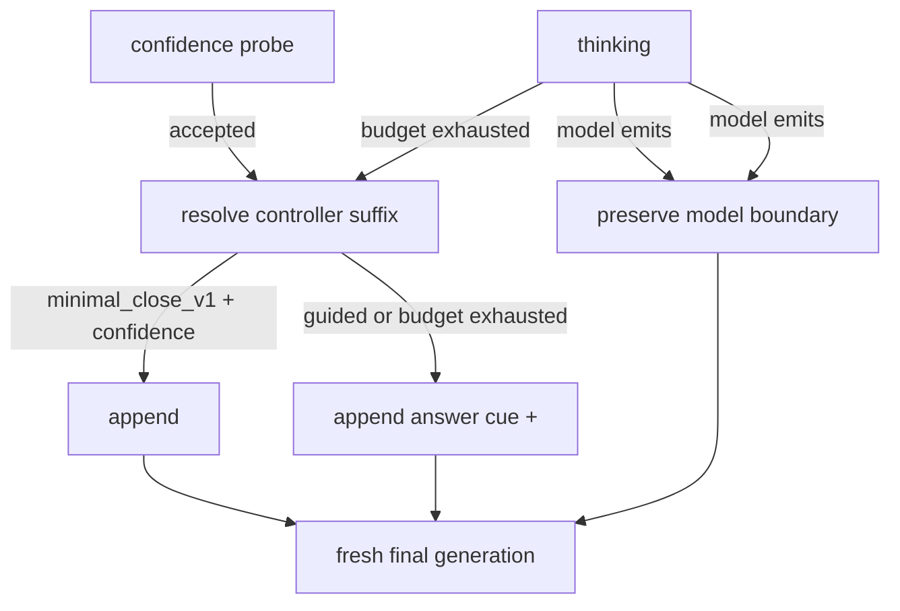

# Think Budget 最终答案生成兼容性设计

## 1. 设计目的

本文针对仓库 revision `bc142570103f86ca53ed656c75afd999bd13cbbd` 和
2026-08-20 的运行状态，设计 DTB 对不同模型终结行为的兼容方式。

[`run_10_no_final/RESULT.md`](../log/perf/run_10_no_final/RESULT.md) 已实测：W8A8
量化、特定场景思维链压缩语料增训权重在 `confidence_accepted` 后只收到裸
`</think>` 时，48 条历史失败集中有 8 条立即以 stop token 结束且没有最终答案；改为
`BUDGET_EXHAUSTED_FINAL_PROMPT` 后，空 final 从 8/48 降为 0/48，严格正确数从
34/48 升至 43/48。这个结果证明该权重需要明确 answer cue，但尚未证明开源权重使用同一
cue 时质量与时延不退化。

设计目标是：

1. 同一份 DTB 状态机代码同时支持开源权重和量化增训权重；
2. 量化增训权重可以稳定从 controller-forced reasoning exit 进入最终答案；
3. 不因兼容性改动新增内部请求，并把 prefix-cache 尾块增量限制在必要的 cue token；
4. 保持原生 parser-facing 契约，包括单一 reasoning 边界、工具调用结构、流式
   `text/token_ids` 连续性及最终 `finish_reason`；
5. 配置选择可审计，且不能由用户请求或不可靠的 prompt/model-name 启发式改变。

本文只设计最终答案兼容性。accepted trial 的复用仍是后续独立优化，不与本次 cue 修复一起
上线。

## 2. 现状与核心问题

### 2.1 当前状态机的不对称行为

当前 `think_budget_vllm_adapter/deer_think_budget/state.py` 中：

- `confidence_accepted` 使用裸 `THINK_END_TAG`；
- `budget_exhausted` 使用 `BUDGET_EXHAUSTED_FINAL_PROMPT`；
- 模型主动输出 `</think>` 或 `<tool_call>` 时，沿模型边界直接进入 final；
- hidden probe 使用独立的 21-token `TRIAL_PROMPT`，接受后丢弃，再发起 fresh-final。

run_10 的错误只出现在第一种路径。问题不是预算或分类错误，而是“为何进入 final”意外决定了
模型能否生成 final。

### 2.2 需要建模的是终结兼容性，而不是另一套算法

不同权重需要不同的 controller close suffix，类似 chat template 或特殊 token 兼容性。它不应
成为 scene 预算、不应由请求参数传入，也不需要建立模型分类器。本文定义一个最小概念：

`finalization_mode`：服务进程启动时选定的 controller-forced reasoning 终结方式。

同一状态机只通过该值解析后缀。scene、BudgetPlan、置信度和 history 均不感知模型身份。

## 3. 设计决策

### 3.1 使用 YAML 模式，不在状态机中读取环境变量

新增两个具名模式：

| `finalization_mode` | `confidence_accepted` | `budget_exhausted` | 用途 |
| --- | --- | --- | --- |
| `minimal_close_v1` | `</think>` | 现有 answer cue | 保持当前开源权重行为 |
| `guided_close_v1` | 现有 answer cue | 现有 answer cue | 量化增训权重 |

answer cue 继续作为代码内受审查常量，YAML 只保存枚举名，不允许写任意 prompt 文本。这样可
避免部署文件中的转义、额外 `</think>`、prompt 注入和无法追踪的文案漂移。

run_10 只证明了现有 cue 的确切文本有效。实现时应给相同字节内容增加语义中立的代码名
`GUIDED_FINAL_PROMPT_V1`，而不是让 confidence 分支依赖名为
`BUDGET_EXHAUSTED_FINAL_PROMPT` 的原因专用常量。是否把文案改成更短、更中性的提示属于新的
单变量实验，不能在本次重构中顺手修改。

配置放在 `budget_config.yaml` 的 `RUNTIME.finalization_mode`。量化增训 YAML 设为
`guided_close_v1`；开源 YAML 在兼容性实验完成前保持 `minimal_close_v1`。两者使用相同 Python
代码和状态机。

不建议增加 `TB_FINAL_ANSWER_CUE=1` 一类直接控制算法分支的环境变量，原因是：

- 它会形成 YAML 之外的第二优先级，容易发生“文件显示 A、实际运行 B”；
- 现有实验 manifest、配置签名和 `source_by_field` 无法自然解释覆盖关系；
- 状态机将依赖进程环境，而非已校验的有效配置。

如果运维以后不希望复制替换同名 YAML，可以只增加
`TB_BUDGET_CONFIG_PATH=/path/to/model.yaml` 来选择**完整配置文件**。环境变量只负责文件定位，
不直接选择 `finalization_mode`；启动日志必须记录规范化路径、文件 SHA256 和最终 mode。当前
人工替换 YAML 已能满足部署，因此这项不是本轮必需实现。

本设计假定一个服务进程只承载一个基础 checkpoint。以后若同一进程承载终结行为不同的多个
模型或 LoRA，应在模型注册配置中显式映射 mode，不能按 prompt、模型路径字符串或 token ID
猜测。

### 3.2 仅对 controller-forced exit 使用模式

后缀解析规则为：

```python
def controller_final_suffix(reason, finalization_mode):
    if reason == BUDGET_EXHAUSTED:
        return GUIDED_FINAL_PROMPT_V1
    if reason == CONFIDENCE_ACCEPTED:
        return (
            GUIDED_FINAL_PROMPT_V1
            if finalization_mode == GUIDED_CLOSE_V1
            else THINK_END_TAG
        )
    return None
```

`MODEL_THINK_END` 和 `MODEL_TOOL_CALL` 返回 `None`：模型已经给出原生边界，控制器不得再追加
cue 或第二个 `</think>`。这也避免破坏工具调用 XML/JSON 和多轮 parser 状态。

状态转换如下：



本轮继续保留 fresh-final。它已在开源权重上验证，且把 cue 支持与 trial 复用的 parser 风险
解耦。

### 3.3 final 非空是统一协议不变量

cue 能降低失败概率，但不能替代输出协议校验。`_FinalAnswerState` 当前只要收到 terminal
output 就把 `completion_status` 写成 `success`；这使 one-token stop 被误记为成功。

应增加统一不变量：controller 关闭 reasoning 后，成功结束必须已经产生至少一种 parser-visible
final evidence：

- 非空 final content；或
- 完整、可解析的 tool call。

裸 stop token、空白文本、只有空 delta 都不构成 evidence。首次 final 没有 evidence 时：

1. 暂不向上游发送该空 terminal；
2. 若当前是 `minimal_close_v1`，使用 `guided_close_v1` 的 cue 做一次有界 fresh-final retry；
3. 若已经是 `guided_close_v1`，可使用一条版本化 stronger cue 重试一次，或直接报告
   `protocol_no_final_answer`；在新的 stronger cue 通过实验前，推荐后者；
4. 重试仍为空时标记错误，禁止写 `success`；不得用 `ignore_eos` 强行生成。

只有在尚未向客户端发送 final content 时才允许重试。若已经发送可见 final delta，控制器不能
回滚或重采样。tool call 是否完整由原生 parser 契约测试裁决，不能只检查字符串长度。

### 3.4 prefix caching 成本模型

answer cue 不新增 engine child call；现有 final 请求无论使用何种后缀都要经历一次排队、prefill
和首 token 生成。设：

- `B`：实际 KV cache block size；
- `L`：进入 final 前已提交的主 prompt token 数；
- `S`：final suffix token 数；
- `H`：被 APC 命中的共同前缀，通常按完整 block 对齐且 `H <= floor(L/B)×B`。

该 final child 的待计算 prompt 量近似为：

```text
U = (L - H) + S
```

从裸 `</think>` 的 1 token 改为 run_10 的 24-token cue，单次 final 的理论增量是 23 token，
不是一个 block，也不会新增一次“完整首字”调用。vLLM v0.23.0 的
`KVCacheManager.get_computed_blocks()` 只返回完整 block，并在全命中时仍保留最后 token 重算；
这些尾块/最后 token 成本在两个模式中都存在。

如果未来为了复用 accepted trial，要求 probe 与 final 使用同一个 cue，那么每次 probe 确实会
重新计算共同前缀后的尾块和短后缀。但 run_10 目标 tokenizer 上，现有 `TRIAL_PROMPT` 为 21
token、guided cue 为 24 token；81 次 probe 的直接提示增量只有 243 token，即约 3 token/probe。
主要成本仍是 probe 子请求数量和 50-token decode，而不是这 3 个 prompt token。

上述推导只说明增量边界，不假定增长中的 parent prefix 一定被保留。run_00 曾实测后续 phase
只命中固定 1,536 token，说明目标服务器仍需按实际 `cached_prompt_tokens` 审计。实验必须记录
block size、final/probe 的 `prompt_tokens`、`cached_prompt_tokens`、prefill、TTFT 和 phase
calls，不能用公式替代服务器测量。

## 4. 核心数据与配置

只新增一个运行时配置字段，不新增 model type、profile bundle 或 scene 字段：

```python
class FinalizationMode(str, Enum):
    MINIMAL_CLOSE_V1 = "minimal_close_v1"
    GUIDED_CLOSE_V1 = "guided_close_v1"

@dataclass
class AlgorithmConfig:
    # existing fields ...
    finalization_mode: FinalizationMode = FinalizationMode.MINIMAL_CLOSE_V1
```

能够由 mode 和 final reason 推导出的 suffix 不存入 `BudgetPlan` 或请求状态。实验身份所需的
配置文件路径、SHA 和部署 checkpoint 放在 manifest；请求 telemetry 只记录最终 mode 和实际
final reason。

为了实现协议校验，请求状态只增加运行时真正需要的最小状态：

```python
final_attempt: int = 0
final_evidence_seen: bool = False
```

`final_evidence_seen` 是 parser-facing content/tool-call 证据，不是 Judge 正确性，也不能由
`generated_tokens > 0` 推导，因为 stop token 可能计入生成量但不产生可见答案。

YAML 示例：

```yaml
RUNTIME:
  finalization_mode: guided_close_v1
```

未知 mode 必须启动失败，不能静默回落到 built-in default。请求参数不提供 override。

## 5. 主要修改点

| 文件 | 修改 |
| --- | --- |
| `think_budget_vllm_adapter/context.py` | 增加 `FinalizationMode` 和 `AlgorithmConfig.finalization_mode` 校验 |
| `think_budget_vllm_adapter/config/unified_config.py` | 加入默认值、YAML 白名单解析；未知值 fail fast |
| `think_budget_vllm_adapter/config/budget_config.yaml` | 开源默认先声明 `minimal_close_v1`；量化增训 YAML 声明 `guided_close_v1` |
| `think_budget_vllm_adapter/budget_controller.py` | 把已校验 mode 装入请求 `AlgorithmConfig`，不做模型识别 |
| `think_budget_vllm_adapter/deer_think_budget/state.py` | 集中解析 controller suffix；增加 final evidence 与空 final 失败/有界重试 |
| `think_budget_vllm_adapter/telemetry.py` | 记录 mode、attempt、evidence、empty-final outcome；不复制到 BudgetPlan |
| `tests/test_adapter_state_machine.py` | 覆盖两种 mode、两类 controller exit、模型边界、空 terminal、retry 与 tool call |

建议把后缀解析写成无 vLLM 依赖的纯函数，单测直接穷举
`FinalAnswerReason × FinalizationMode`。不需要新增模块级分类器。

## 6. 实验与收口决策

### 6.1 实现可以先做，默认值先不统一

run_10 已足够支持增加 `guided_close_v1`，无需等待开源实验才实现配置能力；但它不足以把 guided
模式设为所有权重的唯一默认。推荐顺序：

1. 实现具名 mode、final 非空不变量和 telemetry；开源 YAML 保持 minimal，量化 YAML 使用
   guided；
2. 量化权重把 48 条定向集再重复 2 轮，随后执行 633 条全集；
3. 开源权重做同 commit、同 13 场景的 minimal/guided 请求级 A/B；
4. 若 guided 在开源权重也通过质量、hard failure 和时延门，则统一默认 guided，后续删除模型
   差异；否则长期保留两份 YAML，但仍只有一份状态机实现。

### 6.2 必需的 2×2 证据

| 权重 | minimal | guided | 当前证据 |
| --- | --- | --- | --- |
| 量化增训 | 定向故障基线 | 目标模式 | run_10 已有单轮 8/48 → 0/48；需重复与全集 |
| 开源 | 当前行为基线 | 兼容性候选 | 缺同轮 A/B，必须补测 |

每个比较固定请求、sampling/seed、并发、到达节奏、cache 初态、服务和 adapter commit。Judge
使用 temperature=0，按 `QA_ID` 配对；空 final 与 parser hard failure先独立强制计错。

### 6.3 验收标准

功能与协议门：

- 48 条定向集连续 3 轮 `protocol_no_final_answer=0`；
- 633 条全集不新增空 final、工具 XML 泄漏、参数 JSON 不完整、重复 `</think>` 或错误
  `finish_reason`；
- stream/non-stream、模型主动 `</think>`、模型主动 `<tool_call>`、confidence exit 和 budget
  exit 全部通过；
- 有效 final 前不能发送空 terminal，失败不能记录为 `success`。

质量门：

- 继续使用项目已确认的选择原则：先选正确率不低于对应 Vanilla/模式基线的结果；若没有，最多
  多错 1 条才进入时延比较；
- 对开源权重，guided 只有在不突破该门时才可成为统一默认。

性能与缓存门：

- fresh-final 阶段两种 mode 的 engine call 数必须相同；
- 单列 final suffix token、uncached prompt token、prefill、TTFT、final decode 和 E2E；
- 13 场景等权宏平均 paired E2E 不出现预先声明容忍线之外的退化；建议实验前声明 1% 为候选
  容忍线，并同时报告置信区间，不能测试后再选择阈值；
- 若后续启用 trial 复用，另做 `cue+fresh-final` 与 `cue+trial-reuse` A/B，不把收益归给本次
  compatibility mode。

## 7. 一致性校验

- **概念一致性：** `finalization_mode` 只表示模型终结兼容性；scene 仍只决定 budget，final
  reason 仍只说明为何离开 thinking。
- **状态完备性：** 两个 controller exit、两个模型原生 boundary、空 terminal、正常 stop、
  length、error 和 cancel 均有明确处理。
- **接口完备性：** YAML 是唯一行为配置源；环境变量如以后增加，只选 YAML 路径；请求无
  override。
- **层次一致性：** cue 解析在算法状态机，模型部署选择在配置层，parser-valid evidence 由原生
  parser 契约约束；不在分类器或 BudgetPlan 中复制职责。
- **性能一致性：** mode 不改变 phase 数；suffix token 成本与子请求边界成本分开记录；trial
  复用保持独立实验。
- **可审计性：** 启动日志记录配置路径/SHA/mode；final phase 记录 mode、reason、attempt 和
  evidence outcome，能够从日志证明每个请求实际走了哪种终结行为。

## 8. 变更历史

| 日期 | 变更内容 | 原因 |
| --- | --- | --- |
| 2026-08-20 | 初版：定义 YAML 驱动的终结兼容模式、空 final 不变量、prefix-cache 成本模型及跨权重收口实验 | run_10 证明量化增训权重需要 answer cue，但开源权重的统一适用性尚未验证 |
