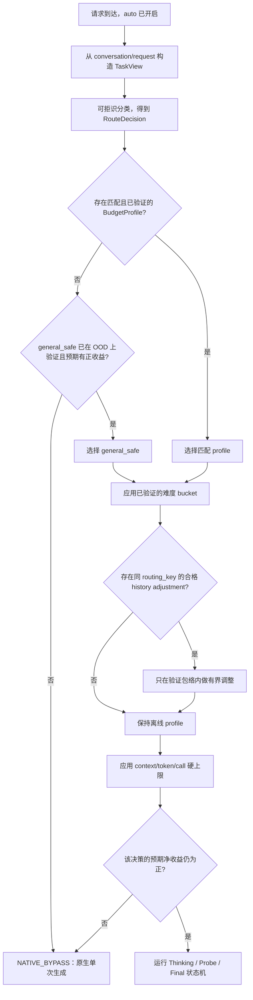

# Think Budget 泛化性实施计划

## 1. 设计目的

本文设计 Think Budget 从“单场景固定参数可获得收益”走向“服务端开启后自动
选择有效策略”的实施方案。第一优先级是在 13 个产品慢思考场景上，在语义质量
非劣的硬约束下最大化端到端时延改善；通用任务只承担最低限度的泛化校验。
生产灰度、在线自适应和自动回滚不进入第一阶段关键路径，等算法候选收敛后再
实施。

设计起点：

- 文档日期：2026-07-30；
- 仓库 revision：`06a09eb`；
- 目标集成环境：vLLM `v0.23.0`、vLLM-Ascend `v0.23.0rc1`；
- 当前性能证据：
  [`run_02/RESULT.md`](../log/perf/run_02/RESULT.md) 与
  [`deer_performance_analysis.md`](../debug/deer_performance_analysis.md)；
- 当前算法边界：
  [`think_budget_vllm_adapter_refactor_plan.md`](../debug/think_budget_vllm_adapter_refactor_plan.md)；
- 13 个产品测试集及新增语义质量分尚未进入本仓库，因此本文定义其数据接口、
  实验方法和准入规则，不虚构具体质量阈值或跨场景实测结论。

这是一次受质量约束的性能优化与自动策略选择设计，不是单纯的任务分类器扩词，
也不是让线上用户继续传递 `fixed_*` 超参数。

2026-07-31 优先级裁决：原计划中的完整生产验证链路偏重，修订为“先离线寻优、
再生产化”的两阶段方案。设计起点仍保持上述 revision；本次只调整达到原目标的
实施路径。

### 1.1 “开启即优化”的操作定义

对普通请求，产品只需要开启 Think Budget 的 `auto` 模式：

1. 不要求用户传 `fixed_check_length`、`fixed_think_stride`、
   `fixed_num_thinking`、`fixed_prob_th` 等算法参数；
2. 服务端根据请求中已经存在的结构化信息自动选择经过验证的预算档位；
3. 无法可靠识别或没有合格策略时，自动回到原生单次生成；
4. 调试用请求级 fixed override 可以保留，但不属于正式产品接口；
5. “开启”不等于强制每个请求都进入多阶段控制器。原生旁路是自动策略的一种
   安全动作，且旁路请求必须保持原生请求语义。

自动模式的实际总体收益必须把旁路请求也计入：

```text
auto_net_gain
= 所有开启请求的 Vanilla E2E
- 所有开启请求的实际 E2E（受控生成 + 原生旁路）
```

不能只报告被路由到某个高收益档位的条件收益。

### 1.2 范围与非目标

本计划覆盖：

- 13 个产品场景的数据分层、预算策略发现、路由与留出验证；
- 通用/OOD 任务的最低限度质量护栏；
- `_decide()`、任务分类、难度估计、历史预算和配置模型的演进；
- 请求级 telemetry、实验产物和验收；
- 算法候选收敛后的生产灰度、回滚和在线历史。

本计划不改变已经裁决的首版性能策略：

- trial answer 最多 50 token；
- trial 使用 clean child context；
- trial 不写回主思考链；
- final answer 新鲜生成；
- Value Min 在出现跨场景语义收益证据前继续关闭；
- 不恢复 answer list、soft truncation 或候选答案复用。

MTP 维持生产默认，不作为本轮泛化实验变量。

### 1.3 两阶段实施边界


| 阶段 | 第一目标 | 必做 | 明确推迟 |
| --- | --- | --- | --- |
| 阶段一：算法寻优 | 在声明的候选空间内获得质量合格的最大产品 E2E 改善 | Vanilla 配对基线、语义质量门、逐场景 oracle、profile 合并、自动路由测试、一次产品留出和通用集检查 | 生产 shadow/canary、自动回滚、在线 history、延迟质量回填、完整漂移监控 |
| 阶段二：生产化 | 将阶段一候选安全地变成 `auto on/off` 产品能力 | 原生旁路、PolicyBundle、接口回归、灰度、监控、回滚 | 新一轮无证据的算法扩展 |

阶段一可以继续通过请求级 fixed override 或实验 harness 下发候选参数，不要求
先完成 `dtb.patch` 的自动路由改造。这样先回答“哪些参数和 profile 真正快且
质量合格”，再承担服务化成本。

## 2. 当前结论与问题定义

### 2.1 已有证据

| 结论 | 证据强度 | 影响 |
| --- | --- | --- |
| run_02 相对三次 Vanilla 均值，平均 E2E 降低 `20.5613 s / 31.48%`，可见 token 降低 `55.48%` | 实测 | 证明固定策略在一个场景存在明显净收益 |
| 计入 1650 个 hidden probe token 后，总模型 generated token 仍降低约 `53.20%` | 实测 | 50-token probe 在该场景具有净 token 收益 |
| run_02 的 thinking wall 占 E2E `68.82%`，probe 占 `11.17%` | 实测 | 预算和停止策略仍是主优化变量 |
| 16/16 prompt 被 task classifier 判成 `classification`，实际 scene 为 planning/fault/code 混合 | 实测 + 源码确定 | 动态预算前必须修复完整 prompt 污染和弱命中即路由 |
| 当前 decision 平均约 `5.53 ms`，普通 controller CPU 不是成本中心 | 实测 | 首版路由应保持轻量，不引入额外 LLM 分类请求 |
| run_02 的结构正确率为 100%，但该 Judge 只检查 JSON 结构 | 实测 | 还不能声明语义质量非劣 |

### 2.2 当前实现不适合作为自动默认策略的原因

1. `_classify_task()` 对 tokenizer 解码后的完整 prompt 分类。系统说明、输出
   schema、few-shot 示例和工具描述会与真实用户任务共同计分。
2. 当前 `task_matched` 只要求已知非 general 类型且
   `task_confidence > 0`。一次弱子串命中也可能选择任务预算，没有拒识门。
3. `scene_classifier.py` 与 `task_type_budget.py` 分别计分，再用固定优先级
   合并。两者的概念和证据可能冲突，当前 telemetry 也没有记录命中 span。
4. 任务类别直接绑定预算。产品语义类别相同的请求未必具有相同的成本—质量
   曲线；不同语义类别也可能共享同一个合格预算。
5. 当前难度估计将 14 维启发式结果映射到很宽的连续预算区间，再与任务预算
   逐字段平均；这些区间尚未用 13 个场景校准。
6. 未命中任务进入 history。新任务默认 `num_thinking=99`，随后依赖
   `max_internal_calls` 和硬 token 上限兜底，不是面向低时延的冷启动策略。
7. history 按已执行策略产生的 thinking token 学习。该值是受当前预算和停止
   阈值截断的结果，不等同于“保持质量所需的 token”，存在自反馈偏差。
8. 普通线上 history 没有质量标签。无标签记录可以描述成本分布，不能证明
   更低预算仍正确。

因此，直接增加 13 个 task type 和各自参数会同时放大误路由、数据泄漏和
历史自反馈风险。

## 3. 优化目标与验收口径

### 3.1 受约束目标

对数据集/场景 \(s\) 和自动策略 \(\pi\)，定义：

```text
gain_latency(s, π) = E[E2E_vanilla - E2E_auto]
gain_tokens(s, π)  = E[total_generated_vanilla - total_generated_auto]
quality_delta(s, π)= Q_auto - Q_vanilla
```

其中 `total_generated_auto` 必须包含 visible thinking、hidden probe 和
final answer。自动策略选择目标为：

```text
最大化：
  阶段一主指标 gain_latency_product
  = 预先选择的产品场景等权宏平均或真实流量加权 gain_latency

约束：
  每个产品场景的质量非劣
  产品宏平均质量非劣
  通用/OOD 集最低质量检查通过
  隐藏 token、内部调用、错误和取消有硬上限
```

如果尚无可信流量权重，阶段一默认用 13 场景等权宏平均作为唯一排序主指标；
流量加权、P50、P95 和最坏场景同时报告，但不再组成复杂的联合目标。存在可信
权重时，可在第一轮实验前将流量加权均值声明为主指标。等权与流量加权不能在
看到候选结果后互换。

“最大”指声明候选空间和实验预算内的 `best_observed`，不声称找到连续超参数
空间的数学全局最优。候选空间、停止搜索条件和最小有意义时延差写入 manifest。

### 3.2 质量门

每个数据集先声明一个 `QualityContract`：

```text
QualityContract
  primary_metric
  metric_direction
  non_inferiority_margin
  hard_failure_predicates
  judge_version
  reference_version
  minimum_effective_samples
```

质量门必须在查看候选策略的产品留出结果前固定。新增语义质量分上传后，根据
其量纲、基线方差和产品容忍度填写 `non_inferiority_margin`；本文不以结构
正确率替代语义质量，也不预设一个不适用于所有场景的统一分值差。

建议的判定顺序：

1. 解析错误、工具名/参数错误、关键事实错误等 `hard_failure` 不得新增；
2. 每个产品场景的 paired quality delta 单侧置信区间下界不得越过非劣界；
3. 产品等权宏平均和流量加权质量都必须非劣；
4. 阶段一只对最终自动策略运行一次通用/OOD 质量检查；不要求每个搜索候选
   都跑完整通用测试；
5. 只有全部通过后才按时延选择候选。

小数据集不应以“均值碰巧没降”判定通过。样本数不足以建立有效区间时，结果为
`INCONCLUSIVE`，不能自动晋级。

### 3.3 性能门

质量通过后，阶段一按预声明的产品 E2E 主指标排序；以下指标用于解释和发现
明显回归，不与主指标组成新的加权优化函数：

- paired E2E mean、P50、P95 和单侧置信区间；
- visible thinking、hidden probe、final 和 total generated token；
- 每个 phase 的 queue/prefill/decode/wall；
- accept round、probe 次数、原生旁路率；
- 最坏场景回归和最慢 5% 请求；
- `auto_net_gain`、受控请求条件收益、策略覆盖率；
- 相对“每场景最佳合格固定参数”的自动路由 regret。

阶段一候选必须在产品 E2E 主指标上有正净收益，并尽可能保留逐场景 oracle 的
收益。`oracle_retention_target` 在摸底后、最终 profile 选择前写入 manifest。
P95、最坏场景和覆盖率在阶段一默认是报告项；只有业务方预先声明其为硬要求时
才成为准入门。阶段二再为生产发布补充 P95、错误率和覆盖率门。

### 3.4 两阶段验收摘要

| 验收项 | 阶段一：算法候选 | 阶段二：生产能力 |
| --- | --- | --- |
| 产品质量 | 每场景与宏平均通过预声明非劣界 | 沿用阶段一合同并做 canary 复核 |
| 产品性能 | `best_observed` 自动策略最大化预声明 E2E 主指标；报告 oracle retention | 生产 canary 相对 Vanilla 仍保持正净收益 |
| 通用性 | 最终候选做一次独立 OOD 质量检查和路由拒识检查 | 未验证/OOD 请求可原生旁路 |
| 可靠性 | 只要求实验无错误、账本完整、结果可复现 | stream/non-stream、取消、异常、版本错误、灰度和回滚全部通过 |
| 历史 | 不启用在线 history；可离线评估难度 bucket | 先 shadow，证明额外收益后才 bounded |

## 4. 核心概念

### 4.1 TaskView

`TaskView` 是供路由使用的真实任务视图，不是完整 chat template 文本：

```text
TaskView
  latest_user_text
  relevant_user_history
  output_contract_features
  tool_capability_features
  language
  prompt_token_count
  excluded_region_hashes
```

它显式排除：

- system/developer 固定说明；
- assistant few-shot 答案；
- 重复输出 schema 正文；
- 工具说明中的自然语言描述；
- chat template 的控制 token。

输出合同和工具能力不是完全丢弃，而是转成结构化特征，例如“要求 JSON”、
“存在函数工具”、“需要 SQL”，避免其大段文字污染关键词分类。

### 4.2 SemanticTaskType 与 BudgetProfile

两个概念必须分离：

- `SemanticTaskType` 描述请求在做什么，例如规划、故障诊断、数学、代码、
  检索或工具调用；
- `BudgetProfile` 描述哪一组预算和停止策略经过质量验证。

多个 semantic task type 可以共用一个 profile；同一 semantic task type 的
不同成本形态也可以使用不同 profile。13 个产品数据集只是离线数据来源，
不是天然的 13 个线上 profile。

只有同时满足以下条件才建立专用 profile：

1. 有生产可见且不会泄漏答案/数据集身份的稳定路由特征；
2. 相对父 profile 的成本—质量曲线确实不同；
3. 在独立留出集上获得显著或有业务意义的额外净收益；
4. 误路由到该 profile 不会造成不可接受的质量损失。

否则样本向上收缩到共享 profile 或 `general_safe`。

### 4.3 RouteDecision

```text
RouteDecision
  semantic_task_type
  profile_candidate
  confidence
  top_score
  margin
  evidence_codes
  excluded_only_matches
  is_ood
  reject_reason
  classifier_version
```

`confidence` 不再只是 top score / 全部 score。路由至少同时满足：

- top score 达到最小证据门；
- top1 与 top2 的 margin 达到门限；
- 有来自 `TaskView` 真实任务区的有效证据；
- 候选 profile 在当前模型、模板和策略版本上处于 `VALIDATED` 状态。

任一条件不满足就拒识，不把“最接近的已知类型”强行当成命中。

### 4.4 PolicyBundle

`PolicyBundle` 是阶段二才实现的、随服务部署的只读策略包；阶段一用普通
`policy_candidates.json` 保存相同信息即可：

```text
PolicyBundle
  schema_version
  policy_version
  model_revision
  tokenizer_revision
  prompt_template_revision
  classifier
  profiles
  difficulty_buckets
  confidence_calibration
  validation_summary
  fallback_profile
```

策略包与可追加的在线历史分离。服务启动时校验版本和字段完整性，原子加载；
版本不匹配或加载失败时回到原生路径，而不是使用部分配置。

### 4.5 HistoryPrior

`HistoryPrior` 属于阶段二的可选增强。离线 13 场景实验得到的先验使用显式
`HistoryPrior`，不伪造成
`inference_history.jsonl` 中的历史请求：

```text
HistoryPrior
  routing_key
  source_dataset_hashes
  sample_count
  quality_contract_version
  quality_passed
  thinking_token_quantiles
  accept_round_distribution
  latency_quantiles
  candidate_profile
  provenance_run_ids
```

这样可以区分“经过质量验证的离线先验”和“线上尚未评分的观测”。

## 5. 目标决策流程

下图是阶段二的服务内目标流程。阶段一只在实验 harness 中执行相同的
TaskView/RouteDecision/profile 选择，并继续通过 fixed override 运行候选，
不要求先改 serving 路径。



### 5.1 原生旁路

阶段二新增 `NATIVE_BYPASS` 作为泛化质量护栏；阶段一统计时将被拒识样本按
Vanilla 的实测结果计入自动策略：

- OOD 或低置信路由默认旁路；
- 没有经当前模型版本验证的 profile 时旁路；
- 预估 probe 成本高于可节省思考成本时旁路；
- 策略包、分类器或 history 发生异常时旁路；
- 旁路不得进入三状态机后再模拟“原生”，应直接复用 vLLM 原生单次生成路径。

旁路会牺牲该部分流量的潜在时延收益，但避免为了提高“路由覆盖率”对未知任务
错误压缩。随着通用 profile 在 OOD 集上通过验证，再逐步提高覆盖率。

### 5.2 任务分类修正

第一版使用规则和廉价结构特征，不额外发起模型分类请求。具体修改：

1. 从 `conversation` 的 role 和 request 的 tool/schema 字段构造
   `TaskView`，不再从完整 `prompt_token_ids` 解码结果分类；
2. 英文短词使用词边界，选项使用独立行首正则；`A.` 不能在任意正文位置命中；
3. 对重复 schema、few-shot 和固定模板维护排除规则，并记录
   `excluded_only_matches`；
4. 合并 scene/task 两套冲突计分为一个可审计路由器，或至少共享同一个
   `TaskView` 和证据模型；
5. 引入 `min_score`、`min_margin` 和 `unknown`；
6. telemetry 记录 evidence code、分数、margin 和拒识原因，不记录完整正文；
7. 用 13 场景人工黄金标签和 OOD 集报告 confusion matrix、拒识率以及
   “误路由损失矩阵”。

分类准确率不是最终目标。一个将 hard math 错送到短 classification profile 的
错误，比两个保守 profile 之间的混淆危险得多，因此还要报告每种混淆带来的
质量/时延 regret。

### 5.3 预算 profile 的层次化发现

建议的层次：

```text
native
└── general_safe
    ├── short_structured
    ├── planning_diagnosis
    ├── tool_execution
    ├── knowledge_reasoning
    └── math_code_long
        └── 仅在证据充分时再细分
```

以上名称只是初始建模用 archetype，不应在摸底数据前固化。实际分组依据是
质量合格候选的预算—时延响应曲线，而不是产品名称。

专用 profile 采用向父级收缩的晋级规则：

1. 先测试父 profile；
2. 只有父 profile 在该场景质量通过但性能明显非最优，才搜索专用候选；
3. 专用候选先在优化集 group OOF 上优于父 profile 才进入最终候选；产品留出
   只在 profile 集合冻结后的 A4 使用；
4. 数据不足、收益不稳定或路由不可分时继续使用父 profile。

run_02 的 `check=1024 / stride=512 / rounds=4 / min=100 /
threshold=0.90` 只能作为其原场景的强候选和相邻 profile 的搜索锚点，不能
直接升级为全局默认。

### 5.4 参数化与搜索空间

减少互相冗余的自由参数。对搜索和报告统一计算：

```text
max_visible_think
= check_length
+ num_thinking × think_stride
```

同时保留 `min_think_budget` 和 `confidence_threshold`。候选生成优先基于
Vanilla reasoning token 分位数和已观测 accept round，而不是对 1–6000 的
连续区间盲目网格搜索。

搜索顺序：

1. 固定 50-token probe，先在安全锚点附近校准 threshold；
2. threshold 通过质量门后，分别缩放 check 和 stride；
3. 再测试 rounds/max_visible_think；
4. 单变量候选筛出后才组合；
5. 优先用简单的 successive halving 减少完整服务器实验数；只有已有搜索工具
   时才使用约束贝叶斯搜索，不为阶段一新建复杂调参平台；
6. 产品留出只评估最终少量候选，不参与继续调参。

run_02 的 `0.90 → 0.89 → 0.88 → 0.875` 离线回放仍可用于该 profile
预筛，但回放不能替代真实 final 和质量测试。

候选选择采用保守规则：

```text
先淘汰所有质量不合格/不确定候选；
在剩余候选中最大化 latency gain 的置信下界；
收益相近时选择 profile 更少、预算更保守、路由更简单的候选。
```

### 5.5 难度估计

阶段一静态 profile 未收敛前不启用当前 0–1 连续难度到 400–6000 token 的
宽区间外推。只有 A4 显示明显的 profile 内 oracle regret 时，才尝试
profile 内的离散、有界调整：

```text
DifficultyBucket
  profile_id
  feature_version
  cut_points
  LOW -> validated_vector_low
  MEDIUM -> validated_vector_base
  HIGH -> validated_vector_high
```

约束：

- 每个 vector 都必须在该 profile 的留出集上独立通过质量门；
- 只在已验证包络内选择，不能从公式外推新预算；
- 样本不足时退回 base；
- 难度只使用生成前可见特征；
- 报告 bucket calibration、每 bucket 质量和误分 regret；
- 先与“无难度、固定 profile”做消融，证明它提供额外净收益后才默认启用。

当前 task+difficulty 逐字段平均可以保留为兼容分支，但不应直接成为 `auto`
生产默认。

### 5.6 置信度停止策略

原始 average logprob 在不同任务、语言和轮次之间未必同尺度。分两阶段演进：

第一阶段：

- 每个 profile 使用固定、经留出验证的 threshold；
- threshold 有全局上下界；
- Value Min 继续关闭；
- 每轮保留 raw average、round、difficulty bucket 和 accept reason。

第二阶段，在数据足够后引入轻量校准器：

```text
p_safe_stop = calibrate(
    profile_id,
    probe_round,
    raw_confidence,
    difficulty_bucket,
    trial_stop_reason
)
```

只有当 `p_safe_stop` 达到预声明精度门，且本轮 probe 的期望节省为正，才
提前停止。校准器必须离线训练、版本化和 OOF 验证，不在服务中在线拟合。

### 5.7 历史预算

在线历史整体推迟到阶段二。届时遵循“先验与观测分离、成本与质量分离、只做
有界调整”：

1. 13 场景已验证结果写入 `PolicyBundle/HistoryPrior`，不预填伪历史请求；
2. 线上历史 key 至少包含 `profile_id + model_revision +
   prompt_template_revision`，不能把所有 unknown/general 混为一组；
3. 未评分记录只能更新成本、accept round 和方差，不能触发更激进的预算下降；
4. 只有 `quality_observed=true` 且达到最小样本数的记录才能支持质量相关调整；
5. error/cancel 不进入正常 token 分位数；
6. history adjustment 不能越出 profile 已验证预算包络；
7. 禁止 5 条无标签记录自动注册永久 task type；
8. 默认关闭 `new_task_unlimited`，冷启动使用 `general_safe` 或 native；
9. 保存 policy version，防止新旧策略产生的截断 token 混合统计；
10. 在线自适应先只做 shadow 建议，经过离线回放和 canary 后再生效。

如产品存在延迟质量分，新增按 `parent_request_id` 回填质量的接口。没有质量
回填时，history 的作用应限制为 drift 监控和保守上界估计。

### 5.8 Probe 价值与未来扩展

run_02 已证明 probe 在一个场景有净收益，但不能推出所有 profile 都值得
probe。每个 profile 计算：

```text
probe_net_gain
= 因提前接受少走的后续 thinking wall
- probe wall
```

若优化集上 probe 净收益非正，该 profile 应优先 native bypass，而不是仅为
维持统一状态机强制 probe。动态 `should_probe()` 和按轮停止概率模型属于
第二阶段优化；首版先用少量静态 profile 降低验证复杂度。

## 6. 数据与实验设计

### 6.1 13 个产品场景的 ScenarioCard

每个测试集补一份不含答案泄漏的描述：

```text
ScenarioCard
  scenario_id
  dataset_hash
  product_domain
  semantic_task_distribution
  output_contract
  scorer / semantic_judge
  hard_failure_predicates
  template_families
  language_distribution
  expected_traffic_weight
  risk_level
  sample_count
```

13 个数据集一旦用于调参，其中对应部分就是“优化集”，不能再作为最终测试
证据。阶段一采用最低充分切分：

- 去除精确和近重复样本；
- 识别共享 system prompt、few-shot 和 schema 的模板族；
- 按模板族/问题族分成“优化集 + 产品留出集”，避免同模板跨组泄漏；
- 优化集用于候选搜索和 profile 合并，产品留出只运行最终少量候选；
- 样本过少时在优化集内使用 group K-fold，不再额外建立独立校准集；
- 数据集 hash、split manifest 和 judge version 固定进实验产物。

### 6.2 通用/OOD 验证集

阶段一只准备一个规模受控、覆盖主要风险的通用集，不为所有候选反复运行。
它不是 13 场景的随机混合，应包含产品模板之外的独立任务族：

- 数学和逻辑推理；
- 代码生成/修复；
- 知识问答和长文本综合；
- 指令遵循与结构化输出；
- 工具/函数参数生成；
- 简单检索、分类和短回答；
- 多语言及长短 prompt；
- 特意包含会误触产品关键词、选项标记和 schema 文本的 adversarial routing
  样本。

按能力类型等权报告，不能让大量短 QA 掩盖 hard reasoning 退化。阶段一的
通用集只用于：

1. 最终自动策略的一次质量 sanity check；
2. 分类器对未知任务的拒识检查；
3. 判断是否存在可安全复用的 `general_safe`。

如果某类 OOD 没有合格 profile，native bypass 是正确结果。需要同时报告
OOD 旁路率，防止以旁路全部请求“获得质量非劣”却声称算法已全面泛化。
更大规模、多轮 OOD 和漂移验证放到阶段二。

### 6.3 基线和上界

整个阶段一 campaign 包含以下基线和上界，不要求每个候选轮次都重跑全部变体；
环境身份不变时可复用 A0 的 Vanilla：

| 变体 | 作用 |
| --- | --- |
| `VANILLA` | 原生质量、时延和 token 基线 |
| `CURRENT_AUTO` | 可选；只摸底一次当前 task/difficulty/history 行为 |
| `GLOBAL_SAFE` | 不做专用路由的共享合格候选 |
| `PROFILE_AUTO` | 本计划的自动路由策略 |
| `SCENE_ORACLE` | 每场景离线最佳质量合格固定候选，只作为上界，不部署 |

`SCENE_ORACLE - PROFILE_AUTO` 是自动策略 regret。它能区分“参数本身没有找到”
和“路由没有选对参数”两类问题。

run_02 fixed 配置只在对应场景中作为额外锚点，不冒充 `GLOBAL_SAFE`。

### 6.4 阶段一：快速算法寻优

#### A0：最低充分基线

1. 固定 sampling、seed、到达节奏、生产并发、cache 初态和 MTP；
2. 对 13 场景运行一次完整 Vanilla，记录样本级 E2E、reasoning/final token
   和语义质量；
3. 填写 `QualityContract`、产品主指标和场景权重；
4. 对 run_02 场景再重复两次已知候选，确认现有收益不是单轮偶然；
5. 只有最终候选和时延差接近噪声的候选才增加重复，不在初筛阶段把所有变体
   固定运行三次。

输出：baseline manifest、优化/留出 split、样本级基线和实验预算。

#### A1：逐场景 oracle 搜索

1. 先在每个场景优化集上独立搜索质量合格参数；
2. threshold、check、stride、rounds 按第 5.4 节逐层筛选；
3. 第一轮单次运行快速淘汰明显慢或质量失败候选；
4. 对每场景前 2–3 个候选做随机交错重复和质量复核；
5. 得到 `SCENE_ORACLE`，作为自动策略的性能上界。

退出条件：继续扩大相邻候选已不能带来超过 manifest 中
`minimum_meaningful_gain` 的稳定收益，或实验预算耗尽；两种停止原因必须记录。

#### A2：profile 合并

1. 比较 13 个 oracle 的 BudgetVector、threshold、accept round 和误用代价；
2. 从共享 profile 开始，将参数和响应曲线相近的场景合并；
3. 用合并后的 profile 回放/复测对应场景；
4. 只有合并造成的时延损失超过 `oracle_retention_target` 或质量失败时才
   拆分 profile；
5. 输出最少 profile 数量与最高产品主指标之间的 Pareto 候选。

退出条件：选出一个 `PROFILE_SET_CANDIDATE`，质量合格且达到预声明的 oracle
收益保留目标。

#### A3：自动路由验证

阶段一不先改 vLLM 服务入口。使用离线/测试 harness：

1. 从现有 `conversation/request` 构造 `TaskView`；
2. 在优化集内用 group OOF 生成 `RouteDecision`；
3. 按路由结果下发对应 fixed profile；拒识样本按 Vanilla 计入；
4. 报告分类 confusion、拒识率、auto-vs-oracle regret 和全量
   `auto_net_gain`；
5. 修复 run_02 固定 “classify actions” 污染等高损失误路由。

退出条件：自动路由后的产品主指标为所有质量合格自动候选中的
`best_observed`，且达到 oracle 收益保留目标。

#### A4：一次最终检查

1. 冻结 profile、路由规则和全部超参数；
2. 对产品留出执行冻结的自动路由并运行最终候选，候选数量限制为 1 个主候选
   和至多 1 个保守备选，二者的使用优先级预先声明；
3. 对通用/OOD 小集运行一次质量和拒识检查；
4. 最终候选做至少 3 个随机交错重复，报告 paired E2E、质量、total token
   和 phase 账本；
5. 形成阶段一 `RESULT.md`，决定是否进入阶段二。

阶段一不要求 production shadow、canary、在线 history、自动回滚、原子 bundle
热更新或完整漂移监控。

### 6.5 阶段二：生产化验证

只有 A4 通过后才执行：

1. 将冻结的 profile 和路由规则打包为只读 `PolicyBundle`；
2. 在 vLLM serving 中实现一次 auto decision 和原生旁路；
3. 补齐 stream/non-stream、取消、异常、LoRA、priority、parser、DP rank
   回归；
4. 先 shadow，再 canary，验证生产负载下仍保留正净收益；
5. 增加按 profile 回滚和最低限度漂移监控；
6. 只有静态 profile 仍存在显著 oracle regret 时，再依次评估 difficulty
   bucket 和在线 history。

### 6.6 服务器测试控制

沿用性能 runbook，并额外要求：

- 同一样本的各变体按 block 随机交错，避免温度、负载和 cache 时间漂移；
- 阶段一固定一种与生产一致的 cache 初态，不同时展开 cold/warm 两层；
- 阶段一以生产并发为正式数字；只有结果异常时才补并发 1 诊断；
- 每个外部请求按 `parent_request_id` 关联所有 phase；
- 阶段一保存候选/profile/route 和实际 BudgetPlan；difficulty/history 未启用时
  不增加对应实验；
- 语义 judge 与生成服务解耦，judge 版本和提示 hash 入 manifest；
- profiler 结果不进入正式时延数字。

### 6.7 汇总表

每个场景输出：

| 场景 | N | 质量基线/自动/差值 CI | E2E 基线/自动/收益 CI | P95 | visible think | hidden probe | final | total generated | controlled/bypass | accept rounds |
| --- | ---: | --- | --- | ---: | ---: | ---: | ---: | ---: | --- | --- |

总览同时输出：

- 产品场景等权宏平均；
- 流量加权平均；
- OOD 能力等权宏平均；
- 最坏场景；
- hard failure 清单；
- profile 覆盖和拒识率；
- classifier/profile/oracle regret；
- controller 总工作量与原生调用次数。

## 7. 配置与核心数据结构

### 7.1 新增结构

阶段一只需要 `TaskView`、`RouteDecision` 和 `BudgetProfile` 的实验侧表示；
`ExecutionAction`、`PolicySource`、`AutoBudgetDecision` 和正式
`PolicyBundle` 留到阶段二服务集成。

```python
@dataclass(frozen=True)
class TaskView:
    latest_user_text: str
    relevant_user_history: tuple[str, ...]
    output_contract_features: frozenset[str]
    tool_capability_features: frozenset[str]
    language: str
    prompt_token_count: int
    excluded_region_hashes: tuple[str, ...]


@dataclass(frozen=True)
class RouteDecision:
    semantic_task_type: str
    profile_candidate: str | None
    confidence: float
    top_score: float
    margin: float
    evidence_codes: tuple[str, ...]
    excluded_only_matches: bool
    is_ood: bool
    reject_reason: str | None
    classifier_version: str


class ExecutionAction(str, Enum):
    CONTROLLED = "controlled"
    NATIVE_BYPASS = "native_bypass"


class PolicySource(str, Enum):
    REQUEST_FIXED = "request_fixed"
    VALIDATED_PROFILE = "validated_profile"
    GENERAL_SAFE = "general_safe"
    HISTORY_ADJUSTED = "history_adjusted"


@dataclass(frozen=True)
class BudgetProfile:
    profile_id: str
    status: str
    budget: BudgetVector
    confidence_threshold: float
    max_visible_think: int
    max_internal_calls: int
    allowed_task_types: tuple[str, ...]
    model_revision: str
    template_revision: str
    validation_run_ids: tuple[str, ...]


@dataclass(frozen=True)
class AutoBudgetDecision:
    execution_action: ExecutionAction
    route: RouteDecision
    policy_source: PolicySource | None
    profile_id: str | None
    budget_plan: BudgetPlan | None
    fallback_reason: str | None
```

`BudgetPlan` 继续作为 controlled 三状态机的唯一预算输入，并增加：

- `profile_id/profile_version`；
- `route_confidence/classifier_version`；
- `difficulty_bucket`；
- `history_prior_id/history_adjustment`；
- `fallback_reason`；
- `expected_probe_net_gain_ms`（有模型时）。

### 7.2 配置模型

阶段一继续使用 fixed override 和实验侧候选文件，不先重构生产 YAML。阶段二
再将当前 `TASK_TYPES` 的可编辑预算升级为版本化策略包，YAML 只保留：

```text
AUTO_ROUTING
  enabled
  classifier_version
  min_score
  min_margin
  ood_action

POLICY_BUNDLE
  path
  expected_schema_version
  require_model_revision_match
  require_template_revision_match

ONLINE_HISTORY
  mode: disabled | shadow | bounded
  minimum_quality_observed
  maximum_adjustment
  auto_registration: false

SAFETY_LIMITS
  max_visible_think
  max_hidden_probe_tokens
  max_internal_calls
  native_on_bundle_error
```

profile 的正式值、来源 run、质量门和版本放在 bundle 中，避免手工 YAML 改值
绕过验证。请求级 fixed override 只在显式 debug/experiment 模式允许，并在
telemetry 标记。

## 8. 内部接口与文件修改

### 8.1 核心接口

阶段一实验侧接口：

```python
def build_task_view(
    conversation,
    request,
    *,
    prompt_token_count: int,
) -> TaskView:
    """从结构化 chat 输入构造分类视图，不读取完整模板化 prompt。"""


def route_task(
    task_view: TaskView,
    routing_rules,
) -> RouteDecision:
    """返回可拒识路由和可审计证据。"""


def select_experiment_profile(
    route: RouteDecision,
    profiles: tuple[BudgetProfile, ...],
) -> BudgetProfile | None:
    """选择实验 profile；None 表示本样本按 Vanilla 计入。"""
```

阶段二服务侧接口：

```python
def select_auto_budget(
    route: RouteDecision,
    task_view: TaskView,
    policy_bundle: PolicyBundle,
    history_snapshot,
    hard_limits,
) -> AutoBudgetDecision:
    """选择 validated profile、有界修正或原生旁路。"""


def record_quality_observation(
    parent_request_id: str,
    *,
    score: float,
    passed: bool,
    judge_version: str,
) -> bool:
    """为延迟质量信号幂等回填历史；不得阻塞生成响应。"""
```

阶段一调用关系：

1. 实验 harness 从原始 `conversation/request` 构造 `TaskView`；
2. 为样本生成 route 和 profile；
3. profile 通过已有 fixed override 下发，拒识样本复用 Vanilla 结果；
4. 不修改 vLLM serving，不读在线 history。

阶段二调用关系：

1. vLLM serving 完成原生 prompt 解析和 DP/LoRA/trace 上下文构造；
2. `build_task_view()`、`route_task()` 和 `select_auto_budget()` 只执行一次；
3. `NATIVE_BYPASS` 直接继续原生 serving；
4. `CONTROLLED` 才创建 `RequestStateContext` 和三状态机；
5. 两条路径都记录同一 schema 的 parent-level auto decision。

### 8.2 阶段一文件级修改

#### 实验 harness 与配置

- 增加候选生成、逐场景运行、质量过滤、profile 合并和自动路由汇总；
- 通过现有请求级 fixed override 下发 BudgetVector/threshold；
- 产出 `SCENE_ORACLE`、`PROFILE_SET_CANDIDATE` 和 auto-vs-oracle regret；
- 不要求先新增正式 PolicyBundle。

#### `optimizations/task_type_budget.py` 与 `scene_classifier.py`

- 支持从结构化 `TaskView` 或实验数据中的真实任务区段分类；
- 增加词边界、独立选项行、排除区、score/margin 门和 unknown；
- 返回命中 evidence code；
- 删除“任意 confidence > 0 即 task matched”；
- 先供离线路由验证，暂不切换生产 `_decide()`。

#### 遥测和提取工具

- 复用现有 phase schema，保证候选、BudgetPlan、visible/hidden/final token
  和 parent E2E 可配对；
- 增加实验结果侧的 scenario/profile/route 字段，不先修改生产 Prometheus。

### 8.3 阶段二文件级修改

#### `dtb.patch`

- 在已经取得 `conversation`、request、prompt tokens 和原生 route context 后
  执行一次 auto decision；
- 支持 `NATIVE_BYPASS` 继续原生单次生成；
- 保证 bypass 不重复 tokenize/prefill，不丢 priority、LoRA、trace、
  parser 和 DP rank；
- fixed experiment override 仍可强制 controlled，但仅用于实验。

#### `think_budget_vllm_adapter/context.py`

- 增加 `ExecutionAction`、`PolicySource`、`BudgetProfile` 和
  `AutoBudgetDecision`；
- 扩展 `BudgetPlan` 的 profile/route/version/fallback 字段；
- 保持 `PerformancePolicy` 现有不变量。

#### `think_budget_vllm_adapter/budget_controller.py`

- 将当前 `_decide(prompt_text, ...)` 拆成 task view、route、profile select；
- fixed branch 保留为调试最高优先级；
- 增加 validated profile、general safe 和 native bypass；
- difficulty/history 只能在 profile 验证包络内修正；
- decision telemetry 同时覆盖 controlled 和 bypass；
- bundle/history 异常 fail-safe 到 native。

#### `optimizations/task_type_budget.py` 与 `scene_classifier.py`

- 将阶段一已验证的 TaskView 路由接入生产 `_decide()`；
- 保留兼容 API 直到 server shadow 通过。

#### `optimizations/difficulty_estimator.py`

- 增加 profile-specific bucket 模式；
- continuous 旧映射保留兼容但默认关闭；
- 输出 bucket、cut point version 和是否回退 base。

#### `history/history_budget.py` 与 `history/history_module.py`

- history key 加 profile/model/template/policy version；
- 区分 offline prior、unlabeled cost observation 和 labeled quality；
- 禁用无质量 auto-registration；
- 增加 delayed quality update；
- 新任务不再默认 unlimited；
- bounded 模式不能越出 validated profile。

#### `config/unified_config.py` 与 `config/budget_config.yaml`

- 增加 auto routing、bundle、history mode 和 safety limits；
- 配置加载时校验 bundle schema 与运行模型/template 身份；
- YAML fallback 必须是 native-safe，不能静默启用未验证动态预算。

#### `telemetry.py` 与 `tools/extract_tb_phase_metrics.py`

- parent decision 增加 route/profile/action/fallback；
- requests 汇总增加 controlled/bypass、auto gain 所需字段；
- 不把 request/scenario id 放进 Prometheus 高基数 label。

## 9. 遥测与实验产物

### 9.1 Decision telemetry

阶段一只在实验结果中记录 route/profile，不改生产热路径。以下 schema 在
阶段二接入服务后每个请求记录一条：

```json
{
  "schema": 2,
  "parent_request_id": "chatcmpl-x",
  "phase": "decision",
  "execution_action": "controlled",
  "semantic_task_type": "planning",
  "profile_id": "planning_diagnosis-v2",
  "classifier_version": "route-v2",
  "route_confidence": 0.91,
  "route_margin": 0.42,
  "evidence_codes": ["USER_PLAN_STEPS"],
  "reject_reason": null,
  "policy_source": "validated_profile",
  "difficulty_bucket": "medium",
  "history_mode": "shadow",
  "fallback_reason": null,
  "budget_plan": {}
}
```

旁路也记录 decision，但没有 child engine phases；原生 request metrics 仍由 vLLM
记录。

### 9.2 Campaign 目录

阶段一的必需产物只有：

```text
manifest.json
split_manifest.json
policy_candidates.json
requests.jsonl
controller_phases.jsonl
quality_results.jsonl
per_scenario.csv
macro_summary.csv
metrics.before.prom
metrics.after.prom
RESULT.md
```

以下是阶段二生产化后的完整目录；阶段一不要求为了填满目录而生成无用文件：

```text
docs/log/perf/<campaign_run_id>/
├── manifest.json
├── scenario_cards.json
├── split_manifest.json
├── quality_contracts.json
├── policy_candidates.json
├── policy_bundle.json
├── routing_predictions.jsonl
├── requests.jsonl
├── controller_phases.jsonl
├── quality_results.jsonl
├── per_scenario.csv
├── macro_summary.csv
├── metrics.before.prom
├── metrics.after.prom
└── RESULT.md
```

`manifest.json` 在原 runbook 字段基础上增加：

- dataset/split/judge hash；
- candidate generation code revision；
- classifier/profile version；阶段二再增加 bundle version；
- traffic weights；
- 质量非劣界、产品 E2E 主指标、`minimum_meaningful_gain` 和
  `oracle_retention_target`；P95/最坏场景/coverage 只有被声明为硬要求时记录
  准入值；
- 是否为优化集或产品留出；
- 阶段二才记录 history mode 和 prior identity。

## 10. 测试计划

### 10.1 阶段一最低测试集

- `TaskView` 不包含 system/few-shot/schema 正文；
- 同一 user task 在不同 chat template 下得到同一路由；
- “classify actions” 只出现在固定说明时不会命中 classification；
- `A.` 只有在独立选项行且数量满足规则时命中；
- top score、margin、unknown 和拒识原因；
- profile 合并与 oracle retention 计算正确；
- 拒识样本以 Vanilla 计入 `auto_net_gain`；
- fixed experiment override 的预算与实际 BudgetPlan 一致；
- phase token 账本包含 hidden probe。

### 10.2 黄金路由测试

建立两组最低黄金数据：

1. 13 场景真实任务区段的人工 semantic label；
2. 少量完整模板和 OOD/adversarial 样本，用于证明模板不污染并验证 unknown。

断言不仅包括 label，还包括 profile、拒识和 evidence code。规则升级必须报告
新旧 confusion 与 misroute regret。

### 10.3 阶段一服务器验收

- 每个场景至少得到一个质量合格 oracle，或明确记录该场景无合格控制器候选；
- 最终 profile 自动策略通过产品留出和一次 OOD 检查；
- 最终候选至少 3 次随机交错重复；
- phase 与客户端 E2E/total generated token 可闭环；
- 没有客户端错误、空响应或新增 hard failure。

### 10.4 阶段二生产验收

- native bypass 与完全关闭特性的请求输出、usage、sampling 和 engine call
  数一致；
- auto decision CPU 保持毫秒级，不引入额外模型调用；
- controlled phase 与 Prometheus call/token 精确闭环；
- hidden probe 独立记账；
- policy bundle 原子更新和故障回退；
- cold/warm cache、并发 1/生产并发；
- 流式断开、非流式、超时和引擎错误；
- production canary 通过第 3.4 节阶段二质量和性能门。

## 11. 阶段二：灰度、漂移与回滚

本节不属于阶段一验收，不应阻塞 13 个产品集的参数搜索、profile 合并和最终
候选选择。只有阶段一 A4 通过并决定进入生产集成后才实施。

发布顺序：

1. `shadow`：只计算 route/profile，不改变生成；
2. `canary`：仅对高置信、低风险且 profile 已验证的少量流量 controlled；
3. 分 profile 扩大流量，而不是一次全局扩容；
4. `general_safe` 最后扩大覆盖；
5. history 从 disabled → shadow → bounded，永不直接进入无界在线学习。

线上按 profile 监控：

- route 分布、unknown/bypass 比例和 template hash 漂移；
- E2E/P95、thinking/probe/final/total token；
- accept round、confidence 分布；
- error/cancel/空响应和 hard failure；
- 延迟质量分及其 judge version；
- 相对同期 Vanilla canary 的 paired/近似 paired 差值。

触发以下任一条件时，受影响 profile 自动回到 native，而不是全局继续冒险：

- bundle/model/template 版本不匹配；
- route 分布或 unknown 比例显著漂移；
- 错误、空响应或 hard failure 越界；
- 延迟质量低于门限；
- E2E/P95 连续窗口无正收益；
- history adjustment 越界或质量标签陈旧。

保留少量稳定 Vanilla control 流量，用于发现模型版本、负载和数据分布变化。

## 12. 关键取舍与未采用方案

### 12.1 不直接一场景一组关键词和参数

该方案能快速拟合 13 个测试集，但：

- 模板词可能成为数据集身份泄漏；
- 线上表达变化会误路由；
- profile 数量随产品增长；
- 通用任务容易被产品词触发；
- 无法区分分类错误和预算错误。

本计划允许在证据充分时建立专用 profile，但要求生产可见特征、层次化收缩和
独立留出收益。

### 12.2 不把离线最佳预算伪造成历史

伪历史会混淆观测请求与经验证先验，还可能让成功率、样本量和时间淘汰逻辑
产生错误结论。用 versioned `PolicyBundle/HistoryPrior` 表达同一信息更可审计。

### 12.3 不在首版增加 LLM 路由请求

run_02 的 decision 成本仅毫秒级，而额外 LLM 请求会增加 queue、prefill、
decode 和可用性依赖。先用结构化输入、可拒识规则和 native fallback；只有
规则覆盖率成为主要收益瓶颈且有成本证据时，才评估轻量分类模型。

### 12.4 不用旁路掩盖低覆盖

旁路是质量护栏，但最终报告必须包含全流量 `auto_net_gain` 和 coverage。
若 100% 旁路，质量安全但优化目标没有完成。

## 13. 一致性校验

- **目标一致性**：优化指标包含所有开启请求和 hidden probe，不能用条件收益
  或 completion usage 代替端到端收益。
- **阶段一致性**：阶段一只以算法候选和最低泛化检查验收，PolicyBundle、
  canary、在线 history 和自动回滚不得成为其前置条件。
- **概念一致性**：semantic task、budget profile、dataset scenario 和 history
  key 不混用。
- **路由完备性**：每个请求只能得到 controlled 或 native bypass；所有拒识、
  配置异常和 OOD 都有确定动作。
- **状态完备性**：只有 controlled 进入 Thinking/Probe/Final；native 不创建
  控制器 child request。
- **质量一致性**：结构正确率、语义质量和 hard failure 分开报告。
- **统计一致性**：优化集、产品留出和 OOD 不交叉；候选选择不能回看产品留出
  继续调参。
- **历史一致性**：未评分记录不推导成功率，不把策略截断后的 token 当作质量
  最优预算。
- **接口一致性**：stream/non-stream、LoRA、priority、trace、parser、DP rank
  和取消语义在 controlled/native 两条路径保持原生上下文。
- **性能一致性**：相同模型、采样、到达节奏、并发、cache 和 MTP 下配对；
  profiler 时延不与正式实验混用。
- **配置一致性**：阶段一候选必须关联 manifest；阶段二正式 profile 只能来自
  已验证 PolicyBundle，YAML 或 bundle 失败采用 native-safe fallback。
- **可调试性**：每个自动决策记录 version、evidence、profile、field source
  和 fallback reason，能从产物离线重放。

## 14. 实施顺序与退出条件

### 阶段一：算法寻优

#### S1.0 基线和评价合同

上传 13 场景样本级结果与语义分，完成优化/留出 split、QualityContract、
Vanilla 基线和主指标声明。

退出：质量和 E2E 可以按同一 QA_ID 配对，manifest 可复现。

#### S1.1 逐场景 oracle

使用 fixed override 完成 A1，得到每场景质量合格的最佳已观测候选。

退出：13 个场景各有 oracle 或明确的“无质量合格候选”结论。

#### S1.2 profile 合并

完成 A2，在 profile 数量与 oracle 收益保留之间选择 Pareto 点。

退出：`PROFILE_SET_CANDIDATE` 达到预声明 `oracle_retention_target`。

#### S1.3 自动路由

修复 TaskView 分类污染，在实验 harness 中完成 route → fixed profile，并把
拒识样本按 Vanilla 计入全量收益。

退出：自动策略的产品主指标为质量合格候选中的 `best_observed`，且高损失
误路由已消除或拒识。

#### S1.4 最终检查

冻结后只运行产品留出、一次通用/OOD 检查和最终候选 3 次交错重复。

阶段一总验收：

1. 每个产品场景及产品宏平均质量通过非劣界；
2. 产品 E2E 主指标为声明搜索空间中的 `best_observed`；
3. 达到 oracle 收益保留目标，或明确记录未达到的路由/profile 原因；
4. 通用/OOD 检查没有新增 hard failure，未知任务能拒识；
5. total generated token 包含 hidden probe，phase 与客户端账本可闭环；
6. 形成进入阶段二或继续算法搜索的明确决策。

### 阶段二：生产化

#### S2.0 服务集成

实现 PolicyBundle、服务内一次 auto decision 和 native bypass。

#### S2.1 接口回归

验证 stream/non-stream、取消、异常、LoRA、priority、parser、trace 和 DP。

#### S2.2 灰度与回滚

按 profile shadow/canary，增加生产监控和回滚；保留 Vanilla control。

#### S2.3 可选动态增强

只有静态 profile 仍存在显著 oracle regret 时，才依次评估 difficulty bucket、
离线 prior 和 bounded online history。

阶段二总验收：

1. native bypass 与关闭特性的原生行为一致；
2. 生产 canary 仍满足阶段一质量合同和正 E2E 净收益；
3. 接口、异常、取消和上下文透传不回归；
4. profile 级回滚可用；
5. 默认产品接口只暴露 `auto on/off`。

## 15. 执行前需要固化的输入

以下第 1–5 项会阻塞阶段一 S1.0 之后的候选准入；第 6 项只影响阶段二路由：

1. 13 个数据集的样本数、模板族、重复关系和预期流量权重；
2. 新增语义质量分的量纲、judge 版本、样本级结果与基线方差；
3. 每个场景不可接受的 hard failure；
4. 阶段一采用等权还是流量加权产品 E2E 主指标，以及
   `minimum_meaningful_gain/oracle_retention_target`；
5. 可用的小规模独立通用/OOD 数据集及其 scorer；
6. 线上是否存在可信的产品内部场景 metadata。它可作为阶段二的可选强证据，
   但正式自动模式不能依赖用户传一组超参数。

## 16. 变更历史

| 日期 | 变更内容 | 原因 |
| --- | --- | --- |
| 2026-07-31 | 重构为“算法寻优 → 生产化”两阶段，简化阶段一数据切分、重复、OOD、接口与产物要求 | 以 13 个产品集最大 E2E 改善为首要目标，避免灰度、在线 history 和自动回滚阻塞算法收敛 |
| 2026-07-30 | 创建 Think Budget 泛化性实施计划 | 将单场景固定参数收益转化为 13 产品场景与 OOD 约束下的自动策略、实验和发布方案 |
