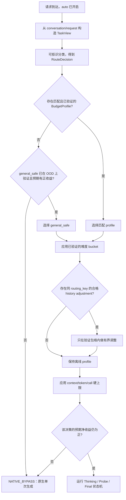

# Think Budget 泛化性实施计划

## 1. 设计目的

本文设计 Think Budget 从“单场景固定参数可获得收益”走向“服务端开启后自动
选择安全且有效的策略”的实施方案。目标是在 13 个产品慢思考场景上尽量扩大
端到端时延收益，同时用独立的产品留出集和通用任务集约束质量退化与场景过拟合。

设计起点：

- 文档日期：2026-07-30；
- 仓库 revision：`06a09eb`；
- 目标集成环境：vLLM `v0.23.0`、vLLM-Ascend `v0.23.0rc1`；
- 当前性能证据：
  [`run_02/RESULT.md`](../log/perf/run_02/RESULT.md) 与
  [`deer_performance_analysis.md`](../debug/deer_performance_analysis.md)；
- 当前算法边界：
  [`think_budget_vllm_adapter_refactor_plan.md`](../debug/think_budget_vllm_adapter_refactor_plan.md)；
- 13 个产品测试集及新增语义质量分尚未进入本仓库，因此本文定义其数据接口、
  实验方法和准入规则，不虚构具体质量阈值或跨场景实测结论。

这是一次受质量约束的性能优化与自动策略选择设计，不是单纯的任务分类器扩词，
也不是让线上用户继续传递 `fixed_*` 超参数。

### 1.1 “开启即优化”的操作定义

对普通请求，产品只需要开启 Think Budget 的 `auto` 模式：

1. 不要求用户传 `fixed_check_length`、`fixed_think_stride`、
   `fixed_num_thinking`、`fixed_prob_th` 等算法参数；
2. 服务端根据请求中已经存在的结构化信息自动选择经过验证的预算档位；
3. 无法可靠识别或没有合格策略时，自动回到原生单次生成；
4. 调试用请求级 fixed override 可以保留，但不属于正式产品接口；
5. “开启”不等于强制每个请求都进入多阶段控制器。原生旁路是自动策略的一种
   安全动作，且旁路请求必须保持原生请求语义。

自动模式的实际总体收益必须把旁路请求也计入：

```text
auto_net_gain
= 所有开启请求的 Vanilla E2E
- 所有开启请求的实际 E2E（受控生成 + 原生旁路）
```

不能只报告被路由到某个高收益档位的条件收益。

### 1.2 范围与非目标

本计划覆盖：

- 13 个产品场景的数据分层、预算策略发现、路由与留出验证；
- 通用/OOD 任务的质量和性能护栏；
- `_decide()`、任务分类、难度估计、历史预算和配置模型的演进；
- 请求级 telemetry、实验产物、灰度、回滚和验收。

本计划不改变已经裁决的首版性能策略：

- trial answer 最多 50 token；
- trial 使用 clean child context；
- trial 不写回主思考链；
- final answer 新鲜生成；
- Value Min 在出现跨场景语义收益证据前继续关闭；
- 不恢复 answer list、soft truncation 或候选答案复用。

MTP 维持生产默认，不作为本轮泛化实验变量。

## 2. 当前结论与问题定义

### 2.1 已有证据

| 结论 | 证据强度 | 影响 |
| --- | --- | --- |
| run_02 相对三次 Vanilla 均值，平均 E2E 降低 `20.5613 s / 31.48%`，可见 token 降低 `55.48%` | 实测 | 证明固定策略在一个场景存在明显净收益 |
| 计入 1650 个 hidden probe token 后，总模型 generated token 仍降低约 `53.20%` | 实测 | 50-token probe 在该场景具有净 token 收益 |
| run_02 的 thinking wall 占 E2E `68.82%`，probe 占 `11.17%` | 实测 | 预算和停止策略仍是主优化变量 |
| 16/16 prompt 被 task classifier 判成 `classification`，实际 scene 为 planning/fault/code 混合 | 实测 + 源码确定 | 动态预算前必须修复完整 prompt 污染和弱命中即路由 |
| 当前 decision 平均约 `5.53 ms`，普通 controller CPU 不是成本中心 | 实测 | 首版路由应保持轻量，不引入额外 LLM 分类请求 |
| run_02 的结构正确率为 100%，但该 Judge 只检查 JSON 结构 | 实测 | 还不能声明语义质量非劣 |

### 2.2 当前实现不适合作为自动默认策略的原因

1. `_classify_task()` 对 tokenizer 解码后的完整 prompt 分类。系统说明、输出
   schema、few-shot 示例和工具描述会与真实用户任务共同计分。
2. 当前 `task_matched` 只要求已知非 general 类型且
   `task_confidence > 0`。一次弱子串命中也可能选择任务预算，没有拒识门。
3. `scene_classifier.py` 与 `task_type_budget.py` 分别计分，再用固定优先级
   合并。两者的概念和证据可能冲突，当前 telemetry 也没有记录命中 span。
4. 任务类别直接绑定预算。产品语义类别相同的请求未必具有相同的成本—质量
   曲线；不同语义类别也可能共享同一个合格预算。
5. 当前难度估计将 14 维启发式结果映射到很宽的连续预算区间，再与任务预算
   逐字段平均；这些区间尚未用 13 个场景校准。
6. 未命中任务进入 history。新任务默认 `num_thinking=99`，随后依赖
   `max_internal_calls` 和硬 token 上限兜底，不是面向低时延的冷启动策略。
7. history 按已执行策略产生的 thinking token 学习。该值是受当前预算和停止
   阈值截断的结果，不等同于“保持质量所需的 token”，存在自反馈偏差。
8. 普通线上 history 没有质量标签。无标签记录可以描述成本分布，不能证明
   更低预算仍正确。

因此，直接增加 13 个 task type 和各自参数会同时放大误路由、数据泄漏和
历史自反馈风险。

## 3. 优化目标与验收口径

### 3.1 受约束目标

对数据集/场景 \(s\) 和自动策略 \(\pi\)，定义：

```text
gain_latency(s, π) = E[E2E_vanilla - E2E_auto]
gain_tokens(s, π)  = E[total_generated_vanilla - total_generated_auto]
quality_delta(s, π)= Q_auto - Q_vanilla
```

其中 `total_generated_auto` 必须包含 visible thinking、hidden probe 和
final answer。自动策略选择目标为：

```text
最大化：
  产品场景等权宏平均 gain_latency
  + 真实流量加权 gain_latency
  - 尾时延和最坏场景退化惩罚

约束：
  每个产品场景的质量非劣
  产品宏平均质量非劣
  通用/OOD 集质量非劣
  隐藏 token、内部调用、错误和取消有硬上限
```

等权宏平均防止大数据集掩盖小场景退化；流量加权指标反映实际业务收益。二者
必须同时报告，不能互相替代。

### 3.2 质量门

每个数据集先声明一个 `QualityContract`：

```text
QualityContract
  primary_metric
  metric_direction
  non_inferiority_margin
  hard_failure_predicates
  judge_version
  reference_version
  minimum_effective_samples
```

质量门必须在查看候选策略的密封留出结果前固定。新增语义质量分上传后，根据
其量纲、基线方差和产品容忍度填写 `non_inferiority_margin`；本文不以结构
正确率替代语义质量，也不预设一个不适用于所有场景的统一分值差。

建议的判定顺序：

1. 解析错误、工具名/参数错误、关键事实错误等 `hard_failure` 不得新增；
2. 每个产品场景的 paired quality delta 单侧置信区间下界不得越过非劣界；
3. 产品等权宏平均和流量加权质量都必须非劣；
4. 通用/OOD 集独立通过同样的非劣判断；
5. 只有全部通过后才按时延选择候选。

小数据集不应以“均值碰巧没降”判定通过。样本数不足以建立有效区间时，结果为
`INCONCLUSIVE`，不能自动晋级。

### 3.3 性能门

质量通过后，再比较：

- paired E2E mean、P50、P95 和单侧置信区间；
- visible thinking、hidden probe、final 和 total generated token；
- 每个 phase 的 queue/prefill/decode/wall；
- accept round、probe 次数、原生旁路率；
- 最坏场景回归和最慢 5% 请求；
- `auto_net_gain`、受控请求条件收益、策略覆盖率；
- 相对“每场景最佳合格固定参数”的自动路由 regret。

候选策略必须至少在产品宏平均 E2E 上有正净收益。具体最坏场景容忍值、P95
目标和最低自动覆盖率应在第一次 13 场景摸底后写入 campaign manifest，不能
在看到最终结果后调整。

## 4. 核心概念

### 4.1 TaskView

`TaskView` 是供路由使用的真实任务视图，不是完整 chat template 文本：

```text
TaskView
  latest_user_text
  relevant_user_history
  output_contract_features
  tool_capability_features
  language
  prompt_token_count
  excluded_region_hashes
```

它显式排除：

- system/developer 固定说明；
- assistant few-shot 答案；
- 重复输出 schema 正文；
- 工具说明中的自然语言描述；
- chat template 的控制 token。

输出合同和工具能力不是完全丢弃，而是转成结构化特征，例如“要求 JSON”、
“存在函数工具”、“需要 SQL”，避免其大段文字污染关键词分类。

### 4.2 SemanticTaskType 与 BudgetProfile

两个概念必须分离：

- `SemanticTaskType` 描述请求在做什么，例如规划、故障诊断、数学、代码、
  检索或工具调用；
- `BudgetProfile` 描述哪一组预算和停止策略经过质量验证。

多个 semantic task type 可以共用一个 profile；同一 semantic task type 的
不同成本形态也可以使用不同 profile。13 个产品数据集只是离线数据来源，
不是天然的 13 个线上 profile。

只有同时满足以下条件才建立专用 profile：

1. 有生产可见且不会泄漏答案/数据集身份的稳定路由特征；
2. 相对父 profile 的成本—质量曲线确实不同；
3. 在独立留出集上获得显著或有业务意义的额外净收益；
4. 误路由到该 profile 不会造成不可接受的质量损失。

否则样本向上收缩到共享 profile 或 `general_safe`。

### 4.3 RouteDecision

```text
RouteDecision
  semantic_task_type
  profile_candidate
  confidence
  top_score
  margin
  evidence_codes
  excluded_only_matches
  is_ood
  reject_reason
  classifier_version
```

`confidence` 不再只是 top score / 全部 score。路由至少同时满足：

- top score 达到最小证据门；
- top1 与 top2 的 margin 达到门限；
- 有来自 `TaskView` 真实任务区的有效证据；
- 候选 profile 在当前模型、模板和策略版本上处于 `VALIDATED` 状态。

任一条件不满足就拒识，不把“最接近的已知类型”强行当成命中。

### 4.4 PolicyBundle

`PolicyBundle` 是离线验证后随服务部署的只读策略包：

```text
PolicyBundle
  schema_version
  policy_version
  model_revision
  tokenizer_revision
  prompt_template_revision
  classifier
  profiles
  difficulty_buckets
  confidence_calibration
  validation_summary
  fallback_profile
```

策略包与可追加的在线历史分离。服务启动时校验版本和字段完整性，原子加载；
版本不匹配或加载失败时回到原生路径，而不是使用部分配置。

### 4.5 HistoryPrior

离线 13 场景实验得到的先验使用显式 `HistoryPrior`，不伪造成
`inference_history.jsonl` 中的历史请求：

```text
HistoryPrior
  routing_key
  source_dataset_hashes
  sample_count
  quality_contract_version
  quality_passed
  thinking_token_quantiles
  accept_round_distribution
  latency_quantiles
  candidate_profile
  provenance_run_ids
```

这样可以区分“经过质量验证的离线先验”和“线上尚未评分的观测”。

## 5. 目标决策流程



### 5.1 原生旁路

新增 `NATIVE_BYPASS` 是泛化质量的关键护栏：

- OOD 或低置信路由默认旁路；
- 没有经当前模型版本验证的 profile 时旁路；
- 预估 probe 成本高于可节省思考成本时旁路；
- 策略包、分类器或 history 发生异常时旁路；
- 旁路不得进入三状态机后再模拟“原生”，应直接复用 vLLM 原生单次生成路径。

旁路会牺牲该部分流量的潜在时延收益，但避免为了提高“路由覆盖率”对未知任务
错误压缩。随着通用 profile 在 OOD 集上通过验证，再逐步提高覆盖率。

### 5.2 任务分类修正

第一版使用规则和廉价结构特征，不额外发起模型分类请求。具体修改：

1. 从 `conversation` 的 role 和 request 的 tool/schema 字段构造
   `TaskView`，不再从完整 `prompt_token_ids` 解码结果分类；
2. 英文短词使用词边界，选项使用独立行首正则；`A.` 不能在任意正文位置命中；
3. 对重复 schema、few-shot 和固定模板维护排除规则，并记录
   `excluded_only_matches`；
4. 合并 scene/task 两套冲突计分为一个可审计路由器，或至少共享同一个
   `TaskView` 和证据模型；
5. 引入 `min_score`、`min_margin` 和 `unknown`；
6. telemetry 记录 evidence code、分数、margin 和拒识原因，不记录完整正文；
7. 用 13 场景人工黄金标签和 OOD 集报告 confusion matrix、拒识率以及
   “误路由损失矩阵”。

分类准确率不是最终目标。一个将 hard math 错送到短 classification profile 的
错误，比两个保守 profile 之间的混淆危险得多，因此还要报告每种混淆带来的
质量/时延 regret。

### 5.3 预算 profile 的层次化发现

建议的层次：

```text
native
└── general_safe
    ├── short_structured
    ├── planning_diagnosis
    ├── tool_execution
    ├── knowledge_reasoning
    └── math_code_long
        └── 仅在证据充分时再细分
```

以上名称只是初始建模用 archetype，不应在摸底数据前固化。实际分组依据是
质量合格候选的预算—时延响应曲线，而不是产品名称。

专用 profile 采用向父级收缩的晋级规则：

1. 先测试父 profile；
2. 只有父 profile 在该场景质量通过但性能明显非最优，才搜索专用候选；
3. 专用候选在开发集、交叉留出和密封留出都优于父 profile 才晋级；
4. 数据不足、收益不稳定或路由不可分时继续使用父 profile。

run_02 的 `check=1024 / stride=512 / rounds=4 / min=100 /
threshold=0.90` 只能作为其原场景的强候选和相邻 profile 的搜索锚点，不能
直接升级为全局默认。

### 5.4 参数化与搜索空间

减少互相冗余的自由参数。对搜索和报告统一计算：

```text
max_visible_think
= check_length
+ num_thinking × think_stride
```

同时保留 `min_think_budget` 和 `confidence_threshold`。候选生成优先基于
Vanilla reasoning token 分位数和已观测 accept round，而不是对 1–6000 的
连续区间盲目网格搜索。

搜索顺序：

1. 固定 50-token probe，先在安全锚点附近校准 threshold；
2. threshold 通过质量门后，分别缩放 check 和 stride；
3. 再测试 rounds/max_visible_think；
4. 单变量候选筛出后才组合；
5. 用开发集上的 successive halving 或约束贝叶斯搜索减少完整服务器实验数；
6. 密封留出只评估最终少量候选，不参与继续调参。

run_02 的 `0.90 → 0.89 → 0.88 → 0.875` 离线回放仍可用于该 profile
预筛，但回放不能替代真实 final 和质量测试。

候选选择采用保守规则：

```text
先淘汰所有质量不合格/不确定候选；
在剩余候选中最大化 latency gain 的置信下界；
收益相近时选择 profile 更少、预算更保守、路由更简单的候选。
```

### 5.5 难度估计

首版不直接启用当前 0–1 连续难度到 400–6000 token 的宽区间外推。改为
profile 内的离散、有界调整：

```text
DifficultyBucket
  profile_id
  feature_version
  cut_points
  LOW -> validated_vector_low
  MEDIUM -> validated_vector_base
  HIGH -> validated_vector_high
```

约束：

- 每个 vector 都必须在该 profile 的留出集上独立通过质量门；
- 只在已验证包络内选择，不能从公式外推新预算；
- 样本不足时退回 base；
- 难度只使用生成前可见特征；
- 报告 bucket calibration、每 bucket 质量和误分 regret；
- 先与“无难度、固定 profile”做消融，证明它提供额外净收益后才默认启用。

当前 task+difficulty 逐字段平均可以保留为兼容分支，但不应直接成为 `auto`
生产默认。

### 5.6 置信度停止策略

原始 average logprob 在不同任务、语言和轮次之间未必同尺度。分两阶段演进：

第一阶段：

- 每个 profile 使用固定、经留出验证的 threshold；
- threshold 有全局上下界；
- Value Min 继续关闭；
- 每轮保留 raw average、round、difficulty bucket 和 accept reason。

第二阶段，在数据足够后引入轻量校准器：

```text
p_safe_stop = calibrate(
    profile_id,
    probe_round,
    raw_confidence,
    difficulty_bucket,
    trial_stop_reason
)
```

只有当 `p_safe_stop` 达到预声明精度门，且本轮 probe 的期望节省为正，才
提前停止。校准器必须离线训练、版本化和 OOF 验证，不在服务中在线拟合。

### 5.7 历史预算

历史功能遵循“先验与观测分离、成本与质量分离、只做有界调整”：

1. 13 场景已验证结果写入 `PolicyBundle/HistoryPrior`，不预填伪历史请求；
2. 线上历史 key 至少包含 `profile_id + model_revision +
   prompt_template_revision`，不能把所有 unknown/general 混为一组；
3. 未评分记录只能更新成本、accept round 和方差，不能触发更激进的预算下降；
4. 只有 `quality_observed=true` 且达到最小样本数的记录才能支持质量相关调整；
5. error/cancel 不进入正常 token 分位数；
6. history adjustment 不能越出 profile 已验证预算包络；
7. 禁止 5 条无标签记录自动注册永久 task type；
8. 默认关闭 `new_task_unlimited`，冷启动使用 `general_safe` 或 native；
9. 保存 policy version，防止新旧策略产生的截断 token 混合统计；
10. 在线自适应先只做 shadow 建议，经过离线回放和 canary 后再生效。

如产品存在延迟质量分，新增按 `parent_request_id` 回填质量的接口。没有质量
回填时，history 的作用应限制为 drift 监控和保守上界估计。

### 5.8 Probe 价值与未来扩展

run_02 已证明 probe 在一个场景有净收益，但不能推出所有 profile 都值得
probe。每个 profile 计算：

```text
probe_net_gain
= 因提前接受少走的后续 thinking wall
- probe wall
```

若开发集上 probe 净收益非正，该 profile 应优先 native bypass，而不是仅为
维持统一状态机强制 probe。动态 `should_probe()` 和按轮停止概率模型属于
第二阶段优化；首版先用少量静态 profile 降低验证复杂度。

## 6. 数据与实验设计

### 6.1 13 个产品场景的 ScenarioCard

每个测试集补一份不含答案泄漏的描述：

```text
ScenarioCard
  scenario_id
  dataset_hash
  product_domain
  semantic_task_distribution
  output_contract
  scorer / semantic_judge
  hard_failure_predicates
  template_families
  language_distribution
  expected_traffic_weight
  risk_level
  sample_count
```

13 个数据集不能直接全部作为调参集。需要：

- 去除精确和近重复样本；
- 识别共享 system prompt、few-shot 和 schema 的模板族；
- 按模板族/问题族分组切分，避免同模板样本跨开发与密封留出造成泄漏；
- 保留每场景的开发集、校准集和密封留出集；
- 如果样本过少，采用 group K-fold 产生 OOF 结果，但仍保留最终未触碰集；
- 数据集 hash、split manifest 和 judge version 固定进实验产物。

### 6.2 通用/OOD 验证集

通用集不是 13 场景的随机混合，应包含产品模板之外的独立任务族：

- 数学和逻辑推理；
- 代码生成/修复；
- 知识问答和长文本综合；
- 指令遵循与结构化输出；
- 工具/函数参数生成；
- 简单检索、分类和短回答；
- 多语言及长短 prompt；
- 特意包含会误触产品关键词、选项标记和 schema 文本的 adversarial routing
  样本。

按能力类型等权报告，不能让大量短 QA 掩盖 hard reasoning 退化。通用集用于：

1. 训练/调参阶段的 OOD 开发子集；
2. 完全隔离的 OOD 密封留出；
3. 分类器拒识和 `general_safe` 的验证。

如果某类 OOD 没有合格 profile，native bypass 是正确结果。需要同时报告
OOD 旁路率，防止以旁路全部请求“获得质量非劣”却声称算法已全面泛化。

### 6.3 基线和上界

每轮至少包含：

| 变体 | 作用 |
| --- | --- |
| `VANILLA` | 原生质量、时延和 token 基线 |
| `CURRENT_AUTO` | 当前 task/difficulty/history 实现，识别已有行为 |
| `GLOBAL_SAFE` | 不做专用路由的共享合格候选 |
| `PROFILE_AUTO` | 本计划的自动路由策略 |
| `SCENE_ORACLE` | 每场景离线最佳质量合格固定候选，只作为上界，不部署 |

`SCENE_ORACLE - PROFILE_AUTO` 是自动策略 regret。它能区分“参数本身没有找到”
和“路由没有选对参数”两类问题。

run_02 fixed 配置只在对应场景中作为额外锚点，不冒充 `GLOBAL_SAFE`。

### 6.4 分阶段实验

#### E0：摸底与基线冻结

1. 对 13 场景和 OOD 集运行 Vanilla 至少 3 个随机交错重复；
2. 固定 sampling、seed、到达节奏、并发、cache 初态和 MTP；
3. 上传并验证语义评分，填写每个 `QualityContract`；
4. 记录 Vanilla reasoning/final token、E2E 和模板分布；
5. 重复 run_02 两轮，确认现有单场景候选可复现。

输出：基线 manifest、split、quality baseline、样本级明细和场景权重。

#### E1：路由 shadow

1. 实现 `TaskView` 和可拒识 `RouteDecision`；
2. 所有请求仍走 Vanilla，仅记录路由建议；
3. 用人工黄金标签报告 confusion matrix、margin、拒识率；
4. 检查固定模板是否仍污染分类；
5. 构建误路由损失矩阵，确定 `min_score/min_margin`。

退出条件：run_02 的 16 个样本不再因固定 “classify actions” 误判，且所有
高风险混淆均会被正确路由或拒识。

#### E2：共享安全 profile

1. 从 Vanilla token 分位数和 run_02 锚点生成少量候选；
2. 在产品开发集和 OOD 开发集上做 threshold、check、stride、rounds 的
   分阶段搜索；
3. 选出同时通过质量门的 `general_safe`，否则保持 native；
4. 测量 probe 净收益和 controlled coverage。

退出条件：共享 profile 在声明覆盖范围内质量非劣，产品宏平均时延有正净
收益，并且没有未解释的 P95/错误回归。

#### E3：层次化专用 profile

1. 按候选预算响应曲线聚合场景；
2. 只对父 profile 明显非最优的组做专用搜索；
3. 对每次拆分做 group OOF 和密封留出验证；
4. profile 数量、覆盖率和 oracle regret 一起报告；
5. 无稳定增益的专用 profile 合并回父级。

退出条件：每个专用 profile 都有独立收益证据和可靠生产路由特征。

#### E4：难度和历史消融

依次比较：

```text
profile only
profile + difficulty bucket
profile + offline prior
profile + shadow online history
```

只有某层在质量门内继续提升 `auto_net_gain`，才进入下一层。不得一次同时
启用难度、历史和新分类规则后只报告组合结果。

#### E5：密封留出和发布候选

1. 冻结 classifier、PolicyBundle 和全部超参数；
2. 一次性运行产品与 OOD 密封留出；
3. 计算分层 paired bootstrap 置信区间；
4. 做 13 场景多重比较控制或报告同时置信区间；
5. 失败后回到开发阶段，新版本不得重复查看并继续拟合原密封留出；
6. 形成只读 release bundle 和完整验证摘要。

### 6.5 服务器测试控制

沿用性能 runbook，并额外要求：

- 同一样本的各变体按 block 随机交错，避免温度、负载和 cache 时间漂移；
- cold/warm cache 作为显式实验层，不混合汇总；
- 并发至少包含生产默认和并发 1 诊断；
- 每个外部请求按 `parent_request_id` 关联所有 phase；
- 保存 routing、profile、difficulty/history source 和实际 BudgetPlan；
- 语义 judge 与生成服务解耦，judge 版本和提示 hash 入 manifest；
- profiler 结果不进入正式时延数字。

### 6.6 汇总表

每个场景输出：

| 场景 | N | 质量基线/自动/差值 CI | E2E 基线/自动/收益 CI | P95 | visible think | hidden probe | final | total generated | controlled/bypass | accept rounds |
| --- | ---: | --- | --- | ---: | ---: | ---: | ---: | ---: | --- | --- |

总览同时输出：

- 产品场景等权宏平均；
- 流量加权平均；
- OOD 能力等权宏平均；
- 最坏场景；
- hard failure 清单；
- profile 覆盖和拒识率；
- classifier/profile/oracle regret；
- controller 总工作量与原生调用次数。

## 7. 配置与核心数据结构

### 7.1 新增结构

```python
@dataclass(frozen=True)
class TaskView:
    latest_user_text: str
    relevant_user_history: tuple[str, ...]
    output_contract_features: frozenset[str]
    tool_capability_features: frozenset[str]
    language: str
    prompt_token_count: int
    excluded_region_hashes: tuple[str, ...]


@dataclass(frozen=True)
class RouteDecision:
    semantic_task_type: str
    profile_candidate: str | None
    confidence: float
    top_score: float
    margin: float
    evidence_codes: tuple[str, ...]
    excluded_only_matches: bool
    is_ood: bool
    reject_reason: str | None
    classifier_version: str


class ExecutionAction(str, Enum):
    CONTROLLED = "controlled"
    NATIVE_BYPASS = "native_bypass"


class PolicySource(str, Enum):
    REQUEST_FIXED = "request_fixed"
    VALIDATED_PROFILE = "validated_profile"
    GENERAL_SAFE = "general_safe"
    HISTORY_ADJUSTED = "history_adjusted"


@dataclass(frozen=True)
class BudgetProfile:
    profile_id: str
    status: str
    budget: BudgetVector
    confidence_threshold: float
    max_visible_think: int
    max_internal_calls: int
    allowed_task_types: tuple[str, ...]
    model_revision: str
    template_revision: str
    validation_run_ids: tuple[str, ...]


@dataclass(frozen=True)
class AutoBudgetDecision:
    execution_action: ExecutionAction
    route: RouteDecision
    policy_source: PolicySource | None
    profile_id: str | None
    budget_plan: BudgetPlan | None
    fallback_reason: str | None
```

`BudgetPlan` 继续作为 controlled 三状态机的唯一预算输入，并增加：

- `profile_id/profile_version`；
- `route_confidence/classifier_version`；
- `difficulty_bucket`；
- `history_prior_id/history_adjustment`；
- `fallback_reason`；
- `expected_probe_net_gain_ms`（有模型时）。

### 7.2 配置模型

建议将当前 `TASK_TYPES` 的可编辑预算升级为版本化策略包，YAML 只保留：

```text
AUTO_ROUTING
  enabled
  classifier_version
  min_score
  min_margin
  ood_action

POLICY_BUNDLE
  path
  expected_schema_version
  require_model_revision_match
  require_template_revision_match

ONLINE_HISTORY
  mode: disabled | shadow | bounded
  minimum_quality_observed
  maximum_adjustment
  auto_registration: false

SAFETY_LIMITS
  max_visible_think
  max_hidden_probe_tokens
  max_internal_calls
  native_on_bundle_error
```

profile 的正式值、来源 run、质量门和版本放在 bundle 中，避免手工 YAML 改值
绕过验证。请求级 fixed override 只在显式 debug/experiment 模式允许，并在
telemetry 标记。

## 8. 内部接口与文件修改

### 8.1 核心接口

```python
def build_task_view(
    conversation,
    request,
    *,
    prompt_token_count: int,
) -> TaskView:
    """从结构化 chat 输入构造分类视图，不读取完整模板化 prompt。"""


def route_task(
    task_view: TaskView,
    policy_bundle: PolicyBundle,
) -> RouteDecision:
    """返回可拒识路由和可审计证据。"""


def select_auto_budget(
    route: RouteDecision,
    task_view: TaskView,
    policy_bundle: PolicyBundle,
    history_snapshot,
    hard_limits,
) -> AutoBudgetDecision:
    """选择 validated profile、有界修正或原生旁路。"""


def record_quality_observation(
    parent_request_id: str,
    *,
    score: float,
    passed: bool,
    judge_version: str,
) -> bool:
    """为延迟质量信号幂等回填历史；不得阻塞生成响应。"""
```

调用关系：

1. vLLM serving 完成原生 prompt 解析和 DP/LoRA/trace 上下文构造；
2. `build_task_view()`、`route_task()` 和 `select_auto_budget()` 只执行一次；
3. `NATIVE_BYPASS` 直接继续原生 serving；
4. `CONTROLLED` 才创建 `RequestStateContext` 和三状态机；
5. 两条路径都记录同一 schema 的 parent-level auto decision。

### 8.2 文件级修改

#### `dtb.patch`

- 在已经取得 `conversation`、request、prompt tokens 和原生 route context 后
  执行一次 auto decision；
- 支持 `NATIVE_BYPASS` 继续原生单次生成；
- 保证 bypass 不重复 tokenize/prefill，不丢 priority、LoRA、trace、
  parser 和 DP rank；
- fixed experiment override 仍可强制 controlled，但仅用于实验。

#### `think_budget_vllm_adapter/context.py`

- 增加 `ExecutionAction`、`PolicySource`、`BudgetProfile` 和
  `AutoBudgetDecision`；
- 扩展 `BudgetPlan` 的 profile/route/version/fallback 字段；
- 保持 `PerformancePolicy` 现有不变量。

#### `think_budget_vllm_adapter/budget_controller.py`

- 将当前 `_decide(prompt_text, ...)` 拆成 task view、route、profile select；
- fixed branch 保留为调试最高优先级；
- 增加 validated profile、general safe 和 native bypass；
- difficulty/history 只能在 profile 验证包络内修正；
- decision telemetry 同时覆盖 controlled 和 bypass；
- bundle/history 异常 fail-safe 到 native。

#### `optimizations/task_type_budget.py` 与 `scene_classifier.py`

- 统一结构化输入和证据；
- 增加词边界、独立选项行、排除区、score/margin 门和 unknown；
- 返回命中 evidence code；
- 删除“任意 confidence > 0 即 task matched”；
- 保留兼容 API 直到新黄金测试和 server shadow 通过。

#### `optimizations/difficulty_estimator.py`

- 增加 profile-specific bucket 模式；
- continuous 旧映射保留兼容但默认关闭；
- 输出 bucket、cut point version 和是否回退 base。

#### `history/history_budget.py` 与 `history/history_module.py`

- history key 加 profile/model/template/policy version；
- 区分 offline prior、unlabeled cost observation 和 labeled quality；
- 禁用无质量 auto-registration；
- 增加 delayed quality update；
- 新任务不再默认 unlimited；
- bounded 模式不能越出 validated profile。

#### `config/unified_config.py` 与 `config/budget_config.yaml`

- 增加 auto routing、bundle、history mode 和 safety limits；
- 配置加载时校验 bundle schema 与运行模型/template 身份；
- YAML fallback 必须是 native-safe，不能静默启用未验证动态预算。

#### `telemetry.py` 与 `tools/extract_tb_phase_metrics.py`

- parent decision 增加 route/profile/action/fallback；
- requests 汇总增加 controlled/bypass、auto gain 所需字段；
- 不把 request/scenario id 放进 Prometheus 高基数 label。

## 9. 遥测与实验产物

### 9.1 Decision telemetry

每个请求记录一条：

```json
{
  "schema": 2,
  "parent_request_id": "chatcmpl-x",
  "phase": "decision",
  "execution_action": "controlled",
  "semantic_task_type": "planning",
  "profile_id": "planning_diagnosis-v2",
  "classifier_version": "route-v2",
  "route_confidence": 0.91,
  "route_margin": 0.42,
  "evidence_codes": ["USER_PLAN_STEPS"],
  "reject_reason": null,
  "policy_source": "validated_profile",
  "difficulty_bucket": "medium",
  "history_mode": "shadow",
  "fallback_reason": null,
  "budget_plan": {}
}
```

旁路也记录 decision，但没有 child engine phases；原生 request metrics 仍由 vLLM
记录。

### 9.2 Campaign 目录

```text
docs/log/perf/generalization/<campaign_id>/
├── manifest.json
├── scenario_cards.json
├── split_manifest.json
├── quality_contracts.json
├── policy_candidates.json
├── policy_bundle.json
├── routing_predictions.jsonl
├── requests.jsonl
├── controller_phases.jsonl
├── quality_results.jsonl
├── per_scenario.csv
├── macro_summary.csv
├── metrics.before.prom
├── metrics.after.prom
└── RESULT.md
```

`manifest.json` 在原 runbook 字段基础上增加：

- dataset/split/judge hash；
- candidate generation code revision；
- classifier/profile/bundle version；
- traffic weights；
- 质量非劣界、P95/最坏场景/coverage 准入值；
- 是否为开发、校准或密封留出；
- history mode 和 prior identity。

## 10. 测试计划

### 10.1 无模型单元测试

- `TaskView` 不包含 system/few-shot/schema 正文；
- 同一 user task 在不同 chat template 下得到同一路由；
- “classify actions” 只出现在固定说明时不会命中 classification；
- `A.` 只有在独立选项行且数量满足规则时命中；
- top score、margin、unknown 和拒识原因；
- 低置信、bundle 缺失、版本不符和异常都 native bypass；
- validated profile 选择和父 profile 回退；
- difficulty bucket 不越出验证包络；
- 未评分 history 不降低预算；
- quality 回填幂等；
- fixed debug override 的优先级和 telemetry；
- controlled/native 两条路径只做一次决策；
- stream/non-stream、取消、错误、LoRA、priority、parser 和 DP 上下文不回归。

### 10.2 黄金路由测试

建立三组：

1. 13 场景真实任务区段的人工 semantic label；
2. 对应完整模板 prompt，用于证明模板不污染；
3. OOD/adversarial 样本，用于验证 unknown 和危险误路由。

断言不仅包括 label，还包括 profile、拒识和 evidence code。规则升级必须报告
新旧 confusion 与 misroute regret。

### 10.3 服务器验收

- native bypass 与完全关闭特性的请求输出、usage、sampling 和 engine call
  数一致；
- auto decision CPU 保持毫秒级，不引入额外模型调用；
- controlled phase 与 Prometheus call/token 精确闭环；
- hidden probe 独立记账；
- policy bundle 原子更新和故障回退；
- cold/warm cache、并发 1/生产并发；
- 流式断开、非流式、超时和引擎错误；
- 13 场景与 OOD 密封留出通过第 3 节质量和性能门。

## 11. 灰度、漂移与回滚

发布顺序：

1. `shadow`：只计算 route/profile，不改变生成；
2. `canary`：仅对高置信、低风险且 profile 已验证的少量流量 controlled；
3. 分 profile 扩大流量，而不是一次全局扩容；
4. `general_safe` 最后扩大覆盖；
5. history 从 disabled → shadow → bounded，永不直接进入无界在线学习。

线上按 profile 监控：

- route 分布、unknown/bypass 比例和 template hash 漂移；
- E2E/P95、thinking/probe/final/total token；
- accept round、confidence 分布；
- error/cancel/空响应和 hard failure；
- 延迟质量分及其 judge version；
- 相对同期 Vanilla canary 的 paired/近似 paired 差值。

触发以下任一条件时，受影响 profile 自动回到 native，而不是全局继续冒险：

- bundle/model/template 版本不匹配；
- route 分布或 unknown 比例显著漂移；
- 错误、空响应或 hard failure 越界；
- 延迟质量低于门限；
- E2E/P95 连续窗口无正收益；
- history adjustment 越界或质量标签陈旧。

保留少量稳定 Vanilla control 流量，用于发现模型版本、负载和数据分布变化。

## 12. 关键取舍与未采用方案

### 12.1 不直接一场景一组关键词和参数

该方案能快速拟合 13 个测试集，但：

- 模板词可能成为数据集身份泄漏；
- 线上表达变化会误路由；
- profile 数量随产品增长；
- 通用任务容易被产品词触发；
- 无法区分分类错误和预算错误。

本计划允许在证据充分时建立专用 profile，但要求生产可见特征、层次化收缩和
独立留出收益。

### 12.2 不把离线最佳预算伪造成历史

伪历史会混淆观测请求与经验证先验，还可能让成功率、样本量和时间淘汰逻辑
产生错误结论。用 versioned `PolicyBundle/HistoryPrior` 表达同一信息更可审计。

### 12.3 不在首版增加 LLM 路由请求

run_02 的 decision 成本仅毫秒级，而额外 LLM 请求会增加 queue、prefill、
decode 和可用性依赖。先用结构化输入、可拒识规则和 native fallback；只有
规则覆盖率成为主要收益瓶颈且有成本证据时，才评估轻量分类模型。

### 12.4 不用旁路掩盖低覆盖

旁路是质量护栏，但最终报告必须包含全流量 `auto_net_gain` 和 coverage。
若 100% 旁路，质量安全但优化目标没有完成。

## 13. 一致性校验

- **目标一致性**：优化指标包含所有开启请求和 hidden probe，不能用条件收益
  或 completion usage 代替端到端收益。
- **概念一致性**：semantic task、budget profile、dataset scenario 和 history
  key 不混用。
- **路由完备性**：每个请求只能得到 controlled 或 native bypass；所有拒识、
  配置异常和 OOD 都有确定动作。
- **状态完备性**：只有 controlled 进入 Thinking/Probe/Final；native 不创建
  控制器 child request。
- **质量一致性**：结构正确率、语义质量和 hard failure 分开报告。
- **统计一致性**：开发、校准、密封留出和 OOD 不交叉；候选选择不能回看密封
  留出继续调参。
- **历史一致性**：未评分记录不推导成功率，不把策略截断后的 token 当作质量
  最优预算。
- **接口一致性**：stream/non-stream、LoRA、priority、trace、parser、DP rank
  和取消语义在 controlled/native 两条路径保持原生上下文。
- **性能一致性**：相同模型、采样、到达节奏、并发、cache 和 MTP 下配对；
  profiler 时延不与正式实验混用。
- **配置一致性**：正式 profile 只能来自已验证 PolicyBundle；YAML 或 bundle
  失败采用 native-safe fallback。
- **可调试性**：每个自动决策记录 version、evidence、profile、field source
  和 fallback reason，能从产物离线重放。

## 14. 实施顺序与退出条件

### P0：冻结评价合同

1. 上传 13 场景样本级摸底结果和语义质量分；
2. 完成 ScenarioCard、去重、group split 和 QualityContract；
3. 冻结 Vanilla 基线与产品/OOD 准入值；
4. 重复 run_02，确认单场景锚点。

退出：质量指标可在样本级配对，split/judge/manifest 可复现。

### P1：TaskView、拒识和原生旁路

1. 修复完整 prompt 分类；
2. 实现统一 RouteDecision；
3. 增加 native bypass；
4. 补黄金路由与 vLLM 原生回归；
5. 服务器 shadow。

退出：高风险误路由被消除或拒识，native 与完全关闭行为一致。

### P2：PolicyBundle 与共享 profile

1. 实现只读 bundle 和版本校验；
2. 完成 E2 的共享候选搜索；
3. 形成 `general_safe` 或明确保持 native；
4. 完成 parent/phase telemetry schema 2。

退出：声明覆盖范围内质量非劣且全流量产品宏平均净收益为正。

### P3：层次化专用 profile

1. 完成 13 场景响应曲线和 archetype 聚类；
2. 只拆分有证据的专用 profile；
3. 降低 auto-vs-oracle regret；
4. 完成产品与 OOD 密封留出。

退出：每个 profile 都有稳定路由、独立质量与收益证据。

### P4：难度与历史

1. 难度改成 profile-specific validated bucket；
2. 离线先验显式入 bundle；
3. delayed quality 回填；
4. history shadow 和 bounded canary。

退出：相对 profile-only 继续提高净收益，且没有历史自反馈或漂移回归。

### P5：生产灰度

按 profile canary、扩大和自动回滚，保留 Vanilla control。默认产品接口只暴露
`auto on/off`，不要求用户理解内部参数。

## 15. 执行前需要固化的输入

以下信息缺失不妨碍当前设计，但会阻塞 E0 之后的候选准入：

1. 13 个数据集的样本数、模板族、重复关系和预期流量权重；
2. 新增语义质量分的量纲、judge 版本、样本级结果与基线方差；
3. 每个场景不可接受的 hard failure；
4. 产品宏平均、最坏场景、P95 和最低 coverage 的准入值；
5. 可用的独立通用/OOD 数据集及其 scorer；
6. 线上是否存在可信的产品内部场景 metadata。它可作为可选强证据，但正式
   自动模式不能依赖用户传一组超参数。

## 16. 变更历史

| 日期 | 变更内容 | 原因 |
| --- | --- | --- |
| 2026-07-30 | 创建 Think Budget 泛化性实施计划 | 将单场景固定参数收益转化为 13 产品场景与 OOD 约束下的自动策略、实验和发布方案 |
