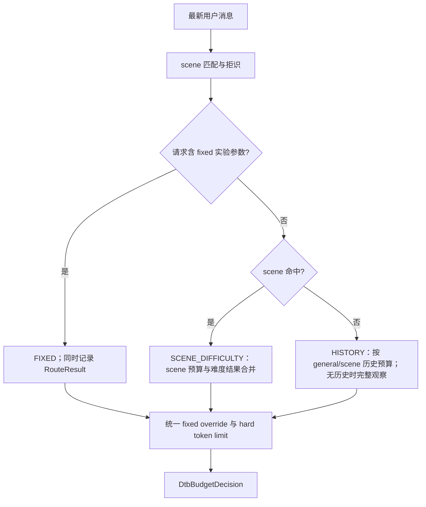
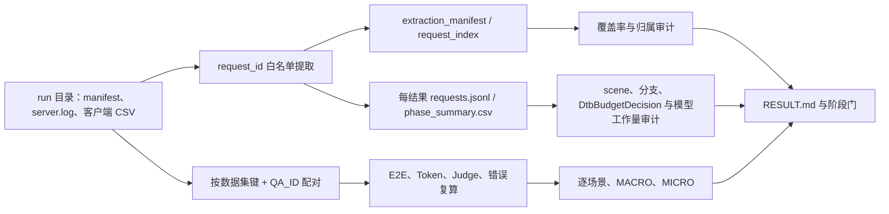

# DTB 泛化性实施计划

## 1. 设计目的

DTB（Dynamic Think-Budget Control）的第一目标是在 13 个产品慢思考场景上，在质量不下降的前提下，
最大化开启特性后的端到端时延收益。用户不应为自己的请求持续传入
`fixed_*` 参数；这些参数只作为阶段一寻找候选策略的实验入口，最终由服务端根据
可见请求自动选择预算。

本计划采用两个阶段：

1. **阶段一：算法寻优。** 先获得 13 场景的 Vanilla、仅开启 DTB、按 Vanilla
   思考长度构造的定制 fixed 策略数据，选择每场景最优策略，再合并为尽量少的预算
   profile，并验证 `scene → budget/reject` 自动选择。
2. **阶段二：在线增强。** 阶段一稳定后再实现陌生场景 history 学习、原生首次
   观察和必要的生产发布保障。阶段一不建设灰度、自动回滚或独立策略包抽象。

一句话流程是：**先用 Vanilla 建立逐样本基线并搜索各产品场景的质量合格最优 fixed
策略，再合并少量 profile、配置 scene 直达预算及拒识规则，最后用自动模式回放产品
集并做一次通用集校验。**

设计基线：

- 文档日期：2026-07-31；
- 当前状态日期：2026-08-21；
- 目标环境：vLLM `v0.23.0`、vLLM-Ascend `v0.23.0rc1`；
- 当前单场景证据：[`run_02/RESULT.md`](../log/perf/run_02/RESULT.md)；
- 当前 13 场景自动模式证据：[`run_07/RESULT.md`](../log/perf/run_07/RESULT.md)；
- 性能归因口径：[`deer_performance_analysis.md`](../debug/deer_performance_analysis.md)；
- 当前生产结构与 telemetry 边界：
  [`dtb_cleanup_and_telemetry_refactor_plan.md`](dtb_cleanup_and_telemetry_refactor_plan.md)；
- 当前 finalization 行为与 run_11 验收：
  [`think_budget_finalization_compatibility.md`](think_budget_finalization_compatibility.md)；
- 旧 adapter 裁决仅作为历史证据：
  [`think_budget_vllm_adapter_refactor_plan.md`](../debug/think_budget_vllm_adapter_refactor_plan.md)。

从 2026-08-21 起，新实验以 `dtb/`、`patches/vllm/v0.23.0/` 和
`dtb-algorithm-v3` 为唯一生产基线。v3 仅把 `confidence_accepted` fresh-final 后缀改为
run_10 已验证的 answer cue，probe 与预算逻辑不变。历史 run 不改写；新 run 的 manifest 必须记录 TB
commit、两份 patch hash、YAML hash、观测模式和实验角色。旧
`think_budget_vllm_adapter/`、根目录 patch 或旧 telemetry 写端不得继续部署。

### 1.1 不可违反的原则

1. 运行时只使用一个分类标识 `scene`，流程为
   `最新用户消息 → scene 或 reject → scene 对应预算`；不再引入
   `task_type` 或必须经过的语义类型实体。
2. 预算、匹配证据和优先级继续通过
   `dtb/config/budget_config.yaml → dtb/config/loader.py` 在进程启动时一次性校验加载，不新增
   `PolicyBundle`。
3. 能推导的字段不存储；实验状态、revision 和验证 run ID 放在实验 manifest，
   不进入运行时 dataclass。
4. 每个场景独立执行质量分层：先只保留正确率不低于 Vanilla 的候选并选择 E2E
   最低者；只有该层为空时，才允许从比 Vanilla 少 1 个正确样本的候选中选择 E2E
   最低者。其他场景的质量增益不能抵消本场景缺口，低质量层的时延优势不能越级。
5. 完成逐场景选择后，用 13 个产品场景等权宏平均 paired E2E gain 汇总最终策略；
   不得新增 hard failure，收益近似时才选择 profile 更少的方案。
6. 性能账本必须包含 visible thinking、hidden probe 和 final answer 的全部模型
   token，并区分 queue、prefill、decode 和控制器耗时。
7. 拒识是自动策略的正常结果。弱证据或 top1/top2 差距不足时不得强行匹配产品
   scene。

## 2. 已有证据与待回答问题

| 结论 | 证据强度 | 对本计划的影响 |
| --- | --- | --- |
| run_02 证明固定策略在单场景可获得显著 E2E 和 token 收益 | 实测 | 支持启动 13 场景 fixed 搜索；不再作为当前自动模式主证据 |
| run_04、fixed_v1/v2/v3 已完成 13 场景三类基线和质量优先选点 | 实测 | search 阶段已有 13 个可发布候选：9 个严格质量层、4 个一题容差层 |
| run_07 的 633/633 请求只传开关后均命中预期 scene 和冻结预算 | 实测 | 已知产品 search 集的“开启即优化”路由与配置闭环已经完成 |
| run_07 相对 run_04 Vanilla 的请求加权 E2E 降低 44.58%，13 场景等权相对降幅 50.65% | 实测 | 13/13 场景平均 E2E 与 P95 均改善，核心产品时延里程碑通过 |
| run_07 人工处理 1 条无效 Judge 后，两侧均为 558/633；7 场景严格非劣、6 场景少 1 题 | 实测 | 通过当前预声明的一题容差门，但不是严格逐场景非劣证明 |
| run_07 hidden probe 为 58,728 token、占 phase wall 8.65%，完整账本为 937,389 generated token | 实测 | hidden probe 已进入结果口径，不能再用客户端 completion token 代替总工作量 |
| run_07 使用参与规则和选点的同一批 633 条 search 样本，且缺少实验 manifest | 实测 | 不能据此声明产品 holdout、通用/OOD 泛化或解释跨 run 质量波动 |

当前尚待回答：

1. 未参与规则设计的产品 holdout 能否保持正确路由、逐场景质量门和正宏平均 E2E；
2. 通用/OOD 请求是否会误命中产品 scene，reject/default 路径的质量与时延如何；
3. 新增错误中是否存在解析、工具调用或关键事实 hard failure；
4. 哪些近似预算可在不改变质量层和时延收益的情况下合并；
5. 模型、量化/后训练状态或服务配置变化后，同身份 Vanilla 与自动 DTB 的收益是否仍然成立。

因此当前状态固定表述为：**13 个已知产品 search 场景的核心里程碑通过，完整阶段一
尚未通过**。完成 holdout、通用/OOD、hard failure 和复杂度门之前，不得缩写为“阶段一
已完成”。

## 3. 最小数据模型

阶段一只使用以下四个概念。它们是文档和实验数据的边界，不要求都实现为
dataclass。

### 3.1 ScenarioSpec

描述一个产品数据集：

```text
ScenarioSpec
  scene                 # 唯一分类和报表标识
  dataset_path
  sample_id_field
  split                 # search / holdout
  quality_metric
  non_inferiority_margin
  hard_failure_rule
```

数据集名称不是天然的预算 profile。只有请求特征可稳定匹配、且成本—质量曲线确实
不同的场景，才保留独立 scene；否则合并到共享预算。

### 3.2 CandidatePolicy

阶段一实验候选：

```text
CandidatePolicy
  policy_id
  fixed_budget_tokens
  fixed_check_length
  fixed_min_think_tokens
  fixed_think_stride
  fixed_num_thinking
  fixed_prob_th
```

`fixed_num_thinking` 由总预算、首次检查长度和 stride 推导后写入实际请求，确保实验
可复现；不再存储可由这些字段推导的 `max_visible_think`。

### 3.3 RouteResult

仅在验证自动路由时记录，不进入 `DtbBudgetDecision`：

```text
RouteResult
  scene
  scene_matched
  candidate_scene
  top_score
  second_score
  score_margin
  reject_reason
  matched_evidence
```

不生成额外 `confidence`。规则路由只使用原始 score、margin 和明确拒识原因。

### 3.4 ExperimentResult

仅用于日志与报表：

```text
ExperimentResult
  run_id / variant / scene / sample_id / parent_request_id
  e2e_ms / ttft_ms
  visible_think_tokens / hidden_probe_tokens / final_answer_tokens
  quality / hard_failure
  effective_budget / route_result / phase_metrics
```

## 4. 模块设计

### 4.1 配置模块

文件：

- `dtb/config/budget_config.yaml`
- `dtb/config/loader.py`
- `dtb/config/schema.py`

`SCENES.<scene>` 同时保存：

- `indicators.strong`、`indicators.weak`；
- `typical_tokens`、`token_range`；
- `check_length`、`min_think_tokens`、`think_stride`、`num_thinking`；
- `prob_th` 和 trial answer 长度相关配置。

公开接口：

```python
load_dtb_service_config(path=DEFAULT_CONFIG_PATH) -> DtbServiceConfig
```

`DtbServiceConfig` 聚合算法配置、scene 定义、scene 优先级和观测配置；
`DtbAlgorithmPolicy` 保存不允许由部署 YAML 漂移的算法常量。加载器带进程级缓存，只在
controller 构造时读取和校验 YAML；请求路径不做文件 I/O、`stat`、mtime 检查或降级到
内置默认表。配置错误必须启动失败。`SCENE_PRIORITY` 只解决同分时的确定性顺序，不代替
拒识门。

### 4.2 scene 匹配模块

文件：`dtb/budgeting/scene_router.py`

输入只取最新一条用户消息，排除 system prompt、工具说明、few-shot assistant 内容
和输出 schema 对规则的污染。

匹配规则：

1. 中文短语使用规范化子串匹配；
2. 英文单词和短语使用词边界匹配，避免 `search` 命中 `searchable`；
3. 代码块、LaTeX、多步骤、选项行、`*_count` 字段和 SQL 使用结构规则；
4. 每个配置证据最多计分一次；
5. top score 低于 `scene_match_min_score`，或 top1-top2 小于
   `scene_match_min_margin` 时返回 `general/reject`。

接口：

```python
classify_scene(
    question: str,
    *,
    min_score: float,
    min_margin: float,
    scene_override: str = "",
) -> RouteResult
```

离线测试必须从 `docs/log/test_results` 抽取真实问题。当前已选取
`TC0000000201`、`0204`、`0212`、`0216`：明确故障和规划样本应命中，证据并列样本
应拒识，并防止复现全部被判成 classification 的旧错误。

### 4.3 预算决策模块

文件：

- `dtb/budgeting/budget_resolver.py`
- `dtb/budgeting/budget_decision.py`

决策顺序：



`DtbBudgetDecision` 只保留执行状态机所需字段：

```text
scene / scene_matched / decision_branch / budget
confidence_threshold / percentile_step
source_by_field / policy_version / hard_think_token_limit
```

分类证据、难度分解和 history 统计通过 `decision_details` 打点，不放入
`DtbBudgetDecision`。

难度估计位于 `dtb/budgeting/difficulty/`，是原始设计组成部分，当前默认关闭。此次重构只
迁移并恢复清晰依赖，没有删除或宣称已完成生产有效性验证；重构完成后的单独一致性检视
决定它是否启用、调整或淘汰。

### 4.4 history 模块

文件：

- `dtb/history/store.py`
- `dtb/history/budget_policy.py`

history 的设计目的不是利用在线正确性反馈，而是让模型面对未识别的新场景时，逐步
减少不必要的思考：

1. 首次请求走原生完整思考，记录真实思考 token；
2. 样本较少时按历史最大值和均值乘安全系数给预算；
3. 稳定后按思考 token 的分位数选择预算；
4. 在线决策不读取正确性；质量只由离线陌生验证集检查。

陌生验证方法：固定一组从未参与规则和预算选择的任务，按同一 scene 连续请求
第 1 次到第 n 次，分别报告 E2E、预算和正确率；只有正确率相对第一次完整思考不下降
时，才能认为 history 压缩有效。

当前实现已把历史索引和统计统一为 `scene`，历史数据目录为 `dtb/data/history/`，并将无在线质量标签明确记为
`thinking_tokens_without_online_quality`。但 `first_full_observation` 目前仍由控制器
大预算路径模拟，并不等同于原生单次生成。真正的 native bypass 及其验收属于阶段二；
在完成前不得把该分支描述为“已实现原生首次观察”。

history store 的路径、最大条目、保留天数和异步队列容量由 YAML `HISTORY_STORE` 在启动时
校验；`enable_history_budget=false` 时 controller 不配置或构造 store，也不读写历史文件。

### 4.5 telemetry 与提取模块

文件：

- `dtb/observability/config.py`
- `dtb/observability/phase_recorder.py`
- `dtb/observability/stream_audit.py`
- `dtb/observability/event_writer.py`
- `tools/extract_dtb_phase_metrics.py`

观测配置只有三个互斥模式，均在启动时从 YAML 解析：

| 模式 | 用途 | 写出事件 | 运行约束 |
| --- | --- | --- | --- |
| `off` | 正式性能/质量比较的默认模式 | 无 | 不构造 recorder/writer，不调用计时、反射、序列化或队列 |
| `phase` | 独立的归属与模型工作账本 run | `DTB_PHASE` schema 3、`DTB_REQUEST_SUMMARY` | 异步有界队列；不得与正式性能数混为同一口径 |
| `stream_audit` | parser/tool 流故障定点审计 | `DTB_STREAM_AUDIT` schema 1 | 仅显式 request-id allowlist；不同时创建 phase recorder |

模式不能由单个 HTTP 请求覆盖。修改 `OBSERVABILITY.mode` 后必须重启服务。队列满时请求
协程只增加 dropped 计数并返回，后台 writer 以限频标准日志告警；账本 run 必须在 manifest
和 `RESULT.md` 对账 dropped 数，非零时 phase 完整性门失败。

`DTB_PHASE` schema 3 对每个 phase 记录：

```text
parent_request_id / child_request_id / phase / round
wall_ms / queue_ms / prefill_ms / decode_ms / controller_cpu_ms
prompt_tokens / cached_prompt_tokens / generated_tokens
visible / stop_reason
```

decision 额外记录：

```text
scene / scene_matched / decision_branch / effective DtbBudgetDecision
classification_source / classification_input_chars
candidate_scene / scores / top_score / second_score / score_margin
min_score / min_margin / reject_reason
required_matches / missing_required
strong_matches / weak_matches / structural_matches
difficulty breakdown / history mode and statistics
hard_think_token_limit 的全部候选上限、生效来源与最终值
decision module timings
```

probe 继续记录置信度方法、原始值、pair count、是否接受及原因。日志不记录 prompt 或
回答正文。final answer 额外记录 `final_answer_reason`，取值为
`confidence_accepted` 或 `budget_exhausted`；提取后的 `requests.jsonl` 保留该字段，
用于审计最终生成使用了自由回答后缀还是限时回答后缀。

`DtbRequestState` 是 thinking、hidden probe、final answer token 与 child generate 次数的
唯一生产账本；telemetry 只读取该状态生成请求摘要，不重复记账。响应 completion token
不包含 hidden probe，不能替代 `total_model_generated_tokens`。

提取器兼容历史 `TB_PHASE` schema 1/2 和新 `DTB_PHASE` schema 3，命令行只接收一个
`run_<id>` 目录。该目录根部必须有
`server.log`，目录内必须恰有一个 `_SUMMARY.csv`，summary 引用的每个具体结果文件名
也必须在目录内唯一可解析。多个数据集、Judge 和历史请求共用日志时，使用客户端结果
CSV 中的 `request_id` 作为权威白名单，与 phase 事件的 `parent_request_id` 做精确等值关联：

```text
具体结果 CSV request_id
  → 结果文件归属表
  → server.log 中同 parent_request_id 的 phase
  → 每个具体结果文件的独立提取目录
```

10 秒等待和首末日志行号只用于检查执行顺序，不作为归属条件。首末行表示已知
`request_id` 在结构化服务日志中的可见范围，不等同于客户端 HTTP 测试的精确起止时间；
原生路径完全不打印该 ID 时允许为 `null`。Judge 或旧请求没有出现
在被测结果 CSV 的白名单中，因此即使 phase 与测试请求交错也会被排除。提取器同时输出
`request_index.csv`，逐行记录结果 CSV 行号、是否在日志出现、phase 数及首末日志行；
跨结果文件重复的非空 `request_id` 属于不可消歧输入，直接拒绝提取。Vanilla 没有
phase 是合法状态。`off` 正式性能 run 中 DTB 也没有 phase，是设计状态；它可用于客户端
E2E/质量排名，但不能用于 phase 覆盖、分支来源或总模型 token 裁决。需要这些结论时，使用
相同代码、数据、采样、并发和 cache 条件另跑 `phase` 账本 run，并明确报告 telemetry
开销，不能把两个 run 的 E2E 混合排名。

接口固定为：

```bash
python tools/extract_dtb_phase_metrics.py docs/log/perf/<run_id>
```

提取器不再接收或推导 run 外部输入，也不复制原始 CSV。若服务器产物未完整上传，必须
先在服务器完成提取，再回传 `_SUMMARY.csv`、具体结果 CSV、
`extraction_manifest.json`、`request_index.csv`、每个隔离目录的 `requests.jsonl` 与
`phase_summary.csv`；`controller_phases.jsonl` 可按体积选择上传。GitHub 上缺失
`server.log` 的 run 不要求可重新执行提取，但缺失具体结果 CSV 时不能完成请求级配对和
质量转移分析。

## 5. 具体重构清单

本次评审对应的源码改动：

| 文件 | 改动 |
| --- | --- |
| `dtb/config/{loader,schema}.py`、`budget_config.yaml` | 启动时 fail-fast 加载；合并算法、scene 和观测配置；删除请求级重载 |
| `dtb/budgeting/scene_router.py` | 配置驱动的词边界/结构匹配、产品模板 required gate、score+margin 拒识 |
| `dtb/budgeting/{budget_resolver,budget_decision}.py` | 最新用户消息直达 scene；输出语义明确的 `DtbBudgetDecision` |
| `dtb/budgeting/difficulty/*` | 保留原始难度估计设计并随模块迁移；默认关闭，等待重构后单独检视 |
| `dtb/reasoning/*` | `DtbStateMachine`、`DtbRequestContext`、`DtbRequestState` 与 parser boundary 分责 |
| `dtb/history/*` | 只保留 scene 索引、统计和预算；读取算法状态的唯一工作账本 |
| `dtb/observability/*`、提取器 | 默认关闭；phase 与 stream audit 互斥；新写 schema 3、兼容读历史 schema |
| `dtb/integration/vllm/*`、版本化 patch | vLLM 请求/响应契约与 DTB 算法隔离，patch 只保留可部署差异 |
| `tests/test_dtb_*` | 覆盖 scene-only 决策、状态机、默认关闭、异步写出和兼容提取 |

截至 run_07 的算法证据状态（重构前历史 run，不回写 telemetry）：

1. [x] 13 个产品场景均已补充 `SCENES` 节点、required gate、离线正/负样本和冻结预算；
2. [x] 质量合格 CandidatePolicy 已写入运行时，633/633 条 search 请求自动恢复预期预算；
3. [x] 已知产品样本的 `scene_match_min_score`、`scene_match_min_margin` 与冲突规则已离线校验；
4. [ ] 近似参数的 profile 合并尚未通过质量—时延复杂度门；当前保留 scene 直达预算；
5. [ ] 产品 holdout 和一次通用/OOD 校验尚未执行；
6. [ ] history 的真实 native bypass 仍属于阶段二。

2026-08-20 生产重构状态：旧 adapter 和根目录 patch 已退出生产结构；内部名称统一为
DTB；配置、预算、reasoning、history、observability 与 vLLM integration 已按上表拆分；
默认关闭、phase、stream audit 三种模式已由无模型测试覆盖。难度有效性与目标 NPU 上的
真实“关闭态零可测影响”仍分别需要后续专项检视和服务器 paired run。

## 6. 阶段一实验与数据采集

### 6.1 新实验身份的三类必需 run

首次搜索一个新算法版本，或模型、量化/后训练状态、硬件与关键服务配置发生变化时，
每个产品场景使用相同样本、顺序、采样参数、随机种子、并发、到达节奏和 prefix
cache 状态。正式性能/质量候选统一使用 `OBSERVABILITY.mode: "off"`，至少提供：

1. `vanilla`：原生单次生成；
2. `dtb_default`：仅开启 DTB，不传 fixed 参数；
3. `dtb_fixed_v1`：按本节公式由 Vanilla 构造的场景定制参数。

不要把三个 variant 混在同一进程热状态中。若必须复用进程，manifest 中记录执行
顺序并在结果中标注 cache 状态。新实验身份必须使用同身份 Vanilla；不得因为数据集
名称相同就跨模型、量化/后训练版本或关键服务配置复用旧 Vanilla。

此外，每个进入裁决的 DTB 候选至少提供一次 `OBSERVABILITY.mode: "phase"` 的账本 run，
使用相同代码、数据、sampling/seed、并发/到达节奏和 cache 状态，验证分支、预算来源、
hidden probe 与 phase 完整性。该 run 单独标记 `experiment_role=phase_audit`；正式 run 标记
`experiment_role=official_performance`。两者不得拼接请求或用 phase run 的 E2E 代替关闭态
性能。`stream_audit` 只用于 parser/tool hard failure，不是候选裁决的常规步骤。

### 6.2 基于 Vanilla 构造首个 fixed 候选

对场景 \(s\)，先从 Vanilla 输出解析每条请求的**思考 token**，令
\(T_{50,s}\) 为其中位数。若当前结果只有 completion token、无法分离思考与答案，
先补解析，不能直接用 completion token 代替。

首个候选 `fixed_v1`：

```text
fixed_check_length
  = clamp(round_to_50(0.20 * T50), 100, 2000)

fixed_min_think_tokens
  = fixed_check_length

fixed_think_stride
  = clamp(round_to_50(0.10 * T50), 50, 1000)

fixed_budget_tokens
  = max(fixed_check_length,
        round_to_50(0.50 * T50))

fixed_num_thinking
  = max(1,
        ceil((fixed_budget_tokens - fixed_check_length)
             / fixed_think_stride))

fixed_prob_th = 0.93
```

这个候选用于快速判断“按场景定制是否有价值”，不是最终最优参数。质量合格且有正
收益后，以 `fixed_budget_tokens` 的 `0.35/0.50/0.65 * T50` 做粗搜，再只在最优点
附近调整 check length、stride 和阈值。

### 6.3 回传产物

每个 run 放到 `docs/log/perf/<run_id>/`。测试脚本无法按场景切日志时，使用以下层级；
`test_result` 下移为 run 的子目录，每个具体结果文件对应一个隔离的提取目录：

```text
docs/log/perf/<run_id>/
├── manifest.json
├── server.log
├── test_result/
│   ├── _SUMMARY.csv
│   └── <具体结果文件>.csv
├── extraction_manifest.json
├── request_index.csv
├── extracted/
│   └── <具体结果文件名去扩展名>/
│       ├── controller_phases.jsonl
│       ├── requests.jsonl
│       └── phase_summary.csv
└── RESULT.md
```

`extraction_manifest.json` 记录整份服务日志中 phase 总数、被白名单选中的数量、排除
数量，以及每个结果文件的请求覆盖率和首末匹配行。禁止把不同具体结果文件重新聚合到
同一个 `phase_summary.csv`；跨场景比较在后续分析阶段从各隔离目录读取。`_SUMMARY.csv`
和结果 CSV 可以直接放在 run 根目录，也可以放在子目录；新 run 约定使用
`test_result/`，提取器仍兼容其他历史层级。无论层级如何，整个 run 下的 summary 和其
引用的结果文件名都必须唯一。

`manifest.json` 从 [`manifest.template.json`](../log/perf/manifest.template.json) 复制；
最低字段：

```text
run_id / variant / scene / policy_id
vllm / vllm-ascend / pytorch / torch-npu / CANN / model
adapter_commit / vllm_commit / vllm_ascend_commit
sampling / seed / concurrency / arrival_pattern / prefix_cache_state
fixed parameters
dataset path / sample count
```

### 6.4 历史过渡实验 run_06：分类与 fixed_v3 并行

run_06 不等待 fixed_v3 收口再启动分类验证，但也不提前把未验证的聚类中心写入运行时：

- 6 个 fixed_v2 已过质量门的场景只传 `enable_think_budget = true`，验证模板路由能
  自动恢复各自的冻结向量；
- 其余 7 个场景显式传入各自 fixed_v3，fixed 分支优先于 scene 预算；
- 第一阶段固定 `enable_difficulty_estimator = false`、
  `enable_history_budget = false`；未识别请求使用 default budget，暂不宣称 native bypass；
- `max_think_tokens` 作为 scene 的硬预算上限参与统一取最小值，避免只恢复四维
  `BudgetVector`、却丢失 fixed 实验中的 `fixed_budget_tokens` 约束；
- 6 组冻结配置按 hard limit 暂记为 fast（850/1050）、medium（1500/1600）、
  deep（2600/3050）三类候选。该标签只用于分析和后续交叉回放，不进入运行时对象，
  run_06 前不合并类内参数。

具体场景映射、锚点、预算和验收命令见
[`run_06_scene_routing_and_fixed_v3_plan.md`](../debug/run_06_scene_routing_and_fixed_v3_plan.md)。

客户端逐样本结果最低字段：

```text
scene / sample_id / parent_request_id
e2e_ms / ttft_ms / completion_tokens
quality / hard_failure / error
```

服务端通过相同 `parent_request_id` 关联所有内部 phase。Vanilla 没有内部 phase 时，
仍需提供客户端 E2E、思考/答案 token 分解和质量结果。

### 6.5 裁决分支与生效配置审计

每个 run 在完成请求白名单隔离后、进入性能候选比较前，必须执行一次离线**裁决审计**。
它的目的不是增加运行时抽象，而是证明被测请求实际走了预期分支、使用了预期配置，
避免把 scene 误路由、难度动态预算或 fixed 未生效造成的结果归因给候选参数。

权威输入只使用：

```text
_SUMMARY.csv 与具体结果 CSV
extraction_manifest.json
extracted/<具体结果名>/requests.jsonl
```

对每个预期经过控制器的请求，从 `requests.jsonl` 读取：

```text
decision_branch / scene / scene_matched / reject_reason
effective DtbBudgetDecision / confidence_threshold / percentile_step
hard_think_token_limit / source_by_field / policy_version
final_answer_reason
```

生效配置签名固定为：

```text
(check_length, min_think_budget, num_thinking, think_stride,
 confidence_threshold, percentile_step, hard_think_token_limit)
```

按具体结果文件分别汇总分支、scene、配置签名和字段来源；同一测试集出现多个 scene、
多个配置或拒识时必须展开，不能只报告众数。`DecisionBranch.HISTORY` 只表示进入未命中
scene 的代码分支；若 `decision_details.history.budget_mode=history_disabled`，应报告为
“history 兜底、实际使用 default”，不能描述成使用了历史预算。

每个 run 的 `RESULT.md` 至少记录覆盖率闭合、总体分支/scene 计数、全部有效配置、逐
测试集分解、拒识原因和异常请求。进入性能选择前必须满足：

```text
sum(各结果客户端行) = extraction_manifest.client_rows
sum(decision_branch) = sum(scene) = 被审计 DTB 请求总数
每个 DTB 请求恰有一个 effective DtbBudgetDecision
Vanilla 原生路径没有 DTB decision phase
dtb_default 不出现 fixed 分支或 fixed 字段来源
dtb_fixed_* 全部进入 fixed，且字段来源与传入参数一致
```

任一不等式、缺失 DtbBudgetDecision 或 variant 分支断言失败时，该 run 只能用于排障，不能
参与 E2E 排名。实例见 [`run_04/RESULT.md`](../log/perf/run_04/RESULT.md)。

### 6.6 选择规则

对每个样本 \(i\) 做配对：

```text
paired_gain_i = E2E_vanilla_i - E2E_candidate_i
scene_gain_s  = mean(paired_gain_i in scene s)
macro_gain    = mean(scene_gain_s over 13 scenes)
```

选择顺序固定为：

1. 删除新增 hard failure 的候选；
2. 对每个场景建立严格质量层
   `quality(candidate) >= quality(Vanilla)`，层内选择平均 E2E 最低的候选；
3. 只有严格质量层为空时，才建立一题容差层
   `candidate_correct = vanilla_correct - 1`，并在该层选择平均 E2E 最低的候选；
4. 两个质量层均为空时，该场景没有可发布的 DTB 候选，应继续搜索或 reject/native；
5. 将 13 个逐场景选择结果组合后报告 `macro_gain`，只在不改变上述逐场景选择的
   前提下考虑 profile 合并和复杂度门。

同一数据集的有效样本数相同时直接比较正确条目数；有效样本数不同时比较预声明的
正确率指标。步骤 2 的任何候选都优先于步骤 3，即使步骤 3 的 E2E 更低。宏平均质量
和其他场景的增益只用于汇总，不能把单场景不合格候选提升到更高质量层。

P50、P95、token 分解、phase 耗时、覆盖率和拒识率用于解释结果，不参与重新加权
排名。

### 6.7 新性能结果的标准分析流程

本节是新 session 的执行入口。目标是只依赖一个 run 目录、明确的基线和本节规则，
生成可复核的 `RESULT.md`，不依赖前序对话中的临时脚本或记忆。

#### 6.7.1 数据流与权威来源



| 数据 | 权威用途 | 不能替代的内容 |
| --- | --- | --- |
| 用户实验说明 + `manifest.json` | 实验身份、variant、基线、代码/模型/采样/cache | 不能由文件名前缀反推完整环境 |
| 具体结果 CSV | 请求 E2E、TTFT、completion token、`QA_ID`、回答、Judge、客户端错误 | summary 不能替代请求级配对 |
| `_SUMMARY.csv` | 发现结果文件并与明细复算对账 | 不能单独证明样本相同或路由正确 |
| `extraction_manifest.json` / `request_index.csv` | request-id 归属、覆盖率、排除项与日志行范围 | 不包含最终 DtbBudgetDecision 细节 |
| `requests.jsonl` | 每请求 scene、分支、有效预算、来源、visible/hidden/final token | 不用于替代客户端 E2E |
| `phase_summary.csv` | 每结果的 phase calls、wall/queue/prefill/decode、prompt/cache/generated 汇总 | 异常请求仍需回到 phase JSONL |
| `controller_phases.jsonl` | phase 级异常和停止原因调查 | 正常总体分析无需把多个结果目录重新混合 |
| `RESULT.md` | 派生结论、人工裁决、限制和阶段决策 | 不得反向覆盖原始 CSV |

`docs/report/chart/generate_report.py` 是可选的客户端配对复算和图表层。它与上表共享
具体结果 CSV，但不读取 telemetry，所以不能替代覆盖率、分支、配置和 hidden probe
审计。

#### 6.7.2 第一步：确定比较身份

分析前先写出：

```text
candidate run / variant
baseline run / variant
model、量化/后训练状态、代码和服务身份
DTB policy version、YAML hash、serving/parser patch hash
observability mode 与 experiment_role（official_performance / phase_audit）
数据集集合与 split（search / holdout / OOD）
请求 overrides、sampling/seed、并发/到达节奏、prefix cache
Judge 版本与采样参数
```

基线优先级：同一 run、同一实验身份的 Vanilla > manifest 证明身份相同的其他 run
Vanilla > 只能确认数据集相同的历史 Vanilla。最后一种只能报告观察差异，不能把变化
归因给 DTB。模型、量化、后训练权重或关键 serving 配置改变后，必须重新建立 Vanilla。

结果文件名前缀由实验显式声明，例如 `vanilla_`/`dtb_` 或
`qp_vanilla_`/`qp_dtb_`。规范化数据集键只删除**该 variant 的已声明前缀**、扩展名和
末尾 `_YYYY-MM-DD_HH-MM-SS`；不要维护一个会误删业务名称的全局前缀列表。每个 variant
中的规范化键必须唯一。

#### 6.7.3 第二步：提取与完整性门

存在原始输入但还没有提取产物时执行：

```bash
python tools/extract_dtb_phase_metrics.py docs/log/perf/<run_id>
```

实际 run 目录名含空格、`&` 等 shell 特殊字符时，必须给整个路径加引号。

随后依次检查：

```text
只有一个 _SUMMARY.csv，且其每个结果文件名在 run 内唯一存在
每个具体结果行都有非空、run 内唯一的 request_id
sum(具体结果行) = extraction_manifest.client_rows = request_index 行数
selected_phase_records + excluded_phase_records = total_phase_records_in_log
每个结果 manifest 的 client_rows/request_ids 与具体 CSV 一致
sum(每结果 phase_summary.calls) = selected_phase_records
每个 phase-audit DTB 请求恰有一个 decision 和一个 effective DtbBudgetDecision
dropped telemetry events = 0
```

`extraction_manifest.request_ids` 可以同时包含 Vanilla 和 DTB 请求，而
`total_phase_parent_requests` 只统计日志中实际有 phase 的 parent；原生 Vanilla 没有
phase 时两者不相等是合法的。phase wall 闭合只与**具有 phase 的候选请求 E2E 总和**
比较，不能把同 run 的 Vanilla E2E 也加进分母。

若缺失原始 `server.log`，但已上传 extraction manifest、request index、每结果
`requests.jsonl` 和 `phase_summary.csv`，可以从已提取产物继续分析；必须声明本地未重新
提取。若连这些产物也缺失，只能分析客户端 E2E/质量，不能给出路由、配置或总模型
工作量结论。

#### 6.7.4 第三步：裁决分支和配置审计

按第 6.5 节签名逐结果文件汇总，至少报告：

```text
scene / scene_matched / candidate_scene / reject_reason
decision_branch / classification_source / score_margin
四维预算 / confidence / percentile / hard limit
每个字段 source_by_field / policy_version
difficulty 与 history 是否实际参与
```

同一结果文件出现多个 scene、配置签名或 reject 时全部展开并定位请求，不能只报告众数。
分支名不等于模块实际生效：例如 `scene_difficulty` 且 `difficulty=null` 只表示 scene
预算分支，`HISTORY` 且 `budget_mode=history_disabled` 实际仍使用 default。

variant 断言：

```text
Vanilla：允许没有 phase
dtb_default / 仅开开关：不得出现 fixed 字段来源
dtb_fixed_*：应进入 fixed，且请求值、DtbBudgetDecision 和 source_by_field 一致
自动 scene 验证：预期产品请求应命中目标 scene 和冻结预算
OOD：重点报告产品 scene 误命中率、reject_reason 与实际兜底预算
```

任一请求归属、DtbBudgetDecision 或预期分支不闭合时，先判为路由/配置实验失败，不进入参数
优劣排序。

#### 6.7.5 第四步：请求级配对和指标

在每个规范化数据集键内按 `QA_ID` 做一对一配对，拒绝空值、重复和集合不相等。还应
比较同一 `QA_ID` 的问题与参考答案，或用 manifest 的数据集哈希证明输入内容相同；
只有 ID 相同但内容变化时不能称为 paired 实验。

从明细复算行数、E2E、Token 和正确数，再与两侧 `_SUMMARY.csv` 对账。定义：

```text
gain_i                  = vanilla_e2e_i - candidate_e2e_i
scene_gain_s            = mean(gain_i in scene s)
macro_gain_s            = mean(scene_gain_s over scenes)
macro_gain_pct          = mean(scene_gain_s / mean(vanilla_e2e in scene s))
request_weighted_gain_s = mean(gain_i over all requests)
request_weighted_pct    = sum(gain_i) / sum(vanilla_e2e_i)
faster_count            = count(gain_i > 0)
```

Token 使用相同宏/微结构，但客户端 `Token数` 只叫“响应 completion token”。同时报告
两侧平均/P50/P95；P50/P95 是解释指标，不替代唯一排序指标 `macro_gain_s`。

若需要可重复的配对表或图：复制
[`run_07.json`](../report/chart/configs/run_07.json)，显式修改 baseline/candidate run、
variant 前缀、scene 映射和 `comparison_id`，按
[`report_chart_workflow.md`](../report/chart/report_chart_workflow.md) 生成新的 revision。
新实验第一次运行时，`expected` 先只保留已人工确认的 scene/pair 数；复核后再固化收益
断言。生成器是复算辅助，`RESULT.md` 仍需补 telemetry 和阶段判断。

#### 6.7.6 第五步：质量、错误和人工裁决

自动 Judge 只把去空白后的字面量 `True` 计为正确。质量状态分三类：

```text
correct        # Judge 明确 True
incorrect      # Judge 明确 False
unresolved     # judge_invalid、空白或裁判协议错误，尚无人工结论
```

`unresolved` 不得为了通过门槛静默计对或计错。人工复核后，在 `RESULT.md` 记录 variant、
scene、`QA_ID`、布尔结论、理由和来源；可视化配置通过 `judge_overrides` 应用同一结论，
并把来源文档加入 `additional_inputs`。未解决项存在时，质量门保持 pending。

分别报告：

- 两侧正确数、有效/未解决数和正确率；
- `Vanilla-only correct`、`candidate-only correct` 与净变化；
- 客户端 `错误` 非空项；
- 解析、工具调用、关键事实错误等 hard failure 人工审计。

当前 13 场景自动模式质量门为：每场景优先严格非劣；若该场景没有严格候选，允许
`candidate_correct = vanilla_correct - 1`；任何场景少 2 题及以上均失败。微平均和
场景等权质量必须报告，但不能用其他场景增益抵消某场景超过一题的缺口。新增 hard
failure 独立一票否决。

#### 6.7.7 第六步：模型工作量账本

从每个结果的 `requests.jsonl` 汇总 visible thinking、hidden probe、final answer、
generate calls 和 probe rounds；从 `phase_summary.csv` 按 phase 汇总 calls、wall、
queue、prefill、decode、prompt/cache/generated token 和 known coverage。

必须对账：

```text
total_model_generated = visible_think + hidden_probe + final_answer
phase generated 合计 = total_model_generated
visible_think + final_answer ≈ 客户端 completion token
phase wall 合计 ≈ 具有 phase 的候选客户端 E2E 合计
```

最后两式允许有 tokenizer、usage 边界和控制器外开销造成的小差值，必须报告绝对值与
比例，不能强行改写为相等。queue/prefill/decode 的 known count 必须随数值一起报告；
`decision` 是 CPU phase，没有这些模型时序字段是合法的。

#### 6.7.8 第七步：RESULT 和停止条件

每个新 run 的 `RESULT.md` 使用固定顺序：

1. 一屏结论与是否通过预声明门；
2. 输入、实验身份、基线和证据限制；
3. 提取覆盖与请求归属；
4. 分支、scene、有效配置和值来源；
5. 逐场景和总体 E2E/Token/质量表；
6. Judge 转移、人工裁决、客户端错误和 hard failure；
7. visible/hidden/final 与 phase 账本；
8. 与上一候选或已冻结策略的关系；
9. 阶段验收、下一轮动作、证据强度和变更记录。

停止并降级结论的条件：

| 条件 | 允许结论 |
| --- | --- |
| 样本或输入内容不一致 | 只能做非配对描述，不参与候选选择 |
| 路由、配置或 request-id 归属不闭合 | 只能用于排障 |
| Judge 存在未解决项 | 性能可报告，质量门 pending |
| 缺 telemetry | 可报告客户端 E2E/质量，不能归因分支或声称总模型 token |
| 缺 manifest | 可报告实测差异；跨 run 波动和环境原因保持未归因 |
| 同一 search 集既用于选点又用于验证 | 只能声明 search 里程碑，不能声明 holdout/OOD 泛化 |

## 7. 两阶段实施顺序

### 阶段一：算法寻优

1. 冻结 13 个 `ScenarioSpec` 和 search/holdout；
2. 收集三类必需 run；
3. 按场景通过质量门后选择 fixed 候选；
4. 将近似候选合并为少量预算 profile；
5. 为这些 profile 编写 scene 证据与拒识单测；
6. 在 holdout 上运行自动 scene 路由；
7. 对最终自动候选运行一次开源通用/OOD 测试；
8. 输出 best observed 策略和未解决的拒识场景。

步骤 3 与步骤 4～5 不必全局串行。只要已有多个场景通过质量门，就可以用这些
CandidatePolicy 开始**离线**聚类、分类规则和拒识单测；未通过场景继续局部 fixed
搜索并标记为 `reject/native`。步骤 6 仍是收口门：只有待覆盖场景已有质量合格策略，
或拒识已验证真正回到原生单次生成，才能写入并测试自动运行配置。聚类结果只用于让
多个 scene 共享相同预算值，不引入运行时必经的 `BudgetProfile` 对象。

### 阶段二：在线增强

1. 对陌生 scene 实现真正的原生首次观察；
2. 按无标签 token 历史逐步压缩；
3. 用陌生验证集第 1..n 次正确率非下降验收；
4. 算法收益稳定后，再补最小灰度和故障回退能力。

## 8. 验收标准

### 8.1 代码与接口

- [x] adapter 运行时不存在第二套任务分类器或任务预算索引；
- [x] 最新用户消息是 scene 匹配唯一自然语言输入；
- [x] 每个可路由 scene 在 `SCENES` 中同时具有匹配证据和预算；
- [x] 英文证据使用边界匹配，真实产品样本覆盖命中、拒识和负例；
- [x] run_07 的 13 场景 633/633 个仅开开关请求命中目标 scene，未进入 fixed、default、
      reject 或 history；
- [x] scene 命中时四维预算、置信度阈值和 hard limit 均能恢复质量优先选中的
      fixed_v1/v2/v3 候选，且字段来源可由 decision telemetry 还原；
- [x] 第一阶段默认关闭 difficulty/history；拒识 telemetry 明确记录
      `history_disabled`、`default_budget` 和拒识原因；
- [x] `DtbBudgetDecision` 不存 RouteResult、难度分解、history 统计或可推导
      `max_visible_think`；
- [x] `DTB_PHASE` schema 3 decision 日志能还原 scene 选择、拒识原因和所有有效预算来源；
- [x] 历史 `TB_PHASE` schema 1/2 仍可由提取器读取；
- [x] `off` 不构造 recorder/writer，`stream_audit` 不创建 phase recorder；
- [x] 模型工作量只由 `DtbRequestState` 记账，telemetry 不维护第二份 ledger。
- [x] 共享服务日志可按结果 CSV 的 `request_id` 精确拆分，旧请求和 Judge phase 不进入
      被测结果目录；
- [x] 每个具体结果文件有独立 `phase_summary.csv`，并有逐请求关联审计与首末日志行；
- [x] 提取 CLI 只需一个 run 目录参数，并能递归发现唯一 summary 和结果 CSV；
- [x] 所有原始输入均位于 `<run_id>` 内，Vanilla 无 phase 时仍可完整归档。

### 8.2 阶段一算法结果

- [x] 13 场景均有可配对的 Vanilla、DTB default、fixed 数据；
- [x] run_04、fixed_v1/v2/v3 和 run_07 的 `RESULT.md` 已完成裁决审计，覆盖率、分支和配置计数闭合；
- [x] fixed_v1/v2/v3 请求均命中 fixed 分支，且有效字段来源和值与候选文件一致；
- [x] search 数据按“严格质量层优先、无严格候选才允许少一题、层内最低 E2E”完成
      13 场景选点：9 个严格层、4 个一题容差层；
- [x] search 数据组合已报告 13 场景等权宏平均 paired E2E gain；
- [x] run_07 在 search 集只传开关：633/633 命中预期 scene，13/13 场景平均 E2E 与
      P95 改善，请求加权 E2E 改善 44.58%，场景等权相对改善 50.65%；
- [x] run_07 通过当前预声明质量门：7 场景严格非劣，6 场景少 1 题，0 场景少 2 题，
      人工裁决后微平均与 Vanilla 同为 558/633；
- [ ] 不新增解析错误、工具错误、关键事实错误等 hard failure；
- [ ] 收益近似时已选择 profile 数更少的方案；
- [x] run_07 hidden probe 已计入总模型生成 token 和 phase 时间，phase 与客户端 E2E
      缺口已报告；
- [ ] 最终自动模式在产品 holdout 保持正宏平均收益，并完成一次通用/OOD 校验。

阶段状态：**search 集核心产品里程碑通过；完整阶段一仍因 hard failure、profile
复杂度、产品 holdout 和通用/OOD 四项未完成而保持未通过。**

### 8.3 阶段二 history

- [ ] 第一次陌生 scene 请求已确认走原生单次生成，而非控制器大预算近似；
- [ ] 在线预算只依赖可观测 token 历史，不假设在线正确性反馈；
- [ ] 陌生验证集第 1..n 次的正确率相对首次不下降；
- [ ] history 的额外收益、最坏回归和控制器成本均有请求级证据。

## 9. 变更记录

| 日期 | 变更 |
| --- | --- |
| 2026-07-30 | 初版：定义 13 场景寻优、自动路由和生产化方案 |
| 2026-07-31 | 调整为算法寻优优先、生产化后置的两阶段计划 |
| 2026-07-31 | 根据评审删除强制语义类型、PolicyBundle 和重复指标；统一 scene，明确拒识门、history 无在线质量反馈目的、源码重构和三类服务器数据采集计划 |
| 2026-08-03 | 增加共享服务日志的 request-id 白名单隔离；结果 CSV 下移到 run；提取接口收敛为单一 `run_<id>` 目录参数，自动发现固定日志、唯一 summary 和全部结果 CSV |
| 2026-08-05 | 固化提取后的裁决审计：按测试集还原最终分支、scene、生效配置与字段来源；增加 Vanilla/default/fixed variant 断言，并以 run 内 `RESULT.md` 作为性能选择前置证据 |
| 2026-08-07 | 根据 fixed_v2 结果允许局部 fixed 搜索与离线聚类/分类调试并行；自动配置收口仍要求质量合格策略或已验证的 native reject，详见 [`run_05_fixed_v2/RESULT.md`](../log/perf/run_05_fixed_v2/RESULT.md) |
| 2026-08-07 | 实现 run_06 第一阶段：6 个 frozen v2 产品模板直达精确 scene 预算，增加 scene hard limit、required gate 和拒识回退 telemetry；633 条历史请求完成正负全量回放，聚类中心合并等待 fixed_v3 与交叉回放。 |
| 2026-08-10 | 澄清逐场景质量优先级：严格非劣候选优先于一题容差候选，只在同一质量层比较 E2E；按 fixed_v1/v2/v3 重新选点并更新运行时配置。 |
| 2026-08-12 | 纳入 run_07：633/633 个仅开开关请求命中 13 个预期 scene，search 集核心里程碑通过；完整阶段一仍等待 hard failure、profile 复杂度、产品 holdout 与通用/OOD。 |
| 2026-08-12 | 固化新 run 的端到端分析接口：实验身份、单参数提取、覆盖/配置审计、QA_ID 配对、Judge 人工覆盖、宏微指标、hidden probe 账本、RESULT 模板与降级条件；修正章节编号和 `test_result` 层级。 |
| 2026-08-13 | final phase 与请求级提取增加 `final_answer_reason`，区分置信度接受和预算耗尽的模型 prompt 后缀。 |
| 2026-08-20 | 将后续实验基线切换到重构后的 `dtb/` 与版本化 patch；内部决策改称 `DtbBudgetDecision`；telemetry 改为默认 `off`、独立 `phase` 账本 run 和 allowlisted `stream_audit`，生产只写 `DTB_PHASE` schema 3、提取器兼容读取历史 schema。 |
| 2026-08-21 | 算法基线提升为 `dtb-algorithm-v3`：probe 保持不变，`confidence_accepted` 与 `budget_exhausted` 统一使用 run_10 已验证的 fresh-final answer cue；run_11 在量化增训权重的 13 场景全集与 fixed_v4 上验收空 final、质量和 paired E2E。 |
