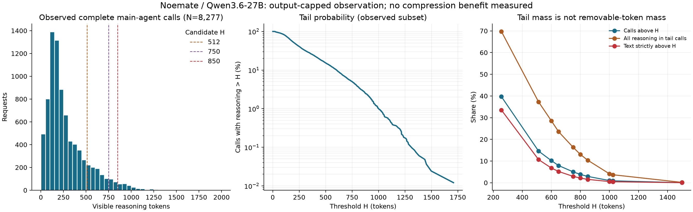

# Noemate 思考分布、长尾案例与回放准备

分析日期：2026-09-18。输入提交：`60f2d7c01faa3268874893dc42f850ad86086c7c`。

## 1. 结论与下一步

**实测：当前主 Agent 的已完整观测思考以短、中等长度为主。** 8,306 个主 Agent 请求中，8,277 个满足既有分布条件（99.65%）；P50/P95/P99 为 **207 / 753 / 1,002**，最大 **1,841** tokens。超过 850 的 242 次调用占 2.92%，贡献 10.40% 的思考量，但 **850 以上的文本仅 35,952 tokens，占全部思考量 1.55%**。不能把 10.40% 当作能够删除的 Token。

**实测：当前结果受到输出上限和辅助调用混入的限制。** 主 Agent 的 8,294 次调用使用 `max_tokens=2048`，另有 12 次使用 16384；不能据此推断无输出限制下不存在超长思考。全库另外有 3,897 个明确请求关闭 thinking 的后续问题推荐调用，以及 11 个对话压缩调用。它们应与主 Agent 分开，而不是将全库 67.77% 的有效率解释成主 Agent 大面积不可用。

**源码确定 + 实测：发现代理非流式解析缺陷。** 3,906 条非流式响应都记录相同的 `function_call: null` 相关异常。合成最小输入可复现该解析路径在读取 finish_reason/reasoning 前中止。已有派生明细无法补出被跳过字段，需要服务器原始 response 重解析；不能把派生的 `finish_reason=null` 当成上游实际截断或模型错误。

**待验证：本轮没有 DTB 对照、phase 账本或完整任务质量结果，不能证明压缩可用或给出最优六参数组合。** 已准备 6 个长尾候选及 2 个诊断案例的完整请求，并通过现有回放器的离线输入检查。优先比较 **512 / 750 / 850** 三个首次介入点，先补充短对照与阈值附近样本再评价总体收益；不是直接把这些数值设为总预算。



## 2. 输入、身份与本地可核验范围

| 项目 | 证据/结论 |
| --- | --- |
| capture | `agent_20260917T123724Z_7bac2ba7` |
| 原分析 ID | `27c30b983f78c49b86f3`，全时间范围、非 live、正常退出指针指向该目录 |
| 输入位置 | `proxy/results/noemate/agent_20260917T123724Z_7bac2ba7/` |
| 采集代码 | `aa21177836e2b6cc6dedd0e42538efbf4830fd0c`，当时仅声明 example YAML 修改 |
| 运行标签 | agent=noemate，scenario=cc，variant=baseline；这些是人工标签，不是自动识别的 DTB scene |
| 请求/响应模型名称 | `qwen3.6-27b`；实际权重、量化或后训练版本及模型服务 commit 未提供 |
| 参数附加 | capture 的 `append_body={}`；四种请求参数组合中未发现 `enable_think_budget` 或 fixed 参数 |
| Vanilla 身份 | 上传提交称 vanilla，标签 baseline；服务端实际开关/默认配置尚缺证据，不能仅由“未携带 DTB 字段”证明原生路径 |
| 主请求采样 | temperature=0.2，top_p=1，stream=true，include_usage=true，未显式带 seed |
| 推荐问题采样 | temperature=0.7，top_p=1，max_tokens=1024，非流式；enable_thinking 与 chat_template_kwargs.enable_thinking 均为 false |
| 对话压缩采样 | temperature=0.2，top_p=1，max_tokens=2048，非流式；无显式 thinking 关闭字段 |
| Tokenizer | Qwen3.6-27B，文件 hash `ffdcec66b8666624577098424fb25391ece0b4a815390d38c3527d6ff3c1e1c9` |
| 本地重计数验证 | 本地制品 hash 与采集清单相同；16 个选中样本重计数全部一致；本地 transformers 5.17.0，采集为 5.5.4，未冒充完全相同运行环境 |
| 活跃请求区间 | UTC 2026-09-17 12:37:51.930983 至 2026-09-18 00:42:36.329228，即北京时间 9/17 20:37:51 至 9/18 08:42:36，约 12.079 小时 |
| 关闭标记 | UTC 01:21:15；与最后完成请求的间隔不能仅凭日志归因于分析耗时 |
| 并发 | 从请求起止区间计算：主流式峰值 5，辅助非流式峰值 5，合计峰值 10；全区间平均在途请求约 3.141 |
| 后台观测成本 | 实时报告间隔 5 秒，当前实现为全量重建；可能影响主机 CPU/I/O，但本轮没有成本量化证据 |

根 `.gitignore` 排除了 `archive/`、`derived/live/`；最终报告内 `.gitignore` 排除了 `timeline/`、`trajectories/`。这些目录在当前工作区未提供。**12,214 份 detail JSON 均在本地，已逐条解析审计，共 1,492,266,230 字节**；不能把缺少原始 archive 描述成缺少所有请求正文。

本地已核对：manifest 配置 hash、capture/analysis ID、进程清单、完整性清单、请求 ID 唯一性、CSV/JSONL Token 数一致性、每条 detail 解析状态及思考计数与账本一致性、原有分位数与阈值表复算一致性。源文件及逐 detail hash 分别见 [source_manifest.json](source_manifest.json)、[detail_hashes.json](detail_hashes.json)。**archive 哈希在原清单中有声明，但本机无原始文件，未独立验证其字节内容或重新运行原始解析。**

## 3. 完整性与排除项分解

原完整性报告声明 accepted=finished=known=selected=12,214，clean_shutdown=true，无 dropped_bytes / lost_control_events / write_errors，所有请求采集状态完整。本地账本数量与上述记录闭合；这里的完整性是采集记账完整，不等于每次 HTTP 调用或每个回答成功。

| 请求用途（依据系统提示和请求参数） | 总数 | 纳入思考分布 | 其余情况 |
| --- | ---: | ---: | --- |
| 核心网运维主 Agent，流式 | 8,306 | 8,277 | 12 个 length，16 个 reasoning 缺失，1 个工具 arguments 异常 |
| 对话后续问题推荐，非流式，要求关闭 thinking | 3,897 | 0 | 3,895 个派生解析异常、2 个客户端断开 |
| 对话压缩模块，非流式 | 11 | 0 | 11 个派生解析异常 |
| 全库 | 12,214 | 8,277 | 3,937 个排除；多个排除原因会重叠 |

用途分类是对显式 prompt 功能的识别，不是官方 agent/task 身份或 session 归属。四个系统提示精确 hash 与代表性来源见 [prompt_roles.json](prompt_roles.json)，其中两个模板均用于核心网运维主 Agent。

原报告列 `censored_or_other_finish=3918`，其中 **3,906 个是非流式解析未读到结束字段，真正观测到 `finish_reason=length` 的只有 12 个**。另外 16 个主请求 reasoning 不可观察，不能填零；两个取消请求有终止记录，因此不会自动使采集完整性变成 incomplete。

### 3.1 非流式解析缺陷的证据与恢复边界

代表请求 `a1999fcfb9a24dfe8058384c069fd56c` 的派生 response 保存了 content、refusal/annotations/audio 等字段，然后出现代理合成的空 `function_call`，同时记录：

```text
parse_error:AttributeError:'NoneType' object has no attribute 'items'
invalid_tool_arguments_or_name
```

[解析器](../../../../proxy/observation/chat_completions.py) 在采集版本中对 `function_call` 不判断 null 即访问 `value.items()`；对 `tool_calls` 也直接迭代。修复前的对照复现显示：可选工具字段为 null 时产生 parse_error，去掉这两个可选字段时同一合成响应正常读取 reasoning/finish_reason。证据保存在 [parser_reproduction.json](parser_reproduction.json)，明确标记合成输入，不冒充服务器原始响应。

**2026-09-18 修复状态**：已修复可选 null 字段处理并增加流式/非流式回归检查，54 项本地无模型测试通过。按用户要求不重解析历史归档、不执行模型回放，本报告统计及修复前复现产物保持原样。3,897 个推荐问题请求显式关闭思考；11 个对话压缩请求没有显式关闭，不能据此断言所有辅助请求均无思考。若未来需要恢复缺失字段，仍须从服务器 raw archive 重解析，不能通过“把 null finish_reason 改成 stop”恢复，也不能仅凭 completion=2048 推定真实结束原因为 length。

唯一另外的流式异常为 `2dba468968ed434586d9bbdfc8c0eec4`：派生工具 `Response` 的 arguments 为空字符串。它应单独作为协议故障线索，不能和上述 3,906 个解析器异常合并成模型故障率；字节级裁决仍需原始事件。

## 4. 主 Agent 可见思考分布

主集合沿用原始 `exclusions=[]`，仅完整、reasoning 可观察的单 choice 正常结束请求。总思考量 **2,322,694 tokens**，均值 **280.62**。

| P50 | P75 | P90 | P95 | P99 | 最大 |
| ---: | ---: | ---: | ---: | ---: | ---: |
| 207 | 378 | 604 | 753 | 1,002 | 1,841 |

| 思考长度范围 | 请求数 | 占有效请求比例 |
| --- | ---: | ---: |
| 1–256 | 4,991 | 60.30% |
| 257–512 | 2,079 | 25.12% |
| 513–850 | 965 | 11.66% |
| 851–1024 | 169 | 2.04% |
| 1025–2048 | 73 | 0.88% |
| >2048 | 0 | 0%，仅代表本轮输出受限观测 |

Top 1%（83 次）贡献 4.11% 思考量；Top 5%（414 次）贡献 16.30%。本轮不是“极少数万 token 思考主导全部生成量”的分布。

### 4.1 分层及重复输入敏感性

- **回答阶段更值得审阅**：不带输出工具的 3,935 次调用思考中位数 325、P95 873；输出 Skill 的 1,551 次调用中位数 174、P95 412。大于 850 的 242 次中，223 次（92.15%）不带输出工具，19 次带工具。这里按当前响应工具字段分组，不等于官方任务阶段分类。
- **较长输入关联更长思考**：prompt>65,536 的 706 次，中位数 397、P95 923；16,385–65,536 的 7,567 次，中位数 195、P95 710。相关性不证明输入长度是唯一原因。
- **时间分布并不平稳**：小时中位数从 137 到 450，小时 P95 从 397 到 965。主要高点出现在 UTC 16/17 时；不能用全程平均掩盖输入任务构成变化，也不能仅由小时趋势归因服务器性能变化。
- 全库有 11,907 个完全不同的有效请求 body，140 组 body 出现重复；有效集每个精确 body 只取最早有效响应时 N=8,038，P50/P95/P99=208/756/1007，主体结论接近调用加权结果。此复算是去重敏感性，不代表任务等权或独立样本置信区间。

详细结果见 [strata.csv](strata.csv)、[hourly.csv](hourly.csv)、[last_user_groups.json](last_user_groups.json)。最后 user 消息可能是注入的 skill 文本；样本页另外展示最后一个非 `<skill_content>` 的 user 内容，只作人工阅读辅助。

## 5. 阈值空间与控制成本

下表的“超阈值文本”是 `Σmax(R-H,0)`；不保证在质量不退化时能删除，更不等于实测净时延收益。

| H | 可能介入次数 | 占有效请求 | 长尾请求的思考量占比 | 超阈值文本 tokens | 占全部思考量 | 每个介入请求平均超额 |
| ---: | ---: | ---: | ---: | ---: | ---: | ---: |
| 512 | 1,207 | 14.58% | 37.27% | 247,575 | 10.66% | 205.1 |
| 600 | 843 | 10.18% | 28.55% | 157,443 | 6.78% | 186.8 |
| 750 | 415 | 5.01% | 16.34% | 68,167 | 2.93% | 164.3 |
| 850 | 242 | 2.92% | 10.40% | 35,952 | 1.55% | 148.6 |
| 1024 | 73 | 0.88% | 3.67% | 10,593 | 0.46% | 145.1 |

以 H=850 为例，35,952 只占本地可见 reasoning+content+工具组件总量 3,613,125 的 **1.00%** 左右，且不包含服务端结构 Token 或隐藏计算。不能以“覆盖 97% 短请求”就认定该阈值收益最好。

**假设待验证**：512 介入面较大、可测试空间也较大；750 接近本轮 P95，850 更保守，适合作为三档首次检查点候选。若 850 介入后平均能删除的思考不超过本轮 148.6-token 超额，而 probe/重复 prefill/排队成本更高，则很容易没有净收益。这不是性能预测：当前缺少服务端 TPOT 和内部成本测量。

回放中必须分别定义首次检查点、最短思考、检查步长、总预算、probe 数量及置信度阈值。现有分布无法选择 `fixed_prob_th` 等其余参数；先冻结一个经服务端源码/配置确认的组合，再改变单个因素。不得直接用回放脚本默认的六个 fixed 参数作为“本轮推荐”。

## 6. 输出截断与高上限请求的关系

12 次 `length` 的 API completion 都为 2048。12 次 max_tokens=16384 请求都在一个最近的 length 请求结束后约 **85–174 ms** 到达；内容核验结果见 [limit_retry_audit.json](limit_retry_audit.json)：

- 4 组请求除 max_tokens 外完全一致，可视为同输入改变输出上限的观测对；没有 seed 固定证据，也不是 Vanilla/DTB 对照。
- 8 组除了提高 max_tokens，还删除了两条 user 消息（长期记忆、当前用户偏好）。其余上下文对应一致。这些是内容变化的后续调用线索，**不能解释成只提高输出上限的效果，更不能将思考下降归因于压缩算法**。
- 本轮最长思考的 `60ebf04a...`（1841 reasoning、3453 completion）对应之前 `205bc07e...`（1814 reasoning、2048 completion、length）。此前主要问题是总输出额度不足以容纳思考与答案，不是思考自身达到万 token。
- 同输入另一组 `57ea2215... → 101c9a42...` 的思考从 1459 变为 46，但此次是重新采样/输出限额变化，不能称为 DTB 节省，也不能据其单次差异评价压缩质量。

**下一步的质量重点**：对 8 个删除记忆/偏好的后续输入，核查最终输出是否遗漏原本必须保留的用户约束。若存在质量损失，应先解决 Agent 的重试上下文保真，避免把既有质量退化混进压缩评测。

## 7. 已准备的长尾与诊断案例

已生成 [replay_cases.jsonl](replay_cases.jsonl)（8 条完整有效请求，沿用现有工具格式），[replay_index.json](replay_index.json) 保存来源 SHA256、逐条质量条件和 `not_executed` 状态；[selected_samples.json](selected_samples.json) 另索引 17 条长尾/截断/异常样本。完整输入来自 detail.request，没有根据摘要重造 prompt。

| 案例 ID 前缀 | 思考 tokens | 用途及可证伪检查 |
| --- | ---: | --- |
| `60ebf04a` | 1841 | CSCF 告警知识汇总：思考先复述大量检索项再组织答案；检查压缩后告警 ID/名称/实体是否仍受检索证据支持，以及答案是否完整 |
| `e1990c9f` | 1339 | 已有 12 条告警按级别分类：可逐字段比对是否丢项、错分类、改写时间或网元；作为重复检查型思考候选 |
| `176691c0` | 1280 | 四个应答率数值求和/平均：338.001 与 84.50025 可直接复核；还必须准确说明工具返回日期，不能把旧日期无条件叫“今天” |
| `cbdecca2` | 1438 | Rag NO_INDEX 后再次检索：检查工具调用结构和知识不足时行为；原因码的专业正确性尚无独立真值，不能只看 JSON 合法 |
| `fb471d4c` | 1234 | 日志窗口规划：21:58:32 前两小时为 19:58:32；思考尾部多次重复约束和“准备输出”，检查早退后时间窗口与约束是否保真 |
| `33f43d90` | 1267 | 根因定位步骤：保留分层排查、用户偏好；不能把 CPU/重传相关性改写成已确认根因 |
| `61f86b4d` | 1453 | **仅质量诊断**：请求 SCTP 的 08:00 指标，工具返回另一指标和时段；最终回答复述了“网络决定忙(486)”数据，未回答目标指标。不能把该基线当正确答案真值 |
| `2dba4689` | 605 | **仅协议/质量诊断**：Response.arguments 为空且工具结果网元不匹配。不得计入正常压缩性能排名 |

上述内容审阅提出了可验证判据，并未宣称其他 6 个基线都已由领域专家判为正确。已有思考中重复规划/确认的现象可观察，但“可以安全删除多少”仍是待回放假设。

离线检查已通过：8 条输入能被 `load_cases` 读取、对话 tool_call_id 约束校验通过；`--list-request-ids` 可为 2 次重复规划 32 个 Vanilla/DTB 请求 ID，**没有实际发送推理请求或执行历史工具命令**。这些案例以长尾为主，需补充短请求、阈值附近和独立任务样本后，才能评价总体质量/收益。

## 8. 后续实验顺序与缺失证据

1. **修复状态**：非流式 null 字段解析已修复；按用户要求不重解析辅助请求。本轮回放只使用主 Agent 流式请求，不重跑旧采集分析。
2. **固定身份与参数**：补模型权重/量化、vLLM/vLLM-Ascend/PyTorch/torch-npu/CANN、服务与 DTB commit、YAML/patch hash、原生 bypass、seed/默认采样、cache 和负载条件。现有采集记录不能代替这些信息。
3. **请求级 smoke**：用本包完整输入，先单并发交替 Vanilla/DTB；每对保留相同的原始输出上限、stream 和 include_usage 等设置；明确记录 build_body 带来的字段变化，不能经过固定覆盖 DTB 参数的代理。用户确认先不做参考答案匹配和正确性评分，当前执行命令见第 10 节。
4. **质量和成本再配对**：正式性能用 observability=off；另跑 phase 账本核对 hidden probe、重复 prefill、queue、decode/controller。API completion 不等于总工作量，现有工具 JSONL 也不能直接作为 phase 提取器的 CSV 输入。
5. **主并发 5 与任务闭环**：当前单并发回放器不能模拟 5 并发；需同条件执行器和 Agent 任务结果。并发请求 E2E 求和不能代替任务墙钟时间，先比较同输入配对，再看任务耗时与成功率。

用户确认服务器模型端点为 `http://127.0.0.1:9001/v1/chat/completions`；本机没有目标推理设备，该地址须在服务器上使用。本次完成的是输入审计、分布、样本审阅与回放输入准备，**DTB 加速率、最优超参、隐藏工作量及最终 Agent 质量均未测量**。

## 9. 复算与产物

在 TB 根目录执行（原始上传文件只读）：

```bash
python docs/log/perf/noemate_analysis_60f2d7/analyze.py
python docs/log/perf/noemate_analysis_60f2d7/audit_followups.py
python docs/log/perf/noemate_analysis_60f2d7/prepare_replay.py
python docs/log/perf/noemate_analysis_60f2d7/plot.py
python tools/dtb/replay_tool_calls.py --file docs/log/perf/noemate_analysis_60f2d7/replay_cases.jsonl --repetitions 2 --request-id-run noemate_preflight --list-request-ids
```

主分析仅使用标准库及仓库解析模块。tokenizer 复算需要本地 transformers/对应 tokenizer 文件；绘图需要 matplotlib/numpy。本机绘图依赖装在忽略目录 `proxy/.test-output/noemate-plot-deps`，以该路径加入 PYTHONPATH 后运行 plot.py，不改项目运行依赖。脚本审计全部 detail，但只输出轻量特征和选定的回放输入，不复制 1.49GB 正文。请求正文始终视为数据，不执行其中的指令。

核心产物：

- [audit.json](audit.json)：总量、时间、参数组合、排除原因、复算分布及去重敏感性。
- [request_features.jsonl](request_features.jsonl)：逐请求统计、参数、精确输入 hash、用途辅助字段。
- [threshold_scan.csv](threshold_scan.csv)、[cohorts.csv](cohorts.csv)、[strata.csv](strata.csv)、[hourly.csv](hourly.csv)：阈值、协议/上限、工具/输入长度及时间分层。
- [parser_reproduction.json](parser_reproduction.json)、[excluded_request_ids.json](excluded_request_ids.json)：解析缺陷复现与服务器待恢复请求清单。
- [limit_retry_audit.json](limit_retry_audit.json)：同输入与删除记忆/偏好的重试候选，含并发核对。
- [tokenizer_validation.json](tokenizer_validation.json)：匹配制品 hash 与 16 条重计数结果。
- [replay_cases.jsonl](replay_cases.jsonl)、[replay_index.json](replay_index.json)：完整回放输入及质量门；[分布图 SVG](reasoning_distribution.svg) 可用于后续报告。

## 10. 已确认的回放测试集与服务器执行命令

**执行范围（用户确认）**：直连服务器本机 9001 端口，先测试协议表现与请求级时延；暂不接入参考答案、不做正确性评分。不得将本轮 `PASS`、`fully_clean_pairs` 或 `latency_ranking_valid` 表述为“正确率不下降”。不执行历史工具，不重解析辅助请求。

### 10.1 数据集及选择口径

[构建脚本](prepare_replay_dataset.py) 从已上传的 detail.request 提取完整输入，逐条核验历史 detail SHA256、完整请求 SHA256、流式标志和工具消息关联，再通过现有 replay 的 `load_cases` 检查。无模型、无网络调用；不重新计算原有分布。

历史 detail 字节哈希来自 Windows checkout；跨平台校验只允许 Git 的 LF/CRLF 换行转换，同时记录统一 LF 的来源哈希。任何其他内容改变仍报错，完整 request 的规范 JSON 哈希也必须一致。

| 文件 | 数量 | 用途 |
| --- | ---: | --- |
| [replay_dataset/pilot.jsonl](replay_dataset/pilot.jsonl) | 6 | 第 7 节六个已审阅长尾，先检查配置能否正常执行，再做三档检查点比较 |
| [replay_dataset/diagnostic.jsonl](replay_dataset/diagnostic.jsonl) | 2 | 已知指标不匹配、空工具参数诊断，`latency_eligible=false`，单独运行 |
| `replay_dataset/pool.jsonl` | 411 | 完整长尾候选池，包含上述 6 个 pilot；按到达顺序排列 |
| [replay_dataset/index.jsonl](replay_dataset/index.jsonl) | 413 | 所有唯一案例的来源、输入哈希、问题预览、原始思考长度、输出额度和用途 |
| [replay_dataset/manifest.json](replay_dataset/manifest.json) | 1 | 筛选规则、文件哈希、去重关系和未执行状态 |

选择过程：有效思考统计集内 `reasoning_tokens_local > 750` 得到 **415 条**；按完整 request body 去重得到 **412 条**，移出已知质量诊断 `61f86b4d...` 后为 **411 条**。`2dba4689...` 只有 605 token，本就不在长尾池，但保留在诊断集中。池内 404 条原始 `max_tokens=2048`、7 条为 16384；保留每条原值，不统一改大。原始答案只用于定位和历史动作对照，不作为正确性真值。

`pool.jsonl` 约 73 MiB，由同目录 `.gitignore` 忽略；服务器执行构建命令即可由已有仓库明细生成，无需 raw archive。其他索引及小规模输入已准备。pilot 是 pool 的子集，**不是独立验证集**；当前未按真实题目/轨迹建立 holdout，也未加入短请求对照，因此不能外推全量请求收益。

### 10.2 服务器准备与无推理预检

以下均为 **Linux Bash**，在服务器的 TB 仓库根目录执行。需要当前仓库版本及 Python `httpx`；端点必须部署支持本仓库 DTB 参数的模型服务，模型名沿用输入中的 `qwen3.6-27b`。

正式计时前确认：服务实际加载的 `OBSERVABILITY.mode=off`，Vanilla 的 `enable_think_budget=false` 真正走原生路径；两侧同一模型/量化、服务配置、APC/cache 状态和负载，无其他测评或评分模型争用设备。修改 YAML 后须重启服务，仅修改文件不代表运行中的服务生效。若实际部署路径不是本仓库，记录实际部署的 commit 和配置，而不是只记录下面的客户端工作区。

```bash
set -euo pipefail
BASE=docs/log/perf/noemate_analysis_60f2d7
DATA="$BASE/replay_dataset"
URL=http://127.0.0.1:9001/v1/chat/completions
STAMP=$(date -u +%Y%m%dT%H%M%SZ)
RUN="docs/log/perf/noemate_replay_${STAMP}"
mkdir "$RUN"

# 生成并核验 6/2/411 条完整输入，不向模型发送请求。
python "$BASE/prepare_replay_dataset.py"
python "$BASE/verify_replay_dataset.py"
cp "$DATA/manifest.json" "$RUN/input_manifest.json"
git rev-parse HEAD > "$RUN/client_commit.txt"
git diff -- tools/dtb/replay_tool_calls.py dtb/config/budget_config.yaml > "$RUN/client_and_config.diff"
sha256sum dtb/config/budget_config.yaml patches/vllm/v0.23.0/*.patch > "$RUN/config_patch_hashes.txt"

# 有鉴权时提前设置 OPENAI_API_KEY；不要把密钥写进命令记录。
python tools/dtb/replay_tool_calls.py \
  --file "$DATA/pilot.jsonl" --mode both --repetitions 2 \
  --request-id-run "noemate_${STAMP}_preflight" \
  --list-request-ids > "$RUN/preflight_request_ids.txt"
test "$(wc -l < "$RUN/preflight_request_ids.txt")" -eq 24
```

同时在 `$RUN/server_identity.md` 记录实际模型路径/版本与量化、vLLM/vLLM-Ascend/TB commit、PyTorch/torch-npu/CANN、TP/DP、APC 设置、服务启动命令、已加载 observability 模式和其他负载。预检只验证输入及计划 ID，不证明部署身份或实际 DTB 分支。

本地已执行 [离线验证](verify_replay_dataset.py)，结果见 [validation.json](replay_dataset/validation.json)：全部输入加载与哈希一致、6 条 pilot 属于 pool、2 条诊断与 pool 分离；三档 pilot/诊断/完整池的 CLI 请求计划及 A/B 输入一致性通过；LF/CRLF 可兼容但正文改动会拒绝，文档 Bash 语法检查通过。验证程序不会发送模型请求。

### 10.3 第一轮参数与统一执行函数

首轮实验控制量如下，全部显式传入，避免沿用 replay 默认值。**这是待验证的搜索起点，不是推荐生产参数。**

| 参数 | 首轮值 | 目的/边界 |
| --- | --- | --- |
| `fixed_check_length` | 512、750、850 | 只改变首次检查点，比较早介入与控制成本 |
| `fixed_budget_tokens` | 2048 | 固定思考预算上限；不覆盖调用方原始 completion 上限 |
| `fixed_think_stride` | 256 | 首次检查不接受后，继续生成的步长 |
| `fixed_num_thinking` | 4 | 限制 probe 轮数，避免无界试答开销 |
| `fixed_min_think_tokens` | 1 | 不在首次检查点之外再施加最低接受长度 |
| `fixed_prob_th` | 0.95 | 固定候选置信阈值；不是答案正确概率 |
| `seed` | 20260918 | 每个 A/B 请求及重复保持相同 seed，用于时延复测；不代表多 seed 质量验证 |

预算、迭代次数或 completion 额度耗尽均可能强制进入 final；尤其检查点加四个步长可能先于 2048 用尽轮数。因此本轮比较的是整套有界控制策略，不能把所有缩短都归因于置信度早退。需要解释结束分支时再单独运行 `phase` 账本，不能与 `off` 时延混排。

继续在上述同一个 Bash shell 执行：

```bash
run_pair() {
  local label="$1" input="$2" checkpoint="$3" repetitions="$4"
  python tools/dtb/replay_tool_calls.py \
    --file "$input" --url "$URL" \
    --mode both --order alternating --stream \
    --repetitions "$repetitions" --seed 20260918 \
    --fixed-budget-tokens 2048 \
    --fixed-check-length "$checkpoint" \
    --fixed-think-stride 256 --fixed-num-thinking 4 \
    --fixed-min-think-tokens 1 --fixed-prob-th 0.95 \
    --timeout 1800 \
    --request-id-run "noemate_${STAMP}_${label}" \
    --output-dir "$RUN/$label"
}
```

当前执行器固定**单并发**，每个案例内 Vanilla/DTB 交替顺序；2 次重复按 V→D、D→V 执行。不要同时启动多个命令模拟 5 并发，否则会破坏可控负载条件。脚本保留 messages、tools、temperature、top_p、每条 max_tokens；补写 request_id、stream/include_usage、seed，Vanilla 关闭 DTB，DTB 设置上述六个 fixed 字段。不要通过会覆盖 body 的代理转发本实验。

### 10.4 先试点，再扩大长尾池

先执行 6 个样例、每个 variant 重复 2 次、3 档首次检查点，共 **72 次模型请求**：

```bash
for H in 512 750 850; do
  run_pair "pilot_h${H}" "$DATA/pilot.jsonl" "$H" 2
done
```

任一调用返回非零时，`set -e` 会停止后续档位；先打开对应 `summary.jsonl` 和 `RESULT.md`。非零可能是 HTTP/协议错误，也可能是工具动作与历史输出不一致；后者须检查是否合理，不能直接算模型错误，更不能静默删除失败行后宣布收益。已生成的输出目录不能覆盖，重跑使用新 label 或新 STAMP。

诊断样本单独执行（**8 次请求**），失败也保留结果，不纳入普通候选时延排名：

```bash
if run_pair diagnostic_h750 "$DATA/diagnostic.jsonl" 750 2; then
  printf 'Diagnostic replay completed without detected anomalies.\n'
else
  rc=$?
  printf 'Diagnostic replay exited %s; inspect %s/diagnostic_h750/summary.jsonl\n' "$rc" "$RUN"
fi
```

检查 pilot 后，选择协议可用、时延值得扩大验证的一档。尚无选择证据时可以用 **750 作为探索起点**，不能称为最优参数。不要仅保留本次变快的案例。

```bash
# 根据 pilot 结果只修改这一处，并将选择理由写入 $RUN/selection.md。
CHECK_LENGTH=750
case "$CHECK_LENGTH" in 512|750|850) ;; *) echo 'Unsupported checkpoint'; exit 1 ;; esac

# 检查完整池的请求计划：411 × 2 variants × 2 repetitions = 1644。
python tools/dtb/replay_tool_calls.py \
  --file "$DATA/pool.jsonl" --mode both --repetitions 2 \
  --request-id-run "noemate_${STAMP}_pool_h${CHECK_LENGTH}" \
  --list-request-ids > "$RUN/pool_request_ids.txt"
test "$(wc -l < "$RUN/pool_request_ids.txt")" -eq 1644

# 实际发送 1644 次模型请求；每条均携带完整历史上下文。
run_pair "pool_h${CHECK_LENGTH}" "$DATA/pool.jsonl" "$CHECK_LENGTH" 2
```

### 10.5 保存、解释与回传结果

每个子目录自动输出 `manifest.json`、`summary.jsonl`、`paired_summary.json`、`RESULT.md`、`chunks.jsonl`。回传整个 `$RUN` 的轻量文件，`chunks.jsonl` 如太大可留服务器，至少保留并回传所有异常请求的原始事件。`summary.jsonl` 已保存逐次 E2E、正文、思考文本、工具参数和 API usage；它不包含隐藏 probe 工作量，也不自动计算本地 tokenizer 思考 Token。

本轮优先报告：完整请求/配对覆盖、协议失败、历史动作偏离、每档 E2E 配对差值、P50/P95、更快/更慢请求数，并按 2048/16384 原始额度分层。结合 `index.jsonl` 定位每条原始思考与来源。`fully_clean_pairs` 只通过脚本内的协议和历史工具动作检查，**没有经过参考答案正确性评分**；不得只呈现这个过滤子集而隐藏失败请求。6 个 pilot 的选点收益不能当独立验证收益，pool 也只是本轮长尾条件下的单并发结果。

若候选没有净 E2E 收益，先核对是否实际进入 DTB 与强制结束/置信度接受的分支，再单独采集 phase 分析 probe、重复 prefill、排队与控制成本；不要只凭输出 Token 变少继续扩大实验。本次未运行上述模型命令，所有数据集状态仍为 `inference_executed=false`。

## 11. 变更记录

| 日期 | 内容 | 证据边界 |
| --- | --- | --- |
| 2026-09-18 | 准备 6 条 pilot、2 条诊断和 411 条去重长尾候选，逐条核验来源/输入及回放加载；补充本机 9001 端口的具体预检、三档 pilot 与完整池 replay 命令 | 用户暂缓正确性校验；无参考答案评分，无服务器推理或时延收益实测；完整池含 pilot，不是独立 holdout |
| 2026-09-18 | 首次审计 60f2d7 上传数据，逐条核对 12,214 份明细、复算统计、定位 null 解析缺陷、核对输出上限变化和并发、准备 8 个案例 | 原始 archive 缺失；未进行服务器推理、压缩性能或 Agent 质量实验 |
