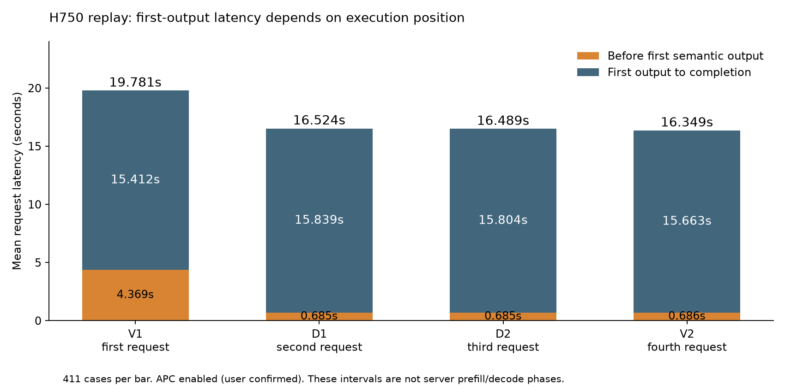

# Noemate replay 7249b3：时延收益与下一轮决策

分析日期：2026-09-21。来源 commit：`7249b3dc165bca2512a79346dec9117a7034b083`。

## 1. 结论

**实测：750 完整池存在账面 E2E 改善，但不能将 5.591% 解释为已证实的思考压缩收益。** 5.591% 是过滤后 777 对请求的逐对加速率中位数；全部 822 对的总 E2E 降幅为 8.627%。执行顺序固定为每案例 `V1 → D1 → D2 → V2`，V1 的首输出显著慢于其余三次。只看第二轮 D2/V2，DTB 平均慢 **0.858%**，逐对加速率中位数 **−0.726%**，199/411 对更快。即使过滤为 388 对 fully clean，第二轮仍平均慢 0.441%。

**用户确认：APC 开启、服务实际 observability=off。假设：首遍建立的 prefix cache 被后续重复请求复用，是主要顺序混杂因素。** 首输出差值与此解释高度一致，但缺少逐请求 cache/prefill 账本，不能把首输出时间直接称为 prefill，也不能精确分摊 APC 收益。第二轮只是较接近相同缓存条件的敏感性分析，仍是固定 D→V，不是完整随机对照。

**实测：512 试点值得继续，但不足以直接扩大或宣布胜出。** 全部 12 对总 E2E 降低 10.099%；第二轮六对总 E2E 降低 10.319%，但仅 3/6 更快，逐对加速率中位数为 −0.434%，小样本结果不稳定。原报告的 24.93% 是另一个过滤口径。

**下一轮顺序：先 8 条 phase 确认零 probe → 同一 32 条案例比较 probe750 与 direct750，各配同轮 Vanilla → 有稳定净收益再扩池或降低到 512 → 最后 5 并发、端到端 Agent。** 第 6 节为当前执行命令，替代此前 H512/H750 的 probe 策略扫描。system 匹配交由其他任务，本轮通过请求 fixed 参数隔离验证压缩策略。当前参考答案评分按用户要求仍暂缓，全文不宣称正确率不下降。

## 2. 输入、身份和完整性

| 项目 | 审计结果 |
| --- | --- |
| 512 试点 | 6 案例 × 2 重复 × 2 variant = 24 请求；`../noemate_replay_20260920T010816Z/pilot_h512/` |
| 750 完整池 | 411 案例 × 2 重复 × 2 variant = 1,644 请求，822 完整配对 |
| 诊断 | 2 案例、8 请求；不纳入正常候选排名 |
| 9 月 18 日目录 | 只有准备/预检材料，没有已上传模型回放结果 |
| 其他试点 | 没有已上传的 pilot_h750、pilot_h850；不能假设已经完成 |
| 请求身份 | 全部唯一，案例/attempt/variant 集合及 V1-D1-D2-V2 顺序闭合，无缺失配对 |
| 输入一致性 | 输入文件 SHA256 与 manifest 一致；重建全部实际请求 body，SHA256 与 chunks request 记录逐一一致 |
| chunks | pool 的 28 个分片连续读取，共 595,446 条 SSE 事件记录；跨分片请求保持连续，每请求恰有一个 `[DONE]`；全部重组结果与 summary 的正文、reasoning、工具、usage、finish 和异常记录完全一致 |
| 客户端 | 已上传 client commit 为 `abf4e752d766f33fa934a52d916fbb2b3c974b32`，client/config diff 为空；750 所在根目录未附完整 server_identity |
| 服务 | 响应模型名 `qwen3.6-27b`；用户补充 APC=on、observability=off。实际模型权重/量化、设备/TP/DP、服务仓库 SHA、已加载 patch/YAML 身份仍缺完整记录 |

manifest 请求参数为单并发、SSE、seed=20260918，保留每条原始 temperature/top_p/max_tokens。除检查点 H512/H750 外，均为 budget=2048、stride=256、num_thinking=4、min_think=1、prob_th=0.95。完整池包含 404 条 max_tokens=2048、7 条 max_tokens=16384。

已独立复算工具的 `paired_summary.json`，结果逐字段一致。原始回放文件保持不变；没有服务器 phase/server.log，不能执行 phase 提取或证明每条实际分支、probe 数与有效预算。源码/请求参数不能替代已加载服务身份。

审计产物：[audit_summary.json](audit_summary.json)、[pool_h750_audit.json](pool_h750_audit.json)、[pool_h750_pairs.json](pool_h750_pairs.json)。28 个分片无需先拼成大文件。

## 3. 5.591% 的口径与顺序分解

正号表示加速，负号表示变慢；总 E2E 降幅为 `1 − ΣDTB_E2E / ΣVanilla_E2E`，不是逐对百分比的均值或中位数，也不是并发任务墙钟收益。

| 750 子集 | 对数 | Vanilla 均值 s | DTB 均值 s | 总 E2E 降幅 | 逐对加速率中位数 | 更快对数 |
| --- | ---: | ---: | ---: | ---: | ---: | ---: |
| 全部 | 822 | 18.065 | 16.507 | +8.627% | +5.657% | 500 |
| 工具脚本 fully clean | 777 | 18.155 | 16.575 | +8.705% | **+5.591%** | 471 |
| 第一轮 V1→D1 | 411 | 19.781 | 16.524 | +16.466% | +14.782% | 301 |
| 第二轮 D2→V2 | 411 | 16.349 | 16.489 | **−0.858%** | **−0.726%** | 199 |

| 750 执行位置 | 平均首输出 s | 首输出后至完成 s | E2E s |
| --- | ---: | ---: | ---: |
| V1，第一个访问本条完整输入 | 4.369 | 15.412 | 19.781 |
| D1，第二个访问 | 0.685 | 15.839 | 16.524 |
| D2，第三个访问 | 0.685 | 15.804 | 16.489 |
| V2，第四个访问 | 0.686 | 15.663 | 16.349 |



全池平均首输出节省 **1.842 秒/对**，而 E2E 仅节省 **1.559 秒/对**；首输出之后 DTB 反而多 **0.284 秒/对**。首输出后时间包含剩余生成、控制、传输及客户端日志操作，不能称为纯 decode，但这一分解已经不支持“总收益由减少思考生成主导”。

**源码确定**：回放工具按案例循环，每次都从第一轮 Vanilla 开始；第二次仅交换 V/D 顺序。这能平衡普通运行位置，却无法让 DTB 同样承担每条新输入第一次访问的缓存成本。APC 实际命中量尚无 metrics 佐证，因此使用“强烈支持缓存/顺序混杂”，不把具体 cache 命中率当实测。

完整池第二轮 case 重采样的总 E2E 收益 95% bootstrap 区间为 **[−3.573%, +1.780%]**，未显示稳定正收益。这里按 case 重采样，仅用于敏感性分析，不消除轨迹间相关性、执行顺序或服务漂移。细节见 [sensitivity.json](sensitivity.json)。

## 4. 可见思考没有整体减少，长尾身份也不稳定

本地使用与原采集制品哈希一致的 Qwen3.6-27B tokenizer，`add_special_tokens=false`，对所有 replay summary 的可见 reasoning/content 重新编码；没有把字数或 SSE chunk 数当 token。[tokenizer_identity.json](tokenizer_identity.json) 保存制品身份。

| 750 指标，822 对 | Vanilla | DTB | 变化 |
| --- | ---: | ---: | ---: |
| 可见 reasoning 本地重计数 | 581,834 | 590,471 | **增加 1.484%** |
| API completion | 906,280 | 920,378 | **增加 1.556%** |

隐藏 probe、重复 prefill 和控制器成本尚未知，因此 API completion 不能称为总模型工作量。

虽然选样时全部 reasoning>750，当前 Vanilla 822 次重放里有 **452 次（54.99%）≤750**。历史长尾不等于每次重放都会长思考；原采集没有同一 seed/服务身份的完整保证，当前 manifest 指定固定 seed，也仍有大量重复差异：两次 Vanilla 的 reasoning+正文+工具名/参数完全一致仅 **4/411** 案例，DTB 为 **6/411**。这不证明 seed 被忽略，但说明不能把两次生成当作确定性复现。

第二轮按**本次 Vanilla 输出长度**分层：

| reasoning 范围 | 案例数 | 总 E2E 降幅 |
| --- | ---: | ---: |
| ≤512 | 106 | −24.989% |
| 513–750 | 118 | −0.992% |
| 751–1024 | 129 | +2.633% |
| >1024 | 58 | +11.749% |

这是事后分层，容易受选样/均值回归和生成随机性影响，**不能直接形成运行时路由规则，也不能证明“短路径固定慢 25%”**。但它足以提示下一轮同时检查短请求放大和真实长尾收益，不能继续只按旧日志长度选取最有利的样例。

## 5. 512 试点的信号及异常边界

512 的 12 对全量总 E2E 收益 +10.099%，reasoning 从 12,726 降至 11,156（−12.337%）；第二轮六对总 E2E 收益 +10.319%，reasoning 从 6,598 降至 5,286。但第二轮只有 3 对更快，中位数略慢，case bootstrap 区间 [−4.736%, +26.252%]。已有收益集中于少数案例。

同六个 case 在另一次 750 池内回放反而总耗时增加 18.851%，但 Vanilla 输出本身也显著变化、运行时间不同、服务身份未完全闭合，**不能拿这两个数字直接裁决 512 优于 750**。应同一环境和相同预热规则直接比较。

完整池脚本报告 Vanilla 1 个 protocol failure、DTB 0 个，但还有以下不能忽略的行为：

- 历史工具动作偏离：V=35、D=32；配对为两侧无偏离 778、两侧均有 23、仅 V 12、仅 D 9。工具名与历史不同不必然等于答案错误，当前不做参考答案裁决。
- **工具 schema 错误两侧各 1 个，且是不同案例**：line 340 的 Vanilla `Bash.args` 应为 array 却为字符串；line 347 的 DTB `Rag.indexes` 应为 array 却为字符串。工具脚本将 schema 错误归入 semantic 分类，因此“DTB protocol failure=0”不等于没有接口错误。
- line 230 的 Vanilla 出现 tool delta 后继续输出 content，原始分片重组确认存在。
- `finish_reason=length`：V=14、D=11；7 对两侧均截断、7 对仅 V、**4 对仅 D**。工具脚本不自动把所有 length 算协议失败，下一轮仍须单列，不得当作自然完成。
- 512 的两个历史工具调用缺失在两侧均发生，造成 fully clean 只剩 10 对。脚本的 `latency_ranking_valid` 实际要求全部配对 fully clean，虽然自动报告文字只提 protocol；以源码实际逻辑为准。

诊断集仅排障，不参与上述收益。异常与截断位置见 [pool_h750_anomalies.json](pool_h750_anomalies.json)、[pool_h750_length_cases.json](pool_h750_length_cases.json)。无新增服务端运行或人工正确性判定。

## 6. 下一轮：固定 H=750，对照有 probe 与直接答案

### 6.1 先做 8 条 phase，确认直接答案路径

前置条件：服务已部署本工作区的 `deferred_observation.py` 门禁修复（第 8.3 节源码证据），重启并确认实际加载的 `OBSERVABILITY.mode=phase`。仅同步 YAML 或沿用旧进程不能保证该行为。APC 保持开启，模型/权重、采样和环境保持不变；记录实际服务启动参数、配置路径、服务 commit/dirty patch、vLLM/Ascend 版本与 SHA。以下命令不修改服务、不发送评分请求。

已生成 [phase_probe_lines.txt](phase_probe_lines.txt)，8 条包括 line 230/340/347 和当前试点中若干大幅变化案例，来源见 [next_probe_manifest.json](next_probe_manifest.json)。比较两个策略各 2 次，共 **32 次 DTB 请求**，这一轮不排名时延：

| 策略 | fixed_check_length | fixed_budget_tokens | 其余 fixed 参数 |
| --- | ---: | ---: | --- |
| probe750 | 750 | 2048 | stride=256、num=4、min=1、prob=0.95 |
| direct750 | 750 | 750 | 与 probe750 相同 |

```bash
set -euo pipefail
BASE=docs/log/perf/noemate_analysis_60f2d7
AUDIT=docs/log/perf/noemate_replay_20260920T012159Z
python "$BASE/prepare_replay_dataset.py"
FILE="$BASE/replay_dataset/pool.jsonl"
URL=http://127.0.0.1:9001/v1/chat/completions
STAMP=$(date -u +%Y%m%dT%H%M%SZ)
OUT="docs/log/perf/noemate_direct750_phase_${STAMP}"
mkdir "$OUT"
cp "$AUDIT/next_probe_manifest.json" "$OUT/selection.json"
cp "$AUDIT/phase_probe_lines.txt" "$OUT/selected_lines.txt"
git rev-parse HEAD > "$OUT/client_commit.txt"
git diff -- dtb tools/dtb/replay_tool_calls.py > "$OUT/client_dtb_worktree.patch"
LINES=$(cat "$OUT/selected_lines.txt")

for POLICY in probe750 direct750; do
  if [[ "$POLICY" == probe750 ]]; then BUDGET=2048; else BUDGET=750; fi
  python tools/dtb/replay_tool_calls.py \
    --file "$FILE" --lines "$LINES" --url "$URL" --stream \
    --mode dtb --repetitions 2 --seed 20260918 --timeout 1800 \
    --fixed-budget-tokens "$BUDGET" --fixed-check-length 750 \
    --fixed-think-stride 256 --fixed-num-thinking 4 \
    --fixed-min-think-tokens 1 --fixed-prob-th 0.95 \
    --request-id-run "phase_${STAMP}_${POLICY}" \
    --output-dir "$OUT/$POLICY"
done
```

按 summary 的实际 request ID 关联 server.log 中的 `DTB_PHASE` 与 `DTB_REQUEST_SUMMARY`，检查：direct750 的有效介入值和硬预算均为 750、所有请求 hidden probe token 为 0、没有 `confidence_probe` phase。至少要有一个**实际触发**的 `post_drain_branch=budget_final`、`final_answer_reason=budget_exhausted` 请求；全部自然结束只能说明零 probe，不能验证强制退出路径。自然边界、原生完成、取消、错误须分别说明，不能强求每条都进入 budget_final。probe750 则记录真实 probe 数、隐藏 token、prefill/queue/cache 及 completion 剩余额度，供与 direct750 对照。

目标是排除参数未生效、自然短请求路径异常、循环成本或强制结束问题。保留服务完整日志与启动记录；phase 仅用于归因，不与 off 性能排名混用。当前 replay 输出不是标准 CSV run，不能不经适配直接调用 `extract_dtb_phase_metrics.py`。未确认预算生效、实际强制退出且零 probe 时，先排障，不继续批量测试。

### 6.2 32 条 off：probe750 与 direct750 各配同轮 Vanilla

已生成 [next_probe_lines.txt](next_probe_lines.txt)：按第二轮 Vanilla reasoning 的四档各 8 条，包含六个原 pilot 和三条工具异常案例，其余按 case_id SHA256 确定性选择。**这是事后校准/排障集，不是独立 holdout，也不能用其总体均值估算真实流量收益。**

phase 验收后，将实际服务切回 `observability=off` 并重启；APC 继续开启。每个 case、每个策略前先对完全相同输入进行一次**不计入测量的原生 warmup**，再测 4 次 V/D 配对。不同案例交替两个策略的顺序，各策略内部 `--order alternating` 平衡 V/D 顺序。核对两侧首输出接近；异常时需要独立 phase/cache 诊断，不将偏差直接归因于压缩。不能只在整个 32 条集合开始时预热一次。

下面命令在服务器 TB 根目录执行。保持原始采样/max_tokens、seed 和介入值，仅改变硬预算来选择退出策略。保留 `num_thinking=4` 是为了避免同时改变两个参数；direct750 在轮数判断前已因预算耗尽跳过 probe。每个策略每 case 有 1 次 warmup + 8 次计时请求，总 **576 请求**（64 warmup + 512 measured：每个策略 128 对）。各策略都带本轮 Vanilla，不能把旧 7249b3 的 V1 冷缓存结果作为新候选基线。

```bash
set -euo pipefail
BASE=docs/log/perf/noemate_analysis_60f2d7
AUDIT=docs/log/perf/noemate_replay_20260920T012159Z
python "$BASE/prepare_replay_dataset.py"
FILE="$BASE/replay_dataset/pool.jsonl"
URL=http://127.0.0.1:9001/v1/chat/completions
STAMP=$(date -u +%Y%m%dT%H%M%SZ)
OUT="docs/log/perf/noemate_direct750_off_${STAMP}"
mkdir "$OUT"
cp "$AUDIT/next_probe_manifest.json" "$OUT/selection.json"
cp "$AUDIT/next_probe_lines.txt" "$OUT/selected_lines.txt"
git rev-parse HEAD > "$OUT/client_commit.txt"
git diff -- dtb tools/dtb/replay_tool_calls.py > "$OUT/client_dtb_worktree.patch"
IFS=',' read -r -a LINES < "$OUT/selected_lines.txt"

i=0
for LINE in "${LINES[@]}"; do
  i=$((i+1))
  if (( i % 2 )); then POLICIES=(probe750 direct750); else POLICIES=(direct750 probe750); fi
  for POLICY in "${POLICIES[@]}"; do
    if [[ "$POLICY" == probe750 ]]; then BUDGET=2048; else BUDGET=750; fi
    LABEL="l${LINE}_${POLICY}"
    # 仅预热，必须从性能汇总中排除；若报错，检查后再继续。
    python tools/dtb/replay_tool_calls.py \
      --file "$FILE" --lines "$LINE" --url "$URL" --stream \
      --mode vanilla --repetitions 1 --seed 20260918 --timeout 1800 \
      --request-id-run "off_${STAMP}_${LABEL}_warm" \
      --output-dir "$OUT/${LABEL}_warm"

    # 两侧都已访问同一输入后再计时；4 个配对，不覆盖原始 max_tokens。
    python tools/dtb/replay_tool_calls.py \
      --file "$FILE" --lines "$LINE" --url "$URL" --stream \
      --mode both --order alternating --repetitions 4 --seed 20260918 \
      --fixed-budget-tokens "$BUDGET" --fixed-check-length 750 \
      --fixed-think-stride 256 --fixed-num-thinking 4 \
      --fixed-min-think-tokens 1 --fixed-prob-th 0.95 --timeout 1800 \
      --request-id-run "off_${STAMP}_${LABEL}_measured" \
      --output-dir "$OUT/${LABEL}_measured"
  done
done
```

两段脚本均使用现有 replay CLI。工具遇到协议/历史动作异常会返回非零，`set -e` 将停止，已完成请求仍保存在目录内。已知异常案例可能再次触发停止；先检查对应 summary 和 RESULT，区分历史动作偏离与接口失败，再从未完成的案例/策略续跑并用新目录保存，汇总时去掉重叠的重跑数据。不要用无条件 `|| true` 跳过失败，也不要把脚本退出当作整批完成。参考答案评分仍暂缓；schema、空响应、错误与 length 单列，不能只用过滤异常后的均值选择参数。

汇总时排除所有 `_warm` 目录，分别统计每个策略的 128 对全量请求：`1 - ΣDTB_E2E / ΣVanilla_E2E`、更快请求数、逐 case 四次均值差、P50/P95，以及可见 reasoning、completion、工具异常和 length。两个策略必须使用完全相同 case 集合；比较 direct750 与 probe750 的绝对 E2E/可见 token，并检查各自 Vanilla 是否接近。32 条是等额分层校准集，不据此外推生产平均收益。只比较 `*_measured` 输出，不混入 phase；回传各目录 manifest、summary、paired_summary、chunks，以及 phase 服务日志和实际服务身份。

本地离线校验：两段 Bash 均通过 `bash -n`；将 `python` 替换为只记录参数的函数后实际展开循环，再用真实 replay 参数解析器和 `build_body()` 核对所有调用。确认 phase 为 32 请求、off 为 64 warmup + 512 measured，输出目录/request-id-run 不重复，原 messages/tools/max_tokens/采样参数保留，Vanilla 清除 fixed 字段，direct 请求的预算与介入值均为 750。未向模型服务发送请求。

### 6.3 如何决定后续路线

| 32 条校准 + phase 观察 | 下一步 |
| --- | --- |
| direct750 在首输出接近时稳定缩短 E2E、实际零 probe，未新增接口/截断问题 | 先扩大原 411 条池并补短请求；若需继续找更低阈值，再在相同 32 条比较 direct750/direct512，两个阈值都令硬预算等于介入值 |
| direct750 的可见思考减少，但 E2E 无稳定收益 | 查看 phase 的 abort/drain、final prefill/queue 和答案长度是否抵消收益；若主要是可裁剪后缀太短，再试 direct512，不再扫描无效的 probe 超参 |
| direct750 相对 probe750 或 Vanilla 变慢，或工具 schema/length 新增 | 先定位退出、答案长度及接口契约，不能直接扩大或宣称压缩可用；budget_exhausted 本身是 direct 策略的预期分支 |
| 介入路径/预算与请求不一致、短路径异常 | 先修部署或实现，不继续性能排名 |
| 完整池和短请求都显示稳定净收益，接口异常已闭环 | 再做并发 5 的同节奏 HTTP 配对，随后真实 Agent 端到端测试 |

本轮全部来自旧长尾池，不能用 +5.591% 估算全流量/任务收益。真正端到端可能受工具等待、后续轮次变化、重试和请求数影响；参考答案评分虽暂缓，但到“可用性/质量不退化”验收时必须恢复。当前可以预备 Agent smoke 环境，不能把它替代上述选点与归因。

## 7. 复算、证据和变更记录

```bash
# 在 TB 根目录执行；需要本地 transformers 与已有 tokenizer，无模型推理。
python docs/log/perf/noemate_analysis_60f2d7/prepare_replay_dataset.py
python docs/log/perf/noemate_replay_20260920T012159Z/analyze_replay.py
```

[analyze_replay.py](analyze_replay.py) 顺序读取原始分片，不修改 summary/chunks；生成审计、逐对数据、异常清单、tokenizer 身份、敏感性结果及下轮抽样索引。完整池 P95 使用现有 replay 的插值口径。原始自动报告保留在 [pool_h750/RESULT.md](pool_h750/RESULT.md)，512 自动报告见 [pilot_h512/RESULT.md](../noemate_replay_20260920T010816Z/pilot_h512/RESULT.md)。

| 日期 | 变化 | 证据边界 |
| --- | --- | --- |
| 2026-09-21 | 审计 7249b3 的三组回放及 28 个 pool 分片，复算配对、顺序/首输出分解与可见 token；用户确认 APC on、observability off；准备 32 条校准和 8 条 phase 索引 | 未执行新服务器请求，未评分正确性；主要发现为当前 750 收益受缓存顺序混杂，不能作为思考压缩已获益的证明 |
| 2026-09-21 | 补充 probe 长度候选、Skill 模板与 system 身份的离线识别审计；修复预算等于介入值时流式无法进入直接 final 的门禁 | 配置候选命中 156/411；25/822 只是第三次 probe 的长度候选，不是实测次数；无服务器性能或质量验证 |
| 2026-09-21 | 将下一轮命令更新为 8 条 phase 和 32 条 off 的 probe750/direct750 对照；补充跳过 probe 的源码链和 750/512 阈值依据 | 本地确认场景预算与 fixed 预算均解析为 H=hard_limit=750；750 是单因素实验起点，非已验证最优阈值；system 路由扩展交由其他任务 |

## 8. 新场景识别与零 probe 候选

### 8.1 可以通过新增场景配置识别哪些输入

**离线实测：可以识别稳定模板，不必依赖 session 或新增请求标签。** 用当前请求适配器提取最新非空 user 消息，再把候选节点加入内存中的场景配置，现有 matcher 实际得到：

| 最新 user 消息的模板标记 | 案例数 |
| --- | ---: |
| `<skill_content name="knowledge-qa">` | 102 |
| `<skill_content name="cn-query-ops-monitoring-data">` | 45 |
| `<skill_content name="cn-fault-spirit">` | 9 |
| 合计 | 156/411（37.96%） |

这 156 条还同时包含 `Skill resource root: .nextagent/skills/`。组合两种标记比单用“告警”“网元”“查询”等业务词更明确；哈希目录会变化，不应加入规则。可以合并成一个部署场景，后续各 Skill 的收益确有差异时再拆分预算。

以下是待合入 `SCENES` 的**候选片段**，本次没有更改生产 YAML。`required_all` 和 `required_any` 是现有 matcher 支持的配置字段；匹配得分为模板级 100 分，本池不与已有强模板冲突。建议同时在 `SCENE_PRIORITY` 中登记新节点，但同分冲突仍须遵守 margin 拒识，不能只靠优先级掩盖。

```yaml
noemate_loaded_skill:
  description: Noemate 已加载的知识问答、运维查询与故障 Skill
  typical_tokens: 750
  token_range: [1, 750]
  check_length: 750
  max_think_tokens: 750
  min_think_tokens: 1
  think_stride: 256
  num_thinking: 1
  prob_th: 0.95
  indicators:
    required_all:
      - 'Skill resource root: .nextagent/skills/'
    required_any:
      - '<skill_content name="knowledge-qa">'
      - '<skill_content name="cn-query-ops-monitoring-data">'
      - '<skill_content name="cn-fault-spirit">'
    strong: []
    weak: []
```

离线加入该匹配节点后，156 条命中，剩余 255 条保留原路由。对每条正例分别删去资源路径标记或对应 Skill 标记，均不再命中新场景。这只检验组合条件有效，**尚未在其他 Agent 的真实负例语料上测量误识别率**。复用相同包装和 Skill 名称的其他 Agent 也可能命中。

**若要覆盖当前完整 411 条：有共同特征，但仅新增现有配置还不够。** 全部 system 消息都包含同一句“你是核心网运维 Agent，负责理解用户输入，结合上下文和本轮用户偏好，选择合适的 Skill 处理核心网运维相关问题。”当前 `visible_user_text()` 只取最新非空 user 消息，不把 system 送入场景 matcher。要用它识别整个应用，应新增单独的、限定 system 来源的身份匹配入口；业务场景继续匹配 latest user，避免把历史 Skill 或全量工具说明都用于业务词评分。本次尚未实现此扩展。

上述覆盖率的分母是经过筛选的 411 条回放池，不代表 11 小时全流量；没有稳定包装的 255 条也不能简单用宽泛运维关键词全部归入零 probe。

### 8.2 输出长度能支持的 probe 粗估

H=750、stride=256 时，忽略特殊分支，第三个 probe 检查点约为 `750 + 2 × 256 = 1262`。完整池 822 次 DTB 执行中，本地重编码可见 reasoning 长度达到该值的有 **25 次（3.04%）**，涉及 **21/411 个案例（5.11%）**，其中 4 个案例两次重复都达到。

这是“可能进入第三次 probe 的长度候选”，**不能表述为已确认 probe >2 的请求数或严格上下界**。原生自然结束、abort 后 drain 超出阈值、最终容量门禁等都可能使长输出没有对应 probe；本地正文重编码也不完全等价于服务器 token ID 计数。实际次数与隐藏成本仍须 phase 账本。即使只有一两次 probe，也可能抵消短距离压缩的收益。

### 8.3 到达 H 后直接进入答案

**源码确定：用硬预算等于介入值可以表达该策略，不应使用 `fixed_num_thinking=0`。** 0 表示未指定，并不关闭 probe。固定回放设 `fixed_budget_tokens=H` 和 `fixed_check_length=H`；自动场景设 `max_think_tokens=check_length=H`，且开启 scene budget、关闭 difficulty/history 修改及请求 fixed 覆盖。检测到预算耗尽时直接走 `budget_exhausted → cue → final_answer`。

这里的 `max_think_tokens` 是 **SCENES 节点字段**，不能把它当成顶层请求参数。当前 replay 通过 `--fixed-budget-tokens 750 --fixed-check-length 750` 实现同一有效预算，不依赖 system 匹配。已在本地用真实 resolver 分别验证场景配置与 fixed 配置，两者均得到 `intervention_threshold=750`、`budget.check_length=750`、`hard_think_token_limit=750`；其他向量参数均为 min=1、stride=256、num=4。

源码证据链（行号对应本工作区；**包含上一轮尚未提交的门禁修复，不能推断旧服务器进程已有此行为**）：

| 步骤 | 源码位置 | 确定的行为 |
| --- | --- | --- |
| 介入点 | [budget_resolver.py:67–76](../../../../dtb/budgeting/budget_resolver.py#L67) | fixed_check_length 优先，否则读取已匹配 scene.check_length |
| 硬思考预算 | [budget_resolver.py:339–353](../../../../dtb/budgeting/budget_resolver.py#L339) | fixed_budget_tokens 或 scene.max_think_tokens 加入硬上限，取各容量上限的最小值 |
| 剩余思考预算 | [generation_states.py:135–140](../../../../dtb/reasoning/generation_states.py#L135) | `max(0, hard_think_token_limit - thinking_tokens)`；思考达到 750 时为 0 |
| 流式是否允许 probe | [deferred_observation.py:103–106](../../../../dtb/reasoning/deferred_observation.py#L103) | can_probe 必须满足 remaining_think_budget > 0，因此此时为 False |
| 流式门禁修复 | [deferred_observation.py:241–250](../../../../dtb/reasoning/deferred_observation.py#L241) | 预算耗尽但 final 有容量时仍允许 abort/drain，避免旧逻辑直接撤销介入 |
| 流式状态选择 | [deferred_observation.py:279–292](../../../../dtb/reasoning/deferred_observation.py#L279) | 优先自然边界；否则 can_probe=False 时进入 BUDGET_EXHAUSTED final |
| 非流式状态选择 | [generation_states.py:412–422](../../../../dtb/reasoning/generation_states.py#L412)、[509–527](../../../../dtb/reasoning/generation_states.py#L509) | 首段上限 min(check_length, remaining_budget, 容量)；生成后先判断预算耗尽，再考虑进入 probe |
| cue 与答案 | [generation_states.py:35–70](../../../../dtb/reasoning/generation_states.py#L35)、[683–702](../../../../dtb/reasoning/generation_states.py#L683) | budget_exhausted 使用固定限时 cue，补齐 reasoning 边界后启动最终答案 |

因此正常可介入路径是 `可见思考达到 750 → 剩余预算 0 → 跳过 probe → cue + final`。自然结束、同批或 drain 中遇到自然边界、原生 terminal 赢得 abort 竞态时保留相应原生语义，不强行追加 cue；不支持切换或 final 容量不足时也不能承诺强制在 H 结束。

本次发现并修复流式前置门禁：过去只检查是否还有 probe 容量，在硬预算等于 H 时会撤销介入；现允许预算已耗尽且仍有 final 容量的请求进入 abort/drain，再按已有逻辑直接 final。自然结束/自然 reasoning 或 tool 边界优先，不重复拼 cue 或结构边界；没有答案容量时保留原生完成。非流式原本已有预算耗尽直接 final 的路径。本地新增/扩展测试覆盖以上情况，相关六个测试文件 **89 passed、1956 subtests passed**，没有模型推理验证。

这是“触达后停止思考”，流式 abort/drain 可能产生超出 H 的少量或更多在途 token；也仍有 final 子请求、重复 prefill 和控制器成本。它不保证最终可见 reasoning 严格等于 H，也不保证净 E2E 下降。

实验顺序更新：先部署修复并重启服务，使用第 6 节 8 条 phase 样本检查零 hidden probe 和退出原因；然后保持 APC、逐案例预热、off 模式与其他请求参数一致，在同一 32 条上比较原策略和直接预算策略各自相对同轮 Vanilla 的配对结果。先固定 H=750，只把 `--fixed-budget-tokens 2048` 改为 `--fixed-budget-tokens 750`（其他参数保留，包括 `--fixed-num-thinking 4`，预算耗尽优先于轮数）。写入独立输出目录，不覆盖原 run。若该策略有净收益，再比较 H=512，避免同时改变介入值和 probe 策略导致无法归因。

场景身份可以自动识别，**是否需要长思考不能由身份直接推出**。当前请求有 2048 completion 上限，且存在 length 结束；“未观察到超长尾”不能证明不存在更长的推理需求。零 probe 是待验证策略，正确性仍按约定暂缓评分，不能宣称质量不下降。

复算命令：`python docs/log/perf/noemate_replay_20260920T012159Z/analyze_probe_routes.py`。输入为已准备的 pool 和本轮 pairs，输出 [probe_route_candidates.json](probe_route_candidates.json)，含配置/数据哈希、逐案例路由与 25 次长度候选；不访问模型服务、不修改生产配置。

### 8.4 为什么下一轮先用 750，是否是合适的值

**750 适合作为控制变量实验的起点，目前没有证据确认它是最优生产阈值。** 原完整池的介入点就是 750；保持它并把硬预算从 2048 改为 750，能直接比较“介入后试答再决策”与“介入后直接答案”。这不是仅移除相同输出上的固定 probe 开销：更早退出也会改变可见思考和最终答案，因此需要同时报告 E2E、思考/答案长度及接口异常。

已有 822 次 Vanilla 回放的事后长度统计如下，见 [direct_budget_projection.json](direct_budget_projection.json)：

| 候选 H | reasoning ≤H | reasoning >H | H 之后的可见 reasoning token 总数 | 占 Vanilla 可见 reasoning 总数 |
| --- | ---: | ---: | ---: | ---: |
| 750 | 452（54.99%） | 370（45.01%） | 76,463 | 13.14% |
| 512 | 212（25.79%） | 610（74.21%） | 196,692 | 33.81% |

表中最后两列仅为 `Σmax(Vanilla_reasoning_tokens-H, 0)` 的静态后缀空间，**不是实测节省 token、总模型工作量降幅或预期加速率**。真正 direct 输出会变化，abort/drain 会超出 H，final 可能变长；未计入隐藏 probe、重复 prefill、排队和控制成本。当前池从历史长尾筛选且大部分 max_tokens=2048，不能外推全量分布或宣称不存在更长推理需求。

750 的优点是让已有回放中约 55% 的自然短思考仍有机会原生结束，先检查剩余约 45% 是否有足够后缀空间覆盖接管成本。512 涉及更多请求，压缩空间更大，但改变生成过程的范围也更广。此前 512 只有 6 个案例且跨 run 缓存/输出不同，不足以证明它更好。若 direct750 仍因后缀太短而难以抵消接管成本，就在同一预热规则下测试 direct512；若 direct750 已经产生接口或答案异常，先定位原因。最终阈值仍需恢复质量验收后确定。
