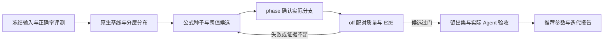

# 从测试集得到可交付的 DTB 压缩配置

目标是让接手 Agent 在**同一模型、目标数据质量不退化**的约束下，找到经过验证、具有净 E2E
收益的配置。现有 YAML 是历史工作负载的起点，不是新模型的最优超参。本文基于
`codex/dtb-static-refactor@a518a7ec` 的接口整理，2026-11-23 核对；本轮没有执行新模型实验。

完成一次标定后，必须交付两份相互关联的文档：

1. [建议的压缩参数模板](templates/compression_parameters.md)：当前采用哪组参数、适用范围、
   配置文件/hash、证据和回滚方式。没有候选过门时，建议保持 native，不能强行推荐压缩。
2. [参数分析与测试报告模板](templates/compression_iteration_report.md)：从 Vanilla 分布、
   候选推导到每轮成功/失败的连续记录；下一位 Agent 应能复算选择依据并继续迭代。

模板是待填的交付契约，本文历史案例不填充新数据的测试结果。参数文档只维护当前结论，
报告逐轮追加；纠正旧结论时保留原记录、纠正原因和替代轮次。配置 YAML 是另附的部署制品，
不能用一张参数表代替实际文件。新 run 放 `artifacts/perf/<run_id>/`，正式推荐文档和精简报告
在评审后纳入 Git，原始采集留在可访问的归档中。



## 1. 先冻结实验问题，不先调参数

每条输入至少要有以下信息。可从[现有 replay 数据](../../validation/replay/cases.jsonl)学习
`case_id/request_body/answer_check` 的组织方式；其中 7 条合成输入只是接口验收，不是通用调优集。

| 信息 | 需要固定什么 |
| --- | --- |
| 身份与分组 | 唯一 case_id、数据集版本/hash、scene/调用角色、原始任务或会话 ID；近重复、同任务多轮必须在同一数据划分 |
| 完整请求 | model、原始 messages、tools、模板、stream、采样/seed、completion 额度；不能只留下最后一句用户问题 |
| 正确性 | 标准答案或评分规则、评测器代码/版本/hash；数值/JSON/工具参数优先确定性比较，开放题固定 rubric 与 Judge 版本 |
| Agent 任务 | 固定初始输入、环境/工具快照及任务成功条件；完整闭环另记录任务起止和工具耗时 |
| 数据划分 | 校准/调参集、留出验收集；按任务/会话分组划分，提前记录比例和样本数，不能反复用留出集选参数 |
| 验收目标 | 主指标、正确率允许变化、关键场景约束、短请求时延容忍度、并发和收益要求；在看候选结果前确定 |

原生配置用 `enable_think_budget=false`，删除六个 fixed 请求覆盖；不以很大预算模拟关闭。
更换模型、量化或后训练修订后重跑 Vanilla。固定 vLLM/Ascend、torch/torch-npu/CANN、模型与
tokenizer 修订、YAML/patch hash、采样、到达节奏和 prefix cache；服务器身份记录参考
[manifest](../../validation/replay/server-manifest.example.json)。`phase` 诊断和 `off` 排名分开。

评分对每个计划样本保留 True/False/invalid，只有 Judge **字面量 True** 计正确。
明确严格正确率分母，例如 `正确数 / 计划评测数`，invalid、客户端错误、Judge 错误、协议
hard failure 单列；缺少评分不能悄悄减少分母。Judge 故障修复后重评同一冻结答案并记录版本，
不要把评分故障当成算法失败，也不能把故障样本从质量门中静默删除。

## 2. 先让原生模型跑完整校准集

至少保存逐请求输入/hash、参考答案、实际答案、判分与原因、server request ID、输入 token、
可见思考 token、最终答案 token、API usage、finish_reason、完整耗时和错误。
首次基线覆盖全部样本，再按预先规定的重复次数复测波动；后续候选用同输入和匹配的
sampling/seed 配对。分组、异常和缺失的处理规则要在所有轮次保持一致。

输入特征先选能解释差异的几类：调用角色/system 身份、任务类别、prompt 长度、历史轮数、
工具数量及是否处于工具返回之后、输出格式约束。**不要仅按输入长短猜思考难度**；画输入
长度与原生思考长度/正确性的分组统计，确认哪些特征确有区分度后再建立 scene。
新 scene 的身份/关键词路由也要测混淆、误拒识和误匹配，不能只调预算。

统计时至少列以下两张表：

- 每场景/角色的 N、正确/错误/invalid、截断/不可观察数、prompt P50/P95、思考 T50/T75/T90/
  T95/T99/max、最终答案长度、HTTP E2E P50/P95；注明分位数算法。
- 以**原生长度固定分层**的短/长请求：各层数量占比、思考 token 占比、质量和 E2E。
  不得用候选压缩后的长度重新划分样本，否则长请求会被移入短层，比较对象随参数变化。

`length` 是被截断的观测，不是自然思考长度；未知长度不填 0。分布可以使用可观察的正常
样本，但必须列排除数量和理由；质量/错误/时延总表保留全体请求，失败和超时单列。
如果截断占比高，应先给足合理输出额度重建基线，不能拿受上限压平的分布推导预算。

优先保存实际生成 token IDs 与已验证 reasoning 边界。只有文本时可用同一 tokenizer 重编码，
但必须标 `local_reencode`；这是预算种子估计，不能冒充原始生成 token。API completion
usage 包含思考与答案，不等于思考长度，也不包含 DTB 的隐藏 probe。

例如，用自备的 JSONL（每行含唯一 `case_id` 和完整 `request_body`）采集原生结果，Bash：

```bash
python tools/dtb/replay_tool_calls.py --file /path/to/labeled-cases.jsonl \
  --mode vanilla --repetitions 3 --stream \
  --url http://127.0.0.1:9001/v1/chat/completions --model YOUR_SERVED_MODEL \
  --max-tokens 4096 --temperature 0 --top-p 1 --seed 20261123 \
  --output-dir artifacts/perf/baseline-001
```

这里的 3 次重复和采样只是操作示例，不是统计样本量保证；按目标业务预先确定并成组保持。
随后用数据集评测器判分 `summary.jsonl` 的答案，按 case_id 连接原始标准答案；该命令本身
不判业务正确率。工具会写客户端 manifest，实际服务器身份仍需另存。超时或截断先排障，
不要用生成的耗时汇总直接宣布质量通过。

## 3. 用已有公式生成第一组候选，再明确搜索范围

已有工具 [construct_fixed_candidate.py](../../tools/construct_fixed_candidate.py) 实现的公式如下。
这些是**候选种子的历史启发式**，不是正确率保证或最优性公式。

令 `Q50(x)` 表示四舍五入到最近的 50，半值向上；`T50` 是当前场景原生可见思考长度中位数：

工具要求 `T50 > 0`。若无思考/直接工具返回较多导致中位数为零，先按角色与实际思考分层、
审计长尾或保持 native，不伪造正中位数；未知长度仍单列，不填零。

```text
C0 = clip(Q50(0.20 × T50), 100, 2000)       首次检查长度
S0 = clip(Q50(0.10 × T50),  50, 1000)       继续思考步长
B0 = max(C0, Q50(0.50 × T50))              思考总预算
R0 = max(1, ceil((B0 - C0) / S0))          probe 轮数种子
M0 = C0                                  最低思考量
p0 = 0.93                                置信接受阈值种子
```

教学算例：假设 `T50=2200`，得到 `C0=450、S0=200、B0=1100、R0=4、M0=450、p0=.93`。
名义 `C0+R0×S0=1250` 不等于实际生成量；B0、模型自然停止、置信接受、上下文和调用额度
仍会限制生成。这个算例没有声称任何历史测试集的实测中位数就是 2200。

| 含义 | 单请求搜索字段 | 写入命中场景的字段 |
| --- | --- | --- |
| C：首次检查；流式中的介入阈值来源 | fixed_check_length | check_length |
| S：拒绝试答后的步长 | fixed_think_stride | think_stride |
| R：最大 probe 轮数 | fixed_num_thinking | num_thinking |
| M：有效评分接受前的最低思考量 | fixed_min_think_tokens | min_think_tokens |
| B：思考总预算 | fixed_budget_tokens | max_think_tokens |
| p：置信接受阈值 | fixed_prob_th | prob_th |

单请求显式提供六个正值，满足 `1 <= C <= B`、`1 <= M <= B`、S/R 为正整数。
fixed 为 0 表示不覆盖，不是禁用该能力；尤其只设置 fixed 总预算而漏填 M 时，最低思考量
默认取 B，可能使本来想测的提前接受不发生。当前 R 是 probe 轮数，不是“生成总段数”；
最后一次拒绝后资源允许时还能追加一个 stride。完整约束和覆盖来源见
[配置参考](../design/dtb_configuration_reference.md)，不用旧设计反推字段含义。

### 3.1 复用候选构造工具

以下 Bash 命令只在有目标 tokenizer 的环境中计算种子，不发送推理请求：

```bash
python tools/construct_fixed_candidate.py artifacts/perf/baseline-001 \
  --vanilla-result test_result/vanilla_scene_2026-11-23_10-00-00.csv \
  --tokenizer /path/to/actual/model \
  --candidate-label fixed_v1 \
  --output-dir artifacts/perf/baseline-001/candidates \
  --report-json artifacts/perf/baseline-001/candidate-calculation.json
```

CSV 必须有 `request_id`、`模型回答`、`Token数`（completion token）三列；回答字符串必须含
`</think>`，工具按边界拆出思考文本。读取 tokenizer 后重编码的模式虽名为 `exact_tokenizer`，
也不是原始生成 token IDs。工具不会自动过滤坏样本、检查参考答案或评估输入特征；先审计
适合计算分布的行，保存原表及过滤清单，不要直接把 HTTP summary JSONL 传给它。
parser 已把 reasoning/content 分开的数据，应显式、可审计地转换格式或直接复用
`construct_candidate(T50)`；不能假造不存在的思考边界。

输出为按场景名推导的 `.txt` 候选块及计算 JSON，不是可部署 YAML。同名 candidate label
会被覆盖，迭代应使用新标签并保留每轮 JSON/hash。`--dry-run` 不写候选文本，但若指定
`--report-json` 仍会写报告。缺 tokenizer 时的回归估计路径还需要同场景 DTB CSV 和已提取
`requests.jsonl`，不能作为首次只有 Vanilla 数据时的无依赖替代方案。

把上面的教学候选放入配对采集命令时，使用同一输入、采样及输出额度，例如：

```bash
python tools/dtb/replay_tool_calls.py --file /path/to/labeled-cases.jsonl \
  --mode both --repetitions 3 --stream \
  --url http://127.0.0.1:9001/v1/chat/completions --model YOUR_SERVED_MODEL \
  --max-tokens 4096 --temperature 0 --top-p 1 --seed 20261123 \
  --fixed-check-length 450 --fixed-think-stride 200 --fixed-num-thinking 4 \
  --fixed-min-think-tokens 450 --fixed-budget-tokens 1100 --fixed-prob-th 0.93 \
  --output-dir artifacts/perf/candidate-v1-001
```

它会给每个候选配自己的原生对照，`--mode both` 不是将两侧混在同一并发批中。
这组数值仅用于展示字段映射，必须替换为目标数据算出的候选并继续做独立评分。
每轮用新目录，诊断阶段用 phase，排名阶段用 off；不得把两种模式的记录合并比较。

### 3.2 建议的搜索顺序

下面是本手册建议的实验策略，不是仓库已经执行过的搜索轨迹：

1. 每场景先测公式种子和一个较保守预算点，确认质量、实际分支和成本，不立即做六维全排列。
2. 固定评分算法和采样，围绕种子扫描 B、C，例如 B 的 `{0.8, 1.0, 1.25}` 倍和 C 的
   `{0.75, 1.0, 1.25}` 倍，按选定粒度取整、去重、剔除 C>B；这是起始范围，质量失败时可向外扩展。
3. 在质量可接受的 C/B 附近再调 S/R/M，观察 probe 次数、隐藏 token、child 调用及净耗时。
   缩短 S 或增加 R 可能提高隐藏试答成本，不能只看公开 token 减少。
4. 需要 probe 提前接受时再比较 p，例如 `.90/.93/.95/.97`；同时记录有效评分、低于阈值、
   min-think 拒绝和 fail-open 占比。token 置信度不是答案正确概率，p=.95 不意味着 95% 正确率。
5. 修改 Value-Min、采样或模型时另开实验组并重建对应基线/评分诊断；不要把多项改变混成一次超参收益。

每轮只缩小有证据支持的范围。若质量变差，先读 True→False 的具体失败，再决定提高 C/M/B、
提高有效评分门槛或让该场景 native；盲目增加 p 无法修复预算耗尽直接 final 的失败。
只有少数候选被测过时，用“已测候选中最优/可用”，不要写“全局最佳超参”。

## 4. Agent 长短高度不均时，先选介入阈值

全体 T50 很小可能让公式种子过早介入大量短请求。应先区分 main、子 Agent、标题、followup、
compaction 等角色，再对需要压缩的角色统计自然思考长度 T。对每个候选阈值 C 计算：

```text
预计触及比例       p_long(C) = count(T > C) / N
长请求思考份额     tail_share(C) = sum(T × 1[T > C]) / sum(T)
超阈值部分份额     excess_share(C) = sum(max(T - C, 0)) / sum(T)
```

同时单列 T=C 的数量。以上只描述自然分布；真实介入还受边界、采样能力、容量和 abort 竞争
影响，必须用 phase 确认。tail_share 不是可删比例；excess_share 也不是已证明安全可删的量。
可从该角色 T90/T95/T99 及分布明显分隔处提出 C 候选，记录选择理由；这些分位数是建议的
搜索起点，不要求把所有模型都调成 750。

分别比较两类策略：

- **预算直接收束：C=B。** 到阈值并成功交接后预算耗尽转 final；通常无 probe，调 p 无法
  验证置信早退。适合先评估一个简单预算策略的收益与质量风险。
- **阈值后 probe：C<B。** 为隐藏试答、继续思考和 final 留空间，用质量决定 M/p，用账本
  检查实际 probe/轮数。只给名义空间不保证模型一定进入该分支。

流式在阈值前观察原生 child，非流式直接走状态机；“短请求先原生观察”的收益分析不应
不加验证地套到 JSON 请求。大 delta 和 abort/drain 可使实际长度超过阈值，记录 overshoot，
不硬删已输出 token。8-token [功能演示](integration_smoke.md)只证明干预可用，不参与生产选参。

必须保留短请求负对照。按同一 Vanilla 分层定义 `d = E2E_Vanilla - E2E_DTB`，请求加权
平均收益为 `(1-p_long) × mean(d_short) + p_long × mean(d_long)`；正值才表示该样本混合
分布下平均变快。如果长请求只有 5%，短请求的微小平均退化也可能抵消长尾收益。
该式是分层均值的加权关系，不替代实际并发、排队和 Agent 闭环实验；短层 P95、吞吐和
端到端任务成功率还需独立验收。

## 5. 每一轮如何运行、判定和更新

| 阶段 | 执行与记录 | 进入下一步的条件 |
| --- | --- | --- |
| 接入检查 | 本地静态门禁、8-token smoke、实际 tokenizer/parser；失败先修集成 | 协议链完整，不能绕过连续性失败做正式 Agent E2E |
| 参数诊断 | 少量代表输入，phase，按 server request ID 对齐 route、budget 来源、阈值、abort/drain、probe 和 final | 真实参数/分支符合假设；未触发写未覆盖，缺账本不排名 |
| 调参比较 | off、同输入原生/候选配对、交替次序与重复；保持模型/seed/采样/并发/cache | 正确性与协议通过后才比较收益 |
| 留出验收 | 冻结候选和完整 YAML，重启；移除请求 fixed，验证自动 scene/native 路由和整套数据 | 质量与收益同时达标；不能靠 fixed 强制路由掩盖部署误匹配 |
| Agent 闭环 | 固定初始任务/工具环境，记录各轮调用和完整任务耗时/成功率 | 不以某次模型 HTTP 更快代替任务整体通过 |

每轮质量记录 TT/TF/FT/FF（原生→候选正确/错误）及涉及 invalid 的配对，保留 TF 的输入、
参考答案、两侧答案、评分理由。总体正确率相同不代表没有关键能力退化；关键场景也要过门。
若声称统计意义上的不退化，需预先确定 margin、置信水平、分析方法和样本量；样本小、
未观察到退化只能写样本结论，不能把“差异不显著”写成已证明非劣。

性能同时报告配对差值、更快请求数、原生固定短/长层、逐场景等权宏平均与请求加权结果、
P50/P95 和实际并发吞吐；超时/错误不从分母静默丢弃。phase 分解只用于解释隐藏 probe、
prefill/decode、排队和 controller 成本，排名用 off；不能拿 phase 与 off 混比。

参数固化到 YAML 后要再次检查 `source_by_field` 与最终预算：服务 fixed 覆盖置零，请求
fixed 删除，确认没有 history/difficulty 等额外来源改变本轮假设。scene 的 M 字段是
`min_think_tokens`，RUNTIME 是 `min_think_budget`；不要机械复制键名。完整配置启动校验并
重启后，才能把新参数文档状态从候选改为“目标范围内已验证”。缺收益或缺质量证据就保留 native。

### 可复用工具与能力边界

- [replay_tool_calls.py](../../tools/dtb/replay_tool_calls.py) 支持自定义六个 fixed CLI、
  `--mode vanilla/both`、JSONL 输入和逐请求采集，适合任意候选。它不执行 `answer_check`，
  普通回答的 `length` 也不一定导致非零退出；必须连接数据集评测器和完整终态检查。
- [validate_release.py](../../tools/dtb/validate_release.py) 的精确答案门可用于 text/JSON/tool
  样本；`--file` 可换数据，但 profile 仅有 auto/cap750/probe128，不能传任意 fixed 超参。
  该工具固定 temperature=0、top_p=1，不支持任意 Judge rubric；需要其他采样或评分方式时
  使用适配的评测客户端，不能声称命令自动继承了业务采样。
  以完整候选 YAML 的 auto 做比较时，无 fixed 覆盖；自动路由 phase 审计的元数据需与实际
  部署对应，内置数据绑定 Noemate 750，不适用于所有新场景。
- [audit_release_phase.py](../../tools/dtb/audit_release_phase.py) 只接收正式矩阵产物，
  `--require-intervention` 要求 direct 与 probe 都覆盖，不能拿它判纯 C=B 策略失效。
  [check_probe.py](../../tools/dtb/check_probe.py) 检查 probe 链，仍需另查有效评分及 fail-open。
- [CSV phase 提取](../../tools/extract_dtb_phase_metrics.py) 只接受含 `_SUMMARY.csv`、引用
  结果 CSV 和 server.log 的单 run；JSONL 用自身审计路径。所有原始产物及缺失项遵守
  [实验契约](../design/think_budget_generalization_plan.md)。当前没有包办任意数据正确率与全参搜索的一键工具。

## 6. 现有配置的案例与证据

下述案例固定历史边界，不能当作当前服务或新模型的验收结果。历史大文件已退出交付树，
使用固定提交只读查看，勿恢复实验目录为当前运行入口。

### 6.1 默认 13 场景：首探公式到自动配置验收

[默认配置](../../dtb/config/budget_config.yaml) 保留按场景匹配的预算；
可追溯的首探示例和自动配置测试固定在 Git
`ec26e7b8f5f5c973c83b80438dc844c4590fae14`：

```bash
git show ec26e7b8:docs/debug/fixed_v1_candidate_construction_example.md
git show ec26e7b8:docs/log/perf/run_07/RESULT.md
```

NetQAD 规划 101 题的原生**估计** T50=4668.7062，先按第 3 节公式生成种子，再经历史迭代
放宽预算并提高评分阈值。报告可复核首探与收口值，但不能把中间未列出的每次尝试补写成已执行。

| 参数 | fixed_v1 首探 | run_07 / 当前默认 YAML |
| --- | ---: | ---: |
| C / M | 950 / 950 | 950 / 950 |
| S / R | 450 / 4 | 450 / 5 |
| B / p | 2350 / .93 | 3050 / .95 |

run_07 在 633 题上 633/633 自动命中，无 fixed/history/difficulty 干扰，13 组预算与 run_06
收口值一致。原生与候选均正确 558/633，但存在 **22 对→错、22 错→对**；历史验收采用
7 场景严格、6 场景一题容差。这个容差是历史判定规则，不是新任务默认标准。
这些题参与过搜索，holdout/OOD 未完成；缺完整环境 manifest，报告中的 44.58% E2E
改善只保留为历史跨 run 观测。它示范“种子→逐场景修订→去掉 fixed 验证自动路由”，
没有证明新的模型/数据质量不退化或全局最优。

### 6.2 量化增训：旧参数失配后重建基线

以下历史材料与上节固定在同一提交，可只读追溯：

```bash
git show ec26e7b8:docs/debug/fixed_v4_quant_post_train_candidate_plan.md
git show ec26e7b8:docs/log/perf/run_11_fixed_v5/RESULT.md
```

新权重的 run_08 仍有 633/633 路由命中，但沿用旧预算后正确数从 586/633 降至 547/633，
与此同时 E2E 下降 14.82%。路由正确和速度变快都不能弥补质量失败。历史 v4 因而用新
Vanilla 分布重建候选：已通过场景保留，轻退化场景以 T50 首检、重退化场景以 P75 首检，
上限参考 P95，步长约 .10×T50；按 50 token 取整，轮数按剩余预算推导。
KPI 仅 9 题且估计误差较大，报告没有机械套分位数。该策略是当时的修订方案，不是生产公式。

机器数据场景 29 题，新原生估计 T50/P95=949.7/1245.6，展示了先保守、再局部收紧的过程：

| 项目 | 原生 | v4 | v5 / 当前 quant |
| --- | ---: | ---: | ---: |
| C / M | — | 950 / 950 | 750 / 750 |
| S / R | — | 100 / 3 | 100 / 3 |
| B / p | — | 1250 / .95 | 1050 / .95 |
| 正确数 / 29 | 26 | 28 | 26 |
| 总模型生成 token（历史账本口径） | 32467 | 32211 | 29603 |

v5 的五场景合计与原生均为 227/240 正确，但有 6 对→错、6 错→对；总生成量
262737→219499，下降 16.46%。v5 使用 TP8、原生使用 TP4，且缺 manifest，因此报告中
68.04% 的 phase-on E2E 差异不能归因于 DTB 参数，也不能混入 off 排名。正确数持平也不能免去逐项退化复核。

[量化增训 YAML](../../dtb/config/budget_config_quant.yaml) 因此只交付 **TP4 待验收候选**：
五个 v5 场景（白盒单步、机器数据、NetQAD 单步、告警结论、投诉工具）与八个 v4 复验点。
不能由默认/quant 文件的差异行数反推版本归属，也不能借默认配置的旧正确率验收新权重。
下一步应在相同 TP4/运行环境下，先做 off 全集/留出质量和协议验收，再决定是否继续调参。
保留的[场景 fixtures](../../tests/fixtures/README.md)主要用于路由回归，没有完整参考答案
与服务器耗时，不能直接充当这套质量评测集。

### 6.3 Noemate：由分布选择阈值，单独验证长尾与全流量

[历史分布与技术说明](../report/closeout/dtb_project_technical_blog.md)和
[精简统计](../report/closeout/evidence/display_data.json)记录：8,306 次主 Agent 调用中，
可观察正常思考分布为 8,277 条，T50/T95/T99 为 207/753/1002 token。
超过 750 的只有 415 条（5.01%）；这些长请求包含 16.34% 的思考 token，但仅超出 750 的
部分为 2.93%。二者不能互换，也不能直接解释成时间收益。
该历史长度采用 `local_reencode`，属于本地重分词口径，不是原生成 token ID 实测。

直接套 T50 公式会得到 `C=100、S=50、B=100、R=1、M=100、p=.93`，可能过早影响大量
原本会自然结束的请求。这是为什么 Agent 场景应先按角色分层，再讨论 C 的位置。
历史选择 750 作为待验证工作点，与 T95 接近；没有完整阈值搜索轨迹时，不能补写“搜索
所有分位点后证明 750 全局最优”。

[Noemate 750 YAML](../../dtb/config/budget_config_noemate_750.yaml) 中 main 为
`750/256/4/1/750/.95`，followup、compaction 和未匹配身份走 native。
C=B 的成功交接通常走 `budget_final`，因此这个案例验证的是预算收束，不是 .95 置信早退。
[Noemate native YAML](../../dtb/config/budget_config_noemate_native.yaml) 是保守路由/回滚候选；
正的 fixed 总预算仍可能强制 DTB，做真正原生基线仍应关闭请求开关并清除 fixed。

测试链条是“原生分布 → 选定长请求成对回放 → phase 确认功能 → off 的完整 Agent 运行”，
各阶段回答的问题不同；50 对长请求回放存在遗漏、算术错误和截断反例，不能因提速就写成质量通过。
详细的 50 对回放和完整运行见
[Noemate 测试报告](../report/closeout/noemate_e2e_20261013.md)：共同初始问题按 Vanilla
分为 1,475 个短问题、8 个长问题；模型 HTTP E2E 的观测分别为 9.361→6.752 秒和
34.001→10.045 秒。后续 Agent 轨迹会变化，完整调用集合不能强行逐行配对。
历史资料缺少完整服务器身份清单和任务级质量验收，且原生同输入负对照也有时延变化；
这些结果不证明 DTB 单因素因果收益、业务质量非劣或完整用户任务加速。

另一个[辅助研发分布案例](../report/closeout/dtb_project_technical_blog.md)中，391 条有效调用
T50=29，只有 11 条超过 850，其中 9 条是标题生成。先分角色能避免把标题长尾当成复杂
业务推理；850 与 Noemate 的 750 属于不同数据和实验，不能混用分母与阈值。

## 7. 交付完成标准

接手者沿推荐文档，应能找到唯一候选 YAML、适用模型/场景、正确率和净收益证据、重启与
回滚步骤；沿迭代报告，应能重建基线分布、公式和搜索范围，读到失败样本、停止原因与下一步。
原始数据不可公开时也应给出授权访问位置/hash，不能以不可访问的本机临时路径作为唯一依据。
当前生产配置不随本手册自动改变，待执行项明确写 `pending_remote`。

变更记录：2026-11-23，新增数据驱动选参、Agent 介入阈值、现有 YAML 案例与两份交付模板；
本轮仅文档，未新增搜索器、修改生产参数或生成新的服务器效果结论。
