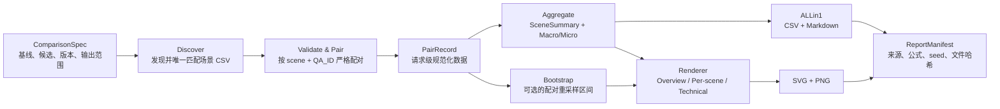

# fixed_v1 汇报图表工作流设计

> 状态：已确认并以 `fixed_v1 vs Vanilla` 落地；当前正式示例为 `generated/run_04_fixed_v1_vs_vanilla/v4/`。
>
> 设计起点：`main@96095cb3bdef9250859cc8774bef9b6a3cbca1fb`，2026-08-06。

## 1. 设计目的

当前 `run_04_fixed_v1/RESULT.md` 已包含完整实验结论，但信息分散在时延、质量和 telemetry
多张表中，不适合直接用于一页汇报，也不便于在 fixed_v2 或其他候选结果到来后重复生成。

本工作流要把“基线 run + 候选 run”转换为同口径、可审计、可反复出图的汇报产物，重点回答：

1. 13 个场景是否普遍获得端到端时延收益；
2. 收益是否来自可见输出 Token 减少；
3. Judge 精度是否总体稳定，以及哪些场景仍有质量风险；
4. 请求级分布是否支持场景平均结论，而不是只由少数异常值驱动。

工作流不改变实验数据，也不重新定义 `RESULT.md` 的统计口径。正向指标统一定义为：

```text
E2E gain        = Vanilla E2E - Candidate E2E      # 正数表示候选更快
visible saving  = Vanilla Token - Candidate Token  # 正数表示可见 Token 减少
accuracy delta  = Candidate accuracy - Vanilla accuracy
```

其中“可见 Token”指客户端结果 CSV 的 completion `Token数`。隐藏 confidence probe Token
不能混入该列；若 technical profile 展示总模型工作量，必须从 telemetry 单列读取并另图说明。
该定义还要求基线和候选的 `Token数` 具有相同采集语义。若一侧包含思考与回答、另一侧只记录
final，则只允许各自与 `_SUMMARY.csv` 对账，不允许计算 saving。配置应显式声明不可比原因，
总览第二面板降级为“更快请求占比”，逐场景 Token 分布替换为不可比说明。

## 2. 数据事实与汇报口径

根据 `docs/log/perf/run_04_fixed_v1/RESULT.md` 及请求 CSV 复核：

| 结论 | 数值 | 证据强度 |
| --- | ---: | --- |
| 场景平均 E2E 有收益 | 13/13 | 实测 |
| 场景等权宏平均 paired E2E gain | 49.47% | 实测 |
| 请求加权 E2E gain | 47.70%，节省 81.3820 s/请求 | 实测 |
| 更快的配对请求 | 607/633，95.89% | 实测 |
| 请求加权可见 completion Token 减少 | 60.06%，1878.01 Token/请求 | 实测 |
| Judge 宏平均变化 | +0.13 pp | 实测 |
| Judge 微平均变化 | -0.79 pp，-5/633 条 | 实测 |
| Judge 场景正确条目下降 | 8/13 场景 | 实测 |
| 配对 Judge 结果未发生翻转 | 570/633，90.05% | 实测 |
| Vanilla-only / fixed-only 正确 | 34 / 29 | 实测 |

因此对外主句应为：

> fixed_v1 在 13/13 场景取得端到端时延收益，请求加权时延下降 47.70%、可见 Token
> 下降 60.06%；总体 Judge 精度基本持平，但 8 个场景仍有局部回退，需要 fixed_v2 回补。

不建议只写“精度波动低”。宏平均接近不变不能替代场景级质量门；图表必须同时显示总体
稳定和局部回退。

## 3. 图表形式探索

### 3.1 外部图表范式

- Forest plot 用一行一个对象的点估计和区间表达多对象效果，适合改造成“13 场景效果图”；
  本工作流只借用视觉语法，不把测试场景称为 meta-analysis study。
  [Cochrane 图形建议](https://training.cochrane.org/handbook/current/graph-recommendations)
- ECDF 直接表示每个观测值，不需要选择直方图区间或 KDE 平滑参数，适合比较 Vanilla 与
  fixed_v1 的请求时延分布；缺点是非技术读者不如箱线图熟悉。
  [Seaborn 分布可视化指南](https://seaborn.pydata.org/tutorial/distributions.html)
- 单独箱线图会隐藏分布形状和样本量。场景请求数为 9–164，若使用箱线图，应叠加原始点；
  对本实验还应优先画配对差值，而不是两个互不关联的 before/after 箱体。
  [原始点与摘要图结合的建议](https://pmc.ncbi.nlm.nih.gov/articles/PMC5010052/)
- 时延平均值不足以表达尾部体验；分布图应保留中位数、P95 或完整请求分布。
  [Google Cloud latency SLI 指南](https://cloud.google.com/stackdriver/docs/solutions/slo-monitoring/sli-metrics/lb-metrics)

### 3.2 候选形式取舍

| 形式 | 决策 | 原因 |
| --- | --- | --- |
| 13 场景 × 3 指标对齐估计图 | 主图 | 同一行同时读取时延、Token、精度，最贴合 ALLin1 口径 |
| 配对差值箱线 + 原始点 | 采用 | 保留 633 个请求、26 个回退请求和场景内离散度 |
| Judge 配对转移发散条 | 采用 | 同时显示 V-only、F-only 和净变化，避免宏平均掩盖场景风险 |
| 逐场景 parity plot | 采用 | 每个点是一对 QA；13 个场景使用同一模板，相对等值线的位置直接表示快/慢 |
| before/after 双柱图 | 不采用 | 26 根柱拥挤，且不表达请求配对和分布 |
| 13 条折线或 slope graph | 不采用 | 场景不是连续序列，交叉线过多；不适合作为总览或逐场景统一模板 |
| 纯箱线图 | 不采用 | 隐藏小样本场景的真实点数和分布形状 |
| 雷达图 | 不采用 | 不同单位、零点和方向难以比较，也会放大面积感知误差 |

## 4. 信息层级与图表定义

### 4.1 总览层

总览层使用同一份 13 场景聚合数据，产物包括：

- `overview/01_overview_matrix.{svg,png}`：核心总览图；
- `overview/02_latency_gain_distribution.{svg,png}`：请求级时延收益证据；
- `overview/03_accuracy_transitions.{svg,png}`：配对精度变化证据；
- 第 5 节定义的 ALLin1 汇总表。

核心总览图包含 13 行场景和三个共享行序的横向面板：

1. paired E2E gain（%），0 为无收益线；
2. 可见 completion Token saving（%），0 为无节省线；
3. Judge 净正确条目变化（candidate 正确数 - Vanilla 正确数），0 为质量持平线。

点旁直接标值并标 `N`；按 E2E gain 从高到低排序。Judge 使用绝对条目数，避免小样本场景
仅多错一题就显示很大的百分比变化。图底部增加两个汇总行：场景等权宏平均和请求加权
微平均；绝对条目数不具备场景等权宏平均语义，因此 Judge 在 MACRO 行显示“—”，在 MICRO
行显示全量净变化。主图只显示点估计，避免在管理层视图中把 bootstrap 区间误读为运行
环境波动的完整不确定性。

该图要让读者在十秒内看到：13/13 时延为正、13/13 Token 节省为正、Judge 净正确条目
围绕零线但存在若干负向场景。

另外两张总览证据图分别回答：

- `02_latency_gain_distribution`：每个场景一行，横轴为请求级 paired E2E
  gain（建议主单位为百分比，tooltip/标签保留秒）；用轻量原始点 + 箱体 + 均值菱形，画
  0 收益线。它回答 607/633 更快以及 26 个回退请求分布在哪里。
- `03_accuracy_transitions`：每个场景以 0 为中心，左侧画 Vanilla-only
  正确数，右侧画 fixed-only 正确数，末端标净正确条目变化；汇总行显示 34 / 29 和
  -5。它回答“总体接近持平为何仍有 8 个场景下降”。

### 4.2 逐场景层

逐场景层对 13/13 场景全量生成，不再选择“主场景”。每个场景产出
`scenes/<scene_slug>.{svg,png}`，并使用完全一致的三面板模板：

1. **E2E 配对关系**：parity plot，横轴 Vanilla E2E、纵轴 fixed_v1 E2E；等值线下方
   表示 fixed 更快。标注 `N`、平均 gain、P50/P95 和 faster/total。
2. **配对收益分布**：上下两行分别展示请求级 E2E gain（%）和可见 Token saving（%），
   使用原始点 + 箱体 + 均值标记，并共享 0 收益参考线。
3. **Judge 配对转移**：显示 both-correct、Vanilla-only、fixed-only、both-wrong 四类计数，
   同时标注 accuracy delta（pp）和净正确条目变化。

逐场景图应能独立引用；标题、单位、正负方向和颜色语义保持一致。另生成
`scenes/index.md`，按总览图的场景顺序列出 13 张详情图，避免人工挑选或漏图。

首版不实现置信区间或 telemetry 机制图。后续若加入 technical profile，可为 paired E2E、
Token saving 和 accuracy delta 增加固定随机种子的 QA 级 paired bootstrap 95% 区间；
区间只描述当前测试题集合的重采样稳定性，不解释服务到达节奏、cache 状态或跨 run 系统扰动。

## 5. ALLin1 汇总表

产物：`allin1.csv` 和 `allin1.md`，两者来自同一个 `SceneSummary` 数据源。

建议字段：

| 字段组 | 字段 |
| --- | --- |
| 身份 | scene、N、baseline、candidate |
| 时延 | Vanilla/F 平均 E2E、gain s、gain %、faster requests、P50/P95 |
| 可见 Token | Vanilla/F 平均 Token、saving Token、saving % |
| Judge | Vanilla/F correct/N、accuracy delta pp、V-only、F-only、净正确条目 |
| 审计 | paired QA 数、client error 数、数据状态/备注 |

表尾增加 `MACRO` 与 `MICRO` 两行，禁止把两种加权口径混写为一个“平均”。百分比公式与
`RESULT.md` 保持一致：先对分子取均值，再除以基线均值，不使用逐请求百分比的简单平均。

## 6. 工作流与模块边界



核心概念：

- `ComparisonSpec`：一次可复现对比的输入声明，不把 run_04 路径硬编码进脚本；
- `PairRecord`：同一场景、同一 `QA_ID` 的 Vanilla 与 candidate 请求对；
- `SceneSummary`：所有表和图的唯一场景级数据源；
- `ReportProfile`：只控制生成总览、逐场景或技术扩展，不改变统计口径；
- `ReportRevision`：同一数据可生成多个视觉版本，旧版本不被覆盖。

实际文件布局如下。图表工作流的设计、实现、配置和产物统一归入
`docs/report/chart/`，`docs/report/` 保留给未来其他类型的汇报任务：

```text
docs/report/chart/
  fixed_v1_report_chart_workflow_design.md
  report_chart_workflow.md
  generate_report.py
  build_allin1_workbook.mjs
  requirements-report.txt
  configs/
    run_04_fixed_v1.json
  generated/
    run_04_fixed_v1_vs_vanilla/
      <revision>/
        allin1.csv
        allin1.md
        allin1.xlsx
        data/allin1_workbook_source.json
        figures/
          overview/*.svg
          overview/*.png
          scenes/index.md
          scenes/<scene_slug>.svg
          scenes/<scene_slug>.png
        report_manifest.json
```

计算层与绘图层分离。数据发现和聚合使用 Python 标准库，数值计算使用 `numpy`，静态图由
`Pillow` 与同源 SVG 绘制器生成；格式化工作簿由 `@oai/artifact-tool` 生成。配置使用标准库
JSON，避免额外 YAML 依赖。SVG 用于文档/PPT 的无损编辑，PNG 用于即时预览。

## 7. 接口定义

已实现命令行接口：

```text
python docs/report/chart/generate_report.py \
  --config docs/report/chart/configs/run_04_fixed_v1.json \
  --profile overview|scenes|all \
  --revision v1
```

- `overview`：ALLin1 + 3 张总览图；
- `scenes`：13 张逐场景详情图 + 场景索引；
- `all`：总览与 13 张逐场景详情，推荐默认；
`--revision` 必填并禁止覆盖已有目录；需要迭代视觉时使用 `v2`、`v3`。配置记录输入目录、
variant 选择器、显示名和场景展示映射。工作簿由第二条命令读取生成器输出的规范化 JSON，
不重复解析原始 CSV；完整命令见 `report_chart_workflow.md`。

## 8. 一致性校验

默认严格失败，不静默丢弃数据：

1. 场景规范化键必须唯一，基线和候选必须一一对应；
2. 同一场景 `QA_ID` 不得重复，集合必须完整配对；
3. CSV 行数、平均时延、平均 Token、Judge 正确数要与 `_SUMMARY.csv` 在舍入误差内一致；
4. fixed_v1 示例必须复现 13 场景、633 对、607 对更快、558→553 条正确；
5. 可见 Token 与 hidden probe Token 必须来自不同字段和不同图层；
6. 图表排序、标签和 ALLin1 行必须来自同一 `SceneSummary`；
7. 中文字体不可用时要给出明确错误或回退告警，不能生成乱码图；
8. manifest 记录源码路径、文件哈希、公式版本、依赖版本、随机 seed 和生成时间；
9. `scenes`/`all` profile 必须为 13/13 场景各生成一张详情图和索引条目；
10. 本地只做数据与出图验证，不把图表生成描述为真实 vLLM 性能复测。
11. 两侧 Token 语义不同时，Token saving 在表、图和 manifest 中必须同时停用，不能只加脚注。

## 9. 已确认并落地的首版

首版建议采用：

1. `all` profile（ALLin1 + 3 张总览图 + 13 张逐场景详情图）；
2. 主图为“13 场景 × 时延/可见 Token/Judge 三面板对齐估计图”；
3. 总览请求分布使用“配对 gain 箱体 + 原始点”，而非 before/after 双箱线；
4. 逐场景层对 13 个场景全量生成统一模板，不做主场景筛选；
5. 逐场景模板采用“E2E parity + E2E/Token 配对收益分布 + Judge 配对转移”；
6. 汇报用语采用“总体精度基本持平、局部场景仍需回补”。

上述方案已经在 `fixed_v1 vs Vanilla` 上执行。正式示例包含 3 张总览图、13 张逐场景图、
CSV/Markdown/XLSX 三种 ALLin1 表、规范化工作簿数据源和带文件哈希的 manifest。

## 10. 变更历史

| 日期 | 变更内容 | 原因 |
| --- | --- | --- |
| 2026-08-25 | 增加 Token 口径不可比降级：保留源列对账，停用 saving，总览改为更快请求占比并在逐场景图显式说明 | run_08 Vanilla 与 run_12 的 Token 字段采集语义不同，避免把口径差异误报为算法收益 |
| 2026-08-11 | 总览 Judge 面板由 accuracy delta（pp）改为净正确条目绝对数；MACRO 行不适用，MICRO 行显示全量净变化 | 避免小样本场景一题变化产生夸张百分比；run_04 历史图不回刷 |
| 2026-08-06 | 采用冷静、克制的灰蓝/低饱和绿红配色，完成脚本、流程说明、工作簿与 v4 示例产物 | 用户确认后执行工作流；显示标签改为配置驱动 |
| 2026-08-06 | 将图表工作流整体下沉到 `docs/report/chart/` | 为未来其他 report 任务预留独立目录 |
| 2026-08-06 | 将图表层级更正为“总览 + 13 个逐场景详情”，删除主场景筛选 | 用户更正层级要求 |
| 2026-08-06 | 初版探索设计；定义图表、ALLin1、复用流程和质量披露口径 | 在实现前明确统计与视觉口径 |
