# fixed_v1 vs Vanilla：逐场景图

以下 13 个场景与总览图使用相同排序和指标方向。

## 1. 告警诊断建议总结

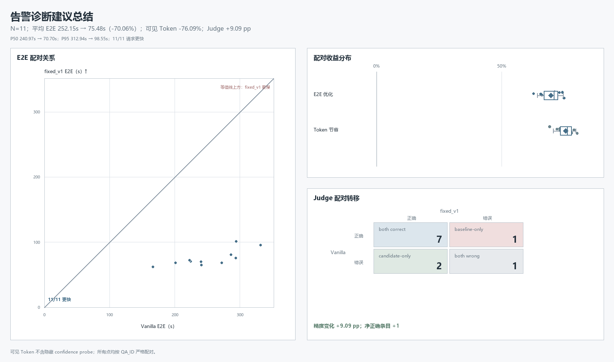

## 2. 投诉助理工具调用

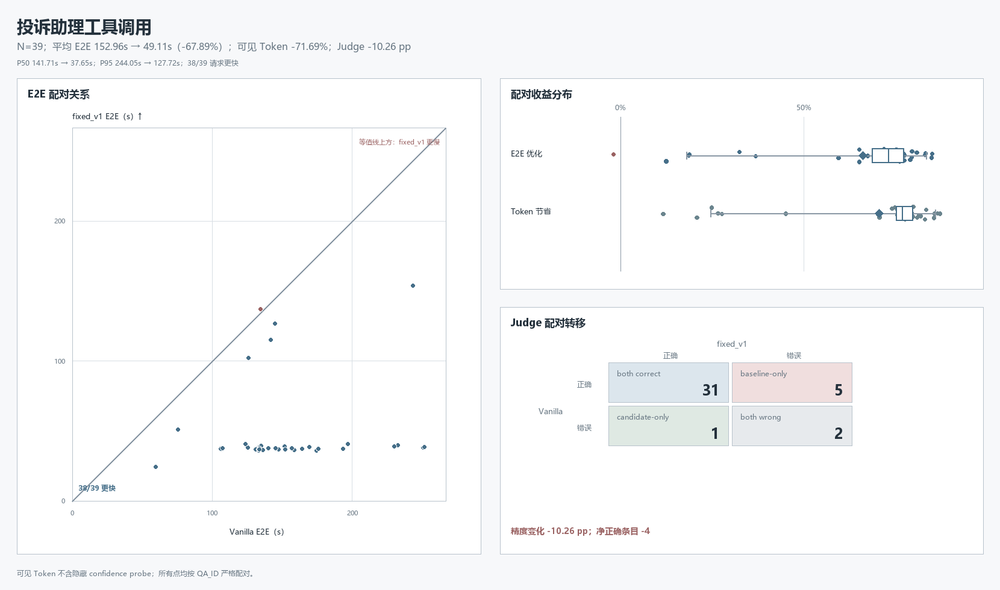

## 3. 事件自闭环

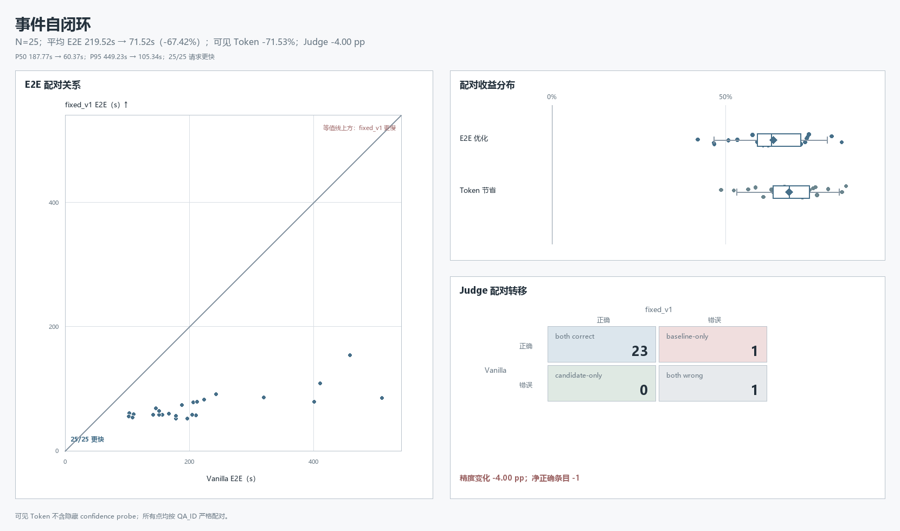

## 4. 告警诊断结论总结

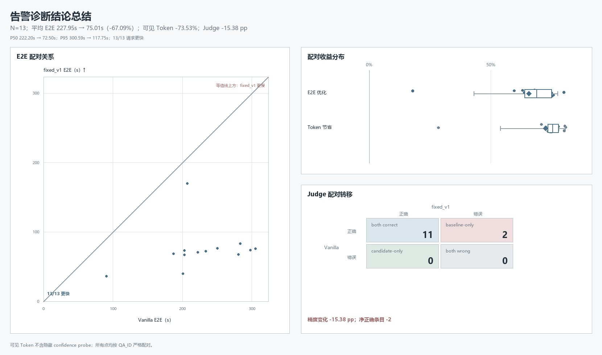

## 5. KPI 配置保障

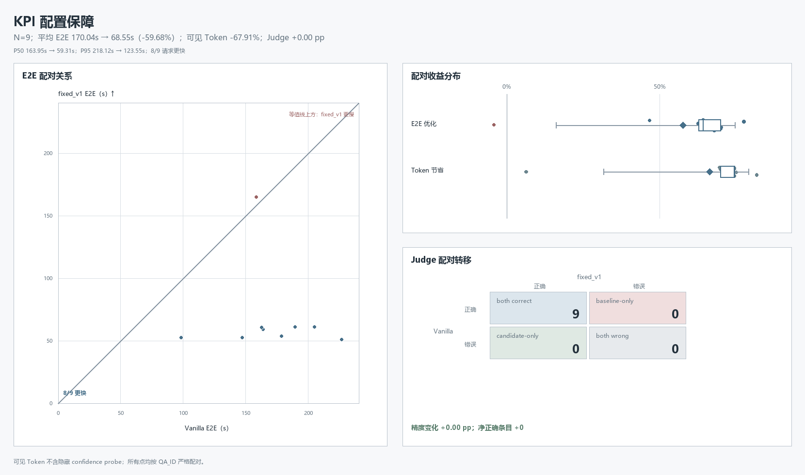

## 6. 长文本根因推理

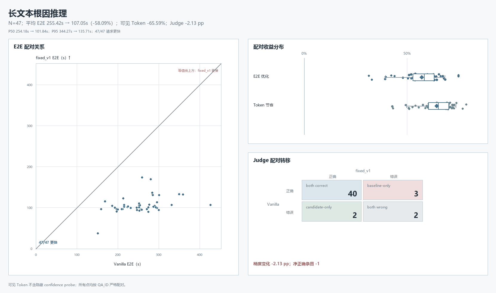

## 7. NetQAD E2E 规划模块

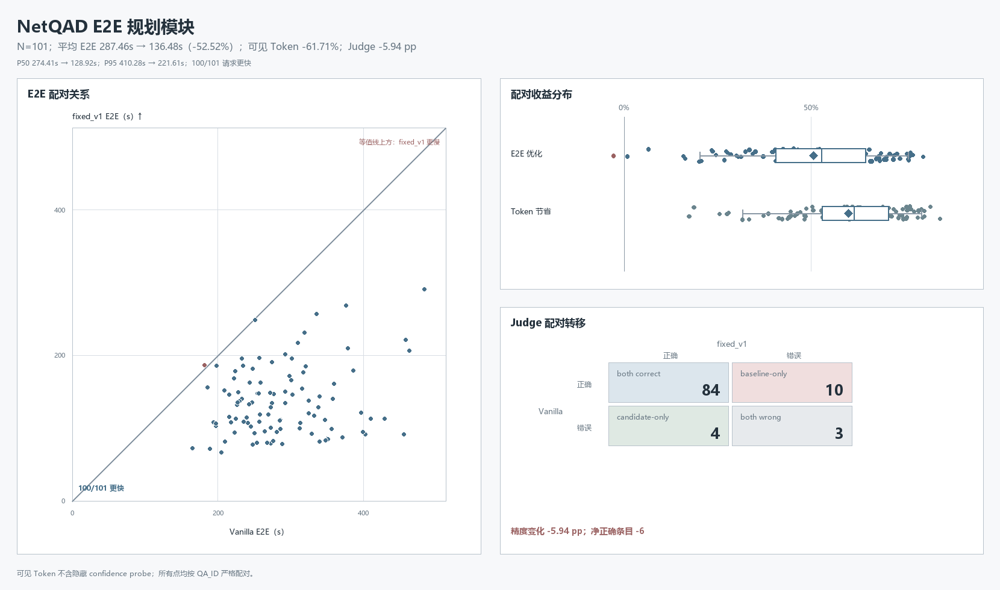

## 8. 投诉分类英文

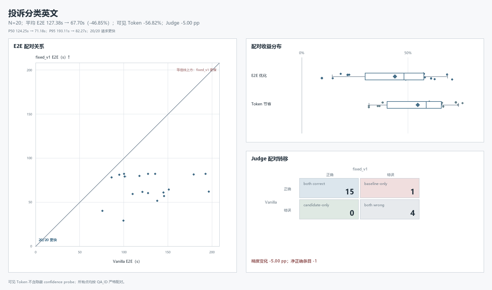

## 9. 投诉分类中文

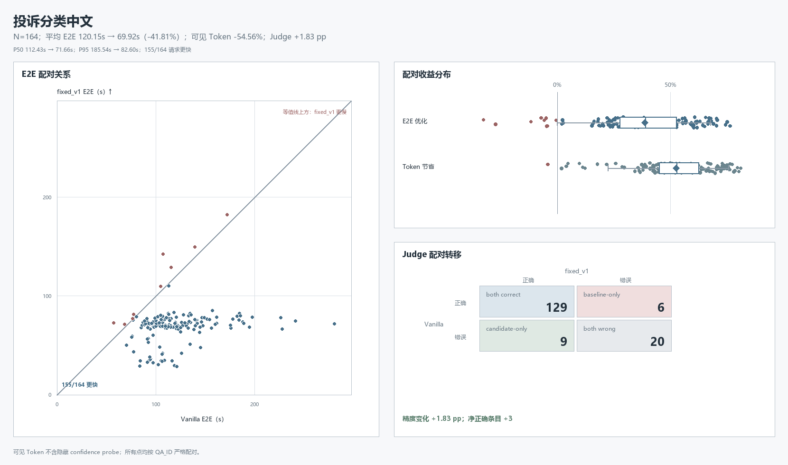

## 10. ReAct 白盒整体规划

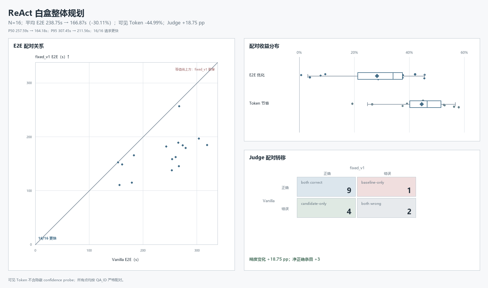

## 11. ReAct 白盒单步规划

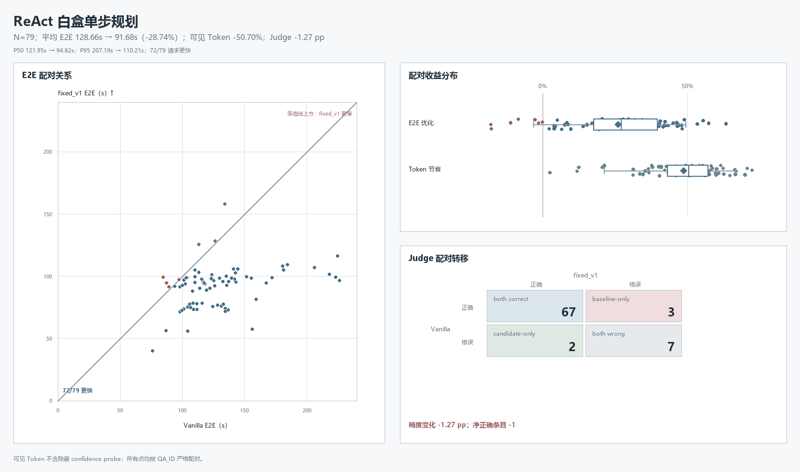

## 12. NetQAD E2E 单步规划

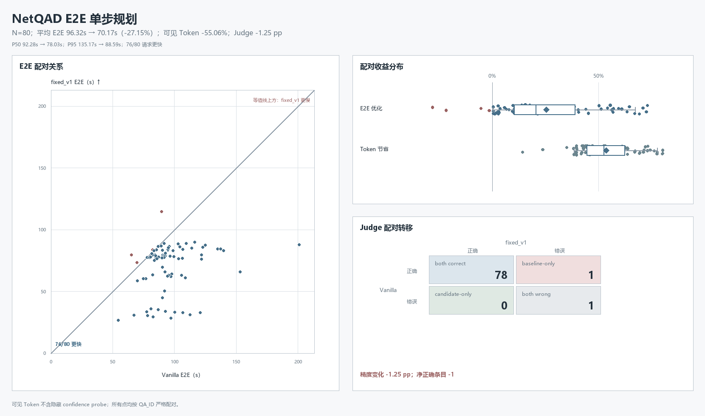

## 13. ReAct 白盒机器数据分析

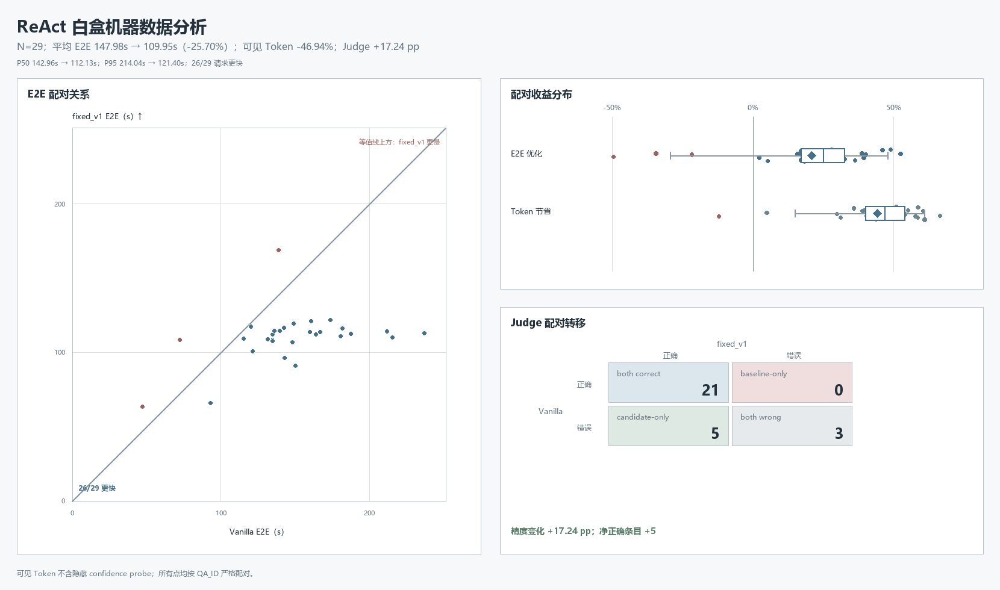
