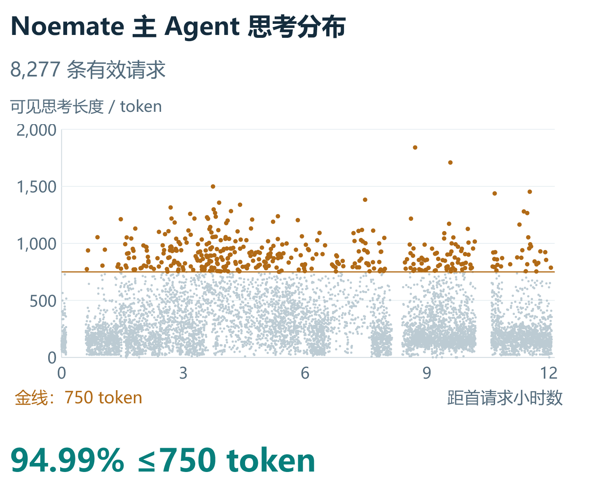
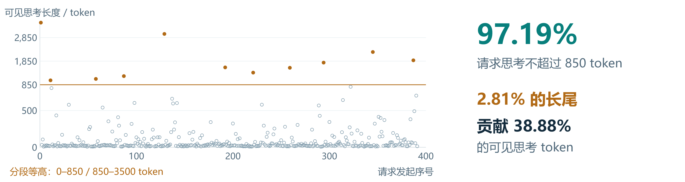
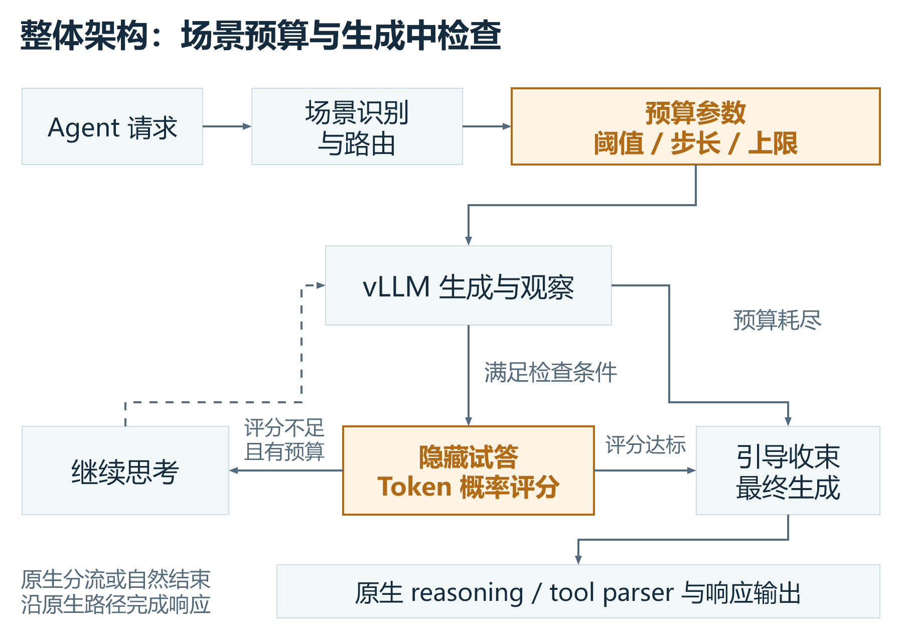
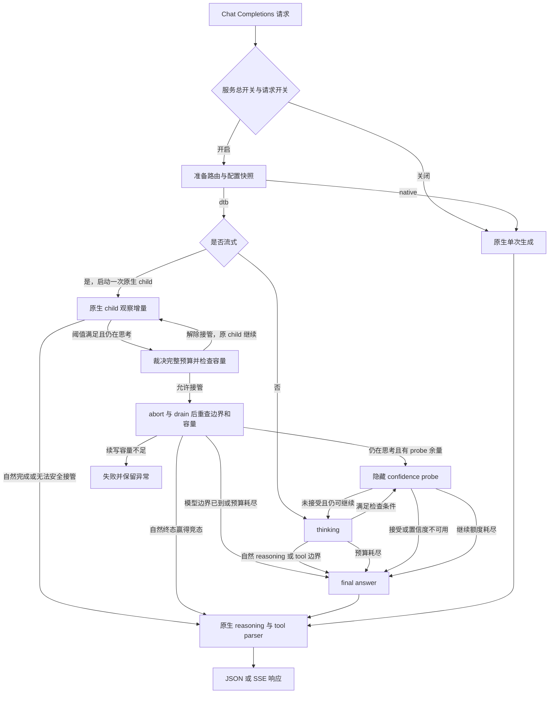
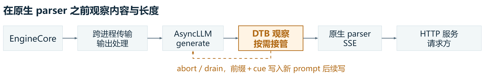
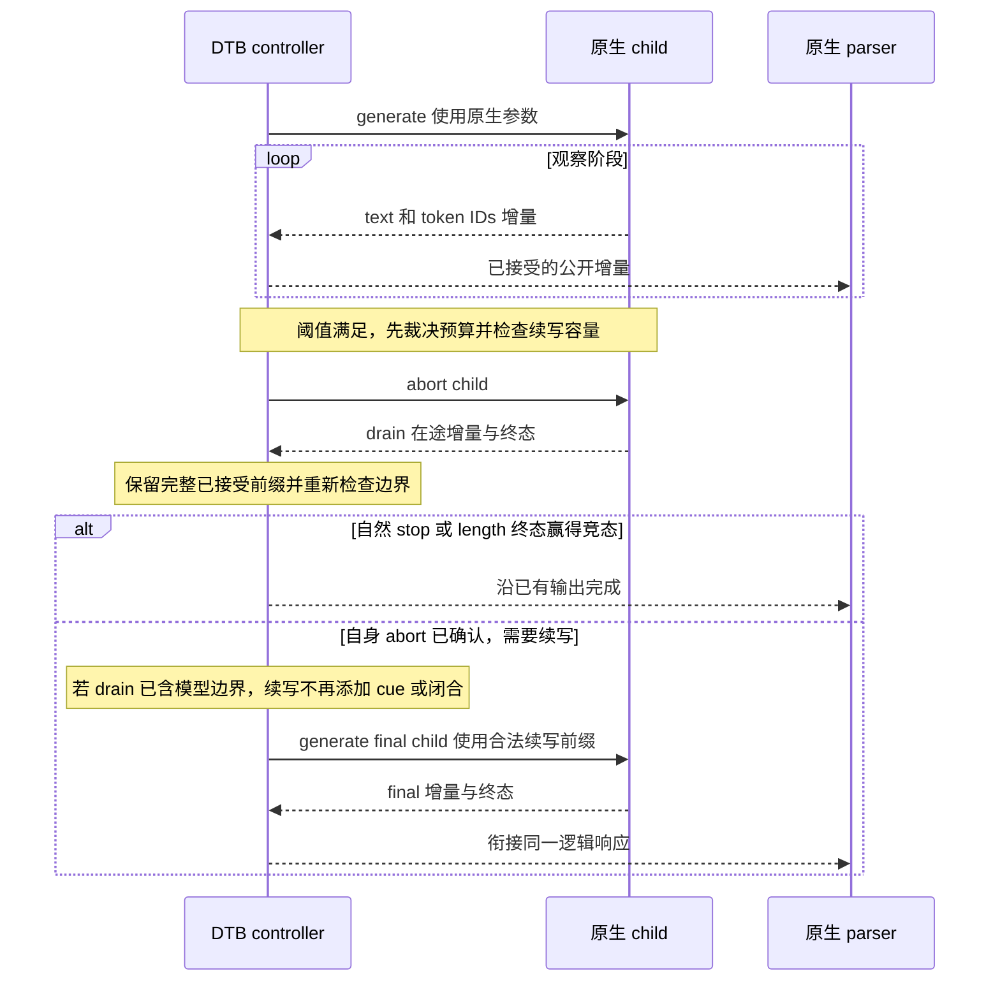
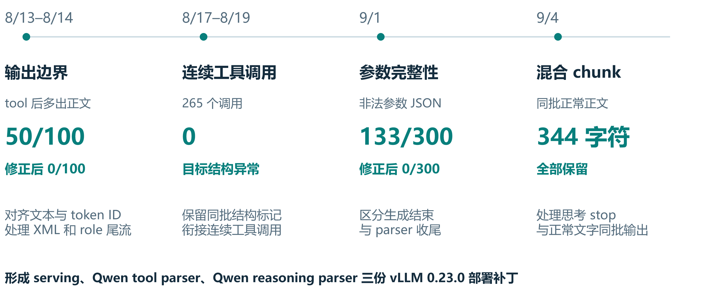
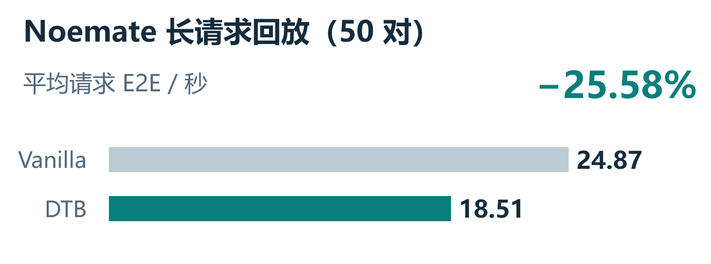
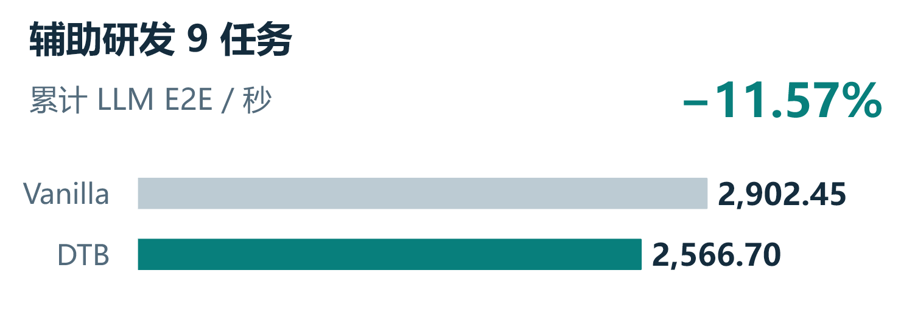

# DTB 项目技术博客

整理日期：2026-10-14。实现以本仓库 `dtb/` 和 vLLM 0.23.0 集成为准，实验覆盖 Noemate 运维 Agent 与辅助研发 Agent，独立思维链观察器 SDK 使用另一个固定交付版本。

DTB（Dynamic Think-Budget Control，动态思考预算控制）把思考预算放进模型服务：先允许模型正常生成，在适合介入的位置判断是否继续思考，再通过合法的停止与续写生成最终答案。项目的核心工作包括预算决策、流式接管、token 前缀续写、原生 reasoning/tool parser 兼容，以及能够区分公开输出和隐藏模型工作量的验证体系。

已有实验观察到长思考尾部收敛和模型调用时延下降。50 对 Noemate 长请求回放的平均 E2E 从 **24.87 秒降到 18.51 秒**；完整 Noemate 运行中，主 Agent 请求平均 E2E 从 **14.97 秒降到 10.69 秒**；研发 9 任务累计 LLM E2E 从 **2,902.45 秒降到 2,566.70 秒**。三组结果的比较单位和实验条件不同，下面分别解释。完整 Noemate 实验已采纳本轮初始短请求性能非劣的系统观测结论；业务质量非劣、DTB 独立因果收益和完整用户任务耗时仍需要各自的证据。

本文沿用[结项提纲](outlines.md)的背景、两类工程实现、效果与交付主线，并展开实现原理和实验方法。源码行为、历史服务器实测和后续假设分别注明；固定版本、原始数据路径和哈希可从[来源索引](sources.md)下钻。

文中图表复用[五页演示稿 r10](presentation/DTB_closeout_20260930_r10.pptx)的原生对象，分布点、坐标、连接线和耗时数值均沿用原稿。配套图片及导出来源见[图表说明](figures/README.md)。

## 1 项目解决的问题

### 1.1 Agent 推理中的额外思考成本

Agent 的一次业务任务通常需要多轮模型调用：理解问题、规划操作、选择工具、读取工具返回，再生成结论。每轮模型调用都可能包含 reasoning。某些调用在已经拿到足够信息后，仍继续复述、计数和检查。这会延长当前调用，也会影响后续步骤的启动时间。

辅助研发的一个真实报告阶段已经收到“3 个测试、1 个失败、2 个通过”，随后仍反复计算列表长度。这个记录提供了干预动机，但不能由此推定所有长思考都是冗余。长推理也可能是正确解题所必需的，过早收束会损害答案覆盖、计算准确性或工具选择。

DTB 的工程目标是：**在答案质量和协议不退化的条件下取得净 E2E 收益**。缩短可见思考只是中间变量。时间收益需要抵扣隐藏试答、重复 prefill、排队、置信度计算、预算判断、序列化和状态切换的成本。

可以用下面的成本关系理解一次接管：

```text
净时间收益
  = 避免继续生成思考所节省的时间
  - 新增 probe、续写 prefill、排队、控制与输出处理的时间
```

这是成本分析框架，具体数值必须测量。生成了更少的公开 token，不等于总模型工作量更少；更少的模型工作量也不能直接换算成相同比例的请求提速。

### 1.2 两类工作负载的长尾

Noemate 历史 capture 包含 12,214 次 HTTP 请求，其中主 Agent 8,306 次、追问推荐 3,897 次、上下文压缩 11 次。排除不可观察 reasoning、截断和解析异常后，主 Agent 分布使用 8,277 次调用。



图 1　Noemate 历史主 Agent 分布，复用演示稿第 4 页。横轴为距首请求的小时数，纵轴为连续线性的 0–2,000 token；金线为 750 token，金色点表示超过阈值的调用。

| Noemate 历史主 Agent 指标 | 数值 |
| --- | ---: |
| reasoning 不超过 750 token | 7,862 次，94.99% |
| reasoning 超过 750 token | 415 次，5.01% |
| P50 / P95 / P99 | 207 / 753 / 1,002 token |
| 最大值 | 1,841 token |
| 超过 750 的请求所含 reasoning | 占全部可见 reasoning 的 16.34% |
| 仅超过 750 的部分 | 68,167 token，占全部的 2.93% |

最后两行描述的是不同量：长请求的全部思考，与这些请求超过阈值的部分。它们都不是已经证明可以安全删除的 token，也不是预期净 E2E 收益。

辅助研发 Vanilla-06 的 392 次调用中，391 次具有有效思考长度。它包含主 Agent、子 Agent 和标题生成。



图 2　研发全链路分布，复用演示稿第 3 页。横轴为请求发起序号；纵轴 0–850 与 850–3,500 两段绘图区等高，各段内线性，不能跨段比较视觉距离。11 条长尾中有 9 条标题调用，图中的 38.88% 是这些长调用所含的可见思考份额。

| 辅助研发历史分布指标 | 数值 |
| --- | ---: |
| reasoning 不超过 850 token | 380 次，97.19% |
| reasoning 超过 850 token | 11 次，2.81% |
| 全部可见 reasoning | 52,112 token |
| 11 次长尾的 reasoning | 20,263 token，占 38.88% |
| P50 / P95 / 最大值 | 29 / 578.5 / 3,482 token |

这组长尾有一个关键组成：**11 次中有 9 次是标题生成，2 次是业务调用**。去掉标题后，382 次有效业务调用只有 2 次超过 850。它说明应按调用角色识别优化对象，不能把标题长尾解释成普遍的复杂业务推理。

这两组数据支持先观察短请求、重点处理长尾的工程选择。750 与 850 属于不同实验和场景，不能混用阈值或分母。reasoning 长度沿用历史本地 tokenizer 重编码，不代表隐藏 probe 或全部设备工作量。数据见[分布与汇总](evidence/display_data.json)、[Noemate 分布点](evidence/noemate_distribution.csv)和[研发分布点](evidence/development_distribution.csv)。

## 2 服务内部的整体架构

### 2.1 请求进入预算控制的位置

生产 DTB 位于 vLLM Chat Completions serving 内。外部请求仍使用同一个 HTTP 接口，controller 在服务内部管理原生生成、观察、试答和最终续写，输出继续交给 vLLM 的原生 parser。



图 3　DTB 职责概览，复用演示稿第 1 页。图中的预算参数表示配置职责；流式完整预算在观察触发后裁决。预算耗尽可以直接 final，Noemate 750 路径无需 probe。具体请求分流与状态选择如下。



图中的 final answer 状态会启动新的 final child。流式 observation 在接管前遇到自然 reasoning/tool 边界时解除接管，让原 child 继续完成；进入三状态后的 thinking child 则在耗尽其生成器后交给 final 状态续写。两条路径的 child 生命周期不同。

这里有三个不同的执行路径。DTB 关闭或路由为 `native` 时，serving 直接执行原生单次生成，不创建 DTB 请求上下文、队列或完整预算决策。路由为 DTB 的流式请求先进行原生观察，短请求沿同一个 child 自然完成。非流式 DTB 请求直接进入 thinking/probe/final 路径。

因此，“所有请求都先生成一段思考，再跑试答，最后重新生成答案”不符合当前实现。流式观察的意义，是把接管成本推迟到确实需要且能够安全介入的位置。原生观察仍有控制器与输出转发成本，不能将它称为零开销。

### 2.2 模块职责和状态所有权

| 模块 | 职责 |
| --- | --- |
| `request_controller.py` | 外部请求生命周期、路由准备、producer/consumer 管理和清理 |
| `config/` | 启动时读取并校验服务配置，编译路由规则 |
| `budgeting/` | 场景识别与 fixed、scene、difficulty、history 预算裁决 |
| `reasoning/` | 原生观察、三状态执行、token 续写、协议边界和请求账本 |
| `integration/vllm/` | 原生请求输入和 stream/non-stream 响应适配 |
| `observability/` | phase 归属记录与按白名单的流式审计 |
| `history/` | 可选历史策略和持久化，默认关闭 |

服务配置、controller 和预算解析器可以服务于多个请求；可变 prompt、输出队列和 ledger 则属于单个请求。预算解析结果是请求快照，不能在并发过程中借用另一请求的可变状态。

生产 DTB 的 producer 与 parser consumer 独立运行，公开增量经过 `stream_output → result_queue → stream_queue` 送往原生响应生成器。保留这个结构，是为了让观察环节及时消费引擎输出，同时维持既有队列、增量顺序和取消语义。删掉队列、合并 DELTA 或并行启动 child 都会改变执行契约。

源码入口与所有权约束见[DTB README](../../../dtb/README.md)和[模块导航](../../../dtb/AGENTS.md)。

## 3 场景路由和预算决策

### 3.1 显式选择哪些请求进入 DTB

外部协议字段 `enable_think_budget` 默认是 `false`。服务配置中的 `BUDGET_ENABLED=true` 只是允许 DTB 的总开关，请求还需要显式启用。优先级如下：

1. 服务总开关关闭，或请求开关关闭，回到原生生成。
2. 有效的正数 `fixed_budget_tokens` 强制选择 DTB。
3. 其余请求根据配置的场景动作选择 `dtb` 或 `native`。
4. 未匹配身份按 `ROUTING.on_unmatched` 处理。

`fixed_check_length`、`fixed_think_stride`、`fixed_prob_th` 等单字段覆盖只改变预算参数，不会把一个 native 场景强行改成 DTB。将大阈值当作“关闭 DTB”也不等价于原生路径，因为上下文、队列和执行生命周期仍可能不同。

当前保留两种路由方式。`legacy_text` 从最近的非空 user 内容等输入提取场景证据；`system_prefix` 根据原始 system 身份和可选的首 user 前缀匹配，不扫描历史正文。后者适合 main、followup 和 compaction 等角色已经由 Agent 模板定义的工作负载。

system 规则在服务启动时编译。匹配保留原始大小写、空白和 BOM 语义，不能擅自规范化身份文本。`prepare_request_route()` 只执行一次，DTB 复用其配置、scene 和阈值快照，避免前后两次判断不一致。

### 3.2 预算字段分别控制什么

| 字段 | 含义 |
| --- | --- |
| `check_length` | 达到首次检查或观察介入参考长度 |
| `min_think_tokens` | 正常置信度接受前的最低思考要求，置信度不可用的 fail-open 分支例外 |
| `think_stride` | 未接受试答后继续思考的参考步长 |
| `num_thinking` | 最大 probe 轮数，最后一次未接受后仍可追加一个 stride，再进入 final |
| `max_think_tokens` / `fixed_budget_tokens` | 思考总额度约束 |
| 隐藏试答长度 | 代码固定上限 50 token，受可用上下文和请求额度进一步缩小 |
| `prob_th` | 试答评分的接受阈值 |

完整预算还会受到上下文容量、外部 completion 额度、内部调用上限等约束。达到参考阈值只是决策条件之一，并不保证该请求实际接管，也不保证每个字段都对应独立的一次引擎调用。旧 legacy YAML 中的 `check_answer_len` 是历史字段，不决定生产试答长度，system 路由模式拒绝这个字段。可选 history 和 difficulty 策略已经实现，当前默认关闭；它们不能统称为已经在线学习到最优预算。

YAML 是启动配置的唯一入口，修改后需要重启。仓库默认仍是既有 `legacy_text` 策略；Noemate 750 和量化增训配置作为显式选择的候选保存，服务不会根据模型名自动热切换。

### 3.3 Noemate 750 候选的实际含义

| 调用身份 | 候选动作 |
| --- | --- |
| Noemate main | DTB，检查长度和最大思考预算均为 750 |
| followup | native，要求匹配对应身份且工具为空 |
| compaction | native，要求匹配对应身份且工具为空 |
| 未匹配身份 | native |

这个候选中 `check_length=max_think_tokens=750`。达到条件并完成接管后，总思考预算已经耗尽，进入 `budget_final`，无需先执行 confidence probe。因此它主要是带协议保护的预算收束策略，不能将该路径描述为“模型置信度达到 0.95 后提前退出”。配置虽然保留 `prob_th=0.95` 等通用字段，某个具体分支不一定用到它们。

750 是参考预算。一个 delta 可能携带多个 token，abort 时还可能有在途输出，最终公开思考略高于阈值符合当前的保留语义。

配置与路由规则见[Noemate 候选 YAML](../../../dtb/config/budget_config_noemate_750.yaml)、[路由设计](../../design/dtb_system_scene_native_routing.md)和[部署手册](../../design/dtb_system_routing_deployment.md)。

### 3.4 隐藏试答怎样形成决策信号

通用 DTB 在仍有思考预算时，可以基于当前前缀生成一段隐藏试答。它要求引擎返回试答实际采样 token 的 logprob，再计算接受分数。试答不作为公开正文发送，也不直接复用为最终答案；接受后仍按 final 路径生成。

默认分数是本轮试答采样 token 概率的算术平均：

```text
score = Σ exp(logprob_i) / N
```

其中 `N` 是当前抽取到的 logprob 位置数。部分缺失位置不贡献分子，但仍保留在分母；代码按实际采样 token ID 找对应概率，不能取每个位置概率最大的候选代替。它也不是整段概率乘积或困惑度。

可选 `value_min` 评分会针对抽取到的 Value token 取较低的若干 logprob；数量不足时退回平均评分。该能力和 safety gate 默认关闭。所有采样概率都不可用时，当前实现采用 fail-open：不持续依赖失效的置信度判断，转入 final。这个分支应记录为置信度不可用，而不能标成高置信接受。

**token 概率描述模型对生成 token 的偏好，不是答案正确概率。** 一段流畅但错误的分类或算术结果仍可能具有高概率，所以评分不能替代质量验证。实现见[confidence.py](../../../dtb/reasoning/confidence.py)、[confidence_gates.py](../../../dtb/reasoning/confidence_gates.py)和[生成状态](../../../dtb/reasoning/generation_states.py)。

## 4 流式观察和合法接管

### 4.1 观察环节位于原生 parser 之前

固定 vLLM V1 AsyncLLM 多进程 Chat Completions 流式路径可以按职责压缩为：



图 4　原生输出与 DTB 控制管道，复用演示稿第 3 页。实线为逻辑输出流，虚线为生成控制；图中“前缀＋cue”对应强制收束路径，模型边界已到时不重复添加 cue。显式 native 绕过 DTB 段，非流式执行路径见第 2 节。

引擎输出先经过 Msgpack/ZeroMQ 传输、detokenize、stop 与 logprob 处理，形成带文本和 token IDs 的 `RequestOutput`。DTB 消费的是这些引擎增量，控制动作通过引擎接口返回 EngineCore。SSE 是更下游的序列化产物。

因此，answer cue 写入内部续写 prompt，不是插入已经发出的 SSE 字节。一个 token、一个 RequestOutput、一个 SSE 事件和一个 TCP 包也没有一一对应关系。外部 `vllm_gateway` 是可选透传采集层，不属于 DTB 必经链路。固定源码定位见[管道来源核对](sources.md)。

### 4.2 停止需要完成 abort 和 drain

`_DeferredInterventionState` 累计可见思考，并识别 reasoning 结束、工具开始和自然终态。只有协议能力、阈值和容量条件满足时才准备接管。下图展开原生终态完成与直接 final 续写分支；隐藏 probe 和后续迭代见第 2 节状态图。



阈值可能落在一个多 token batch 内。当前契约保留整个已接受 delta，以及 abort 后 drain 到的合法尾部，不能任意切开一个 batch 后撤回已经公开的文本。若自然 stop/length 终态先完成，保留原 child 的完成结果。若自身 abort 已确认，但 drain 带来了 reasoning/tool 边界，则进入 `model_boundary_final`，用完整前缀启动 final child，不重复 cue 或闭合标记；仍在思考时才按剩余预算选择 probe 或强制 final。接管后容量不足明确失败，不能伪造空答案成功。

安全能力检查也会拒绝一些组合，例如用户字符串 stop、状态相关采样或惩罚、结构化输出、多模态输入、未绑定协议和缺少 abort 能力。无法安全续写时保持原生生成，这些限制保护协议和采样语义，不表示所有模型与参数都已经支持接管。

同一外部请求的 thinking、probe 和 final 顺序 await。多个 child ID 表示多个内部生成生命周期，不表示它们同时占满 `max_num_seqs`，也不证明 prefix KV 每次都从零计算。是否命中缓存及新增 prefill 的代价需要引擎账本。

所有内部 generate 需要透传 priority、LoRA、trace headers、DP rank 和 parser 上下文，同一外部请求维持 DP 亲和性。否则一次逻辑请求可能在调度、适配器或 parser 上发生不一致。细节见[观察实现](../../../dtb/reasoning/deferred_observation.py)和[请求上下文](../../../dtb/reasoning/request_context.py)。

### 4.3 用 token IDs 续写并保护 prompt 所有权

续写的权威输入是已接受的 token IDs。decode 成文本后重新 tokenize，可能改变结构 token 或分词边界，因此不能用这种方式重建已有前缀。公开 delta、模型续写输入和响应 usage 是三个不同边界，不能互相替代。

观察阶段可以借用原始 prompt；首次修改前调用 `own_prompt()` 取得所有权，每个 child 再通过 `engine_input()` 或 `child_prompt()` 获取稳定快照。这样既避免短路径无必要的修改，又保护已经提交给引擎的输入免受后续列表变更影响。

强制 final 使用已接受前缀，追加既有 answer cue、模型对应的思考闭合 token 和分隔符。模型自然 reasoning/tool 边界后的 final 续写不重复添加 cue 和结构标记。模型 token ID 契约必须与实际 tokenizer、reasoning parser 和 tool parser 一起绑定；当前 Qwen 配置中的数值不能直接用于另一模型。设计见[token 权威续写与所有权](../../design/dtb_token_authoritative_prompt.md)。

### 4.4 所有公开输出共享一次 completion 额度

serving 先按 vLLM 原生 `get_max_tokens()` 解析整个 assistant completion 的有效额度，再交给 DTB。公开 thinking 和 final 共同消耗这份额度，不能每进入一个状态就重新得到完整 `max_tokens`。

`DtbRequestState` 是唯一请求账本，分别记录已透传 completion、思考、隐藏 probe、final 和 child 调用。final 提交前还需考虑上下文余量、已公开 token 和尚未发送的 reasoning 边界，为边界预留额度。

“内部 prompt 已闭合”与“parser 已收到闭合边界”是两种状态。没有可用历史 chunk 模板时，控制器可以先闭合内部 prompt，再在首个 final 输出中补发 parser 边界，不能省略或重复它。

正常 final terminal 必须等生成器耗尽后才能发送；错误、取消和异常要保留失败语义。过早发送成功 terminal 会隐藏尾部异常，额外尾流则可能改变 `finish_reason` 或工具结构。实现职责见[final 结构设计](../../design/dtb_final_answer_state_refactor.md)。

## 5 流式和投机解码的协议兼容

### 5.1 文本相同仍可能解析出不同结果

原生 parser 同时消费增量 text 和 token IDs。stop detokenization 可能隐藏标记文本，但保留结构 token ID；投机解码又可能在同一增量中返回普通正文、参数末尾和工具结束标记。

例如历史故障中，已有文本 `Let me try a`，下一块包含普通文本 ` different approach.\n`，最后一个 ID 是 reasoning-end `248069`。如果只因最后一个 ID 是结束标记就丢弃整个 delta，完整句子会被截断。正确处理应保留普通 reasoning 前缀，同时将结构结束交给 parser。

工具调用也有类似问题：参数和 `</function>` 可能同批到达，两个工具调用可能相邻，甚至 tool-start 的 `token_ids` 已出现而 `text` 为空。只围绕某种固定 chunk 切分方式维护字符串状态，会在合法的新分区下遗漏参数、重复标记或泄漏 XML。

工程契约因此要求：同一逻辑 token 序列在不同增量分区下仍解析成相同的正文和工具结构，保持增量顺序、结束语义与多轮上下文。XML 泄漏、工具标记重复或丢失、JSON 不完整、role 尾流和 `finish_reason` 偏离均属于 hard failure。

### 5.2 历史问题怎样被逐项定位



图 5　历史定向修复时间线，复用演示稿第 2 页。四轮样本和目标故障各自独立，图中的 0 只对应所列目标项，不代表当轮所有故障归零。

| 历史阶段 | 定向问题 | 对应回放结果 |
| --- | --- | --- |
| 8 月 13 至 14 日 | XML 泄漏、tool 后仍出正文或 role 尾流，修正边界交接和前缀对齐 | tool 后 content 50/100→0/100；后续一轮 XML 泄漏 13/100→0/100 |
| 8 月 17 至 19 日 | 参数尾部与结构标记同批、连续工具调用 | 180 对中，170 条含工具 DTB 响应、265 个工具调用的目标结构异常为 0 |
| 9 月 1 日 | 参数 JSON 未闭合，区分模型未完成与 parser 收尾 | DTB 非法 JSON 133/300→0/300 |
| 9 月 4 日 | stop ID 和普通尾句同批，正文被吞 | 新轮 60/60 公开正文与 pre-parser 一致；48 个混合 chunk 的 344 个普通字符全部保留 |

这些数字来自不同定向实验，不能相加成总通过率。8 月的部分轮次仍有其他异常；9 月 1 日还有 terminal 或 Vanilla 空参数问题；9 月 4 日来自两条固定上下文，主要覆盖短思考边界。历史 MTP 回放覆盖了同批收尾，不能据此补写 MTP 性能收益。

完整故障原文、请求 ID 和日志位置见[历史工程复盘](https://github.com/F00L42/TB/blob/32ab2268335e00d79e0aeda4395c6ecdc06d81eb/docs/report/sum0911/%E5%B7%A5%E7%A8%8B%E5%A4%8D%E7%9B%98%E6%97%B6%E9%97%B4%E7%BA%BF_%E6%8A%A5%E9%94%99%E6%A0%B7%E4%BE%8B.md)。

### 5.3 当前三份部署 patch

| Patch | 具体职责 |
| --- | --- |
| `dtb_serving.patch` | 增加请求开关，准备路由，透传统一 completion 额度，将 native 留在原生 serving |
| `qwen3_coder_parser.patch` | 从累积文本解析已完成 function，一次输出规范 JSON 参数，处理同批闭合、多调用和 token-only tool start |
| `qwen3_reasoning_parser.patch` | 末尾为 reasoning-end ID 且标记文本被剥离时，保留普通 reasoning 前缀 |

tool parser 的取舍是：工具名可以在头部完整时发出，参数在 `</function>` 到达后一次输出，不再逐参数发送。模型尚未完成 function 时不凭空补闭合标签。token-only tool start 在 parser 的请求状态中维护逻辑前缀，不把伪造 `<tool_call>` 文本写回正文、SSE、续写 prompt 或 token 账本。

本地 partition gate 以非流式原生 parser 结果作为 oracle，检查 direct tool parser 和统一 delegating parser。reasoning-tail gate 覆盖原生回归、detokenizer 基类与 60 条冻结链；未打 patch 的负对照仍保留 47 条历史尾部缺失，打 patch 的本地检查为 84 项。它们证明固定输入上的协议回归能力，不把重新解析成功写成历史服务器输出已被修复，也不替代真实 HTTP、tokenizer 或 NPU 验证。

三份 patch 的单一制品来源、应用顺序和独立检查命令见[patch README](../../../patches/vllm/v0.23.0/README.md)及[Qwen 边界设计](../../design/dtb_reasoning_boundary_token_stop.md)。

## 6 性能测量和证据方法

### 6.1 分清三种时间

| 时间量 | 测量边界 | 能回答的问题 |
| --- | --- | --- |
| 模型 HTTP 请求 E2E | 网关发起调用到完整响应结束 | 一次调用的等待、生成与返回是否更快 |
| 累计 LLM E2E | 某业务任务内全部模型请求 E2E 相加 | 该任务累计用了多少模型调用时间 |
| 完整任务 wall time | 权威 task_start 到 task_end | 用户完成整项任务等了多久 |

同一任务的模型请求可能有重叠，工具和平台也消耗时间。累计 LLM E2E 不能直接替代任务 wall time。流式 TTFB 是收到响应首字节的时间，也不能未经解析就称为首个答案 token；非流式 TTFB 通常接近整条响应耗时。

### 6.2 用不同 telemetry 模式回答不同问题

| 模式 | 行为 | 使用场合 |
| --- | --- | --- |
| `off` | 无 recorder/writer，不生成 DTB 成功事件 | 生产默认和正式性能比较 |
| `phase` | 写 `DTB_ROUTE`、`DTB_PHASE` schema 3 和 `DTB_REQUEST_SUMMARY` | 审计路由、实际分支、隐藏工作量与阶段耗时 |
| `stream_audit` | 仅记录显式 request ID 白名单的文本/token IDs | 定位公开输出和 pre-parser 边界问题 |

phase writer 使用有界队列，满时记录缺口而非阻塞模型输出。缺失账本不能伪装成完整实验。native 路径合法地没有 DTB phase；`DTB_ROUTE` 只表明路由意图，不证明最终执行成功或质量合格。

按 `parent_request_id` 对账 decision、initial/iterative thinking、confidence_probe、final_answer 和 controller_cpu，分别检查 queue、prefill、decode、cached/generated token 及 stop_reason。phase wall 与客户端 E2E 的差额保留解释空间，不能把未测量的差额自动归到网络或排队。

response completion usage 不包含隐藏 probe，也不包含作为内部 prompt 的 answer cue。不同 child 不证明缓存失效。公开 token、隐藏 token、缓存命中与设备工作量需要独立记录。

### 6.3 先对账和配对，再计算收益

每个 run 保存服务与模型身份、配置和 patch hash、sampling/seed、并发、到达节奏、cache 状态和 observability。模型或后训练修订变化时重新建立 Vanilla，不能沿用旧基线。

请求比较先核对唯一 ID、归属、输入与答案基准、缺失和重复，再报告逐请求差值、更快样本数及分位数。Judge 只有字面量 `True` 才算自动正确，invalid 单列；客户端错误、Judge 错误和协议 hard failure 分开统计。HTTP200、`finish_reason=stop` 和合法 JSON 不能代替业务正确。

收益定义使用明确的分子分母，例如固定成对集合：

```text
集合耗时降幅 = 1 - Σ DTB E2E / Σ Vanilla E2E
```

它不等于逐对百分比的平均值。重复同一问题多次也不能计作更多独立业务问题。具体规则见[实验与证据契约](../../design/think_budget_generalization_plan.md)。

## 7 Noemate 实验结果

### 7.1 五个固定长输入的 50 对回放

回放集合在测量前冻结，来自此前探索中的四个长输入和一个算术边界输入，各进行 10 对 Vanilla/DTB 执行。它是定向小集合，不是随机总体样本或独立 holdout。

本轮保持完整输入、原采样与总 completion 额度，使用 seed `20260918`，单并发、交替顺序，各例紧接预热，固定 check/budget 为 750；正式样本采用 `off`。预热、smoke 和短请求不进入这 50 对，慢请求、截断和工具动作变化均保留。



图 6　5 个固定长输入各重复 10 对的平均请求 E2E，复用演示稿第 4 页。条形图从零起算；25.58% 按完整精度的总耗时比计算。此图只对应历史 50 对回放，第 7.3 节的完整运行另行统计。

| 固定输入 | 对数 | 平均 E2E Vanilla→DTB | 降幅 | 更快对数 |
| --- | ---: | ---: | ---: | ---: |
| line 178 | 10 | 24.229→16.116 s | 33.48% | 10/10 |
| line 259 | 10 | 20.259→18.511 s | 8.63% | 6/10 |
| line 319 | 10 | 40.662→22.476 s | 44.73% | 10/10 |
| line 353 | 10 | 24.397→23.334 s | 4.36% | 7/10 |
| line 399 | 10 | 14.825→12.119 s | 18.25% | 10/10 |
| 全部 | 50 | **24.874→18.511 s** | **25.58%** | **43/50** |

精确总耗时为 1,243.722895→925.557284 秒，降幅为 `1−925.557284/1243.722895=25.5817%`。50 对来自 5 个不同输入，不是 50 个独立问题。

off 没有逐请求 phase。48 次 DTB 的本地思考长度在 750–753 附近，这可以描述输出长度，但不能确认真实接管分支。将这 48 对事后选出并命名为“早退成功集合”会改变估计对象。

独立 phase 实验有 12 次请求，其中 7 次存在 `triggered`、一次 abort、`budget_final` 和 `final_answer`，另外 5 次自然完成。这 7 次没有 probe，也没有 Vanilla 配对，支持预算接管机制，不能跨 off/phase 拼出速度对照。具体轨迹见[phase 399/a2](evidence/noemate_phase.json)，完整耗时见[逐对记录](evidence/noemate_long_pairs.json)。

### 7.2 成功例与失败例一起保留

告警分类 line 178 / attempt 1 的输入已包含 12 条告警及类别真值。该次回放中：

| 指标 | Vanilla | DTB |
| --- | ---: | ---: |
| reasoning | 1,237 token | 753 token |
| 请求 E2E | 24.794401 s | 18.603930 s |
| final 分类覆盖 | 12 条 | 12 条 |

DTB 保留严重、重要、次要各 4 条完整分类字段，该次时延下降 24.97%。正文长度也从 738 变为 727 token，且没有 hidden probe 总账本，所以不能把全部时间差归因于 reasoning 缩短。

同输入的其他执行有明确失败：178 的 6/10 final 遗漏 4 条严重告警；a2/a5 虽有完整分类字段，却存在错误建议；a6 出现草稿或闭合标记。399 的 a1/a4 总和错误，a2 未完成聚合，另 7 次只通过返回数值的有限核对，日期问题仍在。319 尚待独立语义审阅；353 的 DTB 有 4 次 `length` 和一次转为 Rag 工具调用。

全部 50 对的 Vanilla/DTB `length` 为 9/4，工具调用为 0/1。自动协议异常为 0 仍不代表相同业务完成量或质量非劣。178/a1 是事后选择的有界成功例，不能用它替代集合质量验收。原 reasoning/final、输入真值与失败卡见[案例数据](evidence/noemate_cases.json)、[告警真值](evidence/alarm_reference.csv)和[来源索引](sources.md)。

### 7.3 固定初始业务输入的完整运行

2026 年 10 月补充了完整 Noemate 闭环运行。按北京时间，Vanilla 数据覆盖 9 月 17 日 20:37:51 至 9 月 18 日 08:42:36，DTB 数据覆盖 10 月 12 日 11:15:35 至 10 月 13 日 00:30:56；10 月 13 日是离线整理分析日期。这是相隔近一个月的两轮运行。

冻结证据记录了用户确认的条件：初始业务输入固定，两轮使用同一份模型权重，先用 phase 验证压缩，正式 E2E 切回 `off`。DTB 网关向请求附加 `enable_think_budget=true`，没有添加 fixed 字段；main 为流式，`temperature=0.2 / top_p=1`，未发送 seed。

旧 Vanilla 结果固定在 `60f2d7c`，新 DTB 结果固定在 `03d9ec6c`。网关记录的部署源码起点分别为 `aa211778` 和 `f5512aa3`。这些 commit 不是完整服务器环境 manifest：两轮都有未提交配置修改，实际 YAML、模型修订 SHA、vLLM/Ascend/torch/torch-npu/CANN 和启动身份未完整归档。同权重、正式 off 和固定初始输入来自归档的用户确认。

| 完整采集 | Vanilla | DTB |
| --- | ---: | ---: |
| 全部 HTTP 请求 | 12,214 | 11,441 |
| main | 8,306 | 8,030 |
| followup | 3,897 | 3,394 |
| compaction | 11 | 6 |
| other | 0 | 11 |

两侧 request ID 均唯一，accepted/finished 数一致，没有未完成采集、写入错误或丢字节。“采集完整”表示日志完整，不表示每个请求业务成功。

主请求 E2E 使用全部具有耗时的 main，包含截断与解析异常，分母是 8,306→8,030。reasoning 分布使用可观察且 `exclusions=[]` 的样本，分母是 8,277→8,018；未知或异常不能填成零。

| 完整 main 指标 | Vanilla | DTB |
| --- | ---: | ---: |
| 平均 HTTP E2E | 14.971 s | 10.685 s |
| E2E P50 | 10.210 s | 7.790 s |
| E2E P95 | 41.774 s | 28.415 s |
| E2E P99 | 63.982 s | 42.699 s |
| 平均 TTFB | 2.792 s | 2.022 s |
| 可观察 reasoning P99 | 1,002 token | 752 token |
| 可观察 reasoning 最大值 | 1,841 token | 755 token |
| 可观察 reasoning >800 | 316/8,277 | 0/8,018 |

主请求平均 E2E 下降 28.63%，同时观察到过长思考尾部收敛。新样本中有 167 次大于 750，但都不超过 755，符合阈值附近完整 delta 与 drain 的保留现象。没有逐请求 phase 时，它们不能计作已确认接管次数。

这些是两轮整体系统运行的描述统计，调用数、后续上下文、工具轨迹和运行背景不同。平均值不具有完整 prompt 的逐请求配对关系。

### 7.4 初始短请求如何验证性能非劣

采集没有权威 QA_ID，复算使用完整初始业务 user 原字符串的 SHA256 分组，不进行 trim，也不以 CSV 预览截断值计算 hash。两侧各有 1,875 次初始 main 调用、1,484 个不同问题原串，其中共同问题 1,483 个，覆盖两侧各 1,874 次调用。

每个共同问题用 Vanilla 初始 reasoning 中位数定层：不超过 750 为短，超过 750 为长。DTB 沿用同一组，避免把已经被压短的长请求重新放进 DTB 短层。

重复调用先在每个问题内求均值，再让每个问题等权：

```text
V_i = 问题 i 的 Vanilla 有效调用 E2E 均值
D_i = 问题 i 的 DTB 有效调用 E2E 均值
R   = mean(D_i) / mean(V_i)
```

同步 bootstrap 5,000 次，seed 为 `20261013`，每次重采样问题索引，两侧使用同一索引，再计算均值比率。

| Vanilla 固定分层 | 共同问题 | 调用数 V→D | 问题等权 E2E V→D | D/V 与 95% CI |
| --- | ---: | ---: | ---: | ---: |
| ≤750 | 1,475 | 1,866→1,866 | 9.361→6.752 s | 0.721 [0.700, 0.743] |
| ≤512 稳健短层 | 1,444 | 1,822→1,822 | 9.093→6.715 s | 0.739 [0.717, 0.760] |
| >750 初始长层 | 8 | 8→8 | 34.001→10.045 s | 0.295 [0.224, 0.400] |

短层均值快 27.87%，比率区间整体小于 1；≤512 稳健层得到同方向结果。本轮据此采纳**固定初始业务输入下的初始短请求性能非劣**。这是模型 HTTP E2E 的系统观测验收，不是事先注册退化 margin 的正式非劣试验，也不证明每条短请求零开销或短层 P95 非劣。

短层问题等权的 API prompt 均值也从 17,346.83 降到 16,419.00 token，少约 927.83 token、5.35%。固定初始业务输入没有消除记忆/偏好和上下文变化，短层时延改善需要与这个共同变化一起解释。

bootstrap 反映已观察问题的抽样不确定性，不包含运行日期、环境和负载漂移。初始长层只有 8 个问题，DTB reasoning 全部为 132–508，低于 750，同时工具策略发生变化；它补充支持长层变快，不能作为 750 接管的独立因果收益。

逐问题重复次数、prompt、finish 和耗时见[初始问题表](evidence/noemate_e2e_20261013/initial_root_cases.csv)，数值与验收口径见[comparison](evidence/noemate_e2e_20261013/comparison.json)和[acceptance](evidence/noemate_e2e_20261013/acceptance.json)。

### 7.5 原生负对照限制了独立归因

followup 在该候选下走 native。按完整实际输入配对，仅去掉确认等价的 model 别名和预算开关，得到 114 个共同输入、Vanilla 126 次与 DTB 128 次调用。重复先平均、输入等权后，E2E 为 **2.988→1.930 秒，下降 35.39%**；API prompt token 完全相同，completion 长度接近。

原生同输入调用也变快，说明两轮存在运行背景变化。main 全体的 28.63% 和初始短层的 27.87% 不能全部归于 DTB。两类调用的 prompt 长度、生成和排队不同，也不能简单用 main 比率除以 native 比率来“扣除背景”。

两轮 main 完整请求哈希的交集为 0。system 核心规则和工具说明一致，但日期、model 别名、记忆/偏好、历史及工具轨迹存在差异。只规范日期/model 两行后，完整 main 请求交集仍为 0。固定初始业务输入与固定每一步完整模型输入是不同比较单位。

因此，本轮支持的是“打开功能后的整体系统运行观察到长尾收敛，初始短调用没有被拖慢”。若要测 DTB 本体的独立净收益，仍需同环境、固定完整输入与采样、控制到达/cache 并随机交替开关。数据见[原生同输入表](evidence/noemate_e2e_20261013/native_same_input_cases.csv)和[system 差异](evidence/noemate_e2e_20261013/system_prompt_diff.json)。

## 8 辅助研发 Agent 实验

### 8.1 九个相同主任务的累计耗时

研发汇总使用 Vanilla-06 对 DTB run-08，按相同主任务输入配对 9 个 case，纳入主/子 Agent、标题、失败和恢复请求。后续调用轨迹不同，不强行按行号配对每个请求。



图 7　9 任务累计 LLM E2E，复用演示稿第 4 页。条形图从零起算；该值是各模型请求耗时之和，不能替代完整任务 wall time。

| 指标 | Vanilla-06 | DTB run-08 | 变化 |
| --- | ---: | ---: | ---: |
| 模型请求数 | 392 | 350 | −10.71% |
| 累计 LLM E2E | 2,902.454646 s | 2,566.696963 s | **−11.57%** |
| 可见 reasoning | 52,112 token | 39,759 token | −23.70% |
| 平台 start→end 合计 | 4,299.173407 s | 4,129.362689 s | −3.95% |
| 平台 create→end 合计 | 5,201.630600 s | 5,088.941555 s | −2.17% |

LLM E2E 来自每个请求 `metrics.e2e_ms` 求和，包含调用次数和轨迹变化。不能把 11.57% 写成用户整项等待时间缩短，也不能把 reasoning 降幅当成隐藏 probe 在内的总工作量降幅。

逐任务结果有快有慢。case2 的累计 LLM E2E 从 251.22 升至 382.99 秒，同时由编译失败转为 6/6；case26 从 180.14 升至 250.68 秒，仍缺完成报告。集合总量下降不表示每个任务都更快。

两轮最终 DT 全通过数量都是 4/9，但通过集合发生变化：case2 改善，case36 从 4/4 降为 3/4；case29 测试范围从 8 项变为 87 项。Vanilla case35 的 36/36 来自原始测试记录，缺正式报告。通过总数持平不能证明逐任务质量非劣。

run-08 的 350 请求、474 工具调用未检出当时已知的 SSE/JSON/schema 故障，但有一次合法 JSON 中的无效 task_id 被工具运行时拒绝，随后恢复。因此，协议检查通过不能改写成工具执行零错误。

run-08 缺完整部署 manifest、未显式固定 seed，并采用历史 Vanilla。因此该组是有价值的 Agent 运行观测，不能作为严格受控的独立 DTB 因果量。逐任务数据和审核政策见[development_tasks.csv](evidence/development_tasks.csv)、[汇总账本](evidence/display_data.json)和[历史实验 RESULT](https://github.com/F00L42/TB/blob/32ab2268335e00d79e0aeda4395c6ecdc06d81eb/docs/log/perf/agent_run07_08/RESULT.md)。

### 8.2 一次真实 probe 接受与报告续写

case37 的机制示例来自 `run-06-closed` 的实际 Agent 执行，和上面的 run-08 汇总不是同一轮。该报告请求的阶段记录为：

| 阶段 | token | 时间 |
| --- | ---: | ---: |
| 可见思考 | 850 | 9.769065 s |
| 隐藏 probe | 50 | 1.415741 s |
| final | 174 | 2.210565 s |
| 客户端请求 E2E | — | 13.843899 s |

该次思考已提到 `Tests run: 3`、`Failures: 1`、`2 tests passed`，随后反复计算条目数量。probe 接受后停止继续思考并转入 final，保留 2/3 测试结果，继续报告流程。

这个例子把预算算法与 Agent 行为连接起来，但不证明根因诊断完全正确或代码质量提高。历史 Vanilla 同阶段输入不同，不能给它计算同输入节省率。连同 0.053795 秒 decision 在内，phase 合计为 13.449166 秒，与客户端 E2E 相差 0.394733 秒，差额不能归因到未测环节；记录有 1,074 个生成 token，但 `model_work_complete=false`，总工作量仍只是下界。完整原文与 phase 字段见[case37 证据](evidence/development_case37.json)。

## 9 静态优化和可维护性交付

### 9.1 保持行为的 CPU 优化

静态优化以 `f342e127` 为基线，保持预算、cue、采样、child 顺序、取消、异常和最终答案语义。主要工作如下：

| 优化位置 | 改动 | 保留的行为 |
| --- | --- | --- |
| legacy 关键词路由 | 最多 2,048 条不可变规则缓存，一次 classify 只做一次 casefold | 完整证据字典、评分、排序、拒识与 Unicode 边界 |
| 结构规则匹配 | 存在性使用 search，分数饱和后停止 finditer | 匹配结果与顺序 |
| 非流式聚合 | 收集文本片段后一次 join | token/finish 顺序、错误/取消和原生 full parser |
| final 状态 | 提取边界准备、额度计算和流消费职责 | generate 参数、ledger 和 terminal/EOF 次序 |

缓存只持有配置关键词，不持有请求正文、分类结果或 tokenizer。请求折叠文本和匹配列表保持局部。`system_prefix` 使用启动编译规则，不能将 legacy 关键词微基准收益归到它身上。一次 join 降低反复复制长前缀的成本，同时保留 O(chunk 数) 的片段引用，实际峰值内存需在目标负载测量。

历史 Windows/Python 3.14.7 局部 CPU 基准中，1k/16k/64k 字符 legacy 路由中位操作时间减少约 42%/35%/35%；32 个预入队响应、每个 2,048 chunk 的合成聚合批次约 321→143 ms。这是包含 fixture 构造和断言的本机操作测试，没有模拟引擎调度，不能换算吞吐或模型 E2E。final 方法提取主要改善阅读和验证，也不单独宣称提速。

证据见[静态设计](../../design/dtb_static_cpu_refactor.md)和[CPU 记录](../../../validation/static_cpu_20260923.json)。

### 9.2 交付树面向运行和后续开发

当前生产实现集中在 `dtb/`，部署 patch 只有 `patches/vllm/v0.23.0/` 一份，上游固定子模块放在 `third_party/` 并保持只读。目标集成为 vLLM 0.23.0 / vLLM-Ascend 0.23.0rc1；服务器应用 patch 使用独立部署 checkout。

`vllm_gateway` 保留通用 HTTP 透传、并发记录、SSE/JSON/工具观测和离线阅读。默认不改变请求体，显式 `append_body` 才覆盖参数；它不执行 DTB 算法、不重试生成、不执行模型返回的工具。队列溢出会标记采集缺口，分析失败不应改变上游响应。工具轨迹推断也不能冒充权威任务身份。

API 转发版 `think_budget`、旧 proxy Python 入口、LightCode 接口和大实验日志已退出交付。历史数据可从固定 Git 提交读取，不需要恢复旧实现。清理没有重写 Git 历史，所以完整 clone 的历史体积不会随交付树缩小。

无模型回归保留 633 条路由问题、4 条误分类回归、60 条真实 parser 链和小型介入 fixtures，来源和字节哈希独立保存，缺失时失败而非静默 skip。新的 run 写入 `artifacts/perf/<run_id>/` 或 `artifacts/replay/<run_id>/`，避免再次把运行大数据混入生产交付。

README、RESULT、根与模块 AGENTS、设计状态索引和 replay 手册共同构成导航。新开发者或 Agent Session 可以先确认当前交付、已实现能力和待测候选，再定位函数及相应回归。文档的作用是减少对个人记忆和历史会话的依赖，而不是把会话描述当作运行证据。交付范围见[根 RESULT](../../../RESULT.md)、[网关 README](../../../vllm_gateway/README.md)和[fixture 来源](../../../tests/fixtures/provenance.json)。

## 10 独立思维链观察器 SDK

### 10.1 把检测算法与合法交接解耦

项目另行交付 `thinking_observer` SDK，固定版本为 `7ccd6b99eb7a435c2d0d1f66dce24affe0728a0d`。它提供增量观察和合法停止/续写的接口，检测算法由使用者实现。SDK 核心包没有第三方运行时依赖，不引入 DTB、DEER、torch 或 YAML；接入 vLLM 服务仍需要目标 vLLM 环境。

检测器工厂为每个请求创建独立状态，生命周期包含三个同步回调：

```text
Detector.start(context)       返回本次请求的 DetectorState
DetectorState.observe(delta)  按顺序观察增量，返回 CONTINUE 或 StopAndAnswer
DetectorState.close(outcome)  状态创建后一次性结束与释放
```

`ObserverContext` 提供请求上下文，`ReasoningDelta` 携带增量，`StopAndAnswer` 表达停止思考并可选追加内部 cue。`repeat_start` 是诊断位置，不是可以回滚的光标；已经发送的文本和已经接受的 batch 不撤回。

未触发时，同一个原生 child 完成。合法触发后，SDK abort/drain 原生成器，保留已接受前缀和尾部，再最多启动一次 final child；没有 DTB 式隐藏 probe。自然 stop/length 终态赢得竞态时，保留原 child 的结果。接管前已观察到 reasoning/tool 边界时禁用检测、继续原生；自身 abort 确认后若 drain 已包含这类边界，仍以完整前缀续写 final，只是不再添加 cue 或闭合标记。能力不支持时回退原生生成，普通 detector 错误也继续同一原生 child；取消、parser、engine 或预算错误仍传播。

SDK 用 async generator 的消费形成背压，没有生产 DTB 那套独立 producer task 与输出队列。两者共享交接原则，但不能画成相同的执行结构。detector 回调同步运行在请求事件循环；`callback_limit_ms` 是回调返回后的软检查，不能硬抢占卡死或阻塞的回调。

### 10.2 当前提供的能力和扩展位置

首版使用 Python 3.11 以上，支持文本、单 choice、Qwen3 reasoning 与可选 Qwen3Coder tool parser。多模态、PD/KV transfer、未固定 rank 的多 DP、`n>1`、logprobs 和状态相关采样等组合在 detector 状态创建及引擎提交前显式回退原生。

接入使用服务级 `THINKING_OBSERVER_ENABLED=1` 和请求级 `enable_thinking_observer=true` 两级开关，通过 `THINKING_OBSERVER_FACTORY=my_detector:make_detector` 指定工厂。`NoopDetector` 和 `TokenLimitDetector` 用于验证接线和生命周期。SDK **没有实现语义重复检测算法**，不提供重复检测准确率或收益承诺。SDK serving patch 与 DTB serving patch 是独立入口，不能直接叠加部署。

后续重复检测可以在 `observe(delta)` 中维护每请求状态，识别候选重复，再返回 `StopAndAnswer`。这是扩展方向：需要用标注数据检查误触发、漏检及检测开销，并在同工作负载下比较最终答案、工具动作和净 E2E。检测位置正确不代表检测结果正确。

固定版本历史本地验证包含 34 项 CPU async/unit 测试、7 组原生 parser 源码场景、8 条 patched serving 路由，以及 patch/compile、wheel 构建和独立安装。真实模型、HTTP/SSE、Ascend、取消竞态与性能仍是 `pending_remote`。

接口和使用方式见[固定 SDK README](https://github.com/F00L42/TB/blob/7ccd6b99eb7a435c2d0d1f66dce24affe0728a0d/thinking_observer/README.md)、[API 文档](https://github.com/F00L42/TB/blob/7ccd6b99eb7a435c2d0d1f66dce24affe0728a0d/thinking_observer/docs/api.md)和[SDK 设计](https://github.com/F00L42/TB/blob/7ccd6b99eb7a435c2d0d1f66dce24affe0728a0d/thinking_observer/docs/design.md)。它与当前 DTB 交付分别维护，当前目录没有复制 SDK 实现。

## 11 复现入口和后续验收

### 11.1 从冻结证据复算

历史报告和原 summary/manifest 固定到 `32ab2268`；当前代码说明快照为 `f5512aa3`；SDK 为 `7ccd6b99`；完整 Noemate 运行数据为 `60f2d7c` 与 `03d9ec6c`。代码版本、数据版本和实际服务器环境是不同身份，不能以其中一个替代另外两个。

下列命令从仓库根目录运行。历史提取会重建 closeout 的 12 个证据文件，需要本地 Git 中已有固定提交与参考 PPT；它通过 Git blob 读取，不 checkout 大目录，不调用模型或 tokenizer。

```bash
python -X utf8 docs/report/closeout/sources/extract_evidence.py
```

完整 Noemate 复算使用冻结统计投影，先核验证据包 SHA，再重算描述统计、分层、bootstrap 和逐 case CSV；输出写到 ignored artifacts，不覆盖冻结证据：

```bash
python -X utf8 docs/report/closeout/evidence/noemate_e2e_20261013/recompute.py --verify
```

它保留全部 12,214/11,441 请求的统计投影，并带 detail Git blob/hash，正文可回到固定历史数据读取。缺失来源、数值或哈希不一致直接失败。完整说明见[历史证据 README](evidence/README.md)与[完整运行证据包](evidence/noemate_e2e_20261013/README.md)。

### 11.2 无模型门禁与服务器验收分别执行

本地可运行：

```bash
python tools/dtb/check_static.py
```

脚本检查导航、fixture hash、LF、固定只读子模块、三份 patch 可应用性、编译和无模型测试。历史交付记录为 541 项测试与 1,966 子测试；该数字属于当时版本，本地通过也不能替代当前模型、parser 绑定或设备验证。Windows 非交互子进程显式使用 `stdin=subprocess.DEVNULL`，避免依赖继承 stdin 或 PTY。

目标服务器使用[7 条合成 replay](../../../validation/replay/README.md)，覆盖精确算术、路径成本、工具调用、工具返回、followup、compaction 和未知身份。默认矩阵是 7 样本 × auto/cap750/probe128 × SSE/JSON × Vanilla/DTB，共 84 请求；自然结束可能使介入路径未覆盖。

部署与验收的顺序是：

1. 在独立 checkout 应用成套 controller 与三份 patch，选定 YAML、记录 hash 并重启，填实际 server manifest。
2. 在 off 下检查功能矩阵、精确答案和工具协议。
3. 单独开启 phase 并重启，核对自动路由、direct-final、probe、abort/drain 和隐藏工作量。
4. 切回 off 并重启，在相同身份下做并发 1/4 的配对性能实验，再扩充真实业务质量与任务级 wall-time。

退出码 1 表示功能、数据或身份错误；3 表示所要求介入或收益未覆盖，不能记为通过。小型 replay 的样本收益门也不能直接升级成生产性能与广泛业务质量验收。CSV phase 提取仅用于含 `_SUMMARY.csv` 与引用结果 CSV 的单 run；JSONL replay 使用专用审计入口。

## 12 实现和数据阅读入口

| 阅读目的 | 入口 |
| --- | --- |
| 项目现状与交付范围 | [README](../../../README.md)、[RESULT](../../../RESULT.md) |
| 算法与模块入口 | [DTB README](../../../dtb/README.md)、[当前设计索引](../../design/README.md) |
| 配置、路由和回滚 | [路由设计](../../design/dtb_system_scene_native_routing.md)、[部署手册](../../design/dtb_system_routing_deployment.md) |
| 接管和原生协议 | [token 续写](../../design/dtb_token_authoritative_prompt.md)、[Qwen 边界](../../design/dtb_reasoning_boundary_token_stop.md)、[patch](../../../patches/vllm/v0.23.0/README.md) |
| Noemate 完整运行方法 | [专项实验博客](noemate_e2e_20261013.md)、[冻结证据](evidence/noemate_e2e_20261013/README.md) |
| 历史长回放与研发任务 | [精简证据 README](evidence/README.md)、[不可变来源索引](sources.md) |
| 新服务器验证 | [replay 手册](../../../validation/replay/README.md)、[性能 runbook](../../debug/dtb_performance_analysis.md) |
| 原结项内容与演示 | [outlines](outlines.md)、[演示稿说明](presentation/README.md) |

本文引用的设计、源码、冻结实验和 Agent 记录分别支撑其对应结论；参考方案中的未核验目标、其他模型结果和个人经历不作为本项目实测成果。
