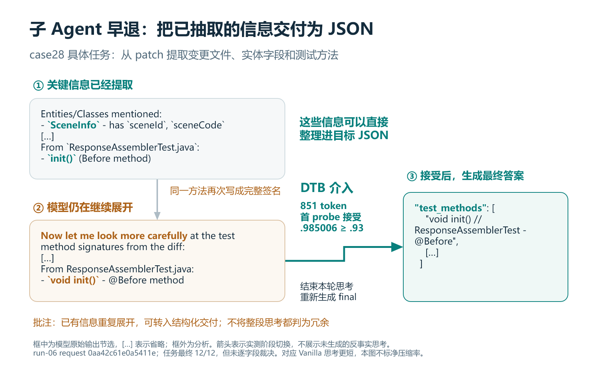

# DTB 阶段性汇报：Agent 工程兼容、时延优化与长思考早退

更新于 2026-09-14。本次材料汇总已有实验，不新增服务器测试。本文是[邮件正文](邮件正文.md)和[四页展示 PPT](DTB阶段性汇报.pptx)的直接信息来源。

## 1. 阶段结论

DTB（Dynamic Think-Budget Control）在模型仍处于思考阶段时，以短试答评估是否可以转入最终输出。接入 Agent 后，首先要保证内部多次生成仍表现为一个完整、连续的 assistant 回合，再让思考压缩转化为实际省时。

本阶段形成三条主线：

1. **工程难题与解决方案。** 通过状态机和原生 parser 协同修复，解决工具前缀丢失、参数 JSON 不完整、停止条件误伤正文以及思考尾段丢失。最新定向回放的 120 条响应未检出工具流协议异常，60 条 DTB 思考正文全部保真。后续 run-08 完整 Agent 执行的 350 个请求、474 次工具调用也未检出已知 SSE/JSON/schema 协议故障。[E1][E2]
2. **优化效果。** 在 9 个任务的完整 Agent 执行中，Vanilla run-06 与 DTB run-08 的最终 DT 全通过任务数均为 **4/9**，累计 LLM 端到端耗时由 **2,902.455 s 降至 2,566.697 s，减少 11.57%**，可见 reasoning token 由 **52,112 降至 39,759，减少 23.70%**。这里的“正确率无劣化”明确指总任务通过率持平，允许通过集合变化，不代表逐任务非劣。[E2][E3]
3. **泛化方向。** “识别冗余思考、只对少数长请求支付控制成本”的方法不依赖 Qwen3.6 这一模型名称。协议边界和置信度标定仍依赖模型，其他模型上的质量与时延收益需要分别实测，当前尚无跨模型收益证明。

平台侧执行时间合计仅下降 **3.95%**，创建到结束的合计下降 **2.17%**。因此 11.57% 始终标为累计 LLM E2E，不写成整项任务等待时间减少 11.57%。当前结果是历史基线上的已观测差异，部署身份和随机性控制尚不足以支持严格因果归因或统计显著性结论。

## 2. 工程难题：在内部早退，保持 Agent 回合完整

### 2.1 输出契约

Agent 的一次模型响应可能包含思考、正文和多个工具调用。工具返回后，下一轮还要以这些消息继续执行。DTB 把一次生成拆成内部思考、隐藏试答和最终回答后，仍必须保持原生 parser 所见的逻辑 token 序列、结构标记、增量顺序和结束语义一致。一次参数损坏可能导致重试，也可能污染后续多轮上下文。

目标不是简单补一个 `</think>`。`text` 与 `token_ids` 必须共同表达正确边界，工具 XML 不能进入普通正文，最后一批参数要有合法收尾，原生 `finish_reason` 也不能被内部阶段切换覆盖。原生工具序列允许多个调用，但不能把两个独立 assistant completion 拼成一个回合。

### 2.2 主要故障、处理与证据

| 工程难题 | 根因与解决方案 | 已有验证及范围 |
| --- | --- | --- |
| 已进入工具调用，却继续 probe 或重新回答 | 同时识别显式 think-end 与隐式 tool-start，统一状态迁移，保留源 terminal 的正文、token 和结束字段绑定 | 早期 100 次主样例中，终止修复后 role 尾流、tool 后 content、terminal 后 chunk 均为 0 |
| 投机合批导致工具前缀丢失 | string stop 截断 text，但未公开后缀 IDs 进入续写 prompt；先对齐边界，后改为经过协议校验的结构 Token ID 停止 | 对齐阶段 XML 泄漏由 13/100 降至 0/100；后续真实 token-stop 回放覆盖 think-end 与一次 tool-start |
| 完整 XML 仍解析成残缺 JSON | parser 在处理参数片段后提前返回，漏掉同批闭合标签；补齐收尾，并在完整函数闭合后生成 canonical JSON、连续解析多调用 | 扩展回放两轮各 300 条 DTB，非法 JSON 由 133 条降至 0 条；当轮仍有其他异常，后续继续排查 |
| 合法 `</think>` 字面文本被误停止 | final 恢复调用方原始 stop；thinking 用结构 ID 区分协议边界与普通 token 拼出的字面量 | 144 个 final 中出现 442 次 literal marker，错误 stop 命中为 0 |
| 边界与正文同批时思考尾段丢失 | reasoning parser 剥离 terminal marker 时误丢同批正文；独立 patch 保留 marker 前正常文本 | 最新 60/60 DTB 公开思考保真，48 个原故障触发 chunk 的 344 字符全部保留 |
| final 独立上限造成过早截断 | 删除额外 2,048-token final cap，按外部统一 completion 剩余额度和上下文额度生成 | 源码确定；历史专项 240 条额度字段闭合，旧长回答样例未完成同批服务器复验 |

来源为工程博客与各专项 RESULT。[E1][E4] 表中每组分母对应独立验证范围，不能拼成同一生产故障率曲线。vLLM v0.23.0 与 MTP 的兼容不依赖关闭投机解码；不将旧 v0.20.2 的历史性能 bug 解释为当前控制器开销。

工程交付固定面向 vLLM v0.23.0，依次应用 `dtb_serving.patch`、`qwen3_coder_parser.patch`、`qwen3_reasoning_parser.patch`。三者共同维护输出契约，部署说明见 [patch README](../../../patches/vllm/v0.23.0/README.md)。

### 2.3 工程可用性与任务正确性分别验收

最新定向回放覆盖两条固定历史上下文、Vanilla/DTB 各 60 条响应，并非重跑完整多轮任务，且其中 DTB 都是短思考，未触发 probe/迭代/强制截思考。工具流协议异常为零不代表模型选工具、填参数和业务结论都正确。

后续 run-08 是完整 Agent 执行，其 350 请求和 474 工具调用未检出已知协议故障，但 case36 有一次合法 JSON 内的无效 `task_id`，工具运行时拒绝后恢复。因此可写“未检出已知工程性工具流故障”，不能写“工具执行零错误”。非流式、取消、长回答和低频边界仍需专项回归。[E2]

## 3. 完整 Agent 执行的优化效果

### 3.1 数据选择与实验身份

主比较为 Vanilla run-06 与 DTB run-08，全部 case2、3、26、28、29、34、35、36、37。两侧 9 个主任务的完整输入 SHA-256 逐 case 相同，后续工具选择、调用次数和上下文会变化，因此按任务比较，不把第 N 轮请求强行配对。

| 项目 | 主比较口径 |
| --- | --- |
| 模型与接口 | `qwen3.6-27b`，`max_tokens=32000`，`top_p=1`，`stream=true` |
| DTB 请求参数 | 介入阈值 850，stride 500，N=5，min=1，budget=20000，gate=.90，trial 上限 50 token |
| DTB 部署行为 | 按用户实验说明保留 close、关闭 telemetry；请求体不能独立验证 close/off |
| 客户端指纹 | 有 SSE 的请求均为 `vllm-0.23.0-tp8-f063d18e` |
| 请求与归属 | Vanilla 392/392、DTB 350/350 唯一归属任务；Vanilla 其中 1 条无 SSE，仍计请求与耗时 |
| 身份缺口 | 缺完整模型权重、DTB/vLLM/vLLM-Ascend SHA、patch/YAML hash、PyTorch/torch-npu/CANN、cache 初态与并发服务流量；temperature/seed 未显式固定 |

这些缺口限制跨日期归因。run-08 无 phase 是关闭态的预期行为，不从其他 run 移植 phase 数字补账，也不声称已验证 run-08 的实际介入率或隐藏生成量。[E2][E3]

### 3.2 质量口径：总通过率持平

一个任务最终 DT 全部通过才计成功，分母固定为全部 9 任务。Vanilla case35 缺正式报告，但原始测试日志有 36/36，显式计入测试口径，同时保留缺报告这一交付异常。

| 任务 | Vanilla 最终 DT | DTB run-08 最终 DT | 说明 |
| --- | --- | --- | --- |
| case2 | 编译失败 | 6/6 | 新增全通过任务 |
| case3 | 14/15 | 14/15 | 两侧均有失败 |
| case26 | 编译失败 | 编译失败 | 两侧均不成功 |
| case28 | 12/12 | 12/12 | 全通过持平 |
| case29 | 7/8 | 86/87 | 测试范围变化，不能聚合条数证明正确率提升 |
| case34 | 5/5 | 5/5 | 全通过持平 |
| case35 | 原始日志 36/36，缺报告 | 36/36 | 测试通过，交付完整性有差异 |
| case36 | 4/4 | 3/4 | 测试退化 |
| case37 | 1/3 | 2/3 | 两侧均未全通过 |

Vanilla 全通过集合为 case28、34、35、36，DTB 为 case2、28、34、35，均 **4/9（44.44%）**。只按正式报告计数则为 3/9 对 4/9，与本次含原始日志的口径分开。不能把“无劣化”扩写为所有任务或所有质量维度不下降，也不能用 Agent 自述“不是代码问题”覆盖测试失败。

### 3.3 全量时延与 token

累计 LLM E2E 定义为每个任务内所有外部请求 `metrics.e2e_ms` 之和，再对 9 任务求和，包括主 Agent、子 Agent、标题、失败和恢复请求。即使请求重叠仍相加，不使用 session 跨度。内部 probe、续写 prefill 已经包含在外部请求耗时中，不能再次叠加。

| 指标 | Vanilla-06 | DTB run-08 | 减少率 |
| --- | ---: | ---: | ---: |
| 累计 LLM E2E | 2,902.455 s | 2,566.697 s | 11.57% |
| 可见 reasoning tokens | 52,112 | 39,759 | 23.70% |
| 响应 completion tokens | 263,947 | 237,105 | 10.17% |
| LLM 请求数 | 392 | 350 | 42 次 |
| 平台执行时间合计 start 到 end | 4,299.173 s | 4,129.363 s | 3.95% |
| 平台创建到结束合计 create 到 end | 5,201.631 s | 5,088.942 s | 2.17% |

LLM 累计省 **335.758 s**。标题请求贡献约 **103.327 s**，主/子 Agent 业务合计贡献约 **232.431 s**，说明观察到的收益不只来自标题。但 reasoning 和 completion 的下降也包含执行轨迹与调用次数变化，不能全部归因于一次次截思考。[E2]

reasoning 是 proxy 本地 tokenizer 对公开 reasoning 文本的计数。response completion 不包含 hidden probe，不能称为模型总生成量。run-08 无 phase，因此不报告 hidden token 压缩率、重复 prefill、queue/decode 拆分或完整模型工作量。

### 3.4 逐任务差异与重复证据

| 任务 | Vanilla LLM s | DTB run-08 LLM s | 减少率 |
| --- | ---: | ---: | ---: |
| case2 | 251.225 | 382.988 | −52.45% |
| case3 | 270.973 | 301.785 | −11.37% |
| case26 | 180.138 | 250.684 | −39.16% |
| case28 | 387.230 | 315.265 | 18.58% |
| case29 | 455.544 | 308.150 | 32.36% |
| case34 | 182.105 | 144.833 | 20.47% |
| case35 | 505.801 | 316.969 | 37.33% |
| case36 | 350.402 | 297.458 | 15.11% |
| case37 | 319.037 | 248.563 | 22.09% |

6/9 任务更快，3/9 更慢。case36 的省时伴随质量下降，仍保留在全量账中，不作为逐任务非劣收益依据。总值从未四舍五入的账本求和，可能与表中逐行显示值求和存在尾差。

另一次 run-07 全量 LLM E2E 减少 25.50%，reasoning 减少 42.58%，但 case37 只执行 1/1 而非原来的 3 条，case35 从原始 36/36 退为编译失败，故不以更大的数字替代主展示。固定 case28、34 三方最终 DT 均全通过，run-07/08 累计 LLM E2E 分别减少 15.08%/19.19%，平台执行合计分别减少 10.58%/11.55%。run-07 case34 修补后才通过、评级下降，且这两个任务的 reasoning 在 run-07 反而增加 0.94%。这支持限定集合上的重复省时，仍不能宣称所有维度都改善。[E2]

## 4. 具体早退案例：子 Agent 从信息提取转入结构化交付

### 4.1 主展示：case28 子 Agent 从 patch 提取设计信息

按最新展示要求，单例选用 **run-06 case28 的子 Agent**，request `0aa42c61e0a5411e`，parent `chatcmpl-aaeacbc036f1e222`。它执行的具体任务是从给定 patch 提取变更文件、实体字段与测试方法，并返回结构化设计信息。这是实际 Agent 流程中的业务子任务，不是标题生成或孤立回放。[E7]



圆角框内为原始输出节选，`[…]` 为省略，换行仅为排版。批注位于框外，箭头表示实际阶段切换。P4 使用该图的紧凑版本，右侧以流程顺序散点图展示思考长尾和 850 token 阈值。

| 原始文本或事件 | 分析 |
| --- | --- |
| `Entities/Classes mentioned:`；``- `SceneInfo` - has `sceneId`, `sceneCode` `` | 已提取实体及字段，可以写入目标 JSON |
| ``From `ResponseAssemblerTest.java`:``；``- `init()` (Before method)`` | 已识别测试初始化方法 |
| `Now let me look more carefully at the test method signatures from the diff:` | 随后开始再次展开方法签名 |
| `From ResponseAssemblerTest.java:`；``- `void init()` - @Before method`` | 同一方法再次写成完整签名，部分整理可在最终结构化答案中完成 |
| 851-token prefix；首 probe 50 token，`.985006 ≥ .93`，accepted=true | 实测首次接受，转入 fresh-final，停止本轮继续思考 |
| 最终 JSON 中的 `"test_methods": [` 和 `"void init() // ResponseAssemblerTest - @Before"` | 原本在思考中反复展开的信息已经成为实际交付 |

原始记录见 [full-log 第 1 行](../../../proxy/results/qwen/local-task29/local-apiserver/dtb/run-06/full_log/proxy_session_1c94a63f8a4f/part-00001.jsonl)，phase 索引和首 probe 见 [probe_analysis.json](../../log/perf/agent_run06/probe_analysis.json)。最终正文含 `file_info`、`data_structures`、`test_methods`，所属任务最终 12/12。文本片段、字符位置、原始正文与 phase 摘要保存在 `sources/evidence.json` 的 `subagent_case`。

**这张图展示的是实测早退机制，不能标为相对 Vanilla 的单次净压缩案例。** 对应 Vanilla 子 Agent 只有 344 reasoning token，DTB 为 851，E2E 25.644906 对 25.487352 s，几乎持平。当前审阅的真实业务子 Agent 中，尚未找到同时具备明确压缩收益、接受 phase 和完整业务质量审计的更强案例；run-06-closed 的 case26 子 Agent 虽首 probe 接受，随后编译失败，不能替代为成功案例。run-07/08 关闭 phase，也不能仅凭长度推断其接受路径。

图中“冗余”是对已有信息重复展开的语义判断，不把所有思考都判为无用；由方法名补成签名也包含整理工作。没有保存 hidden trial 全文，不能把最终 JSON 当成试答原文。该样例属于旧版未 close、gate=.93，不冒充 run-08。任务最终 12/12 不等于这份 JSON 已逐字段全部审计通过，也不能推断未执行 DTB 时一定还会继续产生多大一块思考。

### 4.2 备份：case37 主 Agent 的测试结果汇总

保留 **run-06-closed 的 case37 主 Agent** 为报告流程机制备份，proxy request `0480aca87728475f`，parent `chatcmpl-a385fe220c683c95`。这是已实际执行后续工具的业务请求。工具刚返回 Maven DT 结果，主 Agent 需要汇总并进入报告阶段。此例来自独立 phase 账本，负责解释机制，不冒充 run-08 的请求。

原始输入/输出见 [full-log 第 20 行](../../../proxy/results/qwen/local-task29/local-apiserver/dtb/run-06-closed/full_log/proxy_session_795d073fadb0/part-00001.jsonl)，第 21 行可交叉核验本轮 assistant 与工具返回。服务 phase 见 [server_filtered_part_01 第 1077–1081 行](../../../proxy/results/qwen/local-task29/local-apiserver/dtb/run-06-closed/server_filtered_part_01)。[E3][E5]

### 4.3 case37 哪个子目标的信息已经充分

输入包含 `Tests run: 3, Failures: 1, Errors: 0, Skipped: 0`。EsIndexUtilsTest 首次 expected32/actual31，重试 actual0。DTB 公开思考开头即以 `I see the results:` 提取了 3 tests、1 failure、2 passed。

随后，模型逐项重列 index.json 的 31 个索引并再次计数。临近 850 token 时，思考又在 34、32 和 31 之间推敲，未获得新的工具证据。此时对“汇总测试数、失败项并开始报告”的子目标，已有输入和开头的抽取结果足以支持输出。对于“准确定位失败根因”，思考仍未收敛，不能同样判定充分。

**语义判断：**后半段的复述和再计数对本轮汇报动作的新增价值较低。DTB 的运行时并不理解“已经数过一遍”这个人工语义判断，它实际依据长度门槛和试答概率分数决定是否退出。

case37 备份保留以下原始 reasoning 节选与批注。`[…]` 表示省略，换行仅为排版；加粗标注属于分析，不是模型原始输出。片段已逐字核对 full-log 第 20 行，字符位置保存在 `sources/evidence.json`。

| 原始思考片段 | 就地分析 |
| --- | --- |
| `I see the results:`；`- Tests run: 3`；`- Failures: 1 […]`；`- 2 tests passed: […]` | **汇报事实已齐备：**已抽取 3 条测试、1 条失败、2 条通过 |
| `Let me count: That's 31 indices total` | **再次计数：**在重列 31 项索引之后再数一遍，没有新增工具证据 |
| `But then the count should be 34, not 32 […]`；`I'm getting 31 items total […]` | **继续反复推敲：**在 31、34、32 之间来回计数，根因尚未证实 |

### 4.4 case37 实际停止路径与成本账本

| 阶段 | 实测行为 | 生成 token | phase wall |
| --- | --- | ---: | ---: |
| 原生思考 | 到 850 token 仍未自然结束，触发 abort；收到 abort terminal，排空新增 token=0 | 850，可见 | 9.769065 s |
| 决策 | fixed 分支解析预算和阈值 | 0 | 0.053795 s |
| closed probe | 50-token 试答，以 length 结束；分数 .904024 ≥ .90，首次接受 | 50，隐藏 | 1.415741 s |
| fresh final | 不再 iterative_think，重新生成摘要与工具动作 | 174，可见 | 2.210565 s |

外部 E2E 为 **13.843899 s**。上述 phase wall 合计 **13.449166 s**，与客户端差 **0.394733 s**，只记作未由这些 phase 覆盖的时间，不擅自全部归为控制器 CPU。生成 phase 的 queue 合计 0.057 ms、prefill 合计 1,978.174 ms、decode 合计 11,259.585 ms；这些是 phase 内部拆分，不与 phase wall 再相加。

已记录模型生成为 850+50+174=**1,074 token**。对外 completion=**1,025**，包含合成边界、不含 hidden probe。summary 标记 `model_work_complete=false`，故 1,074 只是已记录工作量下界。[E5]

`.904024` 是 `average_fallback` 的试答 token 概率分数，不是“答案正确率 90.40%”。50-token trial 未保存全文，也没有证明试答是一份完整正确答案。接受后走 fresh-final，不能画成原样复用隐藏答案。

### 4.5 case37 早退后 Agent 做了什么

公开摘要保留 `Tests run=3`、`Failures=1`、`Passed=2`，随后进入“步骤8：生成评测报告”，调用 `bash` 创建报告目录，工具正常返回，下一轮继续获取报告文件名时间戳。DTB 结束的是本轮内部思考，后续报告流程继续执行。

实测支持“关键测试事实未被抹掉，报告动作继续”。但输出还声称失败属于测试数据问题、“与 AI 生成的代码无关”，现有证据不足以确认这一归因，尤其重试 actual0 未被充分解释。不能把案例写成“诊断完全正确”。任务最终 DTB 2/3、Vanilla 1/3，两侧均未全通过；测试在本轮早退前已经完成，2/3 本身也不能证明早退提升代码正确率。

### 4.6 case37 同业务阶段的描述性对照

Vanilla case37 同阶段 request `80ff52c11ff14d4d`，reasoning 1,885 token、E2E 31.077132 s；上述 DTB 为 850 token、13.843899 s，表面差异分别为减少 54.91% 和 55.45%。**这是同业务阶段实测对照，非同输入配对。** Vanilla 工具输入包含 1 failure、1 error，DTB 为 1 failure、0 error，历史上下文也不同。不能把两段文本拼成同一思维链的“原文/截断版”，也不能把相差的 1,035 token 或 17.233 s 称为这次 abort 已证明的净节省。

## 5. 思考长度分布与“抓大放小”

### 5.1 短请求很多，长尾占用显著

Vanilla-06 有 391 条有效生成记录，无 SSE 的另一条请求仅从长度分布排除，仍保留在耗时账中。

| 指标 | 全部有效请求 | 去标题后的主/子 Agent 业务请求 |
| --- | ---: | ---: |
| 请求数 | 391 | 382 |
| reasoning P50 | 29 | 29 |
| reasoning P95 | 578.5 | 398.1 |
| 最大 reasoning 长度 | 3,482 | 1,885 |
| ≤850 token | 380/391，97.19% | 380/382，99.48% |
| >850 token | 11/391，2.81% | 2/382，0.52% |

11 条长请求共生成 **20,263 reasoning token，占 38.88%**；其中 9 条是标题、2 条是业务。因此“少量长尾值得关注”有数据支持，但不能包装成大量业务请求都存在长思考冗余。[E6]

分布的统计表保留 **≤20、21–300、301–850、>850 token** 四个互斥分档。统计从 Vanilla-06 的请求级长度复算，含 0-token 请求，排除同一条无 SSE 请求，分母仍为 391 条有效记录和 52,112 reasoning token；这些分档不是累计阈值。P4 改为流程顺序散点图，以直接展示极端长尾和介入阈值。

| 思考长度分档 / token | 请求数 | 请求占比 | reasoning token | token 占比 |
| --- | ---: | ---: | ---: | ---: |
| ≤20 | 128 | 32.74% | 1,976 | 3.79% |
| 21–300 | 224 | 57.29% | 16,210 | 31.11% |
| 301–850 | 28 | 7.16% | 13,663 | 26.22% |
| >850 | 11 | **2.81%** | 20,263 | **38.88%** |
| 合计 | 391 | 100% | 52,112 | 100% |

**2.81% 的长尾请求占了 38.88% 的 reasoning token。** 分档成员 request ID 与未舍入比例已保存到 `sources/evidence.json`，可核验数量与 token 总和。

长请求的 20,263 token 是完整思考，不是可全部删除的冗余。超过 850 的部分为 **10,913 token**，也只是潜在可干预尾部，其中仍包含必要推理。是否值得停止还要扣除试答和重启成本，并检验质量。

#### 流程顺序散点图：850 token 为什么是有依据的介入点

[独立统计图：思考长度长尾与 850 阈值](统计图/思考长度长尾与850阈值.png)主图按原始 `timestamp` 升序枚举全部 391 条有效请求，每点对应一次请求发起；顶部任务编号和竖线标记 9 个任务区段。横轴为请求发起序号，不是等距时间或严格串行的 Agent 回合，主/子 Agent 请求可能交错。纵轴在 **850 token** 处分为两段：下段 **0–850** 获得更多绘图区，上段 **850–3,500** 完整保留最大值 3,482；两段各自线性，但单位高度对应的 token 数不同，不能跨段按图形高度直接比较倍数。短请求采用空心描边散点，保留真实坐标、不作抖动，让密集样本的轮廓更清楚。右侧长尾放大图保持统一线性纵轴。P4 使用主图的紧凑版本。

- **阈值以下：**380 条请求（97.19%）的思考低于 850，按此策略无需触发试答，继续原生生成。这是阈值在 Vanilla 分布上的覆盖推算，不是 run-08 的实际介入率。
- **阈值以上：**11 条请求（2.81%）长达 1,037–3,482 token。它们的完整思考占全部 reasoning token 的 38.88%。图的右侧将这 11 条单独放大，每条线段从 850 延伸到实际思考长度，绿色标出 2 条业务请求，其余 9 条为标题。
- **潜在介入尾部：**这 11 条在阈值之后仍有 `20,263 − 11×850 = 10,913 token`，占全部思考的 **20.94%**。这部分为需要试答与质量门裁决的优化空间，不是已证实能够删除的冗余。

这解释了 850 的分布依据：让绝大多数短请求免于额外试答，将介入成本集中到少数还有较长后续思考的请求。图本身不能证明 850 是最优阈值，也不能证明所有长请求都可安全早退。运行时条件是**达到 850 且仍未结束思考**，而不是长度到达 850 就无条件切到答案；该基线恰好没有长度等于 850 的请求。发起序号、时间戳、request ID、任务和角色保存在 `sources/evidence.json` 的 `vanilla_chronological_requests`，任务边界保存在 `vanilla_task_blocks`；长尾放大图使用 `vanilla_ranked_requests` 中的长度排序和逐请求阈值以上 token。

### 5.2 机制：让短请求在同一原生生成中完成

DTB 先观察原生生成。如果模型在介入阈值前自然结束思考并开始正文/工具调用，就继续用同一个原生 child 完成，不因 think-end 再提交续写 child。只有达到阈值仍在思考时，才触发 abort、排空尾部、评估 probe，并根据结果继续思考或输出 final。

这样将额外 stop/handoff/probe/续写提交集中在少数请求上。“旁路”仍包含流观察和转发，不等于 CPU 与队列绝对零开销。

采用这一策略的依据是净时延收益：

```text
近似净收益 = 少生成的可见 token × 基线 TPOT
             − hidden probe、重复 prefill、排队与控制器额外成本
```

实际 Agent 总耗时还受 final 输出长度、工具耗时和后续轨迹影响。因此最终以客户端完整请求耗时和任务质量裁决，不以 reasoning token 单指标代替收益。

### 5.3 实现后效果与证据边界

独立 **run-06-closed phase** 账本中，**354/364（97.25%）**请求由同一个原生 child 完成，仅 10 个请求介入，其中 8 个标题、2 个业务；12 次 probe 共 **191 hidden token、17.449 s**。这直接说明短请求没有普遍支付重启与 probe 成本。[E5]

354 个同 child 请求中包含 1 个原生空 final 候选，另有一条到 32,000 completion 上限产生坏工具参数的原生路径，不能把“同 child 完成”当成全部正确。该 phase run 全量 LLM E2E 实际比 Vanilla 慢 4.26%，reasoning 虽减少 18.72%，仍被正文/工具输出增长等因素抵消。

因此这里证明的是实现路径，主性能结果仍用 run-08。不能把 phase run 的 97.25% 标到 run-08 图上，也不能用跨 run 差异宣称关闭 telemetry 的净收益已被测量。

## 6. 泛化性：可迁移的方法与需要重验的模型条件

本次证据集中在 Qwen3.6-27B Agent 场景。可复用的是运行时思路：以长度分布识别潜在收益区间、以短试答提供停止信号、让短请求保持原生完成、在完整质量门下验证 E2E。

跨模型迁移需要重新确认以下条件：

| 条件 | 下一步具体工作 | 验收方式 |
| --- | --- | --- |
| 模型存在可压缩冗余 | 在该模型自身 Vanilla 上统计标题/业务思考分布，人工审阅长样本 | 不能把长思考直接标为无用思考；选取有明确业务子目标的样例 |
| 思考和工具协议可适配 | 核对 tokenizer、chat template、reasoning/tool parser、结构边界与结束语义 | 覆盖流式/非流式、多工具、合批、长输出、取消和错误；保持原生 parser-facing 等价 |
| 试答分数可用 | 重新标定 threshold、stride、gate；观察分数与真实任务质量关系 | 不直接复制 850/.90，也不把分数当已校准的正确概率 |
| 净成本值得支付 | 正式 off 组测完整任务，独立同身份 phase 组测 hidden/probe/prefill/queue | 质量门后 E2E 有可重复改善，不能只看可见 token |

对每个新模型、量化或后训练版本重新建立同身份 Vanilla，固定测试范围、采样 seed、并发/到达节奏和 cache 策略，交替执行 Vanilla/DTB。记录 vLLM、vLLM-Ascend、PyTorch、torch-npu、CANN、模型版本与源码 SHA。新模型既要报告总通过率，也要披露逐任务转移，避免集合持平掩盖退化。

**假设及证伪条件：**若某模型的大部分思考都短，或长思考对质量不可替代，或 probe/prefill 成本高于少生成 token 的收益，则该模型可能没有 DTB 净收益。以固定条件下重复完整 Agent 执行验证，质量下降或 E2E 不降即可否定当前参数组合，而不是继续以 token 压缩宣传成功。

## 7. 备份案例与汇报问答

### 有没有严格相同输入的压缩样例？

有，case29 标题：Vanilla `4b40058e71eb45f8` 与 run-06-closed `402b1cfd1b7c4fbc`，去 DTB 参数后的请求体 SHA-256 同为 `d917865ebf93477bdb8f2c2a81828fbccf9265e0078fb16184ca34036a519886`。reasoning 3,482 对 850，减少 75.59%；E2E 53.458545 对 15.126337 s，减少 71.70%。DTB 首 probe 8 token、.991634 接受，最终输出“场景任务创建分布式锁实现评测”。这是两次随机生成，不是同一前缀的反事实实验；标题也不能替代业务机制主例。[E3]

### 有没有结果全通过的子 Agent 业务案例？

run-06 case28 的子 Agent `0aa42c61e0a5411e` 从 patch 提取文件、实体、测试方法，信息已经列出后又复述方法签名，在 851 token probe 接受，最终输出结构化 JSON，任务最终 12/12。但对应 Vanilla 只有 344 reasoning token，DTB 851，E2E 25.644906 对 25.487352 s，几乎持平，所以只用于说明信息整理阶段的停止语义，不能用作压缩主证据。它还是旧版未 close、gate=.93 的实验，不能混为 run-08。[E3][E7]

### 下一步最有价值的补证是什么？

先补同时期、同部署的 Vanilla/DTB 完整任务重复实验与固定测试套件。单例方面，以 case37 同一完整 HTTP 输入做固定参数回放，核对测试计数、失败项和报告动作；若要验证后续任务质量，则接续真实 Agent 工具执行。仅有孤立 HTTP 回放不足以证明全任务质量不退化。

## 8. 来源与复算入口

本文所有数字来自本地材料，不引用未提供的外部测评。实测、源码确定与假设在对应段落标明。邮件和 PPT 引用本文，本文再链接原始证据。

| 标记 | 来源 | 用途 |
| --- | --- | --- |
| E1 | [原工程技术博客](../DTB_Agent集成验证_技术博客.md)、[原时间轴](../DTB_Agent集成验证_时间轴.pptx) | 工程故障、分层修复与验证时间线 |
| E2 | [run-07/08 RESULT](../../log/perf/agent_run07_08/RESULT.md)、[analysis.json](../../log/perf/agent_run07_08/analysis.json)、[cohorts.json](../../log/perf/agent_run07_08/cohorts.json)、[来源清单](../../log/perf/agent_run07_08/extraction_manifest.json) | 全任务指标、归属、质量转移与重复结果 |
| E3 | [数据选择备忘录](../agent_dtb_demo_data_memo.md) | 主展示口径、业务案例与证据边界 |
| E4 | [replay2 RESULT](../../log/perf/agent_tool_call_run04_paired_replay/run_server_04_token_stop/replay2/RESULT.md) | 120 条工具协议与 60 条 reasoning 保真 |
| E5 | [run-06-closed RESULT](../../log/perf/agent_run06_closed/RESULT.md)、[analysis.json](../../log/perf/agent_run06_closed/analysis.json) | 原生旁路、case37 phase 与隐藏工作量 |
| E6 | [run-06 RESULT](../../log/perf/agent_run06/RESULT.md)、[analysis_evidence.json](../../log/perf/agent_run06/analysis_evidence.json) | Vanilla 思考长度分布 |
| E7 | [PROBE_ANALYSIS](../../log/perf/agent_run06/PROBE_ANALYSIS.md) | case28 子 Agent 停止案例 |
| E8 | [泛化实验计划第 6 节](../../design/think_budget_generalization_plan.md) | 新模型实验身份、质量门与账本契约 |

复算脚本和数据快照位于本目录 `sources/`，包含来源 SHA-256、逐任务表、长度分布与案例 phase。它只读取已有分析账本和原始案例，不启动模型或改写实验结果。
