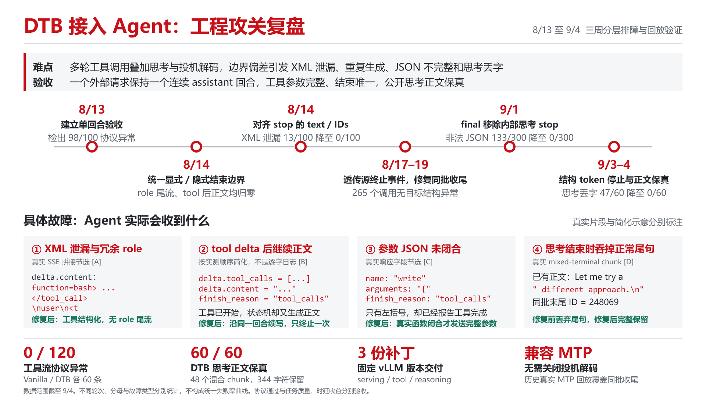

各位好，

本阶段（8.10–9.11）围绕动态思维链压缩技术 DTB 接入 Agent 辅助研发场景的工程可靠性与思考压缩效果进行了开发与验证，主要进展如下。

**一、解决多轮工具调用中的关键工程问题。** 通过算法集成与原生解析器协同修复，解决了回合边界错位、工具前缀丢失、参数 JSON 不完整及停止条件误伤正文等问题。最新回放的 300 条响应未检出工具流协议异常，后续完整端到端测试中未检出任何协议故障，且兼容投机解码等原生特性。

**二、任务通过率不下降，思考token数与端到端时延双降。** 9 个任务中，原生**Qwen3.6-27B**模型与开启DTB压缩后的同一模型最终 DT 全通过任务数均为 4/9；累计 LLM 端到端耗时从 2,902.455 秒降至 2,566.697 秒，减少 **11.57%**；可见 reasoning token 从 52,112 降至 39,759，减少 **23.70%**。

针对 AI 辅助研发场景中"短思考极多、长思考极长"的分布特征，我们采用"抓大放小"策略：短请求保持原生完成，仅对长思考请求执行压缩算法，在不影响整体质量的前提下实现有效时延压缩。

**三、成果可扩展到更多存在冗余思考的模型。** 置信度阈值、短试答与原生旁路的工程实现可无缝迁移，但针对特定模型可能需适配协议、标定阈值。当前跨模型收益尚待实测，近期将优先获取更多思维链样本，扩展应用模型。

工程攻关时间轴：

参与开发人员：
AI能力中心：彭力 00906181 周圣逸 00830407
职责：算法集成vLLM推理框架，定位解决工程化问题，保证端到端可用性与压缩效率。
装备部：胡大海 00936862 李嘉睿 50060896
职责：数据与验证支持，开发评测接口，协助定位工程问题。
研究部：王鑫 00955806 任子骏 50058444
职责：交付高效思维链压缩算法，协同推进工程化方案落地。
