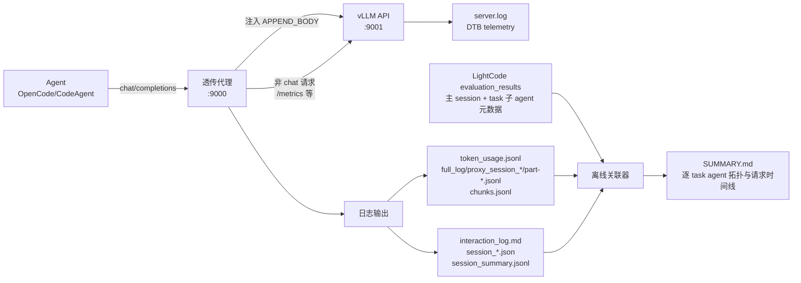
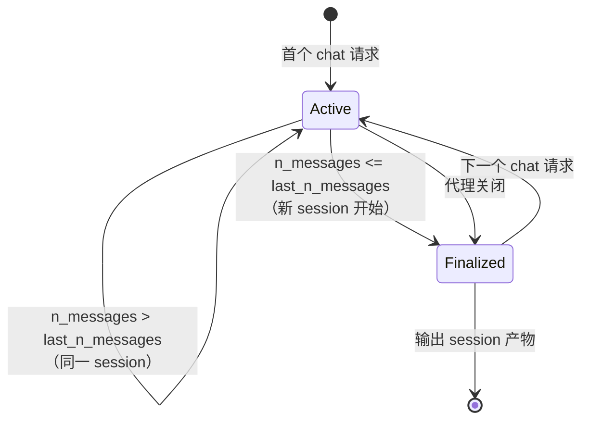
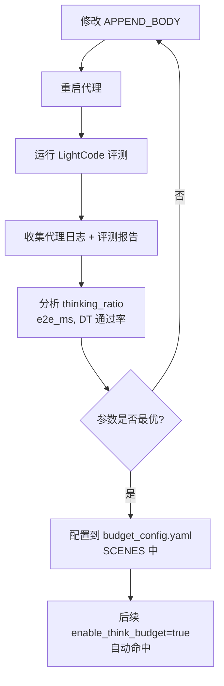

# Agent DTB 透传代理工程指南

## 1. 设计目的

Agent 多轮调用场景（如 LightCode 代码生成评测）中，模型每条任务发起约 60 次 LLM 调用，其中 97% 为工具调用轮次，thinking token 占输出 token 的绝大部分。DTB（Dynamic Think-Budget Control）已通过 vLLM serving patch 集成到推理服务端，但 LightCode 是黑盒环境，无法注入 DTB 参数或观察每轮请求。

本模块的目标是：**在 Agent 和 vLLM 之间部署透传代理，为每轮请求注入 DTB 固定参数，并记录完整的多轮交互数据；在评测结束后，将这些记录确定性关联到 LightCode evaluation task、主 agent 和子 agent，使 Agent 场景下的 DTB 参数优化实验既可审计又便于人工阅读。** 优化实验的最终产出是将推荐参数配置到 `budget_config.yaml` 的 SCENES 中，后续只需 `enable_think_budget=true` 即可自动命中。

设计起点：2026-08-25，基于 `qwen_transparent.py` 已有的透传能力扩展，vLLM `v0.23.0` + DTB serving patch，模型 `qwen3.6-27b`。完整日志分片设计起点为 2026-08-29 的提交 `d7e84c25`：当时 `full_log.jsonl` 能完整写入，但单文件过大且实验环境禁止 LFS 传输，无法随实验结果提交。

## 2. 设计逻辑

### 2.1 核心挑战

Agent 多轮场景下的 DTB 实验面临三个核心问题，每个问题的解决方案决定了代理的关键设计选择：

**挑战一：LightCode 黑盒限制**

LightCode 不暴露每轮请求细节，不支持自定义请求参数。解决方案是在 Agent 和 vLLM 之间插入透传代理，Agent 的 OpenAI 兼容端点指向代理而非直连 vLLM。代理职责明确为透传 + 记录 + 统计，不新增管理 API。

**挑战二：多轮请求的 session 归属**

Agent 的多次 HTTP 请求之间没有显式的 session ID 关联。早期用 `messages` 数组长度的单调性划分 proxy session：`len(messages) ≤ 上一个请求` 时开始新 segment；时间窗口不可靠（session 内最大间隙 122.3s，边界间隙仅 27.1s）。run-02 进一步证明这个 segment 不能作为语义会话：title generation 会带入不同 root prompt，主 Agent 在子 Agent 完成后恢复也可能与子 Agent 请求落入同一 segment。因此该启发式现在只负责原始日志分区，task/主子 Agent 归属必须由逐请求指纹离线裁决。

**挑战三：reasoning_tokens 在 API usage 中为 0**

vLLM 不在 `usage.reasoning_tokens` 中返回实际值。解决方案是加载本地 tokenizer 在 session 结束时计算 reasoning 和 content 的 token 数，所有长度单位统一为 tokens 而非字符。

**挑战四：完整日志既要可上传，也要保持请求原子性**

完整请求会重复携带多轮 `messages`，单体 `full_log.jsonl` 会随上下文增长快速膨胀。只按 session 拆成一个文件仍没有大小上界；按请求拆文件虽然天然有界，但会产生大量小文件；只做全局滚动又丢失会话归属。最终采用“**proxy session 分区 + 有界 part**”：每个请求按请求开始时确定的 `proxy_session_id` 写入独立目录，目录内按 UTF-8 字节数滚动 `part-*.jsonl`。一条请求/响应记录始终保持为一行，不跨 part 拆分；若单条记录本身超过上限，则独占一个 part 并告警。run-02 单体文件实测为 88,950,819 bytes，324 条记录中最大单条为 540,300 bytes（0.515 MiB），因此默认 16 MiB 在保持请求原子的同时有充足滚动余量。

**挑战五：一次评测任务跨主 agent、子 agent 和多个 proxy session**

LightCode 下载的主 session 中，`tool=task` 部件完整记录了子 agent 的 `input.prompt`、官方子 session ID、父 session ID、标题、状态和起止时间。proxy 请求没有 LightCode `task_id`，且用 `messages` 长度划分出的 session 只是片段，不能把两者假定为一对一。不能向评测 prompt 注入追踪 ID，因为这会改变被测输入和质量。

解决方案是对每个请求的首个 user prompt 计算精确 SHA-256；评测结束并下载 LightCode session 后，用同一规则计算主 agent 首条 user 消息和每个 `task` 子 agent 的 `input.prompt` 指纹，先裁决请求级 agent 锚点。segment 内没有直接命中、但该 segment 的全部 agent 锚点都属于同一 task 的 title generation 等辅助请求，只关联到 task 并显式标记为 `auxiliary`，不冒充主/子 Agent 请求。

run-02/0828 实测：20 条官方 agent/tool 记录中有 19 条实际创建了官方 session，全部精确匹配；另 1 条 `status=error` 且没有官方子 session ID，确认未启动。22 个 proxy segment 和 324 条 full-log 请求全部关联到 9 个 evaluation task，其中 316 条是精确 agent prompt 命中、8 条是同 task segment 内的辅助请求；6 个主 AgentSession 跨 2-3 个 segment，7 个 segment 同时包含同一 task 的主/子 Agent 锚点。该结果证明关联关系不能简化为树上的严格物理包含，机器记录必须同时保留 request→agent 的精确边和 request→task 的 segment 辅助边。

### 2.2 方案架构



代理的请求分类逻辑：

- **Chat 请求**（请求体含 `messages` 字段）：注入 `APPEND_BODY` 中的 DTB 参数、参与 session 跟踪、记录完整日志
- **非 Chat 请求**（`/metrics`、`/v1/models` 等）：纯透传，不注入参数、不触发 session 边界检测、不记录日志

### 2.3 Session 生命周期



Session 完成信号：
- **确定信号**：新 session 开始时，旧 session 隐式关闭
- **辅助信号**：session 最后一个请求的 `has_tool_calls=False`，表示 Agent 不再调用工具
- **兜底信号**：代理关闭时，所有活跃 session 强制关闭

### 2.4 Tool Calls 重建

`qwen_transparent.py` 现有的流式累积方式 `json.dumps(delta["tool_calls"])` 逐块拼接，产生 `[{...}][{...}]` 格式，多个 JSON 数组直接相连无法直接解析。重建算法三步：

1. 在 `][` 边界插入逗号，外包数组，解析为 delta 列表
2. 展平每个 delta（流式 `delta.tool_calls` 本身是数组），按 `index` 分组合并 `arguments`
3. 对每个合并后的 `arguments` 字符串尝试 `json.loads`，失败则保留原始字符串

### 2.5 实验参数配置闭环



代理只使用固定参数模式，实验间手动修改 `APPEND_BODY` 并重启。推理服务无状态，不需要轮次感知逻辑。

## 3. 核心数据结构

### Turn — 每轮交互记录

| 字段 | 类型 | 含义 |
| --- | --- | --- |
| `turn_index` | int | 轮次序号（0-based） |
| `request_id` | str | 请求唯一 ID（自生成 UUID） |
| `post_time` / `receive_time` | str | 请求发出 / 响应完成时间 |
| `e2e_ms` | float | 端到端时延 |
| `n_messages` | int | messages 数组长度 |
| `n_tool_results` | int | messages 中 role=tool 的数量 |
| `input_prompt_tokens` | int | API usage.prompt_tokens |
| `turn_type` | str | initial / tool_result / other |
| `injected_dtb_params` | dict | 实际注入的 DTB 参数 |
| `reasoning_tokens_local` | int | 本地 tokenizer 计算的 reasoning token 数 |
| `content_tokens_local` | int | 本地 tokenizer 计算的 content token 数 |
| `thinking_ratio` | float | reasoning_tokens_local / (reasoning_tokens_local + content_tokens_local) |
| `has_tool_calls` | bool | 响应是否包含 tool_calls |
| `stop_reason` | str | finish_reason |

`thinking_ratio` 基于本地 tokenizer 的 token 比，而非字符比。API 返回的 `reasoning_tokens` 始终为 0，不可使用。

### ProxySession — 启发式会话片段

| 字段 | 类型 | 含义 |
| --- | --- | --- |
| `session_id` | str | 12 位 hex UUID；在完整日志中显式命名为 `proxy_session_id` |
| `task_description` | str | 首个用户消息前 200 字符 |
| `dtb_config_name` | str | 当前实验参数组名 |
| `turns` | list[Turn] | 每轮交互记录 |
| `last_n_messages` | int | 上一轮 messages 长度（边界检测用） |

### SessionSummary — 会话汇总

| 字段 | 含义 |
| --- | --- |
| `total_e2e_ms` | 任务端到端时间 |
| `total_prompt_tokens` | 总输入 token |
| `total_completion_tokens` | 总输出 token（API） |
| `total_reasoning_tokens_local` | 总思考 token（本地 tokenizer） |
| `total_content_tokens_local` | 总内容 token（本地 tokenizer） |
| `avg_thinking_ratio` | 平均思考比例 |
| `tool_call_turns` / `tool_result_turns` | 工具调用/返回轮次数 |

### FullLogRecord — 完整请求记录

`schema=2` 的 FullLogRecord 保留原 `request_body` 和 `response_data`，新增 proxy 归属、关联键和独立指标：

| 字段 | 含义 |
| --- | --- |
| `schema` | 固定为 `2` |
| `timestamp` | 请求开始时间 |
| `request_id` | 代理生成的请求 ID |
| `proxy_session_id` / `proxy_turn_index` | 请求开始时确定的启发式 segment 和轮次归属 |
| `correlation.root_user_message_sha256` | 首个 user 消息的精确 SHA-256，用于关联 LightCode 主/子 agent |
| `correlation.root_user_message_preview` | 首个 user 消息前 240 字符，便于不打开大日志时人工识别 |
| `correlation.agent_role_hint` / `case_branch_hint` | 仅作为预览的 main/branch 提示；最终身份以离线精确关联为准 |
| `request_body` | 实际注入 DTB 参数后发送给上游的 JSON body |
| `response_data` | 累积的 content、reasoning 和 tool_calls |
| `completed_at` / `metrics` | 完成时间、E2E、token、stop reason 和 tool-call 标记；不依赖 session finalize |

### FullLogShard — 可传输分片

FullLogShard 是同一 proxy session 下连续若干条 FullLogRecord 构成的 JSONL part。`FULL_LOG_SHARD_MAX_BYTES` 是 part 的目标上限，按序列化后的 UTF-8 字节数计算。记录是最小原子单元，因此单条超大记录允许突破上限，但不得拆成多行或多个 part。每个 proxy session 目录另含一个小型 `manifest.json`，无需打开 part 即可查看首请求、prompt 指纹和预览。

## 4. 接口定义

### 4.1 配置接口（启动前修改）

```python
# 实验参数组名（用于日志标识）
DTB_CONFIG_NAME = "vanilla"

# DTB 固定参数注入
APPEND_BODY = {
    "model": "qwen3.6-27b",
    # "enable_think_budget": True,
    # "fixed_budget_tokens": 850,
    # ...
}

# 结果输出目录
RESULTS_DIR = "results/qwen/local-task29/local-apiserver/vanilla/run-01"

# full-log part 的目标上限（默认 16 MiB）
FULL_LOG_SHARD_MAX_BYTES = 16 * 1024 * 1024
```

切换实验组：修改 `DTB_CONFIG_NAME`、`APPEND_BODY`、`RESULTS_DIR`，重启代理。

### 4.2 预设参数组

| 参数组 | budget_tokens | check_length | think_stride | num_thinking | min_think_tokens | prob_th |
| --- | --- | --- | --- | --- | --- | --- |
| vanilla | — | — | — | — | — | — |
| dtb_auto | auto | auto | auto | auto | auto | auto |
| dtb_tight | 850 | 500 | 250 | 2 | 500 | 0.93 |
| dtb_moderate | 1100 | 450 | 200 | 4 | 450 | 0.93 |
| dtb_loose | 1650 | 1000 | 250 | 3 | 1000 | 0.93 |
| dtb_planning | 3050 | 950 | 450 | 5 | 950 | 0.95 |

### 4.3 输出文件

| 文件 | 格式 | 内容 | 来源 |
| --- | --- | --- | --- |
| `interaction_log.md` | Markdown | 人类可读的逐轮 reasoning/content/tool_calls，长度单位为 tokens | session 结束时追加 |
| `session_<id>.json` | JSON | 结构化 session 数据（不含原始拼接字符串） | session 结束时写入 |
| `session_summary.jsonl` | JSONL | 逐 session 汇总，含 total_reasoning_tokens_local | session 结束时追加 |
| `token_usage.jsonl` | JSONL | 逐请求 token 统计（沿用 `qwen_transparent.py` 格式） | 每轮请求完成 |
| `full_log/proxy_session_<id>/manifest.json` | JSON | 首请求、root prompt 指纹和预览 | proxy session 首次写入 |
| `full_log/proxy_session_<id>/part-<nnnnn>.jsonl` | JSONL | schema 2 请求/响应明细，含 proxy session/turn、关联键和独立 metrics；每个 part 默认目标不超过 16 MiB | 每轮请求完成 |
| `chunks.jsonl` | JSONL | 流式 chunk（可通过 `ENABLE_CHUNKS_LOG` 关闭） | 每个流式 chunk |

不再并行写单体 `full_log.jsonl`，否则无法解决上传问题。历史 run 的单体文件仍由抽取工具兼容读取。

### 4.4 full-log 分片契约

目录布局：

```text
<RESULTS_DIR>/
└── full_log/
    ├── proxy_session_2d04a27eaada/
    │   ├── manifest.json
    │   ├── part-00001.jsonl
    │   └── part-00002.jsonl
    └── proxy_session_90d327bfba6a/
        ├── manifest.json
        └── part-00001.jsonl
```

写入规则：

1. 在请求开始时保存 `proxy_session_id` 和 `proxy_turn_index`，响应完成时按该归属写入；不依赖 session 是否已经 finalize，因此代理异常退出不会让已完成请求等待会话汇总。
2. 写入前序列化完整 JSON 行并计算 UTF-8 字节数。当前 part 非空且追加后超过上限时，先滚动到下一个 part。
3. 单条记录不拆分。单条记录超过上限时独占 part，日志输出 warning；后续记录继续写下一个 part。
4. 同一代理进程内由 writer 锁串行化写入，避免并发响应完成时 JSONL 行交错。一个 `RESULTS_DIR` 只允许一个代理进程写入。
5. 重启后从每个 session 的最大 part 编号续写。若最大 part 尾部不是换行，视为上次进程中断留下的不完整记录：保留原文件用于诊断，新记录从下一个 part 开始，不静默截断或修复。
6. part 文件是权威数据源，`manifest.json` 只提供人类可读入口；可直接用 `request_id`、`proxy_session_id`、`proxy_turn_index` 和 prompt 指纹检索、关联与对账。

现有 tool-call 回放抽取器同时接受历史单文件、新 `full_log/` 目录或整个 run 目录：

```bash
python tools/dtb/extract_tool_call_replay_cases.py \
  <RESULTS_DIR>/full_log <OUTPUT_DIR> --branch <LIGHTCODE_BRANCH>
```

### 4.5 LightCode task 离线关联与可读报告

关联必须在 LightCode 的 `evaluation_results.json` 和 session zip 下载完成后执行：

```bash
python tools/dtb/correlate_lightcode_proxy.py \
  <PROXY_RESULTS_DIR> <LIGHTCODE_SESSION_LOG_DIR> <OUTPUT_DIR>
```

Agent 身份只接受逐请求 `root_user_message_sha256` 精确等值关联，不用时间窗口或文本相似度静默兜底。一个官方 AgentSession 命中多个 ProxySessionSegment、或同一 segment 命中同 task 的多个 AgentSession 都是合法的。未精确命中的辅助请求仅在 segment 的全部 agent 锚点属于同一 task 时获得 task 身份；segment 命中多个 task，或同一指纹命中多个官方 AgentSession，均判为歧义并进入 `unmatched.json`，不得纳入性能汇总。

输出：

| 文件 | 用途 |
| --- | --- |
| `SUMMARY.md` | 任务级概览、映射覆盖率、异常计数和逐任务链接 |
| `tasks/<task_id>.md` | evaluation task 身份、主/子 agent 拓扑、LLM 指标聚合和逐请求时间线 |
| `agent_map.jsonl` | 官方 agent session 到一个或多个 proxy segment 的精确映射 |
| `requests.jsonl` | 每个请求的 task/agent 身份、指标及原始 part 行号 |
| `unmatched.json` | 未映射请求/segment、指纹或跨 task 歧义、未启动子 agent 调用 |

报告只保存索引、摘要和原始 shard 位置，不复制完整 request/response，避免重新制造大文件。

### 4.6 Agent 故障 paired replay

系统可用性故障必须在时延参数搜索前做 paired replay。先分别关联 DTB 与 Vanilla run，
再用显式 spec 从两个 `requests.jsonl` 账本按 `request_id` 抽取原始记录：

```bash
python tools/dtb/build_agent_paired_replay.py \
  --dtb-run <DTB_PROXY_RUN> \
  --dtb-correlation <DTB_CORRELATION_DIR> \
  --vanilla-run <VANILLA_PROXY_RUN> \
  --vanilla-correlation <VANILLA_CORRELATION_DIR> \
  --spec <REPLAY_SPEC_JSON> \
  --output-dir <REPLAY_INPUT_DIR>
```

构建器会为每个语义 pair 输出两条真实上下文：DTB 故障上下文和同 case、同阶段的 Vanilla
健康上下文。二者用于检查故障是否依赖历史轨迹，但**不能直接互算时延**；真正的 A/B 单元是
同一条 `request_body` 分别设置 `enable_think_budget=false/true`。回放器保持单并发，并在重复
次数间交替 Vanilla/DTB 顺序：

```bash
python tools/dtb/replay_tool_calls.py \
  --file <REPLAY_INPUT_DIR>/cases.jsonl \
  --repetitions 30 \
  --request-id-run <AUDIT_RUN_ID> \
  --order alternating \
  --output-dir <REPLAY_OUTPUT_DIR>
```

正式执行前可加 `--list-dtb-request-ids` 生成 `stream_audit` 精确白名单。回放审计不只检查
arguments 是否为合法 JSON，还按原请求 `tools[].function.parameters` 校验 required/type，
并检查预期 tool name、XML 泄漏、tool index、terminal 与 finish reason。协议有任何异常时，
该 pair 不进入时延排名。

`quality_probe` 只保存代码 mutation turn 的真实上下文和返回工具参数；单轮 HTTP 回放不会
执行工具、修改代码或编译，因此不得把它当成代码质量裁决。最终系统可用性门仍是同配置
LightCode smoke 9/9 生成报告，质量结果不低于 Vanilla。

### 4.7 interaction_log.md 格式

```markdown
# Session <session_id>
- DTB Config: <dtb_config_name>
- Duration: 15m 32s
- Turns: 64
- Task: <task_description 前 200 字符>

---

## Turn 0 | 15:20:17 | e2e=5.1s | type=initial | prompt=46820 tokens

### Tool Results (input)   ← 仅 tool_result 类型显示
- `call_xxx`: <工具返回内容前 300 字符>

### Reasoning (119 tokens)
<完整 reasoning 文本>

### Content (0 tokens)
(empty)

### Tool Calls
1. **skill**({"name": "code-production-evaluation"})

---
```

格式规则：
- Reasoning / Content 的长度单位为 tokens，由本地 tokenizer 计算
- Tool Calls 由 `reconstruct_tool_calls()` 从流式 delta 拼接重建
- Tool Results 输入从 `messages` 中 `role=tool` 的内容提取
- 无 tool_calls 时不输出该节；内容为空时输出 `(empty)`

## 5. 一致性校验

### 5.1 概念一致性

| 术语 | 定义 | 注意 |
| --- | --- | --- |
| EvaluationTask | LightCode API 返回的 `task_id` 所标识的一次完整评测 | 包含主 agent、0-N 个子 agent 和最终报告 |
| AgentSession | LightCode 官方 session；主 session 来自 session JSON，子 session 来自主 session 的 `tool=task` 元数据 | 一个 AgentSession 可被 proxy 切成多个 segment |
| ProxySessionSegment | proxy 按 n_messages 单调性划分的请求片段 | 仅用于原始日志分区，不等于 task 或官方 session |
| Turn | 单次 chat/completions 请求-响应对 | 非 chat 请求不产生 Turn |
| thinking_ratio | 本地 tokenizer 计算的 reasoning_tokens / (reasoning_tokens + content_tokens) | 不使用 API 返回的 reasoning_tokens（始终为 0） |
| APPEND_BODY | 启动时配置的固定参数字典，合并到每个 chat 请求体 | 非 chat 请求不注入 |
| FullLogRecord | 一次 chat 请求及其完整响应形成的原子 JSONL 记录 | schema 2，带 proxy segment/turn、prompt 指纹和 metrics |
| FullLogShard | 同一 proxy segment 下有界滚动的 JSONL part | 大小上限是目标值，单条超大记录例外 |

### 5.2 状态完备性

- Session 边界检测：`n_messages <= last_n_messages` 是确定性信号，无需阈值调优
- 代理关闭时 `finalize_all()` 强制关闭所有活跃 session
- Agent 重启对话场景：代理按独立 session 记录，分析阶段由 `analyze_sessions.py` 合并

### 5.3 接口完备性

| 设计逻辑操作 | 对应接口/机制 |
| --- | --- |
| 注入 DTB 参数 | `APPEND_BODY` 静态配置 |
| 识别 session 边界 | `SessionManager.process_request()` 的 n_messages 单调性检测 |
| 重建 tool_calls | `reconstruct_tool_calls()` 函数 |
| 计算 thinking token | `count_tokens()` + 本地 tokenizer |
| 输出人类可读记录 | `write_interaction_log()` → `interaction_log.md` |
| 输出结构化数据 | `session_<id>.json` + `session_summary.jsonl` |
| 输出完整请求明细 | `FullLogShardWriter.append()` → `full_log/proxy_session_<id>/part-*.jsonl` |
| 对应 LightCode task/主子 agent | `correlate_lightcode_proxy.py` 的精确 root prompt 指纹连接 |
| 跳过非 chat 请求 | `is_chat_request` 判断 + 纯透传路径 |

### 5.4 已知限制

- **reasoning_tokens 依赖本地 tokenizer**：vLLM 不在 usage 中返回，若 tokenizer 路径不正确则 token 计数为 0
- **Session 不等于逻辑任务**：Agent 中途重启对话会产生多个 session，需分析阶段合并
- **task 身份是后关联结果**：proxy 在线阶段拿不到 LightCode `task_id`，不得把 branch 提示或时间窗口冒充官方 task 身份
- **精确关联不做模糊兜底**：prompt 被平台改写时会进入未匹配清单，需要人工解释或新增可审计的匹配规则
- **interaction_log.md 追加模式**：多次运行同一 RESULTS_DIR 会累积，需手动清理
- **非 chat 请求无日志**：`/metrics`、`/v1/models` 等请求纯透传，不记录到任何日志文件
- **分片只保证单进程并发安全**：同一 `RESULTS_DIR` 不支持多个代理进程同时写入
- **上限不适用于单条超大记录**：为保持请求原子性，超过 16 MiB 的单条记录会独占一个超限 part；服务器实验前应关注对应 warning
- **崩溃尾记录不会自动修复**：尾部没有换行的 part 会被保留并停止续写，审计/抽取时应显式报告该无效行
- **Tool Results 输入截断**：messages 中 `role=tool` 的内容仅记录前 500 字符，避免日志过大
- **流式超时后数据不完整**：流式 read timeout 设为 `None`（无限），理论上不应触发超时。但若底层连接异常中断，已累积的 reasoning/content 会保存，`stop_reason` 标记为 `error:ReadTimeout`，usage 可能缺失。初始实现使用 600s 阈值，实测 vLLM 推理单轮可超 600s（长 thinking 场景），`httpx.ReadTimeout` 导致 ASGI 崩溃且丢失已累积数据，故改为无限超时 + 异常捕获保留已累积内容

## 6. 变更历史

| 日期 | 变更内容 | 原因 |
| --- | --- | --- |
| 2026-08-25 | 初始设计文档 `agent_multiturn_dtb_experiment_plan.md` | 定义 Agent 多轮场景 DTB 实验方案 |
| 2026-08-25 | 删除轮次感知模式和管理 API | 推理服务无状态，代理职责明确为透传+记录+统计 |
| 2026-08-25 | Session 识别从 5 分钟空闲改为 n_messages 单调性 | 实测时间窗口不可靠（session 内最大间隙 122.3s vs 边界间隙 27.1s） |
| 2026-08-25 | 新增 interaction_log.md 人类可读交互记录 | 便于人工审阅每轮 reasoning/content/tool_calls |
| 2026-08-26 | 实现 `agent_dtb_proxy.py`，通过实测数据回放验证 | 验证 session 跟踪、tool_calls 重建、interaction_log 输出 |
| 2026-08-26 | 非 chat 请求不触发 session 跟踪 | LightCode 轮询 `/metrics` 导致虚假 session 边界 |
| 2026-08-26 | 长度单位从字符改为 tokens，加载本地 tokenizer 计算 | API reasoning_tokens 始终为 0，需本地 tokenizer 补位 |
| 2026-08-26 | 流式 read timeout 从 600s 改为无限（`None`），异常时保存已累积数据 | 实测 vLLM 推理单轮可超 600s，`httpx.ReadTimeout` 导致 ASGI 崩溃且丢失已累积数据 |
| 2026-08-29 | 将单体 `full_log.jsonl` 改为 proxy session 分区、默认 16 MiB 有界滚动的 schema 2 JSONL part，并让回放抽取器兼容新旧输入 | 单体日志可正常记录但因文件过大且 LFS 禁用而无法上传；同时保留逐请求原子性和定位能力 |
| 2026-08-29 | 基于 LightCode `task` 工具元数据和 root user prompt 指纹建立 evaluation task → 主/子 agent → proxy segment → request 的离线关联与可读报告 | session-only 分组不能表达一次评测中的主子 agent 拓扑，run-02 实测还存在一个官方 session 对应多个 proxy segment |
| 2026-08-29 | 增加跨 DTB/Vanilla 精确账本构建的 Agent 故障 paired replay，并把 schema、预期动作和输入一致性纳入门禁 | run-04 出现 arguments 截断、应继续调用工具却 stop，以及有报告但代码质量退化；不同历史上下文不能直接作为时延 pair |
