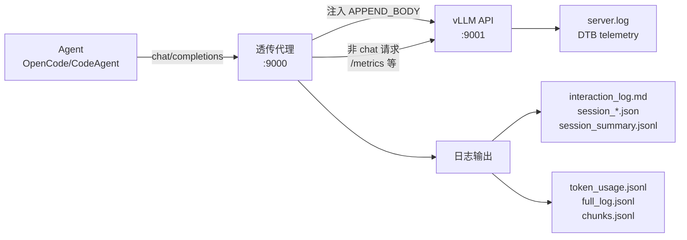
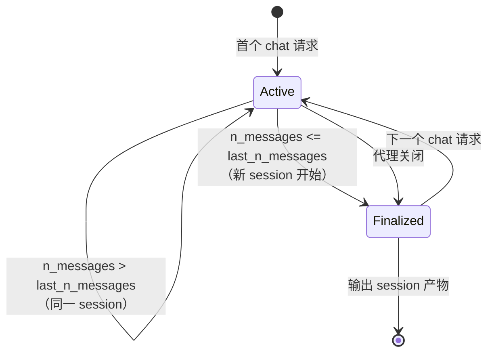
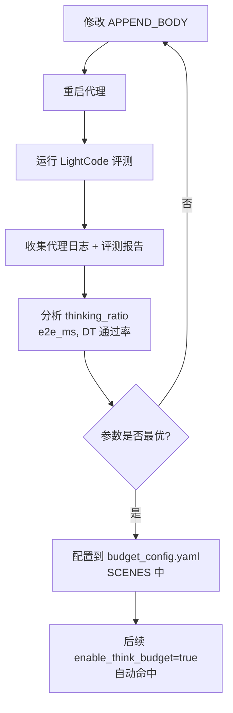

# Agent DTB 透传代理工程指南

## 1. 设计目的

Agent 多轮调用场景（如 LightCode 代码生成评测）中，模型每条任务发起约 60 次 LLM 调用，其中 97% 为工具调用轮次，thinking token 占输出 token 的绝大部分。DTB（Dynamic Think-Budget Control）已通过 vLLM serving patch 集成到推理服务端，但 LightCode 是黑盒环境，无法注入 DTB 参数或观察每轮请求。

本模块的目标是：**在 Agent 和 vLLM 之间部署透传代理，为每轮请求注入 DTB 固定参数，并记录完整的多轮交互数据，使 Agent 场景下的 DTB 参数优化实验成为可能。** 优化实验的最终产出是将推荐参数配置到 `budget_config.yaml` 的 SCENES 中，后续只需 `enable_think_budget=true` 即可自动命中。

设计起点：2026-08-25，基于 `qwen_transparent.py` 已有的透传能力扩展，vLLM `v0.23.0` + DTB serving patch，模型 `qwen3.6-27b`。

## 2. 设计逻辑

### 2.1 核心挑战

Agent 多轮场景下的 DTB 实验面临三个核心问题，每个问题的解决方案决定了代理的关键设计选择：

**挑战一：LightCode 黑盒限制**

LightCode 不暴露每轮请求细节，不支持自定义请求参数。解决方案是在 Agent 和 vLLM 之间插入透传代理，Agent 的 OpenAI 兼容端点指向代理而非直连 vLLM。代理职责明确为透传 + 记录 + 统计，不新增管理 API。

**挑战二：多轮请求的 session 归属**

Agent 的多次 HTTP 请求之间没有显式的 session ID 关联。实测发现时间窗口方法不可靠（session 内最大间隙 122.3s，边界间隙仅 27.1s）。解决方案是利用 `messages` 数组长度的单调递增性：同一 session 内每轮请求的 `len(messages)` 严格递增（Agent 追加历史消息），当新请求的 `len(messages) ≤ 上一个请求` 时标志新 session 开始。

**挑战三：reasoning_tokens 在 API usage 中为 0**

vLLM 不在 `usage.reasoning_tokens` 中返回实际值。解决方案是加载本地 tokenizer 在 session 结束时计算 reasoning 和 content 的 token 数，所有长度单位统一为 tokens 而非字符。

### 2.2 方案架构



代理的请求分类逻辑：

- **Chat 请求**（请求体含 `messages` 字段）：注入 `APPEND_BODY` 中的 DTB 参数、参与 session 跟踪、记录完整日志
- **非 Chat 请求**（`/metrics`、`/v1/models` 等）：纯透传，不注入参数、不触发 session 边界检测、不记录日志

### 2.3 Session 生命周期



Session 完成信号：
- **确定信号**：新 session 开始时，旧 session 隐式关闭
- **辅助信号**：session 最后一个请求的 `has_tool_calls=False`，表示 Agent 不再调用工具
- **兜底信号**：代理关闭时，所有活跃 session 强制关闭

### 2.4 Tool Calls 重建

`qwen_transparent.py` 现有的流式累积方式 `json.dumps(delta["tool_calls"])` 逐块拼接，产生 `[{...}][{...}]` 格式，多个 JSON 数组直接相连无法直接解析。重建算法三步：

1. 在 `][` 边界插入逗号，外包数组，解析为 delta 列表
2. 展平每个 delta（流式 `delta.tool_calls` 本身是数组），按 `index` 分组合并 `arguments`
3. 对每个合并后的 `arguments` 字符串尝试 `json.loads`，失败则保留原始字符串

### 2.5 实验参数配置闭环



代理只使用固定参数模式，实验间手动修改 `APPEND_BODY` 并重启。推理服务无状态，不需要轮次感知逻辑。

## 3. 核心数据结构

### Turn — 每轮交互记录

| 字段 | 类型 | 含义 |
| --- | --- | --- |
| `turn_index` | int | 轮次序号（0-based） |
| `request_id` | str | 请求唯一 ID（自生成 UUID） |
| `post_time` / `receive_time` | str | 请求发出 / 响应完成时间 |
| `e2e_ms` | float | 端到端时延 |
| `n_messages` | int | messages 数组长度 |
| `n_tool_results` | int | messages 中 role=tool 的数量 |
| `input_prompt_tokens` | int | API usage.prompt_tokens |
| `turn_type` | str | initial / tool_result / other |
| `injected_dtb_params` | dict | 实际注入的 DTB 参数 |
| `reasoning_tokens_local` | int | 本地 tokenizer 计算的 reasoning token 数 |
| `content_tokens_local` | int | 本地 tokenizer 计算的 content token 数 |
| `thinking_ratio` | float | reasoning_tokens_local / (reasoning_tokens_local + content_tokens_local) |
| `has_tool_calls` | bool | 响应是否包含 tool_calls |
| `stop_reason` | str | finish_reason |

`thinking_ratio` 基于本地 tokenizer 的 token 比，而非字符比。API 返回的 `reasoning_tokens` 始终为 0，不可使用。

### Session — 任务会话

| 字段 | 类型 | 含义 |
| --- | --- | --- |
| `session_id` | str | 12 位 hex UUID |
| `task_description` | str | 首个用户消息前 200 字符 |
| `dtb_config_name` | str | 当前实验参数组名 |
| `turns` | list[Turn] | 每轮交互记录 |
| `last_n_messages` | int | 上一轮 messages 长度（边界检测用） |

### SessionSummary — 会话汇总

| 字段 | 含义 |
| --- | --- |
| `total_e2e_ms` | 任务端到端时间 |
| `total_prompt_tokens` | 总输入 token |
| `total_completion_tokens` | 总输出 token（API） |
| `total_reasoning_tokens_local` | 总思考 token（本地 tokenizer） |
| `total_content_tokens_local` | 总内容 token（本地 tokenizer） |
| `avg_thinking_ratio` | 平均思考比例 |
| `tool_call_turns` / `tool_result_turns` | 工具调用/返回轮次数 |

## 4. 接口定义

### 4.1 配置接口（启动前修改）

```python
# 实验参数组名（用于日志标识）
DTB_CONFIG_NAME = "vanilla"

# DTB 固定参数注入
APPEND_BODY = {
    "model": "qwen3.6-27b",
    # "enable_think_budget": True,
    # "fixed_budget_tokens": 850,
    # ...
}

# 结果输出目录
RESULTS_DIR = "results/qwen/local-task29/local-apiserver/vanilla/run-01"
```

切换实验组：修改 `DTB_CONFIG_NAME`、`APPEND_BODY`、`RESULTS_DIR`，重启代理。

### 4.2 预设参数组

| 参数组 | budget_tokens | check_length | think_stride | num_thinking | min_think_tokens | prob_th |
| --- | --- | --- | --- | --- | --- | --- |
| vanilla | — | — | — | — | — | — |
| dtb_auto | auto | auto | auto | auto | auto | auto |
| dtb_tight | 850 | 500 | 250 | 2 | 500 | 0.93 |
| dtb_moderate | 1100 | 450 | 200 | 4 | 450 | 0.93 |
| dtb_loose | 1650 | 1000 | 250 | 3 | 1000 | 0.93 |
| dtb_planning | 3050 | 950 | 450 | 5 | 950 | 0.95 |

### 4.3 输出文件

| 文件 | 格式 | 内容 | 来源 |
| --- | --- | --- | --- |
| `interaction_log.md` | Markdown | 人类可读的逐轮 reasoning/content/tool_calls，长度单位为 tokens | session 结束时追加 |
| `session_<id>.json` | JSON | 结构化 session 数据（不含原始拼接字符串） | session 结束时写入 |
| `session_summary.jsonl` | JSONL | 逐 session 汇总，含 total_reasoning_tokens_local | session 结束时追加 |
| `token_usage.jsonl` | JSONL | 逐请求 token 统计（沿用 `qwen_transparent.py` 格式） | 每轮请求完成 |
| `full_log.jsonl` | JSONL | 请求/响应明细，含 `request_id` 字段 | 每轮请求完成 |
| `chunks.jsonl` | JSONL | 流式 chunk（可通过 `ENABLE_CHUNKS_LOG` 关闭） | 每个流式 chunk |

### 4.4 interaction_log.md 格式

```markdown
# Session <session_id>
- DTB Config: <dtb_config_name>
- Duration: 15m 32s
- Turns: 64
- Task: <task_description 前 200 字符>

---

## Turn 0 | 15:20:17 | e2e=5.1s | type=initial | prompt=46820 tokens

### Tool Results (input)   ← 仅 tool_result 类型显示
- `call_xxx`: <工具返回内容前 300 字符>

### Reasoning (119 tokens)
<完整 reasoning 文本>

### Content (0 tokens)
(empty)

### Tool Calls
1. **skill**({"name": "code-production-evaluation"})

---
```

格式规则：
- Reasoning / Content 的长度单位为 tokens，由本地 tokenizer 计算
- Tool Calls 由 `reconstruct_tool_calls()` 从流式 delta 拼接重建
- Tool Results 输入从 `messages` 中 `role=tool` 的内容提取
- 无 tool_calls 时不输出该节；内容为空时输出 `(empty)`

## 5. 一致性校验

### 5.1 概念一致性

| 术语 | 定义 | 注意 |
| --- | --- | --- |
| Session | 同一任务的多轮对话序列，由 n_messages 单调性划分 | 不等于 LightCode task，一个 task 可能产生多个 session |
| Turn | 单次 chat/completions 请求-响应对 | 非 chat 请求不产生 Turn |
| thinking_ratio | 本地 tokenizer 计算的 reasoning_tokens / (reasoning_tokens + content_tokens) | 不使用 API 返回的 reasoning_tokens（始终为 0） |
| APPEND_BODY | 启动时配置的固定参数字典，合并到每个 chat 请求体 | 非 chat 请求不注入 |

### 5.2 状态完备性

- Session 边界检测：`n_messages <= last_n_messages` 是确定性信号，无需阈值调优
- 代理关闭时 `finalize_all()` 强制关闭所有活跃 session
- Agent 重启对话场景：代理按独立 session 记录，分析阶段由 `analyze_sessions.py` 合并

### 5.3 接口完备性

| 设计逻辑操作 | 对应接口/机制 |
| --- | --- |
| 注入 DTB 参数 | `APPEND_BODY` 静态配置 |
| 识别 session 边界 | `SessionManager.process_request()` 的 n_messages 单调性检测 |
| 重建 tool_calls | `reconstruct_tool_calls()` 函数 |
| 计算 thinking token | `count_tokens()` + 本地 tokenizer |
| 输出人类可读记录 | `write_interaction_log()` → `interaction_log.md` |
| 输出结构化数据 | `session_<id>.json` + `session_summary.jsonl` |
| 跳过非 chat 请求 | `is_chat_request` 判断 + 纯透传路径 |

### 5.4 已知限制

- **reasoning_tokens 依赖本地 tokenizer**：vLLM 不在 usage 中返回，若 tokenizer 路径不正确则 token 计数为 0
- **Session 不等于逻辑任务**：Agent 中途重启对话会产生多个 session，需分析阶段合并
- **interaction_log.md 追加模式**：多次运行同一 RESULTS_DIR 会累积，需手动清理
- **非 chat 请求无日志**：`/metrics`、`/v1/models` 等请求纯透传，不记录到任何日志文件
- **Tool Results 输入截断**：messages 中 `role=tool` 的内容仅记录前 500 字符，避免日志过大
- **流式超时后数据不完整**：流式 read timeout 设为 `None`（无限），理论上不应触发超时。但若底层连接异常中断，已累积的 reasoning/content 会保存，`stop_reason` 标记为 `error:ReadTimeout`，usage 可能缺失。初始实现使用 600s 阈值，实测 vLLM 推理单轮可超 600s（长 thinking 场景），`httpx.ReadTimeout` 导致 ASGI 崩溃且丢失已累积数据，故改为无限超时 + 异常捕获保留已累积内容

## 6. 变更历史

| 日期 | 变更内容 | 原因 |
| --- | --- | --- |
| 2026-08-25 | 初始设计文档 `agent_multiturn_dtb_experiment_plan.md` | 定义 Agent 多轮场景 DTB 实验方案 |
| 2026-08-25 | 删除轮次感知模式和管理 API | 推理服务无状态，代理职责明确为透传+记录+统计 |
| 2026-08-25 | Session 识别从 5 分钟空闲改为 n_messages 单调性 | 实测时间窗口不可靠（session 内最大间隙 122.3s vs 边界间隙 27.1s） |
| 2026-08-25 | 新增 interaction_log.md 人类可读交互记录 | 便于人工审阅每轮 reasoning/content/tool_calls |
| 2026-08-26 | 实现 `agent_dtb_proxy.py`，通过实测数据回放验证 | 验证 session 跟踪、tool_calls 重建、interaction_log 输出 |
| 2026-08-26 | 非 chat 请求不触发 session 跟踪 | LightCode 轮询 `/metrics` 导致虚假 session 边界 |
| 2026-08-26 | 长度单位从字符改为 tokens，加载本地 tokenizer 计算 | API reasoning_tokens 始终为 0，需本地 tokenizer 补位 |
| 2026-08-26 | 流式 read timeout 从 600s 改为无限（`None`），异常时保存已累积数据 | 实测 vLLM 推理单轮可超 600s，`httpx.ReadTimeout` 导致 ASGI 崩溃且丢失已累积数据 |
