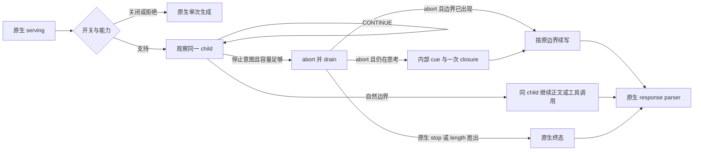
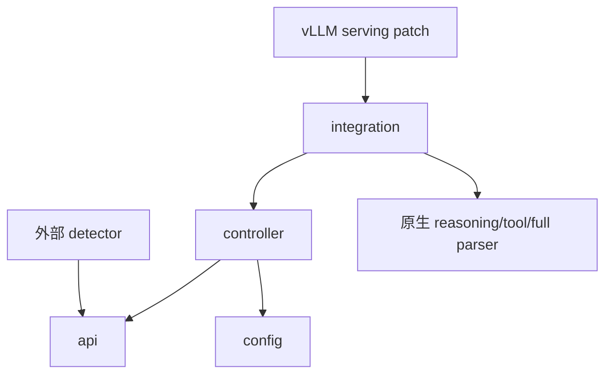

# 思维链观察与引导续写 SDK 设计

## 1. 设计目的

基于 2026-09-22、TB `f342e127`，将经过 DTB 实践的观察、边界、abort/drain 与直接 final 生命周期提取为可独立安装的 SDK。使用者能实现自己的观察算法，并在发现停止条件时安全介入生成；不需要理解或安装原预算、probe、置信度、scene/history 模块。

本次用户确认编辑范围为 Session D 的停止与引导续写。没有研发重复检测算法；示例只演示 factory/state 接口，token 阈值不是效果策略。提取时保留的历史 DTB 目录已在 2026-10-21 退出当前树；原设计和材料由固定 Git 历史保留，见 [来源索引](history.md)。SDK 不依赖它们。

## 2. 设计逻辑

三个主要取舍：

1. **位置和文本分开。** token ID 前缀是续写权威。detokenizer 文本可能迟到或一段对应多个 token，不能用字符位置裁 token。保留完整已接受 batch 和 drain 尾部；较早的 repeat_start 仅诊断。这样 parser 和引擎上下文具有相同的公开前缀。
2. **接管由 controller 管理。** 使用 Detector 回调协议时，回调只返回意图，不持有 engine/parser；压缩算法也可直接修改 observer 的 controller 实现，并保留下面的生命周期语义。自然边界和终止优先；先 abort 并 drain 到确认终态，才允许新的 final child。无法保留上下文或 completion 额度时，abort 前回退原生；abort 后则报错，不能静默丢掉最终答案。
3. **薄封装原生响应。** 核心 yield vLLM-compatible DELTA 对象，不复制整个 DTB facade。流式进入原生 SSE/parser，非流式累积一次再进入原生 full parser。没有额外 producer task/无界 SDK queue；下游消费形成背压。detector 同步增量运行，不支持异步网络检查。

## 3. 模块与提取边界

| 基线能力来源 | SDK 所属 | 保留和改变 |
| --- | --- | --- |
| `dtb/reasoning/deferred_observation.py` | `controller.py` | DELTA 校验、owned abort、drain、自然终态优先；移除阈值路由/activate_budget/probe 转移 |
| `dtb/reasoning/parser_boundary.py` | `api.BoundaryProtocol`、`integration.bind_qwen3` | 从活动 tokenizer/parser 绑定两个边界；保留 text/ID，closure 一次；无 DTB config 类型 |
| `request_context.py` / `request_state.py` | `api.ObserverContext`、请求局部变量 | 只读身份、tokenizer、额度、前缀、终态；无 BudgetDecision/TrialObservation |
| `generation_states.py` final 能力 | `controller.py` | 原 prompt + 已接受前缀 + cue + close token；context/completion 取最小剩余额度；无三状态算法 |
| `request_controller.py` 生命周期 | `controller.py`、`integration.close_with_response` | 显式关闭 source、abort 活跃 child、错误传播；用 async generator 消费替代 producer/queue |
| `integration/vllm/response_adapter.py` | `integration.py`、独立 serving patch | 原生流式/完整 parser；非流式 O(N) 累积，不伪造缺失终态 |
| `observability/*` | `api.Outcome` / summary 事件 | 请求与 child token/wall 诊断；新命名 schema 1，不混入 DTB 事件 |
| `config/*` | `config.ObserverConfig`、服务器环境变量 | 两级开关、工厂、cue、回调成本、abort 超时、telemetry；不读取 YAML |
| budget/history/confidence/token_filter | 无 | 不引入安装或传递依赖 |
| 原生 parser 修复 | 同目录两份 Qwen patch | 基线补丁逐字节复用；SDK 无新 parser 算法 |

框架运行时依赖方向仅为 SDK→标准库，以及 `integration.generate` 局部导入原生 `RequestOutputKind`。没有 SDK→DTB、deer、torch、YAML。

## 4. 核心数据与接口

- `ObserverContext`：冻结的请求身份、协议、completion/context 限制、初始 prompt 长度；服务共享 tokenizer 只能只读使用。
- `ReasoningDelta`：当前新增 token tuple、文本片段、token 起止、框架已接受位置、边界/终态标志。没有累计全文或 prompt 拷贝。
- `Detector.start(context) → DetectorState`：创建请求状态；`observe(delta) → CONTINUE | StopAndAnswer`；`close(outcome)` 清理。
- `StopAndAnswer`：原因、检测点、可选重复起点、可选 cue。框架校验返回值、位置、结构 token 和 cue 大小。
- `Outcome` / `ChildRecord`：结果、实接管点、超出 token、callback/abort/handoff 时间、child prompt/generated token/wall。单位和错误见 [API](api.md)。

框架对接点是 `ThinkingObserver.stream(engine, prompt, params, context, engine_kwargs)`。直接集成者负责能力检查、内部 DELTA 和 async-generator close；vLLM 使用 `VllmObserver.prepare/generate` 自动完成这些步骤。

## 5. 一致性与验收

未触发必须一个原生 child、一个公开终态；接管最多两个 child、一个公开终态、至多一个合成 closure。未进入 reasoning 的正文/工具调用不再送入 detector。请求关闭、取消、异常都关闭 detector 状态一次；start 未返回有效状态则无法调用该状态的 close。

外部已接受 token 数、含 cue 的上下文 token 数分开。公开 usage 不代表总工作量；cue 占 prefill，第二个 child 的重复 prefill/排队由服务器评估。首版不承诺精确回退到检测点，不承诺异步检测或 callback 的硬实时抢占。

本地测试覆盖协议分支、边界分块、原生 parser 与 patched serving 源码路径；真实 tokenizer、EngineCore、SSE、Ascend 性能不能由此推出，服务器门禁保持 pending_remote。

## 6. 变更历史

| 日期 | 变更 | 原因 |
| --- | --- | --- |
| 2026-09-22 | Session D 独立 SDK、接管接口、Qwen/vLLM 补丁及验证手册 | 用户要求可二次开发的观察与编辑能力，明确不实现重复检测算法 |
